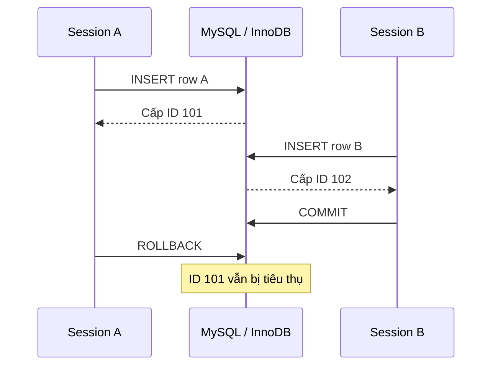

# AUTO_INCREMENT, cách cấp giá trị và khoảng trống sau rollback

AUTO_INCREMENT giúp MySQL tự cấp giá trị số cho một cột khi thêm hàng mới. Cơ chế này thường được dùng để tạo khóa chính kỹ thuật, giúp mỗi bản ghi có một định danh duy nhất mà ứng dụng không phải tự tính toán. Tuy nhiên, AUTO_INCREMENT không phải bộ đếm giao dịch liên tục: giá trị đã cấp có thể bị bỏ trống khi transaction rollback, câu lệnh thất bại, hàng bị xóa hoặc nhiều client ghi đồng thời.

Trong module **DATABASE_MYSQL**, hiểu cách cấp giá trị giúp thiết kế khóa chính, foreign key, transaction và xử lý đồng thời đúng cách. Bài học này tập trung vào cách khai báo, cách MySQL cấp số, nguyên nhân xuất hiện khoảng trống, cách lấy ID trong ứng dụng Java và cách thiết kế số chứng từ liên tục nếu nghiệp vụ thực sự yêu cầu.

## 1. AUTO_INCREMENT dùng để làm gì?

AUTO_INCREMENT là thuộc tính của cột số nguyên. Khi INSERT không cung cấp giá trị cho cột này, MySQL tự tạo giá trị tiếp theo theo bộ đếm của bảng.

Ví dụ:

```sql
CREATE TABLE customers (
    customer_id BIGINT UNSIGNED NOT NULL AUTO_INCREMENT,
    full_name VARCHAR(150) NOT NULL,
    email VARCHAR(255) NOT NULL,
    PRIMARY KEY (customer_id),
    UNIQUE KEY uk_customers_email (email)
) ENGINE = InnoDB;
```

Thêm hàng mà không chỉ định customer_id:

```sql
INSERT INTO customers (full_name, email)
VALUES ('Nguyen An', 'an@example.com');
```

MySQL tự cấp customer_id. Ứng dụng dùng giá trị đó để tham chiếu bản ghi trong các thao tác tiếp theo.

Một bảng chỉ có thể có một cột AUTO_INCREMENT. Cột này phải có index; thông thường nó là PRIMARY KEY. Dùng BIGINT UNSIGNED khi bảng có thể tăng rất lớn và không cần giá trị âm. Kiểu dữ liệu phải được chọn theo vòng đời và quy mô dự kiến, vì khi chạm giới hạn kiểu số, thao tác cấp ID mới sẽ thất bại.

AUTO_INCREMENT phù hợp nhất cho **surrogate key** (khóa thay thế kỹ thuật). Không nên dùng nó để mã hóa số hóa đơn, số hợp đồng hoặc số thứ tự nghiệp vụ nếu các số đó phải liên tục, có quy tắc năm/tổ chức hoặc cần kiểm soát hủy bỏ.

## 2. Khi nào MySQL sinh giá trị mới?

Với cột AUTO_INCREMENT, các trường hợp thường gặp:

| Giá trị trong INSERT | Hành vi thông thường |
|---|---|
| Bỏ cột khỏi danh sách INSERT | MySQL sinh giá trị mới |
| Gán NULL | MySQL sinh giá trị mới |
| Gán 0 | Thông thường sinh giá trị mới |
| Gán 0 khi bật NO_AUTO_VALUE_ON_ZERO | Lưu số 0 thay vì yêu cầu cấp giá trị mới |
| Gán một số dương tường minh | Dùng giá trị được cung cấp nếu hợp lệ; giá trị cao hơn có thể đẩy bộ đếm lên |
| Gán giá trị âm | Không nên dùng; hành vi và tính hợp lệ phụ thuộc kiểu, kiểm tra dữ liệu và cấu hình |

Ví dụ:

```sql
INSERT INTO customers (full_name, email)
VALUES ('Binh Tran', 'binh@example.com');

INSERT INTO customers (customer_id, full_name, email)
VALUES (NULL, 'Chi Le', 'chi@example.com');

INSERT INTO customers (customer_id, full_name, email)
VALUES (0, 'Dung Pham', 'dung@example.com');
```

Cả ba lệnh đều yêu cầu MySQL sinh ID trong cấu hình thông thường. Nếu session có NO_AUTO_VALUE_ON_ZERO, giá trị 0 được xem là giá trị tường minh; nó thường sẽ va chạm với khóa chính hoặc bị từ chối theo ràng buộc.

Kiểm tra mode:

```sql
SELECT @@SESSION.sql_mode;
```

Không nên dùng ID 0 như một mã đặc biệt cho bản ghi "không xác định". Điều này làm phức tạp foreign key, logic ứng dụng và quy tắc cấp số.

## 3. Bộ đếm được cấp ở thời điểm nào?

MySQL cấp giá trị trong quá trình thực thi câu lệnh ghi, không đợi transaction commit. Khi InnoDB cấp một giá trị cho một hàng, giá trị đó được dành cho thao tác chèn. Nếu transaction sau đó rollback, InnoDB không trả lại số đã cấp cho bộ đếm để dùng lại.

Ví dụ trong một session:

```sql
START TRANSACTION;

INSERT INTO customers (full_name, email)
VALUES ('Rollback User', 'rollback@example.com');

SELECT LAST_INSERT_ID() AS allocated_id;

ROLLBACK;

INSERT INTO customers (full_name, email)
VALUES ('Next User', 'next@example.com');

SELECT LAST_INSERT_ID() AS next_allocated_id;
```

ID đầu tiên đã được cấp trong transaction bị rollback. Lần insert tiếp theo có thể nhận ID lớn hơn, để lại một khoảng trống. Đây là hành vi bình thường và không có nghĩa dữ liệu bị mất hoặc InnoDB gặp lỗi.

Điều quan trọng là phân biệt:

- **Cấp ID:** MySQL dành một giá trị trong quá trình thực thi INSERT.
- **Commit:** transaction xác nhận thay đổi dữ liệu.
- **Rollback:** hoàn tác thay đổi transactional, nhưng không thu hồi ID đã cấp.

Thiết kế này giúp nhiều client có thể cấp ID mà không phải giữ một bộ đếm giao dịch khóa lâu đến khi transaction kết thúc.

## 4. Vì sao AUTO_INCREMENT có khoảng trống?

Khoảng trống (gap) là đặc tính bình thường của AUTO_INCREMENT. Một số nguyên nhân phổ biến:

| Nguyên nhân | Ví dụ | Vì sao có gap |
|---|---|---|
| Rollback | Insert trong transaction rồi ROLLBACK | Giá trị đã cấp không được thu hồi |
| INSERT thất bại | Vi phạm unique key hoặc lỗi dữ liệu sau khi cấp ID | Giá trị dành cho thao tác thất bại có thể bị bỏ |
| INSERT IGNORE | Hàng bị bỏ qua do duplicate | Bộ đếm có thể đã tiến lên trong quá trình xử lý |
| ON DUPLICATE KEY UPDATE | Insert chuyển thành update hàng đã có | Giá trị auto-increment có thể được tiêu thụ dù không tạo hàng mới |
| DELETE | Xóa một hàng có ID ở giữa hoặc cuối | MySQL không tự đánh số lại các hàng còn lại |
| Insert ID tường minh | Chèn một ID lớn hơn bộ đếm hiện tại | Bộ đếm tiếp theo được điều chỉnh lên |
| Bulk insert và concurrency | INSERT ... SELECT hoặc LOAD DATA đồng thời | Engine có thể cấp trước hoặc xen kẽ các khoảng giá trị |
| Cấu hình bước tăng | auto_increment_increment lớn hơn 1 | Các ID được cấp cách nhau theo bước cấu hình |

Ví dụ, sau khi có ID 1, 2, 3, xóa hàng 2 không làm MySQL đổi ID 3 thành 2. Việc đổi lại ID có thể phá vỡ foreign key, cache, log và tham chiếu đã được lưu ở hệ thống khác.

**Không dùng COUNT(*) để dự đoán ID tiếp theo.** Số lượng hàng không bằng giá trị lớn nhất của khóa và cũng không phản ánh bộ đếm nội bộ.

## 5. Thí nghiệm quan sát khoảng trống sau rollback

Tạo bảng riêng trong môi trường lab:

```sql
CREATE TABLE auto_inc_lab (
    id BIGINT UNSIGNED NOT NULL AUTO_INCREMENT,
    note VARCHAR(100) NOT NULL,
    PRIMARY KEY (id)
) ENGINE = InnoDB;
```

Thêm một hàng ban đầu:

```sql
INSERT INTO auto_inc_lab (note) VALUES ('committed row');

SELECT LAST_INSERT_ID() AS first_id;
```

Tiếp theo, cấp một ID trong transaction rồi rollback:

```sql
START TRANSACTION;

INSERT INTO auto_inc_lab (note)
VALUES ('will be rolled back');

SELECT LAST_INSERT_ID() AS rolled_back_id;

ROLLBACK;
```

Thêm hàng mới và xem ID:

```sql
INSERT INTO auto_inc_lab (note)
VALUES ('after rollback');

SELECT LAST_INSERT_ID() AS next_id;

SELECT id, note
FROM auto_inc_lab
ORDER BY id;
```

Bạn sẽ thấy ID được cấp cho hàng rollback không xuất hiện trong bảng, còn hàng mới có ID lớn hơn. Khoảng trống này không thể được xem là một bản ghi bị mất; nó là kết quả của chính sách cấp ID.

Có thể kiểm tra giá trị AUTO_INCREMENT kế tiếp được server báo trong metadata:

```sql
SELECT
    TABLE_NAME,
    AUTO_INCREMENT
FROM INFORMATION_SCHEMA.TABLES
WHERE TABLE_SCHEMA = DATABASE()
  AND TABLE_NAME = 'auto_inc_lab';
```

AUTO_INCREMENT trong metadata là giá trị kế tiếp mà server báo tại thời điểm truy vấn; nó có thể thay đổi khi có insert đồng thời hoặc khi bộ đếm được điều chỉnh. Không dùng truy vấn metadata này để cấp ID cho ứng dụng.

## 6. Cấp ID trong môi trường nhiều client

Nhiều kết nối có thể cùng insert vào một bảng. InnoDB phải phối hợp việc cấp giá trị để tránh hai hàng nhận cùng một ID.

Hãy hình dung hai session:



Trong ví dụ, session B có thể commit trước session A. ID 102 tồn tại dù ID 101 không có hàng đã commit. Vì thế, ID tăng dần không bảo đảm thứ tự commit hoặc thứ tự nghiệp vụ.

### 6.1. innodb_autoinc_lock_mode

InnoDB có biến innodb_autoinc_lock_mode để điều khiển cách khóa khi cấp auto-increment:

| Mode | Tên | Đặc điểm |
|---:|---|---|
| 0 | Traditional | Dùng AUTO-INC table lock cho các câu lệnh insert; bảo đảm các giá trị của từng statement được cấp liên tiếp |
| 1 | Consecutive | Simple insert dùng cơ chế khóa nhẹ hơn; bulk insert dùng AUTO-INC lock để cấp dãy liên tục trong statement |
| 2 | Interleaved | Không giữ AUTO-INC table lock ở cấp statement; các statement đồng thời có thể xen kẽ việc cấp ID |

Simple insert là dạng câu lệnh biết trước số hàng cần chèn, ví dụ INSERT ... VALUES. Bulk insert là dạng số hàng cần chèn không được biết trước hoàn toàn, ví dụ INSERT ... SELECT hoặc LOAD DATA.

Trong MySQL 8.0, mode mặc định là 2 (interleaved); các phiên bản cũ có thể dùng mặc định khác. Hãy kiểm tra biến trên đúng server:

```sql
SELECT
    @@GLOBAL.innodb_autoinc_lock_mode
        AS innodb_autoinc_lock_mode;
```

Mode 2 cho phép concurrency cao hơn nhưng không bảo đảm một dãy liên tiếp riêng cho mỗi bulk statement khi nhiều statement chạy đồng thời. Khi dùng statement-based replication, việc cấp xen kẽ có thể làm kết quả không xác định an toàn; MySQL khuyến nghị row-based replication cho mode này. MySQL 8.0 mặc định row-based binary logging.

Không đổi lock mode chỉ để cố tạo ID liên tục. Lựa chọn này là quyết định concurrency và replication, không phải công cụ cấp số hóa đơn.

## 7. Các biến bước tăng và điểm bắt đầu

Hai biến có thể ảnh hưởng dãy ID:

- auto_increment_increment: khoảng cách giữa các giá trị tự sinh.
- auto_increment_offset: điểm lệch bắt đầu trong dãy.

Chúng thường được dùng trong một số cấu hình multi-source hoặc multi-primary replication để giảm nguy cơ xung đột ID giữa các node.

Kiểm tra:

```sql
SELECT
    @@GLOBAL.auto_increment_increment AS global_increment,
    @@GLOBAL.auto_increment_offset AS global_offset,
    @@SESSION.auto_increment_increment AS session_increment,
    @@SESSION.auto_increment_offset AS session_offset;
```

Nếu auto_increment_increment lớn hơn 1, các ID có thể là 1, 3, 5... hoặc một dãy lệch khác tùy offset. Do đó, không giả định ID tiếp theo luôn bằng ID hiện tại cộng 1.

## 8. Lấy ID vừa sinh trong ứng dụng

### 8.1. LAST_INSERT_ID()

LAST_INSERT_ID() trả về giá trị auto-increment đầu tiên được tạo bởi câu lệnh INSERT gần nhất trên **chính connection hiện tại**. Giá trị này không bị ảnh hưởng bởi insert của connection khác.

Ví dụ:

```sql
INSERT INTO auto_inc_lab (note)
VALUES ('created by current session');

SELECT LAST_INSERT_ID();
```

Với câu insert nhiều hàng, LAST_INSERT_ID() trả về ID đầu tiên được tạo cho statement, không phải ID cuối cùng của cả dãy. Không suy ra tất cả ID bằng cách lấy ID đầu tiên cộng số hàng nếu chưa xét bước tăng và cách cấp trong môi trường concurrency.

### 8.2. Java JDBC Generated Keys

Trong Java, dùng JDBC generated keys để lấy ID mà không cần chạy SELECT MAX(id):

```java
public long createCustomer(Connection connection) throws SQLException {
    String sql = "INSERT INTO customers (full_name, email) VALUES (?, ?)";

    try (PreparedStatement ps = connection.prepareStatement(
            sql, Statement.RETURN_GENERATED_KEYS)) {
        ps.setString(1, "Nguyen An");
        ps.setString(2, "an@example.com");

        int affectedRows = ps.executeUpdate();
        if (affectedRows != 1) {
            throw new SQLException("Unexpected affected row count: " + affectedRows);
        }

        try (ResultSet keys = ps.getGeneratedKeys()) {
            if (!keys.next()) {
                throw new SQLException("MySQL did not return a generated key");
            }
            return keys.getLong(1);
        }
    }
}
```

Đoạn code giả định các kiểu JDBC (`Connection`, `PreparedStatement`, `Statement`, `ResultSet`, `SQLException`) đã được import từ `java.sql`.

Dùng chính Connection thực hiện INSERT để đọc generated key. Không mở connection khác rồi gọi LAST_INSERT_ID(), vì mỗi connection có trạng thái riêng.

Không dùng cách sau:

```sql
SELECT MAX(customer_id) FROM customers;
```

Giữa INSERT và SELECT, một client khác có thể thêm hàng mới. MAX(id) có thể trả ID của client khác và gây liên kết nhầm bản ghi. LAST_INSERT_ID() hoặc JDBC generated keys giải quyết đúng vấn đề này.

## 9. Chỉ định hoặc điều chỉnh AUTO_INCREMENT

Có thể xem giá trị kế tiếp bằng:

```sql
SHOW TABLE STATUS LIKE 'customers';
```

Hoặc xem trong INFORMATION_SCHEMA.TABLES như ví dụ ở phần trước.

Khi cần đặt điểm bắt đầu cho một bảng, có thể dùng:

```sql
ALTER TABLE customers AUTO_INCREMENT = 10000;
```

Nếu giá trị yêu cầu nhỏ hơn hoặc bằng giá trị lớn nhất đang có trong cột, MySQL không đặt bộ đếm xuống dưới giá trị cần thiết để tránh xung đột khóa. Giá trị kế tiếp thực tế còn phụ thuộc dữ liệu hiện có và trạng thái bộ đếm.

Một số lưu ý:

- Insert một ID tường minh lớn hơn giá trị hiện tại có thể đẩy bộ đếm lên.
- Xóa hàng có ID lớn nhất không làm bộ đếm tự lùi lại.
- InnoDB từ MySQL 8.0 lưu bộ đếm AUTO_INCREMENT bền vững. Ở các phiên bản cũ hơn, bộ đếm InnoDB có thể được khởi tạo lại từ giá trị lớn nhất còn trong bảng sau khi server khởi động; vì vậy không dựa vào hành vi giữ nguyên mọi khoảng trống ở cuối dãy giữa các phiên bản.
- DELETE FROM table không đặt lại bộ đếm về 1.
- TRUNCATE TABLE xóa toàn bộ hàng và đặt lại bộ đếm, nhưng đây là DDL có implicit commit và không thể rollback như DELETE.
- Không dùng ALTER TABLE ... AUTO_INCREMENT = 1 như cách tái đánh số dữ liệu đang được hệ thống tham chiếu.

Tái sử dụng ID đã cấp có thể khiến log, cache, URL, event hoặc hệ thống tích hợp hiểu một ID mới là bản ghi cũ. ID kỹ thuật nên ổn định trong suốt vòng đời bản ghi.

## 10. AUTO_INCREMENT không phải số thứ tự liên tục

Một khóa chính tự tăng chỉ cần đáp ứng yêu cầu định danh duy nhất. Nó không bảo đảm:

- Không có khoảng trống.
- Tăng đúng một đơn vị.
- Thứ tự commit giống thứ tự ID.
- ID phản ánh thời điểm tạo chính xác.
- ID cho biết tổng số bản ghi.
- ID có thể tái sử dụng sau khi transaction rollback.

Ví dụ, hai đơn hàng có ID 100 và 105 không có nghĩa đơn hàng 101–104 đã bị xóa. Những số đó có thể từng được cấp cho insert thất bại, transaction rollback hoặc thao tác khác.

Nếu cần sắp xếp theo thời gian tạo, dùng cột thời gian phù hợp như created_at và một tiêu chí phụ ổn định. Không dùng ID làm đồng hồ nghiệp vụ.

## 11. Nếu nghiệp vụ yêu cầu số chứng từ liên tục

Một số nghiệp vụ như hóa đơn, biên nhận hoặc chứng từ pháp lý có thể yêu cầu số hiển thị theo quy tắc riêng. Trước tiên cần làm rõ "liên tục" nghĩa là gì: liên tục trong một năm tài chính, theo chi nhánh, theo loại chứng từ hay chỉ không trùng lặp? Quy định kế toán/pháp lý có thể yêu cầu lưu cả số đã hủy thay vì tái sử dụng.

Không dùng AUTO_INCREMENT làm bộ đánh số này. Hãy tách:

- id: khóa chính kỹ thuật, có thể dùng AUTO_INCREMENT.
- invoice_number: số chứng từ theo quy tắc nghiệp vụ, được cấp bằng một cơ chế riêng.
- status: trạng thái phát hành, hủy hoặc điều chỉnh.
- issued_at: thời điểm phát hành.

### 11.1. Bộ đếm nghiệp vụ dùng transaction

Có thể dùng một hàng bộ đếm cho mỗi loại chứng từ hoặc mỗi phạm vi đánh số:

```sql
CREATE TABLE document_counters (
    document_type VARCHAR(30) NOT NULL,
    next_number BIGINT UNSIGNED NOT NULL,
    PRIMARY KEY (document_type)
) ENGINE = InnoDB;

INSERT INTO document_counters (document_type, next_number)
VALUES ('INVOICE', 1001);
```

Trong một transaction, ứng dụng khóa hàng bộ đếm, đọc số hiện tại, tăng bộ đếm và tạo chứng từ trước khi commit:

```sql
START TRANSACTION;

SELECT next_number
FROM document_counters
WHERE document_type = 'INVOICE'
FOR UPDATE;

-- Ứng dụng đọc next_number thành invoice_number.

UPDATE document_counters
SET next_number = next_number + 1
WHERE document_type = 'INVOICE';

INSERT INTO invoices (invoice_number, customer_id, total_amount)
VALUES (?, ?, ?);

COMMIT;
```

Các thao tác đọc bộ đếm, tăng số và chèn chứng từ phải nằm trong cùng transaction InnoDB. SELECT ... FOR UPDATE khóa hàng bộ đếm, khiến transaction khác cùng loại phải chờ. Nếu transaction rollback trước khi phát hành, thay đổi bộ đếm cũng rollback và số có thể được dùng lại.

Cách này tuần tự hóa việc cấp số trong phạm vi một hàng bộ đếm, nên có thể trở thành điểm nghẽn khi throughput cao. Có thể chia bộ đếm theo năm, chi nhánh hoặc loại chứng từ nếu nghiệp vụ cho phép. Với yêu cầu pháp lý, cần lưu vết chứng từ đã phát hành và hủy; không xóa hoặc tái sử dụng số đã phát hành trái quy định.

Đây là ví dụ kiến trúc, cần bổ sung xử lý lỗi, retry khi deadlock, unique constraint trên số chứng từ và quy tắc phát hành thực tế.

## 12. Thực hành tổng hợp

Thực hiện trong database lab:

1. Tạo bảng InnoDB có khóa chính BIGINT UNSIGNED AUTO_INCREMENT.
2. Chèn một hàng bình thường và lấy ID bằng LAST_INSERT_ID().
3. Mở transaction, chèn hàng thứ hai, ghi lại ID rồi rollback.
4. Chèn hàng thứ ba và quan sát khoảng trống.
5. Chạy SELECT id, note ... ORDER BY id để xác nhận chỉ hàng đã commit tồn tại.
6. Chạy SHOW TABLE STATUS hoặc truy vấn INFORMATION_SCHEMA.TABLES để quan sát bộ đếm.
7. Chèn một ID tường minh lớn hơn bộ đếm trong bảng thử nghiệm và xem giá trị kế tiếp thay đổi ra sao.
8. Trong Java, lấy generated key bằng Statement.RETURN_GENERATED_KEYS.
9. Thử hai session insert đồng thời và quan sát rằng ID không phản ánh thứ tự commit.
10. Giải thích vì sao không thể dùng MAX(id) + 1, COUNT(*) hoặc AUTO_INCREMENT cho số hóa đơn liên tục.

Kết thúc bài thực hành, hãy kiểm tra lại khóa chính, foreign key tham chiếu và dữ liệu đã commit. Không chạy TRUNCATE trên bảng có dữ liệu cần giữ chỉ để làm dãy ID đẹp hơn.

## 13. Những sai lầm thường gặp

| Sai lầm | Hệ quả | Cách xử lý |
|---|---|---|
| Mong ID không có gap sau rollback | Hiểu nhầm hành vi bình thường của InnoDB | Chấp nhận gap với khóa kỹ thuật |
| Dùng MAX(id) + 1 | Race condition khi nhiều client insert | Dùng AUTO_INCREMENT và generated keys |
| Dùng ID làm số hóa đơn | Gap, thứ tự commit và quy tắc pháp lý không được bảo đảm | Dùng bộ đếm nghiệp vụ transactional riêng |
| Dùng COUNT(*) để tính ID tiếp theo | Sai khi có delete, rollback hoặc ID tường minh | Không suy ra bộ đếm từ số hàng |
| Nghĩ ID lớn hơn luôn commit sau | Transaction có thể commit theo thứ tự khác | Dùng timestamp hoặc dữ liệu nghiệp vụ để xác định thời gian |
| Xóa hàng cuối để reset ID | Bộ đếm không tự lùi lại | Quản lý ID như định danh bền vững |
| Dùng SELECT LAST_INSERT_ID() trên connection khác | Nhận trạng thái connection không liên quan | Dùng cùng connection hoặc JDBC generated keys |
| Dùng TRUNCATE để xóa rồi rollback | TRUNCATE là DDL có implicit commit | Chỉ dùng khi chủ đích xóa toàn bộ và chấp nhận không rollback |

## 14. Ghi nhớ

- AUTO_INCREMENT tự sinh giá trị số khi cột bị bỏ qua, nhận NULL hoặc nhận 0 trong cấu hình thông thường.
- Cột AUTO_INCREMENT phải có index; thường dùng làm primary key kỹ thuật.
- InnoDB cấp ID trong lúc thực thi INSERT; rollback không thu hồi ID đã cấp.
- Gap có thể xuất hiện do rollback, lỗi insert, IGNORE, upsert, delete, insert ID tường minh, concurrency hoặc bước tăng cấu hình.
- ID không phản ánh thứ tự commit, không phải bộ đếm số hàng và không bảo đảm liên tục.
- innodb_autoinc_lock_mode điều khiển cách phối hợp cấp ID giữa các statement đồng thời; mode 2 cho phép xen kẽ và phù hợp với row-based replication.
- Dùng LAST_INSERT_ID() hoặc JDBC generated keys trên chính connection thực hiện INSERT; không dùng MAX(id) + 1.
- Có thể đặt điểm bắt đầu bằng ALTER TABLE ... AUTO_INCREMENT, nhưng không nên tái sử dụng ID đã cấp trong hệ thống đang vận hành.
- Nếu nghiệp vụ cần số chứng từ liên tục, dùng bộ đếm riêng được khóa và cập nhật trong transaction, kèm quy tắc audit và hủy chứng từ.

Hãy xem AUTO_INCREMENT là cơ chế tạo định danh kỹ thuật hiệu quả, không phải cam kết về một dãy số nghiệp vụ không có khoảng trống. Khi tách hai mục đích này, thiết kế khóa, transaction và xử lý đồng thời sẽ dễ dự đoán và an toàn hơn.

