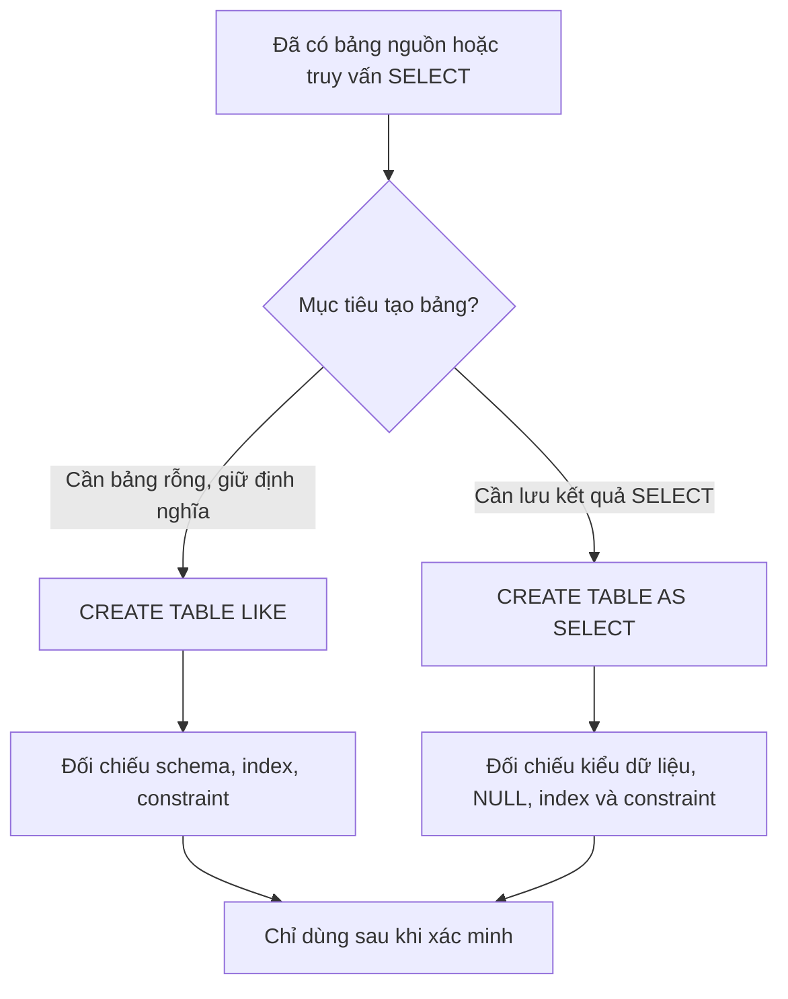

# CREATE TABLE LIKE, CREATE TABLE AS SELECT và thuộc tính cần đối chiếu

MySQL có hai cách thường dùng để tạo một bảng dựa trên bảng hoặc truy vấn có sẵn: `CREATE TABLE ... LIKE` và `CREATE TABLE ... AS SELECT` (CTAS). Hai câu lệnh trông gần giống nhau nhưng phục vụ mục đích khác nhau. `LIKE` tạo một bảng rỗng dựa trên định nghĩa của bảng nguồn; CTAS tạo bảng từ cấu trúc kết quả của một câu `SELECT` và đồng thời nạp các hàng mà truy vấn trả về.

Nếu dùng nhầm, ta có thể tạo được một bảng chứa dữ liệu nhưng thiếu primary key, index, foreign key hoặc default cần thiết. Bài này hướng dẫn phân biệt hai cách tạo bảng, xác định thuộc tính nào được kế thừa, cách bổ sung định nghĩa tường minh và cách kiểm tra kết quả bằng metadata.

Bài học thuộc module **DATABASE_MYSQL**. Module hướng tới việc làm chủ MySQL từ thiết kế bảng, kiểu dữ liệu, khóa và truy vấn SQL đến index, transaction và kiểm soát đồng thời; đồng thời thực hành đọc kế hoạch thực thi, tối ưu truy vấn, phân quyền, sao lưu và xử lý các vấn đề vận hành cơ sở dữ liệu quan hệ. Trong chương **Bảng và ràng buộc**, bài này tập trung vào việc tạo bảng từ cấu trúc hoặc kết quả truy vấn và đối chiếu các thuộc tính quan trọng trước khi đưa bảng mới vào sử dụng.

## 1. Hai nhu cầu khác nhau khi tạo bảng

Hãy xét bảng nghiệp vụ `orders`. Có hai yêu cầu thường gặp:

1. Tạo một bảng `orders_stage` có cấu trúc gần giống `orders` để nạp dữ liệu thử nghiệm hoặc chuẩn bị một bản sao rỗng.
2. Tạo bảng `customer_order_summary` chứa kết quả tổng hợp số đơn và doanh thu theo khách hàng để phục vụ báo cáo.

Yêu cầu đầu tiên cần sao chép định nghĩa bảng. Yêu cầu thứ hai cần tạo một schema từ danh sách biểu thức của truy vấn và lưu kết quả truy vấn vào bảng mới.



`LIKE` thiên về sao chép cấu trúc. CTAS thiên về tạo một bảng dữ liệu từ kết quả truy vấn. Cả hai đều cần bước kiểm tra sau khi tạo; tên lệnh không bảo đảm mọi thuộc tính nghiệp vụ đều được sao chép.

## 2. CREATE TABLE LIKE: sao chép định nghĩa, không sao chép dữ liệu

### 2.1. Cú pháp cơ bản

```sql
CREATE TABLE orders_stage LIKE orders;
```

Câu lệnh tạo `orders_stage` rỗng dựa trên định nghĩa của `orders`. Bảng mới giữ nhiều thuộc tính cấu trúc của bảng nguồn, gồm định nghĩa cột và các index. Không có hàng dữ liệu nào từ `orders` được chép sang.

Có thể chỉ định database nguồn và database đích:

```sql
CREATE TABLE staging_db.orders_stage
LIKE production_db.orders;
```

Đối tượng nguồn phải là table phù hợp với cú pháp `LIKE`; không coi câu lệnh này là cách sao chép một view hoặc một truy vấn tùy ý. Nếu cần tạo bảng từ view hoặc từ join, aggregate hay biểu thức, dùng CTAS hoặc khai báo schema rồi `INSERT ... SELECT`.

### 2.2. Ví dụ cấu trúc nguồn

Giả sử bảng nguồn được tạo như sau:

```sql
CREATE TABLE orders (
    order_id     BIGINT UNSIGNED NOT NULL AUTO_INCREMENT,
    customer_id  BIGINT UNSIGNED NOT NULL,
    order_status VARCHAR(20) NOT NULL DEFAULT 'PENDING',
    total_amount DECIMAL(14, 2) NOT NULL,
    created_at   DATETIME(6) NOT NULL DEFAULT CURRENT_TIMESTAMP(6),
    updated_at   DATETIME(6) NOT NULL DEFAULT CURRENT_TIMESTAMP(6)
                              ON UPDATE CURRENT_TIMESTAMP(6),
    PRIMARY KEY (order_id),
    KEY idx_orders_customer_created (customer_id, created_at),
    KEY idx_orders_status_created (order_status, created_at),
    CONSTRAINT chk_orders_total_nonnegative CHECK (total_amount >= 0)
) ENGINE = InnoDB
  DEFAULT CHARACTER SET = utf8mb4
  COLLATE = utf8mb4_0900_ai_ci;
```

Tạo bảng rỗng dựa trên định nghĩa đó:

```sql
CREATE TABLE orders_stage LIKE orders;

SHOW CREATE TABLE orders_stage;
SELECT COUNT(*) AS row_count FROM orders_stage;
```

`COUNT(*)` phải trả về 0 ngay sau khi tạo bảng. `SHOW CREATE TABLE` giúp kiểm tra định nghĩa thực tế của bảng mới thay vì chỉ dựa vào câu lệnh đã chạy.

### 2.3. Những gì LIKE kế thừa và những gì cần kiểm tra riêng

`CREATE TABLE ... LIKE` tạo một bảng rỗng và kế thừa định nghĩa cột cùng index của bảng nguồn. Tuy vậy, không được hiểu đây là một bản sao hoàn chỉnh của mọi đối tượng phụ thuộc.

| Thuộc tính | Hành vi cần hiểu |
|---|---|
| Hàng dữ liệu | Không được sao chép; bảng đích rỗng. |
| Tên cột, kiểu dữ liệu | Được lấy từ định nghĩa bảng nguồn. |
| `NOT NULL`, `DEFAULT`, `AUTO_INCREMENT` trên cột | Thuộc tính định nghĩa cột được kế thừa; bộ đếm hiện tại của nguồn không phải dữ liệu được sao chép. |
| Primary key và index | Được sao chép theo định nghĩa bảng. |
| Generated column | Thuộc tính định nghĩa cột được giữ theo cấu trúc nguồn; cần xác nhận biểu thức trong `SHOW CREATE TABLE`. |
| Foreign key | Định nghĩa foreign key không được bảo toàn bởi `CREATE TABLE ... LIKE`; cần tạo lại nếu bảng mới cần quan hệ đó. |
| Trigger | Không được sao chép vì trigger là đối tượng riêng gắn với bảng nguồn. |
| Check constraint | Đối chiếu bằng `SHOW CREATE TABLE` và metadata trên đúng phiên bản; không suy luận chỉ từ việc index đã được sao chép. |
| Engine, charset, collation, partition và table options | Kiểm tra định nghĩa kết quả; các tùy chọn thư mục dữ liệu/index như `DATA DIRECTORY` và `INDEX DIRECTORY` không được bảo toàn như một bản sao vật lý. |
| Quyền cấp trực tiếp cho bảng nguồn | Không xem `LIKE` là thao tác sao chép grants; kiểm tra quyền hiệu lực trên bảng đích. |

Điểm đặc biệt quan trọng: tài liệu MySQL nêu rõ foreign key definitions không được bảo toàn bởi `CREATE TABLE ... LIKE`. Nếu bảng mới cần ràng buộc tham chiếu, phải thêm lại bằng `ALTER TABLE` sau khi tạo và kiểm tra dữ liệu phù hợp.

Với CHECK constraint, generated column, partition và các table option có thể chịu ảnh hưởng của phiên bản MySQL hoặc loại đối tượng. Quy trình an toàn là xem `SHOW CREATE TABLE` của nguồn và đích, sau đó đối chiếu metadata của từng thuộc tính mà ứng dụng phụ thuộc.

### 2.4. LIKE không sao chép giá trị AUTO_INCREMENT hiện tại

`LIKE` sao chép thuộc tính `AUTO_INCREMENT` trên cột, nhưng bảng đích mới không phải bản sao trạng thái cấp số của bảng nguồn. Không dựa vào bộ đếm hiện tại của nguồn để bảo đảm ID tiếp theo trong bảng đích.

Kiểm tra:

```sql
SHOW TABLE STATUS LIKE 'orders';
SHOW TABLE STATUS LIKE 'orders_stage';
```

Nếu cần một giá trị bắt đầu riêng, có thể đặt rõ sau khi tạo bảng:

```sql
ALTER TABLE orders_stage AUTO_INCREMENT = 100000;
```

Giá trị mới phải lớn hơn các giá trị khóa hiện có trong bảng đích. Không đặt bộ đếm để giả lập tính liên tục của ID; `AUTO_INCREMENT` không bảo đảm dãy số không có khoảng trống.

### 2.5. LIKE rồi INSERT để sao chép cả dữ liệu

Nếu cần tạo bảng có cấu trúc gần giống và chép dữ liệu, kết hợp hai bước:

```sql
CREATE TABLE orders_copy LIKE orders;

INSERT INTO orders_copy (
    order_id,
    customer_id,
    order_status,
    total_amount,
    created_at,
    updated_at
)
SELECT
    order_id,
    customer_id,
    order_status,
    total_amount,
    created_at,
    updated_at
FROM orders;
```

Nêu rõ danh sách cột ở cả hai phía giúp tránh phụ thuộc vào thứ tự cột và làm cho migration dễ review. Nếu bảng có generated column, không ghi trực tiếp vào generated column; chỉ chọn các cột được phép ghi và để MySQL tính giá trị sinh ra.

Vì `orders_copy` có primary key và index giống bảng nguồn, việc chèn có thể thất bại nếu dữ liệu nguồn có khóa trùng do một thao tác trước đó hoặc bảng đích không thực sự rỗng. Với bảng lớn, việc duy trì index trong lúc insert có chi phí; hãy đo thời gian và dung lượng trước khi chạy trên dữ liệu lớn.

## 3. CREATE TABLE AS SELECT (CTAS): tạo bảng từ kết quả truy vấn

### 3.1. Cú pháp cơ bản

```sql
CREATE TABLE customer_order_summary AS
SELECT
    customer_id,
    COUNT(*) AS order_count,
    SUM(total_amount) AS total_amount
FROM orders
GROUP BY customer_id;
```

MySQL tạo bảng `customer_order_summary` từ các biểu thức trong danh sách `SELECT` rồi chèn các hàng kết quả vào bảng mới. Với ví dụ trên, mỗi khách hàng có một hàng tổng hợp.

CTAS hữu ích cho:

- Bảng snapshot phục vụ báo cáo hoặc phân tích.
- Kết quả tổng hợp cần lưu để xử lý ở bước sau.
- Bảng staging được tạo từ join, filter hoặc transform.
- Bảng trung gian phục vụ quy trình ETL.

CTAS không phải cách sao chép nguyên schema của bảng nguồn. Cấu trúc mới được xác định từ metadata của biểu thức trong `SELECT` và các định nghĩa tường minh mà ta khai báo thêm.

### 3.2. Tên cột được tạo từ select list

Tên cột của CTAS thường lấy từ tên các select item. Với cột gốc, tên thường theo tên cột nguồn; với biểu thức, nên đặt alias rõ ràng:

```sql
CREATE TABLE monthly_revenue AS
SELECT
    customer_id,
    DATE_FORMAT(created_at, '%Y-%m') AS order_month,
    SUM(total_amount) AS revenue
FROM orders
GROUP BY
    customer_id,
    DATE_FORMAT(created_at, '%Y-%m');
```

Alias `order_month` và `revenue` trở thành tên cột của bảng mới. Không nên để tên biểu thức phức tạp hoặc trùng lặp; đặt alias ổn định để ứng dụng và các bước ETL sau dễ tham chiếu.

Nếu select list tạo ra hai cột có cùng tên, MySQL có thể báo lỗi tên cột trùng khi tạo bảng. Hãy đặt alias duy nhất:

```sql
CREATE TABLE customer_contact_export AS
SELECT
    c.customer_id,
    c.email AS customer_email,
    s.email AS support_email
FROM customers AS c
JOIN support_assignments AS a
    ON a.customer_id = c.customer_id
JOIN staff AS s
    ON s.staff_id = a.staff_id;
```

### 3.3. Kiểu dữ liệu được suy ra từ biểu thức

CTAS xác định kiểu cột dựa trên kiểu kết quả của từng biểu thức `SELECT`. Kiểu có thể khác với kiểu của cột nguồn:

- `COUNT(*)` trả về kiểu số nguyên lớn.
- `SUM()` và `AVG()` có quy tắc kiểu kết quả phụ thuộc kiểu đầu vào.
- `CONCAT()` trả về chuỗi với charset/collation được xác định từ các đối số.
- `CASE` phải tổng hợp kiểu của các nhánh kết quả.
- `DATE_FORMAT()` trả về chuỗi, không phải kiểu `DATE` hoặc `DATETIME`.
- Phép nhân hoặc phép chia có thể tạo kiểu số với precision/scale khác cột nguồn.

Ví dụ `order_month` ở phần trước là chuỗi `YYYY-MM` vì `DATE_FORMAT()` trả về chuỗi. Nếu cần cột tháng ở dạng ngày đầu tháng, có thể dùng biểu thức ngày phù hợp hoặc khai báo kiểu đích tường minh.

Không dựa vào tên alias để suy ra kiểu. Kiểm tra kiểu thực tế:

```sql
SHOW CREATE TABLE monthly_revenue;

SELECT
    COLUMN_NAME,
    COLUMN_TYPE,
    IS_NULLABLE,
    COLUMN_DEFAULT,
    CHARACTER_SET_NAME,
    COLLATION_NAME
FROM INFORMATION_SCHEMA.COLUMNS
WHERE TABLE_SCHEMA = DATABASE()
  AND TABLE_NAME = 'monthly_revenue'
ORDER BY ORDINAL_POSITION;
```

### 3.4. CTAS không tự tạo index theo bảng nguồn

Một điểm rất dễ bỏ sót: CTAS không tự tạo index cho bảng mới chỉ vì các cột kết quả được lấy từ cột đã có index trong bảng nguồn.

Ví dụ:

```sql
CREATE TABLE customer_order_summary AS
SELECT
    customer_id,
    COUNT(*) AS order_count,
    SUM(total_amount) AS total_amount
FROM orders
GROUP BY customer_id;
```

Bảng mới có các cột kết quả nhưng không tự có primary key hoặc index trên `customer_id`. Nếu ứng dụng thường truy vấn theo `customer_id`, cần tạo index hoặc khai báo index trong định nghĩa bảng.

```sql
ALTER TABLE customer_order_summary
    ADD PRIMARY KEY (customer_id);
```

Chỉ thêm primary key sau khi xác minh `customer_id` không `NULL` và mỗi khách hàng chỉ xuất hiện một lần. Nếu truy vấn nguồn không bảo đảm một hàng mỗi khách hàng, thao tác thêm khóa có thể thất bại hoặc phản ánh sai mô hình dữ liệu.

## 4. Khai báo thuộc tính tường minh khi dùng CTAS

MySQL cho phép khai báo column definition và index trước phần `SELECT`. Cách này giúp kiểm soát kiểu dữ liệu, nullability, default và index của bảng đích thay vì phụ thuộc hoàn toàn vào kiểu suy ra từ biểu thức.

```sql
CREATE TABLE customer_order_summary (
    customer_id  BIGINT UNSIGNED NOT NULL,
    order_count  BIGINT UNSIGNED NOT NULL,
    total_amount DECIMAL(16, 2) NOT NULL,
    PRIMARY KEY (customer_id),
    KEY idx_summary_total_amount (total_amount)
) ENGINE = InnoDB
  DEFAULT CHARACTER SET = utf8mb4
  COLLATE = utf8mb4_0900_ai_ci
AS
SELECT
    customer_id,
    COUNT(*) AS order_count,
    CAST(SUM(total_amount) AS DECIMAL(16, 2)) AS total_amount
FROM orders
GROUP BY customer_id;
```

Trong ví dụ:

- Định nghĩa cột xác định tên, kiểu, `NOT NULL` và index.
- `PRIMARY KEY` và secondary index được khai báo tường minh.
- `ENGINE`, charset và collation được chọn cho bảng đích.
- `CAST()` làm rõ kiểu kết quả mong muốn cho tổng tiền.
- `SELECT` cung cấp dữ liệu để nạp vào các cột theo thứ tự tương ứng.

Khi kết hợp định nghĩa cột và select list, phải bảo đảm số lượng và thứ tự cột tương ứng. Đặt alias rõ ràng dù đã khai báo tên cột đích để người đọc hiểu mapping.

CTAS có thể khai báo index nhưng không dùng nó như cú pháp khai báo đầy đủ mọi ràng buộc của một bảng nghiệp vụ. Đặc biệt, không thể khai báo foreign key trực tiếp trong phần `CREATE TABLE ... SELECT`; hãy tạo bảng bằng DDL thông thường hoặc thêm foreign key sau bằng `ALTER TABLE` khi cần.

### 4.1. Bổ sung foreign key sau CTAS

Giả sử bảng đích cần tham chiếu đến `customers`:

```sql
ALTER TABLE customer_order_summary
    ADD CONSTRAINT fk_summary_customer
    FOREIGN KEY (customer_id)
    REFERENCES customers (customer_id);
```

Trước khi thêm foreign key, xác minh:

- Hai cột có kiểu dữ liệu tương thích, gồm signed/unsigned.
- Cột được tham chiếu có index phù hợp và là khóa được phép tham chiếu.
- Storage engine hỗ trợ foreign key, thường là InnoDB.
- Không có hàng mồ côi trong bảng đích.
- Quy tắc `ON DELETE` và `ON UPDATE` phù hợp nghiệp vụ.

Nếu CTAS được dùng để tạo snapshot lịch sử, việc thêm foreign key có thể không phù hợp vì snapshot cần giữ dữ liệu ngay cả khi đối tượng nguồn bị xóa. Hãy quyết định theo mục tiêu của bảng mới.

## 5. So sánh CREATE TABLE LIKE và CTAS

| Tiêu chí | `CREATE TABLE ... LIKE` | `CREATE TABLE ... AS SELECT` |
|---|---|---|
| Mục tiêu | Tạo bảng rỗng theo định nghĩa bảng nguồn. | Tạo bảng từ kết quả truy vấn và nạp dữ liệu. |
| Dữ liệu ban đầu | Không sao chép hàng. | Chèn các hàng mà `SELECT` trả về. |
| Nguồn đầu vào | Định nghĩa một table. | Một query expression, có thể gồm join, filter, aggregate và biểu thức. |
| Tên cột | Theo bảng nguồn. | Theo select item/alias hoặc column definitions tường minh. |
| Kiểu và thuộc tính cột | Kế thừa định nghĩa cột của nguồn. | Suy ra từ biểu thức hoặc được khai báo tường minh. |
| Primary key/index | Kế thừa các index của nguồn. | Không tự kế thừa index từ nguồn; khai báo rõ nếu cần. |
| Foreign key | Không bảo toàn foreign key definitions. | Không tự sao chép; không khai báo foreign key trực tiếp trong CTAS. |
| Trigger | Không sao chép trigger của nguồn. | Không sao chép trigger từ bảng được SELECT. |
| Default và AUTO_INCREMENT | Thuộc tính cột được kế thừa; không sao chép bộ đếm hiện tại. | Không nên giả định được kế thừa; khai báo tường minh khi cần. |
| Engine/charset/collation | Đối chiếu định nghĩa kết quả; không coi là bản sao vật lý mọi table option. | Chọn rõ bằng table options nếu cần bảo đảm. |
| Use case điển hình | Bảng rỗng staging, bảng kiểm thử, chuẩn bị bản sao cấu trúc. | Snapshot báo cáo, bảng aggregate, staging từ SELECT. |

Quy tắc chọn nhanh:

- Muốn một bảng rỗng với cấu trúc gần giống bảng nguồn: bắt đầu bằng `LIKE`, sau đó kiểm tra FK, trigger và các thuộc tính phụ thuộc.
- Muốn lưu kết quả truy vấn: dùng CTAS, nhưng xác định rõ kiểu cột, index, constraint và charset/collation.
- Muốn bản sao dữ liệu có cấu trúc gần giống: dùng `LIKE` rồi `INSERT ... SELECT` với danh sách cột tường minh.
- Muốn một bảng nghiệp vụ mới có quan hệ và quy tắc dữ liệu chặt chẽ: ưu tiên DDL tường minh; có thể nạp dữ liệu bằng `INSERT ... SELECT` sau khi schema đã được tạo.

## 6. Những thuộc tính cần đối chiếu sau khi tạo bảng

Không nên chỉ kiểm tra câu lệnh đã chạy thành công. Bảng mới cần được đối chiếu theo các lớp thuộc tính sau.

### 6.1. Column definitions

Kiểm tra:

- Tên và thứ tự cột.
- Kiểu dữ liệu, độ dài, precision và scale.
- `UNSIGNED`, `ZEROFILL` nếu còn dùng trong schema cũ.
- `NULL`/`NOT NULL`.
- `DEFAULT`.
- `AUTO_INCREMENT`.
- Generated column và biểu thức sinh dữ liệu.
- Charset và collation của cột chuỗi.
- Comment hoặc thuộc tính đặc thù cần cho công cụ quản trị.

```sql
SHOW FULL COLUMNS FROM orders_stage;

SELECT
    COLUMN_NAME,
    ORDINAL_POSITION,
    COLUMN_TYPE,
    IS_NULLABLE,
    COLUMN_DEFAULT,
    EXTRA,
    GENERATION_EXPRESSION,
    CHARACTER_SET_NAME,
    COLLATION_NAME
FROM INFORMATION_SCHEMA.COLUMNS
WHERE TABLE_SCHEMA = DATABASE()
  AND TABLE_NAME = 'orders_stage'
ORDER BY ORDINAL_POSITION;
```

`SHOW FULL COLUMNS` hiển thị thêm collation của column chuỗi. `INFORMATION_SCHEMA.COLUMNS` giúp kiểm tra chi tiết theo cách có thể tự động hóa.

### 6.2. Index và khóa

Kiểm tra primary key, unique index và thứ tự cột trong index ghép:

```sql
SHOW INDEX FROM orders_stage;

SELECT
    INDEX_NAME,
    NON_UNIQUE,
    SEQ_IN_INDEX,
    COLUMN_NAME,
    SUB_PART,
    INDEX_TYPE
FROM INFORMATION_SCHEMA.STATISTICS
WHERE TABLE_SCHEMA = DATABASE()
  AND TABLE_NAME = 'orders_stage'
ORDER BY INDEX_NAME, SEQ_IN_INDEX;
```

Với index ghép, `SEQ_IN_INDEX` cho biết thứ tự cột. Không chỉ xác nhận tên index; cần kiểm tra index có đúng cột, thứ tự, prefix length và tính unique hay không.

### 6.3. Foreign key và CHECK constraint

Kiểm tra foreign key:

```sql
SELECT
    CONSTRAINT_NAME,
    COLUMN_NAME,
    REFERENCED_TABLE_NAME,
    REFERENCED_COLUMN_NAME
FROM INFORMATION_SCHEMA.KEY_COLUMN_USAGE
WHERE TABLE_SCHEMA = DATABASE()
  AND TABLE_NAME = 'orders_stage'
  AND REFERENCED_TABLE_NAME IS NOT NULL;
```

Kiểm tra CHECK constraint trên MySQL 8.0.16 trở lên:

```sql
SELECT
    tc.CONSTRAINT_NAME,
    cc.CHECK_CLAUSE
FROM INFORMATION_SCHEMA.TABLE_CONSTRAINTS AS tc
JOIN INFORMATION_SCHEMA.CHECK_CONSTRAINTS AS cc
    ON cc.CONSTRAINT_SCHEMA = tc.CONSTRAINT_SCHEMA
   AND cc.CONSTRAINT_NAME = tc.CONSTRAINT_NAME
WHERE tc.TABLE_SCHEMA = DATABASE()
  AND tc.TABLE_NAME = 'orders_stage'
  AND tc.CONSTRAINT_TYPE = 'CHECK';
```

`CHECK` được thực thi từ MySQL 8.0.16. Với phiên bản cũ hơn, cần kiểm tra đúng khả năng hỗ trợ và không dựa vào một khai báo CHECK vốn có thể chưa được thực thi.

### 6.4. Engine, charset, collation và table options

```sql
SHOW CREATE TABLE orders_stage;

SELECT
    TABLE_NAME,
    ENGINE,
    ROW_FORMAT,
    TABLE_COLLATION,
    CREATE_OPTIONS
FROM INFORMATION_SCHEMA.TABLES
WHERE TABLE_SCHEMA = DATABASE()
  AND TABLE_NAME = 'orders_stage';
```

`SHOW CREATE TABLE` là cách đối chiếu tổng thể hữu ích nhất vì nó hiển thị DDL mà MySQL ghi nhận. Metadata trong `INFORMATION_SCHEMA.TABLES` bổ sung thông tin về engine, row format, collation và create options.

### 6.5. Trigger và đối tượng phụ thuộc

Trigger là đối tượng riêng, không phải một phần của danh sách column/index. Kiểm tra trigger của bảng nguồn và đích bằng:

```sql
SHOW TRIGGERS FROM production_db LIKE 'orders';
SHOW TRIGGERS FROM staging_db LIKE 'orders_stage';
```

Nếu bảng mới cần hành vi audit, đồng bộ hoặc kiểm tra được triển khai bằng trigger, hãy tạo trigger riêng sau khi xem lại nội dung và các phụ thuộc. Không sao chép trigger một cách máy móc nếu trigger ghi sang schema hoặc bảng production.

## 7. CREATE TABLE LIKE và CTAS với bảng tạm

MySQL cho phép tạo temporary table bằng cả hai dạng:

```sql
CREATE TEMPORARY TABLE temp_orders LIKE orders;

CREATE TEMPORARY TABLE temp_customer_totals AS
SELECT
    customer_id,
    SUM(total_amount) AS total_amount
FROM orders
GROUP BY customer_id;
```

Temporary table chỉ tồn tại trong session tạo ra nó và bị loại bỏ khi session kết thúc. Một temporary table cùng tên có thể che khuất bảng permanent cùng tên trong session đó. Vì vậy, cần dùng tên dễ phân biệt và tránh để ứng dụng nhầm bảng tạm với bảng thật.

Temporary table hữu ích cho xử lý trung gian, nhưng vẫn phải kiểm tra kiểu cột, index và charset/collation. Đừng giả định vì bảng tạm sẽ bị xóa nên không cần quan tâm dữ liệu hoặc quyền truy cập.

Một khác biệt về transaction cần nhớ: `CREATE TABLE` thông thường là DDL có implicit commit. `CREATE TEMPORARY TABLE` không gây implicit commit theo cùng cách, nhưng thao tác tạo bảng tạm bản thân nó không được rollback như một thay đổi dữ liệu transactional. Không dựa vào `ROLLBACK` để xóa một temporary table vừa tạo.

## 8. CTAS, INSERT SELECT và tính nhất quán dữ liệu

CTAS kết hợp tạo bảng với việc chạy truy vấn nguồn. Khi cần kiểm soát schema kỹ hơn hoặc cần tái sử dụng bảng đích, có thể tách thành hai bước:

```sql
CREATE TABLE customer_order_summary (
    customer_id  BIGINT UNSIGNED NOT NULL,
    order_count  BIGINT UNSIGNED NOT NULL,
    total_amount DECIMAL(16, 2) NOT NULL,
    PRIMARY KEY (customer_id)
) ENGINE = InnoDB;

INSERT INTO customer_order_summary (
    customer_id,
    order_count,
    total_amount
)
SELECT
    customer_id,
    COUNT(*),
    CAST(SUM(total_amount) AS DECIMAL(16, 2))
FROM orders
GROUP BY customer_id;
```

Tách bước tạo schema và nạp dữ liệu có các lợi ích:

- DDL được review và version-control riêng.
- Có thể tạo index/constraint theo đúng thứ tự triển khai.
- Có thể chạy lại bước nạp dữ liệu theo quy trình được thiết kế.
- Dễ kiểm tra số hàng, tổng tiền và dữ liệu đầu ra trước khi công bố bảng.

Tuy nhiên, việc tách hai bước không tự bảo đảm snapshot nhất quán nếu dữ liệu nguồn thay đổi giữa lúc tạo bảng và lúc nạp. Nếu cần một snapshot nghiệp vụ nhất quán, hãy xác định transaction/isolation hoặc cơ chế snapshot phù hợp với cách MySQL thực hiện DDL và SELECT. DDL thông thường có implicit commit; không giả định có thể gói `CREATE TABLE` và toàn bộ ETL trong một transaction rồi rollback tất cả.

### 8.1. Đối chiếu số hàng và số liệu sau CTAS

Sau khi tạo bảng tổng hợp, so sánh số hàng và tổng số liệu:

```sql
SELECT COUNT(*) AS summary_rows
FROM customer_order_summary;

SELECT
    COUNT(DISTINCT customer_id) AS source_customers
FROM orders;

SELECT SUM(total_amount) AS source_total
FROM orders;

SELECT SUM(total_amount) AS summary_total
FROM customer_order_summary;
```

Hai tổng chỉ có thể so sánh trực tiếp khi cùng phạm vi lọc, cùng cách xử lý `NULL`, cùng đơn vị tiền tệ và cùng thời điểm dữ liệu. Nếu CTAS có `WHERE` hoặc join, hãy áp dụng đúng điều kiện đó cho phép kiểm chứng.

## 9. Charset và collation khi tạo bảng từ nguồn

Với `LIKE`, charset/collation của column và table được lấy từ cấu trúc nguồn theo định nghĩa được sao chép. Với CTAS, charset/collation của biểu thức kết quả được xác định theo quy tắc character set/collation của MySQL và các table option mặc định hoặc khai báo tường minh.

Nếu bảng đích là dữ liệu dùng lâu dài, nên chỉ định rõ table default:

```sql
CREATE TABLE customer_names_snapshot (
    customer_id BIGINT UNSIGNED NOT NULL,
    full_name   VARCHAR(150) CHARACTER SET utf8mb4
                             COLLATE utf8mb4_0900_ai_ci NOT NULL,
    PRIMARY KEY (customer_id)
) ENGINE = InnoDB
  DEFAULT CHARACTER SET = utf8mb4
  COLLATE = utf8mb4_0900_ai_ci
AS
SELECT customer_id, full_name
FROM customers;
```

Đối chiếu `CHARACTER_SET_NAME` và `COLLATION_NAME` trong `INFORMATION_SCHEMA.COLUMNS` sau khi tạo. Điều này đặc biệt quan trọng nếu CTAS chứa `CONCAT()`, `CASE`, literal hoặc biểu thức chuyển đổi giữa nhiều column có collation khác nhau.

`utf8mb4_0900_ai_ci` là collation thuộc MySQL 8.0. Nếu chạy trên MySQL 5.7, chọn collation có hỗ trợ như `utf8mb4_unicode_ci` và kiểm tra lại kết quả trên server đích.

## 10. Lỗi thường gặp

| Hiện tượng | Nguyên nhân có thể | Cách xử lý |
|---|---|---|
| Bảng LIKE không có dữ liệu | `LIKE` chỉ sao chép định nghĩa | Chạy `INSERT ... SELECT` nếu cần chép hàng. |
| Bảng LIKE thiếu foreign key | Foreign key definitions không được bảo toàn | Tạo lại FK bằng `ALTER TABLE` sau khi xác minh dữ liệu. |
| Bảng mới không chạy trigger như nguồn | Trigger không được sao chép | Review và tạo trigger riêng nếu nghiệp vụ cần. |
| CTAS có dữ liệu nhưng truy vấn chậm | Index không tự được kế thừa từ nguồn | Tạo primary/secondary index theo workload và đo bằng `EXPLAIN`. |
| CTAS có kiểu dữ liệu ngoài mong muốn | Kiểu suy ra từ biểu thức SELECT | Khai báo column definition hoặc dùng `CAST()` tường minh. |
| Tên cột CTAS khó hiểu hoặc trùng | Select item không có alias ổn định | Đặt alias duy nhất cho từng biểu thức. |
| CTAS không có AUTO_INCREMENT/default như nguồn | CTAS không sao chép đầy đủ thuộc tính cột nguồn | Khai báo schema tường minh trước SELECT hoặc dùng DDL + INSERT SELECT. |
| Thêm primary key thất bại | Dữ liệu CTAS có NULL hoặc duplicate ở cột dự kiến làm khóa | Kiểm tra `GROUP BY`, NULL và duplicate trước khi thêm khóa. |
| Thêm foreign key thất bại | Kiểu cột không tương thích, thiếu index hoặc có hàng mồ côi | Đối chiếu kiểu, engine, index và truy vấn orphan rows. |
| Tổng số liệu khác nguồn | Phạm vi SELECT khác, join nhân bản hàng hoặc xử lý NULL khác | Kiểm tra grain, join cardinality, filter và aggregate. |

## 11. Quy trình chọn và triển khai

### Trường hợp A: tạo bảng rỗng để thử nghiệm

```sql
CREATE TABLE orders_test LIKE orders;
SHOW CREATE TABLE orders_test;
SHOW INDEX FROM orders_test;
```

Sau đó kiểm tra foreign key, CHECK, trigger, table options và quyền. Chỉ nạp dữ liệu khi cấu trúc đích đáp ứng mục đích thử nghiệm.

### Trường hợp B: tạo bảng tổng hợp báo cáo

```sql
CREATE TABLE customer_revenue_snapshot (
    customer_id BIGINT UNSIGNED NOT NULL,
    revenue     DECIMAL(16, 2) NOT NULL,
    PRIMARY KEY (customer_id)
) ENGINE = InnoDB
  DEFAULT CHARACTER SET = utf8mb4
  COLLATE = utf8mb4_0900_ai_ci
AS
SELECT
    customer_id,
    CAST(SUM(total_amount) AS DECIMAL(16, 2)) AS revenue
FROM orders
GROUP BY customer_id;
```

Sau đó xác minh số hàng, tổng doanh thu, primary key, kiểu cột và execution plan của các truy vấn đọc snapshot.

### Trường hợp C: tạo bảng nghiệp vụ mới từ dữ liệu cũ

Khi bảng đích sẽ trở thành một phần của mô hình dữ liệu vận hành, nên khai báo DDL đầy đủ trước:

```sql
CREATE TABLE archived_orders (
    order_id     BIGINT UNSIGNED NOT NULL,
    customer_id  BIGINT UNSIGNED NOT NULL,
    order_status VARCHAR(20) NOT NULL,
    total_amount DECIMAL(14, 2) NOT NULL,
    created_at   DATETIME(6) NOT NULL,
    PRIMARY KEY (order_id),
    KEY idx_archived_orders_customer (customer_id)
) ENGINE = InnoDB
  DEFAULT CHARACTER SET = utf8mb4
  COLLATE = utf8mb4_0900_ai_ci;

INSERT INTO archived_orders (
    order_id,
    customer_id,
    order_status,
    total_amount,
    created_at
)
SELECT
    order_id,
    customer_id,
    order_status,
    total_amount,
    created_at
FROM orders
WHERE created_at < '2025-01-01';
```

Cách này cho phép xác định rõ khóa và index trước khi dữ liệu được nạp. Nếu cần foreign key hoặc CHECK, khai báo trong DDL hoặc thêm sau khi kiểm tra dữ liệu.

## 12. Quyền và lưu ý vận hành

Tạo bảng cần quyền `CREATE` trên database đích; đọc bảng nguồn cần quyền phù hợp như `SELECT`. Việc thêm index, constraint, foreign key hoặc trigger có thể cần các quyền bổ sung. Hãy dùng tài khoản triển khai có quyền tối thiểu cần thiết, không cấp quyền DDL cho tài khoản ứng dụng chỉ để chạy báo cáo.

CTAS có thể sao chép dữ liệu nhạy cảm vào một bảng mới. Trước khi tạo snapshot, hãy xác định:

- Những column nào thật sự cần thiết trong select list.
- Ai có quyền đọc bảng đích.
- Dữ liệu có cần masking hoặc loại bỏ thông tin định danh không.
- Bảng snapshot tồn tại bao lâu và được xóa theo chính sách nào.
- Dữ liệu có thể thay đổi trong lúc truy vấn đang chạy hay không.

Với bảng lớn, CTAS và `INSERT ... SELECT` có thể tiêu tốn I/O, CPU, dung lượng và tạo tải trên bảng nguồn. Hãy kiểm tra dung lượng đĩa, thời gian chạy, lock/metadata lock và kế hoạch vận hành trước khi thực hiện trên production. Không chạy CTAS vào tên bảng đang được ứng dụng sử dụng như một cách thay thế nóng nếu chưa có chiến lược cutover rõ ràng.

`CREATE TABLE` thông thường là DDL có implicit commit. Nếu tạo bảng tạm bằng `TEMPORARY`, quy tắc implicit commit khác nhưng việc tạo temporary table vẫn không thể rollback như thay đổi dữ liệu InnoDB. Hãy đọc đúng semantics transaction của phiên bản MySQL và loại bảng đang dùng.

## 13. Checklist đối chiếu trước khi sử dụng bảng mới

- [ ] Đã chọn đúng mục tiêu: bảng rỗng theo schema, bảng chứa kết quả SELECT hay bảng nghiệp vụ mới.
- [ ] Tên cột, thứ tự và alias rõ ràng, không trùng.
- [ ] Kiểu dữ liệu, độ dài, precision và scale đúng.
- [ ] `NULL`, `NOT NULL` và `DEFAULT` đúng yêu cầu.
- [ ] `AUTO_INCREMENT` và giá trị bắt đầu được kiểm tra riêng.
- [ ] Primary key, unique key và secondary index đúng cột/thứ tự.
- [ ] Foreign key được tạo lại nếu cần; không giả định LIKE/CTAS đã giữ chúng.
- [ ] CHECK constraint được xác minh trên đúng phiên bản MySQL.
- [ ] Trigger được review và tạo riêng nếu cần.
- [ ] Generated column và biểu thức được kiểm tra qua `SHOW CREATE TABLE`.
- [ ] Engine, row format, charset, collation và partition được đối chiếu.
- [ ] Số hàng và số liệu tổng hợp được so sánh với nguồn.
- [ ] Bảng đích không chứa dữ liệu nhạy cảm ngoài phạm vi cần thiết.
- [ ] Index và quyền truy cập phù hợp với workload đích.
- [ ] Dung lượng, thời gian và ảnh hưởng vận hành đã được xem xét.

## 14. Bài tập thực hành

### Bài tập 1: Sao chép cấu trúc bằng LIKE

Tạo bảng `orders_stage` từ `orders` bằng `CREATE TABLE LIKE`. Dùng `SHOW CREATE TABLE`, `SHOW INDEX` và `INFORMATION_SCHEMA.COLUMNS` để đối chiếu.

**Yêu cầu:** xác định các thuộc tính cột và index được kế thừa, xác nhận bảng đích ban đầu không có dữ liệu.

### Bài tập 2: Kiểm tra foreign key và trigger

Tạo một bảng nguồn có foreign key và trigger trong môi trường thử nghiệm, sau đó tạo bảng mới bằng `LIKE`.

**Yêu cầu:** so sánh metadata của nguồn và đích; giải thích vì sao cần tạo lại FK/trigger khi nghiệp vụ yêu cầu.

### Bài tập 3: Tạo snapshot bằng CTAS

Tạo bảng tổng hợp số đơn và tổng tiền theo khách hàng bằng `CREATE TABLE ... AS SELECT`.

**Yêu cầu:** kiểm tra kiểu dữ liệu, nullability, số hàng và index của bảng đích. Xác định thuộc tính nào không được tự kế thừa.

### Bài tập 4: Khai báo schema tường minh cho CTAS

Tạo lại bảng tổng hợp nhưng khai báo kiểu cột, primary key, secondary index, engine và charset/collation trước phần SELECT.

**Yêu cầu:** so sánh `SHOW CREATE TABLE` của hai bảng và giải thích lợi ích của việc khai báo tường minh.

### Bài tập 5: So sánh dữ liệu sau khi sao chép

Dùng `CREATE TABLE LIKE` rồi `INSERT ... SELECT` để sao chép dữ liệu một khoảng ngày. Dùng CTAS tạo một bảng khác từ cùng điều kiện.

**Yêu cầu:** so sánh cấu trúc, index, constraint, số hàng và tổng tiền giữa hai bảng đích.

### Bài tập 6: Kiểm tra CTAS với biểu thức

Tạo bảng từ truy vấn có `COUNT()`, `SUM()`, `DATE_FORMAT()` và `CASE`.

**Yêu cầu:** kiểm tra kiểu cột, tên alias, charset/collation và xác định cột nào cần `CAST()` hoặc định nghĩa tường minh.

## 15. Ghi nhớ

`CREATE TABLE ... LIKE` tạo một bảng rỗng dựa trên định nghĩa của table nguồn, gồm định nghĩa cột và index; foreign key definitions và trigger không được sao chép như một bản sao đầy đủ. `CREATE TABLE ... AS SELECT` tạo bảng từ kết quả truy vấn và nạp dữ liệu, nhưng không tự kế thừa index và các thuộc tính nghiệp vụ của bảng nguồn. Kiểu dữ liệu của CTAS được xác định từ biểu thức SELECT nếu không khai báo rõ.

Với bảng nghiệp vụ cần khóa, index, default, foreign key và charset/collation ổn định, hãy khai báo schema tường minh rồi nạp dữ liệu bằng `INSERT ... SELECT`. Dù dùng cách nào, hãy đọc lại `SHOW CREATE TABLE`, kiểm tra `INFORMATION_SCHEMA`, đối chiếu dữ liệu và xác nhận quyền trước khi đưa bảng mới vào sử dụng.
