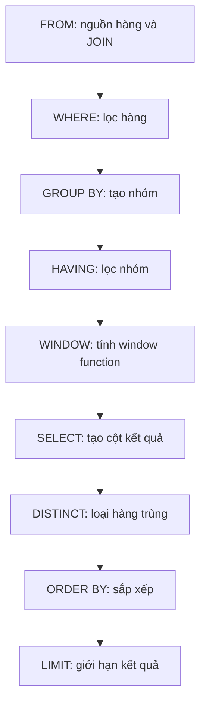

# Cấu trúc SELECT và thứ tự xử lý logic các mệnh đề

`SELECT` là câu lệnh trung tâm để đọc dữ liệu trong MySQL. Một truy vấn có thể chỉ lấy vài cột từ một bảng, kết hợp nhiều bảng, lọc hàng, gom nhóm, tính toán, sắp xếp hoặc giới hạn số kết quả. Khi truy vấn dài hơn, việc hiểu đúng vai trò và thứ tự xử lý logic của từng mệnh đề giúp bạn tránh lỗi alias, đặt điều kiện sai chỗ, tính tổng không đúng và phân trang thiếu ổn định.

Trong SQL, thứ tự viết các mệnh đề không giống hoàn toàn với thứ tự logic mà truy vấn được diễn giải. Ví dụ, `SELECT` được viết trước `WHERE`, nhưng về logic MySQL xác định nguồn hàng từ `FROM` và lọc hàng bằng `WHERE` trước khi tạo danh sách kết quả trong select list. Đây cũng là lý do alias khai báo trong select list không dùng được trong `WHERE` của cùng query block.

Bài học này trình bày cấu trúc truy vấn `SELECT` thường dùng, ý nghĩa từng mệnh đề, thứ tự xử lý logic, cách dùng alias, nhóm dữ liệu, window function, sắp xếp và phân trang. Phạm vi là cú pháp và ngữ nghĩa đọc dữ liệu trong MySQL; các kỹ thuật tối ưu chuyên sâu sẽ được phát triển ở các bài về index và execution plan.

## Mục tiêu học tập

Sau bài học, bạn có thể:

- Đọc và viết cấu trúc `SELECT` có nhiều mệnh đề theo đúng thứ tự cú pháp.
- Giải thích vai trò của `FROM`, `WHERE`, `GROUP BY`, `HAVING`, `WINDOW`, `SELECT`, `DISTINCT`, `ORDER BY` và `LIMIT`.
- Phân biệt thứ tự viết câu lệnh, thứ tự xử lý logic và thứ tự thực thi vật lý do optimizer lựa chọn.
- Hiểu vì sao alias trong select list không dùng được ở `WHERE` nhưng có thể dùng ở `ORDER BY` và một số mệnh đề khác trong MySQL.
- Chọn đúng vị trí cho điều kiện lọc hàng và điều kiện lọc nhóm.
- Dùng hàm tổng hợp và window function mà không làm nhầm số hàng hoặc mức độ chi tiết dữ liệu.
- Viết truy vấn có kết quả được sắp xếp và phân trang ổn định.

## 1. Khung cú pháp SELECT thường dùng

Một query block thường có cấu trúc:

```sql
SELECT [DISTINCT] select_expression [, ...]
FROM source_table_or_expression
[WHERE row_condition]
[GROUP BY grouping_expression [, ...]]
[HAVING group_condition]
[WINDOW window_name AS (window_definition) [, ...]]
[ORDER BY sort_expression [ASC | DESC] [, ...]]
[LIMIT row_count [OFFSET offset]];
```

Các mệnh đề trong ngoặc vuông là tùy chọn. Một truy vấn đơn giản có thể chỉ cần `SELECT`; khi lấy dữ liệu từ bảng thì thường có thêm `FROM`. Các truy vấn tổng hợp dùng `GROUP BY` và có thể dùng `HAVING`; truy vấn cần sắp xếp dùng `ORDER BY`; truy vấn phân trang thường dùng `LIMIT`.

MySQL cũng hỗ trợ các tùy chọn khác như `ALL`, `SQL_CALC_FOUND_ROWS` ở các phiên bản cũ, `INTO` và locking clause như `FOR UPDATE`. Chúng có cú pháp và mục đích riêng; khung trên tập trung vào các mệnh đề xuất hiện thường xuyên trong truy vấn đọc dữ liệu.

Bạn có thể chạy `SELECT` mà không cần bảng:

```sql
SELECT 1 + 2 AS result,
       CURRENT_DATE() AS today;
```

MySQL không bắt buộc phải viết `FROM DUAL` cho truy vấn không đọc bảng. `SELECT 1` là hợp lệ.

## 2. Chuẩn bị dữ liệu dùng trong bài học

Các ví dụ tiếp theo dùng hai bảng khách hàng và đơn hàng. Hãy chạy chúng trong database sandbox:

```sql
CREATE TABLE select_customer (
    customer_id BIGINT UNSIGNED NOT NULL,
    customer_name VARCHAR(100) NOT NULL,
    city VARCHAR(60) NOT NULL,
    PRIMARY KEY (customer_id)
) ENGINE = InnoDB
  DEFAULT CHARACTER SET = utf8mb4;

CREATE TABLE select_order (
    order_id BIGINT UNSIGNED NOT NULL,
    customer_id BIGINT UNSIGNED NOT NULL,
    order_status VARCHAR(20) NOT NULL,
    ordered_at DATETIME(6) NOT NULL,
    total_amount DECIMAL(12,2) NOT NULL,
    PRIMARY KEY (order_id),
    KEY idx_select_order_customer (customer_id),
    KEY idx_select_order_ordered_at (ordered_at),
    CONSTRAINT fk_select_order_customer
        FOREIGN KEY (customer_id)
        REFERENCES select_customer (customer_id)
) ENGINE = InnoDB
  DEFAULT CHARACTER SET = utf8mb4;

INSERT INTO select_customer
    (customer_id, customer_name, city)
VALUES
    (1, 'Nguyễn An', 'Hà Nội'),
    (2, 'Trần Bình', 'TP. Hồ Chí Minh'),
    (3, 'Lê Chi', 'Hà Nội'),
    (4, 'Phạm Dũng', 'Đà Nẵng');

INSERT INTO select_order
    (order_id, customer_id, order_status, ordered_at, total_amount)
VALUES
    (101, 1, 'PAID',      '2025-01-10 09:15:00.100000', 120000.00),
    (102, 1, 'PENDING',   '2025-01-12 10:30:00.200000',  80000.00),
    (103, 2, 'PAID',      '2025-01-11 14:00:00.300000', 250000.00),
    (104, 3, 'CANCELLED', '2025-01-15 08:45:00.400000',  50000.00),
    (105, 2, 'PAID',      '2025-02-02 16:20:00.500000', 100000.00);
```

Khách hàng số 4 chưa có đơn hàng. Dữ liệu này giúp minh họa sự khác nhau giữa truy vấn chỉ đọc bảng khách hàng, truy vấn join và truy vấn tổng hợp. Các bảng có primary key và index cơ bản để câu lệnh ví dụ có thể chạy độc lập.

## 3. SELECT list: chọn cột và biểu thức cần trả về

Select list là phần nằm ngay sau từ khóa `SELECT`. Bạn có thể chọn cột, biểu thức, hằng số, hàm hoặc kết hợp các giá trị đó:

```sql
SELECT
    customer_id,
    customer_name,
    city
FROM select_customer;
```

Nên chỉ rõ các cột cần dùng thay vì luôn viết `SELECT *`. Việc liệt kê cột giúp người đọc biết cấu trúc kết quả, giảm dữ liệu truyền không cần thiết và tránh làm ứng dụng phụ thuộc vào cột mới được thêm vào bảng.

Nếu cần mọi cột, `*` là hợp lệ:

```sql
SELECT *
FROM select_customer;
```

Trong truy vấn nhiều bảng, nên dùng tên bảng hoặc alias để chỉ rõ nguồn cột:

```sql
SELECT
    c.customer_id,
    c.customer_name,
    o.order_id,
    o.total_amount
FROM select_customer AS c
JOIN select_order AS o
    ON o.customer_id = c.customer_id;
```

Nếu hai bảng có cột cùng tên, chẳng hạn `customer_id`, tiền tố `c.` hoặc `o.` giúp tránh tên cột mơ hồ và làm truy vấn dễ đọc.

### 3.1. Biểu thức và alias

Bạn có thể tính giá trị trong select list:

```sql
SELECT
    order_id,
    total_amount,
    total_amount * 0.10 AS estimated_tax,
    total_amount * 1.10 AS amount_with_tax
FROM select_order;
```

Alias đặt tên cho cột kết quả. Có thể viết bằng `AS`:

```sql
SELECT total_amount * 1.10 AS amount_after_tax
FROM select_order;
```

Trong MySQL, `AS` có thể được bỏ qua trong nhiều trường hợp:

```sql
SELECT total_amount * 1.10 amount_after_tax
FROM select_order;
```

Nên dùng `AS` để thể hiện rõ đâu là biểu thức và đâu là tên cột kết quả. Nếu alias chứa khoảng trắng hoặc từ khóa, có thể cần dấu backtick, nhưng tên alias đơn giản không dấu và không trùng từ khóa sẽ dễ dùng hơn.

## 4. FROM: xác định nguồn hàng

`FROM` chỉ ra bảng, view, derived table hoặc nguồn dữ liệu mà truy vấn đọc. Một nguồn có thể có alias:

```sql
SELECT c.customer_name
FROM select_customer AS c;
```

Alias bảng rút gọn tên và được dùng trong các mệnh đề còn lại của query block. Sau khi đặt alias `c`, hãy dùng `c.customer_name`; không tiếp tục dùng tên dài nếu điều đó làm câu lệnh khó đọc.

Nguồn dữ liệu có thể là nhiều bảng kết hợp:

```sql
SELECT
    c.customer_name,
    o.order_id,
    o.order_status
FROM select_customer AS c
INNER JOIN select_order AS o
    ON o.customer_id = c.customer_id;
```

Kết quả chỉ chứa khách hàng có đơn hàng phù hợp với phép `INNER JOIN`. Nếu cần giữ cả khách hàng chưa có đơn, dùng `LEFT JOIN`:

```sql
SELECT
    c.customer_id,
    c.customer_name,
    o.order_id
FROM select_customer AS c
LEFT JOIN select_order AS o
    ON o.customer_id = c.customer_id
ORDER BY c.customer_id, o.order_id;
```

Khách hàng số 4 vẫn xuất hiện, với các cột phía bảng `select_order` là `NULL`. Chi tiết về các loại join và điều kiện join sẽ được học sâu hơn ở phần truy vấn kết hợp bảng.

## 5. WHERE: lọc từng hàng trước khi nhóm

`WHERE` xác định hàng nào được đưa tiếp vào các bước nhóm và tính kết quả. Điều kiện `WHERE` được đánh giá trên dữ liệu nguồn sau `FROM`, trước `GROUP BY`.

```sql
SELECT order_id, customer_id, total_amount
FROM select_order
WHERE order_status = 'PAID';
```

Chỉ các hàng có trạng thái `PAID` được đưa vào kết quả. Bạn có thể kết hợp điều kiện:

```sql
SELECT order_id, customer_id, total_amount
FROM select_order
WHERE order_status = 'PAID'
  AND total_amount >= 150000;
```

Khi trộn `AND` và `OR`, dùng ngoặc để thể hiện ý định:

```sql
SELECT order_id, order_status, total_amount
FROM select_order
WHERE order_status = 'PAID'
  AND (total_amount >= 200000 OR customer_id = 1);
```

Không nên dựa vào việc người đọc nhớ thứ tự ưu tiên toán tử. Ngoặc giúp tránh thay đổi logic ngoài ý muốn khi thêm điều kiện mới.

Các điều kiện thường dùng gồm so sánh, `IN`, `BETWEEN`, `LIKE`, `IS NULL` và toán tử logic. Với `NULL`, dùng `IS NULL` hoặc `IS NOT NULL`; không viết `column = NULL` vì phép so sánh đó cho kết quả `UNKNOWN`.

### 5.1. WHERE không dùng alias của select list cùng cấp

Ví dụ sau không hợp lệ trong cùng query block:

```sql
SELECT
    total_amount * 1.10 AS amount_after_tax
FROM select_order
WHERE amount_after_tax > 200000;
```

Lý do là `WHERE` được xử lý logic trước khi select list tạo alias `amount_after_tax`. Hãy lặp lại biểu thức:

```sql
SELECT
    total_amount * 1.10 AS amount_after_tax
FROM select_order
WHERE total_amount * 1.10 > 200000;
```

Hoặc đưa biểu thức vào một derived table rồi lọc ở query bên ngoài:

```sql
SELECT calculated.amount_after_tax
FROM (
    SELECT total_amount * 1.10 AS amount_after_tax
    FROM select_order
) AS calculated
WHERE calculated.amount_after_tax > 200000;
```

Derived table tạo một query block riêng, vì vậy alias đã trở thành cột của nguồn dữ liệu bên ngoài.

## 6. GROUP BY: gom hàng thành nhóm

`GROUP BY` gom các hàng có cùng giá trị ở một hoặc nhiều biểu thức thành nhóm. Sau khi nhóm, hàm tổng hợp có thể tính một kết quả cho mỗi nhóm.

Ví dụ đếm số đơn và tổng doanh thu theo khách hàng:

```sql
SELECT
    customer_id,
    COUNT(*) AS order_count,
    SUM(total_amount) AS total_revenue,
    AVG(total_amount) AS average_order_value
FROM select_order
GROUP BY customer_id
ORDER BY customer_id;
```

Các hàm tổng hợp thường gặp:

| Hàm | Ý nghĩa |
|---|---|
| `COUNT(*)` | Đếm số hàng trong nhóm |
| `COUNT(expression)` | Đếm giá trị khác `NULL` của biểu thức |
| `SUM(expression)` | Tính tổng các giá trị khác `NULL` |
| `AVG(expression)` | Tính trung bình các giá trị khác `NULL` |
| `MIN(expression)` | Giá trị nhỏ nhất |
| `MAX(expression)` | Giá trị lớn nhất |

Không nhầm `COUNT(*)` với `COUNT(column)`. Nếu cột có `NULL`, `COUNT(column)` không đếm các hàng đó; `COUNT(*)` vẫn đếm hàng.

### 6.1. Quy tắc cột trong SELECT khi có GROUP BY

Khi dùng `GROUP BY`, mỗi biểu thức trong select list thường phải là:

- Biểu thức có trong `GROUP BY`.
- Hàm tổng hợp như `COUNT()`, `SUM()` hoặc `MAX()`.
- Biểu thức phụ thuộc hàm hợp lệ vào các cột nhóm theo quy tắc MySQL, chẳng hạn cột được xác định duy nhất bởi khóa nhóm.

Ví dụ không nên viết:

```sql
SELECT customer_id, order_status, SUM(total_amount)
FROM select_order
GROUP BY customer_id;
```

Một khách hàng có thể có nhiều trạng thái đơn hàng. MySQL không thể chọn một `order_status` duy nhất có ý nghĩa cho mỗi nhóm khách hàng. Với `ONLY_FULL_GROUP_BY` được bật (mặc định trong MySQL 8.0), truy vấn này thường bị từ chối.

Nếu muốn tổng hợp theo cả khách hàng và trạng thái, thêm trạng thái vào nhóm:

```sql
SELECT
    customer_id,
    order_status,
    SUM(total_amount) AS amount_by_status
FROM select_order
GROUP BY customer_id, order_status
ORDER BY customer_id, order_status;
```

Không tắt `ONLY_FULL_GROUP_BY` chỉ để truy vấn chạy. Hãy xác định đúng mức độ chi tiết mà mỗi hàng kết quả cần đại diện.

### 6.2. GROUP BY và alias trong MySQL

MySQL cho phép tham chiếu alias của select list trong `GROUP BY`:

```sql
SELECT
    YEAR(ordered_at) AS order_year,
    COUNT(*) AS order_count
FROM select_order
GROUP BY order_year;
```

Đây là tiện ích của MySQL. Tuy nhiên, khi alias trùng tên cột nguồn hoặc truy vấn cần tương thích nhiều hệ quản trị, nên viết biểu thức rõ ràng hoặc dùng derived table để giảm nhầm lẫn.

## 7. HAVING: lọc sau khi đã tạo nhóm

`HAVING` lọc các nhóm sau `GROUP BY`. Nó thường dùng điều kiện có hàm tổng hợp:

```sql
SELECT
    customer_id,
    COUNT(*) AS order_count,
    SUM(total_amount) AS total_revenue
FROM select_order
WHERE order_status <> 'CANCELLED'
GROUP BY customer_id
HAVING SUM(total_amount) >= 200000
ORDER BY total_revenue DESC;
```

`WHERE` loại hàng bị hủy trước khi nhóm; `HAVING` chỉ giữ các nhóm có tổng tiền đạt ngưỡng. Hai mệnh đề này không thay thế cho nhau:

| Mệnh đề | Thời điểm logic | Dùng để |
|---|---|---|
| `WHERE` | Trước `GROUP BY` | Lọc từng hàng nguồn |
| `HAVING` | Sau `GROUP BY` | Lọc nhóm hoặc kết quả tổng hợp |

MySQL cho phép dùng alias select list trong `HAVING`:

```sql
SELECT
    customer_id,
    SUM(total_amount) AS total_revenue
FROM select_order
GROUP BY customer_id
HAVING total_revenue >= 200000;
```

Tuy vậy, để tránh nhầm lẫn khi alias trùng tên cột hoặc khi chuyển truy vấn giữa các hệ quản trị, có thể lặp biểu thức tổng hợp hoặc dùng query block bên ngoài.

Không nên đưa mọi điều kiện vào `HAVING`. Nếu điều kiện chỉ phụ thuộc từng hàng, đặt ở `WHERE` để loại dữ liệu sớm theo ý nghĩa truy vấn và tạo cơ hội cho optimizer giảm lượng hàng phải nhóm.

### 7.1. HAVING không có GROUP BY

MySQL cho phép `HAVING` trong truy vấn không có `GROUP BY`. Khi có hàm tổng hợp mà không có nhóm tường minh, toàn bộ hàng đầu vào được xem là một nhóm:

```sql
SELECT SUM(total_amount) AS all_order_amount
FROM select_order
HAVING SUM(total_amount) > 0;
```

Truy vấn trả về một hàng nếu tổng lớn hơn 0; nếu điều kiện không đúng, không có hàng kết quả. Trong các truy vấn không tổng hợp, `HAVING` cũng có thể được chấp nhận bởi MySQL, nhưng `WHERE` thường là vị trí rõ ràng hơn cho điều kiện lọc hàng.

## 8. WINDOW: định nghĩa cửa sổ cho window function

Window function tính giá trị trên một tập hàng liên quan đến hàng hiện tại mà không gộp các hàng thành một hàng duy nhất như `GROUP BY`. Ví dụ, bạn có thể tính tổng lũy kế theo khách hàng nhưng vẫn giữ mỗi đơn hàng thành một hàng.

`WINDOW` cho phép đặt tên một window specification để tái sử dụng:

```sql
SELECT
    order_id,
    customer_id,
    ordered_at,
    total_amount,
    SUM(total_amount) OVER customer_order_window AS running_total
FROM select_order
WINDOW customer_order_window AS (
    PARTITION BY customer_id
    ORDER BY ordered_at, order_id
    ROWS BETWEEN UNBOUNDED PRECEDING AND CURRENT ROW
)
ORDER BY customer_id, ordered_at, order_id;
```

- `PARTITION BY customer_id` chia dữ liệu thành cửa sổ riêng cho từng khách hàng.
- `ORDER BY ordered_at, order_id` xác định thứ tự hàng trong mỗi cửa sổ.
- Khung `ROWS BETWEEN UNBOUNDED PRECEDING AND CURRENT ROW` lấy từ hàng đầu tiên của cửa sổ đến hàng hiện tại.
- `SUM() OVER ...` tính tổng lũy kế nhưng không làm mất từng hàng đơn hàng.

Window function được xử lý logic sau `WHERE`, `GROUP BY` và `HAVING`. Vì vậy, không thể dùng trực tiếp window result trong `WHERE` của cùng query block:

```sql
-- Không hợp lệ: running_total chưa tồn tại ở bước WHERE
SELECT
    order_id,
    SUM(total_amount) OVER (ORDER BY ordered_at) AS running_total
FROM select_order
WHERE running_total > 200000;
```

Để lọc theo kết quả window, đặt truy vấn trong CTE hoặc derived table:

```sql
WITH order_running_total AS (
    SELECT
        order_id,
        customer_id,
        ordered_at,
        total_amount,
        SUM(total_amount) OVER (
            PARTITION BY customer_id
            ORDER BY ordered_at, order_id
            ROWS BETWEEN UNBOUNDED PRECEDING AND CURRENT ROW
        ) AS running_total
    FROM select_order
)
SELECT *
FROM order_running_total
WHERE running_total > 200000
ORDER BY customer_id, ordered_at, order_id;
```

Query block bên ngoài nhận `running_total` như một cột nguồn nên có thể lọc bằng `WHERE`. CTE được hỗ trợ từ MySQL 8.0.

## 9. SELECT: tạo các biểu thức kết quả

Sau khi nguồn hàng đã được xác định, lọc, nhóm và xử lý window theo ngữ nghĩa logic, select list xác định các cột và biểu thức được trả về. Ví dụ:

```sql
SELECT
    customer_id,
    COUNT(*) AS order_count,
    SUM(total_amount) AS total_revenue,
    ROUND(AVG(total_amount), 2) AS average_order_value
FROM select_order
WHERE order_status = 'PAID'
GROUP BY customer_id;
```

Kết quả mỗi hàng đại diện cho một khách hàng có ít nhất một đơn đã thanh toán. Select list có thể chứa cột nhóm, biểu thức tổng hợp, hằng số và biểu thức tính toán dựa trên kết quả nhóm.

Trong truy vấn có window function, select list cũng có thể chứa giá trị của window function cùng các cột chi tiết:

```sql
SELECT
    order_id,
    total_amount,
    AVG(total_amount) OVER () AS average_all_orders
FROM select_order;
```

Truy vấn này vẫn trả một hàng cho mỗi đơn hàng; giá trị trung bình được lặp trên từng hàng.

## 10. DISTINCT: loại bỏ hàng kết quả trùng nhau

`DISTINCT` loại bỏ các hàng trùng nhau trong tập cột được chọn:

```sql
SELECT DISTINCT city
FROM select_customer
ORDER BY city;
```

Kết quả có mỗi thành phố một lần. Nếu select list có nhiều cột, MySQL loại bỏ các hàng trùng trên toàn bộ tổ hợp cột được chọn:

```sql
SELECT DISTINCT city, customer_name
FROM select_customer
ORDER BY city, customer_name;
```

Hai khách hàng cùng thành phố nhưng khác tên vẫn là hai hàng kết quả khác nhau. `DISTINCT` không có nghĩa “chỉ lấy giá trị duy nhất của cột đầu tiên”.

### 10.1. DISTINCT và hàm tổng hợp

Có thể dùng `DISTINCT` bên trong hàm tổng hợp:

```sql
SELECT COUNT(DISTINCT customer_id) AS customers_with_orders
FROM select_order;
```

Đây là cách đếm số khách hàng khác nhau có đơn hàng. Nó khác với `SELECT DISTINCT customer_id ...`, vốn trả về danh sách các customer ID.

### 10.2. DISTINCT không thay thế GROUP BY

Nếu cần tính tổng hoặc số lượng theo nhóm, dùng `GROUP BY`. Nếu chỉ cần loại các hàng trùng trong kết quả, dùng `DISTINCT`. Không thêm cả hai một cách máy móc; xác định trước mức độ chi tiết mà kết quả cần đại diện.

## 11. ORDER BY: xác định thứ tự kết quả

SQL không bảo đảm thứ tự hàng nếu truy vấn không có `ORDER BY`. Dù một lần chạy có vẻ trả kết quả theo primary key hoặc thứ tự insert, đó không phải cam kết của truy vấn.

`ORDER BY` có thể sắp xếp theo cột, biểu thức hoặc alias kết quả:

```sql
SELECT
    order_id,
    total_amount,
    total_amount * 1.10 AS amount_after_tax
FROM select_order
ORDER BY amount_after_tax DESC, order_id ASC;
```

- `ASC` là tăng dần và là mặc định.
- `DESC` là giảm dần.
- Có thể sắp xếp theo nhiều biểu thức; biểu thức sau dùng để phân định các hàng bằng nhau ở biểu thức trước.

MySQL cho phép dùng alias trong `ORDER BY` vì bước sắp xếp logic xảy ra sau select list. Cũng có thể dùng vị trí cột, ví dụ `ORDER BY 2 DESC`, nhưng cách này dễ sai khi select list thay đổi; nên dùng tên alias hoặc biểu thức rõ ràng.

### 11.1. Sắp xếp ổn định

Nếu nhiều hàng có cùng `ordered_at`, chỉ sắp xếp theo thời gian chưa xác định thứ tự giữa các hàng cùng timestamp. Thêm khóa duy nhất làm tie-breaker:

```sql
SELECT order_id, customer_id, ordered_at
FROM select_order
ORDER BY ordered_at DESC, order_id DESC;
```

Thứ tự này có thể dùng làm nền tảng cho phân trang ổn định. Nếu không có tie-breaker, các lần chạy hoặc các trang có thể cho thứ tự khác nhau giữa các hàng có cùng giá trị sắp xếp.

### 11.2. Sắp xếp NULL

Trong MySQL, khi sắp xếp tăng dần, giá trị `NULL` thường xuất hiện trước giá trị không null; khi sắp xếp giảm dần, `NULL` thường xuất hiện sau. Nếu cần quy tắc khác, hãy viết biểu thức sắp xếp rõ ràng, chẳng hạn:

```sql
ORDER BY (optional_value IS NULL), optional_value ASC;
```

Biểu thức `(optional_value IS NULL)` đặt hàng không null trước vì kết quả false (0) đứng trước true (1).

## 12. LIMIT: giới hạn số hàng trả về

`LIMIT` giới hạn số hàng của kết quả sau khi sắp xếp logic:

```sql
SELECT order_id, ordered_at, total_amount
FROM select_order
ORDER BY ordered_at DESC, order_id DESC
LIMIT 3;
```

MySQL hỗ trợ hai cách viết offset:

```sql
LIMIT row_count OFFSET offset
```

hoặc:

```sql
LIMIT offset, row_count
```

Ví dụ lấy trang thứ hai với mỗi trang hai hàng:

```sql
SELECT order_id, ordered_at, total_amount
FROM select_order
ORDER BY ordered_at DESC, order_id DESC
LIMIT 2 OFFSET 2;
```

Luôn kết hợp `LIMIT` với `ORDER BY` nếu ứng dụng cần kết quả xác định. Nếu không có `ORDER BY`, MySQL có thể trả về bất kỳ tập hàng nào đáp ứng truy vấn; lần chạy sau có thể trả hàng khác.

### 12.1. Offset pagination và keyset pagination

Offset pagination đơn giản nhưng offset lớn có thể khiến MySQL phải đọc và bỏ qua nhiều hàng trước khi trả trang cần lấy. Với danh sách tăng dần theo khóa, keyset pagination có thể bắt đầu từ giá trị cuối của trang trước:

```sql
SELECT order_id, ordered_at, total_amount
FROM select_order
WHERE (ordered_at, order_id) < (?, ?)
ORDER BY ordered_at DESC, order_id DESC
LIMIT 20;
```

Hai tham số là cặp `(ordered_at, order_id)` của hàng cuối trang trước. Vì `order_id` là khóa duy nhất, cặp giá trị tạo ra thứ tự phân trang ổn định. Row constructor comparison được MySQL hỗ trợ; khi dùng điều kiện phức tạp hoặc cần kiểm soát rõ, có thể viết tương đương:

```sql
WHERE ordered_at < ?
   OR (ordered_at = ? AND order_id < ?)
```

Index phù hợp cho keyset pagination phụ thuộc bộ lọc và thứ tự thực tế; hãy kiểm tra bằng `EXPLAIN`. Keyset pagination đặc biệt hữu ích khi người dùng đi tuần tự qua danh sách lớn.

## 13. Thứ tự xử lý logic của SELECT

Thứ tự viết câu lệnh thường bắt đầu bằng `SELECT`, nhưng thứ tự xử lý logic của một query block phổ biến là:

1. `FROM`: xác định nguồn dữ liệu và tạo tập hàng đầu vào, bao gồm xử lý join.
2. `WHERE`: lọc từng hàng nguồn.
3. `GROUP BY`: gom các hàng còn lại thành nhóm.
4. `HAVING`: lọc các nhóm sau khi tổng hợp.
5. `WINDOW`: xác định cửa sổ và tính các window function trên tập hàng thích hợp.
6. `SELECT`: tạo các biểu thức và cột kết quả.
7. `DISTINCT`: loại bỏ các hàng kết quả trùng nhau nếu được yêu cầu.
8. `ORDER BY`: sắp xếp tập kết quả.
9. `LIMIT`: giới hạn số hàng trả về.

`WINDOW` ở đây mô tả giai đoạn logic của window processing; mệnh đề `WINDOW` trong cú pháp SQL là nơi đặt tên các window specification. Không phải mọi truy vấn đều dùng tất cả các bước. Ví dụ, truy vấn không nhóm sẽ bỏ qua `GROUP BY` và `HAVING`; truy vấn không phân trang sẽ không cần `LIMIT`.

Sơ đồ khái quát:



Thứ tự này giải thích một số quy tắc quan trọng:

- `WHERE` không nhìn thấy alias được tạo trong select list cùng query block.
- `HAVING` có thể lọc kết quả tổng hợp và trong MySQL có thể tham chiếu alias select list.
- `ORDER BY` có thể dùng alias select list.
- Window function không thể được lọc trực tiếp bằng `WHERE` cùng cấp vì nó được tính sau bước lọc hàng.
- `LIMIT` chỉ giới hạn kết quả sau khi truy vấn đã xác định tập kết quả và thứ tự logic.

## 14. Thứ tự logic không phải thứ tự thực thi vật lý

Thứ tự xử lý logic là mô hình để hiểu kết quả truy vấn và quy tắc nhìn thấy tên/alias. Nó **không** có nghĩa MySQL bắt buộc thực thi từng bước tuần tự đúng theo danh sách trên.

MySQL optimizer có thể biến đổi kế hoạch vật lý để giảm chi phí mà vẫn giữ ngữ nghĩa SQL, ví dụ:

- Đẩy một điều kiện lọc xuống gần bảng nguồn hơn khi phép biến đổi là hợp lệ.
- Chọn thứ tự join khác với thứ tự bảng được viết trong truy vấn.
- Dùng index để tìm hàng thay vì quét toàn bộ bảng.
- Tính toán hoặc materialize derived table/CTE tùy khả năng tối ưu và đặc điểm truy vấn.
- Dùng temporary table hoặc filesort khi cần nhóm, loại trùng hoặc sắp xếp.

Do đó, hãy dùng thứ tự logic để viết truy vấn đúng và hiểu phạm vi alias; dùng `EXPLAIN` hoặc `EXPLAIN ANALYZE` để xem kế hoạch vật lý thực tế. Không suy luận rằng vì `WHERE` xuất hiện sau `SELECT` trong văn bản nên MySQL phải tính mọi biểu thức select list trước khi lọc hàng.

## 15. Alias có thể dùng ở mệnh đề nào?

Trong MySQL, alias select list có thể được tham chiếu trong một số mệnh đề, nhưng không phải ở mọi vị trí:

| Mệnh đề | Dùng alias select list cùng query block? | Giải thích |
|---|---|---|
| `WHERE` | Không | Lọc logic diễn ra trước khi select list tạo alias |
| `GROUP BY` | Có | MySQL hỗ trợ alias như một tiện ích |
| `HAVING` | Có | Có thể lọc theo alias của biểu thức kết quả |
| `ORDER BY` | Có | Sắp xếp sau khi select list đã xác định kết quả |
| `SELECT` cùng cấp | Không nên dựa vào | Không thể dùng alias vừa tạo làm biến trong một biểu thức select list khác cùng cấp |

Ví dụ hợp lệ:

```sql
SELECT
    customer_id,
    SUM(total_amount) AS revenue
FROM select_order
GROUP BY customer_id
HAVING revenue > 100000
ORDER BY revenue DESC;
```

Ví dụ không hợp lệ vì `WHERE` không nhìn thấy alias:

```sql
SELECT total_amount * 1.10 AS gross_amount
FROM select_order
WHERE gross_amount > 200000;
```

Nếu cần tái sử dụng biểu thức nhiều lần, hãy cân nhắc derived table hoặc CTE:

```sql
WITH order_amounts AS (
    SELECT
        order_id,
        total_amount * 1.10 AS gross_amount
    FROM select_order
)
SELECT order_id, gross_amount
FROM order_amounts
WHERE gross_amount > 200000
ORDER BY gross_amount DESC;
```

CTE làm rõ ranh giới giữa hai query block: alias `gross_amount` được tạo ở bên trong và trở thành cột nguồn của truy vấn bên ngoài.

## 16. Ví dụ tổng hợp nhiều mệnh đề

Truy vấn sau lấy tổng doanh thu đã thanh toán theo khách hàng trong tháng 1/2025, chỉ giữ khách có doanh thu từ 100.000 trở lên, sắp xếp doanh thu giảm dần và giới hạn ba hàng:

```sql
SELECT
    c.customer_id,
    c.customer_name,
    COUNT(o.order_id) AS paid_order_count,
    SUM(o.total_amount) AS paid_revenue
FROM select_customer AS c
JOIN select_order AS o
    ON o.customer_id = c.customer_id
WHERE o.order_status = 'PAID'
  AND o.ordered_at >= '2025-01-01 00:00:00'
  AND o.ordered_at <  '2025-02-01 00:00:00'
GROUP BY c.customer_id, c.customer_name
HAVING SUM(o.total_amount) >= 100000
ORDER BY paid_revenue DESC, c.customer_id ASC
LIMIT 3;
```

Có thể đọc truy vấn theo ý nghĩa logic:

1. `FROM` và `JOIN` tạo nguồn hàng từ khách hàng cùng đơn hàng.
2. `WHERE` chỉ giữ đơn `PAID` trong tháng 1/2025.
3. `GROUP BY` tạo một nhóm cho mỗi khách hàng.
4. `HAVING` chỉ giữ nhóm có tổng doanh thu đạt ngưỡng.
5. `SELECT` tạo số đơn và tổng doanh thu cho từng nhóm.
6. `ORDER BY` sắp xếp theo doanh thu, sau đó theo ID để phân định.
7. `LIMIT` trả tối đa ba hàng.

Ví dụ này cũng cho thấy điều kiện thời gian nên dùng khoảng nửa mở, còn điều kiện trạng thái là điều kiện lọc hàng nên đặt trong `WHERE`. Bài học về lọc khoảng thời gian và index đã trình bày sâu hơn cách viết điều kiện thời gian thân thiện với index.

## 17. Những lỗi thường gặp khi viết SELECT

- Đặt điều kiện lọc hàng vào `HAVING` dù không cần tổng hợp, khiến ý nghĩa truy vấn khó hiểu và có thể lọc muộn hơn cần thiết.
- Đặt điều kiện tổng hợp như `SUM(amount) > ...` trong `WHERE`; hàm tổng hợp cần được lọc ở `HAVING` hoặc query block bên ngoài.
- Dùng alias select list trong `WHERE` cùng cấp và gặp lỗi tên cột không tồn tại.
- Chọn cột không nhóm và không tổng hợp khi `ONLY_FULL_GROUP_BY` được bật.
- Cho rằng `GROUP BY` tự sắp xếp kết quả; hãy viết `ORDER BY` nếu cần thứ tự.
- Cho rằng kết quả luôn theo thứ tự primary key khi không có `ORDER BY`.
- Dùng `DISTINCT` nhưng chọn thêm cột khiến các hàng vẫn khác nhau trên toàn bộ select list.
- Dùng `LIMIT` không có thứ tự ổn định rồi thấy dữ liệu giữa các trang bị lặp hoặc bỏ sót.
- Dùng `SELECT *` trong API lâu dài, khiến ứng dụng phụ thuộc vào mọi cột của bảng.
- Nhầm thứ tự logic với kế hoạch thực thi vật lý và kết luận optimizer phải xử lý tuần tự theo thứ tự trong sơ đồ.

## 18. Checklist đọc và viết một câu SELECT

- Đã xác định tập hàng nguồn và các bảng cần tham gia trong `FROM`.
- Đã đặt alias bảng rõ ràng và phân biệt các cột cùng tên.
- Đã chọn đúng cột/biểu thức trong select list, có alias dễ hiểu khi cần.
- Đã đặt điều kiện lọc từng hàng trong `WHERE`.
- Đã dùng `GROUP BY` đúng mức độ chi tiết cần tổng hợp.
- Đã bảo đảm các cột không tổng hợp trong select list phù hợp với quy tắc `ONLY_FULL_GROUP_BY`.
- Đã dùng `HAVING` cho điều kiện lọc nhóm hoặc kết quả tổng hợp.
- Đã xác định window function có cần giữ từng hàng chi tiết hay không.
- Đã hiểu `DISTINCT` áp dụng trên toàn bộ hàng kết quả được chọn.
- Đã viết `ORDER BY` nếu thứ tự kết quả có ý nghĩa; thêm tie-breaker duy nhất khi cần ổn định.
- Đã dùng `LIMIT` với thứ tự phù hợp nếu truy vấn phân trang.
- Đã phân biệt thứ tự logic với kế hoạch vật lý và dùng `EXPLAIN` khi cần đánh giá hiệu năng.

`SELECT` là một chuỗi mệnh đề có vai trò riêng: nguồn hàng, lọc hàng, nhóm, lọc nhóm, xử lý cửa sổ, tạo cột kết quả, loại trùng, sắp xếp và giới hạn kết quả. Hiểu thứ tự logic giúp bạn biết điều kiện nào được đặt ở đâu và alias nào có thể tham chiếu; hiểu sự khác nhau với thực thi vật lý giúp bạn không suy đoán cách optimizer chạy truy vấn. Khi viết rõ từng mệnh đề và luôn chỉ định thứ tự nếu kết quả cần ổn định, truy vấn sẽ dễ đọc, dễ kiểm tra và dễ tối ưu hơn.
