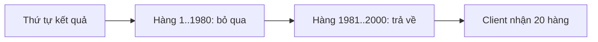

# LIMIT, OFFSET và phân trang trên tập dữ liệu thay đổi

## Mục tiêu

Sau bài này, bạn có thể:

- Dùng `LIMIT` và `OFFSET` để giới hạn số hàng trả về và lấy một trang dữ liệu.
- Thiết kế `ORDER BY` ổn định để các trang không bị xáo trộn do những hàng có cùng giá trị sắp xếp.
- Giải thích vì sao phân trang bằng OFFSET có thể chậm khi đi sâu vào tập dữ liệu lớn.
- Nhận diện hiện tượng trùng hàng hoặc bỏ sót hàng khi dữ liệu thay đổi giữa các lần lấy trang.
- Chọn giữa offset pagination, keyset/cursor pagination và snapshot pagination.
- Thiết kế index, truy vấn đếm và API phân trang phù hợp với MySQL và ứng dụng Java.

## 1. Vì sao cần phân trang?

Một bảng đơn hàng có thể chứa hàng triệu bản ghi. Nếu giao diện quản trị yêu cầu hiển thị toàn bộ đơn hàng trong một lần truy vấn, server phải đọc và truyền lượng dữ liệu lớn, ứng dụng phải giữ nhiều đối tượng trong bộ nhớ và người dùng phải chờ lâu.

Phân trang chia kết quả thành những nhóm nhỏ, thường có kích thước cố định, ví dụ 20 hoặc 50 hàng mỗi trang. MySQL cung cấp `LIMIT` để giới hạn số hàng trả về và `OFFSET` để bỏ qua một số hàng đầu tiên trong thứ tự kết quả.

Phân trang cần giải quyết đồng thời ba vấn đề:

1. **Thứ tự:** hàng nào thuộc trang đầu, trang tiếp theo và trang cuối?
2. **Hiệu năng:** chi phí lấy trang thứ 500 có tăng theo số trang hay không?
3. **Tính nhất quán:** nếu có insert, delete hoặc update trong lúc người dùng chuyển trang, họ có thấy trùng hoặc thiếu bản ghi không?

Chỉ thêm `LIMIT` vào câu truy vấn chưa đủ để giải quyết cả ba vấn đề.

## 2. Cú pháp LIMIT và OFFSET

### 2.1. LIMIT số hàng

`LIMIT` giới hạn số hàng tối đa trong kết quả:

```sql
SELECT order_id, customer_id, status, created_at
FROM orders
ORDER BY created_at DESC, order_id DESC
LIMIT 20;
```

Truy vấn trả về tối đa 20 đơn hàng mới nhất. Nếu bảng chỉ có 7 hàng phù hợp, kết quả có 7 hàng.

### 2.2. LIMIT với OFFSET

MySQL hỗ trợ hai cách viết:

```sql
-- Bỏ qua 20 hàng đầu, lấy tối đa 20 hàng tiếp theo
SELECT order_id, customer_id, status, created_at
FROM orders
ORDER BY created_at DESC, order_id DESC
LIMIT 20 OFFSET 20;

-- Cú pháp tương đương của MySQL
SELECT order_id, customer_id, status, created_at
FROM orders
ORDER BY created_at DESC, order_id DESC
LIMIT 20, 20;
```

Trong cú pháp `LIMIT offset, row_count`, số thứ nhất là số hàng bỏ qua và số thứ hai là số hàng tối đa cần lấy. `OFFSET` bắt đầu từ 0, không phải từ 1.

| Trang | page size | OFFSET | Câu LIMIT |
|---:|---:|---:|---|
| 1 | 20 | 0 | `LIMIT 20 OFFSET 0` |
| 2 | 20 | 20 | `LIMIT 20 OFFSET 20` |
| 3 | 20 | 40 | `LIMIT 20 OFFSET 40` |
| 10 | 20 | 180 | `LIMIT 20 OFFSET 180` |

### 2.3. Tính OFFSET từ số trang

Nếu API nhận `page` bắt đầu từ 1 và `pageSize` là số hàng mỗi trang:

\[
\text{offset} = (\text{page} - 1) \times \text{pageSize}
\]

Ví dụ trang 4 với 25 hàng mỗi trang:

\[
(4 - 1) \times 25 = 75
\]

Truy vấn tương ứng:

```sql
SELECT order_id, status, created_at
FROM orders
ORDER BY created_at DESC, order_id DESC
LIMIT 25 OFFSET 75;
```

Ứng dụng cần xác thực `page >= 1`, `pageSize > 0` và giới hạn page size tối đa. Nên tính offset bằng kiểu số đủ rộng và kiểm tra tràn số trước khi gửi truy vấn. Không cho client tùy ý yêu cầu page size hàng chục nghìn hoặc offset cực lớn.

## 3. ORDER BY phải xác định thứ tự ổn định

### 3.1. LIMIT không tự bảo đảm thứ tự

Nếu không có `ORDER BY`, MySQL không bảo đảm thứ tự hàng trả về. Kết quả có thể thay đổi do execution plan, index, dữ liệu mới hoặc phiên bản server.

Truy vấn sau không phải cách phân trang đáng tin cậy:

```sql
SELECT order_id, status, created_at
FROM orders
LIMIT 20 OFFSET 20;
```

Để phân trang, luôn xác định thứ tự mong muốn:

```sql
SELECT order_id, status, created_at
FROM orders
ORDER BY created_at DESC
LIMIT 20 OFFSET 20;
```

Tuy nhiên, chỉ sắp xếp theo `created_at` vẫn chưa đủ nếu nhiều hàng có cùng timestamp.

### 3.2. Thêm khóa duy nhất làm tie-breaker

Giả sử nhiều đơn hàng được tạo trong cùng một microsecond. Khi đó, `created_at DESC` không xác định thứ tự giữa những hàng có timestamp bằng nhau. MySQL có thể trả các hàng cùng timestamp theo thứ tự khác nhau giữa hai lần chạy.

Thêm primary key vào cuối thứ tự:

```sql
SELECT order_id, status, created_at
FROM orders
ORDER BY created_at DESC, order_id DESC
LIMIT 20 OFFSET 20;
```

`order_id` là khóa duy nhất nên mỗi hàng có vị trí xác định trong thứ tự kết quả, miễn là các giá trị sắp xếp không thay đổi. Đây là nguyên tắc quan trọng: **thứ tự phân trang phải tạo ra một thứ tự toàn phần**, thường bằng cách thêm primary key hoặc unique key làm tiêu chí cuối cùng.

### 3.3. Thứ tự NULL và collation

Nếu cột sắp xếp cho phép `NULL`, cần xác định rõ các hàng `NULL` nằm ở đâu. MySQL có quy tắc mặc định cho `NULL` trong `ORDER BY`, nhưng nghiệp vụ có thể cần cách khác. Có thể dùng biểu thức như `ORDER BY created_at IS NULL, created_at, order_id` để đặt nhóm NULL rõ ràng; tuy nhiên, biểu thức này có thể ảnh hưởng khả năng dùng index trực tiếp.

Với cột chuỗi, thứ tự phụ thuộc collation. Các chuỗi khác nhau về hoa thường hoặc dấu có thể được xem là tương đương trong một collation không phân biệt. Nếu nhiều hàng bằng nhau theo collation, thêm khóa duy nhất để phân định. Khi thay đổi collation, thứ tự phân trang và các ranh giới cursor có thể thay đổi.

## 4. Offset pagination hoạt động như thế nào?

Giả sử người dùng yêu cầu trang thứ 100 với 20 hàng mỗi trang:

\[
\text{OFFSET} = (100 - 1) \times 20 = 1980
\]

MySQL phải tìm và đi qua các hàng đứng trước vị trí cần lấy theo thứ tự phù hợp, rồi mới trả 20 hàng tiếp theo. Dù kết quả chỉ có 20 hàng, công việc để xác định vị trí có thể phải xử lý khoảng 2.000 hàng hoặc entry index trước đó.



Đây là lý do offset pagination thường phù hợp với trang đầu và các trang nông, nhưng có thể chậm khi offset lớn. Nếu truy vấn còn phải đọc nhiều cột từ bảng sau khi quét index, chi phí có thể tăng thêm.

### 4.1. Vì sao OFFSET lớn chậm?

Giả sử có index hỗ trợ `ORDER BY created_at, order_id`. Để lấy `LIMIT 20 OFFSET 500000`, server vẫn cần duyệt qua số lượng lớn entry index trước khi đến 20 hàng cần trả. Index giúp tìm và sắp xếp hiệu quả hơn, nhưng không làm cho việc bỏ qua nửa triệu entry trở thành thao tác hằng số.

Nếu truy vấn lấy nhiều cột không nằm trong index, MySQL có thể phải truy cập bản ghi tương ứng trong quá trình xử lý. Khi đó, việc đọc các hàng bị bỏ qua cũng có thể phát sinh chi phí I/O đáng kể.

### 4.2. Kiểm tra kế hoạch thực thi

Chạy `EXPLAIN` với truy vấn thực tế:

```sql
EXPLAIN
SELECT order_id, status, created_at
FROM orders
ORDER BY created_at DESC, order_id DESC
LIMIT 20 OFFSET 500000;
```

Quan sát access type, key được chọn, số hàng ước lượng và việc có filesort hay không. Với MySQL 8.0.18 trở lên, `EXPLAIN ANALYZE` có thể thực thi truy vấn và báo thời gian/row thực tế; chỉ dùng trên truy vấn và môi trường phù hợp vì lệnh này thực sự chạy câu SELECT.

Không chỉ dựa vào `EXPLAIN` để kết luận. Hãy đo latency ở nhiều offset, dùng dữ liệu có quy mô tương đương production và kiểm tra tải I/O/CPU.

## 5. Thiết kế index cho offset pagination

Giả sử truy vấn thường lấy đơn hàng theo thời gian mới nhất:

```sql
SELECT order_id, status, created_at
FROM orders
WHERE customer_id = 1001
ORDER BY created_at DESC, order_id DESC
LIMIT 20 OFFSET 40;
```

Một index có thể phù hợp:

```sql
CREATE INDEX idx_orders_customer_created_id
ON orders (customer_id, created_at DESC, order_id DESC);
```

Thứ tự cột trong index phản ánh:

1. `customer_id` dùng điều kiện bằng trong `WHERE`.
2. `created_at` và `order_id` hỗ trợ thứ tự sắp xếp sau khi lọc theo customer.

MySQL 8.0 hỗ trợ descending index. Với một số phiên bản hoặc trường hợp thứ tự đảo chiều đồng nhất, optimizer có thể quét index theo chiều ngược; hãy kiểm tra khả năng thực tế bằng `EXPLAIN`. Không tạo index chỉ vì một truy vấn có `LIMIT`.

Nếu truy vấn trả về nhiều cột, có thể cân nhắc covering index nhưng cần cân bằng dung lượng và chi phí ghi. Index quá rộng làm tăng storage, buffer pool và chi phí INSERT/UPDATE/DELETE.

### 5.1. Deferred join cho offset sâu

Một kỹ thuật có thể giảm số lần đọc hàng rộng là tìm khóa của trang bằng index trước, sau đó mới join để lấy đầy đủ cột:

```sql
SELECT o.order_id, o.customer_id, o.status, o.created_at, o.total_amount
FROM (
    SELECT order_id, created_at
    FROM orders
    WHERE customer_id = 1001
    ORDER BY created_at DESC, order_id DESC
    LIMIT 20 OFFSET 50000
) AS page_keys
JOIN orders AS o
  ON o.order_id = page_keys.order_id
ORDER BY page_keys.created_at DESC, page_keys.order_id DESC;
```

Truy vấn con chỉ đọc các cột khóa/thứ tự cần thiết, có thể tận dụng index hẹp hơn. Truy vấn ngoài chỉ đọc đầy đủ hàng cho 20 khóa đã chọn. Kỹ thuật này có thể giảm random row lookup cho các hàng bị bỏ qua, nhưng vẫn phải duyệt các entry index của OFFSET. Nó không loại bỏ độ phức tạp tăng theo offset.

## 6. Dữ liệu thay đổi giữa các trang gây ra điều gì?

Offset pagination thường chạy mỗi trang bằng một câu SELECT riêng. Nếu dữ liệu thay đổi giữa hai lần gọi, vị trí của các hàng có thể dịch chuyển.

### 6.1. INSERT trước vị trí trang tiếp theo có thể gây trùng hàng

Giả sử thứ tự `created_at DESC, order_id DESC`, page size là 3.

<text weight="semibold">Lần lấy trang 1</text>

| Vị trí | order_id | created_at |
|---:|---:|---|
| 1 | 105 | 10:05 |
| 2 | 104 | 10:04 |
| 3 | 103 | 10:03 |
| 4 | 102 | 10:02 |
| 5 | 101 | 10:01 |
| 6 | 100 | 10:00 |

Client nhận `105, 104, 103`. Trước khi lấy trang 2, một đơn hàng mới `106` được insert với timestamp mới hơn và đứng đầu danh sách.

<text weight="semibold">Thứ tự sau INSERT</text>

| Vị trí | order_id |
|---:|---:|
| 1 | 106 |
| 2 | 105 |
| 3 | 104 |
| 4 | 103 |
| 5 | 102 |
| 6 | 101 |

Trang 2 dùng `OFFSET 3 LIMIT 3` sẽ trả `103, 102, 101`. Hàng `103` xuất hiện lại dù đã có ở trang 1. Đây là hiện tượng duplicate do vị trí bị dịch sau insert.

### 6.2. DELETE trước vị trí có thể làm bỏ sót hàng

Nếu một hàng ở trước offset bị xóa, các hàng phía sau dịch lên một vị trí. Trang tiếp theo bỏ qua đúng số lượng cũ nên có thể nhảy qua một hàng chưa được đọc.

### 6.3. UPDATE cột sắp xếp cũng có thể làm trùng hoặc thiếu

Nếu `created_at`, `status`, điểm xếp hạng hoặc một cột trong `ORDER BY` bị thay đổi giữa các trang, hàng có thể di chuyển từ phần chưa đọc sang phần đã đọc hoặc ngược lại. Thứ tự có khóa duy nhất chỉ bảo đảm phân định khi các giá trị sắp xếp không đổi; nó không đóng băng tập dữ liệu.

### 6.4. OFFSET không phải cursor

OFFSET chỉ mô tả số lượng hàng cần bỏ qua trong kết quả hiện tại. Nó không ghi nhớ hàng cuối cùng mà client đã nhận. Khi tập dữ liệu thay đổi, vị trí số học có thể trỏ tới một nhóm hàng khác.

Nếu nghiệp vụ chấp nhận dữ liệu mới xuất hiện hoặc một số thay đổi giữa các trang, offset pagination vẫn có thể phù hợp. Nếu cần tránh dịch chuyển vị trí khi có insert mới, hãy cân nhắc keyset pagination. Nếu cần một tập dữ liệu nhất quán tuyệt đối trong suốt quá trình đọc, cần một snapshot hoặc cơ chế phiên bản dữ liệu.

## 7. Keyset pagination (cursor pagination)

Keyset pagination lấy trang tiếp theo dựa trên giá trị của hàng cuối cùng ở trang trước, thay vì đếm số hàng cần bỏ qua.

Giả sử thứ tự:

```sql
ORDER BY created_at DESC, order_id DESC
```

Sau khi lấy trang đầu, client lưu cặp giá trị của hàng cuối cùng, ví dụ:

```text
last_created_at = 2026-11-18 09:30:00.123456
last_order_id   = 8120
```

Trang tiếp theo lấy những hàng có khóa sắp xếp nhỏ hơn cặp cursor đó:

```sql
SELECT order_id, customer_id, status, created_at
FROM orders
WHERE customer_id = 1001
  AND (created_at, order_id) < ('2026-11-18 09:30:00.123456', 8120)
ORDER BY created_at DESC, order_id DESC
LIMIT 20;
```

Vì cả hai cột đều được sắp xếp giảm dần, so sánh tuple `<` chọn những hàng đứng sau cursor trong thứ tự đó. Có thể viết điều kiện tương đương tường minh:

```sql
WHERE customer_id = 1001
  AND (
      created_at < '2026-11-18 09:30:00.123456'
      OR (
          created_at = '2026-11-18 09:30:00.123456'
          AND order_id < 8120
      )
  )
```

Tuple comparison cần các cột và chiều sắp xếp tương thích với logic cursor. Với thứ tự trộn ASC/DESC, điều kiện phải được viết tường minh theo từng nhánh; không áp dụng máy móc một phép so sánh tuple.

### 7.1. Trang đầu và các trang sau

Trang đầu không có cursor:

```sql
SELECT order_id, status, created_at
FROM orders
WHERE customer_id = 1001
ORDER BY created_at DESC, order_id DESC
LIMIT 20;
```

Các trang tiếp theo truyền cursor lấy từ hàng cuối trang trước:

```sql
SELECT order_id, status, created_at
FROM orders
WHERE customer_id = 1001
  AND (created_at, order_id) < (?, ?)
ORDER BY created_at DESC, order_id DESC
LIMIT 20;
```

Giá trị cursor phải lấy từ hàng cuối thực tế đã trả về, không phải hàng thứ 20 theo một phép đếm khác. Dùng đầy đủ độ chính xác của timestamp, gồm microsecond nếu cột là `DATETIME(6)` hoặc `TIMESTAMP(6)`.

### 7.2. Index cho keyset pagination

Index phù hợp với điều kiện và thứ tự trên:

```sql
CREATE INDEX idx_orders_customer_created_id
ON orders (customer_id, created_at DESC, order_id DESC);
```

Sau khi lọc bằng `customer_id`, MySQL có thể tìm từ vị trí cursor trong phần index được sắp xếp và đọc tiếp một số lượng gần với page size. Với index phù hợp, chi phí không cần tăng tuyến tính theo số trang như OFFSET sâu.

Vẫn phải xác minh bằng `EXPLAIN` và đo thực tế. Nếu có thêm điều kiện lọc, index có thể cần được thiết kế lại theo thứ tự equality predicates, range/cursor columns và ordering. Không có một index duy nhất phù hợp cho mọi biến thể truy vấn.

### 7.3. INSERT mới ảnh hưởng keyset như thế nào?

Với thứ tự giảm dần và cursor đã lưu, một hàng mới được insert ở đầu danh sách (lớn hơn cursor) sẽ không xuất hiện ở các trang tiếp theo của cùng luồng cursor. Các hàng cũ phía sau cursor không bị đẩy qua ranh giới bằng phép đếm offset.

Tuy vậy, keyset không đóng băng dữ liệu:

- Hàng mới được insert phía sau cursor có thể xuất hiện trong các trang tiếp theo.
- Hàng bị xóa sẽ không còn xuất hiện.
- Nếu cột sắp xếp của hàng đã đọc hoặc chưa đọc bị cập nhật, hàng có thể vượt qua cursor và gây lặp hoặc bị bỏ qua.
- Nếu điều kiện lọc thay đổi giữa các request, tập kết quả cũng thay đổi.

Để keyset hoạt động dự đoán được, ưu tiên sort key bất biến, không NULL hoặc có quy tắc NULL rõ ràng, và thêm unique key làm tie-breaker.

## 8. Cursor với thứ tự tăng dần, nhiều cột và NULL

### 8.1. Thứ tự tăng dần

Với:

```sql
ORDER BY created_at ASC, order_id ASC
```

Trang sau lấy các hàng lớn hơn cursor cuối:

```sql
SELECT order_id, status, created_at
FROM orders
WHERE (created_at, order_id) > (?, ?)
ORDER BY created_at ASC, order_id ASC
LIMIT 20;
```

### 8.2. Nhiều cột sắp xếp

Với thứ tự giảm dần theo `priority`, sau đó tăng dần theo `order_id`:

```sql
ORDER BY priority DESC, order_id ASC
```

Không thể dùng một phép tuple `<` đơn giản cho mọi cột vì chiều sắp xếp không giống nhau. Điều kiện “sau cursor” cần viết theo từng nhánh:

```sql
WHERE priority < ?
   OR (priority = ? AND order_id > ?)
ORDER BY priority DESC, order_id ASC
LIMIT 20;
```

Index cần phản ánh thứ tự và bộ lọc phù hợp, ví dụ `(priority DESC, order_id ASC)` trên phiên bản hỗ trợ descending index. Kiểm tra execution plan để xác nhận.

### 8.3. Cursor và cột NULL

So sánh tuple có thành phần `NULL` có thể cho kết quả UNKNOWN, vì vậy không nên dùng trực tiếp một cursor tuple nếu cột sắp xếp có NULL mà chưa định nghĩa cách xử lý.

Các lựa chọn:

- Thiết kế sort key `NOT NULL` nếu nghiệp vụ cho phép.
- Thêm một biểu thức phân nhóm NULL rõ ràng và tạo cursor chứa cả trạng thái NULL cùng giá trị khóa.
- Tách truy vấn xử lý nhóm NULL và nhóm không NULL.

Ví dụ đặt giá trị không NULL trước, NULL sau trong thứ tự tăng dần:

```sql
ORDER BY (created_at IS NULL), created_at, order_id
```

Cursor cần bao gồm cả cờ `(created_at IS NULL)` và các giá trị tiếp theo. Vì biểu thức sắp xếp có thể cần functional index hoặc index hỗ trợ khác, hãy đánh giá bằng `EXPLAIN` trước khi dùng cho bảng lớn.

## 9. Snapshot pagination khi cần tập dữ liệu nhất quán

Offset hoặc keyset pagination qua nhiều HTTP request thường chạy ở nhiều transaction khác nhau. Nếu yêu cầu nghiệp vụ là toàn bộ trang phải phản ánh cùng một snapshot dữ liệu, cần một cơ chế giữ snapshot hoặc xác định phiên bản tập dữ liệu.

### 9.1. Snapshot trong một transaction InnoDB

Với các truy vấn đọc nhất quán trên InnoDB ở isolation level phù hợp (thường là `REPEATABLE READ`), có thể tạo consistent snapshot rồi đọc nhiều trang trong cùng transaction và cùng connection:

```sql
SET SESSION TRANSACTION ISOLATION LEVEL REPEATABLE READ;
START TRANSACTION WITH CONSISTENT SNAPSHOT;

SELECT order_id, status, created_at
FROM orders
ORDER BY created_at DESC, order_id DESC
LIMIT 20 OFFSET 0;

-- Tiếp tục đọc trang khác trên cùng connection/transaction
SELECT order_id, status, created_at
FROM orders
ORDER BY created_at DESC, order_id DESC
LIMIT 20 OFFSET 20;

COMMIT;
```

Các consistent read trong transaction dùng cùng snapshot theo quy tắc InnoDB. Không dùng `FOR UPDATE` nếu mục tiêu là consistent nonlocking read; locking read có semantics khác.

Nhược điểm là transaction dài giữ snapshot cũ, có thể làm undo history không được purge kịp và tăng chi phí vận hành. Không nên giữ một transaction mở trong nhiều phút hoặc qua nhiều lần người dùng tương tác chỉ để họ bấm qua trang.

### 9.2. Snapshot không thể tự kéo dài qua connection bất kỳ

Nếu mỗi request HTTP lấy một connection khác từ pool, mỗi request thường có transaction/snapshot riêng. Mở transaction trong request đầu rồi trả connection về pool không bảo đảm request sau tiếp tục cùng transaction. Giữ connection và transaction qua thời gian người dùng đọc trang gây tiêu thụ tài nguyên và rủi ro transaction dài.

Nếu cần xuất báo cáo nhất quán lâu dài, hãy cân nhắc:

- Tạo snapshot dữ liệu vào bảng/export artifact riêng rồi phân trang trên snapshot đó.
- Chụp một watermark như `MAX(id)` khi bắt đầu, nếu khóa là tăng đơn điệu và dữ liệu cần đọc là append-only hoặc các thay đổi khác được chấp nhận.
- Dùng hệ thống versioning hoặc thời điểm hiệu lực (`as_of`) nếu nghiệp vụ cần truy vấn lịch sử.
- Dùng transaction snapshot ngắn trong một tiến trình export chuyên biệt, thay vì giữ transaction qua các tương tác UI.

Watermark `id <= max_id` chỉ ngăn bản ghi có ID lớn hơn mốc xuất hiện trong luồng đọc. Nó không ngăn update/delete trên hàng cũ, không đảm bảo snapshot của các bảng liên quan và không phù hợp nếu ID được cấp không phản ánh thứ tự commit. Cần nêu rõ giới hạn này trong thiết kế.

## 10. Đếm tổng số hàng và xác định còn trang tiếp theo

### 10.1. COUNT(*) để hiển thị tổng số trang

Một API offset có thể cần tổng số hàng phù hợp:

```sql
SELECT COUNT(*) AS total_rows
FROM orders
WHERE customer_id = 1001;
```

Số trang được tính:

\[
\text{totalPages} = \left\lceil \frac{\text{totalRows}}{\text{pageSize}} \right\rceil
\]

Với bảng lớn và điều kiện lọc phức tạp, `COUNT(*)` có thể tốn thời gian. Trong InnoDB, số hàng toàn bảng không được duy trì như một con số chính xác miễn phí cho mọi truy vấn. Nếu giao diện chỉ cần nút “Tiếp theo”, không nhất thiết phải đếm toàn bộ.

### 10.2. Lấy dư một hàng để biết hasNext

Nếu page size là 20, truy vấn 21 hàng:

```sql
SELECT order_id, status, created_at
FROM orders
WHERE customer_id = 1001
ORDER BY created_at DESC, order_id DESC
LIMIT 21 OFFSET 0;
```

Nếu kết quả có 21 hàng, trả 20 hàng đầu và đặt `hasNext = true`. Nếu có tối đa 20 hàng, `hasNext = false`. Với keyset, cách làm tương tự: dùng `LIMIT pageSize + 1`, bỏ hàng dư khỏi response và tạo cursor từ hàng cuối thực sự trả cho client.

### 10.3. COUNT và trang dữ liệu có thể nhìn thấy thời điểm khác nhau

Nếu `COUNT(*)` và truy vấn lấy trang chạy trong hai transaction khác nhau, dữ liệu có thể thay đổi giữa hai câu lệnh. Khi đó `totalRows` không nhất thiết khớp chính xác với tập hàng mà trang đang hiển thị. Nếu giao diện chấp nhận số tổng gần đúng theo thời điểm, đây thường không phải vấn đề lớn. Nếu yêu cầu nhất quán, cần cùng snapshot hoặc cơ chế snapshot dữ liệu.

## 11. Phân trang trong API và Java JDBC

### 11.1. Offset API

Một request có thể nhận:

```json
{
  "page": 2,
  "pageSize": 20,
  "sort": "newest"
}
```

Server cần:

- Kiểm tra `page` và `pageSize` là số nguyên hợp lệ.
- Đặt giới hạn page size, ví dụ tối đa 100 tùy endpoint.
- Tính offset bằng kiểu số đủ rộng, kiểm tra overflow.
- Chọn thứ tự sắp xếp từ whitelist do server định nghĩa.
- Bind các giá trị `LIMIT`/`OFFSET` qua prepared statement nếu driver hỗ trợ parameter marker ở vị trí này.
- Không nối trực tiếp giá trị đầu vào không tin cậy vào SQL.

### 11.2. Prepared statement với LIMIT/OFFSET

Ví dụ Java JDBC:

```java
String sql = "SELECT order_id, status, created_at "
           + "FROM orders "
           + "WHERE customer_id = ? "
           + "ORDER BY created_at DESC, order_id DESC "
           + "LIMIT ? OFFSET ?";

long page = 2;
int pageSize = 20;
long offset = Math.multiplyExact(page - 1, (long) pageSize);

try (var statement = connection.prepareStatement(sql)) {
    statement.setLong(1, customerId);
    statement.setInt(2, pageSize);
    statement.setLong(3, offset);

    try (var result = statement.executeQuery()) {
        while (result.next()) {
            long orderId = result.getLong("order_id");
            String status = result.getString("status");
            // Ánh xạ các cột còn lại theo nhu cầu
        }
    }
}
```

Ví dụ giả định đã kiểm tra `page >= 1`, `pageSize` nằm trong giới hạn và driver MySQL hỗ trợ bind marker cho `LIMIT`/`OFFSET`. Nếu driver hoặc thư viện cụ thể không hỗ trợ, hãy kiểm tra tài liệu của phiên bản đó; chỉ đưa số nguyên đã được xác thực vào câu SQL theo cách an toàn.

### 11.3. ORDER BY động phải dùng whitelist

Không thể bind tên cột bằng placeholder:

```sql
-- Không hoạt động như cách bind identifier
SELECT order_id, status
FROM orders
ORDER BY ?
LIMIT ?;
```

`ORDER BY ?` sắp xếp theo một giá trị tham số hằng, không thay thế identifier. Trong Java, ánh xạ lựa chọn sort sang một đoạn SQL cố định:

```java
String orderBy = switch (sort) {
    case "newest" -> "created_at DESC, order_id DESC";
    case "oldest" -> "created_at ASC, order_id ASC";
    case "amount" -> "total_amount DESC, order_id DESC";
    default -> throw new IllegalArgumentException("Unsupported sort option");
};

String sql = "SELECT order_id, status, created_at, total_amount "
           + "FROM orders WHERE customer_id = ? "
           + "ORDER BY " + orderBy + " LIMIT ?";
```

Chỉ nối đoạn `orderBy` do server tạo từ whitelist, không nối trực tiếp chuỗi sort do client gửi. Mỗi kiểu sắp xếp cần tie-breaker duy nhất và có thể cần index riêng.

### 11.4. Cursor API

Keyset API thường trả cursor opaque thay vì page number:

```json
{
  "items": [
    { "orderId": 8121, "status": "PAID" },
    { "orderId": 8120, "status": "PENDING" }
  ],
  "nextCursor": "eyJjcmVhdGVkQXQiOi...",
  "hasNext": true
}
```

Cursor có thể mã hóa các sort key, bộ lọc hoặc phiên bản truy vấn. Server nên ký hoặc xác thực cursor nếu client không được phép tự sửa giá trị; cursor không phải cơ chế phân quyền. Mọi request vẫn phải xác thực người dùng và áp dụng điều kiện tenant/customer từ phía server.

## 12. Chọn chiến lược phân trang

| Tiêu chí | Offset pagination | Keyset/cursor pagination | Snapshot pagination |
|---|---|---|---|
| Điều hướng tới trang bất kỳ | Thuận tiện | Khó hơn; thường đi tiếp/lùi theo cursor | Có thể, tùy cách lưu snapshot |
| Hiệu năng ở trang sâu | Có thể giảm mạnh do phải bỏ qua nhiều hàng | Thường ổn định hơn nếu có index phù hợp | Phụ thuộc cơ chế snapshot và index |
| INSERT mới trước vị trí hiện tại | Có thể gây lặp hàng hoặc bỏ sót | Thường không làm dịch cursor đã có | Không thay đổi snapshot đã chụp |
| UPDATE/DELETE trên dữ liệu cũ | Có thể dịch vị trí | Có thể làm hàng di chuyển qua cursor hoặc biến mất | Snapshot giữ góc nhìn cũ theo cơ chế lưu trữ |
| Đếm tổng số trang | Dễ kết hợp COUNT nhưng COUNT có chi phí | Thường không cần tổng trang | Có thể đếm trên snapshot |
| Độ phức tạp ứng dụng | Thấp | Cần tạo, lưu và xác thực cursor | Cao hơn, cần quản lý vòng đời snapshot |
| Trường hợp phù hợp | Bảng vừa, trang nông, cần nhảy trang | Feed, lịch sử giao dịch, danh sách lớn theo thứ tự ổn định | Export, đối soát hoặc báo cáo cần một tập dữ liệu nhất quán |

Không có chiến lược tốt nhất cho mọi endpoint. Hãy chọn theo yêu cầu điều hướng, quy mô dữ liệu, mức thay đổi và tính nhất quán mà người dùng cần.

## 13. Quy trình thiết kế và kiểm thử phân trang

1. **Xác định thứ tự nghiệp vụ:** chọn cột sắp xếp và tie-breaker duy nhất.
2. **Xác định mức thay đổi:** dữ liệu có insert/update/delete trong lúc người dùng chuyển trang không?
3. **Chọn cơ chế:** offset cho trang nông và điều hướng trực tiếp; keyset cho danh sách lớn; snapshot cho export cần nhất quán.
4. **Thiết kế index:** đặt các cột lọc bằng trước các cột cursor/order phù hợp với truy vấn.
5. **Giới hạn đầu vào:** page size tối đa, page hợp lệ, offset không overflow và sort whitelist.
6. **Đo nhiều độ sâu:** so sánh trang đầu, trang giữa và trang rất sâu với dữ liệu gần production.
7. **Kiểm thử cạnh tranh:** insert ở đầu, delete trước cursor, update sort key và thay đổi điều kiện lọc giữa hai lần lấy trang.
8. **Kiểm tra tính đúng:** không có duplicate hoặc missing ngoài hành vi đã được nghiệp vụ chấp nhận; cursor luôn tiến về phía trước.
9. **Giám sát:** theo dõi latency, số hàng đọc, filesort, số request trang sâu và tỷ lệ người dùng chuyển trang.

Một tập test nhỏ nên bao gồm nhiều hàng có cùng timestamp, khóa tăng/giảm, giá trị NULL nếu được phép, trang cuối ít hàng, trang vượt quá dữ liệu, insert/delete xen giữa và dữ liệu thay đổi sort key.

## 14. Kết luận

`LIMIT` và `OFFSET` là cách đơn giản để chia kết quả thành trang, nhưng phải đi cùng `ORDER BY` ổn định. OFFSET lớn có thể tốn kém vì MySQL vẫn phải đi qua các hàng/index entry bị bỏ qua. Khi dữ liệu thay đổi giữa các request, vị trí theo số hàng có thể dịch chuyển và tạo ra kết quả trùng hoặc thiếu.

Với danh sách lớn, keyset pagination dùng giá trị của hàng cuối làm cursor và index phù hợp để đi tiếp hiệu quả hơn. Khi cần một tập dữ liệu nhất quán xuyên suốt quá trình đọc, hãy dùng snapshot hoặc cơ chế phiên bản dữ liệu phù hợp. Dù chọn cách nào, hãy kiểm thử với dữ liệu thay đổi thực tế, giới hạn đầu vào và xác minh kế hoạch thực thi trước khi triển khai.
