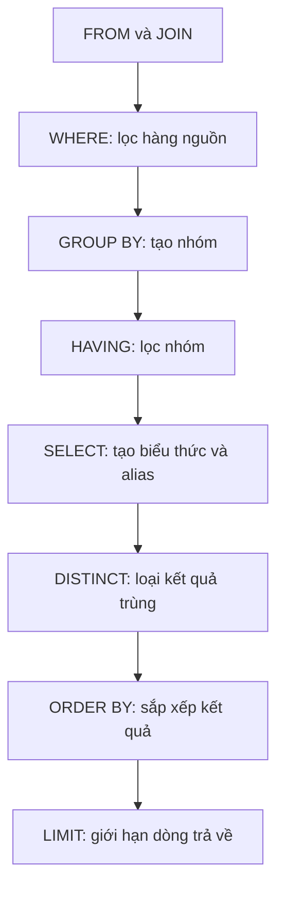

# Quy tắc phân giải bí danh trong WHERE, GROUP BY và ORDER BY

Trong một câu `SELECT`, ta thường đặt bí danh (alias) cho biểu thức để kết quả dễ đọc hơn, chẳng hạn `SUM(total_amount) AS revenue` hoặc `YEAR(created_at) AS order_year`. Bí danh có thể được tham chiếu ở một số mệnh đề như `GROUP BY`, `HAVING` và `ORDER BY` trong MySQL, nhưng không thể dùng trực tiếp trong `WHERE` cùng cấp truy vấn. Ngoài ra, khi bí danh trùng tên một cột nguồn, MySQL có quy tắc ưu tiên khác nhau giữa `ORDER BY` và `GROUP BY`/`HAVING`.

Hiểu đúng phạm vi và thứ tự phân giải bí danh giúp tránh lỗi `Unknown column`, tránh nhóm hoặc sắp xếp theo nhầm cột, đồng thời viết SQL rõ ràng hơn cho ứng dụng **DATABASE_MYSQL**.

## 1. Bí danh cột trong SELECT là gì?

Bí danh đặt tên cho một biểu thức trong danh sách `SELECT`. Có thể dùng từ khóa `AS` để làm rõ:

```sql
SELECT
    order_id,
    quantity * unit_price AS line_total
FROM order_items;
```

Trong kết quả, cột biểu thức `quantity * unit_price` được đặt tên là `line_total`. `AS` có thể được bỏ trong nhiều trường hợp, nhưng nên viết tường minh để tránh việc thiếu dấu phẩy bị hiểu thành bí danh:

```sql
-- Nếu muốn lấy hai cột, dấu phẩy là bắt buộc
SELECT order_id, quantity
FROM orders;

-- Nếu muốn đặt bí danh cho một cột, viết AS tường minh
SELECT order_id AS order_number
FROM orders;

-- Nếu quên dấu phẩy, quantity bị hiểu là bí danh của order_id
SELECT order_id quantity
FROM orders;
```

Bí danh chỉ đổi tên cột trong tập kết quả của truy vấn. Nó không đổi tên cột thật trong bảng và không tự tạo một cột vật lý mới.

## 2. Mệnh đề nào có thể tham chiếu alias?

Trong MySQL, alias của biểu thức `SELECT` có thể được dùng trong `GROUP BY`, `HAVING` và `ORDER BY`. Không thể dùng alias đó trong `WHERE` của cùng query block.

| Mệnh đề | Dùng alias SELECT cùng cấp? | Mục đích |
|---|---|---|
| `WHERE` | Không | Lọc các hàng nguồn trước khi nhóm và tính biểu thức kết quả |
| `GROUP BY` | Có, theo phần mở rộng của MySQL | Gom nhóm theo biểu thức đã đặt bí danh |
| `HAVING` | Có, theo phần mở rộng của MySQL | Lọc nhóm, thường dựa trên kết quả tổng hợp |
| `ORDER BY` | Có | Sắp xếp kết quả theo bí danh |

Ví dụ một alias dùng trong cả `GROUP BY` và `ORDER BY`:

```sql
SELECT
    YEAR(created_at) AS order_year,
    COUNT(*) AS order_count
FROM orders
GROUP BY order_year
ORDER BY order_year;
```

MySQL cho phép `order_year` tham chiếu biểu thức `YEAR(created_at)` trong `GROUP BY` và `ORDER BY`. Dùng bí danh có tên riêng, không trùng với tên cột nguồn, giúp câu SQL dễ đọc và tránh xung đột phân giải.

## 3. Vì sao alias không dùng được trong WHERE?

`WHERE` lọc các hàng đầu vào trước khi các biểu thức trong danh sách `SELECT` được xác định trong ngữ nghĩa truy vấn. Vì vậy, alias được tạo trong `SELECT` chưa nằm trong phạm vi mà `WHERE` có thể tham chiếu.

Ví dụ sau không hợp lệ:

```sql
SELECT
    quantity * unit_price AS line_total
FROM order_items
WHERE line_total > 1000;
```

MySQL có thể báo lỗi `Unknown column 'line_total' in 'where clause'`. Có hai cách viết đúng tùy mục tiêu.

**Cách 1: Viết lại biểu thức trong WHERE**

```sql
SELECT
    quantity * unit_price AS line_total
FROM order_items
WHERE quantity * unit_price > 1000;
```

**Cách 2: Đưa truy vấn vào derived table hoặc CTE**

```sql
SELECT
    item_totals.line_total
FROM (
    SELECT quantity * unit_price AS line_total
    FROM order_items
) AS item_totals
WHERE item_totals.line_total > 1000;
```

Ở query bên ngoài, `line_total` đã là một cột của derived table `item_totals`, nên `WHERE` có thể tham chiếu nó như một cột đầu vào thông thường.

Với CTE trong MySQL 8.0 trở lên:

```sql
WITH item_totals AS (
    SELECT
        order_item_id,
        quantity * unit_price AS line_total
    FROM order_items
)
SELECT order_item_id, line_total
FROM item_totals
WHERE line_total > 1000;
```

Không cần tạo CTE chỉ để né việc lặp một biểu thức ngắn. Derived table/CTE hữu ích khi biểu thức phức tạp, được dùng nhiều lần hoặc cần tách rõ các bước tính toán.

## 4. Dùng alias trong GROUP BY

MySQL cho phép dùng alias trong `GROUP BY`, dù đây là phần mở rộng so với SQL chuẩn. Ví dụ tính tổng doanh thu theo tháng:

```sql
SELECT
    DATE_FORMAT(created_at, '%Y-%m') AS order_month,
    SUM(total_amount) AS revenue
FROM orders
GROUP BY order_month
ORDER BY order_month;
```

`order_month` đại diện cho biểu thức `DATE_FORMAT(created_at, '%Y-%m')`. Câu truy vấn tương đương về ý nghĩa với cách viết lặp biểu thức:

```sql
SELECT
    DATE_FORMAT(created_at, '%Y-%m') AS order_month,
    SUM(total_amount) AS revenue
FROM orders
GROUP BY DATE_FORMAT(created_at, '%Y-%m')
ORDER BY order_month;
```

Nếu cần tương thích với hệ quản trị SQL khác, nên kiểm tra hỗ trợ alias trong `GROUP BY`; cách lặp biểu thức hoặc dùng derived table/CTE thường dễ chuyển đổi hơn.

Không nên dựa vào vị trí cột trong `GROUP BY` như `GROUP BY 1`. Dù MySQL hỗ trợ tham chiếu theo số thứ tự trong một số ngữ cảnh, cách này khó đọc và dễ đổi nghĩa khi danh sách `SELECT` thay đổi. Hãy dùng biểu thức hoặc bí danh có tên rõ ràng.

## 5. Dùng alias trong HAVING

`HAVING` lọc các nhóm sau khi `GROUP BY` tạo nhóm. MySQL cho phép tham chiếu alias của biểu thức tổng hợp trong `HAVING`:

```sql
SELECT
    customer_id,
    SUM(total_amount) AS revenue
FROM orders
GROUP BY customer_id
HAVING revenue > 100000
ORDER BY revenue DESC;
```

Ở đây:

- `WHERE` (nếu có) lọc đơn hàng đầu vào, ví dụ chỉ lấy đơn `PAID`.
- `GROUP BY` gom đơn theo khách hàng.
- `SUM()` tính doanh thu cho từng nhóm.
- `HAVING revenue > 100000` chỉ giữ các nhóm có doanh thu lớn hơn ngưỡng.
- `ORDER BY revenue DESC` sắp xếp nhóm theo doanh thu giảm dần.

Ví dụ kết hợp:

```sql
SELECT
    customer_id,
    SUM(total_amount) AS revenue
FROM orders
WHERE status = 'PAID'
GROUP BY customer_id
HAVING revenue >= 500000
ORDER BY revenue DESC;
```

MySQL hỗ trợ alias trong `HAVING` như một phần mở rộng. Để tăng tính portable, có thể viết lại điều kiện bằng biểu thức tổng hợp:

```sql
HAVING SUM(total_amount) >= 500000
```

Không dùng `HAVING` thay cho `WHERE` khi điều kiện chỉ lọc hàng nguồn. Ví dụ lọc trạng thái đơn hàng nên đặt ở `WHERE`, để giảm số dòng phải nhóm và giúp optimizer có cơ hội áp dụng index sớm hơn.

## 6. Dùng alias trong ORDER BY

`ORDER BY` có thể tham chiếu alias của biểu thức trong danh sách `SELECT`:

```sql
SELECT
    order_id,
    quantity * unit_price AS line_total
FROM order_items
ORDER BY line_total DESC;
```

Có thể sắp xếp theo nhiều bí danh:

```sql
SELECT
    customer_id,
    COUNT(*) AS order_count,
    SUM(total_amount) AS revenue
FROM orders
GROUP BY customer_id
ORDER BY revenue DESC, order_count DESC, customer_id ASC;
```

Nếu có nhiều dòng cùng giá trị sắp xếp, thêm khóa duy nhất làm tie-breaker như `customer_id` để thứ tự kết quả ổn định hơn. Alias chỉ giúp gọi tên biểu thức; nó không làm cho thứ tự trở nên xác định khi các khóa sắp xếp bị trùng.

## 7. Khi alias trùng tên cột nguồn: quy tắc ưu tiên

Đây là trường hợp dễ tạo ra lỗi khó nhận ra. MySQL không áp dụng cùng một thứ tự tìm kiếm tên cho mọi mệnh đề:

- Trong `ORDER BY`, MySQL tìm trong các biểu thức của danh sách `SELECT` trước, sau đó mới tìm cột trong `FROM`.
- Trong `GROUP BY` và `HAVING`, MySQL tìm cột trong `FROM` trước, sau đó mới tìm alias trong danh sách `SELECT`.

Vì vậy, cùng một tên không định danh có thể trỏ đến hai biểu thức khác nhau tùy mệnh đề.

### Ví dụ alias trùng tên khóa chính

Giả sử bảng `demo` có hai cột `id` và `code`, trong đó `id` là khóa chính:

```sql
CREATE TABLE demo (
    id INT NOT NULL PRIMARY KEY,
    code INT NOT NULL
);

INSERT INTO demo (id, code)
VALUES (1, 90), (2, 20), (3, 50);
```

Xét truy vấn:

```sql
SELECT
    code AS id,
    COUNT(*) AS row_count
FROM demo
GROUP BY id
ORDER BY id;
```

Tên `id` được dùng ở hai mệnh đề với hai ý nghĩa:

- `GROUP BY id` được phân giải thành cột `demo.id` trong `FROM`, vì tên cột nguồn được ưu tiên trong `GROUP BY`.
- `ORDER BY id` được phân giải thành alias `code AS id` trong danh sách `SELECT`, vì alias được ưu tiên trong `ORDER BY`.

Truy vấn này nhóm theo khóa chính `demo.id`, nên mỗi nhóm có một dòng; kết quả được sắp xếp theo giá trị `code` được xuất ra dưới tên `id`. Cách viết này hợp lệ nhưng gây bất ngờ khi đọc. Tránh đặt alias trùng tên cột nguồn.

### Cách làm rõ ý định

Nếu muốn tham chiếu cột nguồn, hãy dùng tên có định danh bảng:

```sql
GROUP BY demo.id
```

Nếu muốn dùng alias, hãy đặt một tên không trùng với bất kỳ cột nguồn nào:

```sql
SELECT
    code AS displayed_code,
    COUNT(*) AS row_count
FROM demo
GROUP BY demo.id
ORDER BY displayed_code;
```

Tên alias rõ ràng và việc định danh cột nguồn giúp người đọc biết chính xác biểu thức đang được nhóm hoặc sắp xếp.

## 8. Ambiguity trong GROUP BY và HAVING

Khi tên không định danh xuất hiện vừa là cột của bảng nguồn vừa là alias trong danh sách `SELECT`, `GROUP BY` và `HAVING` ưu tiên cột trong `FROM`. Trong trường hợp `HAVING` có tên mơ hồ giữa cột nhóm và alias, MySQL có thể phát cảnh báo; quy tắc ưu tiên được dành cho cột được dùng trong `GROUP BY`.

Ví dụ, nếu bảng `payments` có cột `amount` và truy vấn đặt một alias khác cũng tên `amount`, người đọc khó biết mệnh đề sau đang dùng tên nào:

```sql
SELECT
    ABS(amount) AS amount,
    COUNT(*) AS payment_count
FROM payments
GROUP BY amount
HAVING amount > 0;
```

Trong `GROUP BY` và `HAVING`, tên `amount` được tìm ở bảng nguồn trước. Không nên dựa vào việc MySQL sẽ đoán theo ý người viết. Hãy đổi alias, ví dụ `absolute_amount`, hoặc định danh rõ cột nguồn bằng `payments.amount`.

Quy tắc đặt tên thực tế:

- Không đặt alias trùng với tên cột trong các bảng thuộc `FROM`.
- Dùng tiền tố hoặc hậu tố có ý nghĩa cho biểu thức tổng hợp, ví dụ `total_revenue`, `order_count`, `normalized_name`.
- Khi truy vấn nhiều bảng có cột cùng tên, luôn định danh `table_alias.column_name`.
- Nếu truy vấn phức tạp, tách thành CTE/derived table với schema kết quả có tên cột rõ ràng.

## 9. Dùng dấu nháy cho alias đúng cách

MySQL cho phép đặt alias có khoảng trắng hoặc ký tự đặc biệt bằng identifier quoting. Ví dụ:

```sql
SELECT SUM(total_amount) AS `Total revenue`
FROM orders;
```

Khi tham chiếu alias ở mệnh đề khác, dùng backtick hoặc tên identifier không cần quote:

```sql
SELECT SUM(total_amount) AS `Total revenue`
FROM orders
ORDER BY `Total revenue` DESC;
```

Không dùng dấu nháy đơn để tham chiếu alias trong `GROUP BY` hoặc `ORDER BY`:

```sql
-- 'revenue' là string literal, không phải tham chiếu alias
SELECT SUM(total_amount) AS revenue
FROM orders
GROUP BY 'revenue';
```

Ở vị trí tham chiếu alias, dấu nháy đơn biểu diễn một chuỗi literal. Dùng identifier quoting bằng backtick nếu alias cần quote. Tốt nhất, đặt alias ngắn, không có khoảng trắng và không cần quote để SQL dễ đọc.

## 10. Alias không dùng được trong biểu thức khác cùng SELECT list

Alias của một select expression không phải biến trung gian có thể dùng cho các select expression đứng sau trong cùng danh sách:

```sql
-- Không hợp lệ trong MySQL
SELECT
    quantity * unit_price AS line_total,
    line_total * 0.1 AS tax_amount
FROM order_items;
```

Để tái sử dụng kết quả, lặp lại biểu thức:

```sql
SELECT
    quantity * unit_price AS line_total,
    quantity * unit_price * 0.1 AS tax_amount
FROM order_items;
```

Hoặc đưa biểu thức vào derived table/CTE:

```sql
SELECT
    item_totals.line_total,
    item_totals.line_total * 0.1 AS tax_amount
FROM (
    SELECT
        order_item_id,
        quantity * unit_price AS line_total
    FROM order_items
) AS item_totals;
```

Ở query ngoài, `line_total` là cột đầu vào của derived table nên có thể được dùng trong biểu thức khác.

## 11. Thứ tự xử lý logic và cách hiểu alias

Để hiểu vì sao alias không có trong `WHERE`, có thể hình dung thứ tự xử lý logic khái quát của một truy vấn như sau:



Đây là thứ tự ngữ nghĩa để suy luận phạm vi biểu thức, không phải lời khẳng định optimizer luôn thực thi vật lý đúng tuần tự như sơ đồ. Optimizer có thể biến đổi kế hoạch để chạy hiệu quả hơn mà vẫn giữ ngữ nghĩa truy vấn.

MySQL có phần mở rộng cho phép `GROUP BY` và `HAVING` tham chiếu alias dù về mặt ngữ nghĩa danh sách `SELECT` được hình thành sau các mệnh đề đó. Vì vậy, cần nhớ đây là quy tắc phân giải tên của MySQL, không nên suy luận rằng alias đã tồn tại ở mọi mệnh đề chỉ vì nó được khai báo trong `SELECT`.

## 12. Checklist khi truy vấn báo Unknown column hoặc nhóm/sắp xếp sai

1. Kiểm tra alias có được khai báo trong đúng query block hay không.
2. Nếu lỗi xuất hiện trong `WHERE`, thay alias bằng biểu thức gốc hoặc bọc truy vấn trong CTE/derived table.
3. Nếu dùng alias trong `GROUP BY`/`HAVING`, kiểm tra có cột nguồn trùng tên không; cột trong `FROM` được ưu tiên.
4. Nếu dùng alias trong `ORDER BY`, nhớ rằng alias trong `SELECT` được ưu tiên trước cột nguồn.
5. Định danh cột nguồn bằng `table_alias.column_name` khi có nhiều bảng hoặc tên mơ hồ.
6. Tránh alias trùng tên cột, tên alias trùng nhau hoặc alias chứa khoảng trắng không cần thiết.
7. Dùng backtick khi cần quote identifier; không dùng dấu nháy đơn để tham chiếu alias.
8. Chỉ dùng `HAVING` cho điều kiện lọc nhóm; điều kiện lọc hàng nguồn nên đặt ở `WHERE`.
9. Nếu cần tương thích hệ quản trị khác, kiểm tra các phần mở rộng MySQL như alias trong `GROUP BY` và `HAVING`.

## 13. Bài tập thực hành

Giả sử có bảng `orders(order_id, customer_id, status, total_amount, created_at)` và `order_items(order_item_id, order_id, quantity, unit_price)`.

1. Tạo alias `line_total` cho `quantity * unit_price`; thử dùng alias trong `WHERE` và quan sát lỗi.
2. Viết lại điều kiện bằng biểu thức gốc, sau đó viết lại bằng derived table để lọc theo `line_total`.
3. Tạo báo cáo doanh thu theo khách hàng với alias `revenue`; dùng alias trong `HAVING` và `ORDER BY`.
4. Tạo alias `order_month` từ `DATE_FORMAT(created_at, '%Y-%m')`; dùng alias trong `GROUP BY` và `ORDER BY`.
5. Tạo bảng thử nghiệm có hai cột `id` và `code`; viết truy vấn `SELECT code AS id ... GROUP BY id ORDER BY id` để quan sát quy tắc ưu tiên khác nhau.
6. Đổi alias để không trùng cột nguồn, định danh cột bằng table alias và so sánh độ rõ ràng của truy vấn.
7. Thử alias có khoảng trắng; tham chiếu bằng backtick rồi thử dấu nháy đơn để phân biệt identifier với string literal.

Bạn hoàn thành bài khi biết chính xác alias nào dùng được trong từng mệnh đề, giải thích được sự khác nhau về thứ tự phân giải tên giữa `ORDER BY` và `GROUP BY`/`HAVING`, và có thể viết lại truy vấn khi alias chưa nằm trong phạm vi. Hãy đặt alias duy nhất, có nghĩa và không trùng tên cột nguồn để SQL luôn dễ đọc và dễ bảo trì.
