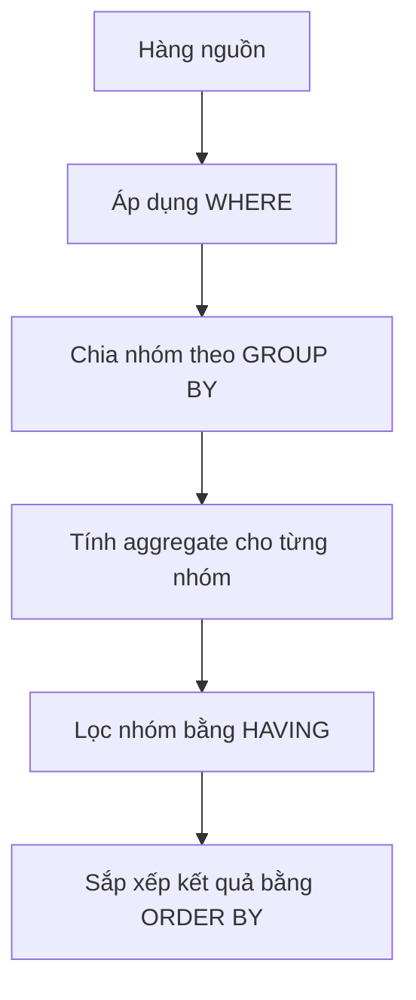

# GROUP BY theo một cột, khóa ghép hoặc biểu thức

`GROUP BY` gom các hàng có cùng giá trị ở một hoặc nhiều khóa nhóm thành từng nhóm để tính số lượng, tổng tiền, trung bình hoặc các chỉ số khác. Chọn khóa nhóm quyết định độ chi tiết của báo cáo: nhóm theo khách hàng tạo một hàng cho mỗi khách hàng; nhóm theo khách hàng và trạng thái tạo một hàng cho mỗi tổ hợp; nhóm theo biểu thức ngày có thể tạo một hàng cho mỗi tháng hoặc mỗi ngày.

Nếu chọn thiếu khóa nhóm, các nhóm có thể bị gộp sai nghiệp vụ. Nếu thêm quá nhiều khóa, một báo cáo đáng lẽ có một hàng cho mỗi khách hàng lại bị chia thành nhiều hàng nhỏ. Vì vậy, trước khi viết SQL, cần xác định rõ một hàng kết quả đại diện cho điều gì.

Bài học thuộc module **DATABASE_MYSQL**. Module hướng tới việc làm chủ MySQL từ thiết kế bảng, kiểu dữ liệu, khóa và truy vấn SQL đến index, transaction và kiểm soát đồng thời; đồng thời thực hành đọc kế hoạch thực thi, tối ưu truy vấn, phân quyền, sao lưu và xử lý các vấn đề vận hành cơ sở dữ liệu quan hệ. Trong chương **Gom nhóm và tập hợp**, bài này tập trung vào cách chọn khóa nhóm từ một cột, nhiều cột hoặc biểu thức để kết quả tổng hợp phản ánh đúng nghiệp vụ.

## 1. GROUP BY tạo ra những nhóm nào?

`GROUP BY` chia tập hàng đầu vào thành các nhóm dựa trên giá trị của danh sách biểu thức được chỉ định. Mỗi tổ hợp giá trị nhóm tạo ra một nhóm kết quả. Các hàm tổng hợp như `COUNT()`, `SUM()`, `AVG()`, `MIN()` và `MAX()` tính trên các hàng thuộc từng nhóm.



Ví dụ bảng `orders`:

| order_id | tenant_id | customer_id | status | total_amount |
|---:|---:|---:|---|---:|
| 1001 | 1 | 101 | PAID | 250000 |
| 1002 | 1 | 101 | SHIPPED | 180000 |
| 1003 | 1 | 102 | PAID | 420000 |
| 1004 | 2 | 101 | PAID | 90000 |
| 1005 | 2 | 101 | CANCELLED | 50000 |

Truy vấn:

```sql
SELECT
    tenant_id,
    customer_id,
    COUNT(*) AS order_count,
    SUM(total_amount) AS revenue
FROM orders
GROUP BY tenant_id, customer_id;
```

Kết quả có một hàng cho mỗi tổ hợp `(tenant_id, customer_id)`. Khách hàng 101 xuất hiện ở cả tenant 1 và tenant 2, vì vậy hai nhóm đó không bị gộp chung.

## 2. Xác định grain trước khi chọn khóa nhóm

**Grain** là mức chi tiết mà mỗi hàng kết quả đại diện. Đây là quyết định quan trọng nhất khi thiết kế báo cáo tổng hợp.

Ví dụ, cùng một bảng `orders` có thể tạo các báo cáo khác nhau:

| Yêu cầu | Grain của kết quả | Khóa nhóm gợi ý |
|---|---|---|
| Tổng doanh thu mỗi tenant | Một hàng mỗi tenant | `tenant_id` |
| Tổng doanh thu mỗi khách hàng trong từng tenant | Một hàng mỗi tenant và khách hàng | `tenant_id, customer_id` |
| Số đơn theo trạng thái | Một hàng mỗi trạng thái | `status` |
| Số đơn theo khách hàng và trạng thái | Một hàng mỗi khách hàng trong từng trạng thái | `customer_id, status` hoặc thêm `tenant_id` nếu dữ liệu đa tenant |
| Doanh thu theo tháng | Một hàng mỗi tháng | `YEAR(created_at), MONTH(created_at)` |
| Doanh thu theo khách hàng trong từng tháng | Một hàng mỗi khách hàng và tháng | `customer_id` cùng biểu thức tháng; thêm `tenant_id` nếu cần |

Hãy diễn đạt yêu cầu thành câu “mỗi hàng kết quả đại diện cho ...” trước khi viết `GROUP BY`. Nếu chưa thể hoàn thành câu này, khóa nhóm thường chưa được xác định rõ.

## 3. GROUP BY theo một cột

Đây là trường hợp đơn giản nhất: một nhóm cho mỗi giá trị khác nhau của một column.

```sql
SELECT
    status,
    COUNT(*) AS order_count,
    SUM(total_amount) AS total_revenue
FROM orders
GROUP BY status
ORDER BY status;
```

Kết quả có một hàng cho mỗi trạng thái. Tất cả đơn `PAID` thuộc cùng một nhóm, các đơn `SHIPPED` thuộc nhóm khác, v.v.

### 3.1. Đếm số hàng theo một thuộc tính

```sql
SELECT
    customer_id,
    COUNT(*) AS order_count
FROM orders
GROUP BY customer_id
ORDER BY order_count DESC, customer_id;
```

Truy vấn cho biết mỗi khách hàng có bao nhiêu đơn. `COUNT(*)` đếm tất cả hàng trong nhóm, kể cả khi một column bất kỳ có giá trị `NULL`.

Nếu muốn đếm số giá trị khác `NULL` của một column, dùng `COUNT(column)`:

```sql
SELECT
    customer_id,
    COUNT(shipped_at) AS shipped_order_count
FROM orders
GROUP BY customer_id;
```

`COUNT(shipped_at)` chỉ đếm hàng có `shipped_at` khác `NULL`; nó không nhất thiết tương đương số đơn hàng.

### 3.2. Nhóm theo một cột nhưng lấy nhiều chỉ số

```sql
SELECT
    status,
    COUNT(*) AS order_count,
    SUM(total_amount) AS total_amount,
    AVG(total_amount) AS average_amount,
    MIN(total_amount) AS smallest_order,
    MAX(total_amount) AS largest_order
FROM orders
GROUP BY status;
```

Mọi aggregate đều được tính độc lập trên cùng nhóm. `MIN(total_amount)` và `MAX(total_amount)` trả về giá trị nhỏ nhất/lớn nhất của column đó; chúng không tự lấy các column khác từ cùng một hàng nguồn.

### 3.3. Nhóm theo column có thể NULL

Các hàng có `NULL` ở khóa nhóm được gom vào cùng một nhóm `NULL`:

```sql
SELECT
    shipping_method,
    COUNT(*) AS order_count
FROM orders
GROUP BY shipping_method;
```

Nếu nhiều đơn chưa có `shipping_method`, chúng cùng xuất hiện trong nhóm `NULL`. Có thể trình bày nhãn dễ đọc bằng `COALESCE()`:

```sql
SELECT
    COALESCE(shipping_method, 'NOT_ASSIGNED') AS shipping_method,
    COUNT(*) AS order_count
FROM orders
GROUP BY COALESCE(shipping_method, 'NOT_ASSIGNED');
```

Chỉ thay `NULL` bằng một nhãn nếu nhãn đó không thể trùng với giá trị nghiệp vụ hợp lệ. Nếu chuỗi `'NOT_ASSIGNED'` cũng có thể là giá trị thật, việc thay thế có thể gộp hai nhóm khác ý nghĩa. Khi đó, nên giữ `NULL` hoặc nhóm theo biểu thức phân biệt rõ trạng thái thiếu.

## 4. GROUP BY theo nhiều cột: khóa ghép của báo cáo

Khi một nhóm được xác định bởi tổ hợp nhiều column, liệt kê tất cả các column trong `GROUP BY`:

```sql
SELECT
    tenant_id,
    customer_id,
    status,
    COUNT(*) AS order_count,
    SUM(total_amount) AS revenue
FROM orders
GROUP BY tenant_id, customer_id, status
ORDER BY tenant_id, customer_id, status;
```

Mỗi tổ hợp `(tenant_id, customer_id, status)` là một nhóm riêng. Một khách hàng có nhiều trạng thái đơn sẽ có nhiều hàng kết quả; cùng một `customer_id` ở hai tenant khác nhau cũng không bị nhập làm một.

### 4.1. Thêm cột vào GROUP BY làm thay đổi độ chi tiết

So sánh hai truy vấn:

```sql
-- Một hàng cho mỗi khách hàng trong tenant.
SELECT tenant_id, customer_id, SUM(total_amount) AS revenue
FROM orders
GROUP BY tenant_id, customer_id;

-- Một hàng cho mỗi khách hàng, tenant và trạng thái.
SELECT tenant_id, customer_id, status, SUM(total_amount) AS revenue
FROM orders
GROUP BY tenant_id, customer_id, status;
```

Truy vấn thứ hai có grain chi tiết hơn. Tổng doanh thu ở cấp khách hàng được chia thành các phần theo trạng thái. Nếu báo cáo chỉ cần tổng theo khách hàng, thêm `status` vào nhóm sẽ làm kết quả bị chia nhỏ ngoài yêu cầu.

### 4.2. Thứ tự cột trong GROUP BY

Về mặt xác định các nhóm, `GROUP BY a, b` và `GROUP BY b, a` tạo cùng các tổ hợp giá trị. Tuy nhiên, thứ tự cột có thể ảnh hưởng khả năng tận dụng index ghép và cách optimizer thực hiện truy vấn.

Ví dụ index:

```sql
CREATE INDEX idx_orders_tenant_customer_status
    ON orders (tenant_id, customer_id, status);
```

Index này có thứ tự trái sang phải. Nó có thể hỗ trợ truy vấn theo tiền tố `(tenant_id)`, `(tenant_id, customer_id)` hoặc cả ba cột, tùy điều kiện và kế hoạch. Nó không tương đương với index bắt đầu bằng `status` khi truy vấn chỉ lọc theo `status`.

Không đổi thứ tự `GROUP BY` chỉ để khớp index mà không kiểm tra kế hoạch và yêu cầu lọc. Hãy thiết kế index theo workload tổng thể, gồm cả `WHERE`, `JOIN`, `GROUP BY` và `ORDER BY`.

### 4.3. Khóa ghép trong schema và khóa nhóm không phải cùng một khái niệm

Một khóa chính ghép trong schema là constraint bảo đảm tính duy nhất của tổ hợp cột trong bảng. Danh sách cột trong `GROUP BY` là quy tắc gom hàng của một truy vấn. Chúng có thể giống nhau nhưng không bắt buộc.

Ví dụ bảng `order_items` có khóa chính ghép `(order_id, line_no)`. Nếu muốn tính tổng số lượng theo đơn, chỉ nhóm theo `order_id`; nếu muốn mỗi dòng hàng thành một nhóm, nhóm theo cả `order_id, line_no`.

```sql
-- Một nhóm cho mỗi đơn hàng.
SELECT order_id, SUM(quantity) AS total_quantity
FROM order_items
GROUP BY order_id;

-- Một nhóm cho mỗi dòng hàng; vì khóa ghép là duy nhất nên mỗi nhóm thường có một hàng.
SELECT order_id, line_no, SUM(quantity) AS line_quantity
FROM order_items
GROUP BY order_id, line_no;
```

Đừng đưa tất cả cột của primary key vào `GROUP BY` theo thói quen. Hãy chọn khóa nhóm theo grain mong muốn.

## 5. Functional dependency và ONLY_FULL_GROUP_BY

Nếu một column được xác định duy nhất bởi khóa nhóm, MySQL có thể cho phép column đó xuất hiện trong `SELECT` dù không được viết trong `GROUP BY` và không nằm trong hàm tổng hợp.

Ví dụ `customers.customer_id` là primary key:

```sql
SELECT
    c.customer_id,
    c.full_name,
    c.email,
    COUNT(o.order_id) AS order_count
FROM customers AS c
LEFT JOIN orders AS o
    ON o.customer_id = c.customer_id
GROUP BY c.customer_id;
```

`customer_id` xác định duy nhất `full_name` và `email` trong bảng `customers`. Đây là functional dependency. `ONLY_FULL_GROUP_BY` kiểm tra tính xác định này để tránh lấy tùy tiện một giá trị trong nhóm.

Kiểm tra mode trên session hiện tại:

```sql
SELECT @@SESSION.sql_mode;
```

Nếu biểu thức không nằm trong `GROUP BY`, không được tổng hợp và không phụ thuộc hàm theo cách MySQL nhận diện, truy vấn có thể báo lỗi 1055. Không tắt mode để che một khóa nhóm sai. Hãy xem lại grain, đưa chiều phân loại còn thiếu vào nhóm hoặc chọn hàng bằng một quy tắc xác định.

Một unique key nullable cần được xem xét cẩn thận: unique index có thể cho phép nhiều `NULL`, nên không phải mọi cột unique đều bảo đảm một giá trị duy nhất cho tất cả hàng. Khi dựa vào phụ thuộc hàm, cần xét toàn bộ cột khóa và `NOT NULL`.

## 6. GROUP BY theo biểu thức

Khóa nhóm không bắt buộc là một column vật lý. Có thể nhóm theo phép tính hoặc hàm được áp dụng trên một hay nhiều column.

### 6.1. Nhóm theo ngày từ DATETIME

Giả sử `created_at` lưu ngày giờ. Muốn đếm số đơn theo ngày:

```sql
SELECT
    DATE(created_at) AS order_date,
    COUNT(*) AS order_count,
    SUM(total_amount) AS revenue
FROM orders
GROUP BY DATE(created_at)
ORDER BY order_date;
```

Mọi hàng có cùng ngày được gom vào một nhóm, bất kể giờ, phút hoặc giây. Biểu thức `DATE(created_at)` trả về phần ngày.

Nếu `created_at` là `TIMESTAMP`, giá trị được diễn giải theo múi giờ session. Do đó ngày nhóm có thể thay đổi khi session time zone thay đổi. Với báo cáo theo ngày địa phương, hãy thiết lập session đúng múi giờ nghiệp vụ hoặc chuyển đổi thời điểm theo quy tắc đã thống nhất trước khi lấy ngày.

### 6.2. Nhóm theo năm và tháng

```sql
SELECT
    YEAR(created_at) AS order_year,
    MONTH(created_at) AS order_month,
    COUNT(*) AS order_count,
    SUM(total_amount) AS revenue
FROM orders
GROUP BY YEAR(created_at), MONTH(created_at)
ORDER BY order_year, order_month;
```

Hai biểu thức năm và tháng tạo thành khóa nhóm. Không nhóm chỉ theo `MONTH(created_at)` nếu dữ liệu có nhiều năm, vì tháng 1 của các năm khác nhau sẽ bị gộp chung.

Nếu chỉ cần một nhãn tháng dạng `2026-05`, có thể dùng `DATE_FORMAT()`:

```sql
SELECT
    DATE_FORMAT(created_at, '%Y-%m') AS order_month,
    COUNT(*) AS order_count,
    SUM(total_amount) AS revenue
FROM orders
GROUP BY DATE_FORMAT(created_at, '%Y-%m')
ORDER BY order_month;
```

`DATE_FORMAT()` trả về chuỗi. Nếu cần dùng tháng như một giá trị ngày để join hoặc tính toán tiếp, hãy cân nhắc tạo ngày đầu tháng bằng biểu thức ngày thay vì lưu nhãn chuỗi.

### 6.3. Nhóm theo phép tính số học

Có thể chia dữ liệu thành các khoảng theo giá trị:

```sql
SELECT
    FLOOR(total_amount / 100000) AS amount_bucket,
    COUNT(*) AS order_count,
    SUM(total_amount) AS bucket_total
FROM orders
GROUP BY FLOOR(total_amount / 100000)
ORDER BY amount_bucket;
```

Ví dụ, `amount_bucket = 2` đại diện cho khoảng từ 200.000 đến dưới 300.000 nếu `total_amount` không âm. Cần mô tả rõ đơn vị và cách xử lý giá trị âm, `NULL`, hoặc đúng ranh giới.

### 6.4. Nhóm theo CASE để tạo bucket nghiệp vụ

Khi nhóm theo nhãn do nghiệp vụ định nghĩa, dùng `CASE`:

```sql
SELECT
    CASE
        WHEN total_amount < 100000 THEN 'SMALL'
        WHEN total_amount < 500000 THEN 'MEDIUM'
        ELSE 'LARGE'
    END AS amount_segment,
    COUNT(*) AS order_count,
    SUM(total_amount) AS revenue
FROM orders
GROUP BY
    CASE
        WHEN total_amount < 100000 THEN 'SMALL'
        WHEN total_amount < 500000 THEN 'MEDIUM'
        ELSE 'LARGE'
    END
ORDER BY amount_segment;
```

Các nhánh `CASE` được đánh giá theo thứ tự; một giá trị thỏa nhánh đầu tiên sẽ không tiếp tục xét nhánh sau. Với `total_amount IS NULL`, không điều kiện so sánh nào đúng nên hàng rơi vào nhánh `ELSE` trong ví dụ này. Nếu `NULL` cần một nhóm riêng, hãy thêm `WHEN total_amount IS NULL THEN 'UNKNOWN'` trước các ngưỡng.

Lặp lại biểu thức dài trong `SELECT` và `GROUP BY` dễ gây sai khác khi bảo trì. Có thể đưa biểu thức vào derived table rồi nhóm theo alias ở truy vấn ngoài:

```sql
SELECT
    categorized.amount_segment,
    COUNT(*) AS order_count,
    SUM(categorized.total_amount) AS revenue
FROM (
    SELECT
        total_amount,
        CASE
            WHEN total_amount IS NULL THEN 'UNKNOWN'
            WHEN total_amount < 100000 THEN 'SMALL'
            WHEN total_amount < 500000 THEN 'MEDIUM'
            ELSE 'LARGE'
        END AS amount_segment
    FROM orders
) AS categorized
GROUP BY categorized.amount_segment
ORDER BY categorized.amount_segment;
```

Derived table làm rõ từng bước và dùng được trên các phiên bản MySQL hỗ trợ subquery trong `FROM`.

## 7. Alias trong GROUP BY và vị trí số

MySQL cho phép tham chiếu select-list alias trong `GROUP BY` ở nhiều trường hợp:

```sql
SELECT
    DATE(created_at) AS order_date,
    COUNT(*) AS order_count
FROM orders
GROUP BY order_date;
```

Tuy nhiên, alias có thể gây nhầm khi trùng tên column hoặc khi chuyển truy vấn sang hệ quản trị khác. Dùng biểu thức tường minh hoặc derived table nếu cần tính di động và dễ đọc.

MySQL cũng hỗ trợ tham chiếu vị trí select list:

```sql
SELECT customer_id, status, COUNT(*) AS order_count
FROM orders
GROUP BY 1, 2;
```

`1` và `2` ở đây lần lượt chỉ biểu thức đầu và thứ hai trong `SELECT`. Cách viết này ngắn nhưng dễ bị thay đổi ý nghĩa khi ai đó chèn hoặc đổi thứ tự cột. Với code ứng dụng và migration lâu dài, nên ghi tên column hoặc biểu thức rõ ràng.

Tham chiếu vị trí số trong `GROUP BY` đã bị deprecated từ MySQL 8.0. Dùng tên column, biểu thức hoặc alias phù hợp để tránh phụ thuộc vào cú pháp cũ.

## 8. WHERE, GROUP BY và HAVING

`WHERE` lọc hàng trước khi nhóm. `HAVING` lọc nhóm sau khi aggregate đã được tính. Đặt đúng điều kiện ở đúng giai đoạn vừa giúp SQL rõ nghĩa vừa có thể giảm lượng dữ liệu cần xử lý.

```sql
SELECT
    customer_id,
    COUNT(*) AS order_count,
    SUM(total_amount) AS revenue
FROM orders
WHERE created_at >= '2026-01-01'
  AND created_at <  '2027-01-01'
  AND status <> 'CANCELLED'
GROUP BY customer_id
HAVING SUM(total_amount) >= 1000000
ORDER BY revenue DESC, customer_id;
```

Trình tự ý nghĩa:

1. `WHERE` chỉ đưa đơn trong năm 2026 và không bị hủy vào tập đầu vào.
2. `GROUP BY` tạo một nhóm cho mỗi khách hàng.
3. `COUNT()` và `SUM()` tính chỉ số cho từng nhóm.
4. `HAVING` loại nhóm có doanh thu dưới một triệu.
5. `ORDER BY` sắp xếp các hàng kết quả.

Nếu chỉ cần lọc theo trạng thái, đặt điều kiện ở `WHERE`; không cần nhóm tất cả trạng thái rồi dùng `HAVING` để loại chúng. Ngược lại, điều kiện dựa trên tổng doanh thu phải đặt ở `HAVING` vì chưa tồn tại trước khi nhóm.

### 8.1. Lọc theo biểu thức nhóm

Muốn chỉ lấy các ngày có ít nhất 100 đơn:

```sql
SELECT
    DATE(created_at) AS order_date,
    COUNT(*) AS order_count
FROM orders
WHERE created_at >= '2026-01-01'
  AND created_at <  '2027-01-01'
GROUP BY DATE(created_at)
HAVING COUNT(*) >= 100
ORDER BY order_date;
```

Không thể thay `HAVING COUNT(*) >= 100` bằng `WHERE COUNT(*) >= 100`, vì aggregate chưa được tính ở giai đoạn lọc hàng.

## 9. NULL và collation ảnh hưởng cách nhóm

### 9.1. Các giá trị NULL tạo thành một nhóm

Trong `GROUP BY`, các giá trị `NULL` của cùng biểu thức nhóm được xếp vào cùng một nhóm. Điều này khác với phép so sánh `NULL = NULL`, vốn không trả về TRUE trong SQL.

```sql
SELECT
    coupon_code,
    COUNT(*) AS order_count
FROM orders
GROUP BY coupon_code;
```

Tất cả đơn không có `coupon_code` được tính chung trong nhóm `NULL`. Nếu cần đếm riêng số hàng thiếu mã, có thể viết:

```sql
SELECT
    COUNT(*) AS all_orders,
    COUNT(coupon_code) AS orders_with_coupon,
    SUM(coupon_code IS NULL) AS orders_without_coupon
FROM orders;
```

### 9.2. Collation quyết định cách nhóm chuỗi

Khi nhóm theo column chuỗi, collation ảnh hưởng việc hai chuỗi có được xem là tương đương hay không. Với collation không phân biệt hoa/thường, `Hanoi` và `hanoi` có thể nằm trong cùng một nhóm. Với collation không phân biệt dấu, những chuỗi chỉ khác dấu có thể được xem là tương đương theo quy tắc collation.

Kiểm tra collation:

```sql
SHOW FULL COLUMNS FROM customers;
```

Hoặc:

```sql
SELECT
    COLUMN_NAME,
    CHARACTER_SET_NAME,
    COLLATION_NAME
FROM INFORMATION_SCHEMA.COLUMNS
WHERE TABLE_SCHEMA = DATABASE()
  AND TABLE_NAME = 'customers'
  AND COLUMN_NAME = 'city';
```

Nếu nghiệp vụ cần phân biệt hoa/thường hoặc dấu, hãy chọn collation phù hợp với yêu cầu đó và kiểm tra trên phiên bản MySQL mục tiêu. Không giả định số nhóm bằng số chuỗi khác nhau về byte.

### 9.3. Giá trị hiển thị của nhóm chuỗi tương đương

Khi collation xem nhiều chuỗi là tương đương, một nhóm có thể chứa các cách viết khác nhau. Nếu cần hiển thị tên chuẩn, hãy lưu hoặc tra cứu một giá trị chuẩn hóa riêng; không dựa vào việc một giá trị nguồn ngẫu nhiên sẽ đại diện ổn định cho cả nhóm.

## 10. GROUP BY và hàm tổng hợp

Các hàm tổng hợp thường được dùng với nhóm:

| Hàm | Công dụng | Lưu ý |
|---|---|---|
| `COUNT(*)` | Đếm mọi hàng | Không bỏ hàng có `NULL`. |
| `COUNT(expr)` | Đếm biểu thức khác `NULL` | Có thể khác `COUNT(*)`. |
| `COUNT(DISTINCT expr)` | Đếm giá trị phân biệt | Bỏ qua `NULL`; có thể tốn tài nguyên. |
| `SUM(expr)` | Tổng giá trị | Trả `NULL` nếu không có giá trị đầu vào khác `NULL`. |
| `AVG(expr)` | Trung bình | Tính trên giá trị khác `NULL`. |
| `MIN(expr)` / `MAX(expr)` | Nhỏ nhất/lớn nhất | Không lấy các column khác từ cùng một hàng. |
| `GROUP_CONCAT(expr)` | Nối giá trị thành chuỗi | Có giới hạn độ dài và thứ tự riêng bên trong hàm. |

Ví dụ:

```sql
SELECT
    status,
    COUNT(*) AS row_count,
    COUNT(shipped_at) AS shipped_count,
    COUNT(DISTINCT customer_id) AS unique_customers,
    COALESCE(SUM(total_amount), 0) AS revenue,
    AVG(total_amount) AS average_amount
FROM orders
GROUP BY status;
```

`COALESCE(SUM(...), 0)` chỉ nên dùng nếu báo cáo định nghĩa tổng không có dữ liệu là 0. `NULL` và 0 có ý nghĩa khác nhau; đừng thay thế chúng một cách máy móc.

Nếu cần nối danh sách có thứ tự:

```sql
SELECT
    customer_id,
    GROUP_CONCAT(
        order_id
        ORDER BY created_at DESC, order_id DESC
        SEPARATOR ', '
    ) AS recent_order_ids
FROM orders
GROUP BY customer_id;
```

Thứ tự phần tử phải được khai báo bên trong `GROUP_CONCAT()`. `ORDER BY` bên ngoài chỉ sắp xếp các nhóm kết quả.

## 11. GROUP BY và JOIN: giữ đúng grain

Một truy vấn có thể nhóm đúng cú pháp nhưng vẫn tính sai tổng vì JOIN làm nhân bản hàng. Giả sử mỗi đơn có nhiều dòng hàng và nhiều lần thanh toán. Join trực tiếp cả hai bảng con theo `order_id` có thể tạo tích giữa dòng hàng và lần thanh toán.

Ví dụ nếu một đơn có 3 dòng hàng và 2 lần thanh toán, join trực tiếp có thể tạo 6 hàng. Khi đó `SUM(order_items.quantity * unit_price)` và `SUM(payments.paid_amount)` đều có nguy cơ bị nhân lên.

Hãy tổng hợp từng bảng con về đúng grain trước khi join:

```sql
SELECT
    o.order_id,
    i.item_total,
    p.paid_total
FROM orders AS o
LEFT JOIN (
    SELECT
        order_id,
        SUM(quantity * unit_price) AS item_total
    FROM order_items
    GROUP BY order_id
) AS i
    ON i.order_id = o.order_id
LEFT JOIN (
    SELECT
        order_id,
        SUM(paid_amount) AS paid_total
    FROM payments
    GROUP BY order_id
) AS p
    ON p.order_id = o.order_id;
```

Mỗi derived table chỉ có tối đa một hàng cho mỗi `order_id`. Khi join với `orders`, phép join không nhân các dòng hàng với các lần thanh toán.

Trước mỗi lần JOIN, hãy hỏi: một hàng ở phía trái có thể khớp bao nhiêu hàng ở phía phải? Nếu cả hai phía đều một-nhiều, cần xem xét tổng hợp trước hoặc thay đổi cách truy vấn.

## 12. GROUP BY không bảo đảm thứ tự kết quả

Không dựa vào thứ tự hàng được trả về chỉ vì truy vấn có `GROUP BY`. Nếu ứng dụng cần thứ tự cụ thể, luôn dùng `ORDER BY`:

```sql
SELECT
    status,
    COUNT(*) AS order_count
FROM orders
GROUP BY status
ORDER BY order_count DESC, status ASC;
```

Thêm tie-breaker như `status` giúp thứ tự ổn định khi hai nhóm có cùng `order_count`. Nếu cần phân trang trên kết quả nhóm, hãy sắp xếp theo khóa nhóm hoặc một thứ tự có tính duy nhất trước khi áp dụng `LIMIT` và `OFFSET`.

## 13. Index và hiệu năng của GROUP BY

### 13.1. Index ghép có thể hỗ trợ nhóm

Nếu thường xuyên nhóm theo `(tenant_id, customer_id)`, index bắt đầu bằng hai column này có thể giúp MySQL đọc các giá trị theo thứ tự phù hợp:

```sql
CREATE INDEX idx_orders_tenant_customer
    ON orders (tenant_id, customer_id);
```

Index có thể hỗ trợ truy vấn:

```sql
SELECT
    tenant_id,
    customer_id,
    COUNT(*) AS order_count
FROM orders
WHERE tenant_id = 1
GROUP BY tenant_id, customer_id;
```

Với điều kiện equality trên `tenant_id`, các hàng của tenant được giới hạn; thứ tự tiếp theo theo `customer_id` có thể hữu ích cho grouping. Tuy nhiên, optimizer vẫn quyết định dựa trên cardinality, thống kê, số hàng và chi phí truy cập.

### 13.2. GROUP BY theo biểu thức có thể khó tận dụng index cột gốc

Ví dụ:

```sql
SELECT DATE(created_at) AS order_date, COUNT(*)
FROM orders
GROUP BY DATE(created_at);
```

Index thông thường trên `created_at` không đồng nghĩa mọi phép nhóm theo `DATE(created_at)` đều được thực hiện trực tiếp từ index. Biểu thức được áp dụng lên giá trị cột và optimizer cần đánh giá cách thực hiện.

Nếu workload thường xuyên nhóm theo ngày, có thể cân nhắc generated column:

```sql
ALTER TABLE orders
    ADD COLUMN created_date DATE
        GENERATED ALWAYS AS (DATE(created_at)) STORED,
    ADD INDEX idx_orders_created_date (created_date);
```

Ví dụ này giả định `created_at` là `DATETIME` và quy tắc ngày không phụ thuộc chuyển đổi múi giờ session. Nếu là `TIMESTAMP`, cần thiết kế rõ ngày nghiệp vụ và timezone trước; không lưu một generated date có ý nghĩa địa phương nếu việc chuyển đổi phụ thuộc session.

MySQL 8.0.13 trở lên hỗ trợ functional index cho một số biểu thức:

```sql
CREATE INDEX idx_orders_created_day
    ON orders ((DATE(created_at)));
```

Functional index có giới hạn về biểu thức và phiên bản. Hãy kiểm tra khả năng hỗ trợ, tính xác định của biểu thức và kế hoạch thực thi trên server mục tiêu trước khi dùng.

### 13.3. EXPLAIN để xác minh

```sql
EXPLAIN
SELECT
    tenant_id,
    customer_id,
    COUNT(*) AS order_count
FROM orders
WHERE tenant_id = 1
GROUP BY tenant_id, customer_id;
```

Đọc các thông tin như:

- `key`: index được optimizer chọn.
- `type`: phương thức truy cập, ví dụ `ref`, `range`, `index` hoặc `ALL`.
- `rows`: số hàng ước lượng cần đọc.
- `Extra`: có thể hiển thị `Using temporary` hoặc `Using filesort`.

`Using temporary` và `Using filesort` không mặc nhiên là lỗi. Với báo cáo cần gom nhiều nhóm hoặc sắp xếp theo aggregate, chúng có thể là một phần tự nhiên của kế hoạch. Hãy đo thời gian, số hàng thực tế và tài nguyên trên dữ liệu đại diện trước khi thay đổi index.

## 14. Những lỗi thiết kế khóa nhóm thường gặp

| Lỗi | Hậu quả | Cách sửa |
|---|---|---|
| Nhóm theo `customer_id` nhưng bỏ `tenant_id` trong hệ thống đa tenant | Gộp khách hàng trùng ID giữa các tenant | Thêm `tenant_id` vào khóa nhóm. |
| Nhóm theo `MONTH(created_at)` mà bỏ năm | Gộp tháng 1 của nhiều năm | Nhóm theo cả `YEAR()` và `MONTH()`. |
| Thêm `status` vào GROUP BY dù báo cáo chỉ cần tổng khách hàng | Một khách hàng bị chia thành nhiều hàng | Bỏ `status` khỏi khóa nhóm hoặc thay đổi yêu cầu báo cáo. |
| Dùng `DATE_FORMAT()` nhưng hiểu kết quả là kiểu DATE | Khó join/tính ngày và có thể phát sinh chuyển đổi chuỗi | Dùng kiểu ngày hoặc biểu thức tháng phù hợp. |
| Nhóm chuỗi nhưng không kiểm tra collation | Các cách viết khác nhau bị gộp hoặc tách ngoài ý muốn | Chọn collation theo quy tắc so sánh nghiệp vụ. |
| Chọn column không tổng hợp ngoài nhóm | Lỗi `ONLY_FULL_GROUP_BY` hoặc kết quả không xác định nếu mode tắt | Dùng khóa nhóm đầy đủ, functional dependency hoặc quy tắc chọn hàng rõ ràng. |
| Join nhiều bảng một-nhiều trước khi SUM | Tổng bị nhân bản | Tổng hợp từng phía về cùng grain trước khi join. |
| Tin GROUP BY sẽ tự sắp xếp kết quả | Thứ tự thay đổi theo kế hoạch/phiên bản | Dùng `ORDER BY` tường minh. |

## 15. Ví dụ báo cáo hoàn chỉnh

Yêu cầu: báo cáo số đơn và doanh thu theo tenant, khách hàng và tháng trong năm 2026; bỏ đơn bị hủy; chỉ giữ nhóm có ít nhất 3 đơn.

```sql
SELECT
    tenant_id,
    customer_id,
    YEAR(created_at) AS order_year,
    MONTH(created_at) AS order_month,
    COUNT(*) AS order_count,
    SUM(total_amount) AS revenue
FROM orders
WHERE created_at >= '2026-01-01 00:00:00'
  AND created_at <  '2027-01-01 00:00:00'
  AND status <> 'CANCELLED'
GROUP BY
    tenant_id,
    customer_id,
    YEAR(created_at),
    MONTH(created_at)
HAVING COUNT(*) >= 3
ORDER BY
    tenant_id,
    customer_id,
    order_year,
    order_month;
```

Độ chi tiết của kết quả là một hàng cho mỗi tenant, khách hàng và tháng. Điều kiện ngày dùng khoảng nửa mở để giới hạn dữ liệu đầu vào và thuận lợi cho index trên `created_at`. `GROUP BY` sử dụng hai biểu thức năm/tháng, nên cùng tháng ở các năm khác nhau không bị gộp.

Nếu `created_at` là `TIMESTAMP` và báo cáo tính theo ngày/tháng địa phương, hãy cấu hình session time zone phù hợp hoặc chuyển đổi theo múi giờ nghiệp vụ trước khi xác định tháng. Cũng cần kiểm tra rằng `status <> 'CANCELLED'` xử lý `NULL` theo đúng yêu cầu; trong SQL, so sánh với `NULL` không trả về TRUE nên hàng có `status IS NULL` bị loại bởi điều kiện này.

## 16. Bài tập thực hành

### Bài tập 1: Nhóm theo một cột

Với bảng `orders`, tính số đơn và doanh thu theo `status`.

**Yêu cầu:** thêm `COUNT(*)`, `SUM(total_amount)` và sắp xếp theo doanh thu giảm dần. Giải thích vì sao cần `ORDER BY` dù đã có `GROUP BY`.

### Bài tập 2: Nhóm theo khóa ghép

Tính doanh thu theo `tenant_id` và `customer_id`.

**Yêu cầu:** so sánh số nhóm với truy vấn chỉ nhóm theo `customer_id`; giải thích trường hợp hai tenant có cùng mã khách hàng.

### Bài tập 3: Chọn grain báo cáo

Viết ba truy vấn: doanh thu theo khách hàng, theo khách hàng và trạng thái, theo khách hàng và tháng.

**Yêu cầu:** mô tả một hàng kết quả đại diện cho điều gì trong từng truy vấn và giải thích tác động khi thêm một column vào `GROUP BY`.

### Bài tập 4: Nhóm theo biểu thức ngày

Tính số đơn theo ngày, sau đó theo tháng và theo năm-tháng.

**Yêu cầu:** tạo dữ liệu ở hai năm có cùng tháng, chứng minh `GROUP BY MONTH(created_at)` làm gộp dữ liệu và sửa bằng `YEAR()` kết hợp `MONTH()`.

### Bài tập 5: Nhóm theo CASE bucket

Chia đơn hàng thành ba phân khúc `SMALL`, `MEDIUM`, `LARGE` dựa trên `total_amount`.

**Yêu cầu:** xử lý riêng `NULL`, kiểm tra các ranh giới 100.000 và 500.000, bảo đảm mỗi hàng thuộc đúng một bucket.

### Bài tập 6: NULL và collation

Tạo dữ liệu `city` có `NULL`, `Hanoi`, `hanoi` và các biến thể dấu.

**Yêu cầu:** nhóm dữ liệu với collation hiện tại; giải thích vì sao số nhóm có thể khác số chuỗi khác nhau về byte.

### Bài tập 7: WHERE và HAVING

Viết truy vấn chỉ tính đơn trong năm 2026, loại đơn hủy và chỉ lấy khách hàng có ít nhất 3 đơn.

**Yêu cầu:** giải thích điều kiện nào thuộc `WHERE`, điều kiện nào thuộc `HAVING`.

### Bài tập 8: GROUP BY và JOIN

Tạo một đơn có nhiều dòng hàng và nhiều payment. Tính tổng tiền hàng và tổng thanh toán.

**Yêu cầu:** so sánh join trực tiếp với cách aggregate từng bảng con theo `order_id` trước khi join.

### Bài tập 9: Index và EXPLAIN

Tạo index ghép `(tenant_id, customer_id, status)`. Chạy `EXPLAIN` cho truy vấn nhóm theo tenant và khách hàng.

**Yêu cầu:** ghi lại `key`, `type`, `rows`, `Extra`; giải thích vì sao index ghép có thứ tự cột và vì sao optimizer có thể chọn cách khác.

## 17. Checklist thiết kế GROUP BY

- [ ] Đã mô tả grain: một hàng kết quả đại diện cho điều gì.
- [ ] Đã chọn đúng một column, nhiều column hoặc biểu thức làm khóa nhóm.
- [ ] Đã bao gồm tenant/namespace nếu ID chỉ duy nhất trong một phạm vi.
- [ ] Không nhóm theo column chi tiết hơn mức báo cáo yêu cầu.
- [ ] Nhóm theo năm và tháng cùng lúc nếu dữ liệu kéo dài nhiều năm.
- [ ] Đã kiểm tra timezone khi nhóm dữ liệu `TIMESTAMP` theo ngày/tháng địa phương.
- [ ] Đã xác định cách xử lý `NULL` trong khóa nhóm.
- [ ] Đã kiểm tra collation của column chuỗi.
- [ ] Các biểu thức không tổng hợp tuân thủ `ONLY_FULL_GROUP_BY`.
- [ ] Điều kiện lọc hàng đặt ở `WHERE`, điều kiện lọc nhóm đặt ở `HAVING`.
- [ ] Join không làm nhân bản hàng trước khi aggregate.
- [ ] Dùng `ORDER BY` nếu kết quả cần thứ tự cụ thể.
- [ ] Index được thiết kế theo workload và xác minh bằng `EXPLAIN`.
- [ ] Số hàng và tổng aggregate được đối chiếu với dữ liệu nguồn.

## 18. Ghi nhớ

`GROUP BY` tạo một nhóm cho mỗi tổ hợp giá trị của danh sách biểu thức. Nhóm theo một cột phù hợp khi mỗi giá trị của cột là một nhóm nghiệp vụ; nhóm theo nhiều cột tạo khóa ghép cho grain chi tiết hơn; nhóm theo biểu thức dùng để gom ngày, tháng, khoảng số hoặc phân khúc do `CASE` xác định.

Hãy xác định grain trước, rồi mới chọn khóa nhóm. `NULL` được gom thành một nhóm; collation quyết định cách so sánh chuỗi; timezone có thể ảnh hưởng biểu thức ngày trên `TIMESTAMP`; `ONLY_FULL_GROUP_BY` bảo vệ tính xác định của các giá trị không tổng hợp. Index có thể hỗ trợ grouping nhưng phải được kiểm chứng bằng `EXPLAIN`. Kết quả chỉ có thứ tự khi có `ORDER BY`, và tổng hợp đúng cú pháp vẫn cần kiểm tra grain cùng cardinality của các phép JOIN để bảo đảm số liệu không bị nhân bản.
