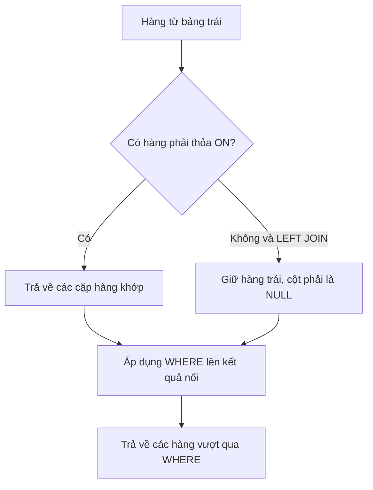

# Vị trí điều kiện trong ON/WHERE và ảnh hưởng đến OUTER JOIN

Trong truy vấn có `JOIN`, cùng một điều kiện có thể làm thay đổi kết quả tùy vị trí đặt nó. Với `INNER JOIN`, điều kiện nối thường có thể được viết trong `ON` hoặc `WHERE` mà vẫn giữ cùng tập hàng nếu phép biến đổi tương đương. Với `LEFT JOIN` và `RIGHT JOIN`, sự khác biệt rất quan trọng: điều kiện trong `ON` quyết định hàng nào được xem là khớp; điều kiện trong `WHERE` lọc kết quả sau khi OUTER JOIN đã bổ sung các hàng có phía không khớp bằng `NULL`.

Đặt điều kiện sai vị trí có thể vô tình loại bỏ các hàng cần được giữ lại, khiến `LEFT JOIN` hoạt động giống `INNER JOIN`. Bài học này giúp xác định bảng nào cần được bảo toàn, điều kiện nào chỉ giới hạn việc ghép cặp và điều kiện nào thật sự dùng để loại hàng khỏi kết quả.

Bài học thuộc module **DATABASE_MYSQL**. Module hướng tới việc làm chủ MySQL từ thiết kế bảng, kiểu dữ liệu, khóa và truy vấn SQL đến index, transaction và kiểm soát đồng thời; đồng thời thực hành đọc kế hoạch thực thi, tối ưu truy vấn, phân quyền, sao lưu và xử lý các vấn đề vận hành cơ sở dữ liệu quan hệ. Trong chương **JOIN và truy vấn con**, bài này tập trung vào vị trí của điều kiện `ON`/`WHERE` và tác động của chúng lên `OUTER JOIN`.

## 1. INNER JOIN và OUTER JOIN giữ hàng khác nhau

`INNER JOIN` chỉ trả về các tổ hợp hàng thỏa điều kiện nối. `LEFT JOIN` giữ tất cả hàng của bảng bên trái; nếu không tìm thấy hàng bên phải phù hợp, các cột của phía phải được trả về dưới dạng `NULL`. `RIGHT JOIN` làm điều tương tự theo hướng ngược lại: giữ tất cả hàng của bảng bên phải.



Sơ đồ mô tả ngữ nghĩa logic của `LEFT JOIN`: tìm cặp khớp theo `ON`, bổ sung hàng không khớp của phía được bảo toàn bằng `NULL`, rồi mới áp dụng `WHERE`. Optimizer có thể thực hiện vật lý theo cách khác miễn kết quả giữ đúng ngữ nghĩa SQL.

Điểm cần nhớ:

- `ON` trả lời câu hỏi: *hai hàng có được ghép với nhau không?*
- `WHERE` trả lời câu hỏi: *hàng kết quả sau JOIN có được giữ lại không?*
- Với OUTER JOIN, một điều kiện ở `WHERE` tham chiếu đến phía được bổ sung `NULL` có thể loại chính các hàng mà OUTER JOIN được thiết kế để giữ.

## 2. Chuẩn bị dữ liệu thực hành

Ta dùng hai bảng: `employees` là bảng nhân viên và `departments` là bảng phòng ban. Một nhân viên có thể chưa được phân phòng, tham chiếu đến phòng ban không còn tồn tại trong dữ liệu mẫu, hoặc thuộc phòng ban đang ngừng hoạt động.

```sql
DROP TABLE IF EXISTS employees;
DROP TABLE IF EXISTS departments;

CREATE TABLE departments (
    department_id INT NOT NULL,
    department_name VARCHAR(80) NOT NULL,
    is_active TINYINT(1) NOT NULL,
    PRIMARY KEY (department_id)
) ENGINE = InnoDB;

CREATE TABLE employees (
    employee_id INT NOT NULL,
    employee_name VARCHAR(80) NOT NULL,
    department_id INT NULL,
    is_active TINYINT(1) NOT NULL,
    PRIMARY KEY (employee_id),
    KEY idx_employees_department (department_id)
) ENGINE = InnoDB;

INSERT INTO departments (department_id, department_name, is_active)
VALUES
    (10, 'Engineering', 1),
    (20, 'Sales', 0),
    (30, 'Finance', 1);

INSERT INTO employees (employee_id, employee_name, department_id, is_active)
VALUES
    (1, 'Linh', 10, 1),
    (2, 'Minh', 20, 1),
    (3, 'An', NULL, 1),
    (4, 'Hoa', 99, 1),
    (5, 'Son', 30, 0);
```

`department_id = 99` được cố ý giữ lại trong dữ liệu mẫu để minh họa trường hợp không có hàng phòng ban tương ứng. Trong schema sản xuất, foreign key có thể ngăn dữ liệu mồ côi như vậy; nhưng nhân viên chưa được phân phòng (`department_id IS NULL`) vẫn là tình huống thường gặp.

## 3. LEFT JOIN cơ bản: giữ mọi hàng bên trái

Truy vấn sau lấy toàn bộ nhân viên và tên phòng ban nếu tìm thấy:

```sql
SELECT
    e.employee_id,
    e.employee_name,
    e.department_id,
    d.department_name
FROM employees AS e
LEFT JOIN departments AS d
    ON d.department_id = e.department_id
ORDER BY e.employee_id;
```

Kết quả có năm nhân viên:

| employee_id | employee_name | department_id | department_name |
|---:|---|---:|---|
| 1 | Linh | 10 | Engineering |
| 2 | Minh | 20 | Sales |
| 3 | An | `NULL` | `NULL` |
| 4 | Hoa | 99 | `NULL` |
| 5 | Son | 30 | Finance |

Các hàng của `employees` đều được giữ. Nhân viên An không có `department_id`; Hoa có mã phòng ban không tồn tại trong bảng `departments`. Trong cả hai trường hợp, cột phía phải được bổ sung bằng `NULL`.

Đây là hành vi cốt lõi của `LEFT JOIN`. Khi thêm điều kiện, hãy xác định xem bạn muốn giới hạn phòng ban được ghép hay muốn loại nhân viên khỏi kết quả.

## 4. Điều kiện trên bảng phải đặt trong ON

Giả sử yêu cầu là: lấy tất cả nhân viên, nhưng chỉ hiển thị thông tin của phòng ban đang hoạt động. Nhân viên thuộc phòng ban ngừng hoạt động vẫn phải xuất hiện; chỉ thông tin phòng ban không được ghép vào kết quả.

Đặt điều kiện phòng ban trong `ON`:

```sql
SELECT
    e.employee_id,
    e.employee_name,
    d.department_name
FROM employees AS e
LEFT JOIN departments AS d
    ON d.department_id = e.department_id
   AND d.is_active = 1
ORDER BY e.employee_id;
```

Kết quả:

| employee_id | employee_name | department_name |
|---:|---|---|
| 1 | Linh | Engineering |
| 2 | Minh | `NULL` |
| 3 | An | `NULL` |
| 4 | Hoa | `NULL` |
| 5 | Son | Finance |

Điều kiện `d.is_active = 1` chỉ cho phép phòng ban đang hoạt động trở thành hàng khớp. Với Minh, phòng Sales có tồn tại nhưng không thỏa `ON`, nên đối với phép nối này không có hàng phải phù hợp; `LEFT JOIN` giữ Minh và bổ sung `NULL` cho các cột phòng ban.

Đây là cách viết phù hợp khi muốn bảo toàn toàn bộ nhân viên và chỉ lấy dữ liệu phòng ban thỏa điều kiện.

## 5. Đặt điều kiện phía phải trong WHERE có thể loại hàng trái

Xét truy vấn:

```sql
SELECT
    e.employee_id,
    e.employee_name,
    d.department_name
FROM employees AS e
LEFT JOIN departments AS d
    ON d.department_id = e.department_id
WHERE d.is_active = 1
ORDER BY e.employee_id;
```

Kết quả chỉ còn Linh và Son. Vì sao?

1. `LEFT JOIN` trước tiên ghép phòng ban theo `department_id`.
2. Nhân viên An và Hoa không có phòng ban khớp, nên `d.is_active` là `NULL`.
3. Nhân viên Minh khớp với Sales, nhưng `d.is_active = 0`.
4. `WHERE d.is_active = 1` chỉ giữ hàng mà điều kiện là TRUE. Điều kiện FALSE hoặc UNKNOWN đều bị loại.
5. Vì vậy, các hàng không khớp của LEFT JOIN bị loại khỏi kết quả.

Khi điều kiện `WHERE` yêu cầu một giá trị cụ thể ở phía phải, nó thường loại hàng được bổ sung `NULL`. Truy vấn khi đó có kết quả tương tự một `INNER JOIN` đối với điều kiện đó.

### 5.1. So sánh hai vị trí

| Ý định | Vị trí điều kiện | Hành vi |
|---|---|---|
| Giữ mọi nhân viên, chỉ ghép phòng đang hoạt động | `ON ... AND d.is_active = 1` | Nhân viên có phòng ngừng hoạt động vẫn xuất hiện với cột phòng `NULL`. |
| Chỉ lấy nhân viên có phòng đang hoạt động | `WHERE d.is_active = 1` | Nhân viên không có phòng hoặc phòng ngừng hoạt động bị loại. |
| Lấy nhân viên có phòng đang hoạt động và cả nhân viên không có phòng khớp | `WHERE d.is_active = 1 OR d.department_id IS NULL` với JOIN không lọc trạng thái trong ON | Giữ hàng không khớp, nhưng loại nhân viên khớp phòng ngừng hoạt động. |

Ba yêu cầu trên khác nhau. Chọn vị trí điều kiện theo ý nghĩa cần đạt, không theo thói quen cú pháp.

## 6. Điều kiện trên bảng trái: ON và WHERE cũng khác nhau

Không chỉ điều kiện phía phải mới quan trọng. Trong `LEFT JOIN`, bảng trái là phía được bảo toàn. Điều kiện trên bảng trái đặt trong `ON` chỉ ảnh hưởng việc ghép với bảng phải; nó không loại hàng trái khỏi kết quả.

### 6.1. Đặt trạng thái nhân viên trong ON

```sql
SELECT
    e.employee_id,
    e.employee_name,
    d.department_name
FROM employees AS e
LEFT JOIN departments AS d
    ON d.department_id = e.department_id
   AND e.is_active = 1;
```

Tất cả nhân viên vẫn xuất hiện. Với Son (`is_active = 0`), điều kiện `e.is_active = 1` không thỏa nên phòng Finance không được ghép; kết quả của Son có `department_name = NULL`.

### 6.2. Đặt trạng thái nhân viên trong WHERE

```sql
SELECT
    e.employee_id,
    e.employee_name,
    d.department_name
FROM employees AS e
LEFT JOIN departments AS d
    ON d.department_id = e.department_id
WHERE e.is_active = 1;
```

Truy vấn này loại Son khỏi kết quả, nhưng vẫn ghép phòng ban cho các nhân viên còn lại. Đây thường là ý định khi chỉ muốn báo cáo nhân viên đang hoạt động.

Quy tắc:

- Điều kiện trên bảng trái đặt trong `WHERE` nếu muốn loại hàng trái.
- Điều kiện trên bảng trái đặt trong `ON` nếu chỉ muốn giới hạn trường hợp hàng trái được ghép với phía phải nhưng vẫn giữ hàng trái.

## 7. Khi nào WHERE ... IS NULL là anti-join?

Một mẫu truy vấn phổ biến là tìm các hàng bên trái không có hàng bên phải tương ứng:

```sql
SELECT
    e.employee_id,
    e.employee_name
FROM employees AS e
LEFT JOIN departments AS d
    ON d.department_id = e.department_id
WHERE d.department_id IS NULL;
```

Vì `d.department_id` là primary key và không thể `NULL` trong một hàng phòng ban thật, giá trị `NULL` sau LEFT JOIN cho biết không có hàng phải khớp. Kết quả là An và Hoa.

Đây được gọi là **anti-join pattern**: trả về hàng bên trái không tìm thấy hàng tương ứng ở bên phải.

### 7.1. Kiểm tra cột nào trong WHERE IS NULL

Phải kiểm tra một column phía phải chắc chắn `NOT NULL` trên mọi hàng khớp, thường là primary key:

```sql
WHERE d.department_id IS NULL
```

Không nên kiểm tra một column nghiệp vụ nullable:

```sql
-- Có thể nhận nhầm hàng đã khớp nhưng manager_name thực sự NULL.
WHERE d.manager_name IS NULL
```

Nếu phòng ban tồn tại nhưng `manager_name` chưa được gán, truy vấn vẫn coi điều kiện là TRUE dù có hàng phải khớp. Kết quả khi đó không còn là “không có phòng ban”.

### 7.2. Anti-join với điều kiện trong ON

Yêu cầu: tìm nhân viên không thuộc phòng ban đang hoạt động. Ta có thể đặt điều kiện trạng thái phòng ban trong `ON`, sau đó kiểm tra primary key phía phải:

```sql
SELECT
    e.employee_id,
    e.employee_name
FROM employees AS e
LEFT JOIN departments AS d
    ON d.department_id = e.department_id
   AND d.is_active = 1
WHERE d.department_id IS NULL;
```

Kết quả gồm Minh (phòng Sales ngừng hoạt động), An (chưa có phòng) và Hoa (mã phòng không khớp). Điều kiện trong `ON` xác định “có phòng đang hoạt động hay không”; `WHERE ... IS NULL` chọn các nhân viên không có phòng phù hợp với định nghĩa đó.

Nếu bỏ điều kiện `d.is_active = 1` khỏi `ON`, truy vấn chỉ tìm nhân viên không có bất kỳ phòng ban khớp nào; Minh sẽ không xuất hiện vì Sales vẫn tồn tại.

## 8. NOT EXISTS là một cách viết anti-join rõ nghĩa

Có thể diễn đạt yêu cầu “không tồn tại phòng ban đang hoạt động tương ứng” bằng `NOT EXISTS`:

```sql
SELECT
    e.employee_id,
    e.employee_name
FROM employees AS e
WHERE NOT EXISTS (
    SELECT 1
    FROM departments AS d
    WHERE d.department_id = e.department_id
      AND d.is_active = 1
);
```

`NOT EXISTS` kiểm tra xem truy vấn con có trả về hàng nào hay không. Nó thường diễn đạt trực tiếp ý nghĩa phủ định tồn tại và không phụ thuộc vào việc chọn column nào phía phải để kiểm tra `IS NULL`.

Với điều kiện tương đương và index phù hợp, optimizer có thể chuyển `NOT EXISTS` và mẫu `LEFT JOIN ... IS NULL` thành chiến lược anti-join hiệu quả. Không mặc định cách viết nào luôn nhanh hơn; hãy dùng cách dễ thể hiện ý nghĩa rồi kiểm tra `EXPLAIN`.

### 8.1. Cẩn thận với NOT IN và NULL

Tránh thay `NOT EXISTS` bằng `NOT IN` khi truy vấn con có thể trả về `NULL`:

```sql
SELECT e.employee_id
FROM employees AS e
WHERE e.department_id NOT IN (
    SELECT d.department_id
    FROM departments AS d
);
```

Nếu tập giá trị ở truy vấn con chứa `NULL`, phép so sánh `NOT IN` có thể trở thành UNKNOWN và không trả về hàng như mong muốn. `NOT EXISTS` thường an toàn hơn cho anti-join vì điều kiện tương quan được đánh giá theo từng hàng. Nếu dùng `NOT IN`, cần bảo đảm cột trong tập con không thể có `NULL`.

## 9. RIGHT JOIN có quy tắc đối xứng

`RIGHT JOIN` bảo toàn mọi hàng của bảng bên phải. Điều kiện trong `ON` xác định hàng trái nào được ghép; hàng phải không có hàng trái khớp vẫn xuất hiện với các cột phía trái bằng `NULL`.

Ví dụ lấy tất cả phòng ban, kể cả phòng chưa có nhân viên:

```sql
SELECT
    d.department_id,
    d.department_name,
    e.employee_id,
    e.employee_name
FROM employees AS e
RIGHT JOIN departments AS d
    ON d.department_id = e.department_id
ORDER BY d.department_id, e.employee_id;
```

Nếu đặt điều kiện nhân viên trong `ON`, mọi phòng ban vẫn được giữ:

```sql
SELECT
    d.department_id,
    d.department_name,
    e.employee_name
FROM employees AS e
RIGHT JOIN departments AS d
    ON d.department_id = e.department_id
   AND e.is_active = 1;
```

Phòng ban không có nhân viên đang hoạt động vẫn xuất hiện; các cột nhân viên được bổ sung `NULL`.

Nếu chuyển `e.is_active = 1` sang `WHERE`, các phòng không có nhân viên phù hợp sẽ bị loại vì `e.is_active` là `NULL`. Kết quả khi đó chỉ còn các phòng có nhân viên đang hoạt động.

Trong code mới, nhiều nhóm thường chọn viết lại `RIGHT JOIN` thành `LEFT JOIN` bằng cách đổi thứ tự bảng. Ví dụ trên có thể viết:

```sql
SELECT
    d.department_id,
    d.department_name,
    e.employee_id,
    e.employee_name
FROM departments AS d
LEFT JOIN employees AS e
    ON e.department_id = d.department_id;
```

Viết `LEFT JOIN` thường giúp người đọc nhận diện ngay bảng nào được bảo toàn.

## 10. INNER JOIN: điều kiện ON và WHERE thường tương đương

Với `INNER JOIN`, hai cách sau thường cho cùng tập hàng khi điều kiện được chuyển nguyên vẹn và không thay đổi ngữ nghĩa biểu thức:

```sql
SELECT e.employee_id, d.department_name
FROM employees AS e
INNER JOIN departments AS d
    ON d.department_id = e.department_id
   AND d.is_active = 1;
```

```sql
SELECT e.employee_id, d.department_name
FROM employees AS e
INNER JOIN departments AS d
    ON d.department_id = e.department_id
WHERE d.is_active = 1;
```

Do INNER JOIN chỉ giữ các cặp hàng khớp, điều kiện lọc cặp có thể được biểu diễn trong `ON` hoặc `WHERE`. Dù vậy, nên giữ điều kiện nối giữa hai bảng trong `ON` và điều kiện lọc kết quả trong `WHERE` để truy vấn dễ đọc.

Không suy rộng quy tắc này sang OUTER JOIN. Với `LEFT JOIN`/`RIGHT JOIN`, chuyển điều kiện giữa `ON` và `WHERE` có thể thay đổi việc hàng không khớp có được giữ hay không.

## 11. Kết hợp nhiều JOIN: xác định đúng thời điểm lọc

Khi truy vấn nối ba bảng trở lên, vị trí điều kiện có thể ảnh hưởng các hàng được bảo toàn ở từng bước nối.

Ví dụ có `employees`, `departments` và `projects`. Yêu cầu: lấy tất cả nhân viên, hiển thị phòng ban đang hoạt động nếu có và hiển thị các dự án đang mở của phòng ban đó.

```sql
SELECT
    e.employee_id,
    e.employee_name,
    d.department_name,
    p.project_name
FROM employees AS e
LEFT JOIN departments AS d
    ON d.department_id = e.department_id
   AND d.is_active = 1
LEFT JOIN projects AS p
    ON p.department_id = d.department_id
   AND p.project_status = 'OPEN'
ORDER BY e.employee_id, p.project_name;
```

Điều kiện trạng thái phòng ban nằm trong `ON` của phép nối đầu; điều kiện trạng thái dự án nằm trong `ON` của phép nối thứ hai. Nhờ đó, nhân viên vẫn được giữ kể cả khi không có phòng ban đang hoạt động hoặc phòng ban không có dự án mở.

Nếu thêm:

```sql
WHERE p.project_status = 'OPEN'
```

vào cuối truy vấn, các hàng mà `p` được bổ sung `NULL` sẽ bị loại. Điều đó làm mất các nhân viên không có dự án mở, trái với yêu cầu ban đầu.

Với chuỗi OUTER JOIN, hãy đọc từ trái sang phải và xác định sau mỗi bước: bảng nào được bảo toàn, điều kiện nào xác định hàng khớp và điều kiện nào lọc kết quả cuối cùng. Khi logic lồng nhau phức tạp, dùng ngoặc và derived table để làm rõ nhóm phép nối.

## 12. Bảo toàn hàng và lọc dữ liệu qua derived table

Một cách khác để giới hạn tập hàng phía phải trước khi nối là dùng derived table:

```sql
SELECT
    e.employee_id,
    e.employee_name,
    d.department_name
FROM employees AS e
LEFT JOIN (
    SELECT department_id, department_name
    FROM departments
    WHERE is_active = 1
) AS d
    ON d.department_id = e.department_id;
```

Truy vấn con chỉ đưa các phòng ban đang hoạt động vào tập có thể ghép. `LEFT JOIN` vẫn giữ tất cả nhân viên. Về ý nghĩa, đây tương đương với việc đặt `d.is_active = 1` trong điều kiện `ON` của ví dụ trước.

Derived table hữu ích khi:

- Phía phải cần lọc bằng nhiều điều kiện hoặc biểu thức.
- Phía phải cần aggregate trước khi join để tránh nhân bản hàng.
- Muốn tách một logic phức tạp thành các bước dễ kiểm tra.
- Muốn bảo đảm tập đầu vào của JOIN đã có grain phù hợp.

MySQL có thể merge hoặc materialize derived table tùy truy vấn và optimizer. Cách tối ưu vật lý có thể khác, nhưng ngữ nghĩa kết quả phải được giữ.

## 13. OUTER JOIN kết hợp GROUP BY và COUNT

Một yêu cầu phổ biến là đếm số nhân viên của từng phòng ban, đồng thời vẫn hiển thị phòng ban chưa có nhân viên.

```sql
SELECT
    d.department_id,
    d.department_name,
    COUNT(e.employee_id) AS employee_count
FROM departments AS d
LEFT JOIN employees AS e
    ON e.department_id = d.department_id
   AND e.is_active = 1
GROUP BY d.department_id, d.department_name
ORDER BY d.department_id;
```

### 13.1. Vì sao dùng COUNT(e.employee_id), không dùng COUNT(*)?

Với phòng ban chưa có nhân viên phù hợp, LEFT JOIN vẫn tạo một hàng kết quả có các cột `e.*` bằng `NULL`.

- `COUNT(*)` đếm hàng được bổ sung đó nên trả về 1 cho phòng ban không có nhân viên khớp.
- `COUNT(e.employee_id)` bỏ qua `NULL`; vì `employee_id` là primary key không nullable trên hàng thật, kết quả trả về 0 khi không có nhân viên.

Đây là khác biệt quan trọng khi đếm hàng ở phía không được bảo toàn.

### 13.2. Đừng chuyển điều kiện lọc nhân viên sang WHERE

Nếu viết:

```sql
SELECT
    d.department_id,
    d.department_name,
    COUNT(e.employee_id) AS employee_count
FROM departments AS d
LEFT JOIN employees AS e
    ON e.department_id = d.department_id
WHERE e.is_active = 1
GROUP BY d.department_id, d.department_name;
```

các phòng không có nhân viên đang hoạt động bị loại trước khi nhóm. Muốn giữ các phòng đó và đếm 0, hãy đưa điều kiện `e.is_active = 1` vào `ON`.

### 13.3. SUM và COALESCE

Nếu cần tổng lương theo phòng ban:

```sql
SELECT
    d.department_id,
    d.department_name,
    COUNT(e.employee_id) AS employee_count,
    COALESCE(SUM(e.salary), 0) AS total_salary
FROM departments AS d
LEFT JOIN employees AS e
    ON e.department_id = d.department_id
   AND e.is_active = 1
GROUP BY d.department_id, d.department_name;
```

`SUM(e.salary)` trả `NULL` khi không có giá trị khác `NULL`; `COALESCE(..., 0)` chuyển kết quả sang 0 theo quy ước báo cáo. Chỉ làm vậy nếu tổng lương của phòng chưa có nhân viên được biểu diễn là 0 theo nghiệp vụ.

## 14. Các mẫu điều kiện ON/WHERE thường gặp

| Mục tiêu | Cách viết gợi ý | Kết quả mong muốn |
|---|---|---|
| Tất cả khách hàng và đơn phù hợp | `LEFT JOIN orders ON ...` | Giữ khách hàng chưa có đơn. |
| Tất cả khách hàng, chỉ ghép đơn đã thanh toán | `LEFT JOIN orders ON ... AND status = 'PAID'` | Khách hàng chỉ có đơn chưa thanh toán vẫn xuất hiện với cột đơn `NULL`. |
| Chỉ khách hàng có đơn đã thanh toán | `LEFT JOIN ... ON ... WHERE order.status = 'PAID'` hoặc `INNER JOIN` | Loại khách hàng không có đơn PAID. |
| Khách hàng chưa từng có đơn | `LEFT JOIN ... WHERE order_id IS NULL` hoặc `NOT EXISTS` | Chỉ giữ khách hàng không có hàng đơn khớp. |
| Tất cả phòng ban và nhân viên đang hoạt động | `departments LEFT JOIN employees ON ... AND employee.is_active = 1` | Giữ phòng ban chưa có nhân viên đang hoạt động. |
| Chỉ phòng ban có nhân viên đang hoạt động | `INNER JOIN ... ON ... AND employee.is_active = 1` | Chỉ giữ phòng có ít nhất một nhân viên phù hợp. |
| Tất cả nhân viên đang hoạt động, kèm phòng nếu có | `employees LEFT JOIN departments ON ... WHERE employee.is_active = 1` | Lọc nhân viên nhưng vẫn giữ người chưa có phòng. |

## 15. Những điều kiện WHERE có thể giữ hàng NULL một cách có chủ đích

Không phải mọi điều kiện `WHERE` tham chiếu phía phải đều làm mất hàng không khớp. Một số điều kiện kiểm tra `IS NULL` hoặc kết hợp logic có thể giữ lại hàng được bổ sung `NULL`.

Ví dụ:

```sql
SELECT e.employee_id, e.employee_name, d.department_name
FROM employees AS e
LEFT JOIN departments AS d
    ON d.department_id = e.department_id
WHERE d.is_active = 1
   OR d.department_id IS NULL;
```

Truy vấn giữ nhân viên thuộc phòng hoạt động và nhân viên không có phòng khớp. Tuy nhiên, nhân viên Minh thuộc Sales đang ngừng hoạt động bị loại vì hàng phải thật có `department_id = 20`, không phải `NULL`, và `is_active = 0`.

Đây không giống truy vấn đặt `d.is_active = 1` trong `ON`: cách đặt trong `ON` biến phòng ngừng hoạt động thành “không khớp” đối với phép nối, do đó vẫn giữ Minh với thông tin phòng `NULL`.

Hãy phân biệt hai yêu cầu:

- **Giữ nhân viên kể cả khi phòng không hoạt động, nhưng ẩn thông tin phòng không hoạt động:** lọc trạng thái trong `ON`.
- **Giữ nhân viên không có phòng và nhân viên thuộc phòng hoạt động; loại người được gán vào phòng không hoạt động:** dùng `WHERE ... OR right_pk IS NULL` với JOIN không lọc trạng thái trong `ON`.

## 16. NULL và điều kiện phủ định

Các phép so sánh với `NULL` không trả về TRUE hoặc FALSE mà thường trả về UNKNOWN. `WHERE` chỉ giữ hàng mà biểu thức điều kiện là TRUE; FALSE và UNKNOWN đều bị loại.

Ví dụ:

```sql
WHERE d.is_active <> 0
```

không giữ hàng mà `d.is_active` là `NULL`. Vì vậy, điều kiện phủ định như `<>`, `!=`, `NOT (x = value)` có thể loại các hàng không khớp của OUTER JOIN.

Nếu muốn giữ hàng không khớp:

```sql
WHERE d.is_active <> 0
   OR d.department_id IS NULL
```

Hoặc đặt điều kiện trạng thái vào `ON` nếu ý định là giới hạn hàng phải được ghép nhưng bảo toàn phía trái.

Không dùng `COALESCE(d.is_active, 0)` một cách máy móc trong mọi điều kiện. Thay `NULL` bằng 0 có thể làm thay đổi ý nghĩa giữa “không có hàng phòng ban” và “phòng ban tồn tại nhưng đang ngừng hoạt động”.

## 17. FULL OUTER JOIN trong MySQL

MySQL không cung cấp cú pháp `FULL OUTER JOIN` trực tiếp. Nếu cần giữ mọi hàng của cả hai phía, có thể kết hợp `LEFT JOIN` và phần hàng chỉ có ở phía phải bằng `UNION ALL`:

```sql
SELECT
    a.id AS a_id,
    a.value AS a_value,
    b.id AS b_id,
    b.value AS b_value
FROM table_a AS a
LEFT JOIN table_b AS b
    ON b.id = a.id

UNION ALL

SELECT
    a.id AS a_id,
    a.value AS a_value,
    b.id AS b_id,
    b.value AS b_value
FROM table_a AS a
RIGHT JOIN table_b AS b
    ON b.id = a.id
WHERE a.id IS NULL;
```

Nhánh thứ hai chỉ lấy hàng phía phải không có phía trái khớp. Điều kiện `a.id IS NULL` phải kiểm tra một khóa phía trái không nullable trên hàng thật. `UNION ALL` tránh bước loại trùng không cần thiết vì hai nhánh đã được thiết kế không chồng lặp.

Đây là kỹ thuật mở rộng; với bài toán thông thường, hãy dùng `LEFT JOIN` hoặc `RIGHT JOIN` theo phía cần bảo toàn.

## 18. Kiểm tra hiệu năng bằng EXPLAIN

Vị trí điều kiện ảnh hưởng cả ngữ nghĩa lẫn kế hoạch truy vấn. Sau khi xác định đúng kết quả, hãy kiểm tra kế hoạch:

```sql
EXPLAIN
SELECT
    e.employee_id,
    e.employee_name,
    d.department_name
FROM employees AS e
LEFT JOIN departments AS d
    ON d.department_id = e.department_id
   AND d.is_active = 1
WHERE e.is_active = 1;
```

Đọc các thông tin chính:

- `type`: cách MySQL truy cập từng bảng.
- `possible_keys`: các index có thể dùng.
- `key`: index được chọn.
- `rows`: số hàng ước lượng cần đọc.
- `filtered`: tỷ lệ hàng ước lượng còn lại sau điều kiện.
- `Extra`: thông tin bổ sung như điều kiện lọc hoặc temporary/filesort.

Với truy vấn lớn, có thể dùng `EXPLAIN ANALYZE` trên MySQL 8.0.18 trở lên để thực thi truy vấn và xem thời gian cùng số hàng thực tế ở các iterator. Chỉ dùng trên truy vấn và môi trường phù hợp vì lệnh này thực sự chạy câu SQL.

Các index thường cần xem xét:

- Index trên khóa nối ở bảng phải, ví dụ `departments(department_id)`.
- Index trên khóa ngoại/column nối ở bảng trái, ví dụ `employees(department_id)`.
- Index hỗ trợ điều kiện lọc như `employees(is_active)` hoặc index ghép phù hợp với thứ tự lọc và nối.

Không tạo index chỉ dựa trên việc một column xuất hiện trong `ON` hay `WHERE`. Cần xem độ chọn lọc, số hàng, tần suất truy vấn, chi phí ghi và kế hoạch thực tế. Với InnoDB, primary key là clustered index và secondary index chứa khóa chính trong leaf record; cấu trúc này cũng ảnh hưởng chi phí đọc.

## 19. Quy trình quyết định đặt điều kiện

Khi viết một OUTER JOIN, thực hiện theo các bước:

1. **Chọn phía cần bảo toàn.** Với `LEFT JOIN`, mọi hàng bên trái phải được giữ; với `RIGHT JOIN`, mọi hàng bên phải phải được giữ.
2. **Viết điều kiện ghép cơ bản trong ON.** Nối khóa của hai bảng bằng điều kiện rõ ràng.
3. **Xét điều kiện phía không được bảo toàn.** Nếu chỉ muốn giới hạn hàng có thể ghép mà vẫn giữ phía bảo toàn, đặt điều kiện vào `ON`.
4. **Xét điều kiện cần loại hàng kết quả.** Nếu hàng không thỏa phải biến mất khỏi báo cáo, đặt điều kiện trong `WHERE`.
5. **Xử lý hàng không khớp có chủ đích.** Dùng `right_pk IS NULL`, `OR ... IS NULL` hoặc `NOT EXISTS` theo đúng yêu cầu.
6. **Nếu có nhiều JOIN, đánh giá từng bước.** Xác định bảng nào được bảo toàn sau mỗi phép nối.
7. **Nếu có aggregate, kiểm tra COUNT và SUM.** Dùng `COUNT(right_pk)` để đếm số hàng khớp; quyết định cách biểu diễn tổng không có dữ liệu.
8. **Xác minh kết quả bằng dữ liệu biên.** Bao gồm khóa ngoại `NULL`, khóa không khớp, hàng phía phải bị lọc, và nhiều hàng khớp.
9. **Đọc EXPLAIN sau khi kết quả đúng.** Tối ưu không được làm thay đổi ngữ nghĩa mong muốn.

## 20. Lỗi thường gặp và cách sửa

| Lỗi | Hậu quả | Cách sửa |
|---|---|---|
| Đặt `right.status = ...` trong WHERE dù muốn giữ mọi hàng trái | Hàng không khớp bị loại; LEFT JOIN có thể thành INNER JOIN về kết quả | Đưa điều kiện sang ON. |
| Đặt điều kiện lọc bảng trái trong ON dù muốn loại hàng trái | Hàng trái vẫn xuất hiện nhưng cột phải thành NULL | Đặt điều kiện vào WHERE. |
| Anti-join kiểm tra một column nullable ở phía phải | Nhận nhầm hàng đã khớp nhưng column thật có NULL | Kiểm tra primary key hoặc column NOT NULL. |
| Dùng COUNT(*) để đếm hàng phải sau LEFT JOIN | Hàng không khớp vẫn được đếm thành 1 | Dùng COUNT(right_table.primary_key). |
| Chuyển điều kiện từ ON sang WHERE mà không kiểm tra OUTER JOIN | Thay đổi tập hàng được bảo toàn | Kiểm thử hàng không khớp và hàng phải không thỏa điều kiện. |
| Dùng NOT IN với truy vấn con có NULL | Kết quả có thể rỗng hoặc thiếu hàng do UNKNOWN | Dùng NOT EXISTS hoặc loại NULL đúng cách. |
| Nối nhiều bảng một-nhiều rồi aggregate | Số liệu bị nhân bản | Tổng hợp từng phía về đúng grain trước khi JOIN. |
| Chỉ nhìn EXPLAIN mà không kiểm tra kết quả | Có thể tối ưu một truy vấn sai ngữ nghĩa | Xác minh tập hàng trước, sau đó mới tối ưu. |

## 21. Bài tập thực hành

### Bài tập 1: So sánh ON và WHERE

Với hai bảng `employees` và `departments` ở phần 2, chạy:

```sql
SELECT e.employee_id, e.employee_name, d.department_name
FROM employees AS e
LEFT JOIN departments AS d
    ON d.department_id = e.department_id
   AND d.is_active = 1;

SELECT e.employee_id, e.employee_name, d.department_name
FROM employees AS e
LEFT JOIN departments AS d
    ON d.department_id = e.department_id
WHERE d.is_active = 1;
```

**Yêu cầu:** liệt kê nhân viên xuất hiện trong từng kết quả và giải thích hàng nào bị loại.

### Bài tập 2: Điều kiện trên phía trái

Chuyển `e.is_active = 1` qua lại giữa `ON` và `WHERE`.

**Yêu cầu:** giải thích vì sao Son vẫn xuất hiện nhưng phòng ban bị NULL trong trường hợp điều kiện nằm trong ON.

### Bài tập 3: Anti-join

Tìm nhân viên không có phòng ban khớp. Sau đó tìm nhân viên không có phòng ban đang hoạt động.

**Yêu cầu:** so sánh `LEFT JOIN ... IS NULL` với `NOT EXISTS`; giải thích vì sao cần kiểm tra primary key phía phải.

### Bài tập 4: Phòng ban không có nhân viên

Dùng `departments LEFT JOIN employees` để liệt kê tất cả phòng ban và số nhân viên đang hoạt động.

**Yêu cầu:** so sánh `COUNT(*)` và `COUNT(employee_id)` cho phòng chưa có nhân viên.

### Bài tập 5: Nhiều OUTER JOIN

Tạo thêm bảng `projects` và nối nhân viên, phòng ban, dự án. Lấy mọi nhân viên và chỉ ghép dự án đang mở.

**Yêu cầu:** chuyển điều kiện `project_status = 'OPEN'` từ ON sang WHERE và mô tả những hàng biến mất.

### Bài tập 6: NULL và NOT IN

Tạo truy vấn con có một giá trị `NULL`, so sánh `NOT IN` với `NOT EXISTS`.

**Yêu cầu:** giải thích ảnh hưởng của UNKNOWN và đề xuất cách viết anti-join an toàn.

### Bài tập 7: EXPLAIN

Tạo index trên các khóa nối và chạy `EXPLAIN` cho truy vấn LEFT JOIN có điều kiện trong ON và WHERE.

**Yêu cầu:** ghi nhận `key`, `type`, `rows`, `filtered`, `Extra`; giải thích optimizer có thể thay đổi cách thực thi ra sao nhưng vẫn phải giữ kết quả SQL.

## 22. Checklist review OUTER JOIN

- [ ] Đã xác định bảng/phía nào cần được bảo toàn.
- [ ] Điều kiện nối khóa được đặt rõ trong `ON`.
- [ ] Điều kiện chỉ giới hạn hàng có thể ghép được đặt trong `ON`.
- [ ] Điều kiện thật sự loại hàng kết quả được đặt trong `WHERE`.
- [ ] Đã kiểm tra điều kiện WHERE trên cột phía được bổ sung NULL.
- [ ] Anti-join kiểm tra primary key hoặc column NOT NULL của phía phải.
- [ ] `NOT IN` không nhận tập con có NULL ngoài ý muốn.
- [ ] Dùng `COUNT(right_pk)` khi cần đếm số hàng khớp.
- [ ] Đã kiểm tra dữ liệu không có khóa nối, khóa NULL và khóa không khớp.
- [ ] Với nhiều JOIN, đã xác định phía được bảo toàn ở từng bước.
- [ ] Aggregate không bị nhân bản bởi quan hệ một-nhiều.
- [ ] Đã xác minh kết quả trước khi tối ưu index.
- [ ] Đã đọc `EXPLAIN` hoặc `EXPLAIN ANALYZE` trên môi trường phù hợp.

## 23. Ghi nhớ

Với `LEFT JOIN`, `ON` quyết định hàng bên phải nào được ghép vào từng hàng bên trái; nếu không có hàng phù hợp, MySQL vẫn giữ hàng trái và bổ sung `NULL` cho phía phải. `WHERE` lọc kết quả sau phép nối. Vì vậy, điều kiện như `right_table.status = 'ACTIVE'` đặt trong WHERE thường loại các hàng không khớp và làm kết quả mất tính bảo toàn của LEFT JOIN.

Đặt điều kiện phía phải trong `ON` khi muốn giữ toàn bộ phía trái nhưng chỉ ghép các hàng phải thỏa điều kiện. Đặt điều kiện trong `WHERE` khi thật sự muốn loại hàng khỏi kết quả. Với anti-join, kiểm tra khóa chính phía phải hoặc dùng `NOT EXISTS`; khi đếm hàng sau OUTER JOIN, dùng `COUNT(right_pk)`. Luôn thử dữ liệu không khớp, `NULL` và nhiều hàng khớp trước khi tối ưu bằng index và EXPLAIN.
