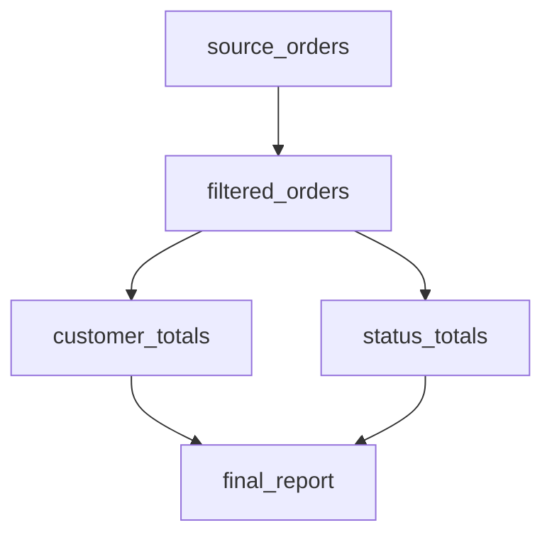

# Phạm vi tên, nhiều CTE và quan hệ tham chiếu giữa các CTE

Common Table Expression (CTE) cho phép đặt tên cho một tập kết quả tạm thời trong phạm vi một câu lệnh SQL. Khi truy vấn có nhiều bước, ta có thể khai báo nhiều CTE trong cùng một mệnh đề `WITH`, rồi để CTE sau tham chiếu CTE đã khai báo trước đó. Cách tổ chức này giúp chia truy vấn lớn thành các bước có tên, dễ đọc và dễ kiểm tra.

Tuy nhiên, CTE không phải bảng tạm tồn tại trong session. Tên CTE chỉ có hiệu lực trong câu lệnh chứa mệnh đề `WITH`; thứ tự khai báo và phạm vi truy vấn quyết định nơi tên đó có thể được tham chiếu. Hiểu rõ các quy tắc này giúp tránh lỗi tên không tồn tại, tham chiếu vòng và nhầm lẫn giữa CTE với bảng vật lý.

Bài học thuộc module **DATABASE_MYSQL**. Module hướng tới việc làm chủ MySQL từ thiết kế bảng, kiểu dữ liệu, khóa và truy vấn SQL đến index, transaction và kiểm soát đồng thời; đồng thời thực hành đọc kế hoạch thực thi, tối ưu truy vấn, phân quyền, sao lưu và xử lý các vấn đề vận hành cơ sở dữ liệu quan hệ. Trong chương **CTE và truy vấn cây**, bài này tập trung vào phạm vi tên CTE, cách khai báo nhiều CTE và quan hệ tham chiếu giữa chúng.

## 1. CTE là một tên gắn với truy vấn con có phạm vi câu lệnh

Một CTE được khai báo bằng `WITH`:

```sql
WITH paid_orders AS (
    SELECT order_id, customer_id, total_amount
    FROM orders
    WHERE status = 'PAID'
)
SELECT
    customer_id,
    SUM(total_amount) AS paid_revenue
FROM paid_orders
GROUP BY customer_id;
```

`paid_orders` là tên của CTE. Truy vấn trong ngoặc tạo tập hàng mà câu lệnh bên ngoài có thể tham chiếu như một nguồn dữ liệu trong `FROM`.

CTE có các đặc điểm quan trọng:

- Tên CTE chỉ có hiệu lực trong câu lệnh chứa `WITH`.
- CTE không tự tạo bảng vật lý trong schema.
- CTE không giữ dữ liệu giữa hai câu lệnh độc lập.
- Một CTE có thể được tham chiếu bởi truy vấn chính và bởi CTE khác nếu quy tắc thứ tự/phạm vi cho phép.
- Một CTE có thể được tham chiếu nhiều lần trong cùng câu lệnh.
- CTE không tự bảo đảm kết quả được materialize hay lưu cache; optimizer quyết định chiến lược thực thi phù hợp.

CTE thường giúp tách truy vấn thành các bước logic. Nó không thay thế bảng tạm khi cần lưu kết quả qua nhiều câu lệnh, cũng không thay thế view dùng lại lâu dài giữa nhiều câu lệnh.

## 2. Phạm vi tên CTE: chỉ trong một câu lệnh

Tên CTE được khai báo ở đầu một câu lệnh và có thể được sử dụng trong phần truy vấn thuộc câu lệnh đó.

```sql
WITH active_customers AS (
    SELECT customer_id, full_name
    FROM customers
    WHERE is_active = 1
)
SELECT customer_id, full_name
FROM active_customers;
```

Sau khi câu lệnh kết thúc, tên `active_customers` không còn tồn tại:

```sql
-- Lỗi: active_customers không phải table/view trong schema.
SELECT * FROM active_customers;
```

Nếu cần dùng kết quả ở câu lệnh tiếp theo, phải khai báo lại CTE, tạo temporary table, tạo bảng vật lý hoặc dùng view tùy mục tiêu.

### 2.1. Hai câu lệnh cần hai khai báo riêng

```sql
WITH active_customers AS (
    SELECT customer_id
    FROM customers
    WHERE is_active = 1
)
SELECT COUNT(*) AS active_count
FROM active_customers;

WITH active_customers AS (
    SELECT customer_id
    FROM customers
    WHERE is_active = 1
)
SELECT customer_id
FROM active_customers
ORDER BY customer_id;
```

Hai câu lệnh trên mỗi câu có một CTE riêng. Việc dùng cùng tên không có nghĩa là câu lệnh thứ hai tái sử dụng đối tượng hoặc dữ liệu được tạo bởi câu lệnh thứ nhất.

### 2.2. CTE không phải temporary table

| Đặc điểm | CTE | Temporary table |
|---|---|---|
| Cách tạo | `WITH name AS (...)` | `CREATE TEMPORARY TABLE ...` |
| Phạm vi | Một câu lệnh | Session tạo bảng |
| Có thể dùng ở câu lệnh tiếp theo | Không, phải khai báo lại | Có, trong cùng session khi bảng còn tồn tại |
| Lưu như đối tượng trong schema | Không | Là bảng tạm của session, không phải bảng permanent |
| Có thể chủ động tạo index sau khi tạo | Không theo cách DDL trên CTE | Có thể tạo index phù hợp trên temporary table |
| Mục đích thường gặp | Chia bước logic trong một truy vấn | Lưu và tái sử dụng dữ liệu trung gian qua nhiều câu lệnh |

## 3. Khai báo nhiều CTE trong một WITH

Một mệnh đề `WITH` có thể khai báo nhiều CTE, phân cách bằng dấu phẩy:

```sql
WITH
source_orders AS (
    SELECT order_id, customer_id, status, total_amount
    FROM orders
),
paid_orders AS (
    SELECT order_id, customer_id, total_amount
    FROM source_orders
    WHERE status = 'PAID'
),
customer_totals AS (
    SELECT
        customer_id,
        COUNT(*) AS paid_order_count,
        SUM(total_amount) AS paid_revenue
    FROM paid_orders
    GROUP BY customer_id
)
SELECT
    customer_id,
    paid_order_count,
    paid_revenue
FROM customer_totals
ORDER BY paid_revenue DESC;
```

Truy vấn có ba CTE:

1. `source_orders` xác định tập đơn hàng đầu vào.
2. `paid_orders` tham chiếu `source_orders` và chỉ giữ đơn đã thanh toán.
3. `customer_totals` tham chiếu `paid_orders` để tổng hợp theo khách hàng.

Truy vấn chính đọc từ `customer_totals`. Mỗi CTE đặt tên cho một bước logic, nhờ đó ta có thể kiểm tra từng phần riêng trước khi ghép thành truy vấn hoàn chỉnh.

### 3.1. Dấu phẩy phân cách CTE, không phải kết thúc câu lệnh

Cú pháp tổng quát:

```sql
WITH
    cte_name_1 [(column_list)] AS (subquery_1),
    cte_name_2 [(column_list)] AS (subquery_2),
    cte_name_3 [(column_list)] AS (subquery_3)
SELECT ...;
```

Chỉ có một `WITH` ở đầu query block; các CTE tiếp theo được thêm bằng dấu phẩy. Không đặt dấu chấm phẩy sau từng định nghĩa CTE vì dấu chấm phẩy kết thúc câu lệnh SQL.

### 3.2. CTE có thể tham chiếu CTE trước đó

Trong một `WITH` không đệ quy, CTE được khai báo sau có thể tham chiếu CTE đã khai báo trước đó:

```sql
WITH
base_data AS (
    SELECT customer_id, total_amount
    FROM orders
),
large_orders AS (
    SELECT customer_id, total_amount
    FROM base_data
    WHERE total_amount >= 1000000
)
SELECT *
FROM large_orders;
```

`large_orders` nhìn thấy `base_data` vì `base_data` đứng trước nó trong cùng mệnh đề `WITH`.

### 3.3. CTE không đệ quy không được tham chiếu CTE khai báo phía sau

Thứ tự khai báo có ý nghĩa. Ví dụ sau không hợp lệ:

```sql
-- Không hợp lệ: first_step tham chiếu later_step được khai báo sau.
WITH
first_step AS (
    SELECT * FROM later_step
),
later_step AS (
    SELECT customer_id FROM customers
)
SELECT * FROM first_step;
```

Trong `WITH` không đệ quy, CTE chỉ có thể tham chiếu các CTE đã xuất hiện trước đó. Hãy đổi thứ tự khai báo để nguồn được định nghĩa trước nơi sử dụng:

```sql
WITH
later_step AS (
    SELECT customer_id FROM customers
),
first_step AS (
    SELECT customer_id FROM later_step
)
SELECT * FROM first_step;
```

Đây cũng là lý do nên sắp xếp danh sách CTE theo thứ tự phụ thuộc: nguồn dữ liệu trước, bước biến đổi sau, truy vấn kết quả cuối cùng ở cuối.

## 4. Quan hệ tham chiếu giữa các CTE là một đồ thị phụ thuộc

Khi có nhiều CTE, có thể xem mỗi CTE là một nút và mỗi tham chiếu là một cạnh phụ thuộc. Nếu `summary` đọc `filtered_orders`, thì `summary` phụ thuộc vào `filtered_orders`.



Ví dụ, một CTE nguồn có thể được dùng bởi hai CTE tổng hợp khác nhau, rồi truy vấn cuối join hai kết quả đó:

```sql
WITH
source_orders AS (
    SELECT order_id, customer_id, status, total_amount
    FROM orders
    WHERE created_at >= '2026-01-01'
      AND created_at <  '2027-01-01'
),
customer_totals AS (
    SELECT
        customer_id,
        COUNT(*) AS order_count,
        SUM(total_amount) AS revenue
    FROM source_orders
    GROUP BY customer_id
),
status_totals AS (
    SELECT
        customer_id,
        COUNT(*) AS paid_order_count
    FROM source_orders
    WHERE status = 'PAID'
    GROUP BY customer_id
)
SELECT
    c.customer_id,
    c.order_count,
    c.revenue,
    COALESCE(s.paid_order_count, 0) AS paid_order_count
FROM customer_totals AS c
LEFT JOIN status_totals AS s
    ON s.customer_id = c.customer_id;
```

`source_orders` được hai CTE khác nhau tham chiếu. `customer_totals` và `status_totals` độc lập với nhau; cả hai cùng phụ thuộc vào `source_orders`. Truy vấn cuối ghép hai tập tổng hợp theo `customer_id`.

### 4.1. Sắp xếp CTE theo thứ tự phụ thuộc

Một quy tắc dễ bảo trì:

1. CTE nguồn: lọc và chọn các column cần thiết từ bảng vật lý.
2. CTE chuẩn hóa: đổi tên, chuẩn hóa giá trị hoặc tạo biểu thức dùng chung.
3. CTE nghiệp vụ: tính các nhóm hoặc chỉ số cụ thể.
4. CTE trình bày: ghép kết quả, xếp hạng hoặc định dạng dữ liệu.
5. Truy vấn chính: trả về tập kết quả cuối cùng.

Không phải truy vấn nào cũng cần đủ các tầng. Tách CTE khi mỗi bước có ý nghĩa rõ ràng; không tạo quá nhiều CTE nhỏ chỉ để đổi tên một column đơn giản.

### 4.2. Không tạo phụ thuộc vòng trong CTE không đệ quy

Ví dụ phụ thuộc vòng:

```sql
-- Không hợp lệ trong WITH không đệ quy.
WITH
cte_a AS (SELECT * FROM cte_b),
cte_b AS (SELECT * FROM cte_a)
SELECT * FROM cte_a;
```

`cte_a` cần `cte_b`, trong khi `cte_b` lại cần `cte_a`. Không có bước đầu tiên để đánh giá. Nếu bài toán thực sự cần lặp qua các hàng, cần xem xét recursive CTE với `WITH RECURSIVE` và một điều kiện dừng rõ ràng; không dùng tham chiếu vòng tùy ý giữa các CTE.

## 5. Một CTE có thể được tham chiếu nhiều lần

CTE có thể xuất hiện nhiều lần trong cùng câu lệnh. Ví dụ, tính doanh thu từng khách hàng rồi so sánh mỗi khách hàng với doanh thu trung bình của tất cả khách hàng:

```sql
WITH
customer_totals AS (
    SELECT customer_id, SUM(total_amount) AS revenue
    FROM orders
    GROUP BY customer_id
),
overall_average AS (
    SELECT AVG(revenue) AS average_revenue
    FROM customer_totals
)
SELECT
    ct.customer_id,
    ct.revenue,
    oa.average_revenue
FROM customer_totals AS ct
CROSS JOIN overall_average AS oa
WHERE ct.revenue > oa.average_revenue;
```

`customer_totals` được tham chiếu trong `overall_average` và một lần nữa trong truy vấn chính. `overall_average` trả về một hàng tổng hợp để so sánh với từng khách hàng.

Một trường hợp khác là tham chiếu cùng CTE hai lần với alias khác nhau để so sánh hai phân nhóm:

```sql
WITH
sales_by_period AS (
    SELECT
        customer_id,
        CASE
            WHEN created_at >= '2026-01-01'
             AND created_at <  '2027-01-01' THEN 'CURRENT'
            WHEN created_at >= '2025-01-01'
             AND created_at <  '2026-01-01' THEN 'PREVIOUS'
        END AS period_name,
        total_amount
    FROM orders
    WHERE (created_at >= '2026-01-01' AND created_at < '2027-01-01')
       OR (created_at >= '2025-01-01' AND created_at < '2026-01-01')
),
period_totals AS (
    SELECT
        customer_id,
        period_name,
        SUM(total_amount) AS revenue
    FROM sales_by_period
    GROUP BY customer_id, period_name
)
SELECT
    current_period.customer_id,
    current_period.revenue AS current_revenue,
    previous_period.revenue AS previous_revenue
FROM period_totals AS current_period
LEFT JOIN period_totals AS previous_period
    ON previous_period.customer_id = current_period.customer_id
   AND previous_period.period_name = 'PREVIOUS'
WHERE current_period.period_name = 'CURRENT';
```

`period_totals` được tham chiếu hai lần với alias khác nhau. Alias là tên của từng lần xuất hiện trong `FROM`; chúng không tạo ra hai định nghĩa CTE mới.

### 5.1. Tham chiếu nhiều lần không có nghĩa là chạy lại toàn bộ truy vấn nhiều lần

Không suy luận số lần tính toán chỉ từ số lần tên CTE xuất hiện trong SQL. MySQL có thể merge CTE vào truy vấn sử dụng hoặc materialize kết quả trung gian tùy cấu trúc và kế hoạch. Nếu CTE được materialize, MySQL có thể tạo kết quả trung gian một lần rồi dùng lại cho các tham chiếu trong cùng câu lệnh.

Hãy xem `EXPLAIN` hoặc `EXPLAIN ANALYZE` trên phiên bản MySQL mục tiêu để hiểu kế hoạch thực tế. Không dựa vào CTE như một cơ chế cache được bảo đảm giữa các câu lệnh.

## 6. Đặt tên cột cho CTE

Tên column của CTE thường được lấy từ select list bên trong. Có thể đặt alias trực tiếp:

```sql
WITH customer_metrics AS (
    SELECT
        customer_id AS id,
        COUNT(*) AS order_count,
        SUM(total_amount) AS revenue
    FROM orders
    GROUP BY customer_id
)
SELECT id, order_count, revenue
FROM customer_metrics;
```

MySQL cũng cho phép khai báo danh sách tên column ngay sau tên CTE:

```sql
WITH customer_metrics (id, order_count, revenue) AS (
    SELECT
        customer_id,
        COUNT(*),
        SUM(total_amount)
    FROM orders
    GROUP BY customer_id
)
SELECT id, order_count, revenue
FROM customer_metrics;
```

Danh sách column bên ngoài gán tên theo vị trí cho các biểu thức trong select list. Số lượng tên phải khớp số lượng cột được trả về; nếu không, MySQL báo lỗi.

### 6.1. Dùng alias để tránh tên khó hiểu

Với biểu thức:

```sql
WITH order_stats AS (
    SELECT
        customer_id,
        SUM(quantity * unit_price) AS gross_amount,
        COUNT(*) AS line_count
    FROM order_items
    GROUP BY customer_id
)
SELECT
    customer_id,
    gross_amount,
    line_count
FROM order_stats;
```

Alias mô tả ý nghĩa nghiệp vụ tốt hơn tên biểu thức. Nên tránh tên chung chung như `value`, `result`, `col1` trong CTE được dùng ở nhiều bước.

### 6.2. Tên column trong CTE phải rõ ràng và duy nhất

Nếu CTE lấy dữ liệu từ nhiều bảng có column trùng tên, hãy đặt alias để tránh mơ hồ:

```sql
WITH customer_contacts AS (
    SELECT
        c.customer_id,
        c.email AS customer_email,
        s.email AS support_email
    FROM customers AS c
    JOIN support_assignments AS a
        ON a.customer_id = c.customer_id
    JOIN staff AS s
        ON s.staff_id = a.staff_id
)
SELECT customer_id, customer_email, support_email
FROM customer_contacts;
```

Khi tham chiếu CTE, nên dùng alias bảng và qualification nếu nhiều nguồn có cùng tên column:

```sql
SELECT
    cm.customer_id,
    cm.revenue
FROM customer_metrics AS cm;
```

## 7. Phạm vi CTE trong truy vấn lồng nhau

CTE được khai báo ở query block bên ngoài có thể được tham chiếu trong các subquery nằm bên trong phạm vi đó.

```sql
WITH active_customers AS (
    SELECT customer_id
    FROM customers
    WHERE is_active = 1
)
SELECT
    c.customer_id,
    c.full_name
FROM customers AS c
WHERE EXISTS (
    SELECT 1
    FROM active_customers AS ac
    WHERE ac.customer_id = c.customer_id
);
```

Subquery trong `EXISTS` nhìn thấy `active_customers` được khai báo ở query block bên ngoài.

### 7.1. CTE lồng bên trong có phạm vi hẹp hơn

Một subquery có thể khai báo CTE riêng bằng `WITH`. CTE bên trong được sử dụng trong query block đó và các query block lồng sâu hơn thuộc phạm vi của nó:

```sql
WITH active_customers AS (
    SELECT customer_id
    FROM customers
    WHERE is_active = 1
)
SELECT outer_result.customer_id
FROM (
    WITH recent_orders AS (
        SELECT DISTINCT customer_id
        FROM orders
        WHERE created_at >= '2026-01-01'
    )
    SELECT customer_id
    FROM recent_orders
) AS outer_result
JOIN active_customers AS ac
    ON ac.customer_id = outer_result.customer_id;
```

Ở đây:

- `active_customers` được khai báo ở query block ngoài và có thể được truy vấn ngoài tham chiếu.
- `recent_orders` được khai báo trong derived table; truy vấn bên trong derived table sử dụng nó.
- Truy vấn ngoài không thể tham chiếu trực tiếp `recent_orders` theo tên CTE vì tên đó thuộc phạm vi query block lồng.
- Derived table `outer_result` đưa các column được chọn ra ngoài thông qua alias của derived table.

Trong truy vấn phức tạp, nên đặt tên CTE lồng khác với CTE ngoài để người đọc không phải suy đoán tên đang trỏ tới phạm vi nào.

### 7.2. CTE bên ngoài và bên trong có thể che khuất tên nguồn

CTE có thể cùng tên với một table hoặc view. Trong phạm vi câu lệnh, tên CTE được ưu tiên khi phân giải tên so với table/view cùng tên. Điều này có thể khiến truy vấn đọc nhầm nguồn nếu dùng tên trùng.

Ví dụ minh họa:

```sql
WITH orders AS (
    SELECT order_id, customer_id
    FROM archived_orders
)
SELECT *
FROM orders;
```

Nếu schema cũng có bảng vật lý `orders`, câu truy vấn ngoài vẫn tham chiếu CTE `orders` trong phạm vi câu lệnh. Nó không tự đọc bảng vật lý cùng tên.

Để tránh nhầm lẫn:

- Đặt tên CTE thể hiện rõ tập dữ liệu hoặc bước xử lý, ví dụ `paid_orders`, `recent_customers`.
- Tránh đặt CTE trùng tên table/view đang được dùng trong cùng truy vấn.
- Dùng tên schema rõ ràng khi cần tham chiếu table vật lý có tên trùng CTE, ví dụ `sales_db.orders`.
- Đặt alias cho table và CTE trong `FROM` khi truy vấn có nhiều nguồn.

## 8. CTE so với derived table, view và temporary table

Các cơ chế này đều có thể biểu diễn một tập kết quả trung gian nhưng khác phạm vi và mục đích.

| Cơ chế | Cách dùng | Phạm vi | Khi phù hợp |
|---|---|---|---|
| CTE | `WITH x AS (...) SELECT ...` | Một câu lệnh | Nhiều bước logic, tham chiếu lại tập kết quả trong cùng câu lệnh. |
| Derived table | `FROM (SELECT ...) AS x` | Query block chứa nó | Một tập con chỉ dùng tại một vị trí trong truy vấn. |
| View | `CREATE VIEW ... AS SELECT ...` | Đối tượng schema | Logic truy vấn cần dùng lại qua nhiều câu lệnh/người dùng. |
| Temporary table | `CREATE TEMPORARY TABLE ...` | Session | Cần giữ dữ liệu trung gian qua nhiều câu lệnh hoặc chủ động tạo index. |
| Bảng permanent | `CREATE TABLE ...` | Schema/database | Cần lưu dữ liệu lâu dài hoặc snapshot được quản lý. |

CTE thường làm truy vấn dễ đọc hơn derived table khi có nhiều tầng. Tuy nhiên, không phải cứ đổi derived table thành CTE thì hiệu năng chắc chắn tốt hơn; optimizer có thể xử lý hai cấu trúc theo cách tương tự.

## 9. CTE không đệ quy và CTE đệ quy

CTE không đệ quy không tham chiếu chính nó. Các CTE trong một `WITH` thông thường chỉ tham chiếu những CTE đứng trước.

CTE đệ quy được khai báo bằng `WITH RECURSIVE` và có thể tham chiếu chính nó để tạo chuỗi kết quả qua nhiều vòng. Một recursive CTE thường có:

1. **Anchor member:** tạo hàng bắt đầu, không tham chiếu CTE đệ quy.
2. **Recursive member:** tham chiếu CTE để tạo thế hệ hàng tiếp theo.
3. **Điều kiện dừng:** giới hạn khi nào không tạo thêm hàng.

Ví dụ đếm từ 1 đến 5:

```sql
WITH RECURSIVE numbers (n) AS (
    SELECT 1
    UNION ALL
    SELECT n + 1
    FROM numbers
    WHERE n < 5
)
SELECT n
FROM numbers;
```

Từ khóa `RECURSIVE` cho phép CTE `numbers` tham chiếu chính nó trong phần đệ quy. Không cần dùng `RECURSIVE` cho CTE không đệ quy.

### 9.1. Nhiều CTE cùng có trong WITH RECURSIVE

`WITH RECURSIVE` có thể chứa cả CTE không đệ quy và CTE đệ quy. CTE không đệ quy có thể được khai báo trước để làm nguồn cho CTE đệ quy hoặc truy vấn cuối:

```sql
WITH RECURSIVE
limits AS (
    SELECT 5 AS max_value
),
numbers (n) AS (
    SELECT 1
    UNION ALL
    SELECT numbers.n + 1
    FROM numbers
    CROSS JOIN limits
    WHERE numbers.n < limits.max_value
)
SELECT n
FROM numbers;
```

`limits` được khai báo trước và được recursive member sử dụng. `numbers` tự tham chiếu trong phần đệ quy. Đây là quan hệ tự tham chiếu được khai báo rõ, khác với hai CTE không đệ quy tham chiếu vòng lẫn nhau.

### 9.2. Giới hạn và điều kiện dừng

Recursive CTE phải có điều kiện dừng. Nếu phần đệ quy tiếp tục tạo hàng mà không kết thúc, truy vấn có thể chạy đến giới hạn recursion hoặc tiêu tốn tài nguyên đáng kể. MySQL có biến `cte_max_recursion_depth` để giới hạn độ sâu mặc định; hãy kiểm tra và đặt giới hạn phù hợp với bài toán.

```sql
SELECT @@SESSION.cte_max_recursion_depth;
```

Không tăng giới hạn chỉ để làm truy vấn chạy lâu hơn. Trước hết hãy xác minh điều kiện nối, anchor member, điều kiện dừng và khả năng tạo chu kỳ trong dữ liệu.

## 10. Dùng nhiều CTE để tách truy vấn nghiệp vụ

Ví dụ: lập báo cáo doanh thu theo khách hàng, chỉ lấy khách hàng đang hoạt động, tính tổng đơn đã thanh toán và xếp hạng doanh thu.

```sql
WITH
active_customers AS (
    SELECT customer_id, full_name
    FROM customers
    WHERE is_active = 1
),
paid_orders AS (
    SELECT order_id, customer_id, total_amount
    FROM orders
    WHERE status = 'PAID'
),
customer_revenue AS (
    SELECT
        customer_id,
        COUNT(*) AS paid_order_count,
        SUM(total_amount) AS revenue
    FROM paid_orders
    GROUP BY customer_id
),
ranked_revenue AS (
    SELECT
        customer_id,
        paid_order_count,
        revenue,
        DENSE_RANK() OVER (ORDER BY revenue DESC) AS revenue_rank
    FROM customer_revenue
)
SELECT
    c.customer_id,
    c.full_name,
    COALESCE(r.paid_order_count, 0) AS paid_order_count,
    COALESCE(r.revenue, 0) AS revenue,
    r.revenue_rank
FROM active_customers AS c
LEFT JOIN ranked_revenue AS r
    ON r.customer_id = c.customer_id
ORDER BY r.revenue_rank, c.customer_id;
```

Các bước có trách nhiệm riêng:

- `active_customers`: lọc danh sách khách hàng cần báo cáo.
- `paid_orders`: lọc đơn đã thanh toán.
- `customer_revenue`: tổng hợp số đơn và doanh thu theo khách hàng.
- `ranked_revenue`: xếp hạng khách hàng theo doanh thu.
- Truy vấn chính: bảo toàn khách hàng đang hoạt động kể cả khi chưa có đơn PAID.

CTE làm rõ thứ tự phụ thuộc và giúp thử từng bước. Nếu muốn kiểm tra riêng `customer_revenue`, có thể tạm thay truy vấn chính bằng `SELECT * FROM customer_revenue`; khi chạy thực tế, vẫn phải khai báo lại toàn bộ `WITH` trong cùng câu lệnh đó.

## 11. CTE và khả năng tối ưu của MySQL

CTE là cấu trúc logic của truy vấn. MySQL có thể xử lý CTE bằng cách merge nội dung vào query block sử dụng hoặc materialize kết quả trung gian, tùy điều kiện và kế hoạch.

Vì vậy:

- Không mặc định CTE luôn tạo bảng tạm vật lý.
- Không mặc định mỗi lần tham chiếu CTE đều chạy lại truy vấn nguồn.
- Không mặc định CTE nhanh hơn derived table.
- Không xem CTE như cache giữa các câu lệnh.

Kiểm tra kế hoạch:

```sql
EXPLAIN
WITH
paid_orders AS (
    SELECT customer_id, total_amount
    FROM orders
    WHERE status = 'PAID'
),
customer_totals AS (
    SELECT customer_id, SUM(total_amount) AS revenue
    FROM paid_orders
    GROUP BY customer_id
)
SELECT customer_id, revenue
FROM customer_totals
WHERE revenue >= 1000000;
```

Trên MySQL 8.0.18 trở lên, `EXPLAIN ANALYZE` có thể thực thi truy vấn và cung cấp số hàng/thời gian thực tế ở các iterator:

```sql
EXPLAIN ANALYZE
WITH paid_orders AS (
    SELECT customer_id, total_amount
    FROM orders
    WHERE status = 'PAID'
)
SELECT customer_id, SUM(total_amount) AS revenue
FROM paid_orders
GROUP BY customer_id;
```

`EXPLAIN ANALYZE` thực sự chạy câu lệnh được phân tích. Hãy dùng trên truy vấn đọc và môi trường phù hợp; không chạy tùy tiện với câu lệnh có tác động ghi dữ liệu.

## 12. Những lỗi thường gặp khi làm việc với nhiều CTE

| Hiện tượng | Nguyên nhân | Cách xử lý |
|---|---|---|
| `Table ... doesn't exist` khi tham chiếu CTE | CTE đã hết phạm vi hoặc tên viết sai | Khai báo `WITH` trong chính câu lệnh sử dụng CTE. |
| CTE đầu tham chiếu CTE khai báo sau | Vi phạm thứ tự tham chiếu của WITH không đệ quy | Sắp xếp nguồn trước, bước phụ thuộc sau. |
| Hai CTE tham chiếu vòng nhau | Có chu trình phụ thuộc không đệ quy | Tách lại logic hoặc dùng recursive CTE nếu thực sự là bài toán lặp. |
| Tên CTE trùng table/view | CTE có thể che khuất đối tượng schema cùng tên | Đặt tên mô tả rõ và qualification table bằng schema khi cần. |
| Truy vấn con không thấy CTE bên trong | CTE được khai báo ở query block lồng | Đưa CTE lên phạm vi cần dùng hoặc trả kết quả ra qua derived table. |
| Sai số lượng column list | Số tên khai báo không khớp số select item | Kiểm tra thứ tự và số biểu thức trong CTE. |
| Column mơ hồ khi join nhiều CTE | Không qualification hoặc alias không rõ | Dùng alias cho từng CTE và prefix tên column. |
| Truy vấn chậm dù dùng CTE | CTE không tự bảo đảm materialization hoặc index | Đọc EXPLAIN, kiểm tra predicate, join, aggregate và index trên bảng nguồn. |
| Kỳ vọng dùng CTE ở câu lệnh tiếp theo | Nhầm CTE với temporary table | Dùng lại WITH, temporary table hoặc view theo phạm vi cần thiết. |

## 13. Quy trình thiết kế nhiều CTE

Khi một truy vấn cần nhiều bước, có thể làm theo trình tự:

1. **Xác định kết quả cuối.** Nêu rõ các column và grain của tập kết quả.
2. **Tìm nguồn dữ liệu.** Chọn các bảng vật lý và column cần thiết.
3. **Tạo CTE nguồn.** Đặt tên mô tả và lọc phạm vi dữ liệu phù hợp.
4. **Xác định dependency.** Ghi rõ CTE nào cần kết quả của CTE nào.
5. **Sắp xếp theo thứ tự tham chiếu.** CTE được dùng phải xuất hiện trước CTE sử dụng nó trong WITH không đệ quy.
6. **Đặt alias column rõ ràng.** Tránh tên trùng hoặc tên biểu thức khó hiểu.
7. **Tách nhánh độc lập.** Nếu nhiều CTE cùng phụ thuộc một nguồn, khai báo chúng sau CTE nguồn rồi ghép ở bước cuối.
8. **Kiểm tra scope.** Bảo đảm CTE được tham chiếu trong cùng câu lệnh và đúng query block.
9. **Kiểm tra tên trùng.** Tránh đặt CTE trùng tên table/view hoặc CTE ở phạm vi lồng nhau.
10. **Xác minh kế hoạch.** Dùng EXPLAIN để xem merge/materialization, số hàng và index thực tế.

## 14. Bài tập thực hành

### Bài tập 1: Phạm vi câu lệnh

Khai báo CTE `active_customers` rồi truy vấn nó. Sau đó chạy một câu `SELECT` mới chỉ tham chiếu `active_customers` mà không có `WITH`.

**Yêu cầu:** giải thích vì sao câu lệnh đầu chạy còn câu lệnh sau báo lỗi.

### Bài tập 2: Nhiều CTE theo chuỗi phụ thuộc

Tạo ba CTE: `source_orders`, `paid_orders` và `customer_totals`.

**Yêu cầu:** mô tả quan hệ tham chiếu và sắp xếp chúng theo đúng thứ tự khai báo.

### Bài tập 3: Tham chiếu CTE nhiều lần

Tạo CTE `period_totals` rồi tham chiếu hai lần bằng alias khác nhau để so sánh hai tập hoặc hai phân nhóm.

**Yêu cầu:** giải thích khác biệt giữa tên CTE và alias của từng lần xuất hiện trong FROM.

### Bài tập 4: Phát hiện forward reference

Viết truy vấn mà CTE thứ nhất tham chiếu CTE thứ hai khai báo sau. Quan sát lỗi, sau đó đổi thứ tự khai báo.

**Yêu cầu:** giải thích quy tắc CTE không đệ quy chỉ tham chiếu CTE đứng trước.

### Bài tập 5: Phạm vi lồng nhau

Khai báo một CTE ngoài và một CTE trong derived table. Thử tham chiếu CTE ngoài từ subquery; thử tham chiếu CTE trong từ query ngoài.

**Yêu cầu:** xác định CTE nào nhìn thấy ở từng query block và vì sao derived table cần alias.

### Bài tập 6: Tên CTE trùng bảng

Trong môi trường thử nghiệm, tạo một bảng `orders`, rồi khai báo CTE cùng tên `orders` đọc từ một bảng khác.

**Yêu cầu:** xác định nguồn mà truy vấn ngoài đọc; viết lại bằng tên CTE khác và qualification schema để dễ hiểu.

### Bài tập 7: CTE đệ quy và không đệ quy

Khai báo CTE `limits` và recursive CTE `numbers` dùng `WITH RECURSIVE` để tạo dãy số.

**Yêu cầu:** chỉ ra anchor member, recursive member, self-reference và điều kiện dừng; giải thích vì sao đây không phải tham chiếu vòng giữa hai CTE thông thường.

### Bài tập 8: EXPLAIN

Viết truy vấn có một CTE được tham chiếu nhiều lần. Chạy `EXPLAIN` và nếu phù hợp chạy `EXPLAIN ANALYZE`.

**Yêu cầu:** mô tả kế hoạch optimizer chọn và giải thích vì sao không thể kết luận số lần thực thi chỉ bằng cách đếm số lần tên CTE xuất hiện trong SQL.

## 15. Checklist review CTE

- [ ] CTE được khai báo trong chính câu lệnh sử dụng nó.
- [ ] Mỗi tên CTE mô tả đúng tập dữ liệu hoặc bước xử lý.
- [ ] CTE không đệ quy chỉ tham chiếu các CTE đã khai báo trước.
- [ ] Không có chu trình phụ thuộc giữa các CTE không đệ quy.
- [ ] Các nhánh cùng dùng một CTE nguồn được tổ chức rõ ràng.
- [ ] Một CTE được tham chiếu nhiều lần có alias riêng ở từng vị trí FROM.
- [ ] Column list khớp số select item và tên column không mơ hồ.
- [ ] CTE lồng nhau được đặt trong query block phù hợp.
- [ ] Tránh trùng tên CTE với table/view hoặc CTE khác ở phạm vi dễ gây nhầm.
- [ ] Không nhầm CTE với temporary table, view hoặc bảng vật lý.
- [ ] Recursive CTE có anchor, recursive member và điều kiện dừng rõ ràng.
- [ ] Đã kiểm tra kế hoạch bằng EXPLAIN khi truy vấn có nhiều bước hoặc nhiều tham chiếu.

## 16. Ghi nhớ

CTE là tên của một tập kết quả có phạm vi trong một câu lệnh. Một `WITH` có thể khai báo nhiều CTE, phân cách bằng dấu phẩy. Trong CTE không đệ quy, một CTE chỉ tham chiếu được các CTE đã khai báo trước đó; hãy tổ chức danh sách theo thứ tự phụ thuộc và tránh chu trình.

CTE ngoài có thể được dùng trong truy vấn con thuộc phạm vi của nó; CTE khai báo trong query block lồng chỉ có phạm vi bên trong query block đó. Tên CTE có thể che khuất table/view cùng tên, vì vậy nên dùng tên mô tả rõ. Một CTE có thể được tham chiếu nhiều lần, nhưng điều đó không tự nói lên cách optimizer thực thi. Dùng `EXPLAIN` để kiểm tra merge hoặc materialization và chọn CTE, derived table, view hay temporary table theo đúng phạm vi sử dụng.
