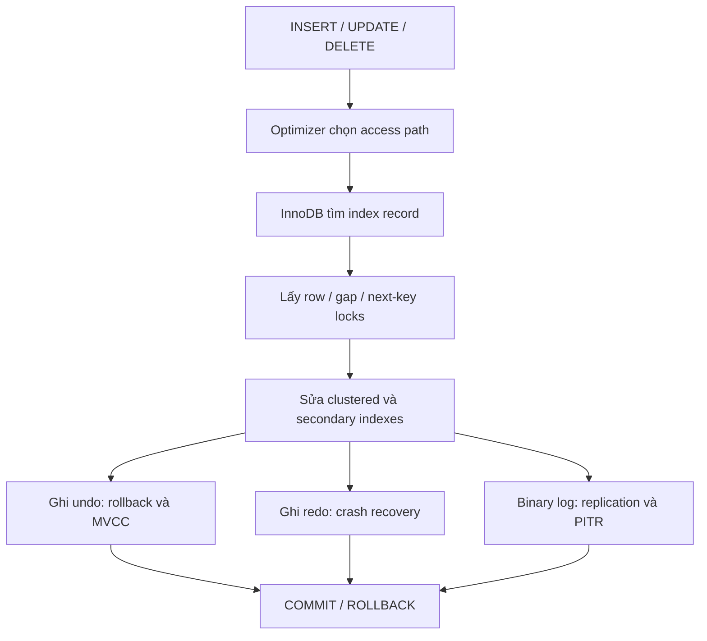

# Tác động của DML đến chỉ mục, khóa, undo, redo và binary log

Một câu lệnh DML như INSERT, UPDATE hoặc DELETE không chỉ thay đổi giá trị trong một hàng. Với InnoDB, mỗi thao tác còn có thể sửa clustered index, nhiều secondary index, lấy khóa để bảo vệ dữ liệu, ghi undo để rollback và đọc nhất quán, ghi redo để phục hồi sau sự cố, đồng thời tạo binary log để replication và point-in-time recovery hoạt động.

Vì vậy, một UPDATE chỉ đổi một cột có thể tạo ra nhiều thao tác ghi bên trong storage engine. Nếu cột đó nằm trong nhiều index, transaction còn phải cập nhật các cấu trúc index liên quan. Nếu điều kiện WHERE quét một vùng lớn, InnoDB có thể phải khóa nhiều index record hơn số hàng cuối cùng được thay đổi. Nếu transaction kéo dài, undo version tồn tại lâu hơn và purge khó dọn dẹp. Nếu binary log được bật, thay đổi đã commit còn được ghi vào log ở tầng server.

Trong module **DATABASE_MYSQL**, hiểu chuỗi tác động này giúp thiết kế index, chia batch, giảm lock contention, dự đoán chi phí ghi và cấu hình durability phù hợp. Bài học lần theo vòng đời của DML trong InnoDB, phân biệt vai trò của index, lock, undo, redo và binary log, sau đó đưa ra cách quan sát và tối ưu workload.

## 1. Bức tranh tổng thể khi một câu lệnh DML chạy

Một câu INSERT, UPDATE hoặc DELETE đi qua nhiều lớp:

1. MySQL phân tích câu lệnh, kiểm tra quyền, ràng buộc và chọn kế hoạch truy cập.
2. InnoDB tìm các bản ghi cần thao tác thông qua clustered index hoặc secondary index.
3. InnoDB lấy các khóa cần thiết để bảo vệ bản ghi và khoảng index liên quan.
4. InnoDB thay đổi trang dữ liệu và index trong buffer pool.
5. Undo record được tạo để hỗ trợ rollback và MVCC consistent read.
6. Redo record được ghi để có thể phát lại thay đổi trang sau crash.
7. Nếu binary logging được bật, MySQL ghi sự kiện DML vào binary log theo binlog format.
8. Khi commit, InnoDB và binary log phối hợp để giữ kết quả transaction nhất quán; cấu hình flush quyết định mức độ bền vững trước sự cố.

Có thể hình dung luồng đơn giản:



Sơ đồ thể hiện các thành phần có liên quan, không phải thứ tự ghi vật lý tuyệt đối cho mọi thao tác. InnoDB có buffer, background flushing, group commit và cơ chế phối hợp commit riêng. Điểm cần nhớ là một DML có thể tạo công việc ở cả storage engine và tầng server.

## 2. InnoDB lưu dữ liệu bằng clustered index và secondary index

Để hiểu chi phí DML, trước hết cần biết InnoDB tổ chức dữ liệu như thế nào.

### 2.1. Clustered index

Trong InnoDB, dữ liệu hàng được lưu trong leaf page của clustered index. Thông thường clustered index chính là PRIMARY KEY.

Ví dụ:

```sql
CREATE TABLE orders (
    order_id BIGINT UNSIGNED NOT NULL,
    customer_id BIGINT UNSIGNED NOT NULL,
    status VARCHAR(20) NOT NULL,
    total_amount DECIMAL(12, 2) NOT NULL,
    created_at DATETIME NOT NULL,
    PRIMARY KEY (order_id)
) ENGINE = InnoDB;
```

Các hàng được tổ chức theo thứ tự khóa chính trong clustered index. Khi truy cập một hàng bằng order_id, InnoDB tìm leaf record của clustered index và đọc dữ liệu hàng tại đó.

Nếu bảng không khai báo PRIMARY KEY, InnoDB chọn một unique index có các cột NOT NULL làm clustered index nếu có. Nếu không có khóa phù hợp, InnoDB tạo clustered index ẩn với row ID nội bộ.

Vì clustered index chứa dữ liệu hàng, thay đổi một cột không được đánh index vẫn cần sửa clustered record. Tuy nhiên, nếu cột đó không xuất hiện trong secondary index thì không cần sửa entry của các secondary index chỉ vì giá trị cột ấy đổi.

### 2.2. Secondary index

Secondary index là B-tree riêng chứa các cột được đánh index và khóa chính của hàng tương ứng.

Ví dụ:

```sql
CREATE INDEX idx_orders_customer_status
    ON orders (customer_id, status);

CREATE INDEX idx_orders_created_at
    ON orders (created_at);
```

Leaf entry của idx_orders_customer_status chứa customer_id, status và order_id (primary key) để InnoDB có thể tìm clustered record khi cần các cột khác.

Điều này có hai hệ quả:

- Một hàng có thể xuất hiện trong nhiều cấu trúc index.
- PRIMARY KEY càng rộng thì các secondary index thường càng tốn dung lượng vì phải mang theo khóa chính.

Chọn khóa chính ngắn, ổn định và không đổi thường giúp giảm chi phí lưu trữ cũng như bảo trì secondary index.

## 3. DML tác động lên index như thế nào?

### 3.1. INSERT

Khi chèn một hàng mới, InnoDB thường phải:

- Tìm vị trí trong clustered index và thêm clustered record.
- Thêm entry vào từng secondary index có liên quan.
- Kiểm tra PRIMARY KEY và các UNIQUE index để bảo đảm không trùng.
- Kiểm tra các FOREIGN KEY liên quan.
- Lấy khóa cần thiết cho insert và các kiểm tra ràng buộc.
- Ghi undo/redo theo yêu cầu của transaction và tạo binlog event nếu bật binary logging.

Ví dụ:

```sql
INSERT INTO orders (
    order_id,
    customer_id,
    status,
    total_amount,
    created_at
)
VALUES (
    90001,
    501,
    'PENDING',
    1250000.00,
    CURRENT_TIMESTAMP
);
```

Nếu bảng có ba secondary index, thao tác chèn một hàng không chỉ là một lần ghi vào bảng: nó còn cần thêm entry vào các index đó. Càng nhiều index, chi phí ghi và dung lượng càng tăng.

### 3.2. UPDATE cột không được đánh index

Giả sử total_amount không nằm trong bất kỳ secondary index nào:

```sql
UPDATE orders
SET total_amount = 1300000.00
WHERE order_id = 90001;
```

InnoDB tìm hàng qua PRIMARY KEY, khóa bản ghi cần cập nhật, ghi undo và redo, rồi thay đổi clustered record. Các secondary index không chứa total_amount thường không cần thay entry.

Đây là một trong những lý do không nên đánh index mọi cột: mỗi index thêm vào có thể làm tăng công việc của các thao tác ghi.

### 3.3. UPDATE cột được đánh index

Nếu cập nhật status, cột thuộc idx_orders_customer_status:

```sql
UPDATE orders
SET status = 'PAID'
WHERE order_id = 90001;
```

InnoDB phải thay đổi clustered record và cập nhật secondary index có chứa status. Về mặt logic, entry index cũ không còn đúng với giá trị mới và entry tương ứng với giá trị mới phải được tạo. Engine quản lý việc xóa đánh dấu và thêm entry theo cơ chế nội bộ; không nên xem đây là một phép sửa byte đơn giản tại cùng vị trí.

Nếu cột được đánh index xuất hiện trong nhiều secondary index, tất cả index liên quan đều có thể phải cập nhật. Cập nhật khóa chính còn tốn kém hơn: vì khóa chính được lưu trong các secondary index, thay đổi PRIMARY KEY có thể cần di chuyển clustered record và cập nhật khóa tham chiếu trong mọi secondary index.

### 3.4. DELETE

Khi xóa hàng:

```sql
DELETE FROM orders
WHERE order_id = 90001;
```

InnoDB không nhất thiết xóa vật lý toàn bộ record ngay lập tức. Hàng và các entry index liên quan được đánh dấu xóa; undo giữ thông tin cần thiết cho rollback và các consistent read đang còn nhìn thấy phiên bản cũ. Khi không còn read view nào cần phiên bản cũ, purge thread có thể dọn các phiên bản và entry đã đánh dấu xóa.

Vì vậy, DELETE nhiều hàng có thể tạo lượng undo lớn và công việc purge kéo dài. Xóa hàng không đồng nghĩa trang dữ liệu được thu nhỏ ngay hoặc file tablespace giảm kích thước tức thì.

### 3.5. Bảng tổng hợp tác động

| Thao tác | Clustered index | Secondary index | Undo / redo |
|---|---|---|---|
| INSERT | Thêm hàng mới | Thêm entry tương ứng vào từng index | Có undo cần cho rollback; redo ghi thay đổi |
| UPDATE cột không index | Sửa hàng | Thường không đổi | Undo lưu giá trị cũ; redo ghi thay đổi |
| UPDATE cột có index | Sửa hàng | Cập nhật các index chứa cột đó | Undo/redo cho thay đổi liên quan |
| UPDATE PRIMARY KEY | Di chuyển/thay đổi khóa hàng | Có thể cập nhật mọi secondary index vì chúng chứa PK | Có thể phát sinh nhiều undo/redo |
| DELETE | Đánh dấu hàng xóa | Đánh dấu entry liên quan; purge dọn sau | Undo hỗ trợ rollback/MVCC; redo ghi thay đổi |

Chi tiết vật lý phụ thuộc phiên bản, index, page state và storage engine. Bảng trên mô tả tác động logic thường gặp trong InnoDB.

## 4. Index làm tăng chi phí ghi và write amplification

Index tăng tốc truy vấn đọc khi được chọn đúng, nhưng mọi index bổ sung đều cần dung lượng và công việc bảo trì.

Một INSERT vào bảng có nhiều index có thể làm thay đổi nhiều B-tree. UPDATE một cột nằm trong một số index có thể làm thay đổi nhiều entry. DELETE phải đánh dấu xóa các entry tương ứng. Những thay đổi này tạo thêm page modification, redo record, buffer pool dirty page và I/O về sau.

Đây là một dạng **write amplification**: một thay đổi logic nhỏ ở hàng có thể tạo ra nhiều thao tác ghi vật lý ở các cấu trúc khác nhau.

### 4.1. Ví dụ thiết kế index quá mức

Bảng đơn hàng:

```sql
CREATE TABLE order_items (
    item_id BIGINT PRIMARY KEY,
    order_id BIGINT NOT NULL,
    product_id BIGINT NOT NULL,
    quantity INT NOT NULL,
    unit_price DECIMAL(12, 2) NOT NULL,
    status VARCHAR(20) NOT NULL,
    created_at DATETIME NOT NULL,
    KEY idx_order (order_id),
    KEY idx_product (product_id),
    KEY idx_status (status),
    KEY idx_created (created_at),
    KEY idx_quantity (quantity),
    KEY idx_price (unit_price)
) ENGINE = InnoDB;
```

Nếu workload thực tế chỉ thường xuyên tìm theo order_id và product_id, các index đơn lẻ trên quantity, unit_price, status, created_at có thể không đem lại đủ lợi ích để bù chi phí ghi. Không thể kết luận chỉ từ schema; cần xem truy vấn thực tế, độ chọn lọc và kế hoạch thực thi.

### 4.2. Chọn index theo workload

Trước khi thêm index:

1. Xác định truy vấn đọc nào đang chậm và thường xuyên.
2. Kiểm tra index hiện có, thứ tự cột và leftmost prefix.
3. Đánh giá cột có độ chọn lọc phù hợp hay không.
4. Cân nhắc index ghép thay cho nhiều index đơn lẻ nếu cùng phục vụ workload.
5. Đo chi phí INSERT/UPDATE/DELETE trước và sau khi thay đổi.
6. Theo dõi dung lượng index, buffer pool và thời gian ghi.

Không xóa index chỉ vì thấy ít truy vấn dùng nó trong một khoảng thời gian ngắn. Index có thể phục vụ truy vấn định kỳ, ràng buộc UNIQUE/FOREIGN KEY hoặc một luồng nghiệp vụ quan trọng.

### 4.3. Change buffer với secondary index

InnoDB có cơ chế change buffering cho một số thay đổi trên secondary index khi trang index đích chưa nằm trong buffer pool. Thay đổi đủ điều kiện có thể được ghi nhận vào change buffer và hợp nhất sau khi trang được đọc hoặc trong quá trình nền.

Cơ chế này giúp giảm việc phải đọc trang secondary index ngẫu nhiên ngay tại thời điểm ghi. Tuy nhiên:

- Không phải mọi loại index modification đều đủ điều kiện.
- Unique secondary index cần kiểm tra uniqueness nên không được buffer theo cách thông thường này.
- Change buffering không loại bỏ chi phí cập nhật index; nó trì hoãn/hợp nhất một phần công việc.
- Cấu hình và hành vi có thể thay đổi theo phiên bản; kiểm tra innodb_change_buffering trên server đích.

Đừng dựa vào change buffer để biện minh cho việc tạo nhiều index không cần thiết.

## 5. DML lấy khóa nào trong InnoDB?

InnoDB dùng khóa ở cấp index record và khoảng index để điều phối truy cập đồng thời. Vì khóa gắn với index record, access path mà optimizer chọn có thể ảnh hưởng trực tiếp đến phạm vi khóa.

Các loại khóa quan trọng:

| Loại khóa | Ý nghĩa |
|---|---|
| Record lock | Khóa một index record |
| Gap lock | Khóa khoảng giữa các index record, ngăn transaction khác chèn vào khoảng đó |
| Next-key lock | Kết hợp record lock và gap lock trên khoảng kết thúc tại record |
| Insert intention lock | Báo ý định chèn vào một khoảng; cho phép các insert ở vị trí khác nhau trong cùng gap phối hợp |
| Intention lock | Khóa ý định ở cấp bảng, phối hợp với khóa cấp hàng |
| AUTO-INC lock | Cơ chế phối hợp cấp AUTO_INCREMENT tùy innodb_autoinc_lock_mode |

DML thường cần exclusive record lock trên bản ghi bị thay đổi. Với truy vấn phạm vi, khóa gap hoặc next-key có thể được dùng để bảo vệ phạm vi khỏi phantom insert, tùy isolation level và loại truy vấn.

### 5.1. Metadata lock khác row lock

Khi truy cập bảng, DML còn lấy metadata lock (MDL) để bảo vệ định nghĩa bảng trong lúc câu lệnh và transaction sử dụng nó. DML thông thường lấy metadata lock tương thích với các thao tác đọc/ghi thông thường, nhưng có thể chặn hoặc bị chặn bởi DDL cần metadata lock xung đột, chẳng hạn một số thao tác ALTER TABLE.

Metadata lock bảo vệ metadata của bảng; record/gap/next-key lock bảo vệ dữ liệu và khoảng index trong InnoDB. Một transaction có thể không giữ nhiều row lock nhưng vẫn làm DDL phải chờ vì nó chưa kết thúc và còn giữ MDL. Vì vậy, khi ALTER TABLE bị treo, cần kiểm tra cả transaction lâu và metadata lock, không chỉ xem row lock.

### 5.2. UPDATE và DELETE khóa theo access path

Ví dụ:

```sql
UPDATE orders
SET status = 'CANCELLED'
WHERE customer_id = 501
  AND created_at < '2026-01-01';
```

Nếu có index (customer_id, created_at), InnoDB có thể tìm một vùng index tương đối hẹp. Nếu không có index phù hợp, server có thể phải scan nhiều hàng hơn; DML có thể cần kiểm tra và khóa nhiều record hơn để tìm các hàng thỏa điều kiện.

Điểm quan trọng: số hàng thực sự thay đổi không nhất thiết bằng số index record đã được scan hoặc số khóa đã lấy trong quá trình thực thi. Một điều kiện lọc không có index tốt có thể làm phạm vi lock lớn và tăng cạnh tranh.

Hãy kiểm tra EXPLAIN cho SELECT tương đương với điều kiện WHERE để hiểu access path; sau đó xác nhận bằng lock instrumentation và workload thực tế. Trên các phiên bản hỗ trợ, MySQL cũng cho phép EXPLAIN một số câu UPDATE/DELETE, nhưng cần kiểm tra cú pháp và phiên bản.

### 5.3. Record lock và unique lookup

Với truy vấn dùng unique index để tìm đúng một hàng bằng toàn bộ unique key, InnoDB thường chỉ cần record lock trên record tìm được, không cần khóa gap trước nó trong trường hợp tìm thấy record. Nếu tìm không thấy hoặc điều kiện là range/non-unique, phạm vi khóa có thể rộng hơn tùy isolation level.

Ví dụ cập nhật bằng primary key:

```sql
UPDATE orders
SET status = 'PAID'
WHERE order_id = 90001;
```

Truy cập bằng khóa chính duy nhất thường có phạm vi khóa nhỏ và dễ dự đoán hơn truy vấn cập nhật bằng cột không có index.

## 6. Isolation level ảnh hưởng gap lock và next-key lock

InnoDB mặc định dùng REPEATABLE READ trong MySQL. Isolation level ảnh hưởng cách khóa range và cách consistent read nhìn thấy dữ liệu.

### 6.1. REPEATABLE READ

Ở REPEATABLE READ, locking read và DML dùng next-key locking trong nhiều trường hợp range scan để ngăn transaction khác chèn bản ghi vào khoảng đang được bảo vệ. Điều này giúp ngăn một số phantom trong locking operation.

Ví dụ:

```sql
START TRANSACTION;

SELECT *
FROM orders
WHERE customer_id = 501
  AND created_at >= '2026-01-01'
FOR UPDATE;
```

Nếu index phù hợp là (customer_id, created_at), InnoDB có thể khóa các index record trong vùng và các gap liên quan theo quy tắc next-key lock. Transaction khác chèn đơn hàng mới vào vùng bị khóa có thể phải chờ.

### 6.2. READ COMMITTED

Ở READ COMMITTED, gap locking cho search và index scan thường bị tắt, ngoại trừ các trường hợp cần cho kiểm tra FOREIGN KEY và duplicate-key. Record lock cho hàng được cập nhật vẫn được dùng.

Điều này có thể giảm lock contention trong một số workload, nhưng thay đổi semantics đọc và kiểm soát phantom. Không đổi isolation level chỉ để "hết lock wait" mà chưa hiểu yêu cầu nhất quán của ứng dụng.

Kiểm tra isolation level:

```sql
SELECT
    @@GLOBAL.transaction_isolation,
    @@SESSION.transaction_isolation;
```

## 7. INSERT cũng cần khóa

INSERT không phải thao tác không khóa. InnoDB cần phối hợp vị trí chèn trong index và kiểm tra ràng buộc.

Khi insert vào B-tree, InnoDB có thể lấy insert intention lock trên gap trước khi đặt record mới. Các transaction có thể chèn vào những vị trí khác nhau trong cùng gap mà không nhất thiết chặn nhau, nhưng insert vào cùng khóa duy nhất có thể phải chờ để xác định kết quả duplicate.

Các tình huống làm INSERT chờ:

- Một transaction đang giữ khóa trên vị trí index hoặc gap cần chèn.
- Unique key đang được tạo bởi transaction chưa commit khác.
- Kiểm tra FOREIGN KEY cần đọc/khóa record cha liên quan.
- AUTO_INCREMENT allocation hoặc các thao tác bulk insert có phối hợp khóa riêng.
- Metadata lock do DDL hoặc transaction khác đang giữ.

Vì vậy, một INSERT đơn giản vẫn có thể gặp lock wait hoặc deadlock khi chạy đồng thời.

## 8. Foreign key và trigger làm tăng phạm vi DML

Một DML có thể kích hoạt thêm thao tác kiểm tra hoặc cập nhật liên quan:

- FOREIGN KEY yêu cầu kiểm tra hàng cha khi insert/update khóa ngoại và kiểm tra hàng con khi xóa/cập nhật khóa cha.
- ON DELETE CASCADE hoặc ON UPDATE CASCADE có thể làm thay đổi nhiều hàng ở bảng con.
- Trigger có thể thực thi thêm INSERT/UPDATE/DELETE trên bảng khác.
- UNIQUE constraint cần kiểm tra xung đột trước khi ghi.

Ví dụ:

```sql
CREATE TABLE order_lines (
    line_id BIGINT PRIMARY KEY,
    order_id BIGINT NOT NULL,
    product_id BIGINT NOT NULL,
    quantity INT NOT NULL,
    CONSTRAINT fk_line_order
        FOREIGN KEY (order_id)
        REFERENCES orders(order_id)
        ON DELETE CASCADE
) ENGINE = InnoDB;
```

Xóa một hàng trong orders có thể kéo theo xóa nhiều hàng order_lines. Do đó, ước lượng số hàng tác động phải tính cả cascade và trigger, không chỉ nhìn vào bảng xuất hiện trực tiếp trong câu DELETE.

Thiết kế khóa ngoại và trigger nên được kiểm tra cùng với lock order. Hai transaction cập nhật các bảng liên quan theo thứ tự khác nhau có thể tạo deadlock.

## 9. Undo log: rollback và MVCC

Undo log lưu thông tin cần thiết để hoàn tác thay đổi và tái tạo phiên bản cũ cho consistent read. Nó là nền tảng của rollback và Multi-Version Concurrency Control (MVCC) trong InnoDB.

### 9.1. UPDATE tạo phiên bản cũ

Giả sử một hàng đang có:

| order_id | status | total_amount |
|---:|---|---:|
| 90001 | PENDING | 1250000.00 |

Transaction A chạy:

```sql
START TRANSACTION;

UPDATE orders
SET status = 'PAID'
WHERE order_id = 90001;
```

InnoDB lưu thông tin undo để có thể khôi phục giá trị trước đó và cho consistent read phù hợp nhìn thấy phiên bản cũ. Transaction chưa commit nên thay đổi chưa được xem là đã xác nhận cho các transaction khác theo quy tắc isolation.

### 9.2. DELETE và undo

Khi DELETE, InnoDB cần giữ đủ thông tin để rollback hàng đã xóa và phục vụ read view còn nhìn thấy hàng đó. Vì vậy, hàng được đánh dấu xóa trước khi purge vật lý sau này.

### 9.3. Undo không phải binary log

Undo và binary log phục vụ mục đích khác nhau:

- Undo là cấu trúc nội bộ InnoDB, hỗ trợ rollback và MVCC.
- Binary log là log ở tầng MySQL server, phục vụ replication và point-in-time recovery.
- Undo không phải bản ghi sự kiện để replica phát lại.
- Binary log không thay thế undo để thực hiện rollback một transaction chưa commit.

### 9.4. Transaction dài làm undo tồn tại lâu

Một transaction giữ read view lâu có thể khiến purge không dọn được các phiên bản cũ mà transaction đó còn cần. Nếu workload liên tục UPDATE/DELETE, history list có thể tăng và undo tablespace phát triển.

Ví dụ transaction mở lâu:

```sql
START TRANSACTION;

SELECT *
FROM orders
WHERE customer_id = 501;

-- Ứng dụng giữ transaction mở trong thời gian dài.
-- Các transaction khác tiếp tục UPDATE/DELETE orders.

COMMIT;
```

Transaction đọc lâu có thể giữ lại các phiên bản cũ cần cho consistent read. Transaction ghi lớn cũng tạo nhiều undo record, khiến rollback có thể mất thời gian và purge cần thêm công việc sau commit.

Theo dõi History list length trong SHOW ENGINE INNODB STATUS và các chỉ số transaction/undo phù hợp. Không dùng một ngưỡng cố định cho mọi workload; cần xem tốc độ tăng, thời gian tồn tại và tác động lên dung lượng.

## 10. Redo log: phục hồi thay đổi sau crash

Redo log ghi lại thông tin để InnoDB có thể phát lại các thay đổi trang đã được ghi nhận, kể cả khi trang dữ liệu chưa được flush xuống data file tại thời điểm sự cố.

### 10.1. Write-ahead logging

InnoDB dùng nguyên tắc write-ahead logging: redo tương ứng phải được ghi bền vững theo cấu hình trước khi trang dữ liệu chứa thay đổi được ghi xuống vị trí dữ liệu chính. Điều này cho phép crash recovery phát lại thay đổi cần thiết.

Luồng đơn giản:

1. Transaction sửa trang trong buffer pool.
2. Trang trở thành dirty page.
3. Redo record được tạo trong redo log buffer.
4. Redo được ghi ra redo log file theo cơ chế commit/flush và background flushing.
5. Dirty page được flush về tablespace sau đó.
6. Nếu server crash trước khi data page được ghi đầy đủ, InnoDB dùng redo để phục hồi.

Redo log chủ yếu phục vụ crash recovery và durability của InnoDB. Nó không phải lịch sử SQL để đọc lại nghiệp vụ.

### 10.2. Redo khác undo

| Đặc điểm | Undo | Redo |
|---|---|---|
| Mục tiêu | Rollback và MVCC | Crash recovery |
| Hướng thông tin | Khôi phục trạng thái cũ | Phát lại thay đổi cần thiết |
| Vòng đời | Có thể cần đến khi transaction/read view không còn cần | Được tái sử dụng theo checkpoint và vòng đời redo |
| Dùng cho replication | Không | Không trực tiếp |
| Khi rollback | Được dùng để hoàn tác | Việc hoàn tác cũng tạo thay đổi mới cần redo |

Khi transaction rollback, InnoDB dùng undo để hoàn tác; các thao tác hoàn tác lại tạo thay đổi trang và redo tương ứng để crash recovery có thể khôi phục trạng thái sau rollback.

### 10.3. innodb_flush_log_at_trx_commit

Biến innodb_flush_log_at_trx_commit điều khiển cách redo log được ghi và flush:

| Giá trị | Hành vi khái quát | Rủi ro khi OS/server mất điện |
|---:|---|---|
| 0 | Ghi và flush redo theo chu kỳ nền, xấp xỉ mỗi giây | Có thể mất các transaction gần đây |
| 1 | Ghi và flush redo xuống storage tại mỗi commit | Mức durability cao nhất theo cơ chế InnoDB |
| 2 | Ghi redo ra OS cache tại mỗi commit, flush xuống storage theo chu kỳ nền | Có thể mất các transaction gần đây nếu OS hoặc máy mất điện |

Kiểm tra:

```sql
SELECT @@GLOBAL.innodb_flush_log_at_trx_commit;
```

Giá trị 1 thường được chọn khi ưu tiên durability. Giá trị 0 hoặc 2 có thể cải thiện hiệu năng trong một số workload nhưng chấp nhận rủi ro mất transaction đã được ứng dụng nhận xác nhận gần thời điểm sự cố.

Mức bảo vệ cuối cùng còn phụ thuộc filesystem, thiết bị lưu trữ, write cache và việc storage có thực sự tuân thủ flush/fsync hay không.

## 11. Binary log: replication và point-in-time recovery

Binary log (binlog) được MySQL server ghi ở tầng server, chứa các sự kiện làm thay đổi dữ liệu hoặc metadata được log theo cấu hình. Với DML, nội dung phụ thuộc binlog_format.

Binary log được dùng cho:

- Replication: replica đọc và áp dụng sự kiện từ source.
- Point-in-time recovery: khôi phục từ full backup rồi phát lại binlog đến thời điểm mong muốn.
- Audit/CDC trong các hệ thống đọc binlog.
- Đồng bộ dữ liệu giữa các thành phần.

### 11.1. Statement-based, row-based và mixed

| Format | Nội dung ghi | Đặc điểm |
|---|---|---|
| STATEMENT | Câu SQL được ghi để phát lại | Gọn hơn trong một số workload nhưng cần câu lệnh có hành vi xác định và môi trường tương thích |
| ROW | Thay đổi ở cấp hàng được ghi | Thể hiện chính xác hàng bị thay đổi; có thể tạo binlog lớn với UPDATE/DELETE nhiều hàng |
| MIXED | Server chọn statement hoặc row tùy trường hợp | Kết hợp hai cách theo quy tắc của MySQL |

Kiểm tra:

```sql
SELECT
    @@GLOBAL.log_bin AS log_bin_enabled,
    @@GLOBAL.binlog_format AS binlog_format;
```

Với row-based logging, binlog có thể chứa before image và after image tùy thao tác, cấu hình binlog_row_image và các cột cần thiết. FULL ghi đầy đủ hình ảnh hàng theo quy tắc; MINIMAL giảm dữ liệu ghi bằng cách chỉ lưu các cột cần thiết; NOBLOB có thể lược bỏ một số BLOB/TEXT không cần thiết. Cấu hình row image có thể ảnh hưởng đến kích thước binlog và khả năng tiêu thụ của CDC.

### 11.2. Binlog không giống redo log

| Đặc điểm | Redo log | Binary log |
|---|---|---|
| Lớp ghi | InnoDB storage engine | MySQL server |
| Mục đích chính | Crash recovery, durability | Replication, PITR, CDC |
| Nội dung | Thông tin phục hồi thay đổi trang | Sự kiện SQL hoặc row event |
| Phạm vi | Dữ liệu InnoDB | Các thay đổi được server ghi vào binlog theo cấu hình |
| Quản lý | InnoDB quản lý checkpoint và vòng đời redo | Server quản lý file, index, rotation và purge binlog |

Không thể dùng redo log thay binlog để dựng replica. Cũng không thể dùng binlog thay redo để InnoDB phục hồi các dirty page sau crash.

### 11.3. sync_binlog

sync_binlog điều khiển tần suất MySQL đồng bộ binary log xuống storage:

| Giá trị | Ý nghĩa khái quát |
|---:|---|
| 0 | Để OS quyết định thời điểm flush |
| 1 | Đồng bộ binlog xuống storage ở mỗi commit theo cơ chế group commit |
| N lớn hơn 1 | Đồng bộ sau mỗi N lần commit |

Kiểm tra:

```sql
SELECT @@GLOBAL.sync_binlog;
```

Kết hợp innodb_flush_log_at_trx_commit = 1 và sync_binlog = 1 thường được dùng khi ưu tiên durability cao, vì cả redo và binlog đều được đồng bộ chặt chẽ ở thời điểm commit. Cấu hình thực tế cần cân bằng với hiệu năng, thiết bị lưu trữ và yêu cầu mất dữ liệu tối đa có thể chấp nhận.

## 12. Commit phối hợp InnoDB redo và binary log

Khi binary logging bật và transaction thay đổi dữ liệu InnoDB, MySQL phải phối hợp commit ở hai nơi: storage engine và binary log. MySQL dùng cơ chế two-phase commit (2PC) nội bộ để giữ trạng thái nhất quán nếu sự cố xảy ra giữa các bước.

Mô tả khái quát:

1. InnoDB chuẩn bị transaction (prepare) và bảo đảm thông tin cần thiết được ghi vào redo.
2. MySQL ghi transaction event vào binary log.
3. Khi binlog ghi thành công, MySQL yêu cầu InnoDB commit transaction.
4. Group commit có thể gom nhiều transaction để giảm số lần flush đồng bộ.

Nếu crash xảy ra giữa các bước, khi khởi động lại MySQL đối chiếu trạng thái prepare của InnoDB với binary log để quyết định transaction đã được commit hay cần rollback. Cơ chế này giúp tránh trường hợp transaction có trong binlog nhưng không có trong InnoDB, hoặc ngược lại.

Đây là mô tả khái quát của phối hợp commit; thứ tự flush và đồng bộ cụ thể phụ thuộc cấu hình durability, group commit và phiên bản. Ứng dụng chỉ nên xem transaction thành công sau khi COMMIT trả kết quả thành công, đồng thời cấu hình flush phải phù hợp yêu cầu durability.

## 13. DML, buffer pool và I/O

InnoDB thường sửa trang trong buffer pool trước khi ghi data page về tablespace. Trang đã sửa trở thành dirty page. Background flushing và checkpoint ghi dirty page xuống storage theo chiến lược của InnoDB.

Một DML có thể tạo ra:

- Đọc index/data page chưa có trong buffer pool.
- Sửa clustered index page.
- Sửa một hoặc nhiều secondary index page.
- Ghi undo page và redo record.
- Tạo dirty page cần flush.
- Tạo binlog event nếu binary logging bật.
- Phát sinh I/O phụ do page split, purge, change buffer merge hoặc checkpoint.

Nếu workload ghi ngẫu nhiên vào index lớn hơn bộ nhớ, cache miss và random I/O có thể tăng. Nếu transaction ghi quá nhiều hàng, lượng dirty page, redo và undo có thể tăng nhanh, gây áp lực lên background flushing và log capacity.

Không phải mọi DML đều gây một lần ghi đĩa đồng bộ cho từng hàng. Buffer pool, redo log buffer, group commit và batch processing giúp gom công việc. Nhưng các thay đổi vẫn tạo ra chi phí cuối cùng cần được flush và duy trì.

## 14. Ví dụ: vì sao UPDATE một cột có thể tốn kém?

Giả sử bảng orders có:

- PRIMARY KEY (order_id).
- Secondary index (customer_id, status).
- Secondary index (status, created_at).
- Secondary index (created_at).

Câu lệnh:

```sql
UPDATE orders
SET status = 'PAID'
WHERE order_id = 90001;
```

Dù chỉ thay đổi một cột, InnoDB cần:

1. Tìm hàng theo PRIMARY KEY.
2. Khóa record cần cập nhật.
3. Ghi undo để lưu giá trị status cũ.
4. Sửa clustered record.
5. Cập nhật idx_orders_customer_status.
6. Cập nhật idx_orders_status_created.
7. Ghi redo cho các thay đổi trang.
8. Ghi row/statement event vào binary log nếu bật.
9. Khi commit, phối hợp redo và binlog theo cấu hình durability.

Nếu status không nằm trong hai secondary index, hai bước cập nhật index có thể không cần thiết. Điều đó cho thấy lựa chọn index ảnh hưởng trực tiếp đến chi phí cập nhật.

## 15. Quan sát lock, transaction và log trong MySQL

### 15.1. Xem transaction đang hoạt động

```sql
SELECT
    trx_id,
    trx_state,
    trx_started,
    trx_wait_started,
    trx_mysql_thread_id,
    trx_rows_locked,
    trx_rows_modified,
    trx_query
FROM INFORMATION_SCHEMA.INNODB_TRX;
```

Truy vấn giúp tìm transaction lâu, transaction đang chờ và transaction đã sửa nhiều hàng. Cần quyền thích hợp để xem các thông tin này.

### 15.2. Xem lock và lock wait

MySQL 8.0 cung cấp các bảng Performance Schema:

```sql
SELECT *
FROM performance_schema.data_locks;
```

```sql
SELECT *
FROM performance_schema.data_lock_waits;
```

data_locks hiển thị lock đang được giữ hoặc yêu cầu; data_lock_waits mô tả quan hệ giữa transaction đang chờ và transaction chặn nó. Các cột có thể khác theo phiên bản; nên chọn những cột cần thiết thay vì phụ thuộc SELECT * trong dashboard lâu dài.

### 15.3. Xem trạng thái InnoDB

```sql
SHOW ENGINE INNODB STATUS;
```

Các phần thường cần chú ý:

- TRANSACTIONS: transaction đang chạy, lock wait và thông tin deadlock gần nhất.
- HISTORY LIST LENGTH: tình trạng hàng đợi undo version cần purge.
- LOG: thông tin redo log và checkpoint.
- BUFFER POOL AND MEMORY: trạng thái buffer pool và page.

Đầu ra là snapshot tại thời điểm truy vấn; deadlock section thường chỉ hiển thị deadlock gần nhất được ghi lại. Với điều tra kéo dài, kết hợp Performance Schema và log monitoring.

### 15.4. Xem cấu hình durability

```sql
SELECT
    @@GLOBAL.innodb_flush_log_at_trx_commit
        AS innodb_flush_log_at_trx_commit,
    @@GLOBAL.sync_binlog AS sync_binlog,
    @@GLOBAL.binlog_format AS binlog_format,
    @@GLOBAL.log_bin AS log_bin_enabled;
```

Kiểm tra cấu hình trên môi trường thực tế và so sánh với yêu cầu RPO/RTO. Không thay đổi các biến durability chỉ dựa trên một lần benchmark.

## 16. Giảm tác động của DML lên index, lock và log

### 16.1. Dùng WHERE có index và cập nhật theo khóa ổn định

Ưu tiên cập nhật bằng primary key hoặc index phù hợp:

```sql
UPDATE orders
SET status = 'CANCELLED'
WHERE order_id = 90001;
```

Tránh UPDATE/DELETE thiếu điều kiện hoặc dùng điều kiện không có index trên bảng lớn nếu không chủ động muốn thay đổi diện rộng.

### 16.2. Giữ transaction ngắn

Transaction càng dài thì càng giữ lock lâu và có thể giữ read view lâu. Hãy thực hiện công việc không cần database trước transaction, chỉ mở transaction khi cần, rồi commit/rollback sớm.

Không chờ người dùng nhập liệu hoặc gọi dịch vụ mạng bên ngoài trong khi đang giữ transaction và row lock.

### 16.3. Chia batch có kiểm soát

Thay vì một DELETE rất lớn:

```sql
DELETE FROM audit_events
WHERE created_at < '2024-01-01';
```

có thể xóa theo từng lô bằng khóa ổn định:

```sql
DELETE FROM audit_events
WHERE event_id IN (
    SELECT event_id
    FROM (
        SELECT event_id
        FROM audit_events
        WHERE created_at < '2024-01-01'
        ORDER BY event_id
        LIMIT 1000
    ) AS batch_rows
);
```

Lặp lại theo batch, đo thời gian, lock wait, undo/redo generation và replication lag. Ví dụ minh họa cần có index phù hợp với điều kiện lọc/thứ tự và phải kiểm tra cú pháp trên phiên bản đích. Kích thước batch không có một con số đúng cho mọi hệ thống.

Batch nhỏ giúp transaction ngắn và giảm lượng undo/redo cho mỗi transaction, nhưng quá nhiều batch nhỏ lại tăng overhead commit và có thể giảm throughput. Hãy đo để chọn kích thước hợp lý.

### 16.4. Giảm index không cần thiết

Mỗi secondary index làm tăng chi phí ghi. Đánh giá lại index trùng lặp, index ít được sử dụng và index có thứ tự cột không phù hợp. Giữ lại index phục vụ truy vấn quan trọng, UNIQUE và FOREIGN KEY theo yêu cầu thiết kế.

### 16.5. Tránh cập nhật khóa chính

Khóa chính được lưu trong các secondary index. Nếu thay đổi PK, InnoDB có thể phải cập nhật nhiều index entry và ảnh hưởng các bảng tham chiếu. Hãy dùng PK ổn định; nếu cần đổi mã nghiệp vụ, lưu nó ở cột riêng.

### 16.6. Đồng nhất thứ tự cập nhật giữa các transaction

Nếu transaction A cập nhật bảng X rồi Y, còn transaction B cập nhật Y rồi X, nguy cơ deadlock tăng. Thiết kế các luồng ghi theo thứ tự bảng/khóa nhất quán, giữ transaction ngắn và có retry khi gặp deadlock.

Deadlock là tình huống bình thường có thể xảy ra trong hệ thống đồng thời. Ứng dụng cần xử lý lỗi deadlock bằng cách rollback và retry toàn bộ transaction với giới hạn hợp lý, không chỉ chạy lại câu SQL cuối cùng.

## 17. Quy trình phân tích một DML chậm hoặc gây lock wait

Khi INSERT, UPDATE hoặc DELETE chậm, hãy kiểm tra theo trình tự:

1. **Xác định câu lệnh và phạm vi dữ liệu.** Có bao nhiêu hàng dự kiến bị tác động? Có trigger hoặc cascade không?
2. **Đọc access path.** Kiểm tra index được dùng và số hàng cần scan.
3. **Đánh giá index maintenance.** Cột được cập nhật nằm trong bao nhiêu secondary index? PK có bị thay đổi không?
4. **Kiểm tra transaction.** Có transaction dài, hàng bị khóa hoặc transaction chờ không?
5. **Xác định lock type và blocker.** Dùng Performance Schema data_locks, data_lock_waits và INNODB_TRX.
6. **Kiểm tra undo/purge.** History list length có tăng kéo dài không? Có read view lâu không?
7. **Kiểm tra redo và I/O.** Redo generation, checkpoint, dirty page và storage latency có gây áp lực không?
8. **Kiểm tra binlog.** Row-based logging có tạo lượng event lớn? Replica có lag hoặc binlog storage tăng nhanh không?
9. **Thử thay đổi nhỏ.** Điều chỉnh index, batch size, transaction scope hoặc thứ tự cập nhật trong staging.
10. **Đo trước/sau.** So sánh throughput, latency, lock wait, rows examined, redo/binlog volume và replication lag.

Không tối ưu chỉ bằng cách tăng buffer hoặc log capacity nếu nguyên nhân gốc là scan quá rộng, index dư thừa hoặc transaction giữ khóa quá lâu.

## 18. Những nhầm lẫn thường gặp

| Nhầm lẫn | Cách hiểu đúng |
|---|---|
| Một UPDATE một hàng chỉ ghi một vị trí | Có thể sửa clustered record và nhiều secondary index |
| Index chỉ làm SELECT nhanh hơn | Index làm tăng chi phí INSERT/UPDATE/DELETE và dung lượng |
| DELETE xóa vật lý hàng ngay | InnoDB đánh dấu xóa; purge dọn khi không còn read view cần phiên bản cũ |
| Undo và redo giống nhau | Undo phục vụ rollback/MVCC; redo phục vụ crash recovery |
| Redo log dùng để replication | Replication dùng binary log |
| Binary log dùng để rollback transaction đang mở | Rollback dựa vào undo trong InnoDB |
| UPDATE chỉ khóa hàng thực sự thay đổi | DML có thể khóa record/range theo access path và isolation level |
| INSERT không lấy khóa | INSERT cần khóa vị trí index, kiểm tra unique/FK và có thể phải chờ |
| READ COMMITTED không bao giờ có gap lock | Gap lock vẫn có thể dùng cho FK và duplicate-key checking |
| Commit thành công luôn đồng nghĩa dữ liệu đã fsync xuống thiết bị | Durability phụ thuộc innodb_flush_log_at_trx_commit, sync_binlog và storage stack |
| Có thể dùng một transaction lớn cho mọi batch | Transaction lớn có thể giữ lock lâu và tạo nhiều undo/redo |
| Deadlock là lỗi bất thường không thể tránh | Deadlock là hệ quả có thể xảy ra của concurrency; ứng dụng cần retry transaction |

## 19. Ghi nhớ

- DML tác động lên clustered index, secondary index, lock, undo, redo và có thể cả binary log.
- InnoDB lưu dữ liệu hàng trong clustered index; secondary index chứa khóa chính để tham chiếu hàng.
- INSERT thêm entry vào các index; UPDATE cột được đánh index phải cập nhật index liên quan; DELETE đánh dấu xóa và purge dọn sau.
- Mỗi index bổ sung làm tăng dung lượng và chi phí ghi; hãy thiết kế theo workload đọc/ghi.
- InnoDB khóa index record và khoảng index; access path, isolation level và loại truy vấn ảnh hưởng phạm vi khóa.
- Undo hỗ trợ rollback và MVCC; transaction/read view dài có thể làm purge chậm và history list tăng.
- Redo hỗ trợ crash recovery theo nguyên tắc write-ahead logging.
- Binary log phục vụ replication, PITR và CDC; không thay thế undo hoặc redo.
- innodb_flush_log_at_trx_commit và sync_binlog ảnh hưởng durability và hiệu năng commit.
- Giảm tác động DML bằng WHERE có index, transaction ngắn, batch có kiểm soát, index vừa đủ và thứ tự cập nhật nhất quán.
- Dùng Performance Schema, INFORMATION_SCHEMA.INNODB_TRX và SHOW ENGINE INNODB STATUS để điều tra lock, transaction và purge.
- Luôn đo execution plan, lock wait, undo/redo, binlog volume và replication lag trước/sau khi tối ưu.

Khi phân tích chi phí DML, hãy lần theo cả đường đi của hàng trong index lẫn đường đi của transaction qua lock, undo, redo và binary log. Cách nhìn này giúp giải thích vì sao một thay đổi nhỏ có thể tạo tải ghi lớn, lock wait hoặc replication lag, từ đó chọn đúng điểm cần tối ưu.

