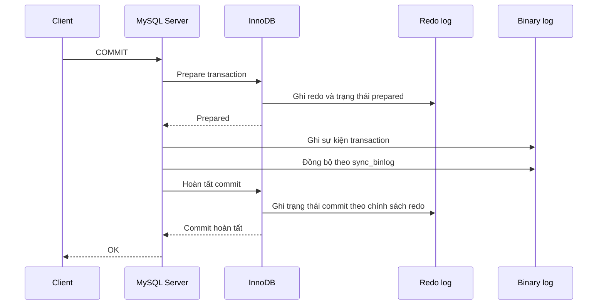

# Giao dịch

## Phối hợp redo, binary log và độ bền của commit

Một giao dịch InnoDB có thể được ghi vào hai hệ thống log với mục đích khác nhau: redo log giúp InnoDB phục hồi trạng thái dữ liệu sau sự cố, còn binary log ghi nhận các thay đổi ở cấp máy chủ để phục vụ sao chép và khôi phục đến một thời điểm. Khi binary logging được bật, MySQL phải phối hợp hai log này để tránh tình trạng một giao dịch được xem là đã commit ở InnoDB nhưng lại vắng mặt trong binary log, hoặc ngược lại.

Sự phối hợp đó gắn với cơ chế commit hai pha (two-phase commit), group commit và các tùy chọn `innodb_flush_log_at_trx_commit`, `sync_binlog`. Hiểu các thành phần này giúp lựa chọn cấu hình phù hợp giữa độ bền dữ liệu, hiệu năng ghi và khả năng khôi phục sau mất điện hoặc lỗi máy chủ.

### 1. Vì sao MySQL cần cả redo log và binary log?

Redo log thuộc InnoDB. Nó ghi lại thông tin cần thiết để tái áp dụng thay đổi lên các trang dữ liệu khi InnoDB khởi động lại sau sự cố. InnoDB tuân theo nguyên tắc write-ahead logging (WAL): thông tin redo cần thiết phải được ghi bền vững trước khi trang dữ liệu tương ứng được ghi xuống data file. Nhờ đó, một transaction đã commit vẫn có thể được phục hồi dù các trang dữ liệu chưa kịp ghi xuống đĩa.

Binary log (binlog) thuộc lớp máy chủ MySQL. Nó ghi lại các sự kiện thay đổi dữ liệu theo định dạng được cấu hình, thường là `ROW`, `STATEMENT` hoặc `MIXED`. Replica đọc binlog từ source để tái thực hiện thay đổi; công cụ `mysqlbinlog` có thể đọc log để phát lại các sự kiện sau một bản sao lưu, hỗ trợ point-in-time recovery (PITR).

| Thành phần | Phạm vi và nội dung | Mục đích chính | Không thay thế cho |
| --- | --- | --- | --- |
| InnoDB redo log | Log thay đổi cần thiết để phục hồi các trang InnoDB | Crash recovery, bảo đảm thay đổi đã commit có thể được phục hồi | Binlog cho replication và PITR |
| Binary log | Sự kiện transaction ở cấp máy chủ; cách ghi phụ thuộc `binlog_format` | Replication, lưu lịch sử thay đổi và PITR | Redo log cho crash recovery nội bộ của InnoDB |
| InnoDB undo log | Thông tin hoàn tác và phiên bản dữ liệu cũ | `ROLLBACK`, MVCC và đọc nhất quán | Redo log hoặc binlog |

Redo log thường mô tả các thay đổi ở mức nội bộ của InnoDB; binlog mô tả các sự kiện logic ở mức máy chủ. Chúng không phải hai bản sao giống hệt nhau. Một giao dịch có thể tạo ra nhiều redo record nhưng được biểu diễn thành một nhóm sự kiện transaction trong binlog.

Nếu `log_bin` tắt, MySQL không ghi binary log và không có nhu cầu phối hợp commit giữa redo và binlog. InnoDB vẫn cần redo log để phục hồi sau crash. Nếu `log_bin` bật, việc ghi nhận giao dịch vào hai log cần được phối hợp.

### 2. Commit hai pha phối hợp InnoDB và binary log

Khi binary logging được bật và giao dịch sử dụng InnoDB, MySQL dùng cơ chế commit hai pha giữa storage engine và binary log. Có thể hiểu theo trình tự logic sau:

1. **Prepare ở InnoDB:** InnoDB ghi các redo record cần thiết và đưa transaction vào trạng thái prepared. Trạng thái này cho phép phục hồi và quyết định commit hoặc rollback sau khi máy chủ gặp sự cố.
2. **Ghi binary log:** MySQL ghi các sự kiện của transaction vào binlog. Các transaction đã hoàn tất được ghi theo ranh giới transaction, để replica và công cụ phục hồi có thể nhận biết một nhóm thay đổi hoàn chỉnh.
3. **Đồng bộ log:** MySQL đồng bộ binlog theo chính sách `sync_binlog`; InnoDB đồng bộ redo theo chính sách `innodb_flush_log_at_trx_commit`. Đây là các mốc quan trọng quyết định dữ liệu nào đã thực sự bền vững trước sự cố nguồn điện hoặc hệ điều hành.
4. **Commit ở InnoDB:** Sau khi giai đoạn ghi log phối hợp hoàn tất, MySQL yêu cầu InnoDB hoàn tất commit. Khi giao dịch được xác nhận thành công, máy chủ trả kết quả cho client.

Sơ đồ sau thể hiện quan hệ logic giữa các thành phần; group commit có thể gộp nhiều transaction vào cùng một lượt ghi hoặc đồng bộ log:



Trong thực tế, MySQL tổ chức commit thành các giai đoạn nội bộ và có thể tối ưu thứ tự ghi, đồng bộ và commit. Vì vậy, sơ đồ nên được đọc như mô hình phối hợp, không phải mô tả từng lời gọi I/O của mọi phiên bản. Khi cần bảo đảm độ bền cao nhất cho transaction InnoDB có binlog, cấu hình cả hai log đồng bộ ở mỗi commit là lựa chọn thông dụng.

### 3. Các tình huống crash trong quá trình commit

Commit hai pha giúp MySQL giải quyết các trạng thái dở dang khi máy chủ dừng giữa lúc ghi hai log. Khi khởi động lại, InnoDB thực hiện crash recovery bằng redo; phần phối hợp với binlog cho phép quyết định số phận của transaction đang ở trạng thái prepared.

| Thời điểm xảy ra sự cố | Trạng thái có thể còn lại | Hướng xử lý khi phục hồi |
| --- | --- | --- |
| Trước khi InnoDB prepare | Transaction chưa có trạng thái prepared bền vững | Các thay đổi chưa commit được rollback |
| Sau prepare nhưng trước khi transaction được ghi vào binlog | InnoDB có transaction prepared nhưng không có bản ghi commit tương ứng trong binlog | Transaction được rollback trong quá trình recovery |
| Sau khi binlog đã được ghi bền vững nhưng trước khi InnoDB hoàn tất commit | Binlog có transaction; InnoDB có trạng thái prepared | Recovery dựa trên quyết định đã ghi trong binlog để hoàn tất commit InnoDB |
| Sau khi cả hai log đã được đồng bộ nhưng trước khi client nhận phản hồi | Transaction đã commit bền vững, nhưng client có thể chưa biết kết quả | Transaction vẫn tồn tại sau restart; client cần xác định kết quả trước khi gửi lại thao tác |

Trường hợp cuối rất quan trọng với ứng dụng. Nếu kết nối bị ngắt ngay sau khi gửi `COMMIT`, client có thể không biết transaction đã thành công hay chưa. Gửi lại một lệnh thanh toán, tạo đơn hàng hoặc trừ số dư mà không có cơ chế chống lặp có thể tạo ra tác động hai lần. Ứng dụng nên dùng khóa idempotency, mã yêu cầu duy nhất hoặc truy vấn trạng thái giao dịch để xử lý kết quả không xác định.

Khả năng phục hồi phối hợp chỉ có ý nghĩa khi các log cần thiết còn tồn tại và được ghi bền vững theo cấu hình. Nếu cho phép hệ điều hành hoặc thiết bị lưu trữ trì hoãn đồng bộ, một sự cố mất điện có thể làm mất các phần log gần nhất và phá vỡ giả định rằng cả hai phía đều đã lưu an toàn.

### 4. innodb_flush_log_at_trx_commit: độ bền của redo log

Biến `innodb_flush_log_at_trx_commit` quyết định InnoDB ghi và flush redo log buffer như thế nào. Với InnoDB, đây là một trong các cấu hình quan trọng nhất đối với độ bền transaction.

| Giá trị | Hành vi chính | Rủi ro khi hệ điều hành hoặc máy bị mất điện |
| --- | --- | --- |
| `1` | Ghi redo và yêu cầu flush xuống thiết bị lưu trữ ở mỗi lần commit | Mức bảo vệ cao nhất theo thiết kế của InnoDB |
| `2` | Ghi redo vào bộ đệm của hệ điều hành ở mỗi lần commit; flush xuống thiết bị theo chu kỳ, thường khoảng một giây | Có thể mất các commit gần nhất nếu hệ điều hành hoặc máy bị dừng đột ngột |
| `0` | InnoDB ghi và flush redo theo chu kỳ, thường khoảng một giây; không yêu cầu ghi redo ở mỗi commit | Có thể mất các commit gần nhất khi tiến trình MySQL, hệ điều hành hoặc máy bị dừng |

Với giá trị `1`, InnoDB yêu cầu hệ điều hành đồng bộ redo xuống thiết bị ở mỗi commit. Điều này không có nghĩa mọi transaction luôn tự tạo một lần ghi đĩa riêng: group commit có thể cho nhiều transaction chia sẻ một lượt flush. Chính sách vẫn yêu cầu mốc đồng bộ phù hợp với từng nhóm commit.

Với giá trị `2`, dữ liệu redo được chuyển từ bộ đệm InnoDB sang bộ đệm hệ điều hành khi commit, nhưng yêu cầu flush xuống thiết bị được thực hiện theo chu kỳ. Nếu chỉ tiến trình `mysqld` bị lỗi trong khi hệ điều hành vẫn chạy, dữ liệu đã nằm trong bộ đệm hệ điều hành thường vẫn còn; tuy nhiên không thể dựa vào điều đó khi hệ điều hành hoặc nguồn điện bị dừng.

Giá trị `0` trì hoãn cả việc ghi redo từ bộ đệm InnoDB và flush theo chu kỳ. Nếu tiến trình MySQL dừng trước lần ghi kế tiếp, redo của những transaction gần nhất có thể chưa rời khỏi bộ nhớ tiến trình.

Chu kỳ flush mặc định thường khoảng một giây và có thể chịu ảnh hưởng của lịch chạy, tải hệ thống và I/O. Không nên diễn giải đây là cam kết chính xác rằng chỉ mất tối đa đúng một giây dữ liệu trong mọi sự cố.

### 5. sync_binlog: độ bền của binary log

Biến `sync_binlog` quyết định tần suất MySQL yêu cầu đồng bộ binary log xuống thiết bị lưu trữ.

| Giá trị | Hành vi chính | Hệ quả |
| --- | --- | --- |
| `1` | Đồng bộ binlog ở mỗi nhóm commit theo cơ chế group commit | Độ bền binlog cao nhất; thường dùng cùng `innodb_flush_log_at_trx_commit=1` |
| `0` | Không yêu cầu đồng bộ binlog theo từng nhóm commit; hệ điều hành quyết định khi nào ghi xuống thiết bị | Một phần binlog gần nhất có thể mất khi hệ điều hành hoặc máy bị dừng |
| `N` lớn hơn `1` | Đồng bộ sau mỗi `N` lượt ghi/nhóm commit theo cơ chế đồng bộ binlog | Tăng hiệu năng ghi trong một số tải nhưng chấp nhận nguy cơ mất các nhóm log gần nhất |

`sync_binlog=1` không có nghĩa mỗi transaction nhất thiết thực hiện một system call đồng bộ riêng. Group commit cho phép nhiều transaction được ghi vào binlog rồi chia sẻ một lần đồng bộ. Vì vậy, giá trị `1` vẫn có thể đạt thông lượng tốt hơn cách hiểu đơn giản là một lần `fsync` cho từng transaction.

Nếu binary log được dùng cho replication hoặc PITR, mất một phần log cuối có thể khiến replica thiếu sự kiện hoặc làm bản khôi phục không thể tiến đến thời điểm mong muốn. Binlog đã được đồng bộ chỉ là một phần của bảo đảm; transaction InnoDB cũng cần redo bền vững để dữ liệu nguồn được phục hồi nhất quán.

### 6. Phối hợp hai biến để chọn mức độ bền

Khi binary logging được bật, hai biến cần được xem xét cùng nhau:

| `innodb_flush_log_at_trx_commit` | `sync_binlog` | Đặc điểm vận hành |
| --- | --- | --- |
| `1` | `1` | Cấu hình thường được chọn khi ưu tiên độ bền commit và tính nhất quán giữa InnoDB với binlog |
| `1` | `0` hoặc `N` lớn hơn `1` | Redo được bảo vệ chặt hơn binlog; sự cố hệ điều hành/nguồn điện có thể làm thiếu sự kiện binlog của thay đổi còn tồn tại trong InnoDB |
| `0` hoặc `2` | `1` | Binlog có thể bền vững hơn redo; sau sự cố, trạng thái InnoDB có thể không còn đầy đủ các thay đổi mà binlog đã ghi |
| `0` hoặc `2` | `0` hoặc `N` lớn hơn `1` | Cả hai phía đều có thể mất các commit gần nhất; nguy cơ sai khác giữa dữ liệu nguồn và lịch sử binlog cao hơn |

Nếu mục tiêu là mức độ bền cao nhất cho transaction InnoDB khi có binary logging, cấu hình nền tảng thường dùng là:

```ini
[mysqld]
innodb_flush_log_at_trx_commit = 1
sync_binlog = 1
```

Hai giá trị này làm tăng yêu cầu I/O đồng bộ. Với hệ thống ưu tiên thông lượng, đội vận hành có thể cân nhắc giá trị thấp hơn sau khi đo tải và xác định rõ lượng dữ liệu có thể chấp nhận mất khi xảy ra sự cố. Quyết định cần tính đến vai trò của máy chủ, khả năng dựng lại dữ liệu, chính sách RPO và mức độ phụ thuộc của replica vào binlog.

Các cấu hình log không thể bù cho thiết bị lưu trữ báo hoàn tất flush trong khi dữ liệu vẫn nằm trong cache dễ mất. Độ bền thực tế còn phụ thuộc hệ điều hành, filesystem, bộ điều khiển lưu trữ, cache của thiết bị và nguồn điện dự phòng. Hạ tầng lưu trữ phải thực hiện đúng yêu cầu flush mà MySQL gửi.

### 7. Group commit và chi phí đồng bộ log

Nếu mỗi transaction buộc máy chủ ghi và đồng bộ redo cùng binlog một cách độc lập, tải ghi cao có thể bị giới hạn bởi số lượt I/O đồng bộ. Group commit gom nhiều transaction vào cùng một nhóm để chia sẻ chi phí ghi và đồng bộ.

Ở mức khái niệm, quá trình binlog group commit có các giai đoạn:

1. **FLUSH:** các transaction đưa phần binlog cache của mình vào binary log theo thứ tự được điều phối.
2. **SYNC:** máy chủ đồng bộ binlog theo chính sách `sync_binlog`; nhiều transaction trong nhóm có thể dùng chung một lượt đồng bộ.
3. **COMMIT:** storage engine hoàn tất commit các transaction trong nhóm.

InnoDB cũng phối hợp flush redo với các giai đoạn commit để bảo đảm quy tắc ghi log trước dữ liệu. Chi tiết nội bộ có thể thay đổi theo phiên bản và cấu hình, nhưng mục tiêu của group commit là giảm số lượt I/O đồng bộ trên mỗi transaction trong khi vẫn giữ thứ tự và ranh giới commit cần thiết.

Một số biến như `binlog_group_commit_sync_delay` và `binlog_group_commit_sync_no_delay_count` cho phép điều chỉnh việc gom nhóm trong các phiên bản hỗ trợ. Tăng thời gian chờ có thể tạo nhóm lớn hơn và giảm chi phí đồng bộ, nhưng làm tăng độ trễ commit. Chỉ nên điều chỉnh sau khi đo thông lượng, độ trễ p95/p99 và đặc điểm I/O thực tế.

Không nên tắt đồng bộ log chỉ để cải thiện benchmark ngắn hạn rồi coi kết quả đó là hiệu năng an toàn khi vận hành. Benchmark cần dùng cùng chính sách durability dự kiến áp dụng trong production.

### 8. Binary log trong replication và point-in-time recovery

Replica không đọc redo log của source. Replica nhận binary log từ source, sau đó áp dụng các sự kiện để tái tạo thay đổi trên máy đích. Vì vậy, binary log phải được giữ đủ lâu để replica có thể bắt kịp, và phải được quản lý cùng quy trình sao lưu.

PITR thường gồm hai phần:

1. Phục hồi một bản backup nhất quán, đồng thời lưu lại vị trí binlog hoặc GTID tương ứng với thời điểm backup.
2. Dùng `mysqlbinlog` phát lại các sự kiện sau mốc backup cho đến ngay trước hoặc tại thời điểm cần khôi phục.

Ví dụ xem trạng thái binary log và các cấu hình liên quan:

```sql
SHOW VARIABLES
WHERE Variable_name IN (
    'log_bin',
    'binlog_format',
    'sync_binlog',
    'innodb_flush_log_at_trx_commit',
    'innodb_flush_log_at_timeout'
);

SHOW BINARY LOG STATUS;
```

`SHOW BINARY LOG STATUS` có trên các phiên bản MySQL mới; ở phiên bản cũ hơn có thể gặp `SHOW MASTER STATUS`. Cần đối chiếu tài liệu của phiên bản đang chạy khi viết quy trình vận hành.

Sau khi xác định đúng file log và khoảng thời gian, có thể đọc hoặc xuất sự kiện bằng công cụ `mysqlbinlog`:

```bash
mysqlbinlog \
  --start-datetime="2026-11-19 08:00:00" \
  --stop-datetime="2026-11-19 09:30:00" \
  mysql-bin.000125 > replay.sql
```

Đây là ví dụ xuất các sự kiện trong khoảng thời gian để kiểm tra trước khi phát lại. Khi phục hồi thật, cần dùng đúng file, vị trí hoặc GTID từ backup, kiểm tra múi giờ và thời điểm của máy chủ, đồng thời xác định rõ điểm dừng để tránh phát lại transaction ngoài phạm vi mong muốn. Không nên chọn mốc chỉ dựa trên tên file hoặc thời gian hiển thị mà chưa đối chiếu metadata backup.

Binlog cần được sao lưu hoặc chuyển đến nơi lưu trữ bền vững nếu được dùng cho PITR. Chỉ giữ log trên cùng ổ đĩa với data file sẽ không bảo vệ được lịch sử khôi phục khi thiết bị đó hỏng hoàn toàn. Thời gian lưu binlog cần dài hơn khoảng thời gian tối đa mà backup có thể cần để phục hồi và replica có thể bị chậm.

### 9. Kiểm tra cấu hình và xây dựng quy trình kiểm chứng

Trước khi thay đổi biến hệ thống, hãy ghi nhận cấu hình đang chạy và xác định phiên bản MySQL:

```sql
SELECT VERSION();

SHOW VARIABLES LIKE 'log_bin';
SHOW VARIABLES LIKE 'binlog_format';
SHOW VARIABLES LIKE 'sync_binlog';
SHOW VARIABLES LIKE 'innodb_flush_log_at_trx_commit';
SHOW VARIABLES LIKE 'innodb_flush_log_at_timeout';
```

Một thay đổi runtime bằng `SET GLOBAL` không tự động đồng nghĩa cấu hình sẽ còn sau khi restart. Với phiên bản hỗ trợ, `SET PERSIST` có thể lưu giá trị để dùng cho lần khởi động sau; thao tác cần quyền quản trị phù hợp và phải tuân thủ quy trình thay đổi cấu hình của hệ thống:

```sql
SET GLOBAL innodb_flush_log_at_trx_commit = 1;
SET GLOBAL sync_binlog = 1;
```

Các lệnh trên chỉ thay đổi giá trị runtime. Nếu cần lưu cấu hình qua restart, hãy cập nhật cấu hình máy chủ hoặc dùng cơ chế persist phù hợp với phiên bản và chính sách vận hành. Không thay đổi trực tiếp trên production khi chưa đánh giá chi phí I/O và chưa có kế hoạch rollback.

Quy trình kiểm chứng nên gồm các bước sau:

1. Ghi nhận giá trị hiện tại của hai biến durability, `log_bin`, `binlog_format`, dung lượng log và độ trễ ghi.
2. Dùng môi trường thử nghiệm để chạy transaction có thể nhận biết rõ, sau đó xác nhận transaction xuất hiện trong dữ liệu InnoDB và trong binlog.
3. Kiểm tra khả năng đọc binlog bằng `mysqlbinlog`, xác nhận ranh giới `BEGIN`/`COMMIT` hoặc các sự kiện transaction tương ứng.
4. Thử khôi phục từ backup cộng với binlog đến một mốc xác định; không chỉ kiểm tra rằng file backup và file binlog tồn tại.
5. Chỉ thử crash hoặc mất điện trong môi trường kiểm thử được kiểm soát. Không mô phỏng mất nguồn trên máy chủ production để xác minh durability.
6. Theo dõi thời gian commit, độ trễ I/O, replica lag và dung lượng binlog sau khi thay đổi.

### 10. Các giới hạn cần nhớ

- Hai biến durability chỉ điều khiển chính sách flush của redo và binlog; chúng không thay thế backup, kiểm thử restore hoặc giám sát replication.
- Redo log phục vụ phục hồi InnoDB, còn binlog phục vụ replication và PITR. Không dùng một loại log như thể nó thay thế hoàn toàn loại còn lại.
- Cam kết commit bền vững phụ thuộc storage engine. Bảng dùng storage engine không hỗ trợ transaction không có cùng hành vi rollback và phối hợp commit như InnoDB.
- Một transaction có thể đã commit dù client chưa nhận được phản hồi. Ứng dụng phải xử lý trường hợp kết quả không xác định bằng cơ chế chống lặp hoặc tra cứu trạng thái.
- `innodb_flush_log_at_trx_commit=1` và `sync_binlog=1` là cấu hình thường dùng khi ưu tiên durability, nhưng vẫn cần thiết bị lưu trữ thực hiện đúng yêu cầu flush.
- Không xóa file binlog thủ công trong thư mục dữ liệu. Dùng cơ chế quản lý log được MySQL hỗ trợ và bảo đảm replica, backup không còn cần các file sắp xóa.

### 11. Checklist khi thiết kế độ bền commit

1. Xác nhận bảng giao dịch dùng InnoDB và binary logging có được bật hay không.
2. Phân biệt rõ vai trò của redo, binlog và undo log.
3. Đánh giá cặp `innodb_flush_log_at_trx_commit` / `sync_binlog` theo RPO và yêu cầu phục hồi.
4. Đo tác động của flush và group commit bằng tải gần với production.
5. Lưu binlog cùng metadata backup hoặc GTID để hỗ trợ PITR.
6. Kiểm thử restore và replay binlog định kỳ; theo dõi replica lag và thời gian lưu log.
7. Thiết kế ứng dụng chịu được tình huống client mất kết nối ngay sau `COMMIT`.

Khi hiểu cách redo log và binary log phối hợp trong commit hai pha, người vận hành có thể chọn cấu hình durability có chủ đích, giải thích được kết quả sau crash và xây dựng quy trình backup, replication, PITR đáng tin cậy cho MySQL.
