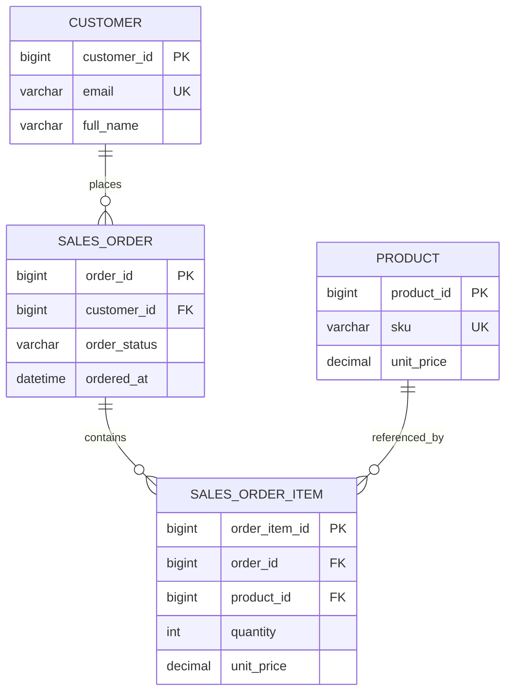

# Chuẩn bị schema, dữ liệu mẫu và các trường hợp biên

Một bài thực hành MySQL có giá trị khi người học có thể tạo lại môi trường, biết rõ dữ liệu đầu vào, dự đoán được kết quả và kiểm tra được các tình huống bất thường. Nếu schema thiếu ràng buộc, dữ liệu mẫu quá đơn giản hoặc không có trường hợp biên, truy vấn có thể chạy đúng trong ví dụ nhỏ nhưng thất bại khi gặp dữ liệu thực tế.

Bài này xây dựng một môi trường thực hành nhỏ cho hệ thống đặt hàng. Bạn sẽ tạo schema gồm khách hàng, sản phẩm, đơn hàng và dòng hàng; nạp dữ liệu mẫu có thể tái lập; xác minh quan hệ và tổng tiền; sau đó thử các trường hợp hợp lệ, không hợp lệ và các giới hạn thường gặp. Các ví dụ sử dụng InnoDB, `utf8mb4` và cú pháp phù hợp với MySQL 8.0.16 trở lên để các ràng buộc `CHECK` được thực thi.

## Mục tiêu học tập

Sau bài học, bạn có thể:

- Chuẩn bị một schema riêng, chọn kiểu dữ liệu và xác định khóa, index, quan hệ phù hợp.
- Tạo dữ liệu mẫu nhất quán, có khóa ngoại hợp lệ và có thể kiểm tra bằng truy vấn.
- Phân biệt `NULL`, chuỗi rỗng, giá trị mặc định và giá trị bằng không.
- Kiểm tra các trường hợp biên về khóa duy nhất, khóa ngoại, số lượng, giá tiền, ngày giờ và ký tự Unicode.
- Dùng transaction để thử nghiệm dữ liệu và làm sạch môi trường thực hành có kiểm soát.

## 1. Chuẩn bị môi trường an toàn

Hãy thực hành trong một MySQL instance hoặc database sandbox mà bạn được phép thay đổi. Không chạy các lệnh tạo, xóa hoặc nạp dữ liệu của bài này trên database production hay schema đang chứa dữ liệu cần giữ lại. Ví dụ dùng tên database `mysql_practice_vi`; nếu tên này đã được tổ chức sử dụng, hãy đổi thành một tên sandbox riêng.

Trước khi tạo schema, kiểm tra phiên bản, SQL mode, múi giờ và bộ ký tự của phiên kết nối:

```sql
SELECT
    VERSION() AS mysql_version,
    @@SESSION.sql_mode AS session_sql_mode,
    @@SESSION.time_zone AS session_time_zone,
    @@SESSION.character_set_client AS client_character_set,
    @@SESSION.character_set_connection AS connection_character_set,
    @@SESSION.character_set_results AS results_character_set,
    @@SESSION.collation_connection AS connection_collation,
    @@character_set_server AS server_character_set,
    @@collation_server AS server_collation;
```

SQL mode ảnh hưởng đến cách MySQL xử lý dữ liệu không hợp lệ, giá trị bị cắt cụt và ngày giờ sai. Với chế độ strict, nhiều dữ liệu ngoài miền hợp lệ sẽ bị từ chối; ở chế độ không strict, một số trường hợp có thể được chuyển đổi và phát cảnh báo. Khi kiểm tra dữ liệu lỗi, hãy đọc thông báo và chạy `SHOW WARNINGS` ngay sau câu lệnh cần kiểm tra.

Lưu ý về phiên bản: MySQL chỉ thực thi các ràng buộc `CHECK` từ phiên bản 8.0.16. Các phiên bản cũ hơn có thể chấp nhận cú pháp nhưng bỏ qua việc kiểm tra. Nếu dùng phiên bản cũ, không được coi `CHECK` là lớp bảo vệ dữ liệu; hãy nâng cấp môi trường hoặc bổ sung kiểm tra ở tầng ứng dụng theo chính sách của dự án.

## 2. Thiết kế schema trước khi viết DDL

Ta dùng một mô hình đơn giản với bốn bảng:

| Bảng | Vai trò | Quan hệ chính |
|---|---|---|
| `customer` | Thông tin người mua | Một khách hàng có thể có nhiều đơn hàng |
| `product` | Danh mục sản phẩm | Một sản phẩm có thể xuất hiện trong nhiều dòng hàng |
| `sales_order` | Thông tin chung của đơn hàng | Mỗi đơn hàng thuộc về một khách hàng |
| `sales_order_item` | Các sản phẩm và số lượng trong đơn hàng | Mỗi dòng thuộc một đơn hàng và tham chiếu một sản phẩm |

Sơ đồ quan hệ:



Một số quyết định thiết kế cần hiểu trước khi tạo bảng:

- Dùng `BIGINT UNSIGNED` cho các khóa định danh và dùng cùng kiểu dữ liệu cho cột khóa ngoại tương ứng. Kiểu, dấu `UNSIGNED` và độ rộng phải tương thích giữa hai phía của quan hệ.
- Dùng `DECIMAL(12,2)` cho giá tiền vì đây là kiểu số thập phân chính xác theo số chữ số đã định. Không dùng `FLOAT` hoặc `DOUBLE` để lưu số tiền cần đối chiếu chính xác.
- Dùng `VARCHAR` cho email, tên, SKU và ghi chú vì độ dài có thể thay đổi. Giới hạn độ dài là một phần của hợp đồng dữ liệu, không chỉ là lựa chọn hiển thị.
- Dùng `DATETIME` cho thời điểm đặt hàng trong ví dụ này. `DATETIME` lưu giá trị ngày giờ theo đúng phần được ghi, không tự chuyển đổi theo múi giờ phiên như `TIMESTAMP`; tuy nhiên `NOW()` và `CURRENT_TIMESTAMP` vẫn trả về thời gian theo múi giờ phiên. Nếu quy ước lưu UTC, ứng dụng cần thiết lập múi giờ kết nối nhất quán, chẳng hạn `SET time_zone = '+00:00'`.
- Dùng khóa ngoại để ngăn đơn hàng tham chiếu khách hàng không tồn tại và dòng hàng tham chiếu đơn hàng hoặc sản phẩm không tồn tại.
- Dùng `UNIQUE` để chống email, SKU trùng và chống một sản phẩm xuất hiện hai lần trong cùng đơn hàng. Quy tắc cuối phù hợp với mô hình gộp số lượng vào một dòng; nếu nghiệp vụ cần nhiều dòng cùng sản phẩm, hãy dùng số thứ tự dòng thay cho ràng buộc này.
- Dùng `CHECK` cho các miền giá trị như giá không âm, số lượng dương và trạng thái hợp lệ. Các quy tắc nghiệp vụ phức tạp hơn vẫn cần được xác thực trong ứng dụng hoặc quy trình nghiệp vụ.

Collation `utf8mb4_unicode_ci` trong ví dụ là collation không phân biệt chữ hoa/chữ thường và có quy tắc so sánh ngôn ngữ. Vì vậy, email hoặc SKU khác nhau chỉ ở chữ hoa/chữ thường có thể bị coi là trùng. Nếu hệ thống cần quy tắc so sánh khác, hãy chọn collation và quy tắc chuẩn hóa dữ liệu có chủ đích; không thay đổi collation tùy tiện sau khi đã có dữ liệu.

## 3. Tạo database và các bảng

Chạy phần dưới đây trong một schema sandbox mới, chưa có các bảng cùng tên:

```sql
CREATE DATABASE IF NOT EXISTS mysql_practice_vi
    CHARACTER SET utf8mb4
    COLLATE utf8mb4_unicode_ci;

USE mysql_practice_vi;

CREATE TABLE customer (
    customer_id BIGINT UNSIGNED NOT NULL AUTO_INCREMENT,
    email VARCHAR(254) NOT NULL,
    full_name VARCHAR(120) NOT NULL,
    phone VARCHAR(30) NULL,
    created_at DATETIME NOT NULL DEFAULT CURRENT_TIMESTAMP,
    PRIMARY KEY (customer_id),
    CONSTRAINT uq_customer_email UNIQUE (email),
    CONSTRAINT chk_customer_email_not_blank
        CHECK (CHAR_LENGTH(TRIM(email)) > 0),
    CONSTRAINT chk_customer_name_not_blank
        CHECK (CHAR_LENGTH(TRIM(full_name)) > 0)
) ENGINE = InnoDB
  DEFAULT CHARACTER SET = utf8mb4
  COLLATE = utf8mb4_unicode_ci;

CREATE TABLE product (
    product_id BIGINT UNSIGNED NOT NULL AUTO_INCREMENT,
    sku VARCHAR(40) NOT NULL,
    product_name VARCHAR(160) NOT NULL,
    unit_price DECIMAL(12,2) NOT NULL,
    active TINYINT UNSIGNED NOT NULL DEFAULT 1,
    PRIMARY KEY (product_id),
    CONSTRAINT uq_product_sku UNIQUE (sku),
    CONSTRAINT chk_product_sku_not_blank
        CHECK (CHAR_LENGTH(TRIM(sku)) > 0),
    CONSTRAINT chk_product_price_nonnegative
        CHECK (unit_price >= 0),
    CONSTRAINT chk_product_active
        CHECK (active IN (0, 1))
) ENGINE = InnoDB
  DEFAULT CHARACTER SET = utf8mb4
  COLLATE = utf8mb4_unicode_ci;

CREATE TABLE sales_order (
    order_id BIGINT UNSIGNED NOT NULL AUTO_INCREMENT,
    customer_id BIGINT UNSIGNED NOT NULL,
    order_status VARCHAR(20) NOT NULL DEFAULT 'PENDING',
    ordered_at DATETIME NOT NULL DEFAULT CURRENT_TIMESTAMP,
    note VARCHAR(500) NULL,
    PRIMARY KEY (order_id),
    KEY idx_sales_order_customer_date (customer_id, ordered_at),
    CONSTRAINT chk_sales_order_status
        CHECK (order_status IN ('PENDING', 'PAID', 'CANCELLED', 'COMPLETED')),
    CONSTRAINT fk_sales_order_customer
        FOREIGN KEY (customer_id)
        REFERENCES customer (customer_id)
        ON UPDATE RESTRICT
        ON DELETE RESTRICT
) ENGINE = InnoDB
  DEFAULT CHARACTER SET = utf8mb4
  COLLATE = utf8mb4_unicode_ci;

CREATE TABLE sales_order_item (
    order_item_id BIGINT UNSIGNED NOT NULL AUTO_INCREMENT,
    order_id BIGINT UNSIGNED NOT NULL,
    product_id BIGINT UNSIGNED NOT NULL,
    quantity INT UNSIGNED NOT NULL,
    unit_price DECIMAL(12,2) NOT NULL,
    PRIMARY KEY (order_item_id),
    UNIQUE KEY uq_order_item_order_product (order_id, product_id),
    KEY idx_order_item_product (product_id),
    CONSTRAINT chk_order_item_quantity_positive
        CHECK (quantity > 0),
    CONSTRAINT chk_order_item_price_nonnegative
        CHECK (unit_price >= 0),
    CONSTRAINT fk_order_item_order
        FOREIGN KEY (order_id)
        REFERENCES sales_order (order_id)
        ON UPDATE RESTRICT
        ON DELETE RESTRICT,
    CONSTRAINT fk_order_item_product
        FOREIGN KEY (product_id)
        REFERENCES product (product_id)
        ON UPDATE RESTRICT
        ON DELETE RESTRICT
) ENGINE = InnoDB
  DEFAULT CHARACTER SET = utf8mb4
  COLLATE = utf8mb4_unicode_ci;
```

Các index được chọn theo quan hệ và truy vấn dự kiến. Khóa chính và khóa duy nhất tự tạo index tương ứng. Index `idx_sales_order_customer_date` hỗ trợ lọc đơn hàng theo khách hàng và sắp xếp theo thời điểm trong phạm vi khách hàng. Index `idx_order_item_product` hỗ trợ tra cứu các dòng hàng theo sản phẩm; index duy nhất bắt đầu bằng `order_id` cũng hỗ trợ tra cứu dòng hàng của một đơn hàng.

Không nên thêm index cho mọi cột. Mỗi index chiếm dung lượng và làm tăng chi phí ghi, cập nhật, xóa. Hãy bắt đầu từ các truy vấn cần phục vụ, sau đó kiểm tra bằng `EXPLAIN` trên dữ liệu đủ đại diện.

## 4. Nạp bộ dữ liệu mẫu có thể tái lập

Dùng ID tường minh để kết quả truy vấn và bài kiểm tra dễ đối chiếu. Trong ứng dụng thực tế, thông thường để `AUTO_INCREMENT` sinh ID; việc chỉ định ID ở đây nhằm làm cho dữ liệu huấn luyện ổn định.

```sql
START TRANSACTION;

INSERT INTO customer
    (customer_id, email, full_name, phone)
VALUES
    (101, 'an.nguyen@example.test', 'Nguyễn An', '0901000101'),
    (102, 'binh.tran@example.test', 'Trần Bình', NULL),
    (103, 'chi.le@example.test', 'Lê Chi', '0903000103');

INSERT INTO product
    (product_id, sku, product_name, unit_price, active)
VALUES
    (201, 'LAP-001', 'Máy tính xách tay', 24990000.00, 1),
    (202, 'MOUSE-001', 'Chuột không dây', 299000.00, 1),
    (203, 'MON-001', 'Màn hình', 4590000.00, 1),
    (204, 'TRIAL-001', 'Dịch vụ dùng thử', 0.00, 1);

INSERT INTO sales_order
    (order_id, customer_id, order_status, ordered_at, note)
VALUES
    (1001, 101, 'PENDING', '2025-01-10 09:15:00', NULL),
    (1002, 102, 'PAID', '2025-01-11 14:30:00', 'Đã thanh toán'),
    (1003, 101, 'CANCELLED', '2025-01-12 08:00:00', 'Đơn bị hủy, chưa có dòng hàng');

INSERT INTO sales_order_item
    (order_item_id, order_id, product_id, quantity, unit_price)
VALUES
    (5001, 1001, 201, 1, 24990000.00),
    (5002, 1001, 202, 2, 299000.00),
    (5003, 1002, 203, 1, 4590000.00);

COMMIT;
```

Giá trong `sales_order_item` là giá tại thời điểm bán. Không nên luôn lấy giá hiện tại từ `product` để tính lại đơn hàng cũ, vì giá sản phẩm có thể thay đổi sau khi khách đã đặt hàng. Đây là lý do bảng dòng hàng lưu một bản chụp `unit_price` riêng.

Đơn hàng `1003` cố ý chưa có dòng hàng. Mô hình cho phép tạo đơn hàng trước rồi bổ sung sản phẩm trong quy trình nhiều bước. Nếu nghiệp vụ yêu cầu mọi đơn hàng đã xác nhận phải có ít nhất một dòng hàng, cần kiểm tra điều kiện đó ở bước xác nhận đơn hàng hoặc bằng thiết kế nghiệp vụ phù hợp; một khóa ngoại đơn giản không bảo đảm được điều kiện tổng hợp giữa các hàng.

## 5. Xác minh schema và dữ liệu sau khi nạp

Đầu tiên, kiểm tra định nghĩa bảng và engine:

```sql
SHOW CREATE TABLE customer;
SHOW CREATE TABLE product;
SHOW CREATE TABLE sales_order;
SHOW CREATE TABLE sales_order_item;
```

Kiểm tra số lượng bản ghi mong đợi:

```sql
SELECT 'customer' AS table_name, COUNT(*) AS row_count FROM customer
UNION ALL
SELECT 'product', COUNT(*) FROM product
UNION ALL
SELECT 'sales_order', COUNT(*) FROM sales_order
UNION ALL
SELECT 'sales_order_item', COUNT(*) FROM sales_order_item;
```

Kết quả ban đầu phải là 3 khách hàng, 4 sản phẩm, 3 đơn hàng và 3 dòng hàng. Nếu số lượng khác, hãy kiểm tra transaction, lỗi insert và trạng thái dữ liệu trước khi tiếp tục.

Kiểm tra đơn hàng và tổng tiền:

```sql
SELECT
    o.order_id,
    c.full_name,
    o.order_status,
    o.ordered_at,
    COALESCE(SUM(oi.quantity * oi.unit_price), 0.00) AS order_total
FROM sales_order AS o
JOIN customer AS c
    ON c.customer_id = o.customer_id
LEFT JOIN sales_order_item AS oi
    ON oi.order_id = o.order_id
GROUP BY
    o.order_id,
    c.full_name,
    o.order_status,
    o.ordered_at
ORDER BY o.order_id;
```

Kết quả cần có ba đơn hàng. Đơn `1001` có tổng `25588000.00`, đơn `1002` có tổng `4590000.00`, còn đơn `1003` có tổng `0.00` do chưa có dòng hàng. `LEFT JOIN` giữ lại đơn hàng không có dòng hàng; `COALESCE` chuyển tổng `NULL` thành số không để kết quả báo cáo rõ ràng.

Tìm các đơn hàng chưa có dòng hàng:

```sql
SELECT o.order_id, o.order_status, o.ordered_at
FROM sales_order AS o
LEFT JOIN sales_order_item AS oi
    ON oi.order_id = o.order_id
WHERE oi.order_item_id IS NULL;
```

Với bộ dữ liệu ban đầu, truy vấn trả về đơn `1003`. Đây là dữ liệu biên có chủ đích, giúp kiểm tra truy vấn có vô tình loại bỏ bản ghi khi dùng `INNER JOIN` hay không.

## 6. Các trường hợp biên cần chuẩn bị

Trường hợp biên là dữ liệu ở sát giới hạn, dữ liệu thiếu, dữ liệu lặp hoặc dữ liệu có hình dạng khác thường. Không phải tất cả trường hợp biên đều là dữ liệu sai; có trường hợp hợp lệ nhưng thường bị truy vấn xử lý nhầm.

| Nhóm | Dữ liệu cần thử | Kết quả mong đợi |
|---|---|---|
| Giá trị bắt buộc | `email = NULL` | Bị từ chối bởi `NOT NULL` |
| Chuỗi rỗng | `email = ''` hoặc chỉ có khoảng trắng | Bị từ chối bởi `CHECK` trong phiên bản có thực thi `CHECK` |
| Dữ liệu duy nhất | Email hoặc SKU đã tồn tại | Bị từ chối bởi `UNIQUE` |
| Collation | Email chỉ khác chữ hoa/chữ thường | Với collation `utf8mb4_unicode_ci`, có thể bị coi là trùng |
| Khóa ngoại | Đơn hàng tham chiếu khách hàng không tồn tại | Bị từ chối bởi foreign key |
| Số lượng | `quantity = 0` | Bị từ chối bởi `CHECK` |
| Giá | `unit_price = 0.00` | Hợp lệ, ví dụ sản phẩm miễn phí |
| Giá âm | `unit_price < 0` | Bị từ chối bởi `CHECK` |
| Giá vượt miền | Giá vượt sức chứa `DECIMAL(12,2)` | Bị từ chối trong strict mode; cần kiểm tra lỗi/cảnh báo |
| Dòng hàng lặp | Cùng một sản phẩm xuất hiện hai lần trong một đơn | Bị từ chối theo quy tắc `UNIQUE` của ví dụ |
| Ngày nhuận | `2024-02-29` | Hợp lệ |
| Ngày không tồn tại | `2025-02-29` | Bị từ chối trong strict mode; cách xử lý phụ thuộc SQL mode |
| Unicode | Tên có dấu hoặc ký tự ngoài BMP | Lưu được khi dùng `utf8mb4` và client kết nối đúng charset |
| Quan hệ rỗng | Đơn hàng chưa có dòng hàng | Hợp lệ theo schema hiện tại; truy vấn phải xử lý được |

Phân biệt rõ các khái niệm sau:

- `NULL` biểu thị chưa có hoặc chưa biết giá trị. `NULL = NULL` không cho kết quả đúng; cần dùng `IS NULL` hoặc `IS NOT NULL`.
- Chuỗi rỗng `''` là một giá trị chuỗi có độ dài bằng không. Chuỗi chỉ chứa khoảng trắng cũng không tự động trở thành `NULL`.
- `DEFAULT` được áp dụng khi câu `INSERT` bỏ qua cột hoặc dùng từ khóa `DEFAULT`; nó không có nghĩa là tự thay thế mọi giá trị `NULL` được truyền vào.
- Giá `0.00` có thể là một giá trị nghiệp vụ hợp lệ, chẳng hạn sản phẩm dùng thử hoặc khuyến mại. Không nên cấm giá bằng không nếu yêu cầu nghiệp vụ cho phép.
- Với `utf8mb4`, một ký tự có thể chiếm tối đa bốn byte. Độ dài `VARCHAR(n)` được tính theo ký tự, nhưng kích thước lưu trữ thực tế còn phụ thuộc encoding và nội dung.

## 7. Thực hành kiểm tra từng trường hợp

Các câu lệnh dưới đây được thiết kế để chạy riêng lẻ. Với các câu lệnh ghi nhãn **dự kiến thất bại**, hãy quan sát lỗi rồi tiếp tục câu tiếp theo; không gộp tất cả vào một script tự động dừng ở câu đầu tiên bị lỗi.

### 7.1. Giá trị hợp lệ ở biên

Giá bằng không là hợp lệ theo schema:

```sql
INSERT INTO product (sku, product_name, unit_price)
VALUES ('FREE-002', 'Tài liệu miễn phí', 0.00);

SELECT sku, product_name, unit_price
FROM product
WHERE sku = 'FREE-002';

DELETE FROM product
WHERE sku = 'FREE-002';
```

Tên tiếng Việt và ký tự Unicode cũng phải được lưu và đọc lại chính xác:

```sql
INSERT INTO customer (email, full_name)
VALUES ('unicode@example.test', 'Nguyễn Ánh 🌱');

SELECT email, full_name
FROM customer
WHERE email = 'unicode@example.test';

DELETE FROM customer
WHERE email = 'unicode@example.test';
```

Nếu ký tự bị biến thành dấu hỏi hoặc ký tự lỗi, kiểm tra charset của database, bảng, cột và kết nối client. Chỉ đặt charset ở database chưa đủ nếu ứng dụng kết nối với charset khác.

### 7.2. Giá trị bắt buộc và chuỗi rỗng — dự kiến thất bại

```sql
-- Vi phạm NOT NULL
INSERT INTO customer (email, full_name)
VALUES (NULL, 'Người kiểm thử');

-- Vi phạm CHECK vì email rỗng
INSERT INTO customer (email, full_name)
VALUES ('', 'Người kiểm thử');

-- Vi phạm CHECK vì email chỉ có khoảng trắng
INSERT INTO customer (email, full_name)
VALUES ('   ', 'Người kiểm thử');
```

Nếu phiên bản MySQL không thực thi `CHECK`, hai câu lệnh với email rỗng có thể được chấp nhận. Đó là lý do cần xác minh phiên bản và `SHOW CREATE TABLE`, thay vì giả định constraint đã bảo vệ dữ liệu.

### 7.3. Giá trị duy nhất và collation — dự kiến thất bại

Email sau trùng với dữ liệu đã nạp. Với collation không phân biệt hoa thường, biến thể viết hoa cũng bị coi là trùng:

```sql
INSERT INTO customer (email, full_name)
VALUES ('an.nguyen@example.test', 'Tên bị trùng');

INSERT INTO customer (email, full_name)
VALUES ('AN.NGUYEN@EXAMPLE.TEST', 'Tên khác nhưng email trùng theo collation');
```

Ràng buộc duy nhất được thực thi ở database nên vẫn bảo vệ dữ liệu khi nhiều request ghi đồng thời. Kiểm tra trước bằng `SELECT` ở ứng dụng không thay thế được `UNIQUE`, vì hai request có thể cùng kiểm tra thấy chưa tồn tại rồi cùng thử insert.

### 7.4. Khóa ngoại và quy tắc xóa — dự kiến thất bại

Đơn hàng tham chiếu một khách hàng không có trong bảng:

```sql
INSERT INTO sales_order (customer_id, order_status, ordered_at)
VALUES (999999, 'PENDING', '2025-02-01 10:00:00');
```

Khách hàng `101` đã có đơn hàng, vì vậy không thể xóa khách hàng đó khi khóa ngoại đang dùng `ON DELETE RESTRICT`:

```sql
DELETE FROM customer
WHERE customer_id = 101;
```

Quy tắc `RESTRICT` giúp ngăn thao tác xóa tạo ra đơn hàng mồ côi. Nếu nghiệp vụ cần xóa tài khoản nhưng vẫn giữ lịch sử giao dịch, thường nên thiết kế trạng thái vô hiệu hóa hoặc ẩn danh dữ liệu phù hợp thay vì xóa dây chuyền toàn bộ đơn hàng.

### 7.5. Miền giá trị và dòng hàng lặp — dự kiến thất bại

```sql
-- Số lượng phải lớn hơn 0
INSERT INTO sales_order_item (order_id, product_id, quantity, unit_price)
VALUES (1001, 203, 0, 4590000.00);

-- Sản phẩm 201 đã có trong đơn hàng 1001
INSERT INTO sales_order_item (order_id, product_id, quantity, unit_price)
VALUES (1001, 201, 1, 24990000.00);

-- Trạng thái không thuộc tập cho phép
INSERT INTO sales_order (customer_id, order_status, ordered_at)
VALUES (103, 'UNKNOWN', '2025-02-01 10:00:00');

-- Giá âm không hợp lệ
INSERT INTO product (sku, product_name, unit_price)
VALUES ('NEGATIVE-001', 'Sản phẩm giá âm', -1.00);
```

Các lỗi dự kiến tương ứng với `CHECK` về số lượng, `UNIQUE` về cặp đơn hàng/sản phẩm, `CHECK` về trạng thái và `CHECK` về giá. Mã lỗi cụ thể có thể khác theo phiên bản và loại vi phạm; hãy dựa vào nội dung lỗi cùng constraint được nêu.

### 7.6. Ngày giờ và sức chứa kiểu dữ liệu

Ngày nhuận năm 2024 hợp lệ:

```sql
INSERT INTO sales_order (customer_id, order_status, ordered_at, note)
VALUES (103, 'PENDING', '2024-02-29 23:59:59', 'edge-date-leap-day');

SELECT order_id, ordered_at
FROM sales_order
WHERE note = 'edge-date-leap-day';

DELETE FROM sales_order
WHERE note = 'edge-date-leap-day';
```

Ngày `2025-02-29` không tồn tại. Hãy thử trong một phiên strict và kiểm tra cả lỗi lẫn cảnh báo nếu có:

```sql
INSERT INTO sales_order (customer_id, order_status, ordered_at, note)
VALUES (103, 'PENDING', '2025-02-29 10:00:00', 'edge-invalid-date');

SHOW WARNINGS;
```

`DECIMAL(12,2)` có tối đa 10 chữ số ở phần nguyên và 2 chữ số ở phần thập phân. Giá trị `9999999999.99` nằm ở giới hạn trên; `10000000000.00` vượt miền biểu diễn. Khi thử giá vượt giới hạn, hãy quan sát hành vi trong SQL mode đang dùng và không chấp nhận dữ liệu bị chuyển đổi âm thầm.

```sql
-- Giá trị lớn nhất biểu diễn được, dự kiến thành công
INSERT INTO product (sku, product_name, unit_price)
VALUES ('PRICE-MAX', 'Sản phẩm giá sát giới hạn', 9999999999.99);

SELECT sku, unit_price
FROM product
WHERE sku = 'PRICE-MAX';

DELETE FROM product
WHERE sku = 'PRICE-MAX';

-- Vượt giới hạn DECIMAL(12,2), dự kiến thất bại trong strict mode
INSERT INTO product (sku, product_name, unit_price)
VALUES ('PRICE-OVER', 'Sản phẩm vượt giới hạn', 10000000000.00);

SHOW WARNINGS;
```

## 8. Thử transaction và kiểm tra rollback

InnoDB hỗ trợ transaction cho các thao tác dữ liệu. Thử thêm một đơn hàng tạm rồi rollback:

```sql
START TRANSACTION;

INSERT INTO sales_order (customer_id, order_status, ordered_at, note)
VALUES (103, 'PENDING', CURRENT_TIMESTAMP, 'rollback-demo');

SELECT order_id, customer_id, order_status, note
FROM sales_order
WHERE note = 'rollback-demo';

ROLLBACK;

SELECT COUNT(*) AS remaining_rows
FROM sales_order
WHERE note = 'rollback-demo';
```

Truy vấn cuối phải trả về `0`. Bài tập này minh họa rollback cho DML trên InnoDB. Không được suy rộng rằng mọi câu lệnh DDL cũng có thể rollback như vậy: nhiều thao tác DDL trong MySQL gây implicit commit hoặc có quy tắc transaction riêng. Hãy tạo schema trước transaction dữ liệu và không dùng `ROLLBACK` làm phương án hoàn tác migration.

## 9. Làm sạch và tạo lại môi trường

Các câu lệnh reset dưới đây xóa bảng và toàn bộ dữ liệu trong schema thực hành. Chỉ chạy khi đã xác nhận đang kết nối đúng database sandbox và không còn dữ liệu cần giữ. Xóa bảng con trước bảng cha để không vi phạm khóa ngoại:

```sql
USE mysql_practice_vi;

DROP TABLE IF EXISTS sales_order_item;
DROP TABLE IF EXISTS sales_order;
DROP TABLE IF EXISTS product;
DROP TABLE IF EXISTS customer;
```

Sau khi reset, chạy lại phần tạo bảng và nạp dữ liệu mẫu. Không cần xóa toàn bộ database nếu mục tiêu chỉ là dựng lại bốn bảng của bài học.

## 10. Checklist trước khi bắt đầu một bài thực hành MySQL

- Đã xác nhận đúng server, database sandbox, phiên bản MySQL và quyền của tài khoản hiện tại.
- Đã kiểm tra SQL mode, múi giờ, charset và collation của phiên kết nối.
- Đã xác định khóa chính, khóa ngoại, ràng buộc duy nhất, miền giá trị và chính sách `NULL`.
- Đã chọn kiểu dữ liệu đúng ý nghĩa: `DECIMAL` cho tiền, kiểu số phù hợp cho số lượng, `utf8mb4` cho văn bản đa ngôn ngữ.
- Đã tạo index dựa trên quan hệ và truy vấn dự kiến, đồng thời hiểu chi phí ghi và lưu trữ.
- Đã nạp dữ liệu mẫu theo thứ tự cha trước con và kiểm tra số lượng bản ghi.
- Đã có dữ liệu cho trường hợp bình thường, dữ liệu rỗng hợp lệ, dữ liệu thiếu, dữ liệu trùng và giá trị sát giới hạn.
- Đã xác định câu lệnh nào dự kiến thành công, câu lệnh nào dự kiến thất bại và lý do.
- Đã biết cách rollback transaction dữ liệu và cách reset schema sandbox an toàn.

Một môi trường thực hành tốt phải giúp người học lặp lại cùng một bài kiểm tra và giải thích được kết quả. Schema xác định cấu trúc và quy tắc dữ liệu; bộ dữ liệu mẫu tạo ra trạng thái có thể kiểm chứng; các trường hợp biên cho thấy hệ thống phản ứng ra sao khi dữ liệu thiếu, trùng, sai miền hoặc nằm sát giới hạn. Khi chuẩn bị đủ cả ba phần, các bài học tiếp theo về truy vấn, index, transaction và tối ưu MySQL sẽ dựa trên một nền tảng nhất quán.
