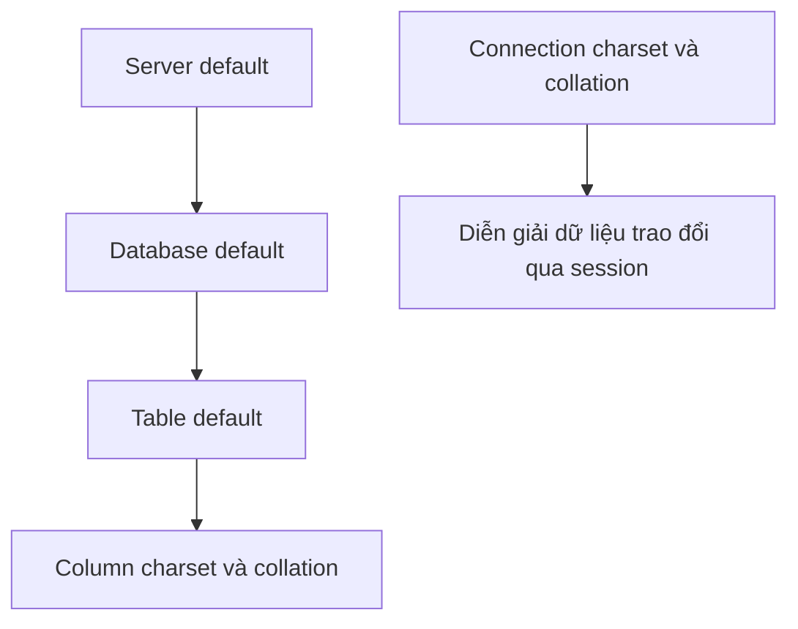
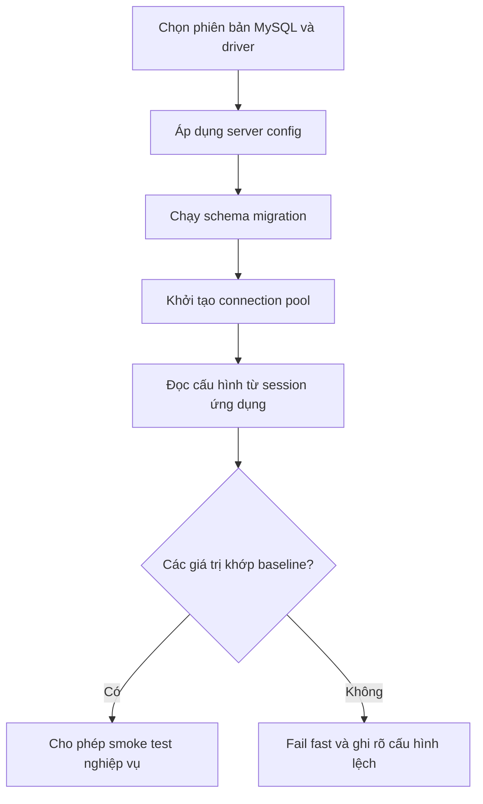

# Thiết lập bộ ký tự, collation, múi giờ và SQL mode có thể tái lập

Một môi trường MySQL có thể chạy mà không báo lỗi nhưng vẫn cho kết quả khác nhau giữa máy lập trình, CI và production. Nguyên nhân đôi khi không nằm ở câu SQL mà ở cấu hình ngầm: một máy dùng bộ ký tự hoặc quy tắc so sánh khác, một kết nối chạy theo múi giờ khác, hoặc SQL mode cho phép dữ liệu mà môi trường khác từ chối.

Bài học thuộc module **DATABASE_MYSQL**. Module hướng tới việc làm chủ MySQL từ thiết kế bảng, kiểu dữ liệu, khóa và truy vấn SQL đến index, transaction và kiểm soát đồng thời; đồng thời thực hành đọc kế hoạch thực thi, tối ưu truy vấn, phân quyền, sao lưu và xử lý vấn đề vận hành cơ sở dữ liệu quan hệ. Trong chương **Môi trường thực hành**, ta thiết lập các giá trị nền tảng để cùng một schema và cùng một ứng dụng có hành vi nhất quán ở nhiều môi trường.

Mục tiêu của bài là biết chọn cấu hình, đặt cấu hình ở đúng phạm vi, kiểm tra giá trị thực tế của từng kết nối và đưa các thiết lập quan trọng vào quy trình triển khai có thể lặp lại. Các ví dụ chính dùng MySQL 8.0 trở lên. Nếu dự án dùng phiên bản khác, hãy kiểm tra danh sách collation và system variable được hỗ trợ trước khi áp dụng nguyên xi.

## 1. Vì sao cần chuẩn hóa cấu hình môi trường?

Hãy hình dung cùng một chức năng đăng ký tài khoản được chạy trên máy lập trình và máy chủ kiểm thử. Trên máy lập trình, chuỗi `Nguyen Van An` và `nguyễn văn an` có thể được so sánh là bằng nhau; trên máy kiểm thử, chúng có thể được xem là khác nhau. Một chuỗi chứa emoji lưu được trên môi trường này nhưng bị lỗi hoặc biến đổi trên môi trường khác. Một truy vấn lọc thời điểm trả về đơn hàng khác ngày vì hai kết nối dùng múi giờ khác nhau. Một câu `INSERT` thiếu dữ liệu hợp lệ bị chuyển thành cảnh báo ở máy này nhưng bị từ chối ở máy kia.

Các khác biệt thường đến từ bốn nhóm cấu hình:

| Nhóm | Cấu hình chi phối | Hệ quả khi không thống nhất |
|---|---|---|
| Character set | Cách mã hóa ký tự khi lưu và trao đổi dữ liệu | Lỗi ký tự tiếng Việt, emoji hoặc dữ liệu bị biến đổi khi truyền qua kết nối. |
| Collation | Cách so sánh, sắp xếp và xác định hai chuỗi có bằng nhau hay không | Kết quả lọc, `ORDER BY`, `UNIQUE` và join có thể khác nhau. |
| Time zone | Cách diễn giải và hiển thị giá trị thời gian | Mốc thời gian bị lệch giờ hoặc điều kiện truy vấn theo ngày trả về sai tập bản ghi. |
| SQL mode | Quy tắc MySQL áp dụng khi phân tích và thực thi SQL | Dữ liệu sai bị cảnh báo ở nơi này nhưng bị từ chối ở nơi khác; truy vấn nhóm có thể hợp lệ ở môi trường này nhưng lỗi ở môi trường khác. |

Một cấu hình có thể được đặt ở cấp máy chủ, database, table, column hoặc session. Vì vậy, chỉ kiểm tra file cấu hình máy chủ là chưa đủ. Ứng dụng thường dùng connection pool; mỗi kết nối vật lý có session riêng và có thể nhận cấu hình khác nhau.

Một môi trường có thể tái lập khi:

1. Phiên bản MySQL và driver kết nối được xác định rõ.
2. Charset và collation mặc định được khai báo rõ cho database và schema.
3. Múi giờ lưu trữ, múi giờ server và múi giờ session có quy ước thống nhất.
4. SQL mode được chọn rõ ràng và được kiểm tra ở các kết nối ứng dụng.
5. Cấu hình cùng script khởi tạo được quản lý phiên bản, có thể áp dụng lại và có câu lệnh kiểm chứng.

## 2. Character set và collation

### 2.1. Hai khái niệm giải quyết hai vấn đề khác nhau

**Character set** (bộ ký tự) xác định tập ký tự có thể biểu diễn và cách mã hóa các ký tự đó thành byte. **Collation** xác định cách so sánh và sắp xếp các chuỗi thuộc một character set.

Ví dụ, cùng một character set có thể có nhiều collation:

- Collation không phân biệt chữ hoa và chữ thường có thể xem `MySQL` và `mysql` là bằng nhau khi so sánh.
- Collation không phân biệt dấu có thể xem `a` và `á` là bằng nhau trong phép so sánh.
- Collation phân biệt chữ hoa/thường và dấu sẽ áp dụng quy tắc chặt hơn.
- Collation dạng binary so sánh theo giá trị nhị phân của chuỗi.

Tên collation của MySQL thường cho biết đặc tính so sánh. Chẳng hạn, `utf8mb4_0900_ai_ci` có `ai` là accent-insensitive (không phân biệt dấu) và `ci` là case-insensitive (không phân biệt hoa/thường). `utf8mb4_0900_as_cs` phân biệt dấu và chữ hoa/thường. Hậu tố cụ thể phụ thuộc collation và phiên bản; hãy tra cứu đúng collation đang dùng thay vì suy đoán chỉ từ tên.

Character set quyết định dữ liệu nào có thể biểu diễn; collation quyết định chuỗi được so sánh như thế nào. Chọn đúng character set nhưng chọn collation không phù hợp vẫn có thể làm sai quy tắc tìm kiếm hoặc tính duy nhất.

### 2.2. Vì sao nên dùng `utf8mb4`?

Với ứng dụng hiện đại, `utf8mb4` là lựa chọn phù hợp cho dữ liệu Unicode. Nó hỗ trợ các ký tự ngoài Basic Multilingual Plane, bao gồm nhiều emoji và ký hiệu bổ sung.

Không nên nhầm `utf8mb4` với tên `utf8` lịch sử trong MySQL. Ở nhiều phiên bản MySQL cũ, `utf8` là tên bí danh của `utf8mb3`, chỉ biểu diễn tối đa ba byte cho một ký tự. `utf8mb4` hỗ trợ tối đa bốn byte. Các phiên bản mới đã đánh dấu `utf8mb3` là cũ và khuyến nghị chuyển sang `utf8mb4`.

Ví dụ, nếu cột tên người dùng dùng charset không hỗ trợ đầy đủ Unicode, dữ liệu tiếng Việt cơ bản có thể vẫn lưu được trong khi một emoji hoặc ký tự hiếm gây lỗi. Kiểm thử chỉ với chữ cái ASCII sẽ không phát hiện vấn đề này.

### 2.3. Phạm vi cấu hình charset và collation

MySQL có các giá trị mặc định ở nhiều cấp. Có thể hình dung thứ tự áp dụng khi tạo đối tượng mới như sau:



- **Server:** `character_set_server` và `collation_server` là mặc định ở cấp máy chủ.
- **Database:** mỗi database có charset và collation mặc định riêng. Khi tạo table mà không chỉ định rõ, table kế thừa mặc định database.
- **Table:** table có charset và collation mặc định; các column mới có thể kế thừa giá trị này.
- **Column:** column kiểu chuỗi có thể khai báo charset và collation riêng, ghi đè mặc định table.
- **Connection/session:** `character_set_client`, `character_set_connection`, `character_set_results` và `collation_connection` ảnh hưởng cách dữ liệu được gửi, diễn giải và trả về trên kết nối hiện tại.

Các giá trị mặc định ở cấp cao hơn chủ yếu ảnh hưởng đối tượng được tạo sau đó. Đổi collation mặc định của database không tự động chuyển đổi các column đã tồn tại trong table cũ. Muốn chuyển dữ liệu hiện có, phải lập kế hoạch migration riêng.

### 2.4. Khai báo rõ khi tạo database và table

Với MySQL 8.0, có thể tạo database với charset và collation được chọn rõ:

```sql
CREATE DATABASE shop_db
    CHARACTER SET utf8mb4
    COLLATE utf8mb4_0900_ai_ci;

USE shop_db;

CREATE TABLE customers (
    customer_id BIGINT UNSIGNED NOT NULL AUTO_INCREMENT,
    email       VARCHAR(255) NOT NULL,
    full_name   VARCHAR(150) NOT NULL,
    PRIMARY KEY (customer_id),
    UNIQUE KEY uk_customers_email (email)
) ENGINE = InnoDB
  DEFAULT CHARACTER SET = utf8mb4
  COLLATE = utf8mb4_0900_ai_ci;

CREATE TABLE customer_notes (
    note_id BIGINT UNSIGNED NOT NULL AUTO_INCREMENT,
    customer_id BIGINT UNSIGNED NOT NULL,
    note_text TEXT CHARACTER SET utf8mb4 COLLATE utf8mb4_0900_as_cs,
    PRIMARY KEY (note_id)
) ENGINE = InnoDB;
```

Trong ví dụ, database và table dùng collation không phân biệt dấu, không phân biệt hoa/thường. Riêng `note_text` dùng collation phân biệt dấu và hoa/thường để minh họa việc một column có thể có quy tắc riêng. Trong dự án thật, không nên chọn collation riêng tùy tiện; hãy gắn nó với yêu cầu tìm kiếm và so sánh cụ thể.

Collation ảnh hưởng cả unique index. Nếu email có unique key trên collation không phân biệt hoa/thường, các giá trị chỉ khác chữ hoa/thường có thể bị xem là trùng. Điều đó có thể đúng với quy tắc định danh của ứng dụng, nhưng phải được quyết định có chủ đích. Quy tắc so sánh email cũng cần được thiết kế theo nghiệp vụ, không chỉ dựa vào mặc định collation.

`utf8mb4_0900_ai_ci` là collation thuộc dòng MySQL 8.0. Nếu dự án cần tương thích MySQL 5.7 hoặc hệ quản trị khác, collation này có thể không tồn tại. Với MySQL 5.7, một lựa chọn phổ biến là `utf8mb4_unicode_ci`; hãy xác minh khả năng hỗ trợ trên đúng phiên bản trước khi viết migration.

### 2.5. Charset của kết nối

Ngay cả khi table đã dùng `utf8mb4`, ứng dụng vẫn có thể truyền dữ liệu sai nếu kết nối diễn giải byte theo charset khác. Các biến session thường cần quan tâm gồm:

- `character_set_client`: charset mà client dùng để gửi câu lệnh.
- `character_set_connection`: charset MySQL dùng khi chuyển đổi và xử lý chuỗi của câu lệnh.
- `character_set_results`: charset dùng để trả kết quả về client.
- `collation_connection`: collation dùng cho các phép so sánh chuỗi trong ngữ cảnh connection khi không có collation cụ thể hơn.

Lệnh sau đặt charset và collation cho connection hiện tại:

```sql
SET NAMES utf8mb4 COLLATE utf8mb4_0900_ai_ci;
```

`SET NAMES` tác động đến các biến charset client, connection, results và collation connection của session hiện tại. Nó không thay đổi charset mặc định của database hoặc chuyển đổi các column đã tạo. Khi ứng dụng kết nối bằng driver, nên cấu hình driver đúng cách và kiểm tra biến session sau khi kết nối; không nên phụ thuộc vào việc người vận hành đã chạy `SET NAMES` trong một cửa sổ SQL tương tác.

Với JDBC, hãy dùng phiên bản MySQL Connector/J phù hợp với server và cấu hình kết nối theo tài liệu của driver. Driver hiện đại có thể thương lượng charset phù hợp; nếu ứng dụng cần khởi tạo session, hãy dùng cơ chế cấu hình connection của driver hoặc connection pool. Ví dụ ở phần múi giờ bên dưới minh họa cách đặt thuộc tính kết nối. Tránh áp đặt `characterEncoding` cũ mà chưa xác minh ánh xạ charset của phiên bản Connector/J đang dùng.

### 2.6. Chuyển đổi schema đã tồn tại

Đổi mặc định database không có nghĩa dữ liệu cũ đã được chuyển sang `utf8mb4`. Cần kiểm tra table và column hiện tại:

```sql
SELECT
    TABLE_NAME,
    TABLE_COLLATION
FROM information_schema.TABLES
WHERE TABLE_SCHEMA = DATABASE()
  AND TABLE_TYPE = 'BASE TABLE'
ORDER BY TABLE_NAME;

SELECT
    TABLE_NAME,
    COLUMN_NAME,
    CHARACTER_SET_NAME,
    COLLATION_NAME
FROM information_schema.COLUMNS
WHERE TABLE_SCHEMA = DATABASE()
  AND CHARACTER_SET_NAME IS NOT NULL
ORDER BY TABLE_NAME, ORDINAL_POSITION;
```

`ALTER TABLE ... CONVERT TO CHARACTER SET ...` có thể chuyển đổi các column chuỗi trong table. Đây là thao tác thay đổi dữ liệu và có thể ảnh hưởng kiểu/độ dài cột, index, unique key, thời gian khóa và dung lượng. Trước khi chạy trên dữ liệu thật, hãy sao lưu, thử trên bản sao có kích thước tương đương, kiểm tra dữ liệu trùng theo collation đích và lập kế hoạch thời gian triển khai.

Ví dụ cú pháp:

```sql
ALTER TABLE customers
    CONVERT TO CHARACTER SET utf8mb4
    COLLATE utf8mb4_0900_ai_ci;
```

Không chạy câu lệnh chuyển đổi chỉ để “đồng bộ cho đẹp”. Hãy xác định rõ collation mong muốn, tác động lên unique index và cách ứng dụng xử lý những giá trị trước đây được xem là khác nhau nhưng nay trở thành bằng nhau.

## 3. Múi giờ trong MySQL

### 3.1. Phân biệt múi giờ hệ điều hành, server và session

MySQL có một số giá trị cần phân biệt:

- `system_time_zone` phản ánh múi giờ hệ điều hành mà MySQL nhận biết khi khởi động. Đây là thông tin hệ thống, không phải biến để ứng dụng tùy ý đổi theo từng request.
- `@@global.time_zone` là múi giờ mặc định của server cho các kết nối mới. Giá trị mặc định thường là `SYSTEM` nếu chưa cấu hình khác.
- `@@session.time_zone` là múi giờ của kết nối hiện tại. Khi session mới được tạo, nó nhận giá trị mặc định từ global; các kết nối đã tồn tại không tự đổi chỉ vì global thay đổi.

Kiểm tra các giá trị:

```sql
SELECT
    @@system_time_zone AS system_time_zone,
    @@global.time_zone AS global_time_zone,
    @@session.time_zone AS session_time_zone,
    NOW() AS session_now,
    UTC_TIMESTAMP() AS utc_now;
```

`NOW()` trả về thời điểm theo múi giờ session. `UTC_TIMESTAMP()` trả về thời điểm UTC. Nếu hai giá trị được gọi gần như cùng lúc, chúng có thể hiển thị lệch nhau theo offset của session.

### 3.2. Khác biệt giữa `TIMESTAMP` và `DATETIME`

Đây là khác biệt quan trọng khi thiết kế schema:

| Kiểu | Cách lưu và hiển thị | Phù hợp với |
|---|---|---|
| `TIMESTAMP` | MySQL chuyển giá trị từ múi giờ session sang UTC khi ghi và từ UTC về múi giờ session khi đọc. | Một thời điểm thực tế trên dòng thời gian, như lúc tạo đơn hoặc lúc thanh toán. |
| `DATETIME` | Lưu ngày và giờ theo giá trị lịch đã nhập; không tự chuyển đổi theo múi giờ session khi đọc/ghi. | Thời gian địa phương có ý nghĩa nghiệp vụ, như lịch hẹn lúc 09:00 tại một địa điểm. |

Ví dụ kiểm tra hành vi:

```sql
SET SESSION time_zone = '+00:00';

CREATE TEMPORARY TABLE time_probe (
    event_timestamp TIMESTAMP,
    event_datetime  DATETIME
);

INSERT INTO time_probe (event_timestamp, event_datetime)
VALUES (NOW(), NOW());

SELECT event_timestamp, event_datetime
FROM time_probe;

SET SESSION time_zone = '+07:00';

SELECT event_timestamp, event_datetime
FROM time_probe;
```

Sau khi đổi session sang `+07:00`, cùng một giá trị `TIMESTAMP` được hiển thị theo giờ mới và lệch bảy giờ so với cách hiển thị UTC. Giá trị `DATETIME` vẫn giữ nguyên các thành phần ngày/giờ đã lưu. Đây là lý do cần quyết định rõ cột đang biểu diễn một thời điểm tuyệt đối hay một giờ lịch địa phương.

Một quy ước phổ biến cho hệ thống giao dịch là lưu các thời điểm sự kiện theo UTC, dùng `TIMESTAMP` hoặc một quy ước UTC rõ ràng với `DATETIME`, và chuyển sang múi giờ người dùng ở tầng hiển thị. Với lịch hẹn địa phương, đôi khi cần lưu cả múi giờ IANA (ví dụ `Asia/Ho_Chi_Minh`) bên cạnh ngày/giờ địa phương để giữ đúng ý nghĩa khi quy tắc múi giờ thay đổi.

### 3.3. Đặt session time zone về UTC

Đặt múi giờ session của kết nối hiện tại:

```sql
SET SESSION time_zone = '+00:00';
```

Đặt mặc định cho các kết nối mới ở cấp server:

```sql
SET GLOBAL time_zone = '+00:00';
```

`SET GLOBAL` không tự đổi session của các kết nối đang mở. Nếu ứng dụng dùng connection pool, những kết nối vật lý đã tồn tại có thể tiếp tục giữ múi giờ cũ. Cần khởi tạo hoặc làm mới kết nối theo quy trình kiểm soát.

Để duy trì sau khi restart, có thể khai báo trong file cấu hình MySQL:

```ini
[mysqld]
default-time-zone = '+00:00'
```

Với MySQL 8.0, một số system variable động có thể được lưu qua restart bằng `SET PERSIST`, ví dụ:

```sql
SET PERSIST time_zone = '+00:00';
```

`SET PERSIST` yêu cầu quyền quản trị phù hợp và ghi cấu hình vào vùng cấu hình persistent của MySQL. File cấu hình triển khai được quản lý phiên bản thường dễ kiểm soát và review hơn khi cần tái lập môi trường. Không phải mọi system variable đều cho phép `SET PERSIST`; hãy kiểm tra thuộc tính của biến và phiên bản trước khi sử dụng.

### 3.4. Múi giờ có tên và bảng time zone

MySQL có thể dùng offset như `'+00:00'`, `'+07:00'` hoặc tên múi giờ như `'Asia/Ho_Chi_Minh'`. Tên múi giờ có lợi khi cần tuân theo quy tắc lịch sử và thay đổi giờ mùa hè của một khu vực. Để MySQL nhận diện tên múi giờ, các bảng time zone trong database hệ thống phải được nạp và cập nhật.

Nếu bảng time zone chưa có dữ liệu phù hợp, lệnh đặt tên múi giờ có thể báo lỗi hoặc không hoạt động như mong đợi. Trên hệ thống Unix, quản trị viên thường dùng công cụ `mysql_tzinfo_to_sql` để nạp dữ liệu từ zoneinfo của hệ điều hành vào MySQL; sau khi cập nhật cần khởi động lại hoặc làm mới theo hướng dẫn phiên bản đang chạy. Trên nền tảng khác, cần dùng quy trình nạp dữ liệu múi giờ phù hợp.

Nếu ứng dụng chỉ cần UTC, offset `'+00:00'` là lựa chọn đơn giản và không phụ thuộc việc nạp bảng tên múi giờ. Nếu nghiệp vụ cần múi giờ địa phương, hãy kiểm tra bảng time zone và lưu định danh khu vực cùng dữ liệu lịch khi cần.

### 3.5. Cấu hình múi giờ trong ứng dụng Java

Múi giờ của MySQL và múi giờ JVM là hai cấu hình riêng. Một ứng dụng Java có thể chạy JVM theo múi giờ hệ điều hành, trong khi session MySQL dùng `SYSTEM` hoặc một giá trị khác. Cần đặt quy ước rõ ở cả driver lẫn tầng ứng dụng.

Ví dụ với phiên bản MySQL Connector/J hỗ trợ các thuộc tính `connectionTimeZone` và `forceConnectionTimeZoneToSession`:

```properties
spring.datasource.url=jdbc:mysql://localhost:3306/shop_db?connectionTimeZone=UTC&forceConnectionTimeZoneToSession=true
```

`connectionTimeZone=UTC` khai báo múi giờ kết nối mà driver sử dụng để chuyển đổi thời gian. `forceConnectionTimeZoneToSession=true` yêu cầu driver đặt múi giờ session của MySQL theo múi giờ kết nối. Hãy kiểm tra tài liệu Connector/J đúng phiên bản; driver cũ có tên thuộc tính hoặc hành vi khác.

Ở tầng Java, nên dùng API thời gian có ý nghĩa rõ ràng: `Instant` cho một thời điểm tuyệt đối, `LocalDate` cho ngày lịch không có giờ, `LocalDateTime` cho ngày/giờ không gắn múi giờ và `ZonedDateTime` khi cần giữ cả múi giờ khu vực. Không nên chuyển mọi giá trị sang `LocalDateTime` rồi giả định nó luôn là UTC.

## 4. SQL mode

### 4.1. SQL mode điều khiển điều gì?

SQL mode là tập các quy tắc thay đổi cách MySQL phân tích và thực thi câu lệnh. Nó có thể ảnh hưởng đến việc MySQL từ chối hay chấp nhận dữ liệu, xử lý giá trị không hợp lệ, cách diễn giải một số cú pháp và yêu cầu đối với truy vấn nhóm.

Một số mode thường gặp:

| SQL mode | Tác dụng khái quát |
|---|---|
| `STRICT_TRANS_TABLES` | Bật hành vi nghiêm ngặt cho bảng transactional; nhiều giá trị sai hoặc ngoài miền sẽ gây lỗi thay vì âm thầm chuyển thành giá trị khác. Chi tiết còn phụ thuộc loại bảng và câu lệnh. |
| `ONLY_FULL_GROUP_BY` | Yêu cầu các biểu thức không tổng hợp trong `SELECT`, `HAVING` và `ORDER BY` phù hợp với quy tắc nhóm hoặc phụ thuộc hàm được MySQL nhận diện. |
| `NO_ENGINE_SUBSTITUTION` | Không âm thầm thay storage engine khi engine được yêu cầu không khả dụng; thay vào đó báo lỗi. |
| `ANSI_QUOTES` | Diễn giải dấu ngoặc kép như dấu quote cho identifier thay vì chuỗi ký tự. Có thể làm hỏng SQL cũ đang dùng dấu ngoặc kép cho string. |
| `NO_BACKSLASH_ESCAPES` | Thay đổi cách xử lý dấu gạch chéo ngược trong string literal. Có thể ảnh hưởng câu SQL được tạo từ ứng dụng. |

Các mode có thể kết hợp thành một danh sách phân cách bằng dấu phẩy. Không nên bật một mode chỉ vì tên của nó nghe có vẻ chuẩn hơn; phải kiểm tra tác động đến SQL hiện có và thư viện ứng dụng.

### 4.2. Vì sao nên có strict mode?

Giả sử cột `quantity` là số nguyên nhưng ứng dụng gửi chuỗi không thể chuyển đổi thành số. Với chế độ không nghiêm ngặt, tùy câu lệnh và phiên bản, MySQL có thể tạo cảnh báo và thay giá trị không hợp lệ bằng giá trị mặc định hoặc giá trị điều chỉnh. Ứng dụng có thể không nhận ra rằng dữ liệu đã bị biến đổi.

Với strict mode, các trường hợp sai thường bị từ chối ngay khi ghi. Lỗi sớm giúp phát hiện vấn đề ở ranh giới ứng dụng và cơ sở dữ liệu, giữ dữ liệu trong trạng thái dễ kiểm soát hơn. Tuy nhiên, bật strict mode có thể làm lộ những dữ liệu cũ hoặc câu lệnh trước đây dựa vào hành vi tự chuyển đổi. Cần chạy kiểm thử hồi quy trước khi áp dụng lên hệ thống đang hoạt động.

### 4.3. `ONLY_FULL_GROUP_BY` bảo vệ ý nghĩa truy vấn nhóm

Ví dụ bảng `orders` có nhiều đơn hàng của cùng một khách hàng. Truy vấn sau có thể không hợp lệ khi bật `ONLY_FULL_GROUP_BY`:

```sql
SELECT customer_id, order_status, COUNT(*)
FROM orders
GROUP BY customer_id;
```

Một khách hàng có thể có nhiều đơn hàng với nhiều `order_status`, nên MySQL không có một giá trị `order_status` duy nhất rõ ràng để trả về cho mỗi nhóm khách hàng. Truy vấn phải nêu ý nghĩa mong muốn, ví dụ đếm đơn theo cả khách hàng và trạng thái:

```sql
SELECT customer_id, order_status, COUNT(*) AS order_count
FROM orders
GROUP BY customer_id, order_status;
```

Hoặc nếu mục tiêu chỉ là đếm tổng đơn theo khách hàng, bỏ `order_status` khỏi danh sách `SELECT`. Tắt `ONLY_FULL_GROUP_BY` có thể khiến MySQL chọn một giá trị không xác định trong nhóm; điều đó che giấu lỗi logic thay vì sửa truy vấn.

### 4.4. Xem và đặt SQL mode

Kiểm tra mode toàn cục và session:

```sql
SELECT
    @@GLOBAL.sql_mode AS global_sql_mode,
    @@SESSION.sql_mode AS session_sql_mode;
```

Đặt cho session hiện tại:

```sql
SET SESSION sql_mode =
    'STRICT_TRANS_TABLES,ONLY_FULL_GROUP_BY,NO_ENGINE_SUBSTITUTION';
```

Đặt giá trị mặc định cho kết nối mới:

```sql
SET GLOBAL sql_mode =
    'STRICT_TRANS_TABLES,ONLY_FULL_GROUP_BY,NO_ENGINE_SUBSTITUTION';
```

Session hiện tại không tự nhận giá trị mới khi `SET GLOBAL` được chạy. Kết nối mới sẽ kế thừa giá trị global tại thời điểm tạo session. Để duy trì sau restart, có thể khai báo `sql-mode` trong file cấu hình server hoặc dùng `SET PERSIST` nếu biến và phiên bản hỗ trợ.

Ví dụ trong file cấu hình:

```ini
[mysqld]
sql-mode = "STRICT_TRANS_TABLES,ONLY_FULL_GROUP_BY,NO_ENGINE_SUBSTITUTION"
```

Danh sách trên là một baseline minh họa cho dự án mới, không phải danh sách tối ưu cho mọi hệ thống. Một số phiên bản MySQL có các mode mặc định khác nhau. Khi đặt một danh sách tường minh, ta thay thế danh sách mặc định; vì vậy cần quyết định có giữ các mode khác mà ứng dụng đang cần hay không. Ghi lại danh sách được chọn trong cấu hình dự án và kiểm tra bằng `@@SESSION.sql_mode`.

## 5. Đặt cấu hình ở đúng phạm vi

Ba phạm vi thường gặp có hành vi khác nhau:

| Phạm vi | Cách đặt | Ảnh hưởng |
|---|---|---|
| Session | `SET SESSION ...` | Chỉ kết nối hiện tại; mất khi kết nối đóng. |
| Global runtime | `SET GLOBAL ...` | Giá trị mặc định cho session mới; không tự đổi session đang tồn tại và thường mất sau restart nếu không lưu persistent. |
| Persistent/server config | File cấu hình hoặc `SET PERSIST` khi được hỗ trợ | Duy trì qua restart theo cơ chế cấu hình của MySQL. |

Quyền cần thiết khác nhau theo thao tác và phiên bản. `SET GLOBAL` và `SET PERSIST` thường cần quyền quản trị phù hợp; ứng dụng nghiệp vụ thông thường không nên có quyền thay đổi cấu hình toàn server.

Một cách phân chia thực tế:

- Charset/collation mặc định của server và múi giờ mặc định: cấu hình ở file server hoặc cơ chế triển khai tương ứng.
- Charset/collation của database, table và column: khai báo trong migration/schema để mỗi môi trường tạo cùng cấu trúc.
- Charset, time zone và SQL mode của connection: cấu hình tại driver hoặc connection pool, sau đó xác minh trên session.
- Thay đổi cấu hình global trong lúc vận hành: thực hiện qua quy trình quản trị có review, ghi nhận thay đổi và kiểm tra các kết nối hiện tại.

Không nên dùng tài khoản ứng dụng để chạy `SET GLOBAL` mỗi lần khởi động. Cách đó đòi hỏi quyền cao và có thể tạo ra race condition giữa các instance ứng dụng cùng khởi động. Cấu hình server nên thuộc quy trình triển khai server; cấu hình session nên thuộc quy trình tạo connection.

## 6. Một cấu hình mẫu có thể quản lý phiên bản

Giả sử dự án chọn MySQL 8.0, dùng `utf8mb4`, collation mặc định không phân biệt dấu và hoa/thường, dùng UTC và bật một tập SQL mode rõ ràng. Có thể lưu cấu hình server trong file `my.cnf` hoặc file cấu hình được mount vào container:

```ini
[mysqld]
character-set-server = utf8mb4
collation-server = utf8mb4_0900_ai_ci
default-time-zone = '+00:00'
sql-mode = "STRICT_TRANS_TABLES,ONLY_FULL_GROUP_BY,NO_ENGINE_SUBSTITUTION"
```

Đối với MySQL 5.7, cần chọn collation có hỗ trợ trên phiên bản đó, ví dụ `utf8mb4_unicode_ci`; không copy `utf8mb4_0900_ai_ci` sang phiên bản không có collation này.

Sau khi khởi tạo server, migration tạo database cũng khai báo rõ:

```sql
CREATE DATABASE IF NOT EXISTS shop_db
    CHARACTER SET utf8mb4
    COLLATE utf8mb4_0900_ai_ci;
```

Các migration tạo table tiếp tục ghi rõ engine, charset và collation khi đó là yêu cầu của schema. Nhờ vậy, database mới không phụ thuộc vào default có thể khác nhau giữa các máy.

Ở tầng kết nối, mỗi connection vật lý cần được khởi tạo theo một quy ước. Có thể dùng cấu hình driver để thương lượng charset và đặt time zone; dùng hook khởi tạo connection để đặt session SQL mode nếu dự án yêu cầu. Ví dụ SQL cho một session:

```sql
SET NAMES utf8mb4 COLLATE utf8mb4_0900_ai_ci;
SET SESSION time_zone = '+00:00';
SET SESSION sql_mode =
    'STRICT_TRANS_TABLES,ONLY_FULL_GROUP_BY,NO_ENGINE_SUBSTITUTION';
```

Không nhất thiết phải chạy `SET NAMES` thủ công nếu driver đã thiết lập charset đúng. Điều cần bảo đảm là các giá trị session thực tế đúng với baseline của dự án. Khi dùng connection pool, hãy đặt cấu hình tại hook tạo connection và xác minh sau khi lấy connection; đừng giả định mọi connection đều giữ nguyên trạng thái sau khi được trả về pool.

## 7. Kiểm chứng môi trường bằng SQL

Một cấu hình chỉ đáng tin khi có thể kiểm tra được. Hãy lưu một script kiểm tra trong bộ công cụ vận hành hoặc chạy trong bước smoke test sau khi triển khai.

### 7.1. Kiểm tra phiên bản và charset của server/connection

```sql
SELECT
    VERSION() AS mysql_version,
    @@character_set_server AS server_charset,
    @@collation_server AS server_collation,
    @@character_set_client AS client_charset,
    @@character_set_connection AS connection_charset,
    @@character_set_results AS results_charset,
    @@collation_connection AS connection_collation;
```

Kiểm tra mặc định của database hiện tại:

```sql
SELECT
    SCHEMA_NAME,
    DEFAULT_CHARACTER_SET_NAME,
    DEFAULT_COLLATION_NAME
FROM information_schema.SCHEMATA
WHERE SCHEMA_NAME = DATABASE();
```

Kiểm tra collation của table và column bằng các truy vấn ở phần 2.6. Đừng chỉ kiểm tra `@@character_set_server`: một column cũ có thể vẫn dùng charset hoặc collation khác.

### 7.2. Kiểm tra múi giờ

```sql
SELECT
    @@system_time_zone AS system_time_zone,
    @@global.time_zone AS global_time_zone,
    @@session.time_zone AS session_time_zone,
    NOW() AS session_now,
    UTC_TIMESTAMP() AS utc_now;
```

Nếu baseline yêu cầu UTC, session ứng dụng cần hiển thị `@@session.time_zone` là `+00:00` hoặc một giá trị UTC tương đương theo cấu hình được chọn. Đừng chỉ nhìn `@@global.time_zone`, vì một connection pool có thể giữ session được tạo từ trước khi global thay đổi.

### 7.3. Kiểm tra SQL mode

```sql
SELECT
    @@GLOBAL.sql_mode AS global_sql_mode,
    @@SESSION.sql_mode AS session_sql_mode;
```

Đối chiếu `@@SESSION.sql_mode` trên connection thực tế của ứng dụng với danh sách trong cấu hình. Kiểm tra một kết nối từ pool sau khi ứng dụng khởi động, không chỉ kiểm tra một phiên quản trị độc lập.

### 7.4. Kiểm tra khả năng lưu Unicode và quy tắc so sánh

Có thể dùng bảng tạm để kiểm tra nhanh trong session:

```sql
SET NAMES utf8mb4 COLLATE utf8mb4_0900_ai_ci;

CREATE TEMPORARY TABLE charset_probe (
    value_text VARCHAR(100)
        CHARACTER SET utf8mb4
        COLLATE utf8mb4_0900_ai_ci
);

INSERT INTO charset_probe (value_text)
VALUES ('Tiếng Việt có dấu'), ('Mặt trời ☀️'), ('MySQL'), ('mysql');

SELECT value_text, HEX(value_text)
FROM charset_probe;

SELECT
    _utf8mb4'Mysql' COLLATE utf8mb4_0900_ai_ci =
    _utf8mb4'mysql' COLLATE utf8mb4_0900_ai_ci AS case_insensitive_match;
```

Truy vấn `HEX` giúp nhìn byte được lưu cho chuỗi. Phép so sánh cuối minh họa collation không phân biệt chữ hoa/thường. Kiểm thử trên dữ liệu thật vẫn cần xem xét accent, ký tự đặc biệt và quy tắc nghiệp vụ; một ví dụ đơn giản không chứng minh mọi trường hợp đều đúng.

## 8. Đưa kiểm tra vào quy trình khởi động ứng dụng

Một quy trình triển khai có thể chia thành các bước:

1. **Pin phiên bản:** xác định phiên bản MySQL server và Connector/J trong cấu hình triển khai, tránh để môi trường tự kéo phiên bản mới không kiểm soát.
2. **Cài đặt server config:** áp dụng file cấu hình charset, collation mặc định, múi giờ và SQL mode; khởi động hoặc reload theo yêu cầu của từng biến.
3. **Chạy migration:** tạo database, table, index và constraint với charset/collation được khai báo rõ.
4. **Khởi tạo connection:** driver và pool thiết lập session theo baseline của ứng dụng.
5. **Smoke test:** đọc các system variable từ connection của ứng dụng, xác minh charset, collation, time zone và SQL mode.
6. **Ghi nhận kết quả:** log phiên bản và các giá trị cấu hình không nhạy cảm để dễ so sánh giữa local, CI, staging và production.

Có thể mô tả luồng kiểm tra như sau:



Nếu cấu hình không khớp, ứng dụng nên báo lỗi khởi động hoặc đánh dấu instance không sẵn sàng theo mức độ ảnh hưởng. Một cảnh báo log đơn thuần có thể khiến hệ thống chạy trong trạng thái khác biệt mà chỉ phát hiện sau khi dữ liệu đã bị ghi sai.

Các giá trị nên được ghi nhận ở log khởi động gồm phiên bản MySQL, charset/collation của server và database, charset/collation của connection, session time zone và session SQL mode. Không ghi mật khẩu, URL có credential hoặc dữ liệu nhạy cảm cùng các thông tin này.

## 9. Lỗi thường gặp và cách xử lý

| Hiện tượng | Nguyên nhân có thể | Hướng kiểm tra |
|---|---|---|
| Tiếng Việt hoặc emoji bị lỗi | Charset của client, connection, column hoặc kết quả không đồng nhất | Kiểm tra các biến charset session và charset/collation của column; xác định lỗi xảy ra lúc gửi, lưu hay đọc. |
| Tìm kiếm không phân biệt hoa/thường như mong đợi | Collation của column hoặc biểu thức không đúng quy tắc nghiệp vụ | Kiểm tra `COLLATION_NAME`; xác định có cần `_ci`, `_cs`, `_ai`, `_as` hay binary comparison. |
| Thêm dữ liệu báo duplicate dù chuỗi khác nhau | Unique index dùng collation xem các chuỗi là tương đương | Kiểm tra collation của cột unique và quy tắc định danh cần áp dụng. |
| Thời gian lệch vài giờ | Session time zone, JVM time zone hoặc cách ánh xạ `TIMESTAMP`/`DATETIME` không thống nhất | So sánh `NOW()`, `UTC_TIMESTAMP()`, `@@session.time_zone` và cấu hình driver. |
| Máy mới có giờ đúng nhưng ứng dụng đang chạy vẫn sai | Global time zone đã đổi nhưng connection pool giữ session cũ | Kiểm tra từng connection; áp dụng init SQL hoặc tạo lại connection theo quy trình an toàn. |
| `INSERT` bị từ chối sau khi triển khai | SQL mode nghiêm ngặt hơn hoặc dữ liệu đầu vào vi phạm kiểu/constraint | So sánh `@@session.sql_mode`, đọc lỗi SQL cụ thể và sửa dữ liệu/logic đầu vào. |
| Truy vấn `GROUP BY` lỗi ở CI | `ONLY_FULL_GROUP_BY` khác giữa các môi trường | Viết lại truy vấn để mọi cột không tổng hợp có ý nghĩa xác định trong nhóm. |
| Đã đổi default database nhưng column vẫn khác | Default chỉ ảnh hưởng đối tượng tạo mới | Kiểm tra `information_schema.COLUMNS` và lập migration chuyển đổi riêng nếu cần. |

Không nên xử lý bằng cách tắt strict mode, đổi collation hoặc đặt `time_zone` tùy tiện chỉ để làm lỗi biến mất. Trước hết phải xác định cấu hình nào đang khác, hành vi mong muốn của nghiệp vụ là gì và phạm vi nào cần được sửa.

## 10. Bài tập thực hành

### Bài tập 1: Tạo database có cấu hình tường minh

Tạo database `practice_shop` dùng `utf8mb4` và collation có sẵn trên phiên bản MySQL của bạn. Tạo bảng `members` với email có unique key. Kiểm tra charset/collation của server, database, table và column bằng `information_schema`.

**Yêu cầu:** ghi lại phiên bản MySQL và giải thích vì sao không thể mặc định dùng `utf8mb4_0900_ai_ci` trên MySQL 5.7.

### Bài tập 2: Quan sát collation

Tạo hai column hoặc hai biểu thức dùng collation phân biệt và không phân biệt hoa/thường. Thử so sánh `MySQL` với `mysql`, sau đó thử một cặp chuỗi tiếng Việt có và không có dấu.

**Yêu cầu:** giải thích vì sao collation có thể làm thay đổi kết quả `WHERE`, `ORDER BY` và unique key.

### Bài tập 3: Quan sát `TIMESTAMP` và `DATETIME`

Tạo bảng tạm có một cột `TIMESTAMP` và một cột `DATETIME`. Đặt session time zone thành UTC, chèn `NOW()` vào cả hai cột, đổi session sang `+07:00` rồi đọc lại.

**Yêu cầu:** ghi lại kết quả và giải thích kiểu nào được chuyển đổi khi hiển thị. Nêu trường hợp nghiệp vụ nên dùng từng kiểu.

### Bài tập 4: SQL mode và truy vấn nhóm

Kiểm tra `@@SESSION.sql_mode`. Bật `ONLY_FULL_GROUP_BY` và chạy truy vấn chọn một cột không tổng hợp, không nằm trong `GROUP BY`. Sau đó sửa truy vấn để kết quả có ý nghĩa xác định.

**Yêu cầu:** giải thích vì sao tắt mode không phải cách sửa đúng cho một truy vấn nhóm mơ hồ.

### Bài tập 5: Kiểm chứng connection pool

Khởi chạy ứng dụng Java có connection pool. Tạo một endpoint hoặc tác vụ chẩn đoán đọc `@@session.time_zone`, `@@session.sql_mode`, `@@character_set_connection` và `@@collation_connection` qua connection lấy từ pool.

**Yêu cầu:** xác minh các giá trị trên nhiều lần lấy connection và sau khi restart ứng dụng. Đưa việc kiểm tra vào smoke test tự động.

## 11. Checklist cấu hình có thể tái lập

Trước khi coi một môi trường MySQL đã sẵn sàng, hãy kiểm tra:

- [ ] Phiên bản MySQL Server và driver kết nối đã được pin.
- [ ] Server có `character_set_server=utf8mb4` và collation phù hợp.
- [ ] Database, table và column có charset/collation đúng theo schema.
- [ ] Connection của ứng dụng dùng charset và collation mong muốn.
- [ ] Quy tắc so sánh chuỗi phù hợp với tìm kiếm và unique key của nghiệp vụ.
- [ ] Múi giờ server và session được xác định; ứng dụng dùng quy ước UTC nhất quán cho thời điểm tuyệt đối.
- [ ] Schema chọn `TIMESTAMP` hoặc `DATETIME` theo đúng ý nghĩa dữ liệu.
- [ ] SQL mode của session ứng dụng khớp baseline đã tài liệu hóa.
- [ ] Các thiết lập được lưu trong cấu hình triển khai hoặc migration có quản lý phiên bản.
- [ ] Có smoke test đọc cấu hình thực tế từ connection ứng dụng.

## 12. Ghi nhớ

Character set quyết định cách biểu diễn ký tự; collation quyết định cách so sánh chuỗi. Múi giờ session ảnh hưởng cách MySQL đọc và ghi `TIMESTAMP`, trong khi `DATETIME` giữ nguyên giá trị lịch. SQL mode quy định cách server xử lý nhiều tình huống SQL và dữ liệu. Cả ba nhóm cấu hình đều có phạm vi server, schema hoặc session khác nhau.

Muốn môi trường có thể tái lập, hãy khai báo rõ cấu hình server, ghi charset/collation vào migration, khởi tạo từng connection theo baseline ứng dụng và kiểm chứng bằng SQL. Khi local, CI và production cùng báo cáo những giá trị tương đương, các khác biệt do cấu hình ngầm sẽ giảm đáng kể và lỗi có thể được phát hiện ngay khi triển khai.
