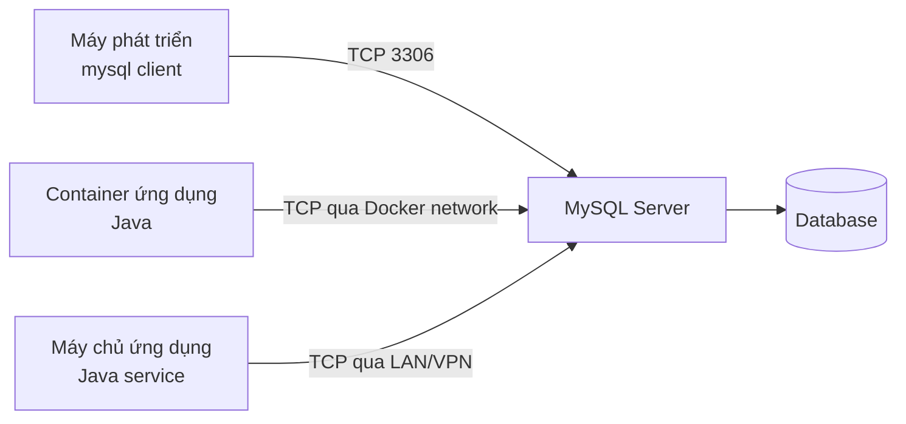

# Kết nối từ máy chủ, container khác và ứng dụng Java

MySQL có thể chạy trên cùng máy với ứng dụng, trong một container riêng hoặc trên một máy chủ mạng độc lập. Để kết nối thành công, cần xác định đúng địa chỉ mà **máy khách nhìn thấy**, cổng MySQL đang lắng nghe, đường mạng cho phép lưu lượng đi qua và tài khoản MySQL được cấp quyền từ đúng nguồn kết nối.

Trong module **DATABASE_MYSQL**, đây là kỹ năng thực hành thiết yếu: một schema và câu truy vấn đúng vẫn không dùng được nếu ứng dụng không thể đến máy chủ, tài khoản không được phép đăng nhập từ host hiện tại hoặc JDBC cấu hình sai. Bài học này hướng dẫn kết nối từ máy khác, giữa các container và từ ứng dụng Java, đồng thời xây dựng cách kiểm tra lỗi theo từng lớp.

## 1. Mô hình kết nối MySQL qua mạng

MySQL Server thường nhận kết nối TCP trên cổng 3306. Client có thể là chương trình dòng lệnh, một container ứng dụng, một ứng dụng Java hoặc một máy chủ khác.



Một kết nối từ xa cần đi qua các bước:

1. Client phân giải tên máy chủ hoặc xác định địa chỉ IP đích.
2. Client mở kết nối TCP tới địa chỉ và cổng MySQL.
3. Hệ điều hành, firewall, router, security group hoặc mạng container cho phép lưu lượng.
4. MySQL đang lắng nghe trên địa chỉ mạng phù hợp và cổng tương ứng.
5. MySQL xác thực tài khoản và kiểm tra phần Host của tài khoản có khớp nguồn kết nối hay không.
6. Client và server thương lượng cơ chế xác thực, mã hóa TLS nếu được cấu hình, rồi mới thực hiện câu lệnh SQL.

Vì vậy, "không kết nối được MySQL" có thể là lỗi DNS, định tuyến, cổng, firewall, cấu hình server, xác thực, quyền hoặc TLS. Hãy kiểm tra theo thứ tự thay vì thay đổi nhiều cấu hình cùng lúc.

## 2. Phân biệt địa chỉ máy khách và máy chủ

Địa chỉ `localhost` hoặc `127.0.0.1` luôn chỉ về **chính môi trường đang chạy client**.

- Nếu Java chạy trực tiếp trên máy phát triển và MySQL cũng chạy trên máy đó, `127.0.0.1:3306` có thể là địa chỉ đúng.
- Nếu Java chạy trong container, `127.0.0.1` chỉ về container Java, không phải container MySQL.
- Nếu Java chạy trên một máy chủ khác, `127.0.0.1` chỉ về máy chủ ứng dụng, không phải máy chủ cơ sở dữ liệu.
- Nếu hai container cùng một Docker network, thường dùng tên service hoặc tên container của MySQL làm hostname.
- Nếu client chạy trên máy host và MySQL được publish từ container ra host, client dùng cổng host đã publish.

Ví dụ: máy host publish cổng 3307 tới cổng 3306 trong container MySQL. Khi đó client trên host kết nối `127.0.0.1:3307`; một container khác trong cùng Docker network vẫn kết nối tới hostname `db` ở cổng `3306`.

Địa chỉ phải được chọn theo góc nhìn của client, không phải theo nơi MySQL được cài đặt.

## 3. Cho phép MySQL nhận kết nối mạng

### 3.1. Kiểm tra cấu hình máy chủ

Đăng nhập vào MySQL bằng một tài khoản quản trị phù hợp và xem các biến mạng:

```sql
SHOW VARIABLES
WHERE Variable_name IN (
    'port',
    'bind_address',
    'skip_networking'
);
```

Ý nghĩa:

- `port`: cổng TCP mà MySQL sử dụng.
- `bind_address`: địa chỉ IP mà MySQL gắn socket lắng nghe.
- `skip_networking`: nếu bật, MySQL không sử dụng TCP/IP để nhận kết nối mạng.

Nếu MySQL chỉ bind vào địa chỉ loopback như `127.0.0.1`, client ở máy khác sẽ không thể kết nối trực tiếp qua card mạng. Cần cấu hình bind vào địa chỉ mạng thích hợp hoặc địa chỉ wildcard theo chính sách hạ tầng. Không nên bind rộng hơn nhu cầu thực tế.

Tên và vị trí file cấu hình phụ thuộc hệ điều hành, cách cài đặt hoặc image. Phần cấu hình trong file `my.cnf`/`mysqld.cnf` thường nằm dưới section `[mysqld]`. Ví dụ minh họa:

```ini
[mysqld]
port = 3306
bind-address = 10.20.0.15
```

Thay `10.20.0.15` bằng địa chỉ IP thực tế của máy chủ MySQL trên mạng cần phục vụ. Đảm bảo địa chỉ đó được gắn trên máy và không tự ý dùng IP ví dụ. Sau khi thay đổi cấu hình, cần khởi động lại dịch vụ nếu phiên bản và cách triển khai yêu cầu, rồi kiểm tra lại biến runtime và socket đang lắng nghe.

Trên Linux có thể kiểm tra socket TCP bằng:

```bash
sudo ss -lntp | grep 3306
```

Kết quả cần cho thấy tiến trình MySQL lắng nghe trên địa chỉ phù hợp. Nếu chỉ thấy `127.0.0.1:3306`, dịch vụ vẫn chỉ nhận kết nối loopback. Trên Windows, có thể kiểm tra bằng PowerShell:

```powershell
Get-NetTCPConnection -State Listen -LocalPort 3306
```

Lệnh kiểm tra socket giúp xác định trạng thái lắng nghe của hệ điều hành; nó không thay thế việc thử kết nối từ đúng máy client.

### 3.2. Mở đường mạng có kiểm soát

Firewall trên máy chủ và firewall của hạ tầng phải cho phép TCP từ các nguồn client cần thiết tới cổng MySQL. Trong môi trường cloud, còn cần kiểm tra security group, network ACL, private subnet, route table và VPN/peering nếu có.

Nguyên tắc vận hành:

- Chỉ cho phép các subnet hoặc địa chỉ nguồn cần truy cập.
- Ưu tiên mạng private, VPN hoặc kết nối riêng giữa ứng dụng và database.
- Không công khai cổng MySQL ra Internet chỉ để tiện kiểm thử.
- Không mở toàn bộ cổng inbound khi chỉ cần TCP 3306.
- Ghi nhận nguồn truy cập, đích, cổng và lý do trong cấu hình hạ tầng.

Nếu MySQL dùng cổng khác 3306, firewall và client phải dùng đúng cổng đã cấu hình. Mở firewall không thể khắc phục server đang bind sai địa chỉ hoặc `skip_networking` đang bật.

## 4. Cấp tài khoản MySQL cho nguồn kết nối

MySQL quản lý tài khoản theo cặp **user và host**, có dạng `'user'@'host'`. Host ở đây mô tả nguồn mà tài khoản được phép kết nối từ đó; nó không phải hostname của máy chủ MySQL đích.

Ví dụ:

- `'app_user'@'localhost'`: tài khoản dành cho kết nối từ chính máy chủ MySQL qua cơ chế kết nối cục bộ phù hợp.
- `'app_user'@'10.20.0.25'`: tài khoản dành cho nguồn có địa chỉ IP đó.
- Nếu cần giới hạn theo một dải IP, hãy dùng hình thức host/netmask được phiên bản MySQL triển khai hỗ trợ và kiểm tra tài liệu tương ứng. Việc dùng ký tự đại diện `%` và `_` trong host của account đã bị đánh dấu deprecated từ MySQL 8.0.35.

Không mặc định tài khoản `'app_user'@'localhost'` sẽ cho phép ứng dụng từ máy khác đăng nhập. Tài khoản có cùng username nhưng host khác nhau là các account khác nhau và có thể có mật khẩu, plugin xác thực, quyền riêng biệt.

### 4.1. Tạo tài khoản ứng dụng có phạm vi hẹp

Ví dụ tạo account cho ứng dụng chạy từ một máy có địa chỉ `10.20.0.25`:

```sql
CREATE USER 'app_user'@'10.20.0.25'
    IDENTIFIED BY 'REPLACE_WITH_A_STRONG_SECRET';

GRANT SELECT, INSERT, UPDATE, DELETE
    ON appdb.*
    TO 'app_user'@'10.20.0.25';
```

Đây là ví dụ minh họa. Hãy thay địa chỉ host, database và mật khẩu bằng giá trị phù hợp. Mật khẩu thật không nên được lưu trong source code hoặc commit vào Git. Dùng secret manager hoặc cơ chế quản lý bí mật của môi trường triển khai.

Ứng dụng runtime thường chỉ cần các quyền đọc và ghi dữ liệu mà nghiệp vụ sử dụng. Không cấp `ALL PRIVILEGES`, `CREATE USER`, `GRANT OPTION`, quyền quản trị server hoặc quyền DDL cho account chạy ứng dụng nếu không có yêu cầu rõ ràng. Tách account migration/schema owner khỏi account phục vụ request ứng dụng.

Có thể kiểm tra account và quyền bằng:

```sql
SELECT user, host
FROM mysql.user
WHERE user = 'app_user';

SHOW GRANTS FOR 'app_user'@'10.20.0.25';
```

Các bảng hệ thống như `mysql.user` chứa thông tin bảo mật; tài khoản thực hiện truy vấn phải có quyền đọc phù hợp. `SHOW GRANTS` thường là cách trực tiếp để xem các quyền được cấp cho một account cụ thể.

### 4.2. Xác minh danh tính và host khớp

Sau khi kết nối thành công, chạy:

```sql
SELECT
    USER() AS client_identity,
    CURRENT_USER() AS matched_account,
    DATABASE() AS current_database;
```

`USER()` cho biết username và host client trình bày khi kết nối. `CURRENT_USER()` cho biết account MySQL thực sự được chọn để kiểm tra quyền. Hai giá trị có thể khác nhau do quy tắc khớp account. Nếu đăng nhập bị từ chối, hãy kiểm tra các account có cùng username, host nguồn thực tế và thông báo phía server; sau khi kết nối được, dùng `CURRENT_USER()` để xác nhận account đã khớp.

## 5. Kết nối giữa các container Docker

### 5.1. Hai container trong cùng Docker network

Khi ứng dụng Java và MySQL nằm trong cùng một Docker Compose project, Compose thường tạo một network mặc định. Các service có thể phân giải nhau bằng tên service. Ví dụ:

```yaml
services:
  db:
    image: mysql:8.4
    environment:
      MYSQL_DATABASE: appdb
      MYSQL_ROOT_PASSWORD: $DB_ROOT_PASSWORD
    volumes:
      - mysql_data:/var/lib/mysql
    networks:
      - backend

  app:
    build: .
    environment:
      DB_HOST: db
      DB_PORT: 3306
      DB_NAME: appdb
      DB_USER: app_user
      DB_PASSWORD: $DB_APP_PASSWORD
    depends_on:
      - db
    networks:
      - backend

networks:
  backend:

volumes:
  mysql_data:
```

Đây là cấu hình minh họa; cần cung cấp các biến bí mật qua môi trường hoặc secret store phù hợp. Không đặt mật khẩu thực vào file Compose được commit. Ví dụ chỉ khởi tạo database; account ứng dụng được tạo và cấp quyền riêng theo mục 4. Image MySQL chính thức có shortcut `MYSQL_USER` để tạo account tiện dụng, nhưng không nên dựa vào account host rộng đó làm chính sách production. Trong production, cần bổ sung health check, cơ chế chờ database sẵn sàng, chính sách restart, quản lý secret và cấu hình backup phù hợp.

Trong ví dụ này:

- `db` là tên service và cũng là hostname mà container `app` sử dụng.
- `3306` là cổng bên trong network container.
- Không cần publish cổng database ra host nếu chỉ các service cùng network cần truy cập.
- `depends_on` điều khiển thứ tự khởi tạo container ở mức cơ bản; nó không đảm bảo MySQL đã sẵn sàng nhận truy vấn.

Ứng dụng cần retry kết nối có giới hạn hoặc chờ health check của database. Không nên coi việc container MySQL đã chạy là bằng chứng server đã hoàn tất khởi tạo.

### 5.2. Publish cổng để client trên máy host truy cập

Nếu cần dùng MySQL client cài trên máy host, có thể publish cổng:

```yaml
services:
  db:
    image: mysql:8.4
    ports:
      - "127.0.0.1:3307:3306"
```

Với mapping này, máy host kết nối `127.0.0.1:3307`; các container cùng network vẫn dùng `db:3306`. Việc bind cổng host vào `127.0.0.1` giới hạn truy cập qua loopback của host trong môi trường Docker hỗ trợ cú pháp này. Nếu bỏ phần địa chỉ host, Docker có thể publish trên các interface rộng hơn; hãy kiểm tra chính sách mạng trước khi triển khai.

### 5.3. Container cần kết nối tới MySQL chạy trên host

Trong Docker Desktop trên Windows hoặc macOS, hostname `host.docker.internal` thường được cung cấp để container truy cập dịch vụ trên host. Ví dụ:

```text
DB_HOST=host.docker.internal
DB_PORT=3306
```

MySQL trên host vẫn phải lắng nghe trên interface mà container có thể đi tới và firewall phải cho phép lưu lượng đó. Trên Linux, `host.docker.internal` có thể cần được cấu hình rõ ràng, chẳng hạn dùng `host-gateway` trong `extra_hosts` nếu phiên bản Docker hỗ trợ.

Không dùng `localhost` trong container để trỏ tới host. Hãy kiểm tra tài liệu Docker của nền tảng đang chạy vì cách định tuyến host có thể khác nhau.

## 6. Kết nối từ máy chủ ứng dụng khác

Khi Java chạy trên một máy ảo hoặc máy vật lý riêng, hostname thường là DNS nội bộ hoặc IP private của máy chủ MySQL. Ví dụ:

```text
DB_HOST=mysql.internal.example
DB_PORT=3306
DB_NAME=appdb
```

Client phải phân giải được tên DNS, có route tới subnet đích và được firewall/security group cho phép. Có thể kiểm tra DNS và cổng từ chính máy ứng dụng:

```bash
getent hosts mysql.internal.example
nc -vz mysql.internal.example 3306
```

Trên Windows PowerShell:

```powershell
Resolve-DnsName mysql.internal.example
Test-NetConnection -ComputerName mysql.internal.example -Port 3306
```

`Test-NetConnection` hoặc `nc` kiểm tra đường TCP tới host và port. Nếu TCP thành công, điều đó chỉ chứng minh đường mạng có thể mở kết nối; nó chưa xác nhận tài khoản MySQL, quyền database hoặc TLS hợp lệ.

Đối với kết nối qua Internet, cần thiết kế bảo vệ mạng rõ ràng, ví dụ VPN hoặc private connectivity. Không nên giải quyết lỗi kết nối bằng cách cho phép mọi địa chỉ Internet truy cập cổng 3306.

## 7. Kết nối từ ứng dụng Java bằng JDBC

Java thường kết nối MySQL thông qua JDBC và MySQL Connector/J. Ứng dụng cần driver tương thích với phiên bản Java và MySQL đang sử dụng.

### 7.1. Thêm MySQL Connector/J

Với Maven, khai báo dependency trong `pom.xml` và chọn phiên bản Connector/J đã được dự án kiểm tra tương thích:

```xml
<dependency>
    <groupId>com.mysql</groupId>
    <artifactId>mysql-connector-j</artifactId>
    <version>${mysql.connector.version}</version>
</dependency>
```

`${mysql.connector.version}` là property do dự án quản lý trong `properties` hoặc trong dependency management. Hãy chọn một phiên bản Connector/J còn được hỗ trợ và phù hợp với Java runtime, MySQL Server và chính sách cập nhật của dự án; không sao chép một số phiên bản cũ từ hướng dẫn không còn cập nhật.

### 7.2. Cấu hình kết nối qua biến môi trường

Ví dụ cấu hình cho ứng dụng chạy trong cùng Docker network với service MySQL:

```text
DB_HOST=db
DB_PORT=3306
DB_NAME=appdb
DB_USER=app_user
DB_PASSWORD=<secret-from-secret-manager>
```

JDBC URL có thể được tạo từ các thành phần cấu hình:

```text
jdbc:mysql://db:3306/appdb
```

Ví dụ Java sử dụng `DriverManager`:

```java
import java.sql.Connection;
import java.sql.DriverManager;
import java.sql.PreparedStatement;
import java.sql.ResultSet;
import java.sql.SQLException;

public class MysqlConnectionExample {
    public static void main(String[] args) throws SQLException {
        String host = System.getenv("DB_HOST");
        String port = System.getenv().getOrDefault("DB_PORT", "3306");
        String database = System.getenv("DB_NAME");
        String user = System.getenv("DB_USER");
        String password = System.getenv("DB_PASSWORD");

        if (host == null || database == null || user == null || password == null) {
            throw new IllegalStateException("Missing database connection configuration");
        }

        String url = "jdbc:mysql://" + host + ":" + port + "/" + database;

        try (Connection connection =
                 DriverManager.getConnection(url, user, password);
             PreparedStatement statement =
                 connection.prepareStatement("SELECT VERSION(), DATABASE()");
             ResultSet result = statement.executeQuery()) {

            if (result.next()) {
                System.out.println("MySQL version: " + result.getString(1));
                System.out.println("Database: " + result.getString(2));
            }
        }
    }
}
```

Connector/J tự đăng ký JDBC driver khi có mặt trên classpath ở các phiên bản hiện đại; không cần gọi `Class.forName("com.mysql.cj.jdbc.Driver")` trong ứng dụng thông thường. Ví dụ trên dùng try-with-resources để đóng `ResultSet`, `PreparedStatement` và `Connection` đúng cách. Ứng dụng thực tế nên quản lý connection pool thay vì tạo kết nối mới cho từng request.

### 7.3. Bật TLS cho kết nối Java

Khi ứng dụng kết nối qua mạng, hãy cấu hình TLS theo chính sách bảo mật của môi trường. Với MySQL Connector/J, có thể dùng `sslMode=VERIFY_IDENTITY` trong JDBC URL khi server có chứng chỉ được CA tin cậy và tên DNS client dùng để kết nối khớp với chứng chỉ:

```text
jdbc:mysql://mysql.internal.example:3306/appdb?sslMode=VERIFY_IDENTITY
```

Client cần trust CA phù hợp; chứng chỉ server phải xác thực được và có subject alternative name khớp hostname. Nếu chỉ bật mã hóa mà không xác minh danh tính server, client có thể không phát hiện endpoint giả mạo. `VERIFY_IDENTITY` yêu cầu cấu hình chứng chỉ đúng; nếu kết nối thất bại, hãy kiểm tra CA, hostname, thời hạn chứng chỉ và cấu hình TLS của server.

Không tắt TLS như một cách sửa lỗi mặc định. Cũng không bật các tùy chọn làm giảm xác minh danh tính chỉ để kết nối thành công trong production. Môi trường phát triển có thể dùng CA nội bộ, nhưng vẫn nên mô phỏng cách xác thực sẽ dùng khi triển khai thật.

## 8. Kiểm tra kết nối theo từng lớp

Khi ứng dụng không kết nối được, hãy đi từ lớp mạng tới lớp MySQL:

| Bước | Câu hỏi | Công cụ hoặc cách kiểm tra |
|---|---|---|
| 1. DNS | Hostname có phân giải đúng không? | `nslookup`, `Resolve-DnsName`, `getent hosts` |
| 2. TCP | Client có mở được cổng đích không? | `Test-NetConnection`, `nc -vz` |
| 3. Listener | MySQL có lắng nghe đúng IP và port không? | `ss -lntp`, `Get-NetTCPConnection` |
| 4. MySQL protocol | Client có bắt tay được với server không? | `mysql -h HOST -P PORT -u USER -p` |
| 5. Authentication | Account và host có khớp không? | `USER()`, `CURRENT_USER()`, kiểm tra account |
| 6. Authorization | Account có quyền trên database và bảng không? | `SHOW GRANTS` |
| 7. TLS | Chứng chỉ và hostname có được xác minh không? | Kiểm tra CA, SAN, thời hạn và `sslMode` |
| 8. Ứng dụng | JDBC URL, driver, pool và secret có đúng không? | Log ứng dụng, cấu hình runtime |

Dùng cú pháp client sau để thử từ chính môi trường ứng dụng:

```bash
mysql -h mysql.internal.example -P 3306 -u app_user -p appdb
```

Tùy chọn `-p` để client hỏi mật khẩu tương tác. Không truyền mật khẩu trực tiếp sau `-p` trong command line vì có thể làm lộ bí mật qua lịch sử shell hoặc danh sách tiến trình.

### Một số lỗi thường gặp

| Triệu chứng | Nguyên nhân có thể | Hướng xử lý |
|---|---|---|
| `Unknown MySQL server host` | DNS sai hoặc hostname không phân giải được | Kiểm tra tên service, DNS và cấu hình network |
| `Connection refused` | Không có listener tại IP/port, MySQL chưa sẵn sàng hoặc port mapping sai | Kiểm tra bind address, port, trạng thái service và mapping |
| Timeout | Firewall, route, security group hoặc network policy chặn | Kiểm tra đường mạng từ client tới server |
| `Access denied for user` | Sai mật khẩu, account host không khớp hoặc plugin xác thực không tương thích | Kiểm tra user/host, `CURRENT_USER()`, mật khẩu và driver |
| `Unknown database` | Database chưa được tạo hoặc tên schema sai | Kiểm tra tên database và quy trình khởi tạo |
| Lỗi chứng chỉ hoặc SSL handshake | CA, hostname, chứng chỉ hoặc TLS policy không khớp | Kiểm tra chain, SAN, thời hạn và cấu hình TLS |
| Java báo thiếu driver | Connector/J không có trong runtime classpath | Kiểm tra dependency và gói triển khai |

Đọc thông báo lỗi đầy đủ và log phía server nếu có quyền. Không nên đổi bind address, cấp quyền rộng hoặc tắt xác minh TLS khi chưa xác định lớp gây lỗi.

## 9. Thực hành tổng hợp

Giả sử một ứng dụng Java chạy trong container `app`, MySQL chạy trong container `db` và cả hai tham gia cùng network Docker Compose.

Mục tiêu là để ứng dụng kết nối tới schema `appdb` bằng account `app_user` với quyền đọc và ghi dữ liệu cần thiết.

Thực hiện theo trình tự:

1. Khởi động service MySQL và chờ health check xác nhận server sẵn sàng.
2. Tạo schema `appdb` và account riêng cho ứng dụng. Giới hạn host account theo IP hoặc subnet nguồn thực tế, dùng cú pháp được phiên bản MySQL hỗ trợ; tránh dựa vào wildcard host đã deprecated.
3. Cấp các quyền cần thiết trên `appdb.*`, không cấp quyền quản trị.
4. Đặt `DB_HOST=db`, `DB_PORT=3306`, `DB_NAME=appdb`, `DB_USER=app_user` và secret trong môi trường chạy container `app`.
5. Kiểm tra từ container `app` rằng hostname `db` phân giải được và cổng 3306 mở.
6. Chạy ứng dụng Java với Connector/J và xác nhận truy vấn `SELECT VERSION(), DATABASE()` trả về kết quả.
7. Thử một thao tác ghi trong transaction trên dữ liệu thử nghiệm, xác nhận ứng dụng có quyền đúng và transaction kết thúc như mong đợi.
8. Khởi động lại container database hoặc môi trường staging tương đương, xác minh ứng dụng có thể phục hồi kết nối sau khi database sẵn sàng.

Nếu muốn client trên máy host truy cập để học tập, publish riêng một cổng loopback, chẳng hạn `127.0.0.1:3307:3306`, rồi kết nối tới `127.0.0.1:3307`. Không đổi JDBC URL bên trong container thành `localhost:3307`; ứng dụng trong network nội bộ vẫn dùng `db:3306`.

## 10. Nguyên tắc vận hành an toàn

- Dùng hostname có thể phân giải ổn định từ đúng môi trường client.
- Giữ MySQL trong private network khi có thể và giới hạn nguồn được phép truy cập.
- Dùng account riêng cho từng ứng dụng hoặc workload; chỉ cấp quyền cần thiết.
- Quản lý mật khẩu bằng secret manager hoặc cơ chế bí mật của nền tảng, luân chuyển khi cần và tránh ghi secret vào log.
- Bật TLS và xác minh danh tính server cho kết nối qua mạng theo chính sách triển khai.
- Dùng connection pool, giới hạn số kết nối và cấu hình timeout phù hợp để ứng dụng không tạo quá nhiều session.
- Có retry với backoff và giới hạn rõ ràng cho lỗi tạm thời; tránh retry liên tục gây quá tải database.
- Theo dõi số kết nối, lỗi xác thực, timeout, độ trễ và trạng thái pool.
- Tách quyền migration khỏi quyền runtime; không dùng tài khoản root trong ứng dụng.
- Kiểm tra lại DNS, route, firewall, account host và TLS sau khi thay đổi hạ tầng.

## 11. Ghi nhớ

- `localhost` luôn trỏ về môi trường chạy client. Container Java không thể dùng `localhost` để tự tìm container MySQL khác.
- Container cùng network thường kết nối bằng tên service và cổng nội bộ, ví dụ `db:3306`.
- Client chạy trên host dùng cổng host đã publish; ví dụ `127.0.0.1:3307` có thể được ánh xạ tới `db:3306`.
- Kết nối từ xa cần listener đúng địa chỉ, TCP route và firewall cho phép.
- MySQL phân biệt account theo `'user'@'host'`; username đúng và mật khẩu đúng vẫn có thể bị từ chối nếu host không khớp.
- Ứng dụng Java dùng MySQL Connector/J và JDBC URL phù hợp với góc nhìn mạng của ứng dụng.
- Kiểm tra theo thứ tự DNS, TCP, listener, xác thực, quyền, TLS và cấu hình ứng dụng để tìm đúng nguyên nhân.

Khi kết nối từ xa hoạt động ổn định và được giới hạn đúng quyền, ứng dụng Java có thể sử dụng MySQL như một dịch vụ dữ liệu độc lập, dễ triển khai trong môi trường container hoặc trên các máy chủ riêng.

