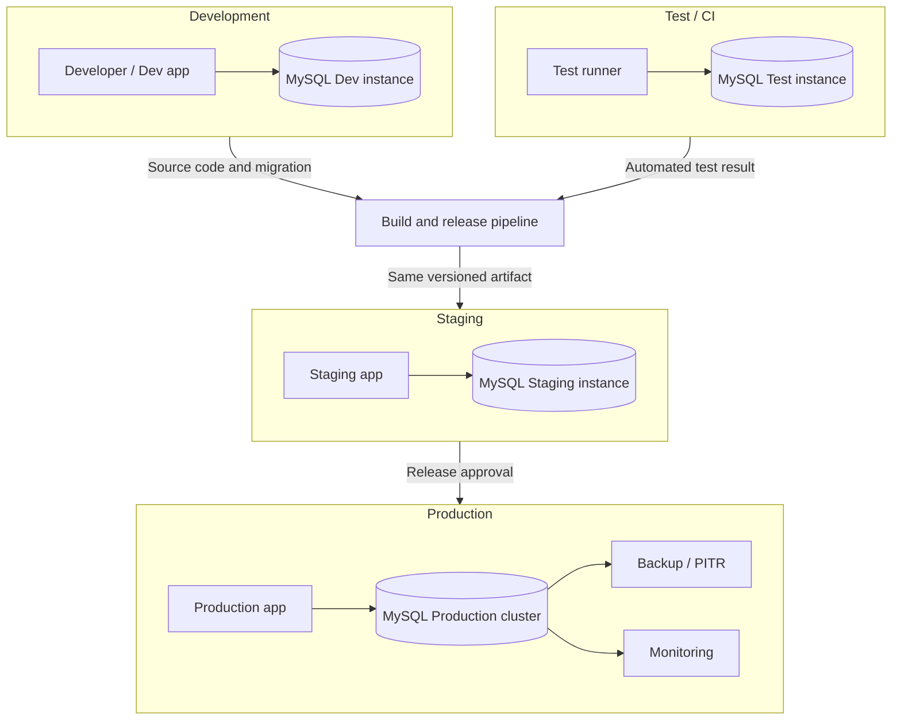
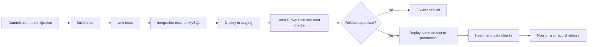

# Tách môi trường phát triển, kiểm thử và vận hành

## Mục tiêu bài học

Sau bài này, bạn có thể:

- Giải thích vai trò của môi trường phát triển (development), kiểm thử (test/QA), tiền vận hành (staging) và vận hành chính thức (production).
- Thiết kế ranh giới riêng cho từng môi trường MySQL: instance, database, tài khoản, mạng, cấu hình và dữ liệu.
- Quản lý cấu hình kết nối và bí mật mà không đưa thông tin nhạy cảm vào mã nguồn.
- Kiểm thử schema, migration, truy vấn, transaction và quyền truy cập trên MySQL gần với môi trường đích.
- Đưa thay đổi từ phát triển đến production theo một quy trình có thể lặp lại, quan sát và phục hồi.
- Chọn chính sách dữ liệu, backup, restore và giám sát phù hợp với mức độ quan trọng của từng môi trường.

Một hệ thống MySQL có thể chạy tốt trên máy lập trình viên nhưng gặp lỗi khi triển khai: phiên bản server khác nhau, collation không tương thích, tài khoản thiếu quyền, migration làm gián đoạn ứng dụng hoặc dữ liệu kiểm thử không đại diện cho dữ liệu thực tế. Tách môi trường giúp phát hiện những khác biệt này trước khi chúng tác động đến dữ liệu nghiệp vụ.

## 1. Vì sao phải tách môi trường?

Mỗi giai đoạn phát triển có mục đích và mức độ rủi ro khác nhau. Khi tất cả ứng dụng cùng kết nối vào một database, một thao tác thử nghiệm như DROP TABLE, chạy migration chưa hoàn chỉnh hoặc nạp dữ liệu mẫu có thể ảnh hưởng đến người khác. Ngược lại, nếu môi trường kiểm thử quá khác production, kết quả kiểm thử không đủ tin cậy để dự đoán hành vi khi phát hành.

Một môi trường nên được xem là một đích triển khai độc lập, có endpoint, cấu hình, tài khoản, dữ liệu và vòng đời riêng. Với hệ thống quan trọng, cách ly bằng các MySQL instance hoặc cụm riêng giúp giới hạn lỗi và tranh chấp tài nguyên. Trong máy cá nhân, có thể dùng nhiều database trong cùng một instance để thực hành; cách này thuận tiện nhưng không tạo ra ranh giới bảo mật hay tài nguyên mạnh như instance riêng.

### Các môi trường thường gặp

| Môi trường | Mục đích | Dữ liệu và quyền | Tiêu chí hoàn thành |
|---|---|---|---|
| Development (dev) | Viết tính năng, thử SQL, debug schema và migration | Dữ liệu giả lập; lập trình viên có quyền thay đổi schema trên phạm vi dev | Tính năng chạy được, truy vấn và migration có thể lặp lại |
| Test / QA | Chạy kiểm thử tự động, tích hợp, hồi quy và kiểm tra nghiệp vụ | Bộ dữ liệu kiểm thử có kiểm soát; tài khoản kiểm thử theo đúng quyền ứng dụng | Bộ kiểm thử đạt, lỗi có thể tái hiện |
| Staging / Pre-production | Diễn tập bản phát hành trên cấu hình gần production | Dữ liệu tổng hợp hoặc đã khử nhận dạng; quyền hạn và luồng triển khai tương tự production | Migration, cấu hình, hiệu năng và quy trình vận hành được xác nhận |
| Production (prod) | Phục vụ người dùng và dữ liệu thật | Dữ liệu nghiệp vụ; quyền tối thiểu, kiểm soát thay đổi chặt chẽ | Dịch vụ đáp ứng SLO, dữ liệu an toàn và có thể phục hồi |

Dev, test và staging không nhất thiết phải là ba cụm máy lớn. Dự án nhỏ có thể dùng một máy cá nhân cho dev, instance tạm thời trong CI cho test và một cụm staging dùng chung. Điều cần giữ là mỗi môi trường có danh tính, dữ liệu, quyền và cấu hình được xác định rõ.

**Test và staging có mục đích khác nhau.** Test ưu tiên phát hiện lỗi bằng các trường hợp kiểm thử lặp lại và có thể chạy thường xuyên. Staging ưu tiên mô phỏng một lần phát hành thực tế: phiên bản ứng dụng, cấu hình, quyền, topology, migration và các bước vận hành gần giống production.

## 2. Thiết kế ranh giới giữa các môi trường

Một kiến trúc đơn giản có thể biểu diễn như sau:



Đây là sơ đồ logic: pipeline chuyển phiên bản ứng dụng và migration đã được quản lý qua các môi trường. Dữ liệu production không đi theo chiều ngược lại vào dev hoặc test dưới dạng bản sao nguyên trạng.

### 2.1. Instance và database

Với production, nên dành instance hoặc cụm riêng có tài nguyên, endpoint, backup, giám sát và chính sách truy cập riêng. Không nên đặt database production cạnh database thử nghiệm trên cùng instance rồi xem tên database là ranh giới an toàn duy nhất. Một câu lệnh chạy nhầm, tài khoản có quyền quá rộng hoặc workload test nặng có thể tác động đến toàn bộ instance.

Trong dev, một instance MySQL cục bộ có thể chứa nhiều database để tiết kiệm tài nguyên. Ví dụ:

- shop_dev: dữ liệu thử nghiệm cá nhân.
- shop_test: schema và fixture cho kiểm thử thủ công.
- shop_ci_12345: database tạm cho một lần chạy CI.

Trong CI, ưu tiên instance hoặc database tạm có tên duy nhất cho mỗi job, sau đó hủy khi job kết thúc. Nếu nhiều job cùng ghi vào một database dùng chung, kiểm thử có thể gây nhiễu, phụ thuộc thứ tự chạy hoặc xóa dữ liệu của nhau.

### 2.2. Tài khoản và quyền

Mỗi môi trường cần tài khoản riêng. Không dùng chung một tài khoản quản trị cho ứng dụng, developer, test runner và công cụ migration.

Một mô hình thường dùng:

- Tài khoản runtime của ứng dụng chỉ có quyền DML cần thiết trên schema ứng dụng.
- Tài khoản migration được cấp quyền DDL cần thiết và chỉ được dùng trong bước triển khai schema.
- Tài khoản đọc báo cáo chỉ có quyền đọc trên các đối tượng được phép.
- Tài khoản quản trị được giới hạn cho người vận hành và công cụ quản trị, có kiểm soát truy cập riêng.

Ví dụ minh họa quyền trên môi trường production:

```sql
-- Host pattern chỉ là ví dụ; hãy thay bằng nguồn kết nối thực tế.
CREATE USER 'shop_runtime'@'10.20.%'
  IDENTIFIED BY '<secret-from-secret-manager>';

GRANT SELECT, INSERT, UPDATE, DELETE
  ON shop_prod.*
  TO 'shop_runtime'@'10.20.%';

CREATE USER 'shop_migrator'@'10.30.%'
  IDENTIFIED BY '<secret-from-secret-manager>';

GRANT ALTER, CREATE, DROP, INDEX, REFERENCES
  ON shop_prod.*
  TO 'shop_migrator'@'10.30.%';

SHOW GRANTS FOR 'shop_runtime'@'10.20.%';
```

Đây là ví dụ về phân tách vai trò, không phải danh sách quyền áp dụng cho mọi ứng dụng. Nếu ứng dụng cần gọi stored procedure, tạo temporary table hoặc dùng một tính năng khác, hãy cấp đúng quyền bổ sung sau khi xác định nhu cầu. Không cấp ALL PRIVILEGES chỉ để làm cho lỗi quyền biến mất. Host pattern cũng phải khớp với mạng thực tế; không sao chép nguyên ví dụ 10.20.% vào hệ thống của bạn.

Dev có thể cho developer quyền DDL trên database dev để thử nghiệm. Quyền đó không nên được mang sang tài khoản runtime ở test, staging hay production. Hãy kiểm thử ứng dụng bằng đúng nhóm quyền mà nó sẽ có khi vận hành.

Kiểm tra tài khoản và quyền của kết nối hiện tại:

```sql
SELECT USER() AS connection_identity,
       CURRENT_USER() AS matched_account;

SHOW GRANTS FOR CURRENT_USER();
```

USER() thể hiện danh tính kết nối client gửi lên; CURRENT_USER() cho biết tài khoản MySQL được dùng để kiểm tra quyền. Khi debug lỗi Access denied, hai giá trị này giúp xác định server đã khớp tài khoản nào.

### 2.3. Mạng và endpoint

Đặt MySQL trong mạng riêng và chỉ cho phép ứng dụng hoặc máy quản trị được chỉ định kết nối. Production thường không cần mở cổng MySQL trực tiếp ra Internet. Developer truy cập qua VPN, bastion hoặc cơ chế truy cập có kiểm soát. Test runner chỉ được phép kết nối đến instance test; pipeline triển khai chỉ nhận quyền đến đúng môi trường mà nó đang triển khai.

Đặt tên endpoint dễ nhận diện, chẳng hạn mysql-dev.internal, mysql-test.internal, mysql-staging.internal và mysql-prod.internal. Tên minh họa này không thay thế cấu hình DNS, firewall hoặc chứng chỉ TLS. Trước khi chạy một lệnh có thể thay đổi dữ liệu, người vận hành cần xác định rõ endpoint, database và tài khoản đang sử dụng.

## 3. Quản lý cấu hình kết nối theo môi trường

Mã ứng dụng nên đọc cấu hình kết nối từ biến môi trường hoặc hệ thống cấu hình được quản lý. Không ghi host, username, password hay khóa truy cập production trực tiếp vào mã nguồn, file cấu hình được commit hoặc log.

Một bộ cấu hình kết nối thường gồm:

| Thuộc tính | Ví dụ | Điều cần kiểm soát |
|---|---|---|
| Host | mysql-dev.internal | Endpoint thuộc đúng môi trường |
| Port | 3306 | Cổng MySQL hoặc cổng được proxy chuyển tiếp |
| Database | shop_dev | Tên database được phép truy cập |
| Username | shop_runtime_dev | Tài khoản riêng theo môi trường và vai trò |
| Password | Secret được cấp lúc chạy | Lưu trong secret manager hoặc kho bí mật của nền tảng |
| TLS | Bật ở kết nối qua mạng | Xác minh chứng chỉ và tên máy chủ theo chính sách |
| Time zone | UTC hoặc giá trị đã thống nhất | Tránh sai lệch khi ghi/đọc thời điểm |
| Charset / collation | utf8mb4 và collation đã chọn | Giữ hành vi so sánh chuỗi nhất quán |

Ví dụ cấu hình cho môi trường dev có thể được nạp vào tiến trình trước khi khởi động:

```text
APP_ENV=development
DB_HOST=127.0.0.1
DB_PORT=3307
DB_NAME=shop_dev
DB_USER=shop_runtime_dev
DB_PASSWORD=<local-development-secret>
```

Đây là ví dụ minh họa cách đặt tên cấu hình. File chứa password chỉ dùng cục bộ và phải được loại khỏi Git. Ở staging và production, lấy secret từ secret manager hoặc cơ chế cấp bí mật của nền tảng; tránh đưa secret vào image, command line, log hay artifact build.

Ứng dụng có thể xây dựng JDBC URL từ các giá trị trên, nhưng username và password nên được truyền riêng qua cơ chế cấu hình của thư viện kết nối:

```text
jdbc:mysql://${DB_HOST}:${DB_PORT}/${DB_NAME}
```

Không dùng một giá trị mặc định âm thầm trỏ đến production khi biến cấu hình bị thiếu. Ứng dụng nên dừng khởi động với thông báo rõ ràng nếu thiếu cấu hình bắt buộc. Điều này ngăn một máy dev vô tình ghi vào database thật chỉ vì file cấu hình cục bộ chưa được thiết lập.

### 3.1. Giữ hành vi MySQL tương thích

Các môi trường nên dùng phiên bản MySQL tương thích với production. Nếu production chạy MySQL 8.4 LTS, kiểm thử tích hợp nên dùng cùng dòng phiên bản hoặc phiên bản đã được xác nhận tương thích. Không dùng tag container trôi nổi như latest cho pipeline cần kết quả tái lập; hãy pin tag patch cụ thể hoặc image digest đã được phê duyệt và cập nhật có chủ đích. Tag mysql:8.4 trong ví dụ Compose bên dưới minh họa dòng LTS; khi đưa vào pipeline cần thay bằng tag patch hoặc digest cố định.

Ngoài phiên bản, hãy kiểm soát những thiết lập ảnh hưởng đến kết quả SQL:

- sql_mode: chế độ kiểm tra dữ liệu và cú pháp.
- Character set và collation: cách lưu, so sánh và sắp xếp chuỗi.
- Time zone: cách diễn giải và hiển thị thời gian.
- Storage engine: ví dụ InnoDB cho table cần transaction.
- autocommit và isolation level: ảnh hưởng đến ranh giới transaction và truy cập đồng thời.
- Giới hạn kết nối, timeout, packet size và cấu hình connection pool.

Không nhất thiết mọi thông số tài nguyên của dev phải giống production. Nhưng các khác biệt ảnh hưởng đến ngữ nghĩa SQL, transaction, quyền hoặc migration cần được phát hiện và kiểm thử. Nếu staging cố ý khác production, hãy ghi rõ lý do và đánh giá rủi ro.

Có thể thu thập một dấu vân tay cấu hình từ kết nối hiện tại:

```sql
SELECT VERSION() AS mysql_version,
       @@hostname AS server_host,
       @@port AS server_port,
       @@datadir AS data_directory,
       @@sql_mode AS sql_mode,
       @@time_zone AS session_time_zone,
       @@character_set_server AS server_charset,
       @@collation_server AS server_collation,
       @@autocommit AS autocommit_mode;
```

So sánh kết quả giữa test, staging và production giúp phát hiện khác biệt cấu hình. Không công bố thông tin nhạy cảm của hạ tầng trong log hoặc báo cáo bên ngoài; chỉ lưu các trường cần thiết cho mục đích chẩn đoán.

## 4. Tạo môi trường thực hành cục bộ có thể tái lập

Docker Compose là một cách thuận tiện để mỗi developer có instance MySQL riêng. Ví dụ dưới đây chỉ dành cho môi trường local:

```yaml
services:
  mysql:
    image: mysql:8.4
    command:
      - --character-set-server=utf8mb4
      - --collation-server=utf8mb4_0900_ai_ci
    environment:
      MYSQL_DATABASE: shop_dev
      MYSQL_USER: shop_runtime_dev
      MYSQL_PASSWORD: ${MYSQL_APP_PASSWORD:?set MYSQL_APP_PASSWORD}
      MYSQL_ROOT_PASSWORD: ${MYSQL_ROOT_PASSWORD:?set MYSQL_ROOT_PASSWORD}
    ports:
      - "127.0.0.1:${MYSQL_PORT:-3307}:3306"
    volumes:
      - mysql_dev_data:/var/lib/mysql
    healthcheck:
      test: ["CMD", "mysqladmin", "ping", "-h", "127.0.0.1", "--silent"]
      interval: 5s
      timeout: 3s
      retries: 20

volumes:
  mysql_dev_data:
```

Lưu cấu hình bí mật cục bộ trong file .env.dev không được commit:

```text
MYSQL_PORT=3307
MYSQL_APP_PASSWORD=<local-app-password>
MYSQL_ROOT_PASSWORD=<local-root-password>
```

Khởi động và xem trạng thái:

```bash
docker compose --project-name shop-dev --env-file .env.dev up -d
docker compose --project-name shop-dev ps
docker compose --project-name shop-dev logs mysql
```

Đặt project name khác cho mỗi môi trường local để Compose tạo nhóm container và named volume riêng. Ví dụ shop-test có thể dùng cổng host khác và file cấu hình riêng. Không chia sẻ volume dữ liệu giữa các instance MySQL độc lập.

Một số chi tiết cần nhớ:

- Biến MYSQL_DATABASE, MYSQL_USER và password của image MySQL được dùng trong quá trình khởi tạo data directory trống. Sửa file .env.dev sau khi volume đã được khởi tạo không tự động đổi mật khẩu hay tạo lại database bên trong volume cũ.
- Nếu cần làm lại dữ liệu local, hãy xác nhận đúng project và volume dev trước khi xóa. Xóa volume sẽ xóa dữ liệu trong đó.
- Cổng host được bind vào 127.0.0.1 để chỉ máy local truy cập trực tiếp trong ví dụ này.
- Cấu hình trên không phải mẫu triển khai production. Production cần secret management, mạng riêng, backup, giám sát, kế hoạch HA và kiểm soát vận hành phù hợp.

Sau khi instance sẵn sàng, kết nối bằng client và xác nhận đúng đích:

```bash
mysql --host=127.0.0.1 --port=3307 --user=shop_runtime_dev --password shop_dev
```

Sau đó chạy:

```sql
SELECT VERSION(), @@hostname, @@port, DATABASE();
SHOW TABLES;
```

Không chạy migration hoặc lệnh xóa dữ liệu cho đến khi đã xác nhận endpoint và database.

## 5. Quản lý schema và migration đồng nhất

Schema của database cần được quản lý như mã nguồn. Lưu migration SQL trong repository, đặt tên có thứ tự và không sửa âm thầm một migration đã được áp dụng ở môi trường dùng chung.

Ví dụ cấu trúc:

```text
database/
  migrations/
    V001__create_customer.sql
    V002__create_order.sql
    V003__add_order_status_index.sql
  seeds/
    dev/
    test/
```

Tên file chỉ là quy ước minh họa; có thể dùng Flyway, Liquibase hoặc công cụ migration khác. Mỗi migration cần được review, chạy tự động trong CI và có lịch sử áp dụng rõ ràng. Test và staging nên được dựng từ migration giống production, thay vì dựa vào một file dump schema do developer chỉnh tay.

Một quy trình migration cơ bản:

1. Tạo migration trong nhánh phát triển và kiểm tra trên database dev sạch.
2. CI tạo instance test tạm, chạy toàn bộ migration từ đầu rồi chạy kiểm thử.
3. Staging chạy migration theo quy trình phát hành dự kiến và xác nhận ứng dụng tương thích.
4. Production áp dụng migration theo cửa sổ hoặc chiến lược triển khai đã được phê duyệt, có backup và kế hoạch phục hồi phù hợp.
5. Ghi nhận phiên bản schema đã áp dụng và kiểm tra ứng dụng sau triển khai.

### 5.1. Thiết kế migration tương thích khi ứng dụng đang chạy

Không phải migration nào cũng có thể rollback đơn giản. Nhiều câu lệnh DDL trong MySQL gây implicit commit; vì vậy không thể giả định một chuỗi ALTER TABLE sẽ được hoàn tác nguyên tử bằng ROLLBACK. Hãy thiết kế migration có thể tiến lên an toàn và hạn chế thay đổi phá vỡ tương thích.

Ví dụ, khi đổi tên cột customer_name thành display_name, có thể chia thành các bước:

1. Thêm cột mới display_name nhưng vẫn giữ cột cũ.
2. Triển khai ứng dụng có thể đọc và ghi tương thích với cả hai cột; backfill dữ liệu theo lô và kiểm tra kết quả.
3. Chuyển toàn bộ luồng đọc sang cột mới, theo dõi lỗi và dữ liệu lệch.
4. Chỉ xóa cột cũ trong một lần phát hành sau, khi chắc chắn không còn phiên bản ứng dụng nào phụ thuộc vào nó.

Cách tiếp cận mở rộng rồi thu hẹp (expand/contract) giúp ứng dụng cũ và mới có thời gian cùng hoạt động. Nó đặc biệt hữu ích khi deploy nhiều instance ứng dụng hoặc cần rollback phiên bản ứng dụng nhanh. Trước migration lớn, hãy thử trên staging với lượng dữ liệu gần thực tế và đo thời gian, khóa cũng như tác động lên truy vấn.

Index cũng là thay đổi schema. Kiểm tra kế hoạch truy vấn bằng EXPLAIN, độ chọn lọc của cột và chi phí ghi thêm index. Một index mới có thể giúp truy vấn đọc nhưng làm tăng dung lượng và chi phí INSERT, UPDATE, DELETE. Không tạo index trong production chỉ dựa trên cảm giác rằng nhiều index sẽ nhanh hơn.

## 6. Dữ liệu kiểm thử phải an toàn và có ý nghĩa

Dữ liệu quyết định chất lượng kiểm thử. Một bộ dữ liệu chỉ gồm vài hàng đơn giản có thể không phát hiện truy vấn chậm, lỗi phân trang, trùng khóa, deadlock hoặc vấn đề với dữ liệu biên.

Ưu tiên dữ liệu tổng hợp (synthetic data) có cấu trúc và phân bố gần với nghiệp vụ. Bộ dữ liệu nên có:

- Dữ liệu ít, nhiều và dữ liệu ở các ranh giới kiểu số, ngày giờ, chuỗi.
- Bản ghi liên quan qua primary key và foreign key.
- Trường hợp trùng lặp, NULL, giá trị dài, ký tự Unicode và dữ liệu không hợp lệ.
- Phân bố có độ lệch để kiểm tra index và kế hoạch thực thi.
- Tập dữ liệu đủ lớn cho bài kiểm thử hiệu năng trong môi trường riêng.

Không sao chép nguyên dữ liệu production sang dev hoặc test. Nếu cần dữ liệu gần thực tế, phải có quy trình phê duyệt, giảm thiểu trường dữ liệu, khử nhận dạng hoặc tổng hợp dữ liệu, kiểm soát truy cập và thời hạn lưu trữ. Việc đổi tên cột hoặc che một vài trường không tự động làm dữ liệu trở nên vô danh nếu vẫn có thể liên kết ngược đến cá nhân.

Seed data nên có thể nạp lại nhiều lần theo cách dự đoán được. Mỗi test nên tạo dữ liệu riêng hoặc dùng transaction rollback khi phù hợp. Tránh để test phụ thuộc vào dữ liệu còn sót từ lần chạy trước. Khi kiểm thử cạnh tranh, cần tạo nhiều session thực sự để quan sát lock wait, deadlock và isolation; chạy tuần tự không thể thay thế loại kiểm thử này.

### 6.1. Kiểm thử trên MySQL thật

Mock repository có thể hữu ích cho unit test, nhưng không thay thế kiểm thử tích hợp với MySQL. Các hành vi như collation, constraint, locking, transaction, JSON, index và optimizer phụ thuộc engine và phiên bản server. Kiểm thử tích hợp nên khởi động MySQL tương thích, chạy migration và thực thi câu SQL thật.

Một bộ kiểm thử hữu ích thường gồm:

| Nhóm kiểm thử | Ví dụ |
|---|---|
| Schema và migration | Tạo database sạch, nâng cấp từ schema phiên bản trước, xác nhận index và constraint |
| CRUD và ràng buộc | Kiểm tra primary key, foreign key, unique, NOT NULL và kiểu dữ liệu |
| Transaction | Commit, rollback, lỗi giữa chừng và tính nguyên tử của nghiệp vụ |
| Đồng thời | Hai session cập nhật cùng bản ghi, lock wait, deadlock và retry |
| Truy vấn | Kết quả đúng, EXPLAIN, index được dùng như dự kiến |
| Quyền | Tài khoản runtime thực hiện được thao tác hợp lệ và bị từ chối với DDL ngoài quyền |
| Tương thích | Phiên bản MySQL, collation, time zone và sql_mode gần production |

Kiểm thử hiệu năng và tải lớn nên chạy trên môi trường được dành riêng cho mục đích đó. Không chạy benchmark nặng trên production hoặc trên instance test dùng chung với các job khác.

## 7. Quy trình đưa thay đổi đến production

Một pipeline có thể tổ chức theo luồng sau:



Các nguyên tắc quan trọng:

- **Build một lần, triển khai nhiều nơi:** artifact được kiểm thử ở staging chính là artifact đưa lên production. Không build một phiên bản khác chỉ dành cho production.
- **Cấu hình tách rời artifact:** endpoint, credentials và tham số môi trường được cấp lúc triển khai.
- **Migration có lịch sử:** biết schema đang ở phiên bản nào và phiên bản kế tiếp sẽ thay đổi điều gì.
- **Kiểm tra trước và sau deploy:** kiểm tra backup, quyền, kết nối, migration, health check và các chỉ số sau triển khai.
- **Có người chịu trách nhiệm:** xác định người thực hiện, người phê duyệt và cách liên lạc khi có sự cố.
- **Không dùng dev làm nguồn dữ liệu production:** chỉ code, migration và artifact đã qua kiểm soát được đưa qua pipeline.

Một lần triển khai production thường gồm chuẩn bị (xác nhận phiên bản, backup, dung lượng, quyền và kế hoạch), áp dụng migration tương thích, triển khai ứng dụng, chạy smoke test, theo dõi lỗi và ghi nhận kết quả. Nếu phát hiện vấn đề, có thể rollback ứng dụng khi schema vẫn tương thích; với thay đổi dữ liệu hoặc DDL, nhiều trường hợp cần sửa tiến (roll forward) thay vì cố khôi phục ngược bằng một lệnh rollback.

## 8. Backup, restore và bảo vệ dữ liệu giữa các môi trường

Mỗi môi trường có nhu cầu bảo vệ dữ liệu khác nhau:

| Môi trường | Cách bảo vệ thường phù hợp |
|---|---|
| Dev | Có thể dựng lại từ migration và seed; sao lưu nếu có dữ liệu thử nghiệm khó tạo lại |
| Test / CI | Dữ liệu tạm; tạo mới cho mỗi job và hủy sau khi chạy |
| Staging | Backup trước diễn tập migration quan trọng; dữ liệu được quản lý và có thể tái tạo |
| Production | Backup định kỳ, bản sao ở vị trí độc lập, mã hóa, quyền truy cập hạn chế và kiểm tra phục hồi |

Với production, chính sách backup phải dựa trên hai mục tiêu:

- **RPO (Recovery Point Objective):** chấp nhận mất tối đa bao nhiêu dữ liệu theo thời gian.
- **RTO (Recovery Time Objective):** dịch vụ cần được khôi phục trong bao lâu.

MySQL có thể dùng logical backup, physical backup và binary log để hỗ trợ phục hồi đến một thời điểm (point-in-time recovery, PITR). Lựa chọn phụ thuộc kích thước dữ liệu, thời gian phục hồi, topology và công cụ vận hành. Backup chỉ có ý nghĩa khi có thể restore; hãy định kỳ phục hồi thử trên môi trường cô lập, đo thời gian và xác nhận dữ liệu sau phục hồi.

Khi cần dựng staging từ production, hãy đưa dữ liệu qua quy trình khử nhận dạng hoặc tạo dữ liệu tổng hợp trước khi cấp quyền cho người kiểm thử. Bản backup chứa dữ liệu nhạy cảm phải được bảo vệ như dữ liệu production: mã hóa, kiểm soát quyền đọc, ghi nhận truy cập và xóa theo thời hạn lưu trữ. Không gửi dump database qua kênh chat hoặc lưu vào laptop cá nhân không được quản lý.

## 9. Giám sát và xử lý sự cố theo môi trường

Mỗi môi trường cần mức giám sát tương ứng với mục đích. Dev cần log đủ để debug; CI cần lưu log và kết quả test để tái hiện lỗi; staging cần kiểm tra những tín hiệu dùng cho quyết định phát hành; production cần cảnh báo và quy trình trực sự cố.

Các tín hiệu MySQL nên quan sát gồm:

- Trạng thái kết nối: số connection, connection error, thread và tình trạng pool.
- Hiệu năng truy vấn: slow query, latency, rows examined, kế hoạch thực thi bất thường.
- Đồng thời: lock wait, deadlock, transaction chạy lâu và transaction chưa kết thúc.
- Tài nguyên: CPU, memory, disk I/O, dung lượng data/log và tốc độ tăng dữ liệu.
- Khả năng sẵn sàng: uptime, lỗi server, trạng thái replica và replication lag nếu có.
- Backup: thời điểm backup gần nhất, kết quả job và lần restore thử gần nhất.

Không đặt cảnh báo production dựa trên một con số tùy ý áp dụng cho mọi hệ thống. Ngưỡng nên gắn với baseline, tải bình thường và SLO. Cảnh báo cần chỉ ra môi trường, instance, dấu hiệu, mức độ ảnh hưởng và hướng xử lý ban đầu.

Khi nhận thông báo “ứng dụng không kết nối được database”, hãy đi theo trình tự:

1. Xác nhận ứng dụng đang chạy với cấu hình môi trường nào.
2. Kiểm tra host, port, database và tài khoản đã được nạp vào tiến trình.
3. Kiểm tra DNS, network policy, firewall và TLS.
4. Kiểm tra MySQL instance có sẵn sàng, còn dung lượng và chấp nhận kết nối không.
5. Kiểm tra tài khoản được khớp, quyền và giới hạn kết nối.
6. Kiểm tra log ứng dụng, error log MySQL và thời điểm lỗi có trùng với deploy hoặc migration không.

Đừng vội tăng max_connections khi gặp lỗi hết kết nối. Hãy xác định pool có rò rỉ connection, transaction bị giữ quá lâu, truy vấn chậm hay tải thực sự tăng. Tương tự, khi truy vấn chậm chỉ ở production, hãy so sánh dữ liệu, thống kê, index, phiên bản, cấu hình và workload trước khi thay đổi tham số server.

## 10. Checklist trước khi cho phép một bản phát hành

- [ ] Ứng dụng và migration đã qua kiểm thử trên phiên bản MySQL tương thích.
- [ ] Staging dùng cấu hình kết nối, charset, collation, time zone và quyền gần production.
- [ ] Tài khoản runtime không có quyền quản trị hoặc DDL ngoài nhu cầu.
- [ ] Không có secret trong repository, image, log hoặc artifact.
- [ ] Dữ liệu staging/test là dữ liệu tổng hợp hoặc đã được xử lý theo chính sách.
- [ ] Migration có thứ tự, được review và có cách xử lý khi triển khai thất bại.
- [ ] Đã xác nhận backup gần nhất và khả năng restore phù hợp với thay đổi.
- [ ] Có kế hoạch triển khai, người phụ trách, smoke test và tiêu chí dừng.
- [ ] Dashboard và cảnh báo production có thể phát hiện lỗi sau triển khai.

## 11. Bài tập thực hành

### Bài 1: Tạo hai môi trường local độc lập

Dùng Docker Compose tạo hai instance: shop-dev và shop-test. Đặt project name, cổng host, database và tài khoản riêng. Xác nhận hai instance có endpoint và data directory khác nhau. Tạo một table trong dev và kiểm tra table đó không xuất hiện trong test.

### Bài 2: Kiểm tra ranh giới quyền

Tạo tài khoản runtime chỉ có quyền SELECT, INSERT, UPDATE, DELETE trên database thử nghiệm. Xác nhận các thao tác dữ liệu cần thiết thành công, nhưng CREATE TABLE và DROP TABLE bị từ chối. Tạo tài khoản migration riêng và kiểm tra quyền DDL của tài khoản đó.

### Bài 3: Kiểm thử migration từ đầu

Tạo hai migration: một migration tạo table khách hàng và một migration tạo table đơn hàng có foreign key. Chạy migration trên database sạch, nạp seed data, chạy test constraint và kiểm tra SHOW CREATE TABLE. Sau đó dựng lại database từ đầu để xác nhận quy trình có thể lặp lại.

### Bài 4: Diễn tập triển khai staging

Tạo một thay đổi schema theo cách expand/contract. Chạy migration, triển khai phiên bản ứng dụng tương thích, kiểm tra dữ liệu và truy vấn, rồi ghi lại các bước cần thiết để quay về phiên bản ứng dụng trước. Xác định bước nào cần roll forward nếu migration đã thay đổi dữ liệu.

### Bài 5: Viết quy trình phục hồi

Chọn một database thử nghiệm, tạo backup, phục hồi vào một instance khác và xác nhận số bảng, số hàng cùng một vài truy vấn nghiệp vụ. Ghi lại thời gian backup, restore và những bước xác minh dữ liệu.

## Kết luận

Tách môi trường là một phần của thiết kế và vận hành MySQL. Dev cần linh hoạt, test cần tái lập, staging cần mô phỏng phát hành và production cần bảo vệ dữ liệu cùng khả năng phục hồi. Khi endpoint, tài khoản, cấu hình, migration, dữ liệu và giám sát được quản lý riêng cho từng môi trường, nhóm phát triển có thể phát hiện sai lệch sớm và triển khai thay đổi database có kiểm soát.

