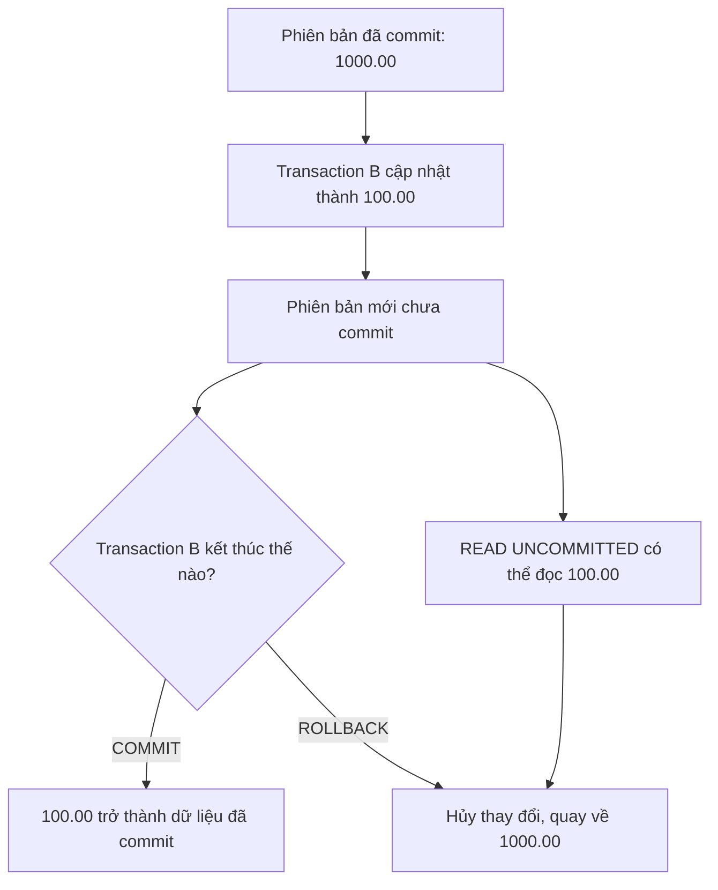

# READ UNCOMMITTED và dữ liệu chưa commit

`READ UNCOMMITTED` là mức cô lập giao dịch thấp nhất trong MySQL. Với InnoDB, một truy vấn đọc thông thường ở mức này có thể nhìn thấy thay đổi mà transaction khác vừa ghi nhưng chưa `COMMIT`. Nếu transaction ghi sau đó `ROLLBACK`, giá trị mà transaction đọc đã không bao giờ trở thành dữ liệu được xác nhận. Việc đọc một thay đổi chưa commit của transaction khác được gọi là **dirty read**.

Dirty read có thể làm báo cáo hiển thị số dư, số lượng tồn kho hoặc trạng thái đơn hàng tạm thời rồi biến mất. Khi nhiều hàng được cập nhật trong cùng một transaction, truy vấn còn có thể nhìn thấy một phần thay đổi trong khi các hàng còn lại chưa được cập nhật. Vì vậy, `READ UNCOMMITTED` chỉ phù hợp khi ứng dụng chấp nhận dữ liệu tạm thời và không nhất quán; nó không phải lựa chọn mặc định để tăng tốc truy vấn.

Bài học thuộc module **DATABASE_MYSQL**. Module hướng tới việc làm chủ MySQL từ thiết kế bảng, kiểu dữ liệu, khóa và truy vấn SQL đến index, transaction và kiểm soát đồng thời; đồng thời thực hành đọc kế hoạch thực thi, tối ưu truy vấn, phân quyền, sao lưu và xử lý các vấn đề vận hành cơ sở dữ liệu quan hệ. Trong chương **MVCC và mức cô lập**, bài này tập trung vào `READ UNCOMMITTED`, cách đọc dữ liệu chưa commit và các rủi ro khi dùng mức cô lập này với InnoDB.

## 1. Mức cô lập giao dịch là gì?

Một transaction có thể chạy đồng thời với transaction khác. Nếu hai transaction cùng đọc hoặc ghi những hàng liên quan, kết quả mà mỗi transaction nhìn thấy phụ thuộc vào mức cô lập và loại câu lệnh được dùng.

SQL định nghĩa bốn mức cô lập phổ biến:

1. `READ UNCOMMITTED`
2. `READ COMMITTED`
3. `REPEATABLE READ`
4. `SERIALIZABLE`

Mức cô lập xác định những thay đổi nào từ transaction khác được phép nhìn thấy và cách các lần đọc tương tác với ghi đồng thời. Nó không thay thế transaction, constraint, khóa hàng hoặc quy tắc nghiệp vụ.

Trong MySQL, InnoDB là storage engine hỗ trợ transaction và MVCC. Mặc định của InnoDB là `REPEATABLE READ`, trừ khi cấu hình server hoặc session thay đổi.

## 2. MVCC và phiên bản hàng trong InnoDB

MVCC (Multi-Version Concurrency Control) cho phép InnoDB duy trì nhiều phiên bản logic của một hàng để các truy vấn đọc có thể nhìn phiên bản phù hợp mà không phải khóa mọi hàng đang đọc. Các ví dụ trong bài giả định bảng dùng InnoDB; storage engine không hỗ trợ transaction không có cùng bảo đảm rollback và isolation.

Khi một transaction cập nhật hàng InnoDB, engine ghi thông tin cần thiết vào undo log để có thể khôi phục phiên bản cũ. Các phiên bản này được liên kết với thông tin transaction. Với consistent read ở những mức cô lập dùng snapshot, InnoDB tạo một read view để xác định transaction nào đã commit và phiên bản hàng nào được phép nhìn thấy.

Ví dụ một hàng có số dư ban đầu `1000.00`:



Ở `READ UNCOMMITTED`, một `SELECT` không khóa thông thường có thể nhìn thấy thay đổi mới nhất kể cả khi transaction ghi chưa commit. Các lần đọc không dựa trên snapshot nhất quán ổn định. Các mức `READ COMMITTED` và `REPEATABLE READ` áp dụng quy tắc snapshot khác nhau để ngăn dirty read.

MVCC không có nghĩa là mọi câu `SELECT` đều không khóa trong mọi tình huống. Cần phân biệt:

- **Consistent read:** truy vấn đọc thông thường, chẳng hạn `SELECT ... FROM ...`, dùng quy tắc nhìn phiên bản của MVCC và thường không khóa hàng được đọc.
- **Locking read:** truy vấn có `FOR SHARE` hoặc `FOR UPDATE`, lấy khóa để phối hợp với transaction ghi. Đây là current read, có hành vi khóa khác với consistent read.
- **Câu lệnh ghi:** `UPDATE`, `DELETE` và `INSERT` vẫn phải lấy các khóa cần thiết. `READ UNCOMMITTED` không tắt khóa ghi.

Một transaction luôn nhìn thấy thay đổi do chính nó thực hiện, kể cả thay đổi đó chưa commit. Đó không phải dirty read. Dirty read là khi transaction A nhìn thấy thay đổi chưa commit do transaction B thực hiện.

## 3. Dirty read xảy ra như thế nào?

Giả sử transaction B cập nhật số dư từ `1000.00` thành `100.00` nhưng chưa commit. Transaction A chạy `SELECT` ở `READ UNCOMMITTED` và đọc được `100.00`. Sau đó B rollback, số dư thực tế trở lại `1000.00`.

Giá trị `100.00` mà A đã đọc là dữ liệu chưa được xác nhận. Nếu A dùng giá trị này để quyết định từ chối thanh toán, gửi cảnh báo hoặc ghi một báo cáo, quyết định đó có thể sai dù cơ sở dữ liệu cuối cùng không hề lưu số dư `100.00`.

### 3.1. Dữ liệu thử nghiệm

Thực hiện trong một schema lab riêng. Tạo bảng một lần và nạp dữ liệu ban đầu:

```sql
CREATE TABLE ru_demo_accounts (
    account_id BIGINT NOT NULL,
    account_name VARCHAR(80) NOT NULL,
    balance DECIMAL(12, 2) NOT NULL,
    PRIMARY KEY (account_id)
) ENGINE = InnoDB;

INSERT INTO ru_demo_accounts (account_id, account_name, balance)
VALUES (1, 'Main account', 1000.00);

SELECT * FROM ru_demo_accounts;
```

Kết quả ban đầu:

| account_id | account_name | balance |
|---:|---|---:|
| 1 | Main account | 1000.00 |

Mở hai kết nối MySQL độc lập, gọi là **Session A** và **Session B**. Không chạy cả hai luồng trong cùng một connection vì mục tiêu là quan sát transaction đồng thời.

### 3.2. Session A: bật READ UNCOMMITTED

Chạy ở Session A, trước khi bắt đầu transaction:

```sql
SET SESSION TRANSACTION ISOLATION LEVEL READ UNCOMMITTED;

SELECT @@SESSION.transaction_isolation;

START TRANSACTION;
```

Giá trị trả về phải là `READ-UNCOMMITTED`. Transaction A hiện đã bắt đầu. Tạm dừng ở đây và chuyển sang Session B.

### 3.3. Session B: cập nhật nhưng chưa commit

Chạy ở Session B:

```sql
START TRANSACTION;

UPDATE ru_demo_accounts
SET balance = 100.00
WHERE account_id = 1;

SELECT balance
FROM ru_demo_accounts
WHERE account_id = 1;
```

Session B nhìn thấy thay đổi của chính nó là `100.00`. Chưa chạy `COMMIT` hoặc `ROLLBACK`; transaction B vẫn đang mở và đang giữ khóa ghi trên hàng.

### 3.4. Session A đọc dữ liệu chưa commit

Quay lại Session A và chạy một truy vấn đọc thông thường:

```sql
SELECT balance
FROM ru_demo_accounts
WHERE account_id = 1;
```

Ở `READ UNCOMMITTED`, InnoDB có thể trả về `100.00` dù Session B chưa commit. Truy vấn đọc thông thường này không phải locking read nên có thể đọc trong khi B vẫn giữ khóa ghi.

Giá trị này là dirty read: transaction A đã đọc một thay đổi chưa được transaction B xác nhận.

### 3.5. Session B rollback và Session A đọc lại

Chạy ở Session B:

```sql
ROLLBACK;
```

Sau đó quay lại Session A:

```sql
SELECT balance
FROM ru_demo_accounts
WHERE account_id = 1;
```

Kết quả lúc này là `1000.00`. Thay đổi thành `100.00` đã bị hủy. Session A có thể đọc một giá trị rồi sau đó thấy giá trị ấy biến mất ngay trong cùng transaction.

Kết thúc Session A:

```sql
COMMIT;
```

`COMMIT` ở A chỉ kết thúc transaction đọc của A; nó không khôi phục hay xác nhận thay đổi của B. B đã rollback thay đổi trước đó.

## 4. Dòng thời gian của dirty read

| Thời điểm | Session A (`READ UNCOMMITTED`) | Session B |
|---|---|---|
| T1 | `START TRANSACTION` | — |
| T2 | — | `START TRANSACTION` |
| T3 | — | `UPDATE balance = 100.00`, chưa commit |
| T4 | `SELECT balance` đọc `100.00` | Vẫn đang mở transaction |
| T5 | — | `ROLLBACK` |
| T6 | `SELECT balance` đọc lại `1000.00` | Đã kết thúc transaction |
| T7 | `COMMIT` | — |

**Điểm quyết định:** A đọc được phiên bản do B tạo ra trước khi B commit. Khi B rollback, giá trị A vừa đọc không còn tồn tại trong dữ liệu đã commit.

## 5. So sánh với READ COMMITTED

`READ COMMITTED` không cho phép một transaction đọc thay đổi chưa commit của transaction khác. Mỗi consistent read thông thường tạo một snapshot mới ở đầu câu lệnh, vì vậy hai câu `SELECT` trong cùng transaction có thể nhìn thấy hai trạng thái đã commit khác nhau nếu transaction khác commit ở giữa.

Lặp lại bài thực hành với Session A:

```sql
SET SESSION TRANSACTION ISOLATION LEVEL READ COMMITTED;
START TRANSACTION;
```

Session B cập nhật số dư thành `700.00` nhưng chưa commit:

```sql
START TRANSACTION;

UPDATE ru_demo_accounts
SET balance = 700.00
WHERE account_id = 1;
```

Trong khi B vẫn mở transaction, Session A chạy:

```sql
SELECT balance
FROM ru_demo_accounts
WHERE account_id = 1;
```

A đọc giá trị đã commit gần nhất là `1000.00`, không đọc `700.00` chưa commit. Bây giờ B chạy:

```sql
COMMIT;
```

Session A chạy lại câu `SELECT` trong transaction đang mở. Ở `READ COMMITTED`, câu lệnh mới có snapshot mới và có thể đọc `700.00` vừa được commit.

Kết thúc transaction A:

```sql
COMMIT;
```

Như vậy:

- `READ UNCOMMITTED`: có thể đọc `700.00` trước khi B commit.
- `READ COMMITTED`: chỉ đọc `700.00` sau khi B commit.
- Hai lần đọc ở `READ COMMITTED` có thể khác nhau vì mỗi câu lệnh dùng snapshot mới.

## 6. So sánh với REPEATABLE READ

`REPEATABLE READ` là mức mặc định của InnoDB. Với consistent read thông thường, lần đọc đầu tiên trong transaction tạo read view; các lần đọc consistent tiếp theo trong cùng transaction tiếp tục dùng snapshot đó.

Thử lại trong hai session:

Session A:

```sql
SET SESSION TRANSACTION ISOLATION LEVEL REPEATABLE READ;
START TRANSACTION;

SELECT balance
FROM ru_demo_accounts
WHERE account_id = 1;
```

Giả sử A đọc được `700.00`; lần đọc này tạo snapshot cho transaction. Session B sau đó cập nhật `500.00` và commit:

```sql
START TRANSACTION;

UPDATE ru_demo_accounts
SET balance = 500.00
WHERE account_id = 1;

COMMIT;
```

Session A đọc lại:

```sql
SELECT balance
FROM ru_demo_accounts
WHERE account_id = 1;
```

Với consistent read ở `REPEATABLE READ`, A vẫn nhìn thấy `700.00` trong snapshot của nó, dù B đã commit `500.00`. Kết thúc A:

```sql
COMMIT;
```

Nếu A bắt đầu một transaction mới, nó sẽ nhìn thấy trạng thái đã commit mới nhất là `500.00`.

Lưu ý: quy tắc snapshot trên nói về consistent read. Các câu lệnh locking read như `SELECT ... FOR UPDATE` là current read và có quy tắc khóa/đọc hiện tại khác với consistent read.

## 7. Bảng so sánh bốn mức cô lập trong InnoDB

| Mức cô lập | Dirty read | Non-repeatable read | Phantom read | Cách nhìn của SELECT không khóa |
|---|---|---|---|---|
| `READ UNCOMMITTED` | Có thể xảy ra | Có thể xảy ra | Có thể xảy ra | Có thể đọc thay đổi chưa commit; không có snapshot ổn định. |
| `READ COMMITTED` | Không | Có thể xảy ra | Có thể xảy ra | Mỗi consistent read có snapshot mới ở đầu câu lệnh. |
| `REPEATABLE READ` | Không | Không trong các consistent read cùng transaction | Snapshot consistent read không thấy hàng mới commit sau read view; locking read có quy tắc khóa riêng | Các consistent read dùng cùng read view của transaction. |
| `SERIALIZABLE` | Không | Không | Được ngăn bằng cơ chế tuần tự hóa và khóa phù hợp | Khi autocommit tắt, plain SELECT được xử lý như locking read dạng shared lock. |

Ba khái niệm cần phân biệt:

- **Dirty read:** đọc thay đổi của transaction khác khi thay đổi đó chưa commit và sau đó có thể rollback.
- **Non-repeatable read:** cùng một hàng được đọc hai lần nhưng giá trị đã commit thay đổi giữa hai lần đọc.
- **Phantom read:** cùng một điều kiện truy vấn phạm vi trả về tập hàng khác nhau do transaction khác thêm hoặc xóa hàng phù hợp.

`READ UNCOMMITTED` có thể gặp cả ba. Đừng nhầm dirty read với lost update: lost update là vấn đề hai transaction ghi đè kết quả của nhau; cần phân tích thao tác đọc-sửa-ghi, khóa và optimistic concurrency riêng.

## 8. Dirty read có thể làm sai số liệu tổng hợp

Thêm tài khoản nhận vào bảng lab trước khi chạy ví dụ:

```sql
INSERT INTO ru_demo_accounts (account_id, account_name, balance)
VALUES (2, 'Savings account', 500.00);
```

Giả sử một transaction chuyển `100.00` từ tài khoản A sang tài khoản B. Quy tắc nghiệp vụ yêu cầu tổng hai số dư không đổi.

Session A đặt mức cô lập cho truy vấn đọc:

```sql
SET SESSION TRANSACTION ISOLATION LEVEL READ UNCOMMITTED;
```

Session B bắt đầu transaction và trừ tiền khỏi tài khoản nguồn:

```sql
START TRANSACTION;

UPDATE ru_demo_accounts
SET balance = balance - 100.00
WHERE account_id = 1;
```

Trong khi B vẫn giữ transaction mở, Session A chạy truy vấn sau ở `READ UNCOMMITTED`:

```sql
SELECT SUM(balance) AS visible_total
FROM ru_demo_accounts
WHERE account_id IN (1, 2);
```

A có thể thấy tổng số dư giảm `100.00` vì tài khoản nguồn đã giảm nhưng tài khoản nhận chưa tăng. Sau đó, Session B cộng tiền cho tài khoản nhận rồi commit:

```sql
UPDATE ru_demo_accounts
SET balance = balance + 100.00
WHERE account_id = 2;

COMMIT;
```

Nếu B rollback, cả hai thay đổi bị hủy. Nếu B commit, cả hai thay đổi trở thành trạng thái đã xác nhận. Một báo cáo đọc bẩn có thể quan sát trạng thái trung gian không phải trạng thái nghiệp vụ hợp lệ.

Ví dụ này cũng cho thấy một truy vấn có thể đọc nhiều hàng nhưng không nhìn thấy một trạng thái nguyên tử. Transaction ghi đảm bảo các thay đổi của nó được commit hoặc rollback cùng nhau; `READ UNCOMMITTED` cho phép reader quan sát các thay đổi trước khi quyết định đó được xác nhận.

## 9. Dirty read với INSERT và DELETE

Dirty read không chỉ xảy ra với `UPDATE`.

### 9.1. Đọc một hàng INSERT chưa commit

Session A đặt mức cô lập trước khi Session B ghi:

```sql
SET SESSION TRANSACTION ISOLATION LEVEL READ UNCOMMITTED;
```

Session B:

```sql
START TRANSACTION;

INSERT INTO ru_demo_accounts (account_id, account_name, balance)
VALUES (3, 'Temporary account', 250.00);
```

Trước khi B commit, Session A ở `READ UNCOMMITTED` có thể chạy:

```sql
SELECT account_id, account_name, balance
FROM ru_demo_accounts
WHERE account_id = 3;
```

A có thể nhìn thấy hàng mới. Nếu B rollback, hàng đó biến mất khỏi dữ liệu đã commit.

Session B kết thúc lần thử:

```sql
ROLLBACK;
```

Session A chạy lại truy vấn. Lần này không còn hàng nào được trả về:

```sql
SELECT account_id, account_name, balance
FROM ru_demo_accounts
WHERE account_id = 3;
```

### 9.2. Đọc trạng thái DELETE chưa commit

Bảo đảm hàng có tồn tại bằng cách nạp một hàng đã commit sau khi transaction INSERT ở bước trước đã rollback:

```sql
INSERT INTO ru_demo_accounts (account_id, account_name, balance)
VALUES (3, 'Temporary account', 250.00);
```

Session B:

```sql
START TRANSACTION;

DELETE FROM ru_demo_accounts
WHERE account_id = 3;
```

Trong khi B chưa commit, Session A chạy:

```sql
SELECT account_id, account_name, balance
FROM ru_demo_accounts
WHERE account_id = 3;
```

A có thể nhìn thấy hàng như đã bị xóa. Sau đó B rollback và A chạy lại câu SELECT; hàng xuất hiện trở lại. Điều này cho thấy dirty read có thể khiến reader hiểu sai cả sự tồn tại lẫn giá trị của hàng.

Session B:

```sql
ROLLBACK;
```

Session A:

```sql
SELECT account_id, account_name, balance
FROM ru_demo_accounts
WHERE account_id = 3;
```

Sau mỗi bài thử, hãy kết thúc transaction đang mở bằng `COMMIT` hoặc `ROLLBACK` ở đúng session trước khi chạy kịch bản tiếp theo.

## 10. READ UNCOMMITTED có loại bỏ khóa không?

Không. Tên mức cô lập dễ gây hiểu lầm rằng transaction không còn dùng khóa. Thực tế:

- `SELECT` thông thường của InnoDB là nonlocking read; ở `READ UNCOMMITTED`, nó có thể đọc dữ liệu chưa commit.
- `UPDATE`, `DELETE` và `INSERT` vẫn lấy khóa cần thiết để bảo vệ thay đổi.
- `SELECT ... FOR UPDATE` vẫn là locking read và lấy khóa độc quyền phù hợp.
- `SELECT ... FOR SHARE` vẫn là locking read và lấy khóa chia sẻ phù hợp.
- Một locking read có thể phải chờ transaction khác nhả khóa; `READ UNCOMMITTED` không biến locking read thành dirty read.

Ví dụ:

```sql
SELECT balance
FROM ru_demo_accounts
WHERE account_id = 1
FOR UPDATE;
```

Đây không phải cách đọc bẩn để né khóa. Câu lệnh yêu cầu khóa hàng cho thao tác đọc-sửa-ghi. Nếu transaction khác đang giữ khóa không tương thích, truy vấn có thể phải chờ hoặc kết thúc bằng lỗi timeout/deadlock tùy tình huống.

`FOR SHARE` là cú pháp MySQL 8.0. Ở các phiên bản cũ hơn, cú pháp tương đương thường dùng là `LOCK IN SHARE MODE`.

Không suy luận rằng `READ UNCOMMITTED` tắt mọi loại khóa. Chi tiết khóa còn phụ thuộc loại truy vấn, index và thao tác; DML và locking read vẫn có quy tắc khóa riêng.

## 11. Cấu hình READ UNCOMMITTED trong MySQL

Có thể xem mức cô lập của session và giá trị mặc định toàn server:

```sql
SELECT
    @@SESSION.transaction_isolation AS session_isolation,
    @@GLOBAL.transaction_isolation AS global_isolation;
```

### 11.1. Chỉ áp dụng cho transaction kế tiếp

```sql
SET TRANSACTION ISOLATION LEVEL READ UNCOMMITTED;

START TRANSACTION;

SELECT *
FROM ru_demo_accounts;

COMMIT;
```

`SET TRANSACTION` không ghi `SESSION` hoặc `GLOBAL` sẽ đặt đặc tính cho transaction kế tiếp của session hiện tại. Hãy chạy lệnh này trước khi bắt đầu transaction.

### 11.2. Đặt mặc định cho các transaction tiếp theo trong session

```sql
SET SESSION TRANSACTION ISOLATION LEVEL READ UNCOMMITTED;
```

Thiết lập này ảnh hưởng các transaction tiếp theo trong connection hiện tại. Nó không thay đổi hồi tố một transaction đang chạy và không đổi cấu hình session khác.

### 11.3. Đặt mặc định toàn server

```sql
SET GLOBAL TRANSACTION ISOLATION LEVEL READ UNCOMMITTED;
```

Thao tác này cần quyền quản trị phù hợp và ảnh hưởng mặc định của các connection mới. Những session đã kết nối có thể tiếp tục giữ giá trị session riêng. Thay đổi mức cô lập toàn server chỉ để chạy thử một truy vấn là lựa chọn rủi ro; hãy ưu tiên cấu hình ở transaction hoặc session cần thử.

### 11.4. Xác minh sau khi cấu hình

```sql
SELECT @@SESSION.transaction_isolation;
```

Trên MySQL 8.0, tên biến là `transaction_isolation`. Một số phiên bản cũ sử dụng tên `tx_isolation`; hãy kiểm tra phiên bản server trước khi dùng câu lệnh quản trị.

Không đổi mức cô lập sau khi đã bắt đầu transaction với kỳ vọng các câu lệnh trước đó sẽ được đánh giá lại. Hãy đặt mức cô lập trước `START TRANSACTION` hoặc trước câu lệnh tự động mở transaction.

## 12. Autocommit và transaction tường minh

MySQL thường bật `autocommit` theo mặc định:

```sql
SELECT @@SESSION.autocommit;
```

Khi `autocommit = 1`, mỗi câu lệnh độc lập thường là một transaction riêng nếu không mở transaction tường minh. Để tái hiện dirty read giữa hai session, transaction ghi phải còn mở sau câu `UPDATE`; vì vậy cần `START TRANSACTION` và chưa commit.

```sql
START TRANSACTION;

UPDATE ru_demo_accounts
SET balance = 500.00
WHERE account_id = 1;

-- Giữ transaction mở để quan sát từ session khác.
-- Chọn đúng một lệnh kết thúc:
COMMIT;
-- hoặc ROLLBACK;
```

Không để transaction thử nghiệm mở lâu hơn cần thiết. Transaction mở lâu giữ khóa, giữ phiên bản cũ cần cho MVCC và có thể làm tăng chi phí dọn undo history.

## 13. Khi nào READ UNCOMMITTED có thể chấp nhận được?

Chỉ cân nhắc `READ UNCOMMITTED` khi tất cả điều kiện sau được chấp nhận:

- Người dùng hiểu rằng kết quả có thể chứa thay đổi chưa commit.
- Kết quả chỉ phục vụ ước lượng hoặc quan sát tạm thời, không làm căn cứ cho quyết định nghiệp vụ có hậu quả.
- Một hàng có thể xuất hiện rồi biến mất, hoặc giá trị có thể đổi sau rollback.
- Tổng hợp nhiều hàng có thể không phản ánh một trạng thái nhất quán.
- Ứng dụng có cách xử lý sai số và không ghi dữ liệu dựa trên kết quả đọc bẩn.

Ví dụ có thể cân nhắc là một công cụ nội bộ hiển thị số liệu thô mang tính tham khảo, nếu người xem chấp nhận số liệu dao động và có nhãn rõ ràng. Ngay cả trong trường hợp đó, cần đo lợi ích thực tế trước khi chọn mức cô lập này.

Không dùng `READ UNCOMMITTED` cho:

- Số dư tài khoản, thanh toán, đối soát hoặc chuyển tiền.
- Kiểm tra tồn kho trước khi xác nhận đơn hàng.
- Quyết định duyệt/hủy đơn hàng, cấp quyền hoặc trạng thái quy trình.
- Tính hạn mức, quota, số chỗ còn lại hoặc số liệu cần bảo đảm ràng buộc.
- Báo cáo tài chính hoặc báo cáo mà người dùng kỳ vọng chỉ chứa dữ liệu đã xác nhận.

## 14. READ UNCOMMITTED không phải mẹo tăng tốc mặc định

Một hiểu lầm phổ biến là `READ UNCOMMITTED` giúp truy vấn đọc không bị block nên luôn nhanh hơn. InnoDB vốn dùng MVCC để các consistent read thông thường ở `REPEATABLE READ` hoặc `READ COMMITTED` có thể đọc phiên bản phù hợp mà không cần khóa mọi hàng đang đọc.

Vì vậy, nếu một truy vấn đọc thông thường đang chậm, cần tìm nguyên nhân thật:

- Thiếu index hoặc index không phù hợp với điều kiện lọc và join.
- Đọc quá nhiều hàng hoặc trả về quá nhiều dữ liệu.
- Transaction ghi giữ khóa quá lâu và truy vấn thực tế là locking read.
- Truy vấn chờ metadata lock hoặc tài nguyên khác, không phải row lock của consistent read.
- Transaction mở lâu làm tăng lượng phiên bản cần giữ và chi phí quản lý undo.
- Execution plan có sort, temporary table hoặc join order không phù hợp.

Hãy đọc `EXPLAIN`, kiểm tra trạng thái transaction/lock và đo thời gian thực tế. Đổi sang `READ UNCOMMITTED` có thể che khuất vấn đề bằng cách chấp nhận dữ liệu bẩn mà không giải quyết nguyên nhân hiệu năng.

## 15. Chọn mức cô lập theo nhu cầu

| Nhu cầu | Lựa chọn cần xem xét | Lý do |
|---|---|---|
| Không bao giờ đọc thay đổi chưa commit | `READ COMMITTED` hoặc cao hơn | Ngăn dirty read. |
| Mỗi câu lệnh cần dữ liệu đã commit mới nhất | `READ COMMITTED` | Mỗi consistent read lấy snapshot mới. |
| Nhiều lần đọc trong transaction cần cùng snapshot | `REPEATABLE READ` | Consistent reads dùng cùng read view. |
| Đọc-sửa-ghi một hàng cần tránh transaction khác sửa đồng thời | `SELECT ... FOR UPDATE` trong transaction phù hợp | Chủ động khóa hàng cần cập nhật. |
| Cần phối hợp nhiều transaction theo thứ tự tuần tự chặt chẽ | Đánh giá `SERIALIZABLE` hoặc thiết kế khóa/constraint cụ thể | Tăng bảo vệ đồng thời nhưng có thể giảm concurrency. |
| Chỉ cần số liệu thô có thể sai tạm thời | Chỉ cân nhắc `READ UNCOMMITTED` sau khi đánh giá rủi ro | Chấp nhận dirty read và kết quả không nhất quán. |

Không có một mức cô lập tối ưu cho mọi truy vấn. Chọn theo bất biến dữ liệu cần bảo vệ, hành vi ứng dụng và workload thực tế.

## 16. Lỗi thường gặp khi thử READ UNCOMMITTED

| Lỗi | Hậu quả | Cách xử lý |
|---|---|---|
| Chạy cả hai transaction trong cùng connection | Không tạo được tình huống đồng thời giữa hai transaction độc lập | Dùng hai connection MySQL riêng. |
| Session ghi đã COMMIT trước khi session đọc | Session đọc không còn cơ hội quan sát dữ liệu chưa commit | Giữ transaction ghi mở cho đến sau câu SELECT ở session đọc. |
| Quên đặt isolation trước START TRANSACTION | Transaction đang chạy không dùng thiết lập mới theo kỳ vọng | Đặt `SET TRANSACTION` hoặc `SET SESSION` trước khi bắt đầu. |
| Dùng `SELECT ... FOR UPDATE` để thử dirty read | Đây là locking/current read, không phải consistent read thông thường | Dùng `SELECT` không có mệnh đề khóa. |
| Nghĩ READ UNCOMMITTED tắt mọi khóa | DML và locking read vẫn có thể chờ khóa | Phân biệt consistent read, current read và câu lệnh ghi. |
| Nghĩ dữ liệu đã đọc sẽ tồn tại sau ROLLBACK | Giá trị dirty read có thể biến mất | Không dùng kết quả đó làm quyết định nghiệp vụ. |
| Nhầm dirty read với non-repeatable read | Chẩn đoán sai nguyên nhân bất thường | Kiểm tra transaction nguồn đã commit hay chưa. |
| Cho rằng mức này luôn nhanh hơn | Có thể che lỗi index/plan mà không giảm chi phí thật | Đo hiệu năng và kiểm tra execution plan trước. |
| Để transaction thử nghiệm mở lâu | Giữ khóa và phiên bản undo lâu hơn cần thiết | Kết thúc bằng COMMIT/ROLLBACK sau mỗi bài thử. |

## 17. Quy trình điều tra một dirty read nghi ngờ

1. **Xác định connection đọc và connection ghi.** Ghi lại session, transaction và thời điểm bắt đầu.
2. **Kiểm tra storage engine.** Xác nhận bảng liên quan dùng InnoDB nếu đang phân tích MVCC của InnoDB.
3. **Đọc mức cô lập thực tế.** Kiểm tra `@@SESSION.transaction_isolation` trên chính connection nghi vấn.
4. **Xác định loại câu đọc.** Phân biệt `SELECT` thông thường với `FOR SHARE`/`FOR UPDATE`.
5. **Đối chiếu thời điểm commit.** Xác minh transaction ghi đã commit hay vẫn mở khi transaction đọc chạy.
6. **Tìm rollback hoặc lỗi ghi.** Một transaction bị rollback sau khi reader đọc là dấu hiệu điển hình của dirty read.
7. **Kiểm tra tác động nghiệp vụ.** Xác định ứng dụng có gửi thông báo, tính toán, cache hoặc ghi kết quả dựa trên dữ liệu bẩn không.
8. **Chọn mức cô lập phù hợp.** Chuyển sang `READ COMMITTED` hoặc `REPEATABLE READ` nếu cần ngăn dirty read; dùng locking read/constraint khi cần bảo vệ thao tác đọc-sửa-ghi.
9. **Kiểm tra lại concurrency.** Chạy lại kịch bản hai session và xác nhận reader không còn nhìn thấy dữ liệu chưa commit.

## 18. Bài tập thực hành

### Bài tập 1: Tái hiện dirty read

Tạo bảng `ru_demo_accounts`, mở hai session, cập nhật số dư ở Session B nhưng chưa commit.

**Yêu cầu:** đọc ở Session A với `READ UNCOMMITTED`, sau đó rollback ở B và đọc lại. Ghi lại hai giá trị A nhìn thấy.

### Bài tập 2: So sánh READ COMMITTED

Lặp lại kịch bản nhưng đổi Session A sang `READ COMMITTED`.

**Yêu cầu:** đọc khi B chưa commit, commit B, rồi đọc lại trong cùng transaction A. Giải thích vì sao hai lần đọc có thể khác nhau.

### Bài tập 3: So sánh REPEATABLE READ

Session A đọc một hàng trước để tạo read view. Session B cập nhật và commit. Session A đọc lại.

**Yêu cầu:** giải thích vì sao consistent read của A vẫn thấy phiên bản trong snapshot cũ.

### Bài tập 4: Dirty INSERT và DELETE

Ở Session B, insert hoặc delete một hàng nhưng chưa commit. Dùng Session A ở `READ UNCOMMITTED` để kiểm tra sự tồn tại của hàng.

**Yêu cầu:** rollback ở B và mô tả vì sao kết quả đọc trước đó không còn đúng.

### Bài tập 5: Đọc tổng nhiều tài khoản

Tạo transaction chuyển tiền gồm hai lệnh UPDATE. Đọc tổng số dư giữa hai lệnh bằng Session A ở `READ UNCOMMITTED`.

**Yêu cầu:** mô tả trạng thái trung gian và giải thích vì sao tổng số dư có thể tạm thời vi phạm bất biến nghiệp vụ.

### Bài tập 6: Consistent read và locking read

Trong lúc Session B cập nhật một hàng và giữ transaction mở, thử `SELECT` thường và `SELECT ... FOR UPDATE` ở Session A.

**Yêu cầu:** so sánh khả năng đọc, khóa và chờ giữa hai loại câu lệnh.

### Bài tập 7: Cấu hình isolation

Thử `SET TRANSACTION`, `SET SESSION TRANSACTION` và đọc `@@SESSION.transaction_isolation`.

**Yêu cầu:** giải thích phạm vi của từng thiết lập và vì sao phải đặt isolation trước transaction cần áp dụng.

### Bài tập 8: Đánh giá rủi ro nghiệp vụ

Chọn một quy trình: thanh toán, đặt hàng, quản lý tồn kho hoặc báo cáo doanh thu.

**Yêu cầu:** chỉ ra dữ liệu nào không được phép dirty read; đề xuất mức cô lập hoặc locking read phù hợp và giải thích.

## 19. Checklist review READ UNCOMMITTED

- [ ] Đã xác định bảng dùng InnoDB và có hỗ trợ transaction.
- [ ] Đã đọc isolation level trên đúng connection.
- [ ] Đã phân biệt thay đổi của chính transaction với thay đổi chưa commit từ transaction khác.
- [ ] Đã hiểu dirty read có thể bị đảo ngược bởi ROLLBACK.
- [ ] Đã phân biệt dirty read, non-repeatable read và phantom read.
- [ ] Đã phân biệt consistent read với locking/current read.
- [ ] Không giả định READ UNCOMMITTED tắt khóa của UPDATE/DELETE/locking read.
- [ ] Không dùng kết quả dirty read cho quyết định tài chính hoặc nghiệp vụ quan trọng.
- [ ] Đã kết thúc transaction thử nghiệm bằng COMMIT hoặc ROLLBACK.
- [ ] Đã so sánh READ COMMITTED và REPEATABLE READ khi cần snapshot nhất quán.
- [ ] Đã đo hiệu năng và kiểm tra EXPLAIN trước khi đổi isolation vì lý do tốc độ.

## 20. Ghi nhớ

`READ UNCOMMITTED` cho phép `SELECT` không khóa thông thường của InnoDB nhìn thấy thay đổi chưa commit từ transaction khác. Nếu transaction ghi rollback, giá trị đã đọc có thể biến mất. Đây là dirty read và có thể dẫn đến số liệu sai, trạng thái trung gian hoặc quyết định nghiệp vụ dựa trên dữ liệu không bao giờ được xác nhận.

`READ COMMITTED` ngăn dirty read nhưng mỗi câu đọc có thể dùng snapshot mới; `REPEATABLE READ` giữ read view nhất quán cho các consistent read trong transaction. `READ UNCOMMITTED` không tắt khóa ghi và không biến locking read thành đọc bẩn. Chỉ dùng mức này khi ứng dụng chấp nhận dữ liệu chưa commit, và không xem nó như mẹo tăng tốc mặc định.
