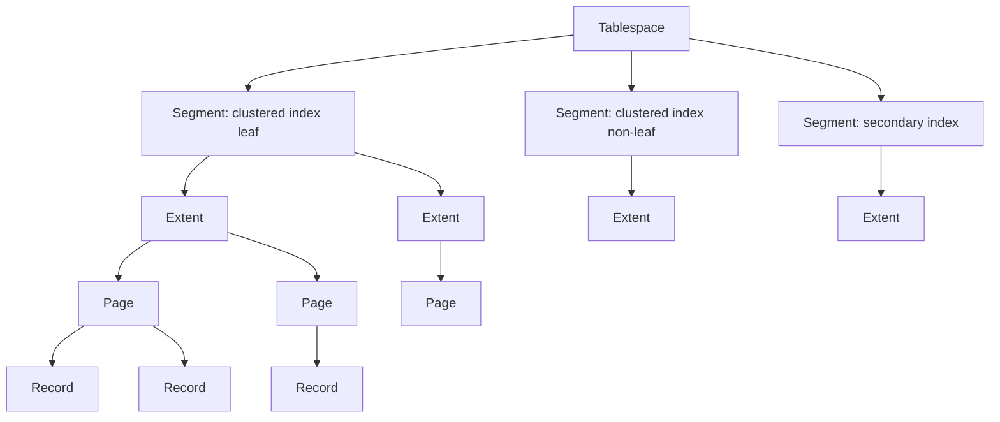

# Lưu trữ InnoDB

## Quan hệ giữa tablespace, segment, extent, page và record

InnoDB tổ chức dữ liệu theo nhiều lớp lưu trữ. Ở mức logic, bảng và chỉ mục nằm trong tablespace; mỗi chỉ mục B-tree được quản lý bằng các segment; segment lấy không gian theo extent; extent gồm nhiều page có kích thước cố định; page chứa các record hoặc cấu trúc nội bộ của InnoDB. Hiểu mối quan hệ này giúp giải thích vì sao một bảng nhỏ vẫn có thể chiếm nhiều không gian, vì sao thêm index làm tăng dung lượng, cách InnoDB đọc một hàng và vì sao việc xóa dữ liệu không nhất thiết làm file trên đĩa nhỏ lại ngay.

Mô hình tổng quát:



Sơ đồ là mô hình khái niệm. Một tablespace có thể chứa nhiều segment; segment có thể sở hữu nhiều extent và một số page rời trong giai đoạn cấp phát ban đầu. Không phải mọi page đều chứa record người dùng: InnoDB còn dùng page cho metadata, bitmap, undo, B-tree và các mục đích nội bộ khác.

### 1. Năm lớp lưu trữ và quan hệ giữa chúng

| Lớp | Vai trò | Có thể hình dung |
| --- | --- | --- |
| Tablespace | Vùng lưu trữ logic của InnoDB, ánh xạ tới một hoặc nhiều file dữ liệu | Một vùng chứa dữ liệu |
| Segment | Nhóm page/extents phục vụ một cấu trúc lưu trữ, thường gắn với phần leaf hoặc non-leaf của index B-tree | Một nhóm không gian dành cho một phần của index |
| Extent | Đơn vị cấp phát gồm nhiều page liên tiếp về mặt logic | Một lô page được cấp phát cùng nhau |
| Page | Đơn vị I/O và bộ nhớ đệm cơ bản của InnoDB | Một khối dữ liệu cố định kích thước |
| Record | Bản ghi hàng hoặc bản ghi index nằm trong page | Một mục dữ liệu trong page |

Đường đi từ trên xuống mô tả cách InnoDB quản lý dung lượng. Đường đi từ dưới lên mô tả cách một hàng được đặt trong cấu trúc chỉ mục. Khi truy vấn tìm một hàng, InnoDB đi qua các page của B-tree; khi cần thêm dữ liệu, InnoDB phải tìm page còn chỗ hoặc cấp phát thêm page/extent cho segment thích hợp.

### 2. Tablespace: vùng chứa dữ liệu logic

Tablespace là đơn vị tổ chức dữ liệu ở mức cao của InnoDB. Nó có định danh không gian (space ID), metadata về kích thước page và ánh xạ tới file vật lý. Một tablespace có thể được lưu trong một file hoặc trong nhiều file, tùy loại tablespace và cấu hình.

Các loại thường gặp:

| Loại tablespace | Nội dung và đặc điểm | Ví dụ thường gặp |
| --- | --- | --- |
| System tablespace | Lưu các cấu trúc dùng chung của InnoDB và có thể chứa dữ liệu/index nếu cấu hình cho phép | `ibdata1` |
| File-per-table tablespace | Tablespace riêng cho một bảng InnoDB cùng các index của bảng đó | `database/table_name.ibd` |
| General tablespace | Tablespace dùng chung do quản trị viên tạo; có thể chứa nhiều bảng | File `.ibd` được khai báo khi tạo general tablespace |
| Undo tablespace | Lưu undo log phục vụ rollback và MVCC | Các file undo tablespace |
| Temporary tablespace | Lưu dữ liệu tạm thời do InnoDB tạo trong quá trình xử lý | File temporary tablespace do máy chủ quản lý |

Với cấu hình file-per-table phổ biến, mỗi bảng InnoDB có một file `.ibd`. File này chứa clustered index và các secondary index của bảng. Xóa bảng có thể giải phóng tablespace riêng để hệ điều hành thu hồi file tương ứng. Nếu nhiều bảng cùng nằm trong system hoặc general tablespace, xóa một bảng thường chỉ trả không gian về tablespace để tái sử dụng; file dùng chung không tự thu nhỏ theo kích thước hàng đã xóa.

File-per-table thường thuận tiện cho quản lý dung lượng, di chuyển hoặc phục hồi từng bảng. General tablespace có thể gom nhiều bảng vào vùng lưu trữ chung, nhưng cần cân nhắc vận hành và giới hạn di chuyển. System tablespace là thành phần nền tảng của instance; không nên xóa, đổi tên hoặc thao tác file trực tiếp khi MySQL đang chạy.

Có thể kiểm tra chế độ file-per-table và các biến liên quan:

```sql
SHOW VARIABLES LIKE 'innodb_file_per_table';
SHOW VARIABLES LIKE 'innodb_data_file_path';
SHOW VARIABLES LIKE 'innodb_page_size';
```

`innodb_file_per_table` cho biết chính sách mặc định hiện tại đối với bảng mới; thay đổi biến không tự động chuyển các bảng đã tồn tại sang tablespace khác. Việc di chuyển bảng phải dùng thao tác DDL phù hợp và có kế hoạch về thời gian, dung lượng tạm, metadata lock và khả năng rollback vận hành.

### 3. Segment: không gian dành cho cấu trúc index

Segment là nhóm page được quản lý cho một cấu trúc lưu trữ cụ thể. Trong B-tree index của InnoDB, phần leaf và phần non-leaf được quản lý tách biệt bằng các segment. Leaf page chứa các entry ở tầng lá; non-leaf page chứa khóa phân nhánh và con trỏ tới page con để điều hướng tìm kiếm.

Một bảng có clustered index và có thể có nhiều secondary index. Mỗi index cần không gian cho các tầng B-tree của nó; do đó thêm index có thể tạo thêm segment và tiêu thụ page/extent. Không gian index không chỉ là các giá trị cột được khai báo trong câu `CREATE INDEX`: nó còn bao gồm page header, directory, phần trống để chèn, các tầng trung gian và cấu trúc quản lý.

Ở giai đoạn đầu, segment nhỏ có thể lấy các page rời từ fragment extent thay vì nhận ngay cả một extent hoàn chỉnh. Khi segment tăng lên, InnoDB có thể cấp phát extent đầy đủ để giảm chi phí quản lý. Vì vậy, không thể lấy số hàng nhân với kích thước record để suy ra chính xác kích thước segment hoặc file `.ibd`.

Đối với một index B-tree, có thể hình dung:

```text
Index B-tree
  Non-leaf segment
    Root page
    Internal pages
  Leaf segment
    Leaf page 1 -> leaf page 2 -> leaf page 3 ...
```

Root và internal page dẫn đường tìm kiếm. Leaf page chứa entry thực tế theo thứ tự index. Với clustered index, entry ở leaf chứa dữ liệu hàng. Với secondary index, entry ở leaf chứa các cột index và khóa chính để tìm hàng tương ứng trong clustered index.

### 4. Extent: đơn vị cấp phát gồm nhiều page

Extent là nhóm page liên tiếp về mặt logic mà InnoDB dùng làm đơn vị cấp phát không gian lớn. Kích thước extent của InnoDB là 1 MiB. Số page trong một extent phụ thuộc `innodb_page_size`:

| `innodb_page_size` | Số page trong một extent 1 MiB |
| ---: | ---: |
| 4 KiB | 256 |
| 8 KiB | 128 |
| 16 KiB | 64 |
| 32 KiB | 32 |
| 64 KiB | 16 |

MySQL thường dùng page 16 KiB theo mặc định, do đó một extent có 64 page. `innodb_page_size` được chọn khi khởi tạo data directory và không thể thay đổi trực tiếp trên một instance đã được khởi tạo. Nếu cần page size khác, phải tạo instance mới và di chuyển dữ liệu theo quy trình phù hợp.

Extent giúp InnoDB cấp phát không gian hiệu quả hơn khi index lớn dần. Các extent có thể ở trạng thái còn trống, được dùng một phần hoặc được một segment sử dụng. Một segment nhỏ không nhất thiết chiếm ngay một extent đầy đủ; InnoDB có cơ chế dùng page rời trong fragment extent trước khi chuyển sang cấp phát extent cho segment.

Ví dụ với page size 16 KiB:

```text
Extent = 1 MiB
       = 64 pages x 16 KiB

Page 0  Page 1  Page 2  ...  Page 63
```

Nếu một bảng chỉ có vài hàng, file tablespace vẫn có thể chứa một số page và metadata tối thiểu. Khi bảng tăng, InnoDB cấp phát thêm page và extent. Vì extent là đơn vị cấp phát, lượng không gian đã cấp phát thường lớn hơn phần byte record đang sử dụng.

### 5. Page: đơn vị đọc, ghi và cache của InnoDB

Page là đơn vị cơ bản mà InnoDB đọc từ file dữ liệu vào buffer pool và ghi từ buffer pool ra file. Kích thước page thường là 16 KiB, nhưng có thể là 4, 8, 16, 32 hoặc 64 KiB tùy cách khởi tạo instance và phiên bản/build hỗ trợ.

Một page có header và trailer phục vụ quản lý, kiểm tra và liên kết page. Với page B-tree, phần nội dung còn có directory và các record. Các page B-tree được liên kết theo thứ tự để hỗ trợ duyệt range scan; các tầng trên giữ khóa phân tách và con trỏ tới page ở tầng dưới.

Một số loại page thường gặp:

- **FIL page:** phần header/trailer và thông tin nhận dạng page, liên kết page trước/sau trong một số cấu trúc.
- **INDEX page:** page thuộc B-tree index, chứa record và page directory.
- **INODE page:** metadata quản lý segment.
- **XDES page:** descriptor theo dõi trạng thái extent và page trong tablespace.
- **IBUF_BITMAP page:** bitmap phục vụ change buffer trong các cấu hình/phiên bản liên quan.
- **UNDO_LOG page:** page lưu undo record.
- **FSP_HDR/FSP page:** metadata quản lý không gian tablespace.

Tên và chi tiết cấu trúc page là nội bộ InnoDB; người dùng thông thường không đọc hoặc chỉnh sửa trực tiếp các byte này. Điều quan trọng khi thiết kế là hiểu một truy vấn có thể cần nhiều lần đọc page nếu index không phù hợp hoặc dữ liệu không nằm trong buffer pool.

### 6. Cấu trúc khái quát của một page B-tree

Page B-tree không chỉ là vùng nối liên tiếp các record. Nó có cấu trúc để InnoDB tìm kiếm, chèn, xóa và duy trì thứ tự khóa.

```text
+--------------------------------------+
| FIL header                           |
+--------------------------------------+
| Page header                          |
| - page level / sibling pointers      |
| - số record / thông tin quản lý      |
+--------------------------------------+
| Infimum record                       |
| User records (được liên kết theo thứ tự)|
| Supremum record                      |
+--------------------------------------+
| Free space / garbage                 |
+--------------------------------------+
| Page directory                       |
+--------------------------------------+
| FIL trailer                          |
+--------------------------------------+
```

Đây là sơ đồ rút gọn, không thể hiện tỷ lệ byte hoặc mọi trường nội bộ. `infimum` và `supremum` là hai pseudo-record đánh dấu đầu và cuối danh sách record trong page. Record được liên kết theo thứ tự khóa; page directory chứa các slot trỏ tới nhóm record để hỗ trợ tìm kiếm nhanh hơn so với duyệt tuần tự toàn bộ.

Khi chèn một record, InnoDB tìm vị trí theo khóa và dùng free space trong page. Khi page không còn đủ chỗ, B-tree có thể phải chia page (page split) và cập nhật các page cha. Khi xóa hoặc cập nhật, vùng dữ liệu có thể trở thành free/garbage và được tái sử dụng hoặc tổ chức lại sau đó. Do đó, kích thước file không nhất thiết giảm ngay khi số hàng giảm.

### 7. Record: cách một hàng được biểu diễn trong page

Record là đơn vị dữ liệu ở mức hàng hoặc index entry. Trong clustered index, leaf record chứa các cột của hàng. Trong secondary index, leaf record chứa giá trị cột index cùng khóa chính để InnoDB tìm clustered record.

Với row format `COMPACT` hoặc `DYNAMIC`, record thường có các phần khái quát:

1. **Record header:** thông tin quản lý record như độ dài, trạng thái và liên kết tới record kế tiếp trong page.
2. **NULL bitmap:** bit đánh dấu các cột nullable đang có giá trị `NULL`.
3. **Variable-length field metadata:** thông tin độ dài của các cột có độ dài biến đổi khi cần.
4. **User column data:** dữ liệu các cột của hàng.
5. **System columns của clustered record:** `DB_TRX_ID` theo dõi transaction sửa hàng gần nhất và `DB_ROLL_PTR` trỏ tới thông tin undo; nếu bảng không có khóa chính phù hợp, InnoDB có thể tạo hidden row ID làm khóa clustered.

Chi tiết byte và thứ tự trường thay đổi theo row format, kiểu cột, NULL, độ dài dữ liệu và phiên bản. Không nên giả định mọi record đều có kích thước cố định. Hai hàng trong cùng bảng có thể chiếm số byte khác nhau do `VARCHAR`, `BLOB`, `TEXT`, giá trị NULL và dữ liệu lưu ngoài page.

Các row format phổ biến:

| Row format | Đặc điểm khái quát |
| --- | --- |
| `REDUNDANT` | Định dạng cũ, header record và cách biểu diễn metadata khác các định dạng mới |
| `COMPACT` | Giảm overhead record so với REDUNDANT; lưu metadata độ dài và NULL trong phần header |
| `DYNAMIC` | Có thể lưu phần lớn dữ liệu cột dài ở ngoài page, giữ con trỏ trong record; thường là lựa chọn mặc định trên MySQL hiện đại |
| `COMPRESSED` | Dùng page compression theo cơ chế row format nén; có giới hạn và chi phí CPU/I/O riêng |

Với `DYNAMIC`, các cột dài như `TEXT` hoặc `BLOB` có thể được lưu ở overflow page khi cần, để record trong B-tree page giữ phần dữ liệu phù hợp. Việc lưu ngoài page có thể giảm áp lực lên leaf page nhưng phát sinh thêm lần truy cập page khi truy vấn cần đọc nội dung dài. `COMPACT` cũng hỗ trợ lưu ngoài page nhưng cách chọn phần giữ lại trong page khác `DYNAMIC`.

### 8. Clustered index và secondary index liên hệ với page/record ra sao?

InnoDB tổ chức dữ liệu bảng theo clustered index. Thông thường, khóa chính là clustered index. Nếu bảng không có khóa chính, InnoDB chọn một unique index phù hợp có các cột `NOT NULL`; nếu không có, InnoDB tạo clustered index ẩn bằng row ID nội bộ.

Leaf page của clustered index chứa toàn bộ dữ liệu hàng. Các page tầng trên chứa khóa và con trỏ để dẫn đến leaf page. Vì vậy, tìm hàng bằng khóa chính thường dẫn đến leaf page chứa trực tiếp hàng đó.

Secondary index có B-tree riêng. Entry ở leaf page của secondary index chứa các cột khóa phụ và giá trị khóa chính của hàng. Khi truy vấn chỉ lấy các cột đã có trong secondary index, có thể thực hiện covering index và không cần đọc clustered record. Nếu cần cột khác, InnoDB dùng khóa chính trong secondary entry để tìm lại hàng ở clustered index.

Ví dụ:

```sql
CREATE TABLE customer_order (
    id BIGINT NOT NULL,
    customer_id BIGINT NOT NULL,
    created_at DATETIME NOT NULL,
    total DECIMAL(12, 2) NOT NULL,
    status VARCHAR(20) NOT NULL,
    PRIMARY KEY (id),
    KEY idx_customer_created (customer_id, created_at)
) ENGINE = InnoDB ROW_FORMAT = DYNAMIC;
```

Với bảng trên:

- Clustered index theo `id` lưu toàn bộ cột hàng ở leaf page.
- Secondary index `idx_customer_created` sắp xếp entry theo `(customer_id, created_at)` và lưu thêm `id` để tìm clustered record.
- Truy vấn chỉ lấy `customer_id`, `created_at` và `id` có thể được phục vụ từ secondary index nếu optimizer chọn đường truy cập đó.
- Truy vấn lấy thêm `total` hoặc `status` thường cần truy cập clustered index để lấy đủ cột.

Vì khóa chính được lặp lại trong secondary index, khóa chính quá rộng làm tăng kích thước tất cả secondary index. Chọn khóa chính ngắn, ổn định và không thay đổi thường giúp tiết kiệm page, giảm I/O và cải thiện cache density.

### 9. Buffer pool: page trong bộ nhớ và page trên đĩa

Buffer pool là vùng bộ nhớ chính của InnoDB dùng cache data page và index page. Khi truy vấn cần một page:

1. InnoDB kiểm tra page đã có trong buffer pool hay chưa.
2. Nếu có, có thể đọc trực tiếp từ bộ nhớ.
3. Nếu chưa có, InnoDB đọc page từ tablespace vào buffer pool.
4. Khi transaction thay đổi dữ liệu, page trong bộ nhớ trở thành dirty page; redo log được ghi theo quy tắc WAL để có thể phục hồi.
5. Background flushing ghi dirty page xuống tablespace theo cơ chế quản lý checkpoint và áp lực buffer pool.

Commit transaction không nhất thiết ghi ngay toàn bộ data page đã sửa xuống file. Độ bền commit dựa vào redo log; dirty page có thể được flush sau. Điều này giúp giảm I/O ngẫu nhiên và gom các lần ghi page, nhưng cũng có nghĩa page trên đĩa có thể cũ hơn phiên bản đã commit trong buffer pool.

Các biến và trạng thái hữu ích khi quan sát:

```sql
SHOW VARIABLES LIKE 'innodb_buffer_pool_size';
SHOW VARIABLES LIKE 'innodb_page_size';
SHOW GLOBAL STATUS LIKE 'Innodb_buffer_pool_read%';
SHOW GLOBAL STATUS LIKE 'Innodb_buffer_pool_pages%';
```

Nếu `Innodb_buffer_pool_reads` tăng nhanh so với workload, có thể workload đang cần đọc page từ đĩa nhiều hơn. Cần phân tích cùng kích thước dữ liệu, working set, index, cache hit, I/O latency và tải truy vấn; một con số riêng lẻ không đủ kết luận phải tăng buffer pool.

### 10. Vì sao thêm/xóa hàng làm thay đổi dung lượng?

Khi insert, InnoDB phải tìm page phù hợp trong clustered index và cập nhật các secondary index liên quan. Nếu page đầy, page split có thể tạo thêm page và làm tăng số extent đã cấp phát. Insert theo thứ tự khóa có thể có đặc tính phân bố page khác insert ngẫu nhiên.

Khi delete, record được đánh dấu xóa và chỉ được loại bỏ vật lý khi điều kiện purge cho phép, vì transaction khác có thể vẫn cần phiên bản cũ theo MVCC. Sau purge, không gian trong page có thể được tái sử dụng cho record mới. Nhưng việc tái sử dụng không đồng nghĩa file `.ibd` tự giảm kích thước.

Khi cập nhật cột tham gia index, InnoDB có thể phải thay đổi entry trong B-tree liên quan. Nếu cập nhật khóa làm vị trí index thay đổi, thao tác có thể tương đương xóa entry cũ và chèn entry mới. Vì vậy, cập nhật các cột index có thể tốn I/O và tạo thêm công việc undo/redo.

Nếu cần thu hồi không gian vật lý của file file-per-table, có thể cần thao tác rebuild như `OPTIMIZE TABLE` hoặc DDL tương ứng. Đây là thao tác có thể tạo I/O lớn, cần dung lượng tạm, ảnh hưởng metadata lock và thời gian hoạt động; phải đánh giá trước trên dữ liệu thật. Không nên chạy chỉ vì `DELETE` nhiều hàng mà chưa đo mức phân mảnh hoặc dung lượng có thể thu hồi.

### 11. Quan sát tablespace, table và index bằng metadata

`INFORMATION_SCHEMA` cung cấp các view để kiểm tra cấu trúc lưu trữ. Quyền truy cập và một số cột có thể thay đổi theo phiên bản MySQL.

Kiểm tra bảng và row format:

```sql
SHOW CREATE TABLE customer_order;
SHOW TABLE STATUS LIKE 'customer_order';

SELECT
    TABLE_SCHEMA,
    TABLE_NAME,
    ENGINE,
    ROW_FORMAT,
    DATA_LENGTH,
    INDEX_LENGTH,
    DATA_FREE
FROM information_schema.tables
WHERE TABLE_SCHEMA = DATABASE()
  AND TABLE_NAME = 'customer_order';
```

`DATA_LENGTH` và `INDEX_LENGTH` là số liệu dung lượng ước lượng/đã cấp phát theo metadata engine, không phải tổng byte payload record chính xác. `DATA_FREE` phản ánh không gian trống trong phạm vi tablespace theo cách MySQL báo cáo; với tablespace dùng chung, không thể quy toàn bộ giá trị này cho một bảng.

Kiểm tra tablespace và file dữ liệu trên MySQL 8.0:

```sql
SELECT
    SPACE,
    NAME,
    SPACE_TYPE,
    PAGE_SIZE,
    FILE_SIZE,
    ALLOCATED_SIZE
FROM information_schema.innodb_tablespaces
ORDER BY NAME;

SELECT
    SPACE,
    PATH
FROM information_schema.innodb_datafiles
ORDER BY SPACE, PATH;
```

Kiểm tra bảng InnoDB và index nội bộ:

```sql
SELECT
    NAME,
    SPACE,
    ROW_FORMAT,
    ZIP_PAGE_SIZE
FROM information_schema.innodb_tables
WHERE NAME = CONCAT(DATABASE(), '/customer_order');

SELECT
    NAME,
    TYPE,
    N_FIELDS,
    PAGE_NO,
    SPACE
FROM information_schema.innodb_indexes
WHERE TABLE_ID = (
    SELECT TABLE_ID
    FROM information_schema.innodb_tables
    WHERE NAME = CONCAT(DATABASE(), '/customer_order')
);
```

Các view `INNODB_TABLESPACES`, `INNODB_DATAFILES`, `INNODB_TABLES` và `INNODB_INDEXES` là metadata nội bộ hữu ích cho chẩn đoán. Một số truy vấn cần quyền phù hợp; nếu phiên bản hoặc cấu hình không cung cấp cột/view như ví dụ, đối chiếu tài liệu đúng phiên bản trước khi tự động hóa.

Không nên đọc hoặc sửa trực tiếp file `.ibd`, `ibdata`, undo hoặc redo khi MySQL đang chạy. Những file này chứa cấu trúc nhị phân và metadata do InnoDB quản lý; thay đổi byte bên ngoài engine có thể làm hỏng tablespace.

### 12. Kết nối cấu trúc lưu trữ với hiệu năng truy vấn

Hiểu page và record giúp giải thích chi phí truy vấn:

- **Point lookup theo primary key:** đi từ root qua các internal page tới clustered leaf page chứa hàng.
- **Lookup theo secondary index:** đi qua B-tree phụ để lấy secondary entry, rồi có thể đọc clustered page theo primary key.
- **Covering index:** nếu mọi cột cần thiết có trong secondary index, truy vấn có thể tránh lần đọc clustered page bổ sung.
- **Range scan:** đọc nhiều leaf page liên tiếp theo thứ tự index; chỉ mục phù hợp có thể giảm random I/O.
- **Full table scan:** phải đọc nhiều page của clustered index; có thể hợp lý nếu truy vấn cần phần lớn hàng hoặc bảng nhỏ.
- **Record lớn/off-page column:** có thể cần thêm overflow page để lấy nội dung `TEXT`/`BLOB`.

Ví dụ so sánh hai truy vấn:

```sql
-- Có thể được phục vụ bởi secondary index.
SELECT id, customer_id, created_at
FROM customer_order
WHERE customer_id = 42
ORDER BY created_at;

-- Cần thêm cột total; có thể phải truy cập clustered index.
SELECT id, customer_id, created_at, total
FROM customer_order
WHERE customer_id = 42
ORDER BY created_at;
```

Optimizer quyết định kế hoạch thực tế dựa trên thống kê và chi phí ước lượng. Dùng `EXPLAIN` để xem index và số hàng ước lượng; nếu cần số liệu thực thi, dùng `EXPLAIN ANALYZE` trên phiên bản hỗ trợ và chú ý câu lệnh được thực thi khi dùng dạng này.

### 13. Checklist khi thiết kế và vận hành

1. Chọn primary key ngắn, ổn định để clustered index và secondary index không phình to không cần thiết.
2. Tạo secondary index theo truy vấn thực tế; mỗi index bổ sung cần page, segment và dung lượng lưu trữ.
3. Hiểu bảng nằm trong file-per-table hay tablespace dùng chung trước khi dự tính khả năng thu hồi dung lượng.
4. Kiểm tra `innodb_page_size` và row format khi cần phân tích kích thước page/record.
5. Dùng metadata trong `INFORMATION_SCHEMA` để quan sát tablespace, data file, row format và index; xem các số dung lượng là số liệu theo engine.
6. Theo dõi buffer pool, page read, dirty page và I/O cùng với workload thực tế.
7. Không sửa trực tiếp file tablespace; dùng SQL/DDL và công cụ backup/restore được MySQL hỗ trợ.
8. Trước khi rebuild hoặc tối ưu bảng lớn, ước lượng dung lượng tạm, thời gian, metadata lock và ảnh hưởng replication.

Tablespace là vùng chứa logic; segment quản lý page cho cấu trúc index; extent là đơn vị cấp phát gồm nhiều page; page là đơn vị I/O/cache; record là hàng hoặc entry index nằm trong page. Khi kết nối được năm lớp này với clustered index, secondary index và buffer pool, có thể giải thích rõ hơn dung lượng InnoDB, đường đi truy vấn và chi phí của các thao tác ghi.
