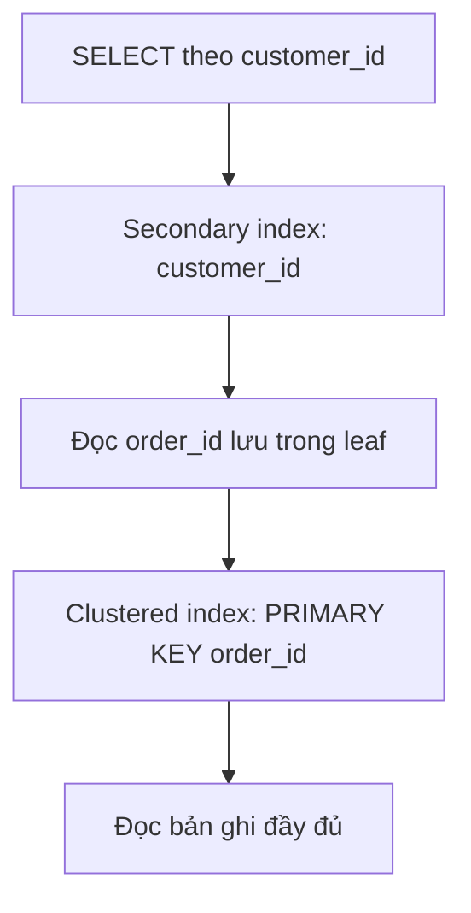
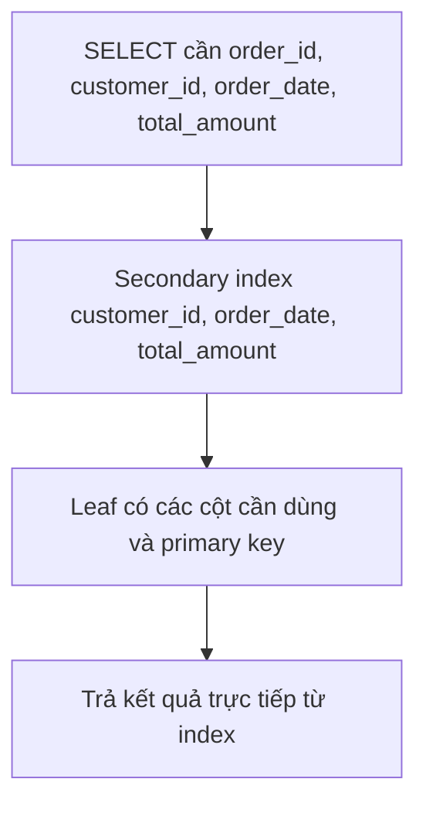

# Covering index và truy cập dữ liệu qua secondary index

Trong InnoDB, một truy vấn có thể tìm hàng qua secondary index rồi dùng khóa chính để đọc bản ghi đầy đủ trong clustered index. Nếu truy vấn chỉ cần các cột đã có sẵn trong secondary index, MySQL có thể trả kết quả trực tiếp từ index mà không cần đọc lại bản ghi clustered trong trường hợp thông thường. Cách truy cập này được gọi là **covering index access**.

Covering index có thể giảm số lần truy cập cây B-tree, giảm I/O và giúp một truy vấn đọc nhiều hàng chạy hiệu quả hơn. Tuy nhiên, thêm cột vào index làm index rộng hơn, tốn bộ nhớ và tăng chi phí `INSERT`, `UPDATE`, `DELETE`. Thiết kế đúng là chọn index theo truy vấn thực tế và đo bằng `EXPLAIN`, không thêm mọi cột vào mọi index.

Bài học thuộc module **DATABASE_MYSQL**. Module hướng tới việc làm chủ MySQL từ thiết kế bảng, kiểu dữ liệu, khóa và truy vấn SQL đến index, transaction và kiểm soát đồng thời; đồng thời thực hành đọc kế hoạch thực thi, tối ưu truy vấn, phân quyền, sao lưu và xử lý các vấn đề vận hành cơ sở dữ liệu quan hệ. Trong chương **Chỉ mục**, bài này tập trung vào covering index và cách InnoDB truy cập dữ liệu qua secondary index.

## 1. Clustered index và secondary index trong InnoDB

InnoDB tổ chức dữ liệu bảng theo một clustered index. Các hàng của bảng được lưu trong leaf page của cây B-tree clustered index, được sắp xếp theo khóa của index này.

Thông thường, clustered index chính là `PRIMARY KEY`. Nếu bảng không khai báo primary key, InnoDB chọn một unique index có các cột `NOT NULL` phù hợp làm clustered index. Nếu không có unique index như vậy, InnoDB tạo một row ID ẩn để tổ chức clustered index.

Các index khác là **secondary index**. Leaf record của secondary index lưu các cột khóa của secondary index và các cột khóa chính cần thiết để xác định hàng trong clustered index. Vì vậy, khi đọc một hàng qua secondary index, InnoDB có thể dùng primary key được lưu kèm để tìm hàng tương ứng trong clustered index.

Ví dụ:

```sql
CREATE TABLE orders (
    order_id BIGINT NOT NULL,
    customer_id BIGINT NOT NULL,
    order_date DATETIME NOT NULL,
    status VARCHAR(20) NOT NULL,
    total_amount DECIMAL(12, 2) NOT NULL,
    shipping_city VARCHAR(80) NOT NULL,
    PRIMARY KEY (order_id),
    KEY idx_orders_customer (customer_id)
) ENGINE = InnoDB;
```

Với bảng này:

- Clustered index là `PRIMARY KEY (order_id)`.
- Secondary index là `idx_orders_customer (customer_id)`.
- Leaf record của secondary index có `customer_id` và khóa chính `order_id`.

Khi truy vấn tìm các đơn hàng của một khách hàng, InnoDB tìm trong `idx_orders_customer`. Nếu truy vấn cần `status` hoặc `total_amount`, các cột này không có trong secondary index, nên InnoDB thường phải dùng `order_id` để đọc bản ghi đầy đủ trong clustered index.



Đây là đường truy cập secondary index thông thường khi truy vấn cần cột không nằm trong index.

## 2. Truy cập qua secondary index không covering

Xét truy vấn:

```sql
SELECT order_id, customer_id, status, total_amount
FROM orders
WHERE customer_id = 42;
```

Index `idx_orders_customer` chỉ có `customer_id` và primary key `order_id`. Truy vấn còn cần `status` và `total_amount`, nên secondary index không bao phủ tất cả dữ liệu cần trả về.

Quá trình truy cập logic:

1. Tìm các leaf record có `customer_id = 42` trong secondary index.
2. Lấy `order_id` từ từng leaf record.
3. Dùng `order_id` tra clustered index.
4. Đọc các cột còn thiếu như `status` và `total_amount`.
5. Trả hàng cho client.

Với N hàng phù hợp, đường truy cập này có thể cần N lần tra cứu clustered index bổ sung. Nếu các hàng nằm rải rác trong clustered index, những lần tra cứu đó có thể tạo I/O ngẫu nhiên và tăng chi phí.

Không phải truy vấn nào dùng secondary index cũng chậm. Secondary index thường giúp giảm mạnh số hàng phải xét so với quét toàn bảng. Vấn đề là sau khi tìm được các entry phù hợp, MySQL còn phải đọc thêm bao nhiêu bản ghi clustered để lấy cột còn thiếu.

## 3. Covering index là gì?

Một index **covering** đối với một truy vấn khi tất cả cột cần thiết để thực hiện truy vấn và tạo kết quả đều có thể lấy từ index đó. Với InnoDB, các cột primary key được lưu kèm trong secondary index cũng có thể được dùng để bao phủ truy vấn.

Tạo một secondary index bổ sung để bao phủ truy vấn lịch sử đơn hàng:

```sql
CREATE INDEX idx_orders_customer_date_amount
ON orders (customer_id, order_date, total_amount);
```

Truy vấn:

```sql
SELECT order_id, customer_id, order_date, total_amount
FROM orders
WHERE customer_id = 42
  AND order_date >= '2026-01-01'
  AND order_date <  '2026-02-01';
```

Các cột truy vấn cần:

- `customer_id`: cột đầu tiên của secondary index.
- `order_date`: cột thứ hai của secondary index.
- `total_amount`: cột thứ ba của secondary index.
- `order_id`: primary key, được lưu kèm trong leaf record của secondary index InnoDB.

Do đó, về mặt cột dữ liệu, index có thể bao phủ truy vấn. MySQL có thể tìm range theo khách hàng và ngày, sau đó lấy `order_id`, `order_date` và `total_amount` từ secondary index mà không cần tra clustered record trong trường hợp thông thường.



Covering index không phải một loại index riêng hay một cú pháp `CREATE COVERING INDEX`. Đó là đặc tính của mối quan hệ giữa một index cụ thể và một truy vấn cụ thể. Cùng một index có thể covering cho truy vấn A nhưng không covering cho truy vấn B.

## 4. Primary key được lưu kèm trong secondary index

Điểm này rất quan trọng khi thiết kế covering index trên InnoDB. Nếu bảng có:

```sql
PRIMARY KEY (order_id),
KEY idx_orders_customer_date (customer_id, order_date)
```

thì secondary index về mặt logic có thêm `order_id` trong leaf record. Truy vấn sau có thể được bao phủ bởi secondary index:

```sql
SELECT order_id, customer_id, order_date
FROM orders
WHERE customer_id = 42;
```

Không nhất thiết phải khai báo `order_id` lần nữa ở cuối index chỉ để lấy primary key trong SELECT. Làm vậy thường chỉ lặp lại thông tin khóa chính mà InnoDB đã lưu kèm.

Tuy nhiên, nếu truy vấn cần một cột khác như `status`, cột đó vẫn phải được đưa vào index nếu muốn index bao phủ:

```sql
SELECT order_id, customer_id, order_date, status
FROM orders
WHERE customer_id = 42;
```

Với index chỉ có `(customer_id, order_date)`, `status` không có sẵn trong leaf record. InnoDB phải đọc clustered record để lấy `status`.

### 4.1. Primary key rộng làm secondary index lớn hơn

Vì secondary index lưu primary key để định vị hàng, primary key có kích thước lớn làm tăng kích thước của mọi secondary index. Ví dụ, khóa chính gồm nhiều cột hoặc một chuỗi dài sẽ được lặp lại trong các secondary index.

Điều này ảnh hưởng:

- Số leaf page cần lưu trữ.
- Số entry có thể chứa trong một page.
- Khả năng giữ index trong buffer pool.
- Chi phí đọc và ghi các secondary index.

Do đó, lựa chọn primary key còn ảnh hưởng đến chi phí của toàn bộ hệ thống index, không chỉ clustered index.

## 5. Phân biệt covering index và Index Condition Pushdown

Hai khái niệm này thường bị nhầm lẫn khi đọc `EXPLAIN`.

- **Covering index access:** tất cả cột cần cho truy vấn có thể lấy từ index; `EXPLAIN` thường hiển thị `Using index` trong cột `Extra`.
- **Index Condition Pushdown (ICP):** MySQL đẩy một phần điều kiện lọc xuống storage engine để kiểm tra ngay trên secondary index trước khi đọc clustered record. Nếu truy vấn vẫn cần cột không có trong index, clustered lookup vẫn cần thiết; `EXPLAIN` thường hiển thị `Using index condition`.

Ví dụ tạo index:

```sql
CREATE INDEX idx_orders_customer_date_status
ON orders (customer_id, order_date, status);
```

Truy vấn cần thêm `shipping_city`, cột không có trong index:

```sql
SELECT order_id, shipping_city
FROM orders
WHERE customer_id = 42
  AND order_date >= '2026-01-01'
  AND order_date <  '2026-02-01'
  AND status = 'PAID';
```

Storage engine có thể dùng các cột `customer_id`, `order_date` và `status` trong secondary index để kiểm tra điều kiện, rồi chỉ tra clustered record cho những entry còn phù hợp để lấy `shipping_city`. Đây là trường hợp ICP có thể giảm số lần clustered lookup; truy vấn vẫn không covering vì cần `shipping_city`.

Không kết luận rằng `Using index condition` nghĩa là không đọc clustered index. Hãy phân biệt dấu hiệu này với `Using index`.

## 6. Đọc EXPLAIN để nhận biết covering access

Chạy `EXPLAIN` cho truy vấn:

```sql
EXPLAIN
SELECT order_id, customer_id, order_date, total_amount
FROM orders
WHERE customer_id = 42
  AND order_date >= '2026-01-01'
  AND order_date <  '2026-02-01';
```

Các cột quan trọng trong kết quả:

| Cột | Ý nghĩa khi đánh giá index |
|---|---|
| `type` | Kiểu truy cập như `range`, `ref`, `eq_ref`, `index`, `ALL`. |
| `possible_keys` | Các index optimizer xem là ứng viên. |
| `key` | Index thực tế được chọn; `NULL` nghĩa là không chọn index. |
| `key_len` | Độ dài phần key được sử dụng, giúp kiểm tra các cột/phần cột tham gia truy cập. |
| `rows` | Số hàng ước tính cần đọc. |
| `filtered` | Tỷ lệ hàng ước tính còn lại sau điều kiện lọc. |
| `Extra` | Thông tin bổ sung; `Using index` thường biểu thị covering access. |

Nếu `Extra` có `Using index`, đó là dấu hiệu truy vấn được bao phủ bởi index được chọn. Một truy vấn covering vẫn có thể không hiệu quả nếu phải quét một phần rất lớn của index.

Ví dụ `type = index` có thể là full index scan. Nó vẫn có thể là covering vì tất cả cột đều nằm trong index, nhưng nếu phải duyệt hàng triệu entry trong khi chỉ cần một vài hàng, truy vấn vẫn tốn kém.

### 6.1. So sánh với truy vấn không covering

Chạy:

```sql
EXPLAIN
SELECT order_id, customer_id, order_date, total_amount, status
FROM orders
WHERE customer_id = 42
  AND order_date >= '2026-01-01'
  AND order_date <  '2026-02-01';
```

Nếu index không chứa `status`, optimizer có thể vẫn dùng cùng secondary index để tìm range nhưng phải lấy `status` từ clustered record. Kế hoạch có thể không còn `Using index`.

Không nên chỉ nhìn một dòng `Extra` để kết luận toàn bộ hiệu năng. Hãy xem `key`, `type`, `rows`, điều kiện lọc và số hàng thực tế.

### 6.2. EXPLAIN ANALYZE

Trên MySQL 8.0.18 trở lên, có thể dùng `EXPLAIN ANALYZE` để thực thi truy vấn và hiển thị thời gian, số hàng thực tế cùng số vòng lặp của các iterator:

```sql
EXPLAIN ANALYZE
SELECT order_id, customer_id, order_date, total_amount
FROM orders
WHERE customer_id = 42
  AND order_date >= '2026-01-01'
  AND order_date <  '2026-02-01';
```

`EXPLAIN ANALYZE` thực sự chạy câu lệnh. Dùng với truy vấn đọc phù hợp trên dữ liệu thử nghiệm hoặc môi trường có kiểm soát; không chạy tùy tiện với câu lệnh ghi hoặc truy vấn đọc quá nặng trên production.

## 7. Thứ tự cột trong composite index

Covering index thường là một composite index: index có nhiều cột theo một thứ tự xác định. Thứ tự này ảnh hưởng cả khả năng tìm kiếm lẫn thứ tự dữ liệu trong B-tree.

Tiếp tục dùng index `idx_orders_customer_date_amount` đã tạo ở phần 3:

Các prefix của index gồm:

1. `(customer_id)`
2. `(customer_id, order_date)`
3. `(customer_id, order_date, total_amount)`

Theo nguyên tắc leftmost prefix, MySQL thường có thể dùng index để tìm theo cột đầu tiên hoặc các nhóm cột bắt đầu từ cột đầu tiên. Ví dụ:

```sql
-- Dùng prefix customer_id
SELECT order_id, customer_id
FROM orders
WHERE customer_id = 42;

-- Dùng prefix customer_id + order_date
SELECT order_id, order_date
FROM orders
WHERE customer_id = 42
  AND order_date >= '2026-01-01';
```

Truy vấn chỉ lọc theo `order_date` mà không có `customer_id` thường không thể dùng index này như một range lookup trực tiếp hiệu quả:

```sql
SELECT order_id, order_date
FROM orders
WHERE order_date >= '2026-01-01';
```

Một số phiên bản MySQL có thể cân nhắc index skip scan trong điều kiện nhất định, nhưng đó là lựa chọn phụ thuộc optimizer và phân bố dữ liệu. Không thiết kế workload dựa trên giả định rằng cột bên phải luôn được dùng hiệu quả khi bỏ qua cột đầu tiên.

### 7.1. Equality, range và cột dùng để cover

Một quy tắc khởi đầu thường hữu ích:

- Đặt các cột được lọc bằng equality vào phần đầu của index.
- Đặt cột dùng range hoặc thứ tự sắp xếp tiếp theo.
- Đưa các cột chỉ cần để trả kết quả vào sau cùng nếu việc mở rộng index vẫn có lợi.

Ví dụ truy vấn:

```sql
SELECT order_id, order_date, total_amount
FROM orders
WHERE customer_id = 42
  AND order_date >= '2026-01-01'
  AND order_date <  '2026-02-01';
```

Index `(customer_id, order_date, total_amount)` hợp lý vì `customer_id` được so sánh bằng, `order_date` dùng range, còn `total_amount` giúp bao phủ cột trả về.

Đây là quy tắc khởi đầu, không phải công thức tuyệt đối. Nếu workload có nhiều truy vấn khác nhau, hãy xét tần suất, độ chọn lọc, thứ tự `ORDER BY`, điều kiện join và chi phí ghi trước khi quyết định thứ tự cột.

### 7.2. Covering index và ORDER BY

Index ghép có thể vừa tìm hàng vừa cung cấp thứ tự:

```sql
SELECT order_id, order_date, total_amount
FROM orders
WHERE customer_id = 42
ORDER BY order_date, order_id;
```

Với index `(customer_id, order_date, total_amount)`, primary key được lưu kèm sau các key part đã khai báo. Vì `total_amount` đứng trước primary key, index này không bảo đảm thứ tự `order_date, order_id` trong các hàng cùng ngày. Nếu truy vấn cần thứ tự đó và vẫn cần cover `total_amount`, hãy đặt primary key trước cột payload; DDL cụ thể được trình bày ở mục 10.1.

Với equality trên `customer_id`, thứ tự key parts của index này cần lần lượt là khách hàng, ngày, mã đơn rồi số tiền. Cách sắp xếp này phù hợp hơn với `ORDER BY order_date, order_id`; ví dụ DDL hoàn chỉnh nằm ở mục 10.1. Vẫn phải kiểm tra hướng ASC/DESC và kế hoạch thực thi trên phiên bản MySQL đang dùng.

Tuy nhiên, nếu truy vấn yêu cầu:

```sql
ORDER BY total_amount DESC
```

thì thứ tự index hiện tại không tự động đáp ứng yêu cầu đó. Covering chỉ nói các cột có sẵn trong index; nó không bảo đảm index đáp ứng mọi thứ tự sắp xếp hoặc mọi điều kiện lọc.

## 8. Chọn cột nào để đưa vào covering index?

Khi thiết kế index, hãy xem toàn bộ truy vấn thay vì chỉ danh sách cột trả về. Các cột cần thiết có thể xuất hiện ở nhiều vị trí:

- SELECT: cột cần trả về hoặc dùng trong biểu thức.
- WHERE: cột dùng để lọc.
- JOIN: cột dùng để ghép bảng.
- GROUP BY: cột dùng để nhóm.
- ORDER BY: cột dùng để sắp xếp.
- HAVING: biểu thức lọc sau khi nhóm.

Ví dụ:

```sql
SELECT order_date, SUM(total_amount) AS daily_revenue
FROM orders
WHERE customer_id = 42
  AND order_date >= '2026-01-01'
  AND order_date <  '2026-02-01'
GROUP BY order_date
ORDER BY order_date;
```

Index `(customer_id, order_date, total_amount)` chứa các cột cần để lọc, nhóm và tính tổng. Nó có thể hỗ trợ truy vấn đọc dữ liệu từ index mà không cần lấy các cột khác của hàng. Optimizer vẫn phải đánh giá kế hoạch tổng thể; covering không bảo đảm luôn loại bỏ được sort hoặc temporary table trong mọi dạng truy vấn.

MySQL không có cú pháp `INCLUDE` riêng như một số hệ quản trị khác. Các cột thêm vào index được khai báo như key parts. Trong ví dụ này, index `idx_orders_customer_date_amount` đã được tạo ở mục 3; không cần tạo lại một index trùng tên.

Vì vậy, thêm cột chỉ để cover cũng làm thay đổi cấu trúc key và kích thước index. Cần cân nhắc thứ tự của nó với các truy vấn khác.

## 9. Giới hạn của prefix index và cột lớn

Để giảm kích thước index cho cột chuỗi dài, MySQL cho phép tạo index trên một prefix:

```sql
CREATE INDEX idx_customer_name_prefix
ON customers (last_name(20));
```

Index này chỉ lưu 20 ký tự đầu của `last_name`, không lưu toàn bộ giá trị. Nếu truy vấn cần trả về toàn bộ `last_name`, prefix index không thể cung cấp phần còn thiếu; clustered record vẫn cần được đọc.

Ví dụ:

```sql
SELECT customer_id, last_name
FROM customers
WHERE last_name LIKE 'Nguyen%';
```

Nếu index là `(last_name(20))`, index có thể hỗ trợ tìm theo prefix nhưng không bao phủ đầy đủ cột `last_name` nếu cần trả về giá trị hoàn chỉnh.

Các cột `TEXT`/`BLOB` hoặc chuỗi rất dài cũng cần cân nhắc giới hạn độ dài key, charset và kích thước index. Đừng thêm một cột lớn vào index chỉ để đạt `Using index` nếu chi phí lưu trữ và ghi lớn hơn lợi ích đọc.

## 10. Covering index cho các mẫu truy vấn thường gặp

### 10.1. Trang lịch sử đơn hàng của khách hàng

Truy vấn:

```sql
SELECT order_id, order_date, total_amount
FROM orders
WHERE customer_id = 42
ORDER BY order_date DESC, order_id DESC
LIMIT 20;
```

Index phù hợp để thử nghiệm khi cần sắp xếp theo ngày và mã đơn:

```sql
CREATE INDEX idx_orders_customer_date_order_amount
ON orders (customer_id, order_date, order_id, total_amount);
```

`order_id` được khai báo tường minh trước cột payload `total_amount` để thứ tự trong index khớp với `ORDER BY order_date DESC, order_id DESC` sau khi cố định `customer_id`. Dù primary key thường được lưu kèm tự động, vị trí của nó ở cuối index mặc định có thể không phù hợp với thứ tự sắp xếp mong muốn. Tùy hướng sắp xếp và phiên bản MySQL, optimizer có thể đọc index theo chiều ngược; hãy kiểm tra EXPLAIN thay vì giả định index luôn đáp ứng mọi tổ hợp `ASC`/`DESC`.

Đây là một thiết kế khác với index `idx_orders_customer_date_amount` ở mục 3. Nếu cả hai chỉ phục vụ cùng một truy vấn, hãy đo và cân nhắc thay thế index cũ bằng index mới thay vì giữ cả hai. Chỉ giữ đồng thời khi workload có các truy vấn khác nhau thực sự cần từng thứ tự key.

### 10.2. Báo cáo tổng số tiền theo khách hàng

Truy vấn:

```sql
SELECT customer_id, SUM(total_amount) AS total_spent
FROM orders
WHERE customer_id BETWEEN 100 AND 200
GROUP BY customer_id;
```

Index `(customer_id, total_amount)` có thể bao phủ các cột của truy vấn và cung cấp thứ tự theo `customer_id`, giúp đọc các giá trị cần thiết từ secondary index.

```sql
CREATE INDEX idx_orders_customer_total
ON orders (customer_id, total_amount);
```

Đây là ứng viên để đo, không phải khẳng định optimizer luôn chọn nó. Nếu phần lớn bảng nằm trong khoảng khách hàng 100–200, full scan có thể hợp lý hơn.

### 10.3. Truy vấn cần cột ngoài index

Truy vấn:

```sql
SELECT order_id, order_date, shipping_city
FROM orders
WHERE customer_id = 42
  AND order_date >= '2026-01-01';
```

Index `(customer_id, order_date, total_amount)` không có `shipping_city`. MySQL có thể dùng index để tìm các đơn phù hợp, rồi tra clustered record để lấy thành phố giao hàng. Nếu truy vấn này rất thường xuyên và chỉ đọc một số lượng hàng vừa phải, có thể đánh giá index `(customer_id, order_date, shipping_city)` hoặc một thiết kế phù hợp khác. Chỉ nên thêm cột sau khi đo workload và kích thước index.

## 11. Chi phí và giới hạn của covering index

Covering index giúp truy vấn đọc nhưng không miễn phí:

1. **Dung lượng:** mỗi key part thêm vào làm leaf record rộng hơn và tăng số page cần lưu.
2. **Buffer pool:** index lớn hơn chiếm nhiều vùng nhớ hơn, có thể đẩy các page hữu ích khác ra khỏi cache.
3. **Ghi dữ liệu:** `INSERT`, `DELETE` và `UPDATE` các cột thuộc index phải duy trì thêm cấu trúc B-tree.
4. **Page split và ghi I/O:** index rộng có thể làm giảm số entry mỗi page, tăng page split và lượng dữ liệu phải ghi.
5. **Chi phí bảo trì:** nhiều index gần giống nhau khiến việc cập nhật thống kê, backup và vận hành tốn tài nguyên hơn.
6. **Độ trễ ghi:** tối ưu một truy vấn đọc có thể làm tăng độ trễ của toàn bộ workload ghi.

Một index covering cho một truy vấn có thể là lựa chọn xấu nếu bảng có tốc độ ghi cao hoặc truy vấn đó rất ít chạy. Hãy cân đối lợi ích đọc với chi phí trên toàn workload.

### 11.1. Không tạo index chứa mọi cột

Một cách làm dễ mắc lỗi là thêm toàn bộ cột của bảng vào một composite index để mọi truy vấn đều trở thành covering. Cách này tạo index rất rộng, tốn bộ nhớ và làm mỗi lần ghi phải cập nhật nhiều dữ liệu hơn.

Thay vào đó:

- Xác định một nhóm truy vấn có tần suất và chi phí đọc đủ lớn.
- Chọn những cột thật sự cần cho nhóm truy vấn đó.
- Giữ các cột dài hoặc ít dùng ngoài index nếu không có lợi ích đo được.
- Xem xét index hiện có để tránh tạo bản sao gần giống.
- Đo tác động lên cả đọc lẫn ghi sau khi tạo index.

### 11.2. MVCC và clustered lookup trong một số trường hợp

Secondary index của InnoDB không lưu các trường thông tin MVCC như transaction ID và rollback pointer theo cách clustered record lưu. Nếu một consistent read gặp secondary-index entry mà không thể xác định visibility chỉ từ entry đó, InnoDB có thể truy cập clustered record để kiểm tra thông tin transaction và quyết định phiên bản có nhìn thấy được với read view hiện tại hay không.

Vì vậy, covering index mô tả khả năng đáp ứng cột của truy vấn từ index và thường giúp tránh clustered lookup. Nó không phải cam kết rằng engine sẽ không bao giờ cần truy cập clustered index trong mọi trạng thái đồng thời hoặc mọi tình huống kiểm tra visibility.

## 12. Những lỗi thường gặp khi thiết kế và đọc covering index

| Lỗi | Vì sao sai | Cách xử lý |
|---|---|---|
| Nghĩ covering index là một loại cú pháp riêng | Covering là quan hệ giữa index và truy vấn | Xác định các cột truy vấn cần rồi kiểm tra index. |
| Quên primary key được lưu trong secondary index InnoDB | Có thể thêm lặp primary key làm index rộng hơn | Xác nhận cấu trúc bảng và tận dụng PK được lưu kèm. |
| Chỉ xem danh sách SELECT | WHERE, JOIN, GROUP BY, ORDER BY cũng cần cột | Đánh giá toàn bộ query block. |
| Thêm SELECT * rồi cố cover | Truy vấn lấy mọi cột, index thường phải rất rộng | Chỉ chọn cột ứng dụng thực sự cần. |
| Nhầm Using index condition với Using index | ICP vẫn có thể cần clustered lookup | Phân biệt lọc trong index với covering access. |
| Nghĩ type = index luôn tốt | Có thể là quét toàn bộ index | Xem rows, điều kiện lọc và số hàng thực tế. |
| Dùng index ghép nhưng bỏ cột đầu | Không tận dụng được leftmost prefix theo cách thông thường | Sắp xếp cột theo workload và kiểm tra plan. |
| Dùng prefix index để trả toàn bộ chuỗi | Index chỉ chứa phần prefix | Chấp nhận clustered lookup hoặc cân nhắc cách lưu trữ khác. |
| Thêm nhiều cột chỉ để có Using index | Index có thể phình to và làm ghi chậm | Đo lợi ích thực tế và chi phí write. |
| Tin rằng Using index đảm bảo truy vấn nhanh | Quét toàn bộ một index lớn vẫn có thể đắt | Đánh giá selectivity, số hàng và thời gian thực tế. |

## 13. Quy trình thiết kế covering index

1. **Chọn truy vấn mục tiêu.** Dùng query log, slow query log hoặc số liệu ứng dụng để xác định truy vấn có chi phí đáng kể.
2. **Xác định số hàng cần đọc.** Điều kiện lọc có chọn lọc hay phải quét phần lớn bảng?
3. **Liệt kê mọi cột cần thiết.** Bao gồm cột SELECT, predicate, join, grouping và ordering.
4. **Kiểm tra clustered key.** Xác nhận primary key và nhớ rằng InnoDB lưu khóa chính trong secondary index.
5. **Chọn thứ tự key parts.** Xét equality, range, order và leftmost prefix theo workload.
6. **Đánh giá độ rộng.** Ước lượng độ dài cột, charset, số entry và chi phí lưu trữ.
7. **Tạo index thử nghiệm.** Dùng tên rõ nghĩa và chỉ tạo index phục vụ truy vấn có căn cứ.
8. **Đọc EXPLAIN.** Kiểm tra key, type, rows, key_len và Extra.
9. **Đo thời gian thực tế.** Dùng EXPLAIN ANALYZE khi phiên bản hỗ trợ và môi trường cho phép.
10. **So sánh toàn workload.** Kiểm tra cả truy vấn đọc liên quan và độ trễ ghi sau khi thêm index.
11. **Theo dõi sau triển khai.** Xác nhận index thực sự được dùng và không tạo chi phí duy trì không cần thiết.

## 14. Bài tập thực hành

### Bài tập 1: Nhận biết clustered và secondary index

Tạo bảng `orders` có `PRIMARY KEY (order_id)` và `KEY (customer_id)`.

**Yêu cầu:** mô tả những cột được lưu trong leaf record của secondary index InnoDB và giải thích vì sao `order_id` có thể được đọc từ index.

### Bài tập 2: So sánh non-covering và covering

Chạy truy vấn lịch sử đơn hàng chỉ lấy `order_id`, `customer_id`, `order_date`, `total_amount`; sau đó thêm `status` vào danh sách SELECT.

**Yêu cầu:** dùng EXPLAIN để so sánh kế hoạch trước và sau khi thêm cột. Giải thích khi nào cần clustered lookup.

### Bài tập 3: Thiết kế composite index

Truy vấn lọc theo `customer_id`, range theo `order_date`, trả về `total_amount`.

**Yêu cầu:** đề xuất index, giải thích thứ tự cột và vai trò của primary key được lưu kèm.

### Bài tập 4: Leftmost prefix

Với index `(customer_id, order_date, total_amount)`, thử truy vấn theo `customer_id`, theo `customer_id + order_date` và chỉ theo `order_date`.

**Yêu cầu:** so sánh `possible_keys`, `key`, `type` và `rows`; giải thích quy tắc leftmost prefix.

### Bài tập 5: Covering và ICP

Tạo index `(customer_id, order_date, status)` rồi chạy truy vấn cần thêm `shipping_city`.

**Yêu cầu:** kiểm tra `Extra`, phân biệt `Using index condition` với `Using index` và giải thích vì sao vẫn có thể cần đọc clustered record.

### Bài tập 6: Prefix index

Tạo index prefix trên cột tên khách hàng, sau đó truy vấn chỉ lấy mã khách hàng và truy vấn lấy cả tên đầy đủ.

**Yêu cầu:** giải thích vì sao prefix index có thể giúp tìm kiếm nhưng không bao phủ giá trị chuỗi đầy đủ.

### Bài tập 7: Chi phí của index rộng

So sánh một index chỉ có `(customer_id, order_date)` với index thêm `status`, `total_amount`, `shipping_city`.

**Yêu cầu:** phân tích dung lượng, khả năng covering và chi phí ghi. Đề xuất index phù hợp với workload được cung cấp.

### Bài tập 8: Đo trước và sau

Chọn truy vấn đọc thường dùng, ghi lại EXPLAIN và thời gian thực tế. Tạo một covering index ứng viên rồi đo lại.

**Yêu cầu:** báo cáo thay đổi ở `key`, `Extra`, số hàng và thời gian; đồng thời đánh giá tác động đến `INSERT`/`UPDATE`.

## 15. Checklist review

- [ ] Đã xác định bảng dùng InnoDB và clustered index của bảng.
- [ ] Đã biết secondary index lưu primary key kèm trong leaf record.
- [ ] Đã xác định truy vấn cần cột nào ở SELECT, WHERE, JOIN, GROUP BY và ORDER BY.
- [ ] Đã phân biệt truy cập secondary index có clustered lookup với covering access.
- [ ] Đã xem xét leftmost prefix và thứ tự cột trong composite index.
- [ ] Đã phân biệt `Using index` với `Using index condition`.
- [ ] Đã kiểm tra `key`, `type`, `rows`, `key_len` và `Extra` trong EXPLAIN.
- [ ] Đã xem xét prefix index có lưu đủ giá trị cần trả về hay không.
- [ ] Đã cân nhắc kích thước index, buffer pool và chi phí ghi.
- [ ] Đã đo kế hoạch và thời gian thực tế thay vì chỉ suy luận từ DDL.
- [ ] Đã đánh giá ảnh hưởng lên workload đọc và ghi trước khi giữ index.

## 16. Ghi nhớ

Trong InnoDB, secondary index lưu các key part đã khai báo cùng primary key cần thiết để tìm hàng trong clustered index. Nếu truy vấn cần cột không có trong secondary index, engine thường phải tra clustered index để lấy bản ghi đầy đủ. Nếu tất cả cột cần thiết đã có trong index, truy vấn có thể dùng covering index access và tránh clustered lookup trong trường hợp thông thường.

`Using index` thường cho biết truy vấn được bao phủ bởi index; `Using index condition` cho biết điều kiện được đẩy xuống kiểm tra trong index nhưng truy vấn vẫn có thể cần clustered record. Hãy thiết kế composite index theo điều kiện lọc, thứ tự, nhóm và cột trả về; tận dụng primary key được lưu kèm; đồng thời cân bằng lợi ích đọc với kích thước index và chi phí ghi. Luôn xác minh bằng EXPLAIN và số liệu thực tế.
