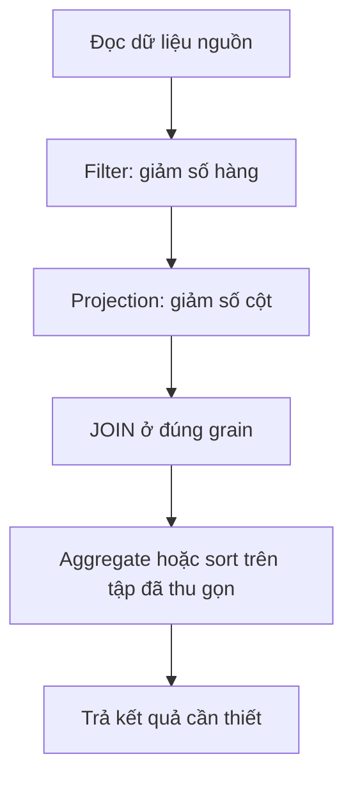

# Giảm số dòng, số cột và dữ liệu trung gian phải xử lý

Một truy vấn SQL thường tốn chi phí theo lượng dữ liệu phải đọc, số hàng đi qua các bước xử lý, độ rộng của mỗi hàng và lượng dữ liệu trung gian được tạo ra khi join, sort, group hoặc materialize. Tối ưu truy vấn vì vậy không chỉ là thêm index. Một cách tiếp cận hiệu quả là giảm sớm số hàng không cần thiết, chỉ lấy các cột thật sự dùng, kiểm soát số hàng phát sinh sau JOIN và tránh tạo các tập trung gian lớn hơn nhu cầu.

Ví dụ, báo cáo doanh thu tháng của một khách hàng không cần đọc mọi đơn hàng, mọi cột của đơn hàng và mọi dòng sản phẩm trong nhiều năm. Truy vấn nên giới hạn đúng khoảng thời gian, lọc đúng khách hàng, chỉ đọc các cột phục vụ tính toán và tổng hợp dữ liệu ở đúng grain trước khi ghép với bảng khác.

Bài học thuộc module **DATABASE_MYSQL**. Module hướng tới việc làm chủ MySQL từ thiết kế bảng, kiểu dữ liệu, khóa và truy vấn SQL đến index, transaction và kiểm soát đồng thời; đồng thời thực hành đọc kế hoạch thực thi, tối ưu truy vấn, phân quyền, sao lưu và xử lý các vấn đề vận hành cơ sở dữ liệu quan hệ. Trong chương **Tối ưu SQL**, bài này tập trung vào việc giảm số dòng, số cột và dữ liệu trung gian phải xử lý.

## 1. Ba nguồn chi phí cần giảm

Khi đọc một truy vấn, hãy tự hỏi ba câu:

1. **Có bao nhiêu hàng phải đọc và xử lý?** Điều kiện lọc có chọn lọc không? Truy vấn có quét cả bảng dù chỉ cần một phần nhỏ?
2. **Mỗi hàng có bao nhiêu dữ liệu phải mang theo?** Truy vấn có lấy `SELECT *`, cột `TEXT`/`BLOB` hoặc các cột không dùng đến không?
3. **Các bước trung gian tạo ra bao nhiêu hàng?** JOIN có nhân bản hàng? GROUP BY, DISTINCT, ORDER BY hoặc derived table có tạo tập lớn hơn cần thiết không?

Một truy vấn có thể đọc ít hàng nhưng vẫn tốn kém nếu mỗi hàng rất rộng. Ngược lại, hàng nhỏ nhưng join fan-out lớn cũng có thể tạo hàng triệu kết quả trung gian. Phải xem đồng thời số hàng, độ rộng hàng và số hàng sau từng bước.



Sơ đồ mô tả cách suy nghĩ khi thiết kế truy vấn. Optimizer có thể thay đổi thứ tự thực thi vật lý để giảm chi phí, nhưng truy vấn nên thể hiện rõ điều kiện và tập dữ liệu cần dùng.

## 2. Giảm số hàng bằng điều kiện lọc có chọn lọc

Điều kiện `WHERE` xác định hàng nào cần đi tiếp qua các bước sau. Nếu truy vấn chỉ cần đơn hàng của một khách hàng trong một tháng, hãy biểu diễn đủ hai giới hạn đó ngay trong truy vấn:

```sql
SELECT
    order_id,
    order_date,
    total_amount
FROM orders
WHERE customer_id = 42
  AND order_date >= '2026-01-01'
  AND order_date <  '2026-02-01';
```

Truy vấn này chỉ yêu cầu hàng của khách hàng 42 trong khoảng tháng 1/2026. Nếu bỏ điều kiện ngày, MySQL có thể phải đọc và xử lý toàn bộ lịch sử đơn hàng của khách hàng đó.

### 2.1. Dùng khoảng nửa mở cho thời gian

Với `DATETIME` hoặc `TIMESTAMP`, nên dùng khoảng từ đầu kỳ đến trước đầu kỳ kế tiếp:

```sql
WHERE created_at >= '2026-01-01 00:00:00'
  AND created_at <  '2026-02-01 00:00:00'
```

Cách này bao gồm mọi thời điểm trong tháng 1, kể cả phần giây lẻ, mà không cần đoán giá trị cuối ngày như `23:59:59.999999`. Nó cũng giữ cột ngày ở dạng trực tiếp trong predicate, thuận lợi cho range access trên index.

### 2.2. Tránh bọc cột index trong hàm khi có thể viết lại

Giả sử có index trên `created_at`. Truy vấn:

```sql
SELECT order_id, created_at
FROM orders
WHERE DATE(created_at) = '2026-01-15';
```

đặt hàm `DATE()` lên cột. Cách viết này thường khiến điều kiện khó dùng range access trực tiếp trên index `created_at`.

Viết lại thành khoảng:

```sql
SELECT order_id, created_at
FROM orders
WHERE created_at >= '2026-01-15 00:00:00'
  AND created_at <  '2026-01-16 00:00:00';
```

Tương tự, nếu có index trên `YEAR(created_at)` dưới dạng functional index hoặc generated column phù hợp thì optimizer có thể dùng trong trường hợp tương ứng; nhưng với index thường trên `created_at`, predicate range trực tiếp thường là lựa chọn rõ ràng.

### 2.3. Predicate sargable

Predicate được gọi là **sargable** khi có thể được chuyển thành điều kiện tìm kiếm phù hợp với index. Một số cách viết thường làm giảm khả năng dùng index:

| Cách viết khó tối ưu | Cách viết nên thử |
|---|---|
| `DATE(created_at) = '2026-01-15'` | Khoảng `created_at >= ... AND created_at < ...` |
| `YEAR(order_date) = 2025` trên index thường của `order_date` | Khoảng ngày từ đầu 2025 đến trước đầu 2026 |
| `CAST(customer_id AS CHAR) = '42'` | So sánh `customer_id = 42` đúng kiểu dữ liệu |
| `price * quantity > 1000` | Nếu phù hợp nghiệp vụ, biến đổi thành điều kiện tương đương trên một vế; kiểm tra kiểu và phép toán |
| `name LIKE '%son'` | Không có cách B-tree range đơn giản cho wildcard đầu; cân nhắc full-text hoặc mô hình tìm kiếm khác |

Không phải mọi hàm trong predicate đều luôn làm mất index. MySQL có thể tối ưu một số biểu thức hoặc dùng functional index. Hãy xem `EXPLAIN` thay vì kết luận chỉ từ hình thức câu SQL.

### 2.4. Kiểu dữ liệu của hai vế so sánh phải tương thích

Nếu `customer_id` là `BIGINT` nhưng ứng dụng truyền một chuỗi không chuẩn, MySQL có thể phải chuyển kiểu và việc dùng index có thể bị ảnh hưởng tùy biểu thức. Hãy truyền tham số đúng kiểu:

```sql
-- Nên truyền tham số số nguyên cho customer_id.
SELECT order_id
FROM orders
WHERE customer_id = 42;
```

Tránh ép kiểu cột trong predicate chỉ để khớp với giá trị đầu vào. Chuẩn hóa kiểu dữ liệu ở tầng ứng dụng hoặc chuyển kiểu ở phía hằng số khi cần.

## 3. Giảm số cột bằng projection

Projection là chọn ra những cột cần thiết. Truy vấn:

```sql
SELECT *
FROM orders
WHERE customer_id = 42;
```

có thể đọc và truyền nhiều cột mà ứng dụng không dùng. Nếu bảng có JSON, địa chỉ giao hàng, ghi chú dài hoặc payload lớn, lượng dữ liệu truyền qua buffer, mạng và client có thể tăng đáng kể.

Viết rõ danh sách cột:

```sql
SELECT
    order_id,
    order_date,
    total_amount
FROM orders
WHERE customer_id = 42;
```

Lợi ích:

- Giảm số byte phải đọc hoặc đưa qua các iterator.
- Có cơ hội dùng covering index nếu các cột cần thiết đã có trong index.
- Giảm dữ liệu truyền qua mạng và cấp phát bộ nhớ ở client.
- Làm rõ hợp đồng dữ liệu của truy vấn, tránh phụ thuộc vào cột mới được thêm vào bảng.

### 3.1. Không lấy cột lớn nếu chưa cần

Ví dụ bảng `documents` có:

```sql
CREATE TABLE documents (
    document_id BIGINT NOT NULL PRIMARY KEY,
    owner_id BIGINT NOT NULL,
    title VARCHAR(200) NOT NULL,
    created_at DATETIME NOT NULL,
    body LONGTEXT NOT NULL,
    attachment LONGBLOB NULL,
    KEY idx_documents_owner_created (owner_id, created_at)
) ENGINE = InnoDB;
```

Màn hình danh sách chỉ cần tiêu đề và ngày tạo:

```sql
SELECT document_id, title, created_at
FROM documents
WHERE owner_id = 42
ORDER BY created_at DESC
LIMIT 50;
```

Không nên lấy `body` và `attachment` cho danh sách nếu người dùng chỉ mở nội dung khi chọn một tài liệu. Tách truy vấn danh sách và truy vấn chi tiết giúp giảm payload và có thể giúp danh sách được phục vụ từ index phù hợp.

### 3.2. Projection trong JOIN

Tránh lấy toàn bộ cột của cả hai bảng:

```sql
SELECT *
FROM orders AS o
JOIN customers AS c
    ON c.customer_id = o.customer_id
WHERE o.order_date >= '2026-01-01';
```

Chỉ chọn cột thật sự cần:

```sql
SELECT
    o.order_id,
    o.order_date,
    o.total_amount,
    c.customer_name
FROM orders AS o
JOIN customers AS c
    ON c.customer_id = o.customer_id
WHERE o.order_date >= '2026-01-01';
```

Điều này cũng tránh cột trùng tên và giúp truy vấn không bị thay đổi kết quả trả về ngoài ý muốn khi schema thêm cột.

## 4. Giảm dữ liệu trung gian khi JOIN

JOIN tạo tổ hợp hàng theo điều kiện nối. Nếu một hàng bên trái khớp với nhiều hàng bên phải, số hàng kết quả tăng theo quan hệ một-nhiều. Đây là hành vi đúng của JOIN, nhưng có thể gây fan-out lớn nếu truy vấn chỉ cần kiểm tra sự tồn tại hoặc tổng hợp ở grain khác.

Giả sử:

- Một khách hàng có nhiều đơn hàng.
- Một đơn hàng có nhiều dòng sản phẩm.
- Một khách hàng có nhiều địa chỉ.

Nếu nối đồng thời đơn hàng, dòng sản phẩm và địa chỉ theo `customer_id`, số hàng trung gian có thể là tích của số đơn, số dòng và số địa chỉ của khách hàng.

### 4.1. Chỉ cần biết có hàng phù hợp: dùng EXISTS

Yêu cầu: tìm khách hàng có ít nhất một đơn đã thanh toán.

Một cách viết dễ gây nhân bản là:

```sql
SELECT
    c.customer_id,
    c.customer_name
FROM customers AS c
JOIN orders AS o
    ON o.customer_id = c.customer_id
WHERE o.status = 'PAID';
```

Nếu khách hàng có năm đơn PAID, khách hàng đó xuất hiện năm lần. Nếu chỉ cần kiểm tra tồn tại, dùng `EXISTS`:

```sql
SELECT
    c.customer_id,
    c.customer_name
FROM customers AS c
WHERE EXISTS (
    SELECT 1
    FROM orders AS o
    WHERE o.customer_id = c.customer_id
      AND o.status = 'PAID'
);
```

`EXISTS` biểu đạt semi-join: trả mỗi hàng khách hàng một lần nếu có ít nhất một hàng đơn phù hợp. Optimizer MySQL có thể chuyển truy vấn thành chiến lược semi-join thích hợp.

### 4.2. Không dùng DISTINCT để che fan-out không hiểu rõ

Có thể viết:

```sql
SELECT DISTINCT
    c.customer_id,
    c.customer_name
FROM customers AS c
JOIN orders AS o
    ON o.customer_id = c.customer_id
WHERE o.status = 'PAID';
```

Truy vấn trả mỗi khách hàng một lần, nhưng JOIN vẫn có thể tạo nhiều hàng trước bước loại trùng. `DISTINCT` có thể cần sort hoặc temporary table. Nếu mục tiêu chỉ là kiểm tra có đơn, `EXISTS` diễn đạt ý định trực tiếp hơn và thường tránh tạo fan-out không cần thiết.

`DISTINCT` vẫn đúng khi nghiệp vụ thực sự yêu cầu loại các hàng kết quả trùng nhau; không nên thay thế nó bằng `EXISTS` nếu cần trả dữ liệu từ từng hàng bên phải.

## 5. Tổng hợp trước khi JOIN để giảm fan-out

Giả sử cần báo cáo tổng doanh thu theo khách hàng và số địa chỉ của mỗi khách hàng. Nếu join trực tiếp `orders` với `customer_addresses`, mỗi đơn hàng có thể bị nhân lên theo số địa chỉ:

```sql
SELECT
    c.customer_id,
    SUM(o.total_amount) AS revenue,
    COUNT(a.address_id) AS address_count
FROM customers AS c
LEFT JOIN orders AS o
    ON o.customer_id = c.customer_id
LEFT JOIN customer_addresses AS a
    ON a.customer_id = c.customer_id
GROUP BY c.customer_id;
```

Nếu một khách hàng có 5 đơn và 3 địa chỉ, kết quả JOIN trung gian có thể có 15 hàng. `SUM(o.total_amount)` khi đó bị nhân lên ba lần. `COUNT(a.address_id)` cũng bị nhân theo số đơn.

Giải pháp là tổng hợp mỗi bảng con về đúng grain trước khi JOIN:

```sql
WITH order_totals AS (
    SELECT
        customer_id,
        SUM(total_amount) AS revenue,
        COUNT(*) AS order_count
    FROM orders
    GROUP BY customer_id
),
address_totals AS (
    SELECT
        customer_id,
        COUNT(*) AS address_count
    FROM customer_addresses
    GROUP BY customer_id
)
SELECT
    c.customer_id,
    c.customer_name,
    COALESCE(o.revenue, 0) AS revenue,
    COALESCE(o.order_count, 0) AS order_count,
    COALESCE(a.address_count, 0) AS address_count
FROM customers AS c
LEFT JOIN order_totals AS o
    ON o.customer_id = c.customer_id
LEFT JOIN address_totals AS a
    ON a.customer_id = c.customer_id;
```

`order_totals` có tối đa một hàng mỗi khách hàng; `address_totals` cũng vậy. Khi join hai tập đã tổng hợp với `customers`, không còn fan-out giữa từng đơn và từng địa chỉ. Đây là **pre-aggregation**.

### 5.1. Xác định grain trước khi tổng hợp

Trước khi viết aggregate, hãy trả lời:

- Một hàng trong bảng nguồn đại diện cho điều gì?
- Kết quả cần một hàng cho mỗi khách hàng, mỗi đơn hàng, mỗi ngày hay mỗi sản phẩm?
- Những bảng con có quan hệ một-nhiều nào sẽ làm tăng số hàng khi join?
- Có thể tổng hợp từng nhánh về cùng grain trước khi ghép không?

Nếu tổng hợp sai grain, truy vấn có thể chạy nhanh nhưng số liệu sai. Đúng kết quả là điều kiện đầu tiên; giảm dữ liệu trung gian phải giữ nguyên ý nghĩa nghiệp vụ.

### 5.2. Lọc trước khi aggregate

Nếu chỉ cần đơn đã thanh toán trong một khoảng thời gian, hãy giới hạn tập đầu vào trước khi nhóm:

```sql
SELECT
    customer_id,
    SUM(total_amount) AS paid_revenue
FROM orders
WHERE status = 'PAID'
  AND order_date >= '2026-01-01'
  AND order_date <  '2026-02-01'
GROUP BY customer_id;
```

Không cần tổng hợp toàn bộ lịch sử rồi mới lọc theo ngày nếu nghiệp vụ chỉ yêu cầu một khoảng thời gian. Optimizer có thể đẩy một số predicate xuống dưới các bước, nhưng viết điều kiện đúng ở query block thích hợp giúp logic rõ ràng và tạo cơ hội tối ưu.

## 6. Giảm số hàng trả về bằng LIMIT đúng cách

Nếu giao diện chỉ hiển thị 20 bản ghi đầu, không cần trả hàng trăm nghìn hàng cho ứng dụng:

```sql
SELECT order_id, order_date, total_amount
FROM orders
WHERE customer_id = 42
ORDER BY order_date DESC, order_id DESC
LIMIT 20;
```

`LIMIT` giới hạn số hàng trả về. Nếu có index hỗ trợ điều kiện và thứ tự, MySQL có thể dừng đọc sớm sau khi tìm đủ số hàng cần thiết.

Tuy nhiên, `LIMIT` không tự làm truy vấn rẻ nếu MySQL vẫn phải quét, join hoặc sort một tập rất lớn trước khi xác định 20 hàng cuối. Hãy xem execution plan.

### 6.1. Phân trang bằng OFFSET

```sql
SELECT order_id, order_date, total_amount
FROM orders
WHERE customer_id = 42
ORDER BY order_date DESC, order_id DESC
LIMIT 20 OFFSET 100000;
```

Với OFFSET lớn, MySQL vẫn phải tìm và bỏ qua nhiều hàng trước khi trả 20 hàng tiếp theo. Chi phí có thể tăng theo độ sâu trang.

### 6.2. Keyset pagination

Nếu thứ tự phân trang là `(order_date DESC, order_id DESC)`, trang tiếp theo có thể bắt đầu sau khóa cuối của trang trước:

```sql
SELECT order_id, order_date, total_amount
FROM orders
WHERE customer_id = 42
  AND (
      order_date < '2026-01-15'
      OR (
          order_date = '2026-01-15'
          AND order_id < 900100
      )
  )
ORDER BY order_date DESC, order_id DESC
LIMIT 20;
```

Các giá trị ngày và mã đơn ở đây là cursor cuối của trang trước. Cách này tránh bỏ qua hàng loạt entry như OFFSET lớn và thường ổn định hơn khi dữ liệu mới được thêm vào đầu danh sách.

Để hỗ trợ truy vấn, có thể đánh giá index ghép:

```sql
CREATE INDEX idx_orders_customer_date_id
ON orders (customer_id, order_date, order_id);
```

Keyset pagination cần thứ tự có tính xác định. Nếu chỉ `ORDER BY order_date` mà nhiều đơn cùng ngày, trang có thể bị lặp hoặc bỏ sót hàng. Thêm khóa duy nhất làm tie-breaker.

### 6.3. Không đẩy LIMIT xuống trước JOIN nếu làm đổi kết quả

Giả sử cần 20 đơn hàng mới nhất cùng tên khách hàng. Giới hạn đơn hàng trước rồi mới join khách hàng là hợp lý nếu quan hệ khách hàng là một-một theo khóa:

```sql
SELECT
    recent.order_id,
    recent.order_date,
    recent.total_amount,
    c.customer_name
FROM (
    SELECT order_id, customer_id, order_date, total_amount
    FROM orders
    ORDER BY order_date DESC, order_id DESC
    LIMIT 20
) AS recent
JOIN customers AS c
    ON c.customer_id = recent.customer_id
ORDER BY recent.order_date DESC, recent.order_id DESC;
```

Nhưng không được tùy tiện giới hạn một bảng trước JOIN nếu điều đó thay đổi tập hàng cần xét, ví dụ khi điều kiện lọc phụ thuộc vào bảng được join hoặc khi một hàng bên trái có nhiều hàng bên phải và nghiệp vụ muốn lấy 20 tổ hợp sau JOIN.

## 7. Derived table và CTE: giảm dữ liệu nhưng hiểu cách optimizer xử lý

Derived table và CTE giúp tách truy vấn thành các bước. Chúng cũng có thể giúp giới hạn cột, lọc hoặc aggregate trước khi join:

```sql
SELECT
    c.customer_id,
    c.customer_name,
    o.paid_revenue
FROM customers AS c
JOIN (
    SELECT customer_id, SUM(total_amount) AS paid_revenue
    FROM orders
    WHERE status = 'PAID'
      AND order_date >= '2026-01-01'
      AND order_date <  '2026-02-01'
    GROUP BY customer_id
) AS o
    ON o.customer_id = c.customer_id;
```

Derived table chỉ mang ra `customer_id` và `paid_revenue`; không cần chuyển mọi cột của `orders` sang bước ngoài.

### 7.1. CTE không phải lúc nào cũng materialize

MySQL có thể merge một CTE/derived table vào query block ngoài hoặc materialize kết quả trung gian, tùy cấu trúc truy vấn và quyết định của optimizer. Vì vậy:

- Không mặc định CTE luôn tạo temporary table.
- Không mặc định CTE luôn được tính đúng một lần.
- Không mặc định CTE nhanh hơn derived table.
- Không dùng CTE như một cơ chế cache qua nhiều câu lệnh.

Nếu CTE có `GROUP BY`, `DISTINCT`, `LIMIT`, window function hoặc một số cấu trúc khác, optimizer có thể không merge nó trong một số trường hợp và phải materialize. Khi đó, giảm số hàng và số cột bên trong CTE càng quan trọng.

### 7.2. Chỉ materialize tập dữ liệu cần dùng

Ví dụ không nên:

```sql
WITH all_order_details AS (
    SELECT *
    FROM orders
)
SELECT customer_id, COUNT(*)
FROM all_order_details
WHERE status = 'PAID'
GROUP BY customer_id;
```

Viết trực tiếp và chỉ lấy dữ liệu cần:

```sql
WITH paid_order_counts AS (
    SELECT customer_id, COUNT(*) AS order_count
    FROM orders
    WHERE status = 'PAID'
    GROUP BY customer_id
)
SELECT customer_id, order_count
FROM paid_order_counts;
```

CTE thứ hai chỉ mang theo khóa nhóm và số đếm, thay vì mọi cột đơn hàng. Nó cũng thể hiện rõ điều kiện lọc và bước tổng hợp.

## 8. UNION ALL và UNION

`UNION` loại bỏ các hàng trùng nhau giữa các nhánh. Để loại trùng, MySQL có thể cần thêm bước xử lý và lưu trữ trung gian. Nếu nghiệp vụ cho phép giữ nguyên các hàng từ từng nhánh, dùng `UNION ALL`:

```sql
SELECT order_id, order_date
FROM current_orders
WHERE order_date >= '2026-01-01'

UNION ALL

SELECT order_id, order_date
FROM archived_orders
WHERE order_date < '2026-01-01';
```

Nếu yêu cầu thật sự là tập kết quả duy nhất, `UNION` mới là lựa chọn đúng:

```sql
SELECT email FROM customer_emails
UNION
SELECT email FROM supplier_emails;
```

Không đổi `UNION` thành `UNION ALL` chỉ để tăng tốc nếu ứng dụng cần loại trùng. Tối ưu phải giữ nguyên semantics.

## 9. Giảm dữ liệu qua GROUP BY và DISTINCT

`GROUP BY` và `DISTINCT` thường tạo bước tổng hợp hoặc loại trùng. Để giảm chi phí:

- Lọc hàng trước khi nhóm nếu điều kiện không phụ thuộc kết quả aggregate.
- Chỉ nhóm theo những cột cần thiết.
- Tránh đưa cột mô tả không cần thiết vào `GROUP BY`, vì nó có thể làm tăng số nhóm.
- Kiểm tra fan-out trước khi aggregate sau JOIN.
- Không dùng `DISTINCT` để che một quan hệ JOIN sai.

Ví dụ:

```sql
SELECT
    customer_id,
    SUM(total_amount) AS revenue
FROM orders
WHERE status = 'PAID'
  AND order_date >= '2026-01-01'
  AND order_date <  '2027-01-01'
GROUP BY customer_id;
```

Đây là tổng hợp theo grain một hàng mỗi khách hàng. Nếu thêm `order_id` vào `GROUP BY`, mỗi đơn có thể trở thành một nhóm riêng và kết quả không còn là tổng theo khách hàng.

## 10. Chỉ giữ dữ liệu trung gian cần cho bước tiếp theo

Trong pipeline truy vấn nhiều bước, mỗi bước nên chuyển tiếp các cột cần cho bước sau. Ví dụ:

```sql
WITH
filtered_orders AS (
    SELECT order_id, customer_id, total_amount
    FROM orders
    WHERE status = 'PAID'
      AND order_date >= '2026-01-01'
      AND order_date <  '2026-02-01'
),
customer_totals AS (
    SELECT
        customer_id,
        SUM(total_amount) AS revenue
    FROM filtered_orders
    GROUP BY customer_id
)
SELECT customer_id, revenue
FROM customer_totals
WHERE revenue >= 1000000;
```

`filtered_orders` bỏ các cột không dùng; `customer_totals` thu gọn nhiều đơn thành một hàng mỗi khách hàng. Truy vấn cuối chỉ đọc hai cột.

Nếu truy vấn nguồn còn phải mang `order_id` nhưng bước tổng hợp không sử dụng nó, hãy cân nhắc bỏ `order_id` khỏi CTE nguồn để giảm payload trung gian. Không cần giữ cột chỉ vì nó có sẵn trong bảng.

## 11. Dùng index để giảm hàng phải đọc

Index giúp MySQL tìm một phần dữ liệu thay vì quét toàn bộ bảng. Nhưng index phải phù hợp với predicate và thứ tự truy cập của truy vấn.

Ví dụ truy vấn:

```sql
SELECT order_id, order_date, total_amount
FROM orders
WHERE customer_id = 42
  AND status = 'PAID'
  AND order_date >= '2026-01-01'
  AND order_date <  '2026-02-01';
```

Một index ghép để thử nghiệm:

```sql
CREATE INDEX idx_orders_customer_status_date
ON orders (customer_id, status, order_date);
```

Index đặt hai điều kiện equality trước, rồi đến cột range theo ngày. Thứ tự này có thể giúp tìm đúng range nhỏ hơn. Cần xác minh bằng `EXPLAIN`, vì hiệu quả còn phụ thuộc độ chọn lọc, phân bố dữ liệu và các truy vấn khác cùng dùng index.

### 11.1. Index không thay thế điều kiện lọc

Nếu truy vấn không có predicate giới hạn phạm vi, index không tự biết ứng dụng chỉ muốn một phần dữ liệu. Ví dụ:

```sql
SELECT order_id, order_date, total_amount
FROM orders
ORDER BY order_date DESC;
```

Truy vấn này yêu cầu toàn bộ đơn hàng theo thứ tự ngày. Index có thể giúp cung cấp thứ tự, nhưng vẫn có thể phải đọc rất nhiều entry. Nếu giao diện chỉ cần một trang, hãy dùng `LIMIT` và cursor phù hợp.

### 11.2. Covering index giảm cả hàng đọc bổ sung

Nếu index chứa mọi cột truy vấn cần, MySQL có thể đọc kết quả trực tiếp từ index mà không cần tra clustered record trong trường hợp thông thường. Điều này giảm thêm lượt truy cập dữ liệu.

Ví dụ index `(customer_id, status, order_date, total_amount)` có thể bao phủ truy vấn ở đầu mục này nếu `order_id` là primary key InnoDB được lưu kèm trong secondary index. Tuy nhiên, thêm cột làm index rộng hơn và tăng chi phí ghi. Chỉ tạo covering index khi workload chứng minh lợi ích.

### 11.3. Không tạo index cho mọi tổ hợp điều kiện

Index làm giảm lượng dữ liệu phải đọc nhưng cũng có chi phí:

- Mỗi `INSERT`, `DELETE` và `UPDATE` liên quan phải duy trì index.
- Index rộng chiếm buffer pool và dung lượng lưu trữ.
- Nhiều index gần giống nhau tăng chi phí ghi và quản trị.

Thiết kế index theo nhóm truy vấn thực tế, không tạo một index riêng cho mọi biến thể `WHERE`.

## 12. WHERE và HAVING: lọc đúng giai đoạn

`WHERE` lọc hàng nguồn trước khi nhóm. `HAVING` lọc nhóm sau khi aggregate. Nếu điều kiện không phụ thuộc aggregate, đưa vào `WHERE` để giảm số hàng đầu vào:

```sql
-- Chỉ nhóm đơn PAID trong năm 2025.
SELECT
    customer_id,
    SUM(total_amount) AS revenue
FROM orders
WHERE status = 'PAID'
  AND order_date >= '2025-01-01'
  AND order_date <  '2026-01-01'
GROUP BY customer_id
HAVING SUM(total_amount) >= 1000000;
```

Ở đây:

- `status` và `order_date` là điều kiện trên từng hàng, nên đặt trong `WHERE`.
- `SUM(total_amount) >= 1000000` là điều kiện trên kết quả tổng hợp, nên đặt trong `HAVING`.

Không viết mọi điều kiện vào `HAVING` theo thói quen. Ví dụ sau còn không hợp lệ trong chế độ `ONLY_FULL_GROUP_BY` nếu `status` không phụ thuộc hàm vào khóa nhóm:

```sql
SELECT customer_id, SUM(total_amount) AS revenue
FROM orders
GROUP BY customer_id
HAVING status = 'PAID';
```

Hãy lọc status trong `WHERE` trước khi aggregate.

## 13. Kiểm soát sort, temporary table và dữ liệu trung gian

Một số thao tác có thể cần lưu hoặc sắp xếp dữ liệu trung gian:

- `ORDER BY` không được đáp ứng bằng thứ tự index phù hợp.
- `GROUP BY` cần gom các hàng theo nhóm.
- `DISTINCT` cần loại trùng.
- Derived table hoặc CTE phải materialize.
- Một số phép join hoặc window function cần sắp xếp/temporary structure.

Không phải cứ thấy `Using temporary` hoặc `Using filesort` là truy vấn chắc chắn chậm. Hãy xem số hàng thực tế, kích thước dữ liệu, thời gian và tần suất chạy.

### 13.1. Giảm dữ liệu trước khi sort

Nếu chỉ cần 20 đơn hàng gần nhất của một khách hàng, hãy lọc khách hàng trước khi sắp xếp:

```sql
SELECT order_id, order_date, total_amount
FROM orders
WHERE customer_id = 42
ORDER BY order_date DESC, order_id DESC
LIMIT 20;
```

Index `(customer_id, order_date, order_id)` có thể giúp vừa giới hạn khách hàng vừa cung cấp thứ tự. Nếu không có index phù hợp, MySQL có thể phải sort nhiều hàng của khách hàng đó rồi mới lấy 20 hàng.

### 13.2. Chỉ sort cột cần thiết

Tránh đưa các payload lớn vào truy vấn chỉ để sắp xếp danh sách. Có thể chọn khóa của 20 hàng trước rồi đọc chi tiết sau:

```sql
WITH page_orders AS (
    SELECT order_id
    FROM orders
    WHERE customer_id = 42
    ORDER BY order_date DESC, order_id DESC
    LIMIT 20
)
SELECT
    o.order_id,
    o.order_date,
    o.total_amount,
    o.shipping_address,
    o.note
FROM page_orders AS p
JOIN orders AS o
    ON o.order_id = p.order_id
ORDER BY o.order_date DESC, o.order_id DESC;
```

Ý tưởng là xác định tập khóa nhỏ trước, sau đó mới đọc các cột chi tiết cho trang hiện tại. Cách này có thể hữu ích khi cột chi tiết lớn; vẫn cần đo execution plan vì optimizer có thể merge hoặc xử lý CTE theo cách khác.

## 14. Tránh các phép biến đổi làm tăng số hàng

Một số lỗi thiết kế khiến dữ liệu trung gian phình to:

### 14.1. JOIN thiếu điều kiện

```sql
-- Nguy hiểm: không có điều kiện nối, có thể tạo Cartesian product.
SELECT *
FROM orders AS o
JOIN order_items AS i;
```

Nếu bảng A có 10.000 hàng và bảng B có 5.000 hàng, Cartesian product lý thuyết có thể tạo 50 triệu cặp hàng.

Viết điều kiện nối đầy đủ:

```sql
SELECT
    o.order_id,
    i.product_id,
    i.quantity
FROM orders AS o
JOIN order_items AS i
    ON i.order_id = o.order_id;
```

### 14.2. Nối sai grain

Nếu `orders` có một hàng mỗi đơn và `order_items` có nhiều hàng mỗi đơn, kết quả join có một hàng mỗi dòng sản phẩm. Không được cộng `orders.total_amount` sau khi join mà không điều chỉnh, vì tổng đơn sẽ bị lặp theo số item.

Nếu cần tổng tiền đơn và số item, hãy tổng hợp item trước hoặc giữ từng metric ở đúng grain:

```sql
WITH item_totals AS (
    SELECT
        order_id,
        COUNT(*) AS item_count,
        SUM(quantity * unit_price) AS calculated_total
    FROM order_items
    GROUP BY order_id
)
SELECT
    o.order_id,
    o.total_amount,
    COALESCE(i.item_count, 0) AS item_count,
    COALESCE(i.calculated_total, 0) AS calculated_total
FROM orders AS o
LEFT JOIN item_totals AS i
    ON i.order_id = o.order_id;
```

### 14.3. Dùng scalar subquery khi cần một giá trị có thể tổng hợp trước

Một correlated subquery có thể phù hợp khi chỉ cần một giá trị cho mỗi hàng ngoài:

```sql
SELECT
    c.customer_id,
    c.customer_name,
    (
        SELECT MAX(o.order_date)
        FROM orders AS o
        WHERE o.customer_id = c.customer_id
    ) AS last_order_date
FROM customers AS c;
```

Với số lượng khách hàng lớn, hãy kiểm tra số lần thực thi và index tương quan. Một cách khác là tổng hợp một lần theo khách hàng rồi join:

```sql
WITH last_orders AS (
    SELECT customer_id, MAX(order_date) AS last_order_date
    FROM orders
    GROUP BY customer_id
)
SELECT
    c.customer_id,
    c.customer_name,
    l.last_order_date
FROM customers AS c
LEFT JOIN last_orders AS l
    ON l.customer_id = c.customer_id;
```

Không có cách nào luôn tốt hơn. Optimizer có thể decorrelate một số subquery; cách tổng hợp trước có thể materialize một tập lớn nếu chỉ cần vài khách hàng. So sánh kế hoạch và số hàng thực tế.

## 15. Đọc EXPLAIN để biết dữ liệu giảm ở đâu

Không thể kết luận truy vấn tốt chỉ vì câu SQL ngắn hoặc có CTE. Hãy kiểm tra kế hoạch thực thi:

```sql
EXPLAIN
SELECT
    order_id,
    order_date,
    total_amount
FROM orders
WHERE customer_id = 42
  AND status = 'PAID'
  AND order_date >= '2026-01-01'
  AND order_date <  '2026-02-01';
```

Các cột cần chú ý:

| Cột EXPLAIN | Câu hỏi cần trả lời |
|---|---|
| `type` | MySQL dùng kiểu truy cập nào: `range`, `ref`, `eq_ref`, `index`, `ALL`? |
| `possible_keys` | Index nào có thể hỗ trợ điều kiện? |
| `key` | Index nào thực sự được chọn? |
| `key_len` | Bao nhiêu phần của key được sử dụng? |
| `rows` | MySQL ước lượng phải đọc bao nhiêu hàng ở bước này? |
| `filtered` | Tỷ lệ phần trăm hàng ước lượng còn lại sau điều kiện lọc là bao nhiêu? |
| `Extra` | Có `Using where`, `Using index`, `Using temporary`, `Using filesort` hay thông tin khác? |

`rows` và `filtered` là ước lượng, không phải số hàng chính xác. Với join nhiều bảng, số hàng trung gian và thứ tự join có thể làm tổng chi phí khác xa điều nhìn thấy ở một dòng riêng lẻ.

### 15.1. EXPLAIN FORMAT=JSON

JSON cung cấp thêm thông tin về điều kiện, ước lượng hàng và cấu trúc join:

```sql
EXPLAIN FORMAT=JSON
SELECT
    c.customer_id,
    c.customer_name
FROM customers AS c
WHERE EXISTS (
    SELECT 1
    FROM orders AS o
    WHERE o.customer_id = c.customer_id
      AND o.status = 'PAID'
);
```

Đọc các thông tin như access type, chosen key, attached condition, estimated rows và cấu trúc semi-join nếu optimizer áp dụng. Tên trường và cấu trúc JSON có thể khác theo phiên bản.

### 15.2. EXPLAIN ANALYZE

Trên MySQL 8.0.18 trở lên:

```sql
EXPLAIN ANALYZE
SELECT
    customer_id,
    SUM(total_amount) AS revenue
FROM orders
WHERE status = 'PAID'
  AND order_date >= '2026-01-01'
  AND order_date <  '2026-02-01'
GROUP BY customer_id;
```

`EXPLAIN ANALYZE` thực thi truy vấn và cho biết số hàng thực tế, thời gian và số vòng lặp của iterator. Dùng trên truy vấn đọc phù hợp và môi trường có kiểm soát; nó thực sự chạy câu SQL, không chỉ ước lượng.

### 15.3. So sánh estimate với actual

Nếu `rows` ước lượng rất thấp nhưng `EXPLAIN ANALYZE` cho thấy số hàng thực tế lớn, optimizer có thể chọn join order hoặc access path chưa phù hợp. Nguyên nhân có thể là thống kê cũ, phân bố dữ liệu lệch hoặc tương quan giữa các cột.

Không thêm index ngay khi thấy số hàng cao. Hãy kiểm tra:

- Predicate có lọc đúng nghiệp vụ không?
- Cột so sánh có đúng kiểu dữ liệu không?
- Có function hoặc phép chuyển kiểu trên cột không?
- Index có bắt đầu bằng các cột phù hợp không?
- Thống kê bảng/index có đủ mới không?
- Join có bị fan-out do sai grain không?

## 16. Quy trình tối ưu một truy vấn

Thực hiện theo trình tự để mỗi thay đổi có thể đo được:

1. **Ghi lại truy vấn gốc.** Lưu SQL, tham số, số hàng trả về và thời gian đo.
2. **Xác định kết quả cần thiết.** Viết rõ grain, cột cần trả về và điều kiện nghiệp vụ.
3. **Giảm hàng đầu vào.** Thêm predicate đúng, dùng khoảng ngày nửa mở và tránh đọc toàn bộ lịch sử nếu không cần.
4. **Giảm cột.** Bỏ `SELECT *`, payload lớn và các cột không dùng ở bước tiếp theo.
5. **Kiểm tra fan-out.** Xác định cardinality của từng JOIN; dùng `EXISTS` nếu chỉ cần kiểm tra tồn tại.
6. **Tổng hợp trước khi JOIN.** Thu gọn từng nhánh về đúng grain khi tránh được nhân bản dữ liệu.
7. **Giảm sort và materialization.** Chỉ sắp xếp/tổng hợp tập đã lọc; xem xét `LIMIT` và keyset pagination.
8. **Thiết kế index có căn cứ.** Dựa trên equality, range, join, order và cột cần cover.
9. **Đọc EXPLAIN.** Kiểm tra access path, index, số hàng ước lượng và bước xử lý bổ sung.
10. **Đo EXPLAIN ANALYZE.** So sánh số hàng/thời gian thực tế trên dữ liệu đại diện.
11. **So sánh kết quả.** Đảm bảo truy vấn mới trả đúng cùng kết quả nghiệp vụ.
12. **Đo toàn workload.** Kiểm tra truy vấn liên quan và chi phí ghi sau khi thêm index hoặc thay đổi cấu trúc.

## 17. Ví dụ tổng hợp: tối ưu báo cáo doanh thu

Yêu cầu: hiển thị 20 khách hàng có doanh thu từ đơn đã thanh toán cao nhất trong tháng 1/2026, kèm tên khách hàng.

### 17.1. Truy vấn chưa tối ưu

```sql
SELECT DISTINCT
    c.customer_id,
    c.customer_name,
    o.order_id,
    o.order_date,
    o.total_amount
FROM customers AS c
JOIN orders AS o
    ON o.customer_id = c.customer_id
JOIN order_items AS i
    ON i.order_id = o.order_id
WHERE YEAR(o.order_date) = 2026
  AND MONTH(o.order_date) = 1
  AND o.status = 'PAID'
ORDER BY o.total_amount DESC;
```

Vấn đề:

- Truy vấn lấy từng đơn và từng dòng item dù báo cáo cần doanh thu theo khách hàng.
- JOIN `order_items` có thể nhân bản đơn theo số dòng sản phẩm.
- `DISTINCT` có thể phải loại nhiều hàng trùng sau khi JOIN.
- `YEAR()` và `MONTH()` bọc cột ngày, gây khó khăn cho range access trên index thường của `order_date`.
- Không có aggregate theo khách hàng nên kết quả chưa đúng grain yêu cầu.

### 17.2. Truy vấn theo đúng grain và giảm dữ liệu

```sql
WITH customer_revenue AS (
    SELECT
        customer_id,
        SUM(total_amount) AS revenue
    FROM orders
    WHERE status = 'PAID'
      AND order_date >= '2026-01-01'
      AND order_date <  '2026-02-01'
    GROUP BY customer_id
)
SELECT
    c.customer_id,
    c.customer_name,
    r.revenue
FROM customer_revenue AS r
JOIN customers AS c
    ON c.customer_id = r.customer_id
ORDER BY r.revenue DESC, c.customer_id
LIMIT 20;
```

Điểm cải thiện:

- Lọc đơn theo trạng thái và khoảng ngày ngay ở nguồn.
- Không JOIN `order_items` vì báo cáo dùng `orders.total_amount`.
- Aggregate về một hàng mỗi khách hàng trước khi join tên.
- Chỉ giữ `customer_id` và `revenue` trong tập trung gian.
- Sort trên tập đã thu gọn theo khách hàng thay vì từng dòng item.
- Chỉ trả 20 khách hàng.

Index ứng viên để thử:

```sql
CREATE INDEX idx_orders_status_date_customer_amount
ON orders (status, order_date, customer_id, total_amount);
```

Đây chỉ là ứng viên dựa trên predicate và cột cần. Nếu `status` có độ chọn lọc thấp hoặc workload có nhiều truy vấn theo khách hàng trước, index khác có thể phù hợp hơn. Hãy đo bằng `EXPLAIN`/`EXPLAIN ANALYZE` và cân nhắc chi phí ghi.

### 17.3. Xác minh tính đúng

Nếu nghiệp vụ định nghĩa doanh thu là tổng các dòng sản phẩm thay vì `orders.total_amount`, phải aggregate `order_items` theo đơn hoặc khách hàng trước khi join. Không bỏ bảng item chỉ vì truy vấn ít hàng hơn nếu điều đó làm thay đổi định nghĩa doanh thu.

Tối ưu truy vấn cần giữ nguyên:

- Điều kiện đơn nào được tính.
- Khoảng thời gian và quy tắc biên ngày.
- Grain của kết quả.
- Định nghĩa doanh thu và cách xử lý đơn hủy/hoàn tiền.
- Cách xử lý khách hàng không có đơn phù hợp.

## 18. Những lỗi thường gặp

| Lỗi | Hậu quả | Cách sửa |
|---|---|---|
| Dùng `SELECT *` trong truy vấn danh sách | Đọc và truyền cột không cần, có thể mang payload lớn | Chọn rõ cột cần thiết. |
| Lọc ngày bằng `YEAR()`/`MONTH()` trên cột có index thường | Có thể làm mất range access trực tiếp | Dùng khoảng ngày nửa mở. |
| JOIN bảng một-nhiều rồi SUM metric của bảng một | Số tiền bị nhân theo số hàng bên nhiều | Aggregate trước hoặc tính metric ở đúng grain. |
| Dùng JOIN khi chỉ cần kiểm tra tồn tại | Nhân bản hàng rồi phải DISTINCT | Dùng `EXISTS`. |
| Dùng DISTINCT để sửa kết quả JOIN sai | Tốn xử lý loại trùng và che lỗi grain | Sửa điều kiện JOIN hoặc dùng semi-join. |
| Dùng OFFSET rất lớn | Phải tìm và bỏ qua nhiều hàng | Cân nhắc keyset pagination. |
| Đẩy LIMIT xuống trước JOIN không đúng | Thay đổi tập hàng và kết quả nghiệp vụ | Chỉ giới hạn sớm khi chứng minh tương đương. |
| Đưa điều kiện hàng vào HAVING | Lọc muộn, có thể không hợp lệ với GROUP BY | Dùng WHERE cho predicate trên hàng nguồn. |
| Tạo CTE chứa mọi cột rồi chỉ dùng vài cột | Tăng dữ liệu trung gian nếu phải materialize | Projection ngay trong CTE. |
| Tạo index quá rộng để cover mọi truy vấn | Tăng dung lượng và chi phí ghi | Chọn index theo workload và đo. |
| Tin rằng CTE luôn materialize hoặc luôn merge | Đoán sai số lần xử lý và chi phí | Kiểm tra EXPLAIN. |
| Chỉ so thời gian mà không so kết quả | Có thể làm truy vấn nhanh nhưng sai | Kiểm tra tập hàng và metric trước/sau. |

## 19. Bài tập thực hành

### Bài tập 1: Lọc theo khoảng ngày

Viết truy vấn lấy đơn hàng trong tháng 3/2026. So sánh `DATE(order_date) = ...` với khoảng nửa mở.

**Yêu cầu:** chạy `EXPLAIN`, so sánh access type và index được chọn.

### Bài tập 2: Projection

Với bảng có các cột mô tả dài hoặc payload lớn, viết một truy vấn danh sách dùng `SELECT *`, sau đó viết lại chỉ lấy các cột cần hiển thị.

**Yêu cầu:** mô tả số cột và dữ liệu được trả về thay đổi ra sao.

### Bài tập 3: EXISTS và JOIN

Tìm khách hàng có ít nhất một đơn PAID bằng JOIN và bằng EXISTS.

**Yêu cầu:** tạo khách hàng có nhiều đơn PAID, so sánh số hàng và giải thích fan-out.

### Bài tập 4: Pre-aggregation

Tạo báo cáo gồm tổng đơn và số địa chỉ của mỗi khách hàng. So sánh JOIN trực tiếp hai bảng một-nhiều với hai CTE đã aggregate.

**Yêu cầu:** chứng minh truy vấn JOIN trực tiếp có thể nhân sai tổng; xác nhận kết quả sau pre-aggregation.

### Bài tập 5: Pagination

Viết truy vấn trang thứ 1 và một trang sâu bằng `LIMIT ... OFFSET`. Sau đó chuyển sang keyset pagination với khóa ngày và ID.

**Yêu cầu:** giải thích cách cursor tránh bỏ qua một lượng lớn hàng.

### Bài tập 6: WHERE và HAVING

Viết báo cáo tổng doanh thu theo khách hàng, chỉ tính đơn PAID và chỉ trả nhóm có doanh thu trên ngưỡng.

**Yêu cầu:** đặt điều kiện status trong WHERE, điều kiện tổng tiền trong HAVING và giải thích thứ tự lọc.

### Bài tập 7: CTE và dữ liệu trung gian

Tạo CTE đọc toàn bộ cột của orders rồi viết lại chỉ lấy `customer_id` và `total_amount`.

**Yêu cầu:** so sánh định nghĩa CTE, kế hoạch và số hàng/cột trung gian nếu optimizer materialize.

### Bài tập 8: UNION và UNION ALL

Ghép dữ liệu từ bảng hiện tại và bảng lưu trữ. Thử UNION và UNION ALL.

**Yêu cầu:** xác định nghiệp vụ có yêu cầu loại trùng không; dùng EXPLAIN để xem khác biệt kế hoạch nếu có.

### Bài tập 9: Đo trước và sau

Chọn một truy vấn có nhiều hàng nguồn hoặc JOIN. Lưu SQL và EXPLAIN ban đầu, sau đó giảm hàng, giảm cột hoặc pre-aggregate.

**Yêu cầu:** so sánh số hàng thực tế, thời gian, kết quả và chi phí ghi nếu thêm index.

## 20. Checklist review truy vấn

- [ ] Đã xác định grain và các cột cần trả về.
- [ ] Không dùng `SELECT *` khi chỉ cần một phần cột.
- [ ] Đã lọc hàng nguồn bằng predicate phù hợp và sargable.
- [ ] Điều kiện ngày dùng khoảng nửa mở khi phù hợp.
- [ ] Kiểu dữ liệu hai vế so sánh tương thích.
- [ ] Chỉ dùng JOIN khi thật sự cần dữ liệu từ bảng bên phải.
- [ ] Dùng EXISTS nếu chỉ cần kiểm tra tồn tại.
- [ ] Đã kiểm tra cardinality và fan-out của từng JOIN.
- [ ] Đã pre-aggregate các nhánh một-nhiều khi cần giữ đúng grain.
- [ ] WHERE dùng cho predicate trên hàng; HAVING dùng cho điều kiện aggregate.
- [ ] LIMIT và pagination không làm thay đổi kết quả nghiệp vụ.
- [ ] CTE/derived table chỉ mang các cột và hàng cần thiết.
- [ ] Đã kiểm tra sort, temporary table và materialization.
- [ ] Đã đọc EXPLAIN và khi phù hợp EXPLAIN ANALYZE.
- [ ] Đã so sánh kết quả trước/sau khi tối ưu.
- [ ] Đã đánh giá tác động của index lên cả đọc và ghi.

## 21. Ghi nhớ

Muốn giảm chi phí SQL, hãy giảm số hàng phải đọc bằng predicate đúng và có thể dùng index; giảm số cột bằng projection thay vì `SELECT *`; và kiểm soát số hàng trung gian do JOIN, GROUP BY, DISTINCT, sort hoặc materialization tạo ra.

Khi chỉ cần kiểm tra tồn tại, dùng `EXISTS`; khi JOIN nhiều nhánh một-nhiều, xác định grain và cân nhắc pre-aggregation; khi phân trang sâu, cân nhắc keyset pagination; khi lọc dữ liệu nguồn, dùng WHERE trước aggregate và để HAVING xử lý điều kiện trên nhóm. Cuối cùng, dùng EXPLAIN/EXPLAIN ANALYZE để đo số hàng và thời gian thực tế, đồng thời xác nhận kết quả nghiệp vụ không thay đổi.
