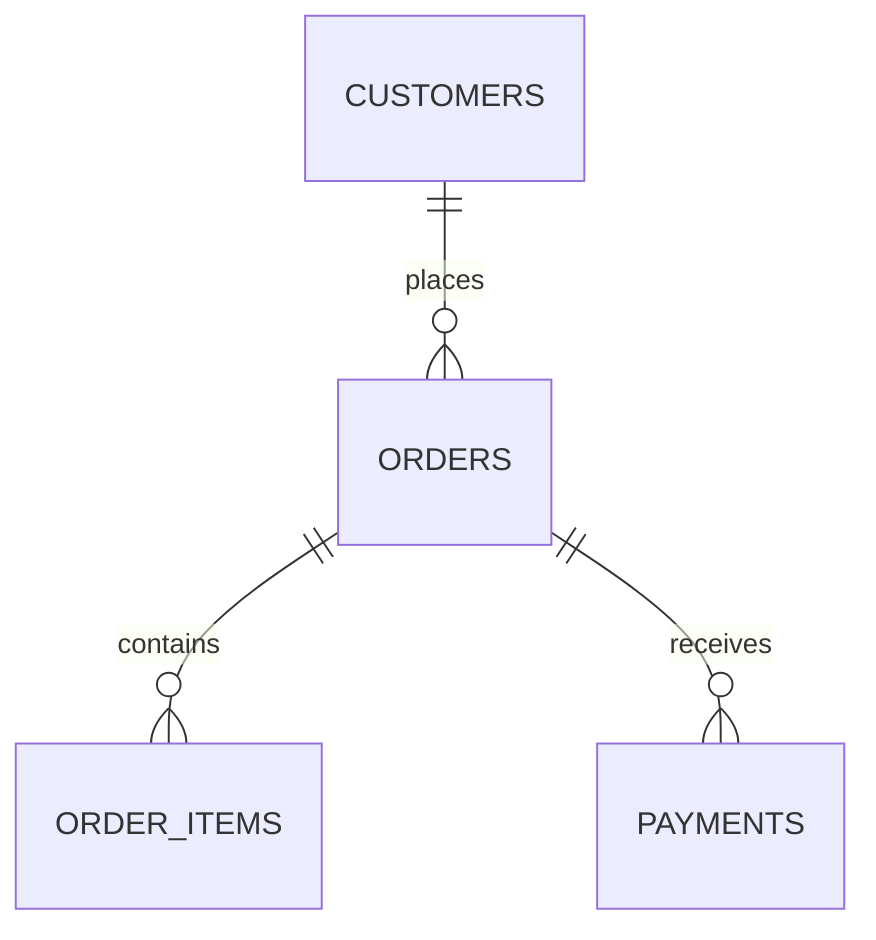

# Giảm nhân dòng trong JOIN và sửa tổng hợp bị đếm trùng

Một lỗi báo cáo phổ biến xuất hiện khi JOIN nhiều bảng có quan hệ một-nhiều rồi mới tính `SUM()`, `COUNT()` hoặc `AVG()`. Mỗi hàng ở bảng cha có thể được lặp lại theo số hàng con; nếu nối thêm một nhánh một-nhiều khác, số hàng còn có thể nhân chéo. Kết quả là tổng doanh thu, số lượng, tiền thanh toán hoặc số đơn bị phóng đại dù từng bảng nguồn không có dữ liệu trùng.

Cách sửa bắt đầu từ **grain** (mức chi tiết) của từng tập dữ liệu: một hàng đại diện cho khách hàng, đơn hàng, dòng đơn hay lần thanh toán? Hãy tổng hợp mỗi nhánh về đúng grain cần JOIN trước khi nối các nhánh với nhau. Khi chỉ cần kiểm tra sự tồn tại của hàng con, dùng `EXISTS` để tránh nhân dòng. `DISTINCT` không phải miếng vá chung cho fan-out vì nó có thể làm mất các giá trị hợp lệ hoặc vẫn giữ nguyên tổng sai.

Trong module `DATABASE_MYSQL`, kỹ năng này quan trọng với báo cáo doanh thu, đối soát thanh toán, thống kê đơn hàng và dashboard. Bài học dùng MySQL 8.0 trở lên, InnoDB và kiểu số `DECIMAL` cho tiền tệ.

## Mục tiêu

Sau bài này, bạn có thể:

- Xác định grain của từng bảng trước khi viết JOIN.
- Giải thích fan-out khi nối một bảng cha với nhiều nhánh một-nhiều.
- Tính được số hàng JOIN tạo ra từ cardinality của từng nhánh.
- Nhận diện `SUM`, `COUNT`, `AVG` bị sai do hàng bị nhân bản.
- Tổng hợp từng bảng con về một hàng trên khóa JOIN trước khi kết hợp.
- Dùng `EXISTS`/`NOT EXISTS` khi chỉ cần kiểm tra có hoặc không có hàng liên quan.
- Dùng `COUNT(child_pk)` và `COALESCE` đúng khi kết hợp `LEFT JOIN`.
- Phân biệt `COUNT(DISTINCT key)` hợp lệ với `SUM(DISTINCT value)` nguy hiểm.
- Đặt bộ lọc đúng phía và đúng thời điểm để giữ semantics của outer join.
- Dùng `EXPLAIN ANALYZE` và truy vấn đối soát để xác minh số hàng và tổng hợp.
- Chọn index hỗ trợ JOIN mà không nhầm index với cách sửa sai logic.

## 1. Grain: một hàng đang đại diện cho điều gì?

Trước khi nối bảng, hãy viết rõ grain của mỗi bảng. Ví dụ hệ thống bán hàng:

| Bảng | Grain của một hàng | Khóa định danh |
|---|---|---|
| `customers` | Một khách hàng | `customer_id` |
| `orders` | Một đơn hàng | `order_id` |
| `order_items` | Một dòng sản phẩm trong một đơn | `order_item_id` |
| `payments` | Một lần ghi nhận thanh toán | `payment_id` |

Một đơn có thể có nhiều dòng hàng và nhiều lần thanh toán. `orders.order_total` có grain đơn hàng; `order_items.quantity * unit_price` có grain dòng đơn; `payments.amount` có grain lần thanh toán. Các measure này không cùng grain.

Nếu JOIN trực tiếp ba bảng con/cha rồi cộng tất cả measure, giá trị ở grain thấp hơn có thể bị lặp theo số hàng của các nhánh khác. Tổng hợp đúng cần đưa các tập dữ liệu về grain tương thích trước khi cộng chúng.

### 1.1. Mối quan hệ một-nhiều



Với một `order_id`, có thể có `m` dòng trong `order_items` và `n` lần thanh toán trong `payments`. Nếu JOIN cả hai nhánh trực tiếp qua `orders`, số hàng của đơn đó có thể là `m × n` khi cả hai nhánh đều có hàng.

Ví dụ đơn có 3 dòng hàng và 2 lần thanh toán sẽ tạo 6 hàng sau JOIN. `order_total` xuất hiện 6 lần; mỗi dòng hàng xuất hiện 2 lần; mỗi lần thanh toán xuất hiện 3 lần.

### 1.2. Công thức fan-out

Với một hàng cha `p`, hai nhánh con có số hàng tương ứng `m` và `n`:

\[
\text{rows after join} = m \times n
\]

Khi dùng `LEFT JOIN`, nếu một nhánh không có hàng phù hợp, nó vẫn tạo một hàng NULL-extended cho phía cha. Với hai nhánh độc lập, số hàng cho mỗi hàng cha thường là:

\[
\max(1,m) \times \max(1,n)
\]

Đây là phép nhân cardinality, không nhất thiết là dữ liệu trùng trong bảng nguồn. JOIN đang biểu diễn mọi tổ hợp hợp lệ giữa các hàng con.

## 2. Schema và dữ liệu lab

Tạo bốn bảng InnoDB. Các khóa chính và index trên `order_id` giúp JOIN; chúng không thay đổi số hàng mà JOIN tạo ra.

```sql
CREATE TABLE customers (
    customer_id BIGINT UNSIGNED NOT NULL,
    customer_name VARCHAR(120) NOT NULL,
    PRIMARY KEY (customer_id)
) ENGINE=InnoDB
  DEFAULT CHARSET=utf8mb4;

CREATE TABLE orders (
    order_id BIGINT UNSIGNED NOT NULL,
    customer_id BIGINT UNSIGNED NOT NULL,
    ordered_at DATETIME(6) NOT NULL,
    order_status VARCHAR(20) NOT NULL,
    order_total DECIMAL(12, 2) NOT NULL,
    PRIMARY KEY (order_id),
    KEY idx_orders_customer_date (customer_id, ordered_at)
) ENGINE=InnoDB;

CREATE TABLE order_items (
    order_item_id BIGINT UNSIGNED NOT NULL,
    order_id BIGINT UNSIGNED NOT NULL,
    product_id BIGINT UNSIGNED NOT NULL,
    quantity INT UNSIGNED NOT NULL,
    unit_price DECIMAL(12, 2) NOT NULL,
    PRIMARY KEY (order_item_id),
    KEY idx_order_items_order (order_id)
) ENGINE=InnoDB;

CREATE TABLE payments (
    payment_id BIGINT UNSIGNED NOT NULL,
    order_id BIGINT UNSIGNED NOT NULL,
    paid_at DATETIME(6) NOT NULL,
    payment_status VARCHAR(20) NOT NULL,
    amount DECIMAL(12, 2) NOT NULL,
    PRIMARY KEY (payment_id),
    KEY idx_payments_order_status (order_id, payment_status, paid_at)
) ENGINE=InnoDB;
```

Nạp dữ liệu:

```sql
INSERT INTO customers (customer_id, customer_name)
VALUES
    (1, 'An'),
    (2, 'Binh'),
    (3, 'Chi');

INSERT INTO orders
    (order_id, customer_id, ordered_at, order_status, order_total)
VALUES
    (101, 1, '2026-03-01 09:00:00', 'COMPLETED', 120.00),
    (102, 1, '2026-03-02 10:00:00', 'COMPLETED',  60.00),
    (201, 2, '2026-03-03 11:00:00', 'COMPLETED', 120.00);

INSERT INTO order_items
    (order_item_id, order_id, product_id, quantity, unit_price)
VALUES
    (1, 101, 501, 1, 40.00),
    (2, 101, 502, 1, 80.00),
    (3, 102, 503, 2, 30.00),
    (4, 201, 504, 1, 70.00),
    (5, 201, 505, 1, 50.00);

INSERT INTO payments
    (payment_id, order_id, paid_at, payment_status, amount)
VALUES
    (1001, 101, '2026-03-01 09:10:00', 'SETTLED', 50.00),
    (1002, 101, '2026-03-01 09:20:00', 'SETTLED', 70.00),
    (1003, 102, '2026-03-02 10:15:00', 'SETTLED', 60.00);
```

Ý nghĩa dữ liệu:

- Đơn `101` có 2 dòng hàng và 2 lần thanh toán.
- Đơn `102` có 1 dòng hàng và 1 lần thanh toán.
- Đơn `201` có 2 dòng hàng nhưng chưa có thanh toán.
- Khách hàng `3` chưa có đơn hàng.

Tổng đúng của khách hàng `1` là 180.00 tiền đơn, 180.00 tiền dòng hàng và 180.00 tiền đã thanh toán. Khách hàng `2` có 120.00 tiền đơn, 120.00 tiền dòng hàng và 0.00 đã thanh toán. Khách hàng `3` có 0 đơn.

## 3. JOIN trực tiếp tạo fan-out

Truy vấn sau nối đơn hàng với các dòng hàng và các lần thanh toán:

```sql
SELECT
    o.order_id,
    o.order_total,
    oi.order_item_id,
    oi.quantity * oi.unit_price AS line_total,
    p.payment_id,
    p.amount AS payment_amount
FROM orders AS o
LEFT JOIN order_items AS oi
    ON oi.order_id = o.order_id
LEFT JOIN payments AS p
    ON p.order_id = o.order_id
WHERE o.order_id = 101
ORDER BY oi.order_item_id, p.payment_id;
```

Đơn `101` có 2 dòng hàng × 2 thanh toán = 4 hàng kết quả:

| order_id | order_item_id | line_total | payment_id | payment_amount | order_total |
|---:|---:|---:|---:|---:|---:|
| 101 | 1 | 40.00 | 1001 | 50.00 | 120.00 |
| 101 | 1 | 40.00 | 1002 | 70.00 | 120.00 |
| 101 | 2 | 80.00 | 1001 | 50.00 | 120.00 |
| 101 | 2 | 80.00 | 1002 | 70.00 | 120.00 |

Không có hàng nào trong bảng nguồn bị duplicate. Bốn hàng là bốn tổ hợp giữa hai dòng hàng và hai lần thanh toán.

### 3.1. Tổng hợp sau JOIN cho kết quả sai

```sql
SELECT
    o.order_id,
    COUNT(o.order_id) AS joined_row_count,
    COUNT(DISTINCT o.order_id) AS distinct_order_count,
    SUM(o.order_total) AS wrong_order_total,
    SUM(oi.quantity * oi.unit_price) AS wrong_item_total,
    SUM(p.amount) AS wrong_paid_total
FROM orders AS o
LEFT JOIN order_items AS oi
    ON oi.order_id = o.order_id
LEFT JOIN payments AS p
    ON p.order_id = o.order_id
WHERE o.order_id = 101
GROUP BY o.order_id;
```

Kết quả sai của đơn `101`:

| Chỉ số | Kết quả JOIN | Kết quả đúng |
|---|---:|---:|
| `joined_row_count` | 4 | Không phải số dòng đơn |
| `distinct_order_count` | 1 | 1 đơn |
| `wrong_order_total` | 480.00 | 120.00 |
| `wrong_item_total` | 240.00 | 120.00 |
| `wrong_paid_total` | 240.00 | 120.00 |

`COUNT(DISTINCT o.order_id)` đúng cho số đơn duy nhất, nhưng không sửa được các phép `SUM` đã bị nhân. Một phép tổng hợp đúng ở một cột không làm những measure khác tự đúng.

### 3.2. JOIN nhiều nhánh còn làm sai AVG

`AVG(o.order_total)` sau fan-out có thể bị lệch vì mỗi đơn được lặp số lần khác nhau tùy số dòng hàng và số thanh toán. Đơn có nhiều thanh toán sẽ có trọng số lớn hơn đơn ít thanh toán, dù nghiệp vụ yêu cầu mỗi đơn có trọng số bằng nhau.

Ví dụ, nếu đơn A có 1 dòng hàng và 1 thanh toán, đơn B có 5 dòng hàng và 3 thanh toán, JOIN hai nhánh tạo lần lượt 1 và 15 hàng. `AVG(order_total)` trên kết quả JOIN không còn là trung bình theo đơn.

## 4. GROUP BY ở cuối không loại bỏ fan-out

Một cách viết thường gặp là JOIN tất cả bảng rồi `GROUP BY customer_id`:

```sql
SELECT
    o.customer_id,
    COUNT(DISTINCT o.order_id) AS order_count,
    SUM(o.order_total) AS order_total,
    SUM(oi.quantity * oi.unit_price) AS item_total,
    SUM(p.amount) AS paid_total
FROM orders AS o
LEFT JOIN order_items AS oi
    ON oi.order_id = o.order_id
LEFT JOIN payments AS p
    ON p.order_id = o.order_id
GROUP BY o.customer_id;
```

`GROUP BY` chỉ gom các hàng đã được JOIN. Nó không biết `order_total` thuộc grain đơn hàng hay `payment.amount` thuộc grain lần thanh toán, nên các giá trị lặp vẫn bị cộng nhiều lần.

Không thể sửa bằng cách thêm tất cả cột vào `GROUP BY`; làm vậy thường chỉ chia kết quả thành nhiều nhóm nhỏ hơn và không khôi phục grain ban đầu. Phải xử lý cardinality trước khi tổng hợp các measure khác grain.

## 5. Cách sửa chuẩn: tổng hợp từng nhánh trước khi JOIN

Đưa mỗi bảng con về một hàng trên `order_id` rồi mới nối với `orders`:

```sql
WITH item_totals AS (
    SELECT
        order_id,
        COUNT(*) AS item_line_count,
        SUM(quantity * unit_price) AS item_total
    FROM order_items
    GROUP BY order_id
),
payment_totals AS (
    SELECT
        order_id,
        COUNT(*) AS payment_count,
        SUM(amount) AS paid_total
    FROM payments
    WHERE payment_status = 'SETTLED'
    GROUP BY order_id
)
SELECT
    o.order_id,
    o.customer_id,
    o.order_total,
    COALESCE(i.item_line_count, 0) AS item_line_count,
    COALESCE(i.item_total, 0.00) AS item_total,
    COALESCE(p.payment_count, 0) AS payment_count,
    COALESCE(p.paid_total, 0.00) AS paid_total
FROM orders AS o
LEFT JOIN item_totals AS i
    ON i.order_id = o.order_id
LEFT JOIN payment_totals AS p
    ON p.order_id = o.order_id
ORDER BY o.order_id;
```

`item_totals` có tối đa một hàng cho mỗi `order_id`; `payment_totals` cũng vậy. Vì mỗi nhánh đã được thu về một hàng trên khóa JOIN, khi nối với một đơn hàng không còn phép nhân `item_count × payment_count`.

Kết quả theo đơn:

| order_id | order_total | item_line_count | item_total | payment_count | paid_total |
|---:|---:|---:|---:|---:|---:|
| 101 | 120.00 | 2 | 120.00 | 2 | 120.00 |
| 102 | 60.00 | 1 | 60.00 | 1 | 60.00 |
| 201 | 120.00 | 2 | 120.00 | 0 | 0.00 |

Đơn `201` vẫn xuất hiện vì dùng `LEFT JOIN`; không có payment được biểu diễn bằng count 0 và tổng 0.00 sau `COALESCE`.

### 5.1. Từ grain đơn hàng lên grain khách hàng

Sau khi có một hàng cho mỗi đơn, có thể tổng hợp lên khách hàng:

```sql
WITH item_totals AS (
    SELECT
        order_id,
        COUNT(*) AS item_line_count,
        SUM(quantity * unit_price) AS item_total
    FROM order_items
    GROUP BY order_id
),
payment_totals AS (
    SELECT
        order_id,
        COUNT(*) AS payment_count,
        SUM(amount) AS paid_total
    FROM payments
    WHERE payment_status = 'SETTLED'
    GROUP BY order_id
),
per_order AS (
    SELECT
        o.order_id,
        o.customer_id,
        o.order_total,
        COALESCE(i.item_line_count, 0) AS item_line_count,
        COALESCE(i.item_total, 0.00) AS item_total,
        COALESCE(p.payment_count, 0) AS payment_count,
        COALESCE(p.paid_total, 0.00) AS paid_total
    FROM orders AS o
    LEFT JOIN item_totals AS i
        ON i.order_id = o.order_id
    LEFT JOIN payment_totals AS p
        ON p.order_id = o.order_id
),
per_customer AS (
    SELECT
        customer_id,
        COUNT(*) AS order_count,
        SUM(order_total) AS order_total,
        SUM(item_total) AS item_total,
        SUM(paid_total) AS paid_total,
        SUM(item_line_count) AS item_line_count,
        SUM(payment_count) AS payment_count
    FROM per_order
    GROUP BY customer_id
)
SELECT
    c.customer_id,
    c.customer_name,
    COALESCE(pc.order_count, 0) AS order_count,
    COALESCE(pc.order_total, 0.00) AS order_total,
    COALESCE(pc.item_total, 0.00) AS item_total,
    COALESCE(pc.paid_total, 0.00) AS paid_total,
    COALESCE(pc.item_line_count, 0) AS item_line_count,
    COALESCE(pc.payment_count, 0) AS payment_count
FROM customers AS c
LEFT JOIN per_customer AS pc
    ON pc.customer_id = c.customer_id
ORDER BY c.customer_id;
```

Kết quả:

| customer_id | customer_name | order_count | order_total | item_total | paid_total |
|---:|---|---:|---:|---:|---:|
| 1 | An | 2 | 180.00 | 180.00 | 180.00 |
| 2 | Binh | 1 | 120.00 | 120.00 | 0.00 |
| 3 | Chi | 0 | 0.00 | 0.00 | 0.00 |

Đây là quy trình tổng hợp nhiều tầng: `payments` và `order_items` về grain đơn hàng, sau đó các measure ở grain đơn hàng được tổng hợp lên grain khách hàng. Khách hàng chưa có đơn vẫn được giữ lại nhờ `LEFT JOIN` với `per_customer`.

### 5.2. Derived table cũng áp dụng cùng nguyên tắc

Nếu không muốn dùng CTE, có thể dùng derived table:

```sql
SELECT
    o.order_id,
    o.order_total,
    COALESCE(i.item_total, 0.00) AS item_total,
    COALESCE(p.paid_total, 0.00) AS paid_total
FROM orders AS o
LEFT JOIN (
    SELECT order_id, SUM(quantity * unit_price) AS item_total
    FROM order_items
    GROUP BY order_id
) AS i
    ON i.order_id = o.order_id
LEFT JOIN (
    SELECT order_id, SUM(amount) AS paid_total
    FROM payments
    WHERE payment_status = 'SETTLED'
    GROUP BY order_id
) AS p
    ON p.order_id = o.order_id;
```

CTE và derived table đều giúp biểu đạt rõ grain đã được tổng hợp. Chọn cách viết dễ đọc và dễ kiểm tra; xem `EXPLAIN` để biết MySQL xử lý/materialize từng phần ra sao.

## 6. Khi chỉ cần kiểm tra sự tồn tại: dùng EXISTS

Nếu mục tiêu chỉ là lấy khách hàng có ít nhất một đơn đã hoàn tất, JOIN rồi `DISTINCT` không cần thiết:

```sql
SELECT
    c.customer_id,
    c.customer_name
FROM customers AS c
WHERE EXISTS (
    SELECT 1
    FROM orders AS o
    WHERE o.customer_id = c.customer_id
      AND o.order_status = 'COMPLETED'
);
```

`EXISTS` trả lời câu hỏi có ít nhất một hàng phù hợp hay không. Một khách hàng có 100 đơn vẫn chỉ xuất hiện một lần trong kết quả outer query.

### 6.1. NOT EXISTS để tìm khách hàng chưa có đơn

```sql
SELECT c.customer_id, c.customer_name
FROM customers AS c
WHERE NOT EXISTS (
    SELECT 1
    FROM orders AS o
    WHERE o.customer_id = c.customer_id
);
```

Truy vấn trả khách hàng chưa có đơn, ví dụ `Chi`. Optimizer có thể biến đổi `EXISTS`/`NOT EXISTS` thành semi-join/anti-join tùy truy vấn và phiên bản. Dù kế hoạch thực thi thế nào, semantics không nhân hàng cha theo số lượng hàng con.

### 6.2. EXISTS kết hợp nhiều bảng con

Muốn tìm khách hàng có đơn chứa một sản phẩm cụ thể:

```sql
SELECT c.customer_id, c.customer_name
FROM customers AS c
WHERE EXISTS (
    SELECT 1
    FROM orders AS o
    JOIN order_items AS oi
      ON oi.order_id = o.order_id
    WHERE o.customer_id = c.customer_id
      AND oi.product_id = 501
);
```

Ngay cả khi đơn có nhiều dòng phù hợp, khách hàng vẫn chỉ xuất hiện một lần vì outer query chỉ kiểm tra sự tồn tại.

## 7. COUNT, COUNT(DISTINCT) và SUM(DISTINCT)

### 7.1. COUNT(*) sau LEFT JOIN

Khi `LEFT JOIN`, một hàng cha không có hàng con vẫn tạo một hàng kết quả với cột phía con là `NULL`. Vì vậy:

```sql
SELECT
    c.customer_id,
    COUNT(*) AS joined_rows,
    COUNT(o.order_id) AS order_count
FROM customers AS c
LEFT JOIN orders AS o
    ON o.customer_id = c.customer_id
GROUP BY c.customer_id;
```

Với khách hàng `3`, `COUNT(*)` trả 1 vì có hàng NULL-extended, còn `COUNT(o.order_id)` trả 0 vì không có khóa đơn hàng khác `NULL`.

### 7.2. COUNT(DISTINCT key) có thể đúng cho một chỉ số cụ thể

Nếu muốn đếm số đơn duy nhất sau một JOIN có fan-out, `COUNT(DISTINCT o.order_id)` có thể cho đúng số đơn:

```sql
SELECT
    o.customer_id,
    COUNT(DISTINCT o.order_id) AS distinct_order_count
FROM orders AS o
LEFT JOIN order_items AS oi
    ON oi.order_id = o.order_id
LEFT JOIN payments AS p
    ON p.order_id = o.order_id
GROUP BY o.customer_id;
```

Đây là cách đếm đúng nếu mục tiêu thực sự là số `order_id` khác nhau. Tuy nhiên, query vẫn tạo fan-out và có thể tốn tài nguyên. Các `SUM()` khác trong cùng query vẫn có thể sai. Thường nên giảm fan-out ở nguồn hoặc dùng `EXISTS` nếu phù hợp.

### 7.3. SUM(DISTINCT amount) không sửa được tổng bị nhân

Không thay `SUM(o.order_total)` bằng `SUM(DISTINCT o.order_total)` như một cách khử duplicate:

```sql
SELECT
    customer_id,
    SUM(DISTINCT order_total) AS not_a_safe_fix
FROM orders
GROUP BY customer_id;
```

Hai đơn khác nhau có thể hợp lệ cùng giá trị `order_total = 120.00`. `SUM(DISTINCT order_total)` chỉ cộng 120 một lần, trong khi tổng đúng của hai đơn là 240. `DISTINCT` xét giá trị biểu thức, không xét danh tính của hàng nguồn.

Tương tự, `SUM(DISTINCT quantity * unit_price)` có thể bỏ hai dòng sản phẩm khác nhau có cùng line total. Để sửa fan-out, tổng hợp theo khóa định danh của measure trước khi JOIN; không khử trùng theo giá trị tiền.

## 8. LEFT JOIN, bộ lọc và dữ liệu không có hàng con

Vị trí đặt điều kiện lọc có thể thay đổi kết quả của outer join.

### 8.1. Giữ khách hàng không có đơn PAID

```sql
SELECT
    c.customer_id,
    COUNT(o.order_id) AS paid_order_count
FROM customers AS c
LEFT JOIN orders AS o
    ON o.customer_id = c.customer_id
   AND o.order_status = 'PAID'
GROUP BY c.customer_id;
```

Điều kiện `order_status = 'PAID'` nằm trong `ON`, nên khách hàng không có đơn PAID vẫn được giữ với count 0.

### 8.2. WHERE trên bảng phải có thể loại hàng NULL-extended

```sql
SELECT
    c.customer_id,
    COUNT(o.order_id) AS paid_order_count
FROM customers AS c
LEFT JOIN orders AS o
    ON o.customer_id = c.customer_id
WHERE o.order_status = 'PAID'
GROUP BY c.customer_id;
```

`WHERE` loại các hàng có `o.order_status IS NULL`, vì biểu thức không đúng. Truy vấn khi đó không còn giữ khách hàng không có đơn; về semantics, điều kiện đã khiến outer join hoạt động như inner join đối với hàng này.

### 8.3. Pre-aggregate child rồi LEFT JOIN

Khi cần tổng tiền thanh toán nhưng vẫn giữ mọi đơn:

```sql
WITH paid_by_order AS (
    SELECT order_id, SUM(amount) AS paid_total
    FROM payments
    WHERE payment_status = 'SETTLED'
    GROUP BY order_id
)
SELECT
    o.order_id,
    o.order_total,
    COALESCE(p.paid_total, 0.00) AS paid_total
FROM orders AS o
LEFT JOIN paid_by_order AS p
    ON p.order_id = o.order_id;
```

Điều kiện trạng thái được áp dụng trước khi tổng hợp payment. Đơn chưa có payment `SETTLED` vẫn xuất hiện với `paid_total = 0.00`.

## 9. Tách các measure theo đúng grain

Một báo cáo có thể chứa nhiều loại measure:

| Measure | Grain nguồn | Cách tổng hợp an toàn |
|---|---|---|
| Số đơn | Đơn hàng | `COUNT(*)` trên tập một hàng/đơn hoặc `COUNT(DISTINCT order_id)` đúng ngữ cảnh |
| Giá trị đơn | Đơn hàng | `SUM(order_total)` trước khi nối nhánh nhiều dòng/payment |
| Doanh thu dòng hàng | Dòng đơn | `SUM(quantity * unit_price)` trên `order_items` theo đơn hoặc khách hàng |
| Tiền đã thu | Lần thanh toán | Lọc trạng thái phù hợp rồi `SUM(amount)` theo đơn/khách hàng |
| Số lần thanh toán | Lần thanh toán | `COUNT(*)` trong tập payment đã lọc |
| Số sản phẩm khác nhau | Dòng đơn | `COUNT(DISTINCT product_id)` nếu mục tiêu là sản phẩm duy nhất |

Không phải mọi measure đều cần được tổng hợp lên cùng một grain ngay từ đầu. Hãy giữ grain gốc khi cần phân tích chi tiết; chỉ tổng hợp khi biết rõ grain đích và các chiều cần giữ.

### 9.1. Phân biệt doanh thu đơn và doanh thu dòng hàng

`orders.order_total` có thể gồm phí vận chuyển, thuế, giảm giá hoặc điều chỉnh. Tổng `quantity * unit_price` từ `order_items` không nhất thiết bằng `order_total`. Không coi hai measure này phải bằng nhau nếu mô hình nghiệp vụ có các thành phần khác.

Khi đối soát, xác định công thức doanh thu chuẩn: trước hay sau giảm giá, có thuế/phí hay không, hàng trả lại được ghi âm hay có bảng refund riêng. Việc sửa fan-out chỉ bảo đảm không nhân hàng; nó không tự xác định định nghĩa kế toán đúng.

### 9.2. Lọc theo ngày ở đúng nguồn thời gian

Ngày tạo đơn (`orders.ordered_at`) và ngày thanh toán (`payments.paid_at`) biểu diễn hai sự kiện khác nhau. Báo cáo đơn được tạo trong tháng nên lọc đơn theo `ordered_at`; báo cáo tiền thu trong tháng nên lọc payment theo `paid_at` trước khi tổng hợp:

```sql
WITH payment_by_order AS (
    SELECT order_id, SUM(amount) AS paid_in_period
    FROM payments
    WHERE payment_status = 'SETTLED'
      AND paid_at >= '2026-03-01 00:00:00'
      AND paid_at <  '2026-04-01 00:00:00'
    GROUP BY order_id
)
SELECT
    o.order_id,
    o.ordered_at,
    COALESCE(p.paid_in_period, 0.00) AS paid_in_period
FROM orders AS o
LEFT JOIN payment_by_order AS p
    ON p.order_id = o.order_id;
```

Đừng lọc `orders.ordered_at` rồi diễn giải kết quả thành tiền thu trong kỳ nếu payment có thể đến vào tháng khác.

## 10. Một nhánh có dữ liệu trùng thật sự

Fan-out do quan hệ một-nhiều là hành vi JOIN hợp lệ. Cần phân biệt nó với duplicate thực sự trong bảng nguồn, ví dụ một sự kiện thanh toán bị import hai lần.

Nếu nguồn có mã giao dịch ngoài `provider_txn_id`, nên dùng unique key phù hợp để bảo vệ tính idempotent:

```sql
ALTER TABLE payments
ADD COLUMN provider_code VARCHAR(30) NULL,
ADD COLUMN provider_txn_id VARCHAR(100) NULL,
ADD UNIQUE KEY uq_payment_provider_txn (provider_code, provider_txn_id);
```

Ví dụ này giả định mã giao dịch chỉ duy nhất trong phạm vi provider; nếu `provider_txn_id` duy nhất toàn bảng thì có thể dùng unique key một cột. Vì hai cột được khai báo nullable, nhiều hàng có thành phần `NULL` vẫn có thể tồn tại theo semantics unique của MySQL; nếu mỗi payment bắt buộc có mã ngoài, hãy dùng `NOT NULL` sau khi làm sạch dữ liệu cũ.

Tìm nghi vấn trùng theo business key:

```sql
SELECT provider_code, provider_txn_id, COUNT(*) AS duplicate_count
FROM payments
WHERE provider_code IS NOT NULL
  AND provider_txn_id IS NOT NULL
GROUP BY provider_code, provider_txn_id
HAVING COUNT(*) > 1;
```

Nếu không thể thay đổi schema ngay, phải xác định bản ghi chuẩn bằng business key và quy tắc xử lý retry. Không dùng `SUM(DISTINCT amount)` để che việc một payment bị ghi hai lần: hai payment hợp lệ cũng có thể cùng số tiền.

### 10.1. Chọn bản ghi mới nhất trong dữ liệu staging

Nếu ETL nhận nhiều phiên bản của cùng một sự kiện và quy tắc là giữ bản mới nhất, có thể dùng `ROW_NUMBER()` để chọn một hàng theo business key:

```sql
CREATE TABLE payment_import_stage (
    payment_id BIGINT UNSIGNED NOT NULL,
    provider_code VARCHAR(30) NOT NULL,
    provider_txn_id VARCHAR(100) NOT NULL,
    amount DECIMAL(12, 2) NOT NULL,
    payment_status VARCHAR(20) NOT NULL,
    received_at DATETIME(6) NOT NULL,
    PRIMARY KEY (payment_id),
    KEY idx_payment_stage_provider_txn
        (provider_code, provider_txn_id, received_at)
) ENGINE=InnoDB;

WITH ranked_payment AS (
    SELECT
        p.*,
        ROW_NUMBER() OVER (
            PARTITION BY provider_code, provider_txn_id
            ORDER BY received_at DESC, payment_id DESC
        ) AS rn
    FROM payment_import_stage AS p
)
SELECT
    payment_id,
    provider_code,
    provider_txn_id,
    amount,
    payment_status
FROM ranked_payment
WHERE rn = 1;
```

Đây chỉ đúng khi quy tắc nghiệp vụ thật sự là chọn phiên bản mới nhất. Nếu các hàng là nhiều lần capture/partial payment hợp lệ, không được loại chúng bằng `ROW_NUMBER()`.

## 11. Kiểm tra cardinality trước khi viết tổng hợp

Truy vấn kiểm tra số hàng theo từng khóa cha giúp phát hiện các nhánh có thể nhân dòng:

```sql
SELECT order_id, COUNT(*) AS item_rows
FROM order_items
GROUP BY order_id
ORDER BY item_rows DESC;

SELECT order_id, COUNT(*) AS payment_rows
FROM payments
GROUP BY order_id
ORDER BY payment_rows DESC;
```

Nếu cùng một đơn có nhiều hàng ở cả hai bảng, JOIN trực tiếp có thể tạo tích số. Có thể kiểm tra dự kiến số hàng bằng cách tính tích cardinality theo từng đơn trong lab:

```sql
WITH item_count AS (
    SELECT order_id, COUNT(*) AS n_items
    FROM order_items
    GROUP BY order_id
),
payment_count AS (
    SELECT order_id, COUNT(*) AS n_payments
    FROM payments
    GROUP BY order_id
)
SELECT
    o.order_id,
    COALESCE(i.n_items, 0) AS n_items,
    COALESCE(p.n_payments, 0) AS n_payments,
    GREATEST(1, COALESCE(i.n_items, 0))
      * GREATEST(1, COALESCE(p.n_payments, 0)) AS expected_left_join_rows
FROM orders AS o
LEFT JOIN item_count AS i
    ON i.order_id = o.order_id
LEFT JOIN payment_count AS p
    ON p.order_id = o.order_id
ORDER BY o.order_id;
```

`expected_left_join_rows` minh họa cardinality của hai nhánh `LEFT JOIN` độc lập. Nếu có thêm bảng con thứ ba, số hàng có thể tiếp tục nhân với số hàng của nhánh đó.

## 12. Đọc EXPLAIN ANALYZE để thấy fan-out

Chạy trên lab:

```sql
EXPLAIN ANALYZE
SELECT
    o.order_id,
    SUM(o.order_total) AS order_total,
    SUM(oi.quantity * oi.unit_price) AS item_total,
    SUM(p.amount) AS paid_total
FROM orders AS o
LEFT JOIN order_items AS oi
    ON oi.order_id = o.order_id
LEFT JOIN payments AS p
    ON p.order_id = o.order_id
GROUP BY o.order_id;
```

Trong TREE plan, đọc số hàng thực tế ở các iterator JOIN. Nếu một order có hai dòng hàng và hai payment, đầu ra của hai nhánh nối có thể tăng lên bốn hàng cho order đó. Hãy so sánh:

- Số hàng ở `orders` trước JOIN.
- Số hàng sau JOIN `order_items`.
- Số hàng sau khi nối thêm `payments`.
- Số vòng lặp của nested-loop iterator.
- Số hàng đi vào aggregate so với số đơn duy nhất.

`EXPLAIN ANALYZE` thực thi truy vấn. Chỉ dùng trên dữ liệu lab hoặc truy vấn có phạm vi an toàn; không chạy tùy tiện một báo cáo lớn trên production.

### 12.1. Index tăng tốc nhưng không sửa sai kết quả

Index trong schema lab:

- `orders(customer_id, ordered_at)` hỗ trợ lọc đơn theo khách hàng và thời gian.
- `order_items(order_id)` hỗ trợ tìm dòng hàng theo đơn.
- `payments(order_id, payment_status, paid_at)` hỗ trợ tìm payment theo đơn/trạng thái/thời điểm.

Các index có thể giảm chi phí truy cập bảng con. Nhưng nếu query vẫn nối hai nhánh một-nhiều ở grain thô, index chỉ làm truy vấn sai chạy nhanh hơn. Trước tiên sửa cardinality/logic; sau đó tối ưu access path.

## 13. Các mẫu truy vấn đúng theo tình huống

### 13.1. Báo cáo tổng theo khách hàng

Dùng mẫu CTE ở phần 5.1: tổng hợp `order_items` và `payments` theo `order_id`, nối vào `orders`, rồi tổng hợp theo `customer_id`. Mỗi measure chỉ xuất hiện một lần trên mỗi đơn trước khi cộng lên khách hàng.

### 13.2. Đếm đơn có ít nhất một payment

Nếu cần số đơn có payment, trước tiên tạo tập đơn có payment duy nhất:

```sql
WITH orders_with_payment AS (
    SELECT DISTINCT order_id
    FROM payments
)
SELECT COUNT(*) AS order_count
FROM orders AS o
JOIN orders_with_payment AS p
    ON p.order_id = o.order_id;
```

Hoặc dùng `EXISTS`:

```sql
SELECT COUNT(*) AS order_count
FROM orders AS o
WHERE EXISTS (
    SELECT 1
    FROM payments AS p
    WHERE p.order_id = o.order_id
);
```

Không cần JOIN mọi payment nếu mục tiêu chỉ là biết đơn có ít nhất một lần thanh toán.

### 13.3. Tổng số dòng hàng và tổng tiền thu riêng biệt

```sql
WITH item_by_customer AS (
    SELECT
        o.customer_id,
        COUNT(*) AS item_line_count,
        SUM(oi.quantity * oi.unit_price) AS item_total
    FROM orders AS o
    JOIN order_items AS oi
        ON oi.order_id = o.order_id
    GROUP BY o.customer_id
),
payment_by_customer AS (
    SELECT
        o.customer_id,
        COUNT(*) AS payment_count,
        SUM(p.amount) AS paid_total
    FROM orders AS o
    JOIN payments AS p
        ON p.order_id = o.order_id
    WHERE p.payment_status = 'SETTLED'
    GROUP BY o.customer_id
)
SELECT
    c.customer_id,
    c.customer_name,
    COALESCE(i.item_line_count, 0) AS item_line_count,
    COALESCE(i.item_total, 0.00) AS item_total,
    COALESCE(p.payment_count, 0) AS payment_count,
    COALESCE(p.paid_total, 0.00) AS paid_total
FROM customers AS c
LEFT JOIN item_by_customer AS i
    ON i.customer_id = c.customer_id
LEFT JOIN payment_by_customer AS p
    ON p.customer_id = c.customer_id;
```

Hai CTE được tổng hợp độc lập theo `customer_id`. Chúng có tối đa một hàng mỗi khách hàng nên JOIN hai kết quả không tạo fan-out. Lưu ý truy vấn này đếm dòng hàng và payment, không đếm đơn; nếu cần số đơn, tạo một CTE riêng từ `orders` theo khách hàng.

### 13.4. Đếm đơn và tổng đơn cùng với số payment

```sql
WITH order_by_customer AS (
    SELECT
        customer_id,
        COUNT(*) AS order_count,
        SUM(order_total) AS order_total
    FROM orders
    GROUP BY customer_id
),
payment_by_customer AS (
    SELECT
        o.customer_id,
        COUNT(*) AS payment_count,
        SUM(p.amount) AS paid_total
    FROM orders AS o
    JOIN payments AS p
        ON p.order_id = o.order_id
    WHERE p.payment_status = 'SETTLED'
    GROUP BY o.customer_id
)
SELECT
    c.customer_id,
    COALESCE(o.order_count, 0) AS order_count,
    COALESCE(o.order_total, 0.00) AS order_total,
    COALESCE(p.payment_count, 0) AS payment_count,
    COALESCE(p.paid_total, 0.00) AS paid_total
FROM customers AS c
LEFT JOIN order_by_customer AS o
    ON o.customer_id = c.customer_id
LEFT JOIN payment_by_customer AS p
    ON p.customer_id = c.customer_id;
```

Mỗi CTE đã về cùng grain khách hàng trước khi kết hợp. Không nối `orders` với `payments` ở grain thô rồi cộng `order_total`.

## 14. Checklist trước khi chấp nhận một báo cáo JOIN

Trước khi tin vào số liệu, trả lời:

1. Một hàng của mỗi bảng đại diện cho thực thể/sự kiện nào?
2. Khóa nào xác định duy nhất một hàng ở từng nguồn?
3. Mỗi cạnh JOIN là one-to-one, one-to-many hay many-to-many?
4. Có nhiều nhánh one-to-many cùng nối vào một parent không?
5. Số hàng dự kiến sau từng JOIN là bao nhiêu?
6. Measure đang cộng thuộc grain nào: đơn, dòng hàng hay payment?
7. Các nhánh đã được aggregate về khóa JOIN trước khi kết hợp chưa?
8. Có thể dùng `EXISTS` thay JOIN nếu chỉ cần kiểm tra sự tồn tại không?
9. Với LEFT JOIN, `COUNT(*)` có đang đếm cả hàng NULL-extended không?
10. Điều kiện lọc phía bảng phải có đặt trong `WHERE` làm mất hàng không có child không?
11. `SUM(DISTINCT ...)` có đang loại các giá trị tiền hợp lệ trùng nhau không?
12. Bộ lọc ngày đang dùng đúng cột sự kiện (order date hay payment date) không?
13. Có duplicate thật sự trong nguồn do import/retry không?
14. `EXPLAIN ANALYZE` cho thấy số hàng/loops tại các nút JOIN phù hợp với dự kiến không?
15. Tổng hợp có đối soát được với các truy vấn độc lập ở từng bảng nguồn không?

## 15. Bài thực hành

Thực hiện với schema và dữ liệu ở phần 2:

1. JOIN `orders`, `order_items`, `payments` cho `order_id = 101`; đếm số hàng và giải thích vì sao có bốn tổ hợp.
2. Tính `SUM(order_total)`, tổng line amount và tổng payment trên JOIN thô; ghi lại các giá trị bị nhân.
3. Thêm `COUNT(DISTINCT order_id)` và giải thích vì sao chỉ chỉ số đếm đơn được sửa.
4. Tạo một đơn có hai payment cùng số tiền; so sánh `SUM(amount)` với `SUM(DISTINCT amount)` để thấy nguy cơ mất giá trị hợp lệ.
5. Tổng hợp `order_items` theo `order_id`, sau đó JOIN với `orders`; xác minh item total đúng.
6. Tổng hợp `payments` theo `order_id`, sau đó JOIN với `orders`; xác minh paid total đúng.
7. Kết hợp hai CTE aggregate thành `per_order`, rồi tổng hợp lên `customer_id`.
8. Giữ khách hàng không có đơn bằng `LEFT JOIN`; so sánh `COUNT(*)` và `COUNT(order_id)`.
9. Chuyển predicate trạng thái từ `ON` sang `WHERE`; xác định khách hàng nào bị loại.
10. Viết `EXISTS` để tìm khách hàng có đơn chứa sản phẩm `501`; so sánh với JOIN + DISTINCT.
11. Viết `NOT EXISTS` để tìm khách hàng chưa có đơn.
12. Lọc payment theo `paid_at` trong CTE; so sánh với lọc order theo `ordered_at` và giải thích khác biệt nghiệp vụ.
13. Dùng `EXPLAIN ANALYZE` để quan sát số hàng trước/sau mỗi JOIN và số vòng lặp.
14. Tạo duplicate import trong bảng staging, phát hiện theo business key và đề xuất unique constraint/idempotency.
15. Viết báo cáo theo khách hàng gồm order count, order total, item total và paid total; đối soát mỗi measure bằng truy vấn độc lập.

Bạn hoàn thành bài khi chỉ ra được grain của từng measure, giải thích chính xác hệ số nhân hàng và viết lại truy vấn để mỗi measure chỉ được tổng hợp từ tập dữ liệu đúng grain.

## 16. Nguyên tắc cần ghi nhớ

- Luôn xác định grain của từng bảng và từng measure trước khi JOIN.
- Một hàng cha nối với `m` hàng ở nhánh A và `n` hàng ở nhánh B có thể tạo `m × n` hàng.
- JOIN nhiều nhánh one-to-many có thể nhân dòng dù dữ liệu nguồn không duplicate.
- `GROUP BY` sau JOIN không tự khôi phục grain ban đầu; `SUM` và `AVG` có thể vẫn sai.
- Tổng hợp từng nhánh con theo khóa JOIN trước khi kết hợp các measure khác grain.
- Dùng `EXISTS`/`NOT EXISTS` khi chỉ cần biết có hay không có hàng liên quan.
- `COUNT(DISTINCT key)` có thể đúng cho số entity duy nhất nhưng không sửa các SUM khác.
- `SUM(DISTINCT amount)` có thể bỏ các khoản hợp lệ có cùng giá trị; không dùng làm cách khử fan-out.
- Với `LEFT JOIN`, dùng `COUNT(child_primary_key)` để đếm hàng con; `COUNT(*)` vẫn đếm hàng NULL-extended.
- Đặt predicate phía bảng phải trong `ON` hoặc trong CTE aggregate khi cần giữ hàng cha không có con.
- Phân biệt order date, payment date và event date; lọc theo đúng thời điểm nghiệp vụ.
- Duplicate nguồn do retry/import cần xử lý bằng business key và idempotency, khác với fan-out do JOIN.
- Index tăng tốc truy cập nhưng không sửa sai cardinality hoặc logic tổng hợp.
- Dùng `EXPLAIN ANALYZE` để xác minh số hàng và loops; đối soát tổng hợp với các truy vấn độc lập.
