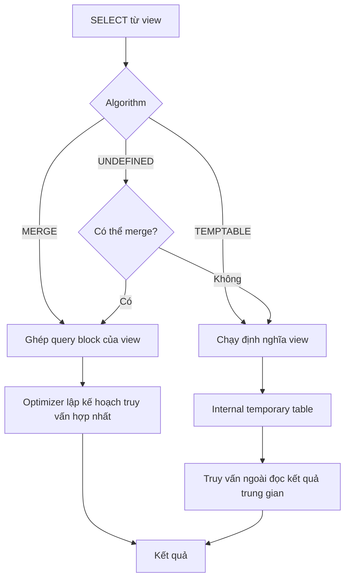

# ALGORITHM MERGE/TEMPTABLE/UNDEFINED và điều kiện áp dụng

MySQL view là một đối tượng schema lưu định nghĩa truy vấn, không phải bản sao dữ liệu độc lập. Khi một câu lệnh đọc view, MySQL phải xử lý định nghĩa view cùng truy vấn bên ngoài. Thuộc tính `ALGORITHM` quyết định cách MySQL xử lý ranh giới này: ghép định nghĩa view vào truy vấn gọi view, tạo kết quả trung gian trong internal temporary table, hoặc để optimizer tự chọn.

Ba giá trị cần nắm là `MERGE`, `TEMPTABLE` và `UNDEFINED`. Chọn đúng algorithm ảnh hưởng khả năng tối ưu predicate, số hàng phải materialize, chi phí bộ nhớ/temporary storage và khả năng cập nhật view. Tuy nhiên, `MERGE` không phải lúc nào cũng tốt hơn, `TEMPTABLE` không đồng nghĩa với câu lệnh `CREATE TEMPORARY TABLE` của ứng dụng, và `UNDEFINED` không có nghĩa là view không có algorithm.

Bài học thuộc module **DATABASE_MYSQL**. Module hướng tới việc làm chủ MySQL từ thiết kế bảng, kiểu dữ liệu, khóa và truy vấn SQL đến index, transaction và kiểm soát đồng thời; đồng thời thực hành đọc kế hoạch thực thi, tối ưu truy vấn, phân quyền, sao lưu và xử lý các vấn đề vận hành cơ sở dữ liệu quan hệ. Trong chương **View và bảng tạm**, bài này tập trung vào `ALGORITHM MERGE/TEMPTABLE/UNDEFINED` và điều kiện áp dụng. `SPECIAL_NOTE` được cung cấp rỗng, vì vậy bài không áp dụng thêm ràng buộc riêng.

## 1. View được xử lý như thế nào?

View lưu một câu lệnh `SELECT` đã định nghĩa:

```sql
CREATE VIEW v_active_customers AS
SELECT customer_id, customer_name, city
FROM customers
WHERE is_active = 1;
```

Ứng dụng có thể truy vấn view như một bảng:

```sql
SELECT customer_id, customer_name
FROM v_active_customers
WHERE city = 'Da Nang';
```

Khi thực thi, MySQL cần kết hợp điều kiện của câu truy vấn ngoài (`city = 'Da Nang'`) với định nghĩa view (`is_active = 1`). Có hai hướng xử lý cơ bản:

- **Merge:** ghép query block của view vào query block bên ngoài để optimizer tối ưu một truy vấn thống nhất.
- **Materialize:** thực thi truy vấn định nghĩa view để tạo kết quả trung gian trong internal temporary table, rồi dùng kết quả đó cho phần còn lại của câu lệnh.

`ALGORITHM` là thuộc tính của định nghĩa view, không phải một hint viết tùy ý ở mỗi câu `SELECT` gọi view. Một view được tạo với algorithm cụ thể sẽ mang thuộc tính đó khi các câu lệnh sử dụng view.

## 2. Ba giá trị ALGORITHM

| Giá trị | Cách xử lý | Ý nghĩa thực tế |
|---|---|---|
| `MERGE` | Ghép định nghĩa view vào truy vấn tham chiếu | Optimizer có thể tối ưu điều kiện, join và access path trên các bảng nền như một query block thống nhất. |
| `TEMPTABLE` | Materialize kết quả view vào internal temporary table | Tạo ranh giới vật lý giữa truy vấn định nghĩa view và phần truy vấn bên ngoài; có thể cần bộ nhớ hoặc temporary storage. |
| `UNDEFINED` | Để MySQL chọn cách xử lý | Optimizer ưu tiên merge khi cấu trúc view cho phép; nếu không thể merge thì dùng materialization. |

Nếu không khai báo `ALGORITHM` khi tạo view, mặc định là `UNDEFINED`. Với `UNDEFINED`, không nên giả định MySQL luôn merge hoặc luôn materialize; cần xem cấu trúc view và execution plan.

### 2.1. Sơ đồ khái quát



Sơ đồ thể hiện lựa chọn ở mức khái niệm. Optimizer còn có thể áp dụng các phép biến đổi khác như condition pushdown hoặc tạo index cho bảng trung gian khi phù hợp; vì vậy hãy kiểm tra kế hoạch thực tế thay vì suy ra toàn bộ execution plan chỉ từ tên algorithm.

## 3. MERGE: ghép định nghĩa view vào truy vấn gọi

`MERGE` cho phép MySQL kết hợp truy vấn bên ngoài với định nghĩa view. View không cần tạo một bản kết quả trung gian riêng trước khi xử lý phần truy vấn còn lại.

Ví dụ view đơn giản:

```sql
CREATE ALGORITHM = MERGE
VIEW v_active_employees AS
SELECT
    employee_id,
    department_id,
    full_name,
    salary
FROM employees
WHERE is_active = 1;
```

Truy vấn bên ngoài:

```sql
SELECT employee_id, full_name, salary
FROM v_active_employees
WHERE department_id = 10
  AND salary >= 30000000;
```

Về mặt logic, MySQL có thể tối ưu tương đương truy vấn trên bảng nền:

```sql
SELECT employee_id, full_name, salary
FROM employees
WHERE is_active = 1
  AND department_id = 10
  AND salary >= 30000000;
```

Truy vấn minh họa phép ghép logic, không khẳng định SQL mà optimizer nội bộ tạo ra phải giống hệt văn bản trên. Điểm quan trọng là optimizer có thể xét các predicate cùng lúc và chọn index trên bảng nền.

### 3.1. Lợi ích của MERGE

- Có cơ hội đẩy điều kiện từ truy vấn ngoài xuống bảng nền khi phép biến đổi bảo toàn ngữ nghĩa.
- Optimizer có thể chọn index dựa trên cả predicate trong view và predicate bên ngoài.
- Các bảng nền có thể được join và sắp xếp thứ tự truy cập trong cùng kế hoạch.
- Tránh tạo tập kết quả trung gian nếu không cần materialization.
- View đơn giản có thể giữ được khả năng cập nhật nếu đáp ứng các điều kiện updatable view.

Ví dụ, nếu bảng `employees` có index ghép phù hợp với `(is_active, department_id, salary)`, truy vấn có cơ hội tận dụng index đó. Index nào được chọn vẫn phụ thuộc thống kê, độ chọn lọc và toàn bộ workload.

### 3.2. MERGE không bảo đảm truy vấn luôn nhanh

`MERGE` chỉ mở ra cơ hội tối ưu hợp nhất. Nó không tự tạo index, không làm predicate kém chọn lọc trở nên chọn lọc và không loại bỏ chi phí join hoặc sort vốn cần thiết.

Một view mergeable nhưng truy vấn bên ngoài lấy quá nhiều hàng vẫn có thể tốn kém. Hãy chọn cột cần thiết, lọc đúng dữ liệu và đọc `EXPLAIN` để biết MySQL thực sự truy cập bảng nền như thế nào.

## 4. TEMPTABLE: materialize kết quả view

`TEMPTABLE` yêu cầu MySQL xử lý view bằng cách tạo kết quả trung gian trong internal temporary table. Truy vấn bên ngoài đọc kết quả đã materialize thay vì ghép trực tiếp query block của view.

Ví dụ view tổng hợp lương theo phòng ban:

```sql
CREATE ALGORITHM = TEMPTABLE
VIEW v_department_payroll AS
SELECT
    department_id,
    COUNT(*) AS employee_count,
    SUM(salary) AS total_payroll
FROM employees
WHERE is_active = 1
GROUP BY department_id;
```

Truy vấn sử dụng view:

```sql
SELECT department_id, employee_count, total_payroll
FROM v_department_payroll
WHERE total_payroll >= 500000000;
```

View đã tổng hợp dữ liệu về một hàng mỗi phòng ban. Điều kiện trên `total_payroll` là điều kiện trên kết quả aggregate; nó chỉ có thể được áp dụng sau khi giá trị tổng hợp tương ứng được xác định. Optimizer có thể đẩy những điều kiện khác xuống trước bước materialization nếu an toàn về ngữ nghĩa, nhưng không thể biến một điều kiện trên tổng tiền thành predicate lọc hàng nguồn tương đương một cách tùy tiện.

### 4.1. Chi phí và lợi ích của TEMPTABLE

**Chi phí có thể phát sinh:**

- MySQL phải thực thi truy vấn định nghĩa view và tạo tập kết quả trung gian.
- Tập trung gian có thể tiêu thụ bộ nhớ; tùy kích thước và cấu hình, temporary table có thể dùng lưu trữ tạm trên đĩa.
- Câu lệnh bên ngoài có thể phải đọc, lọc, join hoặc sort trên tập đã materialize.
- Nếu truy vấn gọi view nhiều lần hoặc view trả về rất nhiều hàng, chi phí materialization có thể đáng kể.

**Một số lý do có thể chọn TEMPTABLE:**

- Muốn giữ ranh giới materialization thay vì merge view vào query block bên ngoài.
- View vốn không thể merge do có aggregate hoặc cấu trúc không mergeable.
- Cần dùng kết quả tổng hợp/trung gian như một tập dữ liệu đầu vào cho bước ngoài.
- Trong một số tình huống, materialization có thể cho phép giải phóng khóa đọc trên các bảng nền sớm hơn sau khi kết quả tạm đã được tạo, thay vì giữ chúng đến hết câu lệnh.

Không chọn `TEMPTABLE` chỉ vì nghĩ rằng temporary table luôn nhanh hơn. Cần đo chi phí tạo, ghi/đọc và xử lý kết quả trung gian.

## 5. UNDEFINED: để MySQL lựa chọn

`UNDEFINED` là lựa chọn mặc định nếu không chỉ định algorithm khi tạo view. MySQL cố gắng dùng `MERGE` nếu định nghĩa view cho phép; nếu view không mergeable thì sử dụng cách xử lý dựa trên materialization.

Ví dụ:

```sql
CREATE ALGORITHM = UNDEFINED
VIEW v_employee_directory AS
SELECT
    employee_id,
    department_id,
    full_name,
    email
FROM employees
WHERE is_active = 1;
```

Định nghĩa này đơn giản và có thể merge. Với một view khác có `GROUP BY` hoặc `DISTINCT`, MySQL có thể cần materialize dù algorithm là `UNDEFINED`.

### 5.1. Khi nào nên để UNDEFINED?

- Khi không có lý do đo lường rõ ràng để ép `TEMPTABLE`.
- Khi muốn optimizer sử dụng `MERGE` nếu có thể.
- Khi định nghĩa view có thể thay đổi theo thời gian và không muốn khóa cứng một chiến lược không còn phù hợp.
- Khi ưu tiên hành vi mặc định của MySQL và sẽ xác minh execution plan trong workload thật.

`UNDEFINED` không có nghĩa là algorithm ngẫu nhiên. Quyết định phụ thuộc cấu trúc view, khả năng merge và các quy tắc optimizer của phiên bản MySQL đang chạy.

## 6. Điều kiện để view có thể MERGE

View thường có khả năng merge khi định nghĩa là một truy vấn dạng chiếu/lọc/join thông thường trên bảng nền. Ví dụ:

```sql
CREATE ALGORITHM = MERGE
VIEW v_orders_recent_columns AS
SELECT
    order_id,
    customer_id,
    order_date,
    total_amount
FROM orders
WHERE order_date >= '2026-01-01';
```

Các cấu trúc phổ biến khiến view không thể merge gồm:

| Cấu trúc trong view | Vì sao không thể xử lý như một phép merge đơn giản |
|---|---|
| Aggregate như `SUM()`, `COUNT()`, `AVG()` | Kết quả phụ thuộc bước tổng hợp nhiều hàng thành nhóm. |
| `GROUP BY` | Tạo grain mới cho kết quả view. |
| `HAVING` | Lọc trên nhóm sau aggregate. |
| `DISTINCT` | Phải loại trùng trong kết quả view. |
| `LIMIT` | Giới hạn tập hàng của query block bên trong; không thể tùy tiện hoán đổi với truy vấn ngoài. |
| `UNION` hoặc `UNION ALL` | Kết hợp nhiều query block thành kết quả view. |
| Window function | Tạo giá trị phụ thuộc cửa sổ hàng và thứ tự trong query block. |
| Một số subquery ở select list hoặc cấu trúc không được optimizer merge | Không thể thay thế an toàn bằng một query block hợp nhất đơn giản. |
| Một số biểu thức gán biến người dùng | Có tác dụng phụ/đánh giá thứ tự khiến phép merge không phù hợp. |

Danh sách trên là những trường hợp thường gặp, không phải danh mục đầy đủ cho mọi phiên bản và mọi cấu trúc truy vấn. Quy tắc merge còn phụ thuộc cú pháp cụ thể và khả năng biến đổi của optimizer.

### 6.1. Ví dụ view không mergeable vì GROUP BY

```sql
CREATE ALGORITHM = UNDEFINED
VIEW v_order_totals_by_customer AS
SELECT
    customer_id,
    COUNT(*) AS order_count,
    SUM(total_amount) AS total_amount
FROM orders
GROUP BY customer_id;
```

View này trả một hàng mỗi khách hàng, không còn một hàng cho mỗi đơn. Optimizer không thể đơn giản thay view bằng bảng `orders` mà bỏ qua bước aggregate. Khi sử dụng view, MySQL cần materialize kết quả hoặc áp dụng các phép tối ưu tương đương được phép mà vẫn bảo toàn ngữ nghĩa.

### 6.2. ORDER BY không đồng nghĩa luôn chặn MERGE

Không nên suy luận rằng cứ có `ORDER BY` trong view là view chắc chắn không mergeable. Thứ tự trong view có thể không còn ý nghĩa nếu truy vấn ngoài áp dụng thứ tự riêng; optimizer có quy tắc xử lý `ORDER BY` trong view. Nếu thứ tự kết quả là yêu cầu của ứng dụng, hãy đặt `ORDER BY` ở câu truy vấn ngoài cùng và kiểm tra kế hoạch thực tế.

## 7. Algorithm và khả năng cập nhật view

Khả năng cập nhật (updatability) là thuộc tính riêng của định nghĩa view và các quy tắc MySQL. Algorithm có ảnh hưởng quan trọng nhưng không phải điều kiện duy nhất.

- View dùng `TEMPTABLE` không updatable.
- View dùng `MERGE` có thể updatable nếu cấu trúc view đáp ứng các điều kiện của updatable view.
- View dùng `UNDEFINED` có thể updatable nếu MySQL xử lý nó bằng `MERGE` và định nghĩa view vẫn thỏa các điều kiện cập nhật.

Ví dụ view lọc một bảng:

```sql
CREATE ALGORITHM = MERGE
VIEW v_active_employee_names AS
SELECT employee_id, full_name, department_id
FROM employees
WHERE is_active = 1;
```

View này có cấu trúc đơn giản và có thể cho phép cập nhật các cột phù hợp. Tuy nhiên, việc một view có thể cập nhật hay không còn phụ thuộc các yếu tố như:

- View có dựa trên một bảng nền hay nhiều bảng.
- Cột được cập nhật có ánh xạ trực tiếp đến cột bảng nền hay là biểu thức tính toán.
- Có aggregate, `DISTINCT`, `GROUP BY`, `HAVING`, `UNION`, window function hoặc cấu trúc làm mất khả năng cập nhật hay không.
- Cột bắt buộc của bảng nền có được cung cấp giá trị hợp lệ hay không.

Kiểm tra thuộc tính:

```sql
SELECT
    TABLE_NAME,
    ALGORITHM,
    IS_UPDATABLE
FROM INFORMATION_SCHEMA.VIEWS
WHERE TABLE_SCHEMA = DATABASE()
  AND TABLE_NAME = 'v_active_employee_names';
```

`IS_UPDATABLE` cho biết MySQL xem view có khả năng cập nhật hay không. Không nên suy luận chỉ từ việc view được tạo thành công.

### 7.1. CHECK OPTION không thay thế algorithm

`WITH CHECK OPTION` kiểm tra các hàng được ghi qua view có còn thỏa điều kiện `WHERE` của view hay không. Nó không quyết định merge hay materialize.

Ví dụ:

```sql
CREATE ALGORITHM = MERGE
VIEW v_active_employees_checked AS
SELECT employee_id, full_name, is_active
FROM employees
WHERE is_active = 1
WITH CASCADED CHECK OPTION;
```

`CHECK OPTION` bảo vệ điều kiện của view khi ghi qua view nếu view updatable. Nó không làm cho một view aggregate hoặc `TEMPTABLE` trở thành updatable.

## 8. Khai báo và thay đổi ALGORITHM

### 8.1. CREATE VIEW

Đặt algorithm ngay trong câu lệnh tạo view:

```sql
CREATE
    ALGORITHM = MERGE
    SQL SECURITY INVOKER
VIEW v_customer_contacts AS
SELECT customer_id, customer_name, email
FROM customers
WHERE is_active = 1;
```

Hoặc:

```sql
CREATE
    ALGORITHM = TEMPTABLE
    SQL SECURITY INVOKER
VIEW v_customer_order_summary AS
SELECT customer_id, COUNT(*) AS order_count
FROM orders
GROUP BY customer_id;
```

Thứ tự các thuộc tính trong cú pháp `CREATE VIEW` cần theo grammar MySQL; các ví dụ trên dùng thứ tự `ALGORITHM`, `DEFINER` (nếu có), `SQL SECURITY` rồi đến `VIEW`.

### 8.2. ALTER VIEW

Có thể thay algorithm khi sửa định nghĩa view:

```sql
ALTER
    ALGORITHM = UNDEFINED
    SQL SECURITY INVOKER
VIEW v_customer_contacts AS
SELECT customer_id, customer_name, email
FROM customers
WHERE is_active = 1;
```

`ALTER VIEW` thay định nghĩa view hiện có. Trước khi đổi algorithm trên production, hãy kiểm tra truy vấn phụ thuộc, quyền truy cập, khả năng cập nhật và execution plan sau thay đổi.

### 8.3. CREATE OR REPLACE VIEW

Trong trường hợp triển khai cần thay thế định nghĩa:

```sql
CREATE OR REPLACE
    ALGORITHM = MERGE
    SQL SECURITY INVOKER
VIEW v_customer_contacts AS
SELECT customer_id, customer_name, email
FROM customers
WHERE is_active = 1;
```

`CREATE OR REPLACE VIEW` có thể thuận tiện cho migration, nhưng không nên dùng như thao tác vô hại: thay đổi danh sách cột, kiểu dữ liệu trả về hoặc security context có thể ảnh hưởng ứng dụng đang sử dụng view.

## 9. Kiểm tra algorithm mà MySQL thực sự lưu

Không chỉ nhìn câu lệnh `CREATE VIEW` đã gửi. Hãy kiểm tra metadata sau khi tạo hoặc thay đổi view.

### 9.1. SHOW CREATE VIEW

```sql
SHOW CREATE VIEW v_active_employees;
```

Kết quả cho biết định nghĩa view, algorithm, definer và security context. Nếu chỉ định `ALGORITHM = MERGE` cho view không thể merge, MySQL tạo view với algorithm `UNDEFINED` và phát warning. Vì vậy, hãy đọc warning và định nghĩa được lưu thay vì giả định yêu cầu ban đầu luôn được giữ nguyên.

Có thể kiểm tra warning ngay sau DDL:

```sql
SHOW WARNINGS;
```

### 9.2. INFORMATION_SCHEMA.VIEWS

```sql
SELECT
    TABLE_SCHEMA,
    TABLE_NAME,
    ALGORITHM,
    IS_UPDATABLE,
    SECURITY_TYPE,
    DEFINER
FROM INFORMATION_SCHEMA.VIEWS
WHERE TABLE_SCHEMA = DATABASE()
ORDER BY TABLE_NAME;
```

Các cột hữu ích:

- `ALGORITHM`: algorithm được lưu cho view.
- `IS_UPDATABLE`: MySQL đánh giá view có khả năng cập nhật hay không.
- `SECURITY_TYPE` và `DEFINER`: thông tin ngữ cảnh quyền của view.

Metadata này giúp xác nhận định nghĩa đã triển khai, nhưng không thay thế việc xem execution plan của câu truy vấn cụ thể.

## 10. Dùng EXPLAIN để phân biệt MERGE và materialization

Chạy `EXPLAIN` trên câu truy vấn gọi view:

```sql
EXPLAIN
SELECT employee_id, full_name
FROM v_active_employees
WHERE department_id = 10;
```

Với view được merge, execution plan thường thể hiện trực tiếp bảng nền như `employees` thay vì một bước derived table riêng cho view. Điều kiện của view và truy vấn ngoài có thể cùng xuất hiện trong kế hoạch truy cập bảng nền.

Với view được materialize, plan có thể hiển thị query block/derived result riêng, chẳng hạn tên dạng `<derivedN>` trong output truyền thống hoặc node materialization trong `FORMAT=TREE`/`FORMAT=JSON`. Hình thức hiển thị phụ thuộc phiên bản và loại truy vấn.

### 10.1. EXPLAIN FORMAT=JSON

```sql
EXPLAIN FORMAT=JSON
SELECT department_id, employee_count, total_payroll
FROM v_department_payroll
WHERE total_payroll >= 500000000;
```

Kiểm tra cấu trúc query block, derived/materialized node, bảng nguồn, access type, index và ước lượng số hàng. Không chỉ tìm một từ khóa; hãy đọc quan hệ giữa các node.

### 10.2. EXPLAIN ANALYZE

Trên MySQL 8.0.18 trở lên, có thể dùng `EXPLAIN ANALYZE` để thực thi truy vấn và quan sát số hàng thực tế, thời gian cùng số vòng lặp của iterator:

```sql
EXPLAIN ANALYZE
SELECT department_id, employee_count, total_payroll
FROM v_department_payroll
WHERE total_payroll >= 500000000;
```

Lệnh này thực sự chạy câu truy vấn. Hãy dùng trên truy vấn đọc phù hợp và môi trường có kiểm soát, nhất là khi view có thể đọc bảng lớn hoặc thực hiện aggregate nặng.

## 11. Phân biệt internal temporary table và CREATE TEMPORARY TABLE

Hai khái niệm cùng có chữ temporary nhưng khác nhau:

| Tiêu chí | Internal temporary table của TEMPTABLE | Bảng do ứng dụng tạo |
|---|---|---|
| Cách tạo | MySQL tự tạo khi xử lý view/query | Ứng dụng chạy `CREATE TEMPORARY TABLE` |
| Tên bảng | Nội bộ, không phải đối tượng ứng dụng tham chiếu trực tiếp | Có tên do người dùng đặt |
| Vòng đời | Gắn với quá trình thực thi câu lệnh/query block | Thường tồn tại trong session đến khi drop hoặc session kết thúc |
| Mục đích | Lưu kết quả trung gian để tiếp tục xử lý truy vấn | Lưu tập dữ liệu tạm do ứng dụng chủ động quản lý |
| Tái sử dụng | Không phải cache kết quả view giữa các câu lệnh | Có thể được dùng trong nhiều câu lệnh cùng session |
| Quyền quản lý | Optimizer/engine quyết định | Ứng dụng chủ động tạo, đọc, sửa và xóa |

`ALGORITHM=TEMPTABLE` không tạo một bảng tạm có tên cố định để ứng dụng dùng ở câu lệnh kế tiếp. Mỗi câu truy vấn tham chiếu view có thể phải materialize lại theo execution plan; view cũng không trở thành bảng lưu kết quả lâu dài.

Ví dụ bảng tạm tường minh:

```sql
CREATE TEMPORARY TABLE tmp_active_employee_ids (
    employee_id BIGINT PRIMARY KEY
);

INSERT INTO tmp_active_employee_ids (employee_id)
SELECT employee_id
FROM employees
WHERE is_active = 1;

SELECT employee_id
FROM tmp_active_employee_ids;

DROP TEMPORARY TABLE tmp_active_employee_ids;
```

Đây là đối tượng tạm do session tạo và quản lý, không phải cơ chế `TEMPTABLE` của view.

## 12. Chọn algorithm theo bài toán

| Tình huống | Hướng lựa chọn ban đầu | Lý do |
|---|---|---|
| View chỉ chiếu/lọc cột từ một bảng | `MERGE` hoặc `UNDEFINED` | Cho optimizer cơ hội kết hợp predicate với bảng nền. |
| View join các bảng, không có cấu trúc chặn merge | `MERGE` hoặc `UNDEFINED` | Optimizer có thể tối ưu join cùng truy vấn bên ngoài. |
| View có aggregate/`GROUP BY`/`DISTINCT`/`UNION` | `UNDEFINED` hoặc `TEMPTABLE` | Cấu trúc thường không mergeable; cần materialization hoặc xử lý tương đương. |
| Cần ép ranh giới materialization đã được đo chứng minh có lợi | `TEMPTABLE` | Cố định việc tạo kết quả trung gian. |
| Chưa có số liệu hoặc view có thể thay đổi | `UNDEFINED` | Để MySQL chọn cách xử lý hợp lệ, sau đó kiểm tra plan. |
| View cần được cập nhật qua DML | Tránh `TEMPTABLE`; xem xét `MERGE` | TEMPTABLE view không updatable; MERGE vẫn cần thỏa điều kiện updatability khác. |

Đây là hướng lựa chọn, không phải quy tắc thay thế benchmark. Một view aggregate có thể bắt buộc materialize dù khai báo `UNDEFINED`; một view đơn giản có thể merge nhưng vẫn chậm do thiếu index hoặc trả quá nhiều hàng.

## 13. Algorithm không phải SQL SECURITY

`ALGORITHM` và `SQL SECURITY` giải quyết hai vấn đề khác nhau:

- `ALGORITHM = MERGE/TEMPTABLE/UNDEFINED` quy định cách xử lý query block của view.
- `SQL SECURITY = DEFINER/INVOKER` quy định ngữ cảnh quyền được dùng khi truy cập view.

Ví dụ:

```sql
CREATE
    ALGORITHM = MERGE
    SQL SECURITY INVOKER
VIEW v_public_employee_directory AS
SELECT employee_id, full_name, department_id
FROM employees
WHERE is_active = 1;
```

`MERGE` không tự cấp quyền cho người dùng và `TEMPTABLE` không phải cơ chế che giấu dữ liệu. Quyền đọc view, quyền đọc bảng nền, definer/invoker và chính sách dữ liệu phải được thiết kế riêng.

## 14. View lồng nhau và tác động dây chuyền

Một view có thể tham chiếu view khác:

```sql
CREATE ALGORITHM = MERGE
VIEW v_active_employee_base AS
SELECT employee_id, department_id, full_name
FROM employees
WHERE is_active = 1;

CREATE ALGORITHM = UNDEFINED
VIEW v_department_employee_names AS
SELECT employee_id, department_id, full_name
FROM v_active_employee_base
WHERE department_id IS NOT NULL;
```

Khi truy vấn view ngoài, MySQL có thể tiếp tục merge các view lồng nhau nếu các định nghĩa cho phép. Nếu một tầng chứa cấu trúc không mergeable, materialization có thể xuất hiện ở tầng đó. Vì vậy, kiểm tra riêng từng view chưa đủ; cần kiểm tra execution plan của câu truy vấn thực tế đi qua toàn bộ chuỗi view.

Thay đổi một view nền cũng có thể ảnh hưởng nhiều view phụ thuộc. Trước migration, xác định các consumer và xác minh metadata/định nghĩa liên quan bằng các công cụ quản lý schema được phép trong quy trình của nhóm.

## 15. Những yếu tố ảnh hưởng hiệu năng ngoài ALGORITHM

Không nên đánh giá hiệu năng chỉ từ chữ `MERGE` hay `TEMPTABLE`. Các yếu tố sau có thể quan trọng hơn:

- **Số hàng đầu vào:** view có lọc được dữ liệu sớm không, predicate có chọn lọc không?
- **Index trên bảng nền:** truy vấn sau merge có index phù hợp với filter, join và sort không?
- **Độ rộng hàng:** view có đưa theo các cột lớn như `TEXT`, `BLOB` hoặc JSON không cần thiết không?
- **Cardinality và join fan-out:** các bảng nền có quan hệ một-nhiều làm số hàng tăng mạnh không?
- **Kích thước kết quả materialize:** view `TEMPTABLE` có tạo một tập trung gian quá lớn không?
- **Aggregate và sort:** `GROUP BY`, `DISTINCT`, `ORDER BY` có cần xử lý nhiều hàng không?
- **Tần suất gọi:** một view đắt được gọi lặp lại trong nhiều câu lệnh có thể tạo tổng chi phí lớn.
- **Tải đồng thời:** CPU, I/O, buffer pool, temporary storage và lock contention đều ảnh hưởng thời gian.

### 15.1. Predicate pushdown và ranh giới aggregate

Với view đơn giản có thể merge, predicate của truy vấn ngoài có cơ hội được tối ưu cùng điều kiện trong view. Với view materialize, optimizer vẫn có thể đẩy một số điều kiện xuống query block bên trong khi phép biến đổi an toàn.

Tuy nhiên, phải phân biệt:

- Điều kiện trên cột nguồn, ví dụ `department_id = 10`, có thể được áp dụng trước khi aggregate nếu không làm đổi kết quả.
- Điều kiện trên giá trị aggregate, ví dụ `SUM(salary) > 500000000`, phải được đánh giá ở mức nhóm sau khi tính aggregate tương ứng.

Đừng cho rằng `TEMPTABLE` luôn ngăn mọi condition pushdown hoặc `MERGE` luôn đẩy được mọi điều kiện. Hãy xem plan cụ thể.

### 15.2. Temporary table có thể dùng bộ nhớ hoặc đĩa

Internal temporary table có thể được lưu trong bộ nhớ hoặc chuyển sang dạng lưu trữ trên đĩa tùy kích thước, kiểu dữ liệu, phiên bản MySQL và cấu hình. Khi materialization tạo lượng dữ liệu lớn, chi phí I/O và thao tác trên temporary storage có thể trở thành nút thắt.

Không áp dụng một ngưỡng cấu hình cố định cho mọi phiên bản. Khi điều tra, hãy xem cấu hình internal temporary table của phiên bản đang chạy, kích thước dữ liệu và các chỉ số runtime liên quan.

## 16. Lab: so sánh MERGE, TEMPTABLE và UNDEFINED

Lab sau tạo dữ liệu mẫu để so sánh ba cách xử lý. Chạy trong schema thử nghiệm, không chạy DDL trên production.

### 16.1. Tạo bảng và dữ liệu mẫu

```sql
CREATE TABLE departments (
    department_id INT NOT NULL PRIMARY KEY,
    department_name VARCHAR(100) NOT NULL
) ENGINE = InnoDB;

CREATE TABLE employees (
    employee_id BIGINT NOT NULL PRIMARY KEY,
    department_id INT NOT NULL,
    full_name VARCHAR(120) NOT NULL,
    salary DECIMAL(14, 2) NOT NULL,
    is_active TINYINT NOT NULL,
    KEY idx_employee_active_department (is_active, department_id),
    KEY idx_employee_department_salary (department_id, salary)
) ENGINE = InnoDB;

INSERT INTO departments (department_id, department_name)
VALUES
    (10, 'Engineering'),
    (20, 'Finance'),
    (30, 'Operations');

INSERT INTO employees
    (employee_id, department_id, full_name, salary, is_active)
VALUES
    (1001, 10, 'An Nguyen', 35000000, 1),
    (1002, 10, 'Binh Tran', 42000000, 1),
    (1003, 10, 'Chi Le', 28000000, 0),
    (2001, 20, 'Dung Pham', 32000000, 1),
    (2002, 20, 'Giang Vo', 51000000, 1),
    (3001, 30, 'Hanh Do', 26000000, 1);
```

### 16.2. Tạo view có thể MERGE

```sql
CREATE ALGORITHM = MERGE
VIEW v_active_employee_lab AS
SELECT employee_id, department_id, full_name, salary
FROM employees
WHERE is_active = 1;

EXPLAIN
SELECT employee_id, full_name, salary
FROM v_active_employee_lab
WHERE department_id = 10
  AND salary >= 30000000;
```

Quan sát xem plan truy cập trực tiếp `employees` như thế nào, index nào được cân nhắc/chọn và ước lượng hàng ra sao.

Có thể thử thêm view join nhiều bảng nhưng vẫn có cấu trúc mergeable:

```sql
CREATE ALGORITHM = MERGE
VIEW v_employee_department_lab AS
SELECT
    e.employee_id,
    e.full_name,
    e.salary,
    d.department_name
FROM employees AS e
JOIN departments AS d
    ON d.department_id = e.department_id
WHERE e.is_active = 1;

EXPLAIN
SELECT employee_id, full_name, salary
FROM v_employee_department_lab
WHERE department_name = 'Engineering'
  AND salary >= 30000000;
```

View join không tự động bị cấm merge chỉ vì có nhiều bảng. Điều quan trọng là query block không chứa cấu trúc ngăn merge; hãy xác minh bằng execution plan.

### 16.3. Tạo view phải materialize vì aggregate

```sql
CREATE ALGORITHM = UNDEFINED
VIEW v_department_payroll_lab AS
SELECT
    department_id,
    COUNT(*) AS employee_count,
    SUM(salary) AS total_payroll
FROM employees
WHERE is_active = 1
GROUP BY department_id;

EXPLAIN
SELECT department_id, employee_count, total_payroll
FROM v_department_payroll_lab
WHERE total_payroll >= 70000000;
```

View có `GROUP BY` nên không merge theo cách thông thường. Quan sát query block hoặc node materialization trong plan.

### 16.4. Ép TEMPTABLE trên view đơn giản để so sánh

```sql
CREATE ALGORITHM = TEMPTABLE
VIEW v_active_employee_temp_lab AS
SELECT employee_id, department_id, full_name, salary
FROM employees
WHERE is_active = 1;

EXPLAIN
SELECT employee_id, full_name, salary
FROM v_active_employee_temp_lab
WHERE department_id = 10
  AND salary >= 30000000;
```

So sánh plan với `v_active_employee_lab`. Hai view có cùng kết quả logic nhưng ranh giới xử lý khác nhau. Tập trung gian và số hàng cần materialize có thể khiến plan tốn chi phí hơn; hãy kiểm tra thực tế thay vì chỉ nhìn số dòng SQL.

### 16.5. Kiểm tra metadata và updatability

```sql
SELECT
    TABLE_NAME,
    ALGORITHM,
    IS_UPDATABLE
FROM INFORMATION_SCHEMA.VIEWS
WHERE TABLE_SCHEMA = DATABASE()
  AND TABLE_NAME IN (
      'v_active_employee_lab',
      'v_department_payroll_lab',
      'v_active_employee_temp_lab'
  )
ORDER BY TABLE_NAME;

SHOW CREATE VIEW v_active_employee_lab;
SHOW CREATE VIEW v_department_payroll_lab;
SHOW CREATE VIEW v_active_employee_temp_lab;
```

Kết quả mong đợi về mặt khái niệm:

- View lọc đơn giản có algorithm `MERGE` và có thể updatable nếu đáp ứng các điều kiện khác.
- View aggregate với `UNDEFINED` cần materialization vì không mergeable và không updatable.
- View ép `TEMPTABLE` không updatable dù định nghĩa chỉ lọc một bảng.

Giá trị cụ thể trong metadata cần được xác nhận trên phiên bản MySQL đang sử dụng.

## 17. Lỗi và hiểu nhầm thường gặp

| Hiểu nhầm/lỗi | Hậu quả | Cách xử lý |
|---|---|---|
| Nghĩ `MERGE` luôn nhanh hơn | Bỏ qua cardinality, index và chi phí join | Đo plan và runtime với dữ liệu đại diện. |
| Nghĩ `TEMPTABLE` là bảng tạm session | Kỳ vọng truy cập lại kết quả ở câu lệnh sau | Phân biệt internal temporary table với `CREATE TEMPORARY TABLE`. |
| Ép `MERGE` cho view có `GROUP BY` | Cấu trúc không đáp ứng điều kiện merge | Dùng `UNDEFINED`/`TEMPTABLE` phù hợp và kiểm tra warning/metadata. |
| Nghĩ `UNDEFINED` luôn materialize | Hiểu sai hành vi mặc định | MySQL ưu tiên merge nếu có thể; xác minh plan. |
| Nghĩ `MERGE` đồng nghĩa view updatable | Có thể DML bị từ chối do các giới hạn khác | Kiểm tra `IS_UPDATABLE` và quy tắc updatable view. |
| Nghĩ `CHECK OPTION` điều khiển algorithm | Trộn lẫn kiểm tra dữ liệu với chiến lược thực thi | `CHECK OPTION` kiểm tra điều kiện view khi ghi, không chọn merge/materialize. |
| Chỉ kiểm tra `SHOW CREATE VIEW` | Không biết plan của truy vấn gọi view | Kết hợp metadata với `EXPLAIN`/`EXPLAIN ANALYZE`. |
| Lấy quá nhiều cột trong view | Tăng payload và chi phí xử lý | Chỉ đưa các cột consumer cần dùng. |
| Materialize một tập kết quả lớn không cần thiết | Tăng memory/temp I/O | Lọc và projection sớm khi bảo toàn ngữ nghĩa. |
| Nhầm ALGORITHM với SQL SECURITY | Đánh giá sai quyền truy cập | Thiết kế algorithm và privilege độc lập. |

## 18. Quy trình quyết định và triển khai

1. **Xác định mục đích view.** View là lớp đặt tên cho truy vấn, ranh giới bảo mật hay lớp aggregate?
2. **Đọc định nghĩa SELECT.** Tìm aggregate, GROUP BY, DISTINCT, LIMIT, UNION, window function và các cấu trúc không mergeable.
3. **Chọn mặc định hợp lý.** Ưu tiên UNDEFINED nếu chưa có bằng chứng cần ép algorithm.
4. **Xem xét MERGE.** Dùng cho view đơn giản khi muốn optimizer hợp nhất điều kiện và truy cập bảng nền.
5. **Xem xét TEMPTABLE.** Chỉ ép khi có lý do rõ ràng hoặc cần ranh giới materialization; nhớ view sẽ không updatable.
6. **Kiểm tra DDL.** Đọc warning và dùng SHOW CREATE VIEW/INFORMATION_SCHEMA.VIEWS xác nhận algorithm đã lưu.
7. **Đo truy vấn đại diện.** Dùng EXPLAIN, EXPLAIN FORMAT=JSON/TREE và khi phù hợp EXPLAIN ANALYZE.
8. **So sánh số hàng và chi phí.** Xem access path, index, materialization, temporary storage, sort và join.
9. **Kiểm tra ngữ nghĩa.** So sánh kết quả, thứ tự nếu có yêu cầu, NULL, aggregate và khả năng cập nhật.
10. **Kiểm tra quyền.** Xác minh SQL SECURITY, DEFINER/INVOKER và quyền trên view/bảng nền.
11. **Triển khai có kiểm soát.** Kiểm tra các ứng dụng phụ thuộc, migration và khả năng rollback.
12. **Theo dõi sau triển khai.** Đo latency, throughput, tài nguyên và lỗi DML qua view.

## 19. Bài tập thực hành

### Bài tập 1: MERGE cho view đơn giản

Tạo view chỉ lọc nhân viên đang hoạt động, sau đó truy vấn view theo phòng ban và khoảng lương.

**Yêu cầu:** dùng EXPLAIN xác định bảng nền, access path và index được chọn.

### Bài tập 2: TEMPTABLE cho aggregate

Tạo view tổng số nhân viên và tổng lương theo phòng ban.

**Yêu cầu:** giải thích vì sao GROUP BY khiến view không mergeable theo cách thông thường; quan sát materialization trong plan.

### Bài tập 3: UNDEFINED

Tạo hai view, một view đơn giản và một view có DISTINCT hoặc GROUP BY, đều dùng UNDEFINED.

**Yêu cầu:** so sánh algorithm metadata và execution plan.

### Bài tập 4: MERGE và updatability

Tạo view lọc một bảng bằng MERGE và thử cập nhật một cột ánh xạ trực tiếp.

**Yêu cầu:** kiểm tra IS_UPDATABLE; thử cập nhật hàng khiến nó không còn thỏa điều kiện view và giải thích vai trò của CHECK OPTION.

### Bài tập 5: TEMPTABLE và updatability

Tạo view đơn giản cùng định nghĩa nhưng dùng TEMPTABLE.

**Yêu cầu:** kiểm tra IS_UPDATABLE và thử DML qua view; giải thích sự khác nhau với MERGE.

### Bài tập 6: So sánh execution plan

Tạo hai view có cùng kết quả logic nhưng một dùng MERGE và một dùng TEMPTABLE.

**Yêu cầu:** chạy EXPLAIN và EXPLAIN ANALYZE trên cùng truy vấn gọi view; so sánh số hàng, thời gian và node materialization.

### Bài tập 7: View lồng nhau

Tạo view thứ hai tham chiếu view thứ nhất, sau đó truy vấn view ngoài.

**Yêu cầu:** quan sát liệu các tầng có được merge hay có bước materialization.

### Bài tập 8: Tách algorithm khỏi security

Tạo hai view có cùng algorithm nhưng khác SQL SECURITY.

**Yêu cầu:** giải thích algorithm không thay thế quyền SELECT trên bảng nền và kiểm tra quyền bằng hai tài khoản lab.

## 20. Checklist review view algorithm

- [ ] Đã hiểu view lưu định nghĩa truy vấn, không lưu sẵn kết quả như bảng vật lý.
- [ ] Đã phân biệt MERGE, TEMPTABLE và UNDEFINED.
- [ ] Đã xác định cấu trúc view có mergeable hay không.
- [ ] Đã hiểu aggregate, GROUP BY, HAVING, DISTINCT, LIMIT và UNION có thể chặn merge.
- [ ] Không giả định ORDER BY trong view luôn được giữ ở truy vấn ngoài.
- [ ] Đã cân nhắc tác động của TEMPTABLE đến materialization và temporary storage.
- [ ] Đã nhớ TEMPTABLE view không updatable.
- [ ] Đã kiểm tra IS_UPDATABLE thay vì suy luận từ DDL.
- [ ] Đã phân biệt CHECK OPTION với ALGORITHM.
- [ ] Đã xác nhận algorithm bằng SHOW CREATE VIEW hoặc INFORMATION_SCHEMA.VIEWS.
- [ ] Đã đọc EXPLAIN/EXPLAIN ANALYZE của truy vấn thực tế gọi view.
- [ ] Đã phân biệt internal temporary table với CREATE TEMPORARY TABLE.
- [ ] Đã kiểm tra quyền SQL SECURITY và các view phụ thuộc.
- [ ] Đã so sánh kết quả và hiệu năng trước/sau thay đổi.

## 21. Ghi nhớ

`MERGE` ghép định nghĩa view vào truy vấn tham chiếu, giúp optimizer có cơ hội tối ưu các predicate và bảng nền trong cùng kế hoạch. `TEMPTABLE` materialize kết quả view vào internal temporary table, tạo ranh giới xử lý và có thể phát sinh chi phí memory/temporary storage; view dùng algorithm này không updatable. `UNDEFINED` là mặc định để MySQL chọn, thường ưu tiên merge khi định nghĩa cho phép.

Các cấu trúc như aggregate, `GROUP BY`, `HAVING`, `DISTINCT`, `LIMIT` và `UNION` thường khiến view không thể merge. Algorithm không quyết định quyền truy cập và cũng không tự bảo đảm hiệu năng. Hãy xác nhận định nghĩa đã lưu, đọc execution plan, đo trên dữ liệu đại diện và kiểm tra updatability trước khi thay đổi view trong production.
