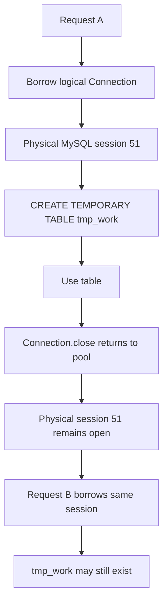

# Vòng đời bảng tạm khi tái sử dụng kết nối qua pool

Trong MySQL, `CREATE TEMPORARY TABLE` tạo một bảng chỉ tồn tại trong **server session** đã tạo nó. Bảng tạm được tự động xóa khi session vật lý kết thúc; `COMMIT` và `ROLLBACK` không tự xóa bảng. Đây là điểm dễ gây lỗi khi ứng dụng dùng connection pool: `Connection.close()` thường chỉ trả kết nối logic về pool, còn kết nối MySQL vật lý vẫn mở và có thể được cấp cho request tiếp theo.

Nếu request A tạo `tmp_work`, dùng xong nhưng không `DROP TEMPORARY TABLE`, request B có thể nhận lại đúng server session đó và nhìn thấy bảng cùng dữ liệu còn sót. Request B có thể gặp lỗi “table already exists”, đọc nhầm dữ liệu request A hoặc ghi đè dữ liệu ngoài ý muốn. Ở chiều ngược lại, nếu request tạo bảng tạm rồi trả connection về pool trước khi dùng tiếp, lần `getConnection()` sau có thể nhận một session khác và báo “table doesn't exist”.

Trong module `DATABASE_MYSQL`, bảng tạm cần được xem là **trạng thái gắn với session**, không phải tài nguyên gắn với request hoặc transaction. Bài học tập trung vào cách quản lý vòng đời đó khi dùng JDBC và connection pool.

## Mục tiêu

Sau bài này, bạn có thể:

- Phân biệt vòng đời server session, logical connection và request ứng dụng.
- Giải thích vì sao temporary table còn tồn tại sau `COMMIT`, `ROLLBACK` và khi connection logic được trả về pool.
- Nhận biết rò rỉ bảng tạm giữa hai request dùng lại cùng physical connection.
- Giữ cùng một connection trong toàn bộ quy trình tạo, nạp, truy vấn và xóa bảng tạm.
- Dọn bảng bằng `DROP TEMPORARY TABLE IF EXISTS` trong mọi nhánh xử lý.
- Hiểu giới hạn của transaction reset và session reset.
- Đánh giá pool/driver có thực hiện reset server state hay không.
- Chọn giữa temporary table, CTE, derived table và staging table thường.
- Thiết kế kiểm thử chứng minh không có trạng thái session bị rò giữa các borrower.

## 1. Ba vòng đời khác nhau

Khi dùng connection pool, có ít nhất ba khái niệm cần phân biệt:

| Khái niệm | Ý nghĩa | Khi kết thúc |
|---|---|---|
| Request | Một lần xử lý nghiệp vụ của ứng dụng | Khi code xử lý request hoàn tất |
| Logical JDBC connection | Đối tượng `Connection` mà borrower nhận từ pool | Khi ứng dụng gọi `close()`; thường trả về pool |
| Physical MySQL connection/session | Kết nối TCP và server session thật | Khi pool đóng kết nối, server ngắt hoặc kết nối bị reset/replace theo cơ chế tương ứng |

Temporary table thuộc physical MySQL session. Nó không thuộc request và cũng không tự biến mất khi logical JDBC connection được đóng.



Pool có thể cấp lại chính physical session vừa được trả về, hoặc cấp một session khác. Ứng dụng không được giả định borrower kế tiếp luôn nhận cùng session hay luôn nhận session sạch nếu không có cơ chế reset được xác nhận.

## 2. Temporary table gắn với session

Tạo bảng tạm:

```sql
CREATE TEMPORARY TABLE tmp_request_orders (
    order_id BIGINT UNSIGNED NOT NULL,
    total_amount DECIMAL(12, 2) NOT NULL,
    PRIMARY KEY (order_id)
) ENGINE=InnoDB;
```

Đặc điểm quan trọng:

- Chỉ session tạo bảng mới nhìn thấy và sử dụng được bảng đó.
- Session khác có thể tạo một temporary table cùng tên; hai bảng độc lập.
- Bảng tự động bị xóa khi physical session kết thúc.
- `COMMIT` và `ROLLBACK` không tự xóa định nghĩa temporary table.
- DML trên temporary table dùng InnoDB vẫn tuân theo transaction của InnoDB.
- `CREATE TEMPORARY TABLE` không gây implicit commit như `CREATE TABLE` thông thường, nhưng thao tác tạo bảng tạm bản thân nó không được rollback để làm biến mất bảng.

### 2.1. Hai session có thể có cùng tên bảng tạm

Session A:

```sql
CREATE TEMPORARY TABLE tmp_work (
    id INT NOT NULL PRIMARY KEY,
    note VARCHAR(40) NOT NULL
) ENGINE=InnoDB;

INSERT INTO tmp_work VALUES (1, 'session A');
SELECT CONNECTION_ID();
SELECT * FROM tmp_work;
```

Session B:

```sql
CREATE TEMPORARY TABLE tmp_work (
    id INT NOT NULL PRIMARY KEY,
    note VARCHAR(40) NOT NULL
) ENGINE=InnoDB;

INSERT INTO tmp_work VALUES (1, 'session B');
SELECT CONNECTION_ID();
SELECT * FROM tmp_work;
```

Hai session có thể dùng cùng tên `tmp_work` nhưng mỗi session nhìn thấy dữ liệu riêng. Session B không đọc được hàng của Session A chỉ bằng cách truy vấn tên đó.

### 2.2. Temporary table có thể che bảng thường cùng tên

Nếu session tạo temporary table trùng tên với một bảng thường trong schema, các câu lệnh tham chiếu tên đó trong session sẽ truy cập temporary table đang che tên bảng thường. Điều này có thể làm truy vấn trong session cho kết quả khác với truy vấn từ session khác.

Đặt tên có tiền tố rõ như `tmp_` hoặc `tmp_req_...`, tránh trùng tên bảng nghiệp vụ. Khi dọn, dùng:

```sql
DROP TEMPORARY TABLE IF EXISTS tmp_request_orders;
```

Từ khóa `TEMPORARY` giúp giới hạn thao tác vào bảng tạm; không dùng `DROP TABLE` chung chung trong routine cleanup nếu có khả năng tồn tại bảng thường cùng tên.

## 3. COMMIT, ROLLBACK và DROP có ý nghĩa khác nhau

Transaction quản lý thay đổi dữ liệu transactional. Nó không quản lý vòng đời session của temporary table.

```sql
CREATE TEMPORARY TABLE tmp_txn_demo (
    id INT NOT NULL PRIMARY KEY,
    value_text VARCHAR(40) NOT NULL
) ENGINE=InnoDB;

START TRANSACTION;
INSERT INTO tmp_txn_demo VALUES (1, 'before rollback');
ROLLBACK;

SELECT COUNT(*) AS row_count
FROM tmp_txn_demo;
```

Sau `ROLLBACK`, bảng `tmp_txn_demo` vẫn tồn tại, nhưng hàng được insert trong transaction InnoDB đã bị hoàn tác. Cần phân biệt:

- **Table lifecycle:** bảng tạm tồn tại tới khi bị `DROP TEMPORARY TABLE` hoặc physical session kết thúc.
- **Row lifecycle:** thay đổi dữ liệu trong bảng tạm phụ thuộc storage engine và transaction.

Nếu bảng tạm dùng engine không transactional như `MEMORY`, DML không có cùng khả năng rollback như InnoDB. Nếu cần thay đổi dữ liệu tạm tham gia cùng transaction với dữ liệu InnoDB, khai báo `ENGINE=InnoDB` rõ ràng.

### 3.1. DROP TEMPORARY TABLE không phải ROLLBACK

```sql
DROP TEMPORARY TABLE IF EXISTS tmp_txn_demo;
```

Lệnh này xóa bảng tạm khỏi session. Không trông chờ `ROLLBACK` sau đó khôi phục bảng. `DROP TEMPORARY TABLE` không gây implicit commit như `DROP TABLE` thông thường, nhưng thao tác xóa bảng tạm không phải thay đổi có thể hoàn tác bằng rollback.

### 3.2. Transaction kết thúc không có nghĩa session sạch

Một session có thể đã commit transaction nhưng vẫn còn:

- Temporary table.
- User variable như `@current_tenant`.
- Session system variable được thay đổi bằng `SET SESSION`.
- Lock được lấy bằng `GET_LOCK()`.
- Prepared statement hoặc trạng thái session khác tùy API/driver.

Vì vậy, `ROLLBACK` khi trả connection về pool không đủ để dọn mọi session state. Pool phải có chính sách reset phù hợp, và ứng dụng vẫn nên chủ động dọn tài nguyên mà mình tạo.

## 4. Tình huống lỗi khi tái sử dụng connection

Giả sử pool có physical connection mang ID 51.

### Request A: tạo bảng nhưng không dọn

```sql
CREATE TEMPORARY TABLE tmp_request_orders (
    order_id BIGINT UNSIGNED NOT NULL PRIMARY KEY,
    total_amount DECIMAL(12, 2) NOT NULL
) ENGINE=InnoDB;

INSERT INTO tmp_request_orders VALUES (101, 120.00);
```

Ứng dụng gọi `connection.close()`. Với pool, lời gọi này thường chỉ trả logical connection về pool; physical session 51 vẫn còn bảng và hàng.

### Request B: nhận lại session 51

Nếu Request B nhận đúng physical session 51 và chạy:

```sql
CREATE TEMPORARY TABLE tmp_request_orders (
    order_id BIGINT UNSIGNED NOT NULL PRIMARY KEY,
    total_amount DECIMAL(12, 2) NOT NULL
) ENGINE=InnoDB;
```

MySQL báo lỗi vì temporary table cùng tên đã tồn tại trong session. Nếu code dùng `CREATE TEMPORARY TABLE IF NOT EXISTS`, lỗi có thể bị che đi nhưng bảng cũ vẫn được tái sử dụng; schema hoặc dữ liệu còn sót có thể không phù hợp với Request B.

### 4.1. Nguy cơ rò dữ liệu giữa borrower

Nếu Request B bỏ qua bước tạo bảng và chỉ chạy:

```sql
SELECT * FROM tmp_request_orders;
```

nó có thể đọc dữ liệu mà Request A để lại. Đây là lỗi cô lập dữ liệu ở tầng ứng dụng. Việc temporary table không nhìn thấy từ session khác không ngăn được rò rỉ khi cùng một session được cấp lần lượt cho nhiều request.

### 4.2. Lỗi ngược: tạo và dùng trên hai connection khác nhau

```java
try (Connection first = dataSource.getConnection()) {
    createTemporaryTable(first);
}

try (Connection second = dataSource.getConnection()) {
    queryTemporaryTable(second);
}
```

Đoạn code này không an toàn. `second` có thể là một physical session khác nên không nhìn thấy bảng do `first` tạo. Nếu pool tình cờ cấp lại cùng physical session, code có thể chạy nhưng vẫn phụ thuộc vào hành vi cấp connection và có nguy cơ dùng dữ liệu cũ.

Giữ một logical `Connection` trong toàn bộ quy trình tạo, nạp, truy vấn và dọn bảng tạm.

## 5. Mẫu SQL an toàn: tạo, dùng và xóa trong cùng session

Với một thao tác đơn giản, có thể dùng chuỗi lệnh trong cùng connection:

Tạo bảng đơn hàng dùng trong ví dụ lab:

```sql
CREATE TABLE orders (
    order_id BIGINT UNSIGNED NOT NULL,
    customer_id BIGINT UNSIGNED NOT NULL,
    total_amount DECIMAL(12, 2) NOT NULL,
    PRIMARY KEY (order_id),
    KEY idx_orders_customer (customer_id)
) ENGINE=InnoDB;

INSERT INTO orders (order_id, customer_id, total_amount)
VALUES
    (101, 100, 120.00),
    (102, 100,  60.00),
    (201, 200,  80.00);
```

```sql
DROP TEMPORARY TABLE IF EXISTS tmp_request_orders;

CREATE TEMPORARY TABLE tmp_request_orders (
    order_id BIGINT UNSIGNED NOT NULL,
    total_amount DECIMAL(12, 2) NOT NULL,
    PRIMARY KEY (order_id)
) ENGINE=InnoDB;

INSERT INTO tmp_request_orders (order_id, total_amount)
SELECT order_id, total_amount
FROM orders
WHERE customer_id = 100;

SELECT order_id, total_amount
FROM tmp_request_orders
ORDER BY order_id;

DROP TEMPORARY TABLE IF EXISTS tmp_request_orders;
```

Lệnh `DROP` ở đầu là lớp phòng vệ khi session có thể còn bảng từ lần sử dụng trước. Lệnh `DROP` cuối giải phóng trạng thái ngay sau khi hoàn tất. Cả chuỗi phải chạy trên cùng một physical session.

Không dùng `CREATE TEMPORARY TABLE IF NOT EXISTS` như cơ chế reset. Nếu bảng đã tồn tại từ borrower trước, `IF NOT EXISTS` không làm mới schema hoặc xóa dữ liệu cũ.

### 5.1. Tên bảng tạm nên ổn định trong code, dữ liệu phải được xóa

Tên temporary table thường là identifier SQL và không thể bind bằng placeholder `?` như giá trị. Dùng tên cố định do code kiểm soát hoặc tên được sinh từ quy tắc an toàn; không ghép trực tiếp tên bảng từ input người dùng.

Nếu dùng tên cố định như `tmp_request_orders`, mỗi lần checkout phải đảm bảo tên đó không còn bảng cũ trước khi tạo. Nếu dùng tên động, vẫn cần cleanup; tên động không thay thế quản lý vòng đời.

## 6. Mẫu JDBC với try/finally

Trong JDBC, `Connection.close()` trên pooled connection thường trả logical connection về pool. Vì vậy, cleanup phải diễn ra trước khi connection được trả lại.

Ví dụ minh họa với cùng một connection:

Đoạn code dùng Java text block (Java 15 trở lên); với Java 8/11, thay các text block bằng chuỗi SQL tương ứng.

```java
try (Connection connection = dataSource.getConnection()) {
    Throwable primaryFailure = null;
    try {
        try (Statement statement = connection.createStatement()) {
            statement.execute(
                "DROP TEMPORARY TABLE IF EXISTS tmp_request_orders"
            );
            statement.execute("""
                CREATE TEMPORARY TABLE tmp_request_orders (
                    order_id BIGINT UNSIGNED NOT NULL,
                    total_amount DECIMAL(12, 2) NOT NULL,
                    PRIMARY KEY (order_id)
                ) ENGINE=InnoDB
                """);
        }

        try (PreparedStatement insert = connection.prepareStatement("""
            INSERT INTO tmp_request_orders (order_id, total_amount)
            SELECT order_id, total_amount
            FROM orders
            WHERE customer_id = ?
            """)) {
            insert.setLong(1, customerId);
            insert.executeUpdate();
        }

        try (PreparedStatement query = connection.prepareStatement("""
            SELECT order_id, total_amount
            FROM tmp_request_orders
            ORDER BY order_id
            """)) {
            try (ResultSet rows = query.executeQuery()) {
                while (rows.next()) {
                    // Map dữ liệu trong cùng connection/session.
                }
            }
        }
    } catch (SQLException failure) {
        primaryFailure = failure;
        throw failure;
    } catch (RuntimeException | Error failure) {
        primaryFailure = failure;
        throw failure;
    } finally {
        try (Statement cleanup = connection.createStatement()) {
            cleanup.execute(
                "DROP TEMPORARY TABLE IF EXISTS tmp_request_orders"
            );
        } catch (SQLException cleanupFailure) {
            // Gọi API evict/discard của pool trước khi connection được trả lại.
            if (primaryFailure != null) {
                primaryFailure.addSuppressed(cleanupFailure);
            } else {
                throw cleanupFailure;
            }
        }
    }
}
```

Đây là mẫu minh họa luồng không mở transaction tường minh. Với transaction nghiệp vụ, cần xử lý `commit`/`rollback` riêng và chỉ trả connection về pool sau khi transaction đã kết thúc. Đoạn code giữ exception chính và gắn lỗi cleanup bằng `addSuppressed`; phần gọi API evict/discard là đặc thù của pool nên phải triển khai theo pool đang dùng. Nếu cleanup thất bại mà không loại physical connection, borrower sau có thể nhận session bẩn.

### 6.1. Khi có transaction

Trình tự tổng quát:

```text
borrow connection
  -> xác nhận trạng thái session/transaction sạch
  -> START transaction hoặc setAutoCommit(false)
  -> DROP TEMPORARY TABLE IF EXISTS
  -> CREATE TEMPORARY TABLE ... ENGINE=InnoDB
  -> nạp và truy vấn dữ liệu tạm
  -> COMMIT nếu nghiệp vụ thành công
     hoặc ROLLBACK nếu thất bại
  -> DROP TEMPORARY TABLE IF EXISTS trong finally
  -> khôi phục session settings nếu ứng dụng đã thay đổi
  -> return connection to pool
```

Nếu rollback thất bại, cleanup không chạy được hoặc trạng thái connection không xác định, không tái sử dụng connection đó. Dùng API eviction/discard riêng của pool. Không bật `autoCommit=true` một cách vô điều kiện khi chưa chắc transaction đã kết thúc; thao tác đổi auto-commit có thể commit transaction còn mở.

### 6.2. Cleanup phải chạy trên cùng connection

Không mở một connection mới chỉ để `DROP TEMPORARY TABLE`. Temporary table của session A không tồn tại trong session B, kể cả khi B dùng cùng username/database. Cleanup phải dùng chính connection đã tạo bảng.

## 7. Session reset của driver và pool

MySQL hỗ trợ lệnh giao thức reset connection (`COM_RESET_CONNECTION`) để đưa server session về trạng thái ban đầu mà không cần đóng TCP connection. Reset server state có thể xóa temporary table và các trạng thái session khác.

Tuy nhiên, ứng dụng không được mặc định rằng mọi connection pool hoặc JDBC driver đều gọi reset này mỗi lần `Connection.close()` hoặc mỗi lần checkout. Một số pool chỉ khôi phục một tập trạng thái JDBC mà nó theo dõi, chẳng hạn auto-commit, read-only, isolation hoặc catalog; temporary table là trạng thái SQL/session mà pool có thể không tự nhận biết nếu không reset server state.

Hãy kiểm tra tài liệu đúng phiên bản của driver và pool:

- Reset được gọi khi trả connection, khi mượn connection hay không được gọi?
- Reset có thực sự xóa temporary table, user variable và session variable không?
- Reset có rollback transaction đang mở không?
- Nếu reset thất bại, physical connection có bị loại khỏi pool không?
- Cấu hình reset có áp dụng cho mọi đường trả connection, gồm timeout và exception không?

### 7.1. Reset không thay thế cleanup của ứng dụng

Session reset là lớp bảo vệ bổ sung. Ứng dụng vẫn nên `DROP TEMPORARY TABLE` trong `finally` để:

- Giải phóng tài nguyên sớm, không chờ tới lần checkout tiếp theo.
- Làm rõ ownership của bảng tạm trong code.
- Giảm phụ thuộc vào cấu hình riêng của pool.
- Phát hiện lỗi cleanup và loại connection nếu cần.

### 7.2. Connection initialization SQL không phải cleanup mỗi lần checkout

Một số pool có cấu hình SQL chạy khi physical connection mới được tạo. Lệnh initialization này thường không đồng nghĩa với việc chạy lại mỗi lần connection được trả về và mượn lại. Không dựa vào `connectionInitSql` để dọn temporary table sau mỗi borrower nếu tài liệu pool không nói rõ nó chạy tại mỗi checkout.

## 8. Giữ cùng connection trong suốt quy trình

Temporary table chỉ tồn tại trong session tạo nó. Nếu một quy trình gồm nhiều repository/service method, truyền cùng một transaction-bound connection hoặc dùng cơ chế quản lý transaction đảm bảo cùng connection.

Mẫu sai:

```java
void prepareStage() throws SQLException {
    try (Connection c = dataSource.getConnection()) {
        createTemporaryTable(c);
    }
}

void processStage() throws SQLException {
    try (Connection c = dataSource.getConnection()) {
        readTemporaryTable(c);
    }
}
```

Mẫu đúng về nguyên tắc:

```java
void processRequest() throws SQLException {
    try (Connection c = dataSource.getConnection()) {
        try {
            createTemporaryTable(c);
            loadTemporaryTable(c);
            processTemporaryTable(c);
        } finally {
            dropTemporaryTable(c);
        }
    }
}
```

Không giữ một `Connection` dùng chung toàn ứng dụng hoặc chia sẻ cùng connection đồng thời giữa nhiều thread. Một connection/session chỉ nên được một đơn vị công việc sử dụng tại một thời điểm.

## 9. Chọn temporary table hay CTE/derived table?

Không phải mọi dữ liệu trung gian đều cần temporary table.

| Nhu cầu | Lựa chọn thường phù hợp | Lý do |
|---|---|---|
| Dùng kết quả trung gian trong một statement | CTE (`WITH`) hoặc derived table | Không tạo trạng thái tồn tại qua nhiều statement |
| Dùng cùng tập dữ liệu qua nhiều statement trong một workflow | Temporary table | Có thể tạo index và tái sử dụng trong cùng session |
| Trao đổi dữ liệu giữa nhiều session/worker | Bảng staging thường có khóa batch/request | Temporary table không chia sẻ giữa session |
| Lưu kết quả lâu dài hoặc audit | Bảng thường | Có vòng đời và quyền truy cập rõ ràng |
| Tập dữ liệu nhỏ, chỉ dùng một lần | CTE/derived table | Tránh cleanup và trạng thái pool |

Ví dụ CTE không tạo session state:

```sql
WITH customer_orders AS (
    SELECT order_id, total_amount
    FROM orders
    WHERE customer_id = 100
)
SELECT order_id, total_amount
FROM customer_orders
ORDER BY order_id;
```

CTE có phạm vi trong một statement. Nếu cần dùng lại kết quả ở nhiều statement và việc tính lại tốn kém, temporary table có thể hợp lý, miễn là quản lý session và cleanup chặt chẽ.

## 10. Dùng staging table thường khi cần chia sẻ qua session

Nếu dữ liệu trung gian cần được worker khác đọc, temporary table không phù hợp. Có thể dùng bảng staging thường với `batch_id` hoặc `request_id`:

```sql
CREATE TABLE job_stage (
    batch_id BINARY(16) NOT NULL,
    row_no BIGINT UNSIGNED NOT NULL,
    payload JSON NOT NULL,
    created_at DATETIME(6) NOT NULL,
    PRIMARY KEY (batch_id, row_no),
    KEY idx_job_stage_created (created_at)
) ENGINE=InnoDB;
```

Mọi truy vấn phải lọc theo `batch_id` và quyền truy cập cần được kiểm soát. Bảng thường đòi hỏi quy trình cleanup theo retention/TTL, xử lý retry và tránh batch khác đọc nhầm dữ liệu. Đổi lại, nó cho phép nhiều session truy cập cùng tập dữ liệu một cách có chủ đích.

## 11. Kiểm tra và chẩn đoán trạng thái session

### 11.1. Ghi nhận physical connection ID

Trong cùng connection:

```sql
SELECT CONNECTION_ID() AS mysql_connection_id;
```

Ghi ID trước khi tạo bảng, sau khi thực hiện các bước và khi tái sử dụng connection. Nếu cùng ID được cấp lại, đó là cùng server session; temporary table chưa bị drop/reset có thể còn tồn tại.

### 11.2. Xác minh bảng trong chính session

```sql
SHOW CREATE TABLE tmp_request_orders;
SELECT COUNT(*) FROM tmp_request_orders;
```

Chạy từ đúng connection đã tạo bảng. Một session giám sát khác không thể dùng câu lệnh này để kiểm tra temporary table riêng của session ứng dụng.

### 11.3. Kiểm tra pool

Theo dõi các chỉ số:

- Số active, idle và pending borrower.
- Số physical connection được tạo mới, đóng hoặc reset.
- Số lần checkout/return và thời gian giữ connection.
- Lỗi `table already exists`, `table doesn't exist` hoặc cleanup failure.
- Connection bị evict/discard và nguyên nhân.
- Transaction bị trả về pool khi còn mở.

Ghi log `CONNECTION_ID()` cùng request ID trong môi trường kiểm thử có kiểm soát để liên hệ một request với physical session. Không ghi dữ liệu nhạy cảm trong temporary table vào log.

## 12. Các lỗi thường gặp

| Hiện tượng | Nguyên nhân | Cách xử lý |
|---|---|---|
| `Table already exists` khi CREATE TEMPORARY TABLE | Session được tái sử dụng còn bảng từ borrower trước | Drop ở đầu và cuối workflow; xác nhận reset pool |
| Request mới đọc dữ liệu request cũ | Temporary table còn hàng trong physical session | Cleanup trong `finally`, kiểm thử reuse cùng connection và evict nếu cleanup lỗi |
| `Table doesn't exist` ở bước xử lý | Tạo và dùng trên hai physical connection khác nhau | Giữ cùng logical Connection trong toàn workflow |
| `ROLLBACK` nhưng bảng vẫn còn | Rollback xử lý DML transactional, không xóa table definition | Gọi `DROP TEMPORARY TABLE` |
| `Connection.close()` nhưng bảng vẫn còn | Logical close trả connection về pool, không kết thúc server session | Cleanup trước close hoặc xác minh session reset |
| `CREATE ... IF NOT EXISTS` chạy nhưng dữ liệu sai | Bảng cũ được giữ lại, không được tạo mới | Drop rồi create; không dùng IF NOT EXISTS như reset |
| Cleanup thất bại nhưng connection vẫn được tái sử dụng | Pool không biết session còn trạng thái tạm | Evict/discard physical connection qua API của pool |
| Hai request chạy đồng thời đụng cùng bảng tạm | Chia sẻ cùng connection/session sai cách hoặc tên/flow bị quản lý sai | Không chia sẻ Connection giữa thread; mỗi borrower dùng session riêng |
| Temporary table che bảng thường | Trùng tên trong cùng session | Dùng prefix `tmp_` riêng và luôn dùng `DROP TEMPORARY TABLE` |
| Dữ liệu temp không rollback | Bảng dùng engine không transactional | Dùng `ENGINE=InnoDB` khi cần rollback DML |

## 13. Quy trình an toàn cho connection pool

Áp dụng quy trình sau cho mọi workflow có temporary table:

1. Mượn một logical connection từ pool.
2. Xác định trạng thái transaction và session theo hợp đồng pool; không dùng connection đã biết là bẩn.
3. Chạy `DROP TEMPORARY TABLE IF EXISTS` cho tên do workflow sở hữu.
4. Tạo temporary table với schema, index và engine rõ ràng.
5. Nạp và truy vấn dữ liệu trên chính connection đó.
6. Commit hoặc rollback transaction theo kết quả nghiệp vụ.
7. Trong `finally`, chạy `DROP TEMPORARY TABLE IF EXISTS` trên cùng connection.
8. Nếu cleanup hoặc reset thất bại, loại physical connection khỏi pool theo API tương ứng.
9. Khôi phục session setting do workflow thay đổi nếu pool không reset server state.
10. Chỉ sau khi trạng thái đã sạch mới trả connection về pool.
11. Theo dõi lỗi và metric pool để phát hiện rò rỉ trạng thái.

Hai lớp bảo vệ nên được kết hợp: cleanup rõ ràng trong ứng dụng và session reset/eviction của pool. Không dùng một lớp làm lý do bỏ qua lớp còn lại.

## 14. Bài thực hành

Thực hiện với MySQL 8.0 và một pool có ít nhất một physical connection để dễ tái sử dụng:

1. Mở Session A, tạo `tmp_work`, insert một hàng và kiểm tra `CONNECTION_ID()`.
2. Chạy `COMMIT`, rồi truy vấn lại `tmp_work`; xác nhận bảng vẫn tồn tại.
3. Chạy `ROLLBACK`; xác nhận định nghĩa bảng vẫn tồn tại và DML InnoDB chưa commit được hoàn tác.
4. Mở Session B, tạo một `tmp_work` cùng tên và insert dữ liệu khác; xác nhận hai session nhìn thấy dữ liệu riêng.
5. Tạo bảng thường cùng tên trong schema lab, sau đó tạo temporary table trùng tên trong Session A; quan sát bảng tạm che tên bảng thường trong session đó.
6. Dùng `DROP TEMPORARY TABLE IF EXISTS` và xác nhận chỉ bảng tạm bị xóa.
7. Viết chương trình JDBC tạo bảng tạm rồi đóng logical connection mà không drop; mượn connection tiếp theo và quan sát lỗi/trạng thái nếu pool trả cùng physical session.
8. Sửa chương trình để tạo, nạp, đọc và drop bảng trong cùng một `Connection` bằng `try/finally`.
9. Cố ý ném exception giữa workflow; xác nhận cleanup vẫn chạy.
10. Cố ý làm cleanup thất bại trong lab; kiểm tra cách pool đánh dấu và loại connection bị lỗi.
11. So sánh pool có reset server state với pool không reset; xác minh hành vi thực tế thay vì dựa vào cấu hình suy đoán.
12. Tạo temporary table trong transaction rồi rollback; phân biệt vòng đời table với rollback DML.
13. Thử `ENGINE=InnoDB` và `ENGINE=MEMORY`; so sánh khả năng rollback DML.
14. Thay workflow một statement bằng CTE; đánh giá có còn cần temporary table hay không.
15. Viết test tích hợp chạy hai request liên tiếp trên cùng physical connection và chứng minh request thứ hai không nhìn thấy dữ liệu request thứ nhất.

Bạn hoàn thành bài khi có thể chứng minh bảng tạm được dọn trước khi connection quay lại pool, workflow dùng cùng session từ đầu đến cuối và request kế tiếp không thể nhìn thấy dữ liệu của borrower trước.

## 15. Nguyên tắc cần ghi nhớ

- Temporary table thuộc physical MySQL session, không thuộc request hoặc transaction.
- Bảng tạm tự mất khi physical session kết thúc; logical `Connection.close()` trong pool thường chỉ trả connection về pool.
- `COMMIT` và `ROLLBACK` không tự xóa temporary table.
- Với InnoDB, rollback có thể hoàn tác DML trên bảng tạm nhưng không xóa định nghĩa bảng.
- Tạo, nạp, đọc và drop bảng tạm trên cùng một connection.
- Dùng `DROP TEMPORARY TABLE IF EXISTS` ở đầu/cuối workflow; tránh dùng `CREATE ... IF NOT EXISTS` như cơ chế reset.
- Nếu cleanup thất bại, evict/discard physical connection qua API của pool.
- Không giả định pool/driver tự gọi `COM_RESET_CONNECTION`; xác minh tài liệu và kiểm thử đúng phiên bản.
- Reset session là lớp bảo vệ bổ sung, không thay thế cleanup chủ động.
- Không chia sẻ một JDBC Connection giữa nhiều thread hoặc request đồng thời.
- Dùng CTE/derived table nếu dữ liệu trung gian chỉ cần trong một statement.
- Dùng staging table thường nếu dữ liệu cần được chia sẻ giữa nhiều session.
- Dùng `ENGINE=InnoDB` khi cần transaction rollback cho DML của bảng tạm.
- Kiểm tra bằng `CONNECTION_ID()` và integration test với connection được tái sử dụng.
- Không trả connection về pool khi còn transaction hoặc session state không xác định.
