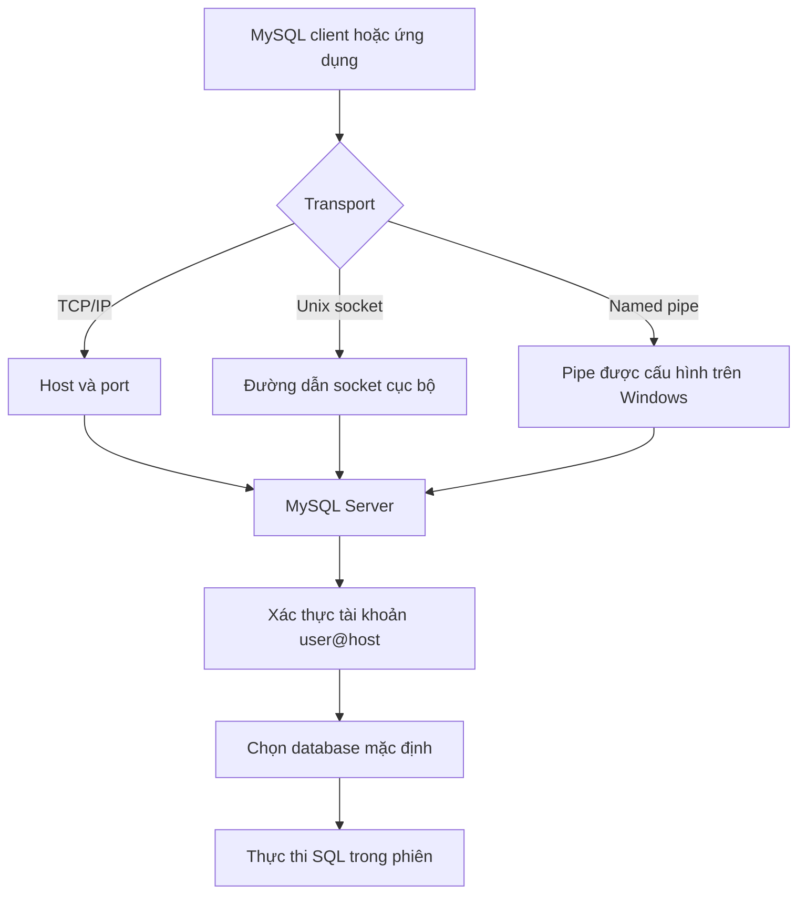

# Host, port, socket, database mặc định và chuỗi kết nối

Để một ứng dụng hoặc công cụ quản trị làm việc với MySQL, nó cần xác định đúng máy chủ, cổng hoặc socket, phương thức truyền dữ liệu và database sẽ dùng mặc định. Các thông tin này thường được nhập trong MySQL Workbench, DBeaver, dòng lệnh `mysql` hoặc cấu hình kết nối của ứng dụng. Chỉ cần sai một thành phần, client có thể không tìm thấy server, kết nối nhầm instance hoặc đăng nhập thành công nhưng truy vấn không chạy trên database mong muốn.

Bài học thuộc module `DATABASE_MYSQL`, chương Công cụ và kết nối. Môi trường kết nối là điểm bắt đầu cho các công việc thiết kế bảng, kiểu dữ liệu, khóa, truy vấn SQL, index, transaction và kiểm soát đồng thời. Khi kết nối đúng, người học có thể tiếp tục đọc kế hoạch thực thi, tối ưu truy vấn, kiểm tra quyền, sao lưu và xử lý vận hành trên đúng instance. Các ví dụ ưu tiên MySQL 8.x; đường dẫn socket, tên service và cách cấu hình có thể thay đổi theo hệ điều hành hoặc phương thức cài đặt.

## Mục tiêu

Sau bài này, bạn có thể:

- Phân biệt host, port, Unix socket và database mặc định.
- Chọn đúng giao thức khi kết nối cục bộ hoặc từ xa.
- Đọc và xây dựng chuỗi kết nối cho MySQL client và JDBC Connector/J.
- Kiểm tra phiên kết nối đang đi đến instance nào và đang sử dụng database nào.
- Khoanh vùng lỗi DNS, mạng, cổng, socket, xác thực, TLS và database không tồn tại.

## 1. Một kết nối MySQL gồm những gì?

Một kết nối thông thường có các thành phần sau:

| Thành phần | Ý nghĩa | Ví dụ |
|---|---|---|
| Host | Máy hoặc địa chỉ mạng chạy MySQL Server | `localhost`, `127.0.0.1`, `db.example.internal` |
| Port | Cổng TCP mà MySQL Server lắng nghe | `3306` |
| Protocol/transport | Cách client truyền dữ liệu tới server | TCP/IP, Unix socket, named pipe |
| User và credential | Tài khoản MySQL và thông tin xác thực | `app_user` và mật khẩu được quản lý an toàn |
| Default database | Database được chọn làm ngữ cảnh ban đầu của phiên | `sales` |
| TLS options | Cách mã hóa và xác minh kết nối mạng | `sslMode=VERIFY_IDENTITY` trong Connector/J |

Host và port mô tả điểm đến mạng khi dùng TCP/IP. Với Unix socket, client kết nối tới một tệp socket cục bộ nên không cần host và port cho đường truyền đó. Sau khi thiết lập transport, MySQL xác thực tài khoản, tạo phiên làm việc rồi có thể chọn database mặc định.



Không nên gộp các khái niệm này thành một giá trị duy nhất. Ví dụ, `localhost` là host, `3306` là port, `sales` là database; chúng giải quyết các phần khác nhau của quá trình kết nối.

## 2. Host: xác định máy chủ MySQL

Host cho biết MySQL Server nằm ở đâu. Giá trị này có thể là tên máy, tên DNS đầy đủ hoặc địa chỉ IP.

| Host | Ý nghĩa thường gặp |
|---|---|
| `localhost` | Máy hiện tại; trên nhiều client Unix, giá trị này có thể kích hoạt Unix socket thay vì TCP |
| `127.0.0.1` | Địa chỉ loopback IPv4 của chính máy đang chạy client; thường dùng để buộc kết nối TCP cục bộ |
| `::1` | Địa chỉ loopback IPv6 |
| `192.0.2.25` | Một địa chỉ IPv4; dải `192.0.2.0/24` được dành cho tài liệu và ví dụ |
| `db.example.internal` | Tên DNS của máy chủ trong mạng nội bộ |

### 2.1. Phân biệt `localhost` và `127.0.0.1`

Trên Unix-like, nhiều MySQL client mặc định dùng Unix socket khi host là `localhost`. Khi đó, client không đi qua TCP port `3306`. Ngược lại, `127.0.0.1` thường yêu cầu kết nối TCP tới loopback. Hành vi cụ thể phụ thuộc client, hệ điều hành và tùy chọn protocol; vì vậy khi cần kiểm tra TCP, hãy chỉ định rõ `--protocol=TCP`.

Hai cách kết nối có thể đi đến cùng một server nhưng dùng transport khác nhau. Điều này giải thích vì sao `mysql -h localhost` có thể thành công trong khi `mysql -h 127.0.0.1 -P 3306` thất bại: server có thể đang chỉ chấp nhận socket cục bộ, TCP listener chưa bật, hoặc cổng/firewall chưa cho phép kết nối.

Ví dụ buộc client dùng TCP trên máy hiện tại:

```bash
mysql --protocol=TCP \
  --host=127.0.0.1 \
  --port=3306 \
  --user=app_user \
  --password \
  --database=sales
```

Ví dụ kết nối bằng tên DNS của máy chủ:

```bash
mysql --protocol=TCP \
  --host=db.example.internal \
  --port=3306 \
  --user=app_user \
  --password \
  --database=sales
```

Client sẽ yêu cầu nhập mật khẩu tương tác. Cách này tránh đặt mật khẩu trực tiếp trong câu lệnh, nơi có thể bị lưu trong shell history hoặc lộ qua danh sách tiến trình.

### 2.2. Host phía client và địa chỉ lắng nghe phía server

Giá trị host mà client nhập là địa chỉ đích. Phía server còn có cấu hình `bind_address` (biến `bind_address`, thường được đặt bằng `bind-address` trong cấu hình) để quyết định địa chỉ mạng mà MySQL lắng nghe.

- `127.0.0.1`: chỉ lắng nghe loopback IPv4, thường chỉ cho phép client trên cùng máy kết nối qua TCP.
- `0.0.0.0`: lắng nghe trên mọi giao diện IPv4; cần kết hợp firewall và kiểm soát truy cập phù hợp.
- Một địa chỉ IP cụ thể: giới hạn listener vào giao diện tương ứng.

Nếu `skip_networking` được bật, MySQL không chấp nhận kết nối TCP/IP. Kết nối qua socket cục bộ vẫn có thể hoạt động. Hãy kiểm tra cấu hình server và hạ tầng mạng trước khi kết luận tài khoản MySQL có vấn đề.

Một khái niệm khác là phần host trong tài khoản MySQL, ví dụ `'app_user'@'10.20.30.15'`. Nó xác định nguồn client được phép dùng tài khoản đó. Host đích trong chuỗi kết nối và host trong tên tài khoản là hai phía khác nhau: một bên chỉ server cần đến, bên kia tham gia vào quy tắc xác thực và cấp quyền.

## 3. Port: cổng TCP của MySQL Server

MySQL Server thường lắng nghe TCP trên port `3306`. Client phải dùng đúng port mà instance đang cấu hình; nếu quản trị viên đổi port hoặc có nhiều instance trên cùng máy, giá trị mặc định này có thể không còn đúng.

Kiểm tra port từ phiên MySQL đang hoạt động:

```sql
SHOW VARIABLES LIKE 'port';
SELECT @@port;
```

Trong tệp cấu hình server, port thường được khai báo trong phần `[mysqld]`:

```ini
[mysqld]
port=3306
bind-address=127.0.0.1
```

Sau khi thay đổi cấu hình, cần khởi động lại service theo quy trình vận hành của máy chủ và xác nhận service đang lắng nghe trên đúng địa chỉ, cổng. Không sửa port trong cấu hình client để thay đổi port server; client chỉ cần trỏ tới cổng server thực sự đang dùng.

MySQL X Protocol có thể dùng port `33060` khi plugin X Protocol được bật. Đây là giao thức riêng, không phải port TCP cổ điển để thay thế tùy tiện cho `3306` trong MySQL client thông thường hoặc JDBC URL kiểu truyền thống. Hãy xác định rõ ứng dụng dùng giao thức MySQL cổ điển hay X Protocol.

### 3.1. Kiểm tra cổng từ máy client

Trên PowerShell:

```powershell
Test-NetConnection db.example.internal -Port 3306
```

Trên Linux có thể dùng `nc` nếu đã cài:

```bash
nc -vz db.example.internal 3306
```

Kiểm tra TCP thành công chỉ chứng minh có thể mở kết nối tới cổng. Nó chưa chứng minh MySQL xác thực được tài khoản, database tồn tại hoặc người dùng có quyền chạy truy vấn.

## 4. Socket: kết nối cục bộ qua tệp Unix socket

Unix domain socket là một điểm giao tiếp cục bộ do hệ điều hành cung cấp. MySQL Server tạo socket tại đường dẫn được cấu hình; client cùng máy có thể kết nối thông qua tệp này mà không cần đi qua TCP/IP. Socket không phải là một cổng TCP và không thể dùng trực tiếp để kết nối tới máy chủ ở xa.

Đường dẫn thường gặp tùy bản phân phối gồm `/var/run/mysqld/mysqld.sock`, `/run/mysqld/mysqld.sock` hoặc `/tmp/mysql.sock`. Đây chỉ là ví dụ, không phải đường dẫn cố định cho mọi cài đặt.

Kiểm tra socket từ phiên server:

```sql
SHOW VARIABLES LIKE 'socket';
SELECT @@socket;
```

Kết nối bằng socket khi đã biết đường dẫn:

```bash
mysql --protocol=SOCKET \
  --socket=/var/run/mysqld/mysqld.sock \
  --user=app_user \
  --password \
  --database=sales
```

Đổi đường dẫn ví dụ thành giá trị thực của server. Client và server phải thống nhất socket path; nếu client tìm sai tệp, nó có thể báo `Can't connect to local MySQL server through socket` dù service vẫn chạy.

Socket thường có quyền truy cập ở cấp hệ điều hành. Người dùng cần quyền phù hợp để mở socket, nhưng vẫn phải vượt qua bước xác thực tài khoản MySQL. Quyền đọc/ghi tệp socket không thay thế quyền SQL.

### 4.1. Named pipe trên Windows

Trên Windows, MySQL có thể được cấu hình dùng named pipe. Tên pipe do server cấu hình, thường là `MySQL` nếu dùng giá trị mặc định trong nhiều thiết lập. Client Windows có thể chỉ định protocol PIPE và tên pipe, ví dụ:

```powershell
mysql --protocol=PIPE --socket=MySQL --user=app_user --password --database=sales
```

Chỉ dùng ví dụ này khi named pipe đã được bật và tên pipe khớp cấu hình server. Nếu server chỉ lắng nghe TCP, hãy dùng `--protocol=TCP` cùng host và port. Windows còn có các lựa chọn protocol cục bộ khác tùy cấu hình, nhưng không nên mặc định rằng mọi máy đều bật chúng.

## 5. Database mặc định của một phiên

Trong MySQL, `database` và `schema` thường được dùng như hai tên gọi tương đương cho một namespace chứa bảng, view, routine và các đối tượng liên quan. Database mặc định là schema mà phiên làm việc chọn ban đầu. Nó giúp câu SQL ngắn gọn hơn khi truy cập các bảng thuộc schema đó.

Ví dụ, khi database mặc định là `sales`, câu lệnh:

```sql
SELECT order_id, total_amount
FROM orders;
```

sẽ tìm bảng `orders` trong database `sales`. Nếu không chọn database mặc định, cần chỉ rõ tên đầy đủ:

```sql
SELECT order_id, total_amount
FROM sales.orders;
```

Chọn database khi mở client bằng `--database` hoặc `-D`:

```bash
mysql --host=127.0.0.1 --port=3306 \
  --user=app_user --password \
  --database=sales
```

Hoặc chọn trong phiên hiện tại:

```sql
USE sales;
SELECT DATABASE();
```

`DATABASE()` trả về database mặc định hiện tại; kết quả là `NULL` nếu phiên chưa chọn database nào. Chuyển database bằng `USE` chỉ thay đổi ngữ cảnh của phiên hiện tại, không thay đổi database mặc định của các kết nối khác.

Việc chọn database không tự cấp quyền. Tài khoản vẫn cần quyền phù hợp trên database hoặc đối tượng được truy cập. Nếu client báo `Unknown database 'sales'`, hãy xác minh tên database và instance đích trước khi tạo mới; có thể bạn đang kết nối nhầm server.

## 6. Chuỗi kết nối và các trường cấu hình

Chuỗi kết nối (connection string hoặc connection URL) gom các thông tin cần thiết để client biết cách mở phiên MySQL. Cú pháp phụ thuộc công cụ hoặc thư viện; không có một định dạng duy nhất dùng cho tất cả client.

Với MySQL client dòng lệnh, các trường thường được truyền qua tham số:

```bash
mysql --protocol=TCP \
  --host=db.example.internal \
  --port=3306 \
  --user=app_user \
  --password \
  --database=sales
```

Trong giao diện MySQL Workbench hoặc DBeaver, các trường tương ứng thường có dạng:

| Trường trong công cụ | Giá trị ví dụ | Ghi chú |
|---|---|---|
| Connection method | Standard TCP/IP | Chọn transport phù hợp |
| Hostname | `db.example.internal` | Tên DNS hoặc IP server |
| Port | `3306` | Port TCP của instance |
| Username | `app_user` | Tài khoản MySQL |
| Password | Nhập qua kho credential của công cụ | Tránh lưu mật khẩu trong file chia sẻ |
| Default schema | `sales` | Có thể để trống nếu chưa cần chọn schema |
| SSL/TLS | Verify CA/identity theo môi trường | Bật xác minh chứng chỉ cho kết nối mạng |

### 6.1. JDBC URL với MySQL Connector/J

Trong ứng dụng Java, MySQL Connector/J dùng URL có dạng tổng quát:

```text
jdbc:mysql://[host][:port]/[database][?propertyName=value&propertyName2=value2]
```

Ví dụ kết nối tới database `sales` trên server nội bộ:

```text
jdbc:mysql://db.example.internal:3306/sales?sslMode=VERIFY_IDENTITY
```

Các phần trong URL:

- `jdbc:mysql://` cho biết JDBC driver và giao thức MySQL cổ điển.
- `db.example.internal` là host.
- `3306` là port.
- `sales` là database mặc định.
- `sslMode=VERIFY_IDENTITY` yêu cầu TLS và xác minh chứng chỉ server, bao gồm danh tính hostname. Máy client phải tin cậy CA phát hành chứng chỉ và hostname trong URL phải khớp chứng chỉ.

Không đưa username hoặc password thật vào URL được commit lên Git, ghi trong log hay chia sẻ qua ticket. Truyền thông tin xác thực riêng qua biến môi trường, secret manager hoặc cơ chế credential an toàn của nền tảng:

```java
String url = "jdbc:mysql://db.example.internal:3306/sales?sslMode=VERIFY_IDENTITY";

Properties properties = new Properties();
properties.setProperty("user", System.getenv("DB_USER"));
properties.setProperty("password", System.getenv("DB_PASSWORD"));

try (Connection connection = DriverManager.getConnection(url, properties)) {
    System.out.println("Connected to MySQL");
}
```

Đoạn mã minh họa cách truyền credential; ứng dụng thực tế cần có dependency Connector/J, import JDBC tương ứng và xử lý ngoại lệ theo cấu trúc của chương trình. Không in giá trị `DB_PASSWORD` ra log.

Nếu server dùng CA nội bộ, cần cấu hình trust store hoặc thuộc tính Connector/J phù hợp để driver xác minh được chứng chỉ. Không hạ `sslMode` xuống chế độ bỏ xác minh chỉ để che lỗi chứng chỉ. Khi phát triển cục bộ, có thể dùng cấu hình TLS riêng của môi trường lab, nhưng cần ghi rõ khác biệt trước khi triển khai.

Tên tham số và hành vi của driver có thể khác giữa các phiên bản Connector/J. Hãy dùng tài liệu của đúng phiên bản driver đang chạy khi thêm các thuộc tính như timeout, timezone, connection attributes hoặc pool settings.

### 6.2. Giá trị có ký tự đặc biệt

Khi một thành phần URL chứa ký tự dành riêng như khoảng trắng, `@`, `:`, `/`, `?`, `&` hoặc `#`, cần mã hóa URL (percent-encoding) theo quy tắc của thành phần đó. Không tự nối chuỗi tùy tiện để tạo URL vì ký tự trong tên database hoặc giá trị tham số có thể bị hiểu nhầm là dấu phân tách.

Đối với JDBC, nên dùng API `Properties` hoặc cấu hình datasource để truyền username, password và các thuộc tính riêng; cách này cũng giảm nguy cơ lỗi escape và lộ bí mật. Nếu thư viện cung cấp builder cho URL, hãy ưu tiên builder đã được kiểm thử.

## 7. Kết nối trong các môi trường triển khai khác nhau

### 7.1. Ứng dụng và MySQL cùng một máy

Với ứng dụng chạy cùng máy với MySQL, có thể dùng Unix socket hoặc TCP loopback. Socket giảm một số bước mạng và thường phù hợp cho client cục bộ; TCP loopback hữu ích khi cần kiểm thử đúng đường kết nối TCP mà ứng dụng sẽ sử dụng.

Đừng mặc định rằng hai cấu hình `localhost` và `127.0.0.1` là tương đương. Hãy đặt rõ protocol khi kết quả kiểm tra cần nhất quán giữa các máy.

### 7.2. Ứng dụng và MySQL ở hai máy khác nhau

Khi client ở máy khác, thường dùng TCP/IP với hostname hoặc IP của server và port đã mở. Kiểm tra lần lượt:

1. DNS phân giải hostname thành đúng địa chỉ.
2. MySQL đang lắng nghe trên giao diện mạng phù hợp.
3. Firewall phía server, firewall mạng và security group cho phép nguồn client tới port MySQL.
4. Đường truyền sử dụng TLS và client xác minh chứng chỉ server.
5. Tài khoản MySQL cho phép kết nối từ nguồn tương ứng và có quyền tối thiểu trên database cần dùng.

Không mở port MySQL trực tiếp ra Internet nếu không có kiến trúc bảo vệ phù hợp. Ưu tiên private network, VPN, bastion hoặc tunnel được quản lý; giới hạn nguồn truy cập và quyền tài khoản.

### 7.3. MySQL chạy trong Docker

Trong Docker, `localhost` luôn chỉ network namespace của nơi lệnh hoặc ứng dụng đang chạy. Nếu ứng dụng chạy trên máy host và container MySQL publish port bằng `-p 3307:3306`, ứng dụng trên host thường kết nối tới `127.0.0.1:3307`. Cổng bên trái là port trên host, cổng bên phải là port bên trong container.

Nếu ứng dụng và MySQL ở hai container cùng Docker network, ứng dụng thường kết nối bằng service/container name và port bên trong container, ví dụ `mysql-db:3306`. Dùng `localhost:3306` từ container ứng dụng sẽ trỏ về chính container ứng dụng, không phải container MySQL.

Ví dụ ánh xạ cổng:

```bash
docker run --name mysql-db \
  -e MYSQL_ROOT_PASSWORD='UseASecretFromYourEnvironment' \
  -p 3307:3306 \
  -d mysql:8.4
```

Đây là ví dụ lab về ánh xạ cổng; trong môi trường thực tế, dùng secret management và volume bền vững cho dữ liệu. Không dùng mật khẩu minh họa này trong triển khai thật.

## 8. Xác minh phiên kết nối sau khi đăng nhập

Khi đã đăng nhập, chạy các câu SQL sau để biết phiên hiện tại đang nói chuyện với server nào:

```sql
SELECT
  @@hostname AS server_host,
  @@port AS server_port,
  @@socket AS server_socket,
  DATABASE() AS default_database,
  USER() AS presented_identity,
  CURRENT_USER() AS privilege_account,
  CONNECTION_ID() AS connection_id,
  VERSION() AS server_version;
```

Ý nghĩa các giá trị:

- `@@hostname`: hostname mà MySQL Server tự nhận diện.
- `@@port`: port TCP được cấu hình cho server; giá trị này không chứng minh phiên hiện tại đã đi qua TCP.
- `@@socket`: socket path do server cấu hình; hữu ích khi kiểm tra kết nối cục bộ.
- `DATABASE()`: database mặc định của phiên, có thể là `NULL`.
- `USER()`: danh tính client trình bày khi kết nối, bao gồm host mà server nhìn thấy.
- `CURRENT_USER()`: account MySQL mà server dùng để kiểm tra quyền cho phiên.
- `CONNECTION_ID()`: định danh kết nối hiện tại trên server.
- `VERSION()`: phiên bản MySQL Server.

Trong MySQL client, lệnh `status` cũng hiển thị thông tin phiên, bao gồm server, user, database và một số chi tiết kết nối:

```text
mysql> status
```

Nếu đang kiểm tra kết nối từ ứng dụng, hãy ghi nhận endpoint đã cấu hình và đối chiếu kết quả truy vấn xác minh. Điều này đặc biệt hữu ích khi có nhiều môi trường development, test, staging và production với tên database giống nhau.

## 9. Xử lý lỗi kết nối thường gặp

| Thông báo hoặc hiện tượng | Nguyên nhân có thể | Hướng kiểm tra |
|---|---|---|
| `Unknown MySQL server host` | DNS sai, hostname không tồn tại hoặc máy client không phân giải được tên | Kiểm tra hostname, DNS và mạng nội bộ; thử IP đã được xác nhận để khoanh vùng DNS. |
| `Connection refused` | Không có listener tại địa chỉ/port đó, service dừng hoặc port mapping sai | Kiểm tra service, `bind_address`, `port`, `skip_networking` và port publish nếu dùng container. |
| Kết nối bị timeout | Firewall, routing, security group hoặc ACL chặn gói tin | Kiểm tra đường đi mạng và quy tắc cho phép nguồn client tới đúng port. |
| `Can't connect ... through socket` | Socket path sai, socket chưa được tạo, service dừng hoặc quyền hệ điều hành không phù hợp | Kiểm tra service, `@@socket`, cấu hình client, quyền thư mục và socket file. |
| `Access denied for user` | Sai credential, account host không khớp nguồn kết nối, plugin xác thực hoặc chính sách TLS không phù hợp | Xác minh user/host, credential, plugin và account được server chọn; không mở rộng host thành `%` để né lỗi. |
| `Unknown database` | Database không tồn tại trên instance đích hoặc tên database bị sai | Kiểm tra `@@hostname`, `@@port`, `DATABASE()` và danh sách database bằng tài khoản có quyền phù hợp. |
| Lỗi xác minh certificate/hostname | CA chưa được tin cậy, chứng chỉ hết hạn hoặc hostname URL không khớp SAN | Kiểm tra chuỗi CA, thời hạn và hostname chứng chỉ; dùng đúng DNS name được cấp chứng chỉ. |
| Ứng dụng kết nối nhầm instance | Cấu hình môi trường, port mapping, DNS hoặc secret khác dự kiến | Đối chiếu `@@hostname`, `@@port`, `VERSION()` và một dấu hiệu nhận diện môi trường do hệ thống quản lý. |

Một quy trình khoanh vùng hiệu quả là đi từ ngoài vào trong: phân giải host, kiểm tra khả năng mở TCP port, xác nhận server đang lắng nghe, thử đăng nhập, chọn database rồi chạy truy vấn đơn giản. Mỗi bước xác nhận một lớp riêng nên giúp thu hẹp nguyên nhân nhanh hơn.

## 10. Bài thực hành

Thực hiện trên instance lab hoặc môi trường được phép truy cập:

1. Mở MySQL client bằng socket cục bộ nếu hệ điều hành hỗ trợ. Ghi lại socket path từ `SHOW VARIABLES LIKE 'socket'`.
2. Kết nối lại bằng TCP loopback với `--protocol=TCP`, host `127.0.0.1` và port server đang dùng. So sánh kết quả với cách kết nối socket.
3. Kết nối bằng hostname của máy chủ trong mạng được phép. Kiểm tra DNS và khả năng mở port từ client.
4. Chọn database `sales` khi khởi tạo phiên bằng `--database=sales`, sau đó kiểm tra `DATABASE()`.
5. Tạo một JDBC URL trỏ đến host, port và database lab. Đưa credential qua cấu hình bí mật hoặc biến môi trường, bật TLS phù hợp với chứng chỉ của môi trường.
6. Chạy truy vấn xác minh ở phần 8 và lưu lại hostname, port, database, version cùng `CURRENT_USER()`; không lưu mật khẩu.
7. Thử lần lượt một host sai, port sai và database sai trong môi trường lab. Ghi nhận cách phân biệt lỗi DNS, lỗi transport và lỗi database.

Bạn hoàn thành bài khi có thể giải thích từng thành phần trong cấu hình kết nối, chủ động chọn đúng transport, xác minh được instance đích và phân loại được lỗi theo từng lớp.

## 11. Nguyên tắc vận hành

- Ghi rõ host, port, protocol và database cho từng môi trường; không dựa vào giá trị mặc định nếu hệ thống có nhiều instance.
- Dùng socket cho kết nối cục bộ khi phù hợp; dùng TCP/IP cho kết nối qua mạng và xác minh TLS.
- Phân biệt port của MySQL Protocol cổ điển với port của MySQL X Protocol.
- Chọn database mặc định để làm rõ ngữ cảnh SQL, nhưng luôn cấp quyền theo tài khoản và đối tượng cần truy cập.
- Không nhúng mật khẩu vào source code, JDBC URL được commit, log hoặc lệnh shell; lấy bí mật từ cơ chế quản lý credential.
- Khi có lỗi, xác minh endpoint và instance trước khi thay đổi quyền hoặc cấu hình tài khoản.
