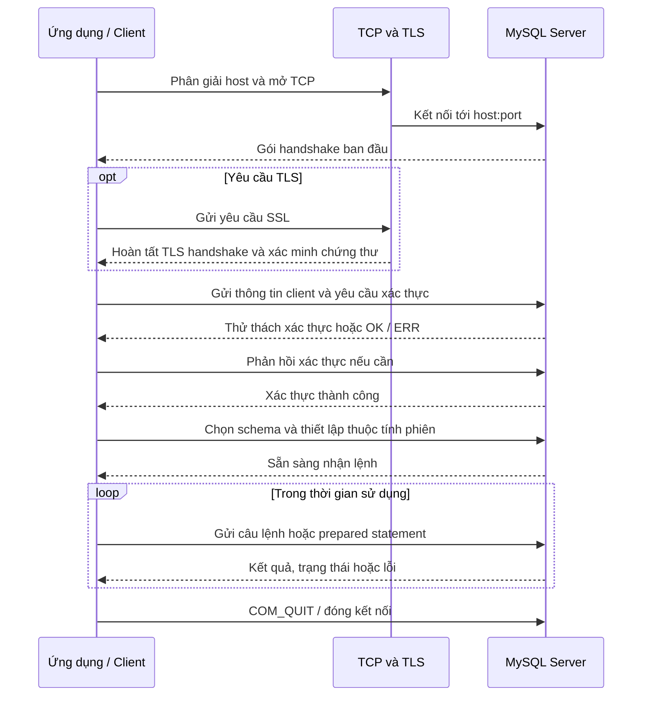

# Vòng đời kết nối: xác thực, khởi tạo phiên, thực thi và đóng

Một kết nối MySQL không chỉ là việc nhập địa chỉ máy chủ và mật khẩu. Khi ứng dụng mở kết nối, client và server phải thiết lập kênh mạng, thương lượng giao thức và mã hóa, xác thực tài khoản, tạo phiên làm việc, thống nhất các thuộc tính phiên, trao đổi câu lệnh và kết quả, rồi giải phóng tài nguyên đúng cách. Hiểu vòng đời này giúp bạn phân biệt lỗi mạng với lỗi xác thực, tránh rò rỉ kết nối, quản lý transaction đúng và cấu hình connection pool an toàn.

Trong module `DATABASE_MYSQL`, kiến thức về kết nối là nền tảng để thực hành thiết kế bảng, kiểu dữ liệu, khóa và truy vấn SQL; sau đó mới có thể đánh giá index, transaction, kiểm soát đồng thời, phân quyền, sao lưu và vận hành. Bài này tập trung vào vòng đời của một kết nối từ lúc client bắt đầu kết nối đến khi phiên được đóng, gồm cả cách quan sát và chẩn đoán từng giai đoạn.

## 1. Phân biệt kết nối vật lý, phiên làm việc và kết nối logic

Ba khái niệm này thường bị gọi chung là “connection”, nhưng chúng có ý nghĩa khác nhau:

- **Kết nối vật lý (physical connection):** kênh giao tiếp thực tế giữa client và MySQL Server, thường chạy trên TCP/IP. Nó có một vòng đời mạng và tiêu thụ tài nguyên ở cả client lẫn server.
- **Phiên làm việc (session):** trạng thái server gắn với một kết nối đã xác thực. Phiên có database mặc định, biến session, transaction hiện tại, prepared statement, bảng tạm, khóa và các trạng thái liên quan.
- **Kết nối logic (logical connection):** đối tượng mà mã ứng dụng sử dụng. Khi có connection pool, ứng dụng mượn một kết nối logic; thao tác `close()` thường trả kết nối vật lý về pool để tái sử dụng thay vì đóng socket ngay.

Nếu dùng JDBC `DriverManager` trực tiếp, một `Connection` thường đại diện cho một kết nối vật lý. Nếu dùng pool, đối tượng `Connection` thường là lớp bao (proxy) đại diện cho một lượt mượn kết nối. Sự khác biệt này ảnh hưởng trực tiếp tới cách hiểu `close()`, transaction và trạng thái session.

## 2. Toàn cảnh các giai đoạn của một kết nối

Một kết nối thông thường trải qua chuỗi bước sau:



Sơ đồ mô tả luồng khái quát. Chi tiết gói tin và cách trao đổi xác thực phụ thuộc phiên bản MySQL, client capability và authentication plugin. Khi TLS được yêu cầu, client và server thương lượng kênh TLS trước khi gửi phần phản hồi xác thực chứa thông tin đăng nhập.

## 3. Giai đoạn 1 — Phân giải địa chỉ và thiết lập TCP

Ứng dụng thường cấu hình một hostname, port, tài khoản và schema. Trước khi MySQL có thể xác thực, client phải tìm được địa chỉ máy chủ và thiết lập kết nối mạng.

Các việc xảy ra ở giai đoạn này:

1. Client phân giải hostname qua DNS hoặc cơ chế phân giải tên của hệ điều hành.
2. Client mở kết nối tới địa chỉ IP và port của MySQL, thường là `3306` nếu không cấu hình khác.
3. Server phải đang lắng nghe trên địa chỉ đó; firewall, security group, định tuyến và chính sách mạng phải cho phép kết nối.
4. Sau khi TCP được thiết lập, client mới có thể trao đổi gói tin giao thức MySQL.

Ví dụ kết nối bằng client dòng lệnh:

```bash
mysql --protocol=TCP \
  --host=db.example.internal \
  --port=3306 \
  --user=shop_app \
  --password \
  --database=learning_shop
```

Tùy hệ điều hành và cấu hình, kết nối tới `localhost` có thể dùng Unix socket hoặc named pipe thay vì TCP. Thêm `--protocol=TCP` giúp buộc client dùng TCP khi bạn muốn kiểm tra đúng đường truyền mạng. Tùy chọn `--password` không kèm giá trị khiến client hỏi mật khẩu tương tác; không đặt mật khẩu trực tiếp trong command line vì lệnh có thể bị lưu trong lịch sử terminal hoặc lộ qua danh sách tiến trình.

Nếu không kết nối được, hãy kiểm tra theo thứ tự: hostname có phân giải đúng không, địa chỉ và port có thể truy cập không, server có đang chạy và lắng nghe không, firewall có chặn không, rồi mới điều tra cấu hình MySQL. Lỗi ở giai đoạn TCP thường chưa liên quan tới quyền của user trong database.

## 4. Giai đoạn 2 — Handshake giao thức và TLS

Sau khi TCP được thiết lập, MySQL Server gửi gói handshake ban đầu. Gói này chứa thông tin giao thức và các capability mà server hỗ trợ, cùng dữ liệu phục vụ quá trình xác thực. Client phản hồi bằng capability của nó, tên user và thông tin cần thiết để tiếp tục xác thực.

Nếu kết nối yêu cầu TLS, luồng giao thức sẽ có bước thương lượng TLS trước phần phản hồi xác thực. Client gửi yêu cầu SSL, hai bên hoàn tất TLS handshake, sau đó client mới gửi thông tin đăng nhập trên kênh được mã hóa. TLS bảo vệ dữ liệu trên đường truyền, nhưng không thay thế xác thực user, kiểm soát quyền hoặc bảo vệ dữ liệu ở trạng thái lưu trữ.

Khi kết nối qua mạng, nên xác minh cả chuỗi chứng thư lẫn hostname để tránh kết nối tới máy chủ giả mạo. Ví dụ với MySQL CLI:

```bash
mysql --protocol=TCP \
  --host=db.example.internal \
  --port=3306 \
  --user=shop_app \
  --password \
  --database=learning_shop \
  --ssl-mode=VERIFY_IDENTITY \
  --ssl-ca=/path/to/ca.pem
```

`VERIFY_IDENTITY` yêu cầu xác minh chứng thư theo CA tin cậy và đối chiếu danh tính máy chủ với hostname đang kết nối. Đường dẫn CA trong ví dụ phải trỏ tới CA phù hợp với chứng thư server. Cấu hình TLS thực tế cần thống nhất giữa client, server và hạ tầng chứng thư; không hạ mức xác minh chỉ để che lỗi hostname hoặc chứng thư.

Sau khi kết nối, có thể kiểm tra trạng thái TLS của phiên:

```sql
SHOW SESSION STATUS LIKE 'Ssl_version';
SHOW SESSION STATUS LIKE 'Ssl_cipher';
```

Giá trị rỗng ở các biến này thường cho biết phiên hiện tại không sử dụng TLS. Khi kiểm tra, hãy chạy trên đúng kết nối cần xác minh.

## 5. Giai đoạn 3 — Xác thực tài khoản và kiểm tra quyền

Xác thực trả lời câu hỏi “client có được đăng nhập bằng tài khoản này không?”. Phân quyền trả lời câu hỏi “sau khi đăng nhập, tài khoản được phép làm gì?”. Hai bước liên quan nhưng không đồng nghĩa.

### Tài khoản MySQL gồm user và host

MySQL nhận diện account theo cặp `user` và `host`, chẳng hạn:

```sql
CREATE USER 'shop_app'@'10.20.30.%'
    IDENTIFIED BY 'replace_with_a_secret';

GRANT SELECT, INSERT, UPDATE, DELETE
    ON learning_shop.*
    TO 'shop_app'@'10.20.30.%';
```

Host trong account là điều kiện xác định nguồn kết nối được phép khớp với tài khoản đó. Tài khoản `'shop_app'@'localhost'` và `'shop_app'@'10.20.30.%'` là hai account khác nhau, có thể có plugin xác thực và quyền khác nhau. Cần thiết kế host theo địa chỉ hoặc phạm vi mạng thực tế; không mở rộng host quá mức nếu không có lý do.

### Authentication plugin

MySQL hỗ trợ các authentication plugin. Plugin xác định cách server và client trao đổi để chứng minh danh tính. Các phiên bản MySQL hiện đại thường dùng `caching_sha2_password` làm plugin mặc định cho account mới, trong khi hệ thống cũ có thể gặp `mysql_native_password` hoặc cấu hình khác. Khả năng tương thích của driver cần được kiểm tra khi nâng cấp server hoặc Connector/J.

Không nên tự đổi plugin để né một lỗi kết nối mà chưa hiểu nguyên nhân. Hãy xác định account thực tế, plugin được gán, phiên bản driver và thông báo lỗi. Nếu cần đổi plugin, phải cân nhắc khả năng tương thích client và chính sách bảo mật của môi trường.

### Kiểm tra account được sử dụng

Sau khi đăng nhập, chạy:

```sql
SELECT
    USER() AS presented_identity,
    CURRENT_USER() AS matched_account,
    DATABASE() AS default_schema,
    CONNECTION_ID() AS connection_id;
```

`USER()` thể hiện user client gửi lên cùng nguồn host của kết nối; `CURRENT_USER()` cho biết account MySQL đã khớp để áp dụng xác thực và quyền. Hai giá trị có thể khác nhau, vì vậy `CURRENT_USER()` rất hữu ích khi điều tra trường hợp đăng nhập thành công nhưng quyền không như dự kiến.

Sau đó kiểm tra quyền:

```sql
SHOW GRANTS FOR CURRENT_USER();
```

Một kết nối có thể xác thực thành công nhưng vẫn nhận lỗi `Access denied` khi thực hiện một thao tác cụ thể do thiếu quyền. Ví dụ, account có `SELECT` nhưng không có `UPDATE` sẽ đọc được dữ liệu nhưng không sửa được hàng.

## 6. Giai đoạn 4 — Khởi tạo session sau khi xác thực

Khi xác thực thành công, server tạo trạng thái phiên để xử lý các lệnh tiếp theo. Client có thể gửi schema mặc định trong quá trình handshake hoặc chọn schema ngay sau đó. Ứng dụng cũng cần thiết lập những thuộc tính phiên mà nghiệp vụ phụ thuộc vào.

Các thuộc tính thường cần quan tâm:

| Thuộc tính | Ý nghĩa | Điều cần thống nhất |
|---|---|---|
| Default database | Schema mặc định cho tên bảng không ghi đầy đủ schema | Chọn đúng database của môi trường hiện tại. |
| Character set và collation | Cách mã hóa, so sánh và sắp xếp chuỗi | Dùng cấu hình Unicode phù hợp, thường là `utf8mb4`. |
| Time zone | Cách server diễn giải và trả về giá trị thời gian liên quan múi giờ | Quy định rõ cách lưu và hiển thị thời gian; ứng dụng thường thống nhất UTC. |
| `sql_mode` | Các quy tắc xử lý SQL và dữ liệu | Không giả định các môi trường có cùng mode nếu chưa kiểm tra. |
| `autocommit` | Có tự động commit mỗi statement hay không | Hiểu rõ trước khi thực hiện nhiều thao tác ghi liên quan. |
| Transaction isolation | Mức cô lập của transaction | Chọn theo yêu cầu nhất quán và đồng thời của ứng dụng. |

Kiểm tra trạng thái phiên:

```sql
SELECT
    DATABASE() AS current_schema,
    @@session.time_zone AS session_time_zone,
    @@session.sql_mode AS session_sql_mode,
    @@session.autocommit AS autocommit,
    @@session.transaction_isolation AS transaction_isolation,
    @@character_set_client AS client_charset,
    @@character_set_connection AS connection_charset,
    @@character_set_results AS results_charset;
```

Các biến trên phản ánh phiên hiện tại. `transaction_isolation` là tên biến dùng trong MySQL 8.0; ở một số bản MySQL 5.7, tên tương ứng là `tx_isolation`. Một cấu hình toàn cục thay đổi không nhất thiết cập nhật ngay các phiên đã mở; do đó hãy kiểm tra đúng connection mà ứng dụng đang sử dụng.

Có thể thiết lập thuộc tính phiên bằng SQL khi cần:

```sql
SET SESSION time_zone = '+00:00';
SET NAMES utf8mb4;
```

Trong ứng dụng, ưu tiên cấu hình tương ứng của driver và đặt chúng một cách nhất quán khi tạo hoặc mượn connection. `SET NAMES` thay đổi charset dùng cho trao đổi chuỗi trên phiên; không dùng nó như cách sửa lỗi dữ liệu đã bị lưu sai encoding.

Nếu client yêu cầu schema mặc định không tồn tại hoặc account không có quyền truy cập schema đó, quá trình khởi tạo database có thể thất bại dù thông tin xác thực hợp lệ. Hãy phân biệt lỗi xác thực với lỗi chọn database.

## 7. Giai đoạn 5 — Thực thi câu lệnh và trao đổi kết quả

Khi session đã sẵn sàng, client gửi câu lệnh theo giao thức MySQL. Server tiếp nhận lệnh, phân tích cú pháp, kiểm tra tên đối tượng và quyền, tối ưu kế hoạch thực thi, rồi truy cập storage engine để lấy hoặc thay đổi dữ liệu. Kết quả được gửi lại qua giao thức dưới dạng OK packet, error packet hoặc result set tùy loại lệnh.

Với truy vấn đọc, client cần tiêu thụ đầy đủ result set trước khi tái sử dụng kết nối cho lệnh tiếp theo. Một số driver có thể đệm toàn bộ kết quả trong bộ nhớ; một số chế độ streaming giữ kết nối bận trong khi ứng dụng đọc từng hàng. Nếu ứng dụng bỏ dở việc đọc hoặc không đóng `ResultSet` và statement đúng cách, connection có thể chưa sẵn sàng cho lệnh khác hoặc tài nguyên bị giữ lâu.

### Dùng prepared statement

Prepared statement tách cấu trúc SQL khỏi giá trị đầu vào. Ví dụ:

```sql
SELECT id, email, full_name
FROM customers
WHERE id = ?;
```

Ứng dụng bind giá trị cho placeholder theo API của driver. Không ghép trực tiếp dữ liệu người dùng vào câu SQL. Placeholder thường đại diện cho giá trị; tên bảng, tên cột hoặc từ khóa sắp xếp động phải được chọn từ danh sách cho phép do ứng dụng kiểm soát.

### Thực thi nhiều lệnh và transaction

Theo mặc định, MySQL thường bật `autocommit` cho session. Mỗi statement độc lập sẽ được commit tự động khi thành công, trừ khi ứng dụng mở transaction hoặc thay đổi cấu hình autocommit. Khi một nghiệp vụ gồm nhiều bước phải thành công cùng nhau, hãy dùng transaction tường minh:

```sql
START TRANSACTION;

UPDATE inventory
SET available = available - 1
WHERE product_id = 42
  AND available > 0;

-- Ứng dụng kiểm tra ROW_COUNT() ngay sau UPDATE.
-- Nếu số hàng bị ảnh hưởng không bằng 1: ROLLBACK.
-- Nếu bằng 1: ghi đơn hàng và tiếp tục.
SELECT ROW_COUNT() AS affected_rows;

INSERT INTO order_items (order_id, product_id, quantity, unit_price)
VALUES (9001, 42, 1, 199000.00);

COMMIT;
```

Đây là ví dụ minh họa luồng điều khiển: ứng dụng phải kiểm tra số hàng bị ảnh hưởng ngay sau `UPDATE` trên cùng connection. Nếu không giảm được đúng một hàng, phải rollback và không ghi dòng đơn hàng. Nếu tất cả thao tác thành công, commit xác nhận thay đổi. Khi có lỗi, ứng dụng cần rollback trước khi trả connection về pool.

Một connection chỉ có một trạng thái transaction tại một thời điểm. Không chia sẻ tùy tiện cùng một connection cho nhiều luồng nghiệp vụ độc lập vì các lệnh có thể tác động lên cùng session, cùng transaction và cùng trạng thái kết quả.

### Một ví dụ JDBC với MySQL Connector/J

Ví dụ dưới đây minh họa kết nối, bind tham số, đọc kết quả và đóng tài nguyên bằng `try-with-resources`. Cần có MySQL Connector/J trên classpath; `sslMode` và `connectionTimeZone` là thuộc tính cấu hình của các phiên bản Connector/J hiện đại.

```java
import java.sql.Connection;
import java.sql.DriverManager;
import java.sql.PreparedStatement;
import java.sql.ResultSet;
import java.sql.SQLException;
import java.util.Properties;

public class CustomerLookup {
    public static void main(String[] args) throws SQLException {
        String url = "jdbc:mysql://db.example.internal:3306/learning_shop"
                + "?sslMode=VERIFY_IDENTITY&connectionTimeZone=UTC";

        Properties properties = new Properties();
        String dbUser = System.getenv("DB_USER");
        String dbPassword = System.getenv("DB_PASSWORD");
        if (dbUser == null || dbPassword == null) {
            throw new IllegalStateException("DB_USER and DB_PASSWORD must be configured");
        }
        properties.setProperty("user", dbUser);
        properties.setProperty("password", dbPassword);

        long customerId = 42L;
        String sql = "SELECT id, email, full_name "
                + "FROM customers WHERE id = ?";

        try (Connection connection = DriverManager.getConnection(url, properties);
             PreparedStatement statement = connection.prepareStatement(sql)) {

            statement.setLong(1, customerId);

            try (ResultSet resultSet = statement.executeQuery()) {
                while (resultSet.next()) {
                    System.out.println(resultSet.getLong("id"));
                    System.out.println(resultSet.getString("email"));
                    System.out.println(resultSet.getString("full_name"));
                }
            }
        }
    }
}
```

`DriverManager.getConnection()` mở kết nối và hoàn tất handshake, xác thực cùng khởi tạo phiên theo cấu hình driver. `executeQuery()` gửi truy vấn và nhận result set. Khi thoát khỏi các khối `try`, `ResultSet`, `PreparedStatement` và `Connection` được đóng theo thứ tự ngược. Ví dụ dùng biến môi trường cho thông tin đăng nhập để tránh hard-code secret trong mã nguồn; trong hệ thống thật, hãy dùng cơ chế quản lý secret phù hợp.

## 8. Giai đoạn 6 — Đóng kết nối và giải phóng trạng thái

Đóng connection là một phần của luồng xử lý, không phải thao tác dọn dẹp có thể bỏ qua. Client nên đóng result set, statement và connection khi hoàn tất công việc. Với kết nối vật lý, driver gửi lệnh kết thúc phiên theo giao thức (thường là `COM_QUIT`) rồi đóng kênh mạng. Server giải phóng tài nguyên gắn với session.

Khi một kết nối bị đóng trong lúc transaction chưa commit, InnoDB rollback transaction chưa hoàn tất. Tuy vậy, ứng dụng nên chủ động commit hoặc rollback theo kết quả nghiệp vụ trước khi đóng; đừng dựa vào việc ngắt kết nối như một cơ chế rollback thông thường.

Nếu mạng bị đứt đột ngột, server có thể chưa biết ngay client đã biến mất và sẽ phát hiện qua lỗi socket hoặc timeout. Vì vậy, đóng kết nối tường minh giúp giải phóng tài nguyên nhanh và dự đoán được hơn so với để kết nối rơi do lỗi mạng.

### Phân biệt `close()` khi có pool

| Trường hợp | Ý nghĩa của `close()` |
|---|---|
| JDBC trực tiếp qua `DriverManager` | Đóng connection vật lý và kết thúc session server. |
| Connection được mượn từ pool | Thường trả connection logic về pool để tái sử dụng; socket vật lý có thể vẫn mở. |

Pool cần kiểm tra tính hợp lệ của kết nối, xử lý connection đã chết và đặt lại trạng thái session trước khi cấp cho request tiếp theo. Tùy thư viện, pool hoặc driver có thể rollback transaction còn mở, khôi phục autocommit, isolation, read-only, schema, biến session và trạng thái khác. Không giả định mọi pool tự động đặt lại mọi thay đổi tùy ý mà ứng dụng đã thực hiện.

Nếu ứng dụng chạy `SET SESSION time_zone`, tạo temporary table, thay đổi isolation hoặc đặt user variable, hãy xác định chính sách reset của pool. Nếu trạng thái phiên bị rò rỉ giữa hai request, request sau có thể chạy trong schema, múi giờ, transaction hoặc cấu hình không mong muốn.

## 9. Quản lý vòng đời kết nối trong ứng dụng

Mở một kết nối mới cho từng câu SQL thường tạo thêm chi phí DNS, TCP, TLS và xác thực. Ứng dụng máy chủ thường dùng connection pool để giữ một số kết nối vật lý và cho các request mượn khi cần.

Một pool cần được cấu hình dựa trên năng lực MySQL và tải ứng dụng:

- **Maximum pool size:** giới hạn số kết nối vật lý pool được phép mở. Tổng kết nối từ tất cả instance ứng dụng phải nằm trong giới hạn server và còn chỗ cho tác vụ quản trị.
- **Minimum idle:** số kết nối nhàn rỗi muốn duy trì sẵn sàng, nếu thư viện hỗ trợ.
- **Connection timeout:** thời gian tối đa request chờ mượn connection trước khi nhận lỗi.
- **Idle timeout:** thời gian connection nhàn rỗi trước khi pool cân nhắc đóng nó.
- **Max lifetime:** tuổi thọ tối đa của connection để thay mới định kỳ; cần phối hợp với timeout của mạng và server.
- **Validation / keepalive:** cơ chế phát hiện connection đã mất hoặc duy trì kết nối qua thiết bị mạng trung gian.

Không đặt pool quá lớn chỉ để giảm thời gian chờ. Nếu có nhiều instance ứng dụng, hãy tính tổng connection tối đa có thể mở. Quá nhiều connection làm tăng bộ nhớ, lịch chuyển đổi tác vụ và tranh chấp tài nguyên ở server. Hãy đo thời gian chờ pool, số connection đang hoạt động, số connection nhàn rỗi và tải database rồi điều chỉnh.

### Thời gian chờ ở các lớp khác nhau

Không phải mọi timeout đều có cùng ý nghĩa:

| Timeout | Lớp / ý nghĩa |
|---|---|
| DNS timeout | Thời gian phân giải hostname. |
| Connect timeout | Thời gian client chờ thiết lập kết nối TCP và hoàn tất bước kết nối ban đầu. |
| TLS handshake timeout | Thời gian thương lượng kênh mã hóa; cách cấu hình phụ thuộc client và runtime. |
| Socket / read timeout | Thời gian client chờ dữ liệu tiếp theo từ server. |
| Pool acquisition timeout | Thời gian request chờ mượn connection từ pool. |
| `wait_timeout` | Thời gian server chờ hoạt động trên một kết nối không tương tác trước khi đóng nó; cần đối chiếu loại client và cấu hình phiên bản. |
| `net_read_timeout` / `net_write_timeout` | Thời gian server chờ đọc dữ liệu từ client hoặc ghi dữ liệu tới client trong các tình huống tương ứng. |

Một connection có thể bị đóng bởi pool, client, server, proxy, firewall hoặc load balancer. Khi đặt timeout, cần phối hợp các lớp để tránh pool giữ một socket đã bị hạ tầng mạng loại bỏ.

## 10. Quan sát kết nối đang hoạt động

MySQL cung cấp một số thông tin để điều tra trạng thái connection. Với quyền phù hợp, có thể xem danh sách session:

```sql
SHOW FULL PROCESSLIST;
```

Các cột thường hữu ích gồm `Id` (connection ID), `User`, `Host`, `db`, `Command`, `Time`, `State` và `Info`. `Sleep` thường chỉ một session đang chờ lệnh; nó không tự động có nghĩa là rò rỉ. Hãy đối chiếu với chính sách pool và tải ứng dụng. Xem thông tin session khác có thể yêu cầu quyền `PROCESS` tùy phạm vi và phiên bản.

Một số status toàn cục có thể giúp hiểu tải kết nối:

```sql
SHOW GLOBAL STATUS LIKE 'Threads_connected';
SHOW GLOBAL STATUS LIKE 'Threads_running';
SHOW GLOBAL STATUS LIKE 'Connections';
SHOW GLOBAL STATUS LIKE 'Aborted_connects';
SHOW GLOBAL VARIABLES LIKE 'max_connections';
```

`Threads_connected` phản ánh số kết nối hiện tại; `Threads_running` phản ánh số luồng đang xử lý lệnh thay vì chỉ chờ; `Connections` là số lần thử kết nối tới server kể từ khi server khởi động; `Aborted_connects` đếm các kết nối không hoàn tất thành công theo định nghĩa status của server. Hãy xem xu hướng theo thời gian thay vì kết luận từ một mẫu đơn lẻ.

Ở phía ứng dụng, theo dõi thêm số connection đang được mượn, số connection nhàn rỗi, thời gian chờ pool, thời gian mở connection mới, lỗi xác thực, timeout và lỗi socket. Có thể ghi `CONNECTION_ID()` vào log chẩn đoán trong phạm vi phù hợp để liên kết một request với session MySQL. Không ghi password, token hoặc chuỗi kết nối chứa secret vào log.

## 11. Chẩn đoán lỗi theo đúng giai đoạn

Khi kết nối thất bại, hãy xác định bước đầu tiên không hoàn thành. Bảng sau giúp khoanh vùng:

| Triệu chứng | Giai đoạn có khả năng liên quan | Hướng kiểm tra |
|---|---|---|
| Host không phân giải được | DNS | Kiểm tra hostname, DNS và cấu hình mạng của môi trường chạy ứng dụng. |
| Connection refused / timeout | TCP | Kiểm tra server, port, bind address, firewall, routing và security group. |
| TLS certificate verify failed | TLS | Kiểm tra CA, thời hạn chứng thư, SAN/hostname và cấu hình SSL mode. |
| `Access denied for user` | Xác thực hoặc account matching | Kiểm tra user, host khớp, password/secret, authentication plugin và phiên bản driver. |
| `Unknown database` | Chọn schema mặc định | Kiểm tra tên schema, quyền truy cập và cấu hình database trong URL. |
| `Too many connections` | Tiếp nhận session | Kiểm tra pool size trên tất cả instance, connection leak và `max_connections`. |
| Lệnh báo thiếu quyền | Phân quyền | Dùng `CURRENT_USER()` và `SHOW GRANTS` để kiểm tra account được khớp. |
| Connection reset khi đang chạy truy vấn | Kênh mạng hoặc timeout | Đối chiếu client timeout, server timeout, proxy/firewall và log tại thời điểm lỗi. |
| Lỗi chỉ xuất hiện khi tái sử dụng connection | Trạng thái session / pool reset | Kiểm tra transaction chưa kết thúc, biến session, schema, autocommit và validation. |

### Lỗi kết nối giữa lúc ghi dữ liệu

Một trường hợp cần đặc biệt cẩn thận: client mất kết nối sau khi gửi lệnh ghi nhưng trước khi nhận được phản hồi. Khi đó ứng dụng có thể không biết server đã commit hay chưa. Không thể mặc định rằng “client không nhận được OK” nghĩa là transaction chắc chắn chưa được commit.

Với thao tác có thể được gửi lại, hãy thiết kế tính idempotent, chẳng hạn dùng một request ID duy nhất có ràng buộc `UNIQUE`, lưu trạng thái xử lý và kiểm tra kết quả trước khi thực hiện lại. Retry chỉ nên diễn ra theo chính sách có giới hạn và có hiểu biết về trạng thái transaction. Tránh tự động retry mù quáng các thao tác tạo đơn, trừ tiền hoặc cập nhật tồn kho.

## 12. Quy trình thực hành kiểm tra toàn bộ vòng đời

Bạn có thể dùng một schema thử nghiệm và tài khoản ít quyền để thực hành theo các bước sau:

1. **Kết nối:** mở MySQL CLI bằng TCP tới hostname và port xác định; xác nhận kết nối tới đúng server.
2. **Kiểm tra TLS:** kết nối với `VERIFY_IDENTITY`, sau đó kiểm tra `Ssl_version` và `Ssl_cipher` trong session.
3. **Xác thực:** chạy `USER()` và `CURRENT_USER()` để biết account nào đã được khớp; kiểm tra `SHOW GRANTS`.
4. **Khởi tạo phiên:** xác nhận schema, charset, time zone, `sql_mode`, `autocommit` và transaction isolation.
5. **Thực thi:** chạy một truy vấn có tham số từ ứng dụng hoặc prepared statement; đọc hết kết quả và đóng result set.
6. **Transaction:** thử một transaction có commit và một transaction có rollback; xác nhận dữ liệu cuối cùng.
7. **Đóng:** đóng statement và connection; quan sát process list để xác nhận session vật lý đã kết thúc nếu không dùng pool.
8. **Tái sử dụng:** chạy ứng dụng qua pool; mượn, dùng và trả connection nhiều lần; kiểm tra trạng thái session không rò rỉ giữa các lượt mượn.
9. **Xử lý lỗi:** thử sai hostname, sai password trong môi trường kiểm thử, thiếu quyền và timeout; ghi nhận mỗi lỗi thuộc giai đoạn nào.

Checklist khi review một cấu hình kết nối:

- [ ] Host, port, schema và giao thức kết nối được xác định rõ theo môi trường.
- [ ] TLS xác minh danh tính server khi kết nối qua mạng không tin cậy.
- [ ] Account được giới hạn host và quyền theo nguyên tắc tối thiểu.
- [ ] Driver tương thích với authentication plugin và phiên bản MySQL.
- [ ] Charset, time zone, `sql_mode`, autocommit và isolation được hiểu rõ.
- [ ] Prepared statement được dùng cho dữ liệu đầu vào.
- [ ] Result set, statement và connection được đóng đúng cách.
- [ ] Pool có giới hạn hợp lý và chính sách reset session rõ ràng.
- [ ] Timeout và retry phù hợp với loại thao tác và hạ tầng mạng.
- [ ] Log và metrics đủ để xác định lỗi theo từng giai đoạn, không làm lộ secret.

Khi nắm được vòng đời kết nối, bạn có thể đọc lỗi theo đúng lớp, cấu hình client và server có chủ đích, dùng connection pool an toàn và bảo đảm mỗi transaction kết thúc trong trạng thái xác định. Đây là nền tảng để triển khai các thao tác SQL, tối ưu truy vấn và vận hành MySQL ổn định trong ứng dụng thực tế.
