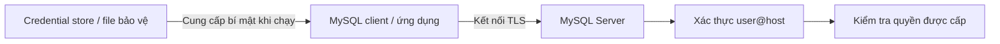

# Quản lý mật khẩu bằng cấu hình bảo vệ hoặc cơ chế lưu thông tin đăng nhập

Ứng dụng và công cụ quản trị cần thông tin xác thực để kết nối MySQL. Nếu ghi mật khẩu trực tiếp vào mã nguồn, câu lệnh terminal, file cấu hình được commit hoặc URL kết nối, bí mật có thể bị lộ qua Git, log, lịch sử shell, ảnh chụp màn hình hoặc hệ thống giám sát. Khi đã bị lộ, người khác có thể sử dụng tài khoản database trong phạm vi quyền được cấp.

Có thể quản lý thông tin đăng nhập bằng file cấu hình được giới hạn quyền truy cập, tiện ích lưu login path của MySQL hoặc credential store/secret manager của hệ điều hành và nền tảng triển khai. Cách phù hợp phụ thuộc vào nơi chạy client, yêu cầu tự động hóa và mức độ bảo vệ cần thiết. Dù chọn cách nào, mật khẩu cần được cấp quyền tối thiểu, truyền qua kết nối TLS và có quy trình luân chuyển, thu hồi rõ ràng.

## 1. Phân biệt mật khẩu MySQL và nơi lưu thông tin đăng nhập

Một kết nối MySQL thường cần các thông tin sau:

| Thành phần | Ví dụ | Vai trò |
| --- | --- | --- |
| Host | `db.internal.example` | Địa chỉ MySQL Server |
| Port | `3306` | Cổng dịch vụ MySQL |
| Database | `appdb` | Schema ứng dụng cần truy cập |
| User | `app_reader` | Tài khoản MySQL dùng để xác thực |
| Password | Giá trị bí mật | Chứng minh danh tính tài khoản |
| TLS settings | CA certificate, verify mode | Bảo vệ và xác minh kết nối mạng |

MySQL xác thực một tài khoản theo tên user và phần host được khai báo, ví dụ `'app_reader'@'10.0.0.%'`. Tài khoản đó có quyền gì là do cấu hình trên server quyết định. File cấu hình hoặc credential store ở phía client chỉ giúp cung cấp thông tin đăng nhập; chúng không tự tạo tài khoản, cấp quyền hay thay đổi mật khẩu trên MySQL Server.

Cần phân biệt ba việc:

1. **Quản lý tài khoản trên server:** tạo user, đặt hoặc đổi mật khẩu, cấp và thu hồi quyền.
2. **Lưu bí mật phía client:** giữ mật khẩu để công cụ hoặc ứng dụng có thể kết nối mà không phải nhập lại mỗi lần.
3. **Bảo vệ đường truyền:** dùng TLS và xác minh chứng chỉ server để bảo vệ thông tin xác thực khi kết nối qua mạng.



## 2. Những cách lưu mật khẩu thường gặp

| Cách lưu | Phù hợp với | Điểm cần lưu ý |
| --- | --- | --- |
| Nhập mật khẩu bằng `-p` | Kết nối thủ công, thỉnh thoảng dùng | Không tiện cho tác vụ tự động nhưng tránh ghi mật khẩu vào câu lệnh |
| Option file như `~/.my.cnf` | Máy cá nhân, máy quản trị hoặc job có file bảo vệ | Mật khẩu trong file là văn bản rõ; phải giới hạn quyền đọc |
| MySQL login path (`.mylogin.cnf`) | MySQL CLI trên máy cá nhân hoặc máy quản trị | Nội dung được làm rối/obfuscate, không phải kho bí mật chống lại người có quyền truy cập tài khoản hệ điều hành |
| OS credential store | Ứng dụng desktop hoặc công cụ có tích hợp | Bí mật được quản lý bởi Keychain, Credential Manager hoặc Secret Service; ứng dụng cần hỗ trợ API tương ứng |
| Secret manager của nền tảng | Backend, CI/CD, container và hệ thống production | Cần cấu hình danh tính workload, quyền đọc secret, audit và quy trình rotation |
| Biến môi trường | Một số môi trường chạy đơn giản hoặc tích hợp nền tảng | Có thể bị lộ qua process inspection, dump, log hoặc công cụ chẩn đoán; không phải secret manager |

Không có một cách lưu phù hợp cho mọi tình huống. Máy cá nhân có thể dùng login path hoặc OS credential store; ứng dụng server nên lấy bí mật từ secret manager hoặc cơ chế cấp secret của môi trường triển khai. Với tác vụ tự động, hãy chọn cách cung cấp bí mật không cần ghi mật khẩu vào command line hay repository.

## 3. Nhập mật khẩu tương tác khi dùng MySQL CLI

Khi kết nối thủ công, cách đơn giản là để MySQL client hỏi mật khẩu:

```bash
mysql -h db.internal.example -P 3306 -u app_reader -p appdb
```

Sau khi chạy, client hiển thị lời nhắc nhập mật khẩu. Không thêm mật khẩu ngay sau `-p`. Ví dụ sau không an toàn:

```bash
# Không dùng: mật khẩu có thể xuất hiện trong process list hoặc shell history
mysql -h db.internal.example -u app_reader -pMySecretPassword appdb
```

Không nên đặt mật khẩu trong tham số `--password=...`, URL kết nối hoặc script shell. Thông tin trên command line có thể được lưu trong lịch sử terminal, hiển thị qua danh sách tiến trình hoặc được thu thập bởi công cụ giám sát. Khi dùng `-p` riêng, MySQL client yêu cầu nhập bí mật tương tác.

Kết nối qua mạng cần cấu hình TLS phù hợp. Ví dụ khi đã có CA certificate của server:

```bash
mysql \
  --host=db.internal.example \
  --port=3306 \
  --user=app_reader \
  --password \
  --ssl-mode=VERIFY_IDENTITY \
  --ssl-ca=/secure/certs/mysql-ca.pem \
  appdb
```

Client sẽ hỏi mật khẩu. `VERIFY_IDENTITY` yêu cầu xác minh chuỗi chứng chỉ và danh tính hostname của server; tên host dùng để kết nối phải khớp với thông tin trong chứng chỉ. Đường dẫn CA ở ví dụ cần được thay bằng file CA tin cậy của môi trường. Không hạ chế độ xác minh chứng chỉ chỉ để bỏ qua lỗi TLS trong production.

## 4. Lưu thông tin đăng nhập bằng MySQL login path

MySQL cung cấp tiện ích `mysql_config_editor` để lưu các tùy chọn kết nối trong file `.mylogin.cnf`. File này được làm rối nội dung để tránh hiển thị trực tiếp như một option file thông thường, nhưng không phải một secret vault có khả năng chống lại người đã chiếm được tài khoản hệ điều hành hoặc quyền đọc file. Hãy bảo vệ tài khoản hệ điều hành và file login path như một bí mật.

### 4.1. Tạo login path

Chạy lệnh sau trong terminal:

```bash
mysql_config_editor set \
  --login-path=dev \
  --host=127.0.0.1 \
  --user=app_reader \
  --port=3306 \
  --password
```

Tiện ích hỏi mật khẩu tương tác. Nhập mật khẩu khi được yêu cầu; không nối mật khẩu vào câu lệnh. Login path `dev` lưu các thông tin kết nối để client có thể dùng lại.

### 4.2. Kết nối bằng login path

```bash
mysql --login-path=dev appdb
```

Có thể kiểm tra các login path đã lưu:

```bash
mysql_config_editor print --all
```

Lệnh hiển thị tên login path và các tùy chọn; mật khẩu được che khi in. Tránh gửi toàn bộ đầu ra chẩn đoán hoặc file `.mylogin.cnf` cho người khác. Xóa login path không còn dùng:

```bash
mysql_config_editor remove --login-path=dev
```

### 4.3. Hiểu giới hạn bảo vệ

- `.mylogin.cnf` thường nằm trong thư mục hồ sơ người dùng; vị trí cụ thể phụ thuộc hệ điều hành.
- Cơ chế của tiện ích làm rối dữ liệu, không nên xem là mã hóa mạnh hoặc nơi lưu bí mật cấp production.
- Người có quyền truy cập cùng tài khoản hệ điều hành có thể sử dụng client để kết nối bằng login path.
- Không đưa file này vào Git, thư mục chia sẻ công khai, image container hoặc bản backup không được bảo vệ.
- Khi máy bị mất, tài khoản hệ điều hành bị xâm nhập hoặc nhân sự không còn quyền truy cập, cần thu hồi/đổi mật khẩu database tương ứng.

Login path thuận tiện cho người quản trị trên máy tin cậy. Với bí mật production, ưu tiên secret manager có kiểm soát danh tính, quyền truy cập và audit.

## 5. Dùng option file được bảo vệ

MySQL client có thể đọc tùy chọn từ file cấu hình. Ví dụ một file `mysql-client.cnf`:

```ini
[client]
host=db.internal.example
port=3306
user=app_reader
password=REPLACE_WITH_SECRET
ssl-mode=VERIFY_IDENTITY
ssl-ca=/secure/certs/mysql-ca.pem
```

Nhóm `[client]` áp dụng các tùy chọn chung cho chương trình client MySQL có hỗ trợ. Thay `REPLACE_WITH_SECRET` bằng bí mật được cung cấp cho môi trường. File này chứa mật khẩu dạng văn bản rõ, vì vậy cần đặt ngoài repository và chỉ cấp quyền đọc cho tài khoản hệ điều hành chạy client.

Trên Linux hoặc macOS, có thể giới hạn quyền file:

```bash
chmod 600 /secure/path/mysql-client.cnf
```

Sau đó chỉ định file khi kết nối:

```bash
mysql --defaults-extra-file=/secure/path/mysql-client.cnf appdb
```

`--defaults-extra-file` phải là tùy chọn đầu tiên sau tên chương trình. Nếu dùng file mặc định `~/.my.cnf`, cũng cần giới hạn quyền tương tự. Trên Windows, hãy cấu hình ACL của file để chỉ tài khoản dịch vụ hoặc người dùng cần thiết có quyền đọc; không để quyền đọc rộng cho nhóm `Users` hoặc `Everyone`.

Một số điểm cần kiểm tra:

- Không lưu file cấu hình có mật khẩu trong thư mục source code hoặc thư mục đồng bộ công khai.
- Không đính kèm file này vào ticket, log hoặc ảnh chụp màn hình.
- Đảm bảo backup của máy quản trị không làm lộ file cấu hình.
- Kiểm tra thứ tự ưu tiên option file và tham số dòng lệnh khi cùng một tùy chọn xuất hiện ở nhiều nơi.
- Nếu file chứa bí mật bị sao chép hoặc lộ quyền đọc, hãy coi mật khẩu đã bị lộ và thực hiện rotation.

Option file bảo vệ tốt hơn khi quyền filesystem được cấu hình chính xác, nhưng bản thân mật khẩu vẫn là văn bản rõ trong file. Cần cân nhắc giới hạn này trước khi sử dụng cho máy chủ production.

## 6. Sử dụng credential store của hệ điều hành hoặc công cụ

Hệ điều hành có thể cung cấp kho lưu thông tin đăng nhập được bảo vệ bởi tài khoản người dùng:

- **Windows Credential Manager:** ứng dụng có thể lưu và truy xuất thông tin xác thực thông qua Windows Credential APIs.
- **macOS Keychain:** ứng dụng được cấp quyền có thể lưu và đọc bí mật từ Keychain.
- **Linux Secret Service:** desktop application có thể sử dụng Secret Service API, thường được cung cấp bởi keyring của môi trường desktop.

Một số công cụ GUI quản lý kết nối database có tùy chọn lưu mật khẩu trong vault hoặc kho bảo mật của hệ điều hành. Khi dùng, hãy kiểm tra công cụ đang lưu bí mật ở đâu, có yêu cầu mở khóa vault hay không và cách xóa thông tin đăng nhập khi không còn dùng. Không giả định mọi ứng dụng đều dùng chung một kho hoặc tự động mã hóa file export kết nối.

Nếu công cụ có lựa chọn lưu mật khẩu trong OS vault/keychain, ưu tiên lựa chọn đó trên máy cá nhân tin cậy. Tránh chọn lưu mật khẩu trong file cấu hình dự án hoặc xuất cấu hình kết nối có chứa bí mật. Khi chuyển máy, hãy tạo lại credential trong kho mới thay vì gửi file chứa mật khẩu qua chat hoặc email.

## 7. Cấp mật khẩu cho ứng dụng và container

Ứng dụng backend cần kết nối database mà không thể yêu cầu người vận hành nhập mật khẩu mỗi lần. Bí mật nên được cung cấp khi chạy từ secret manager hoặc cơ chế secret của nền tảng, sau đó chỉ tồn tại trong phạm vi tiến trình và quyền cần thiết.

### 7.1. Đọc bí mật tại runtime trong ứng dụng Java

Ví dụ dưới đây lấy thông tin kết nối từ môi trường chạy. Giá trị thật được cấu hình ở môi trường triển khai, không ghi vào mã nguồn:

```java
import java.sql.Connection;
import java.sql.DriverManager;
import java.util.Properties;

public class DatabaseConnection {
    public static Connection open() throws Exception {
        String url = "jdbc:mysql://db.internal.example:3306/appdb"
                + "?sslMode=VERIFY_IDENTITY";

        String user = System.getenv("DB_USER");
        String password = System.getenv("DB_PASSWORD");

        if (user == null || password == null) {
            throw new IllegalStateException("Missing database credentials");
        }

        Properties properties = new Properties();
        properties.setProperty("user", user);
        properties.setProperty("password", password);

        return DriverManager.getConnection(url, properties);
    }
}
```

Đoạn code minh họa cách tách bí mật khỏi mã nguồn; nó không tự tạo secret manager. Biến môi trường vẫn có thể bị đọc bởi tiến trình hoặc người có quyền quản trị phù hợp, và có thể xuất hiện trong dump/chẩn đoán. Trong production, ưu tiên cơ chế secret injection của nền tảng hoặc đọc trực tiếp từ secret manager theo danh tính workload. Không ghi giá trị `DB_PASSWORD` vào log.

### 7.2. Dùng Docker Compose secrets

Với Docker Compose, có thể mount một file secret vào container thay vì ghi password trực tiếp trong `compose.yaml`:

```yaml
services:
  app:
    image: my-java-app:latest
    environment:
      DB_HOST: db
      DB_NAME: appdb
      DB_USER: appuser
      DB_PASSWORD_FILE: /run/secrets/db_password
    secrets:
      - db_password

secrets:
  db_password:
    file: ./secrets/db_password.txt
```

Ứng dụng đọc nội dung file `/run/secrets/db_password` lúc khởi động và dùng nó để tạo connection pool. Không commit `./secrets/db_password.txt`; giới hạn quyền file trên máy host và không đưa file vào image. Ví dụ này minh họa cơ chế mount file của Compose; cần tự triển khai phần đọc `DB_PASSWORD_FILE` trong ứng dụng.

Với image MySQL chính thức, một số biến khởi tạo có hỗ trợ hậu tố `_FILE`, ví dụ `MYSQL_ROOT_PASSWORD_FILE` và `MYSQL_PASSWORD_FILE`. Khi sử dụng, cần kiểm tra tài liệu của đúng image/tag đang triển khai. Cơ chế `_FILE` chỉ cung cấp giá trị cho quá trình khởi tạo container; nó không tự cập nhật mật khẩu của tài khoản đã tồn tại trong datadir.

Docker Compose secrets dùng file cục bộ phù hợp cho lab hoặc máy phát triển có kiểm soát. Nó không tự biến file nguồn thành một kho bí mật được mã hóa trên host. Với production, nên dùng secret manager hoặc secret facility của nền tảng điều phối, giới hạn service nào được mount secret và bật audit nếu nền tảng hỗ trợ.

## 8. Nguyên tắc bảo vệ tài khoản database

Lưu mật khẩu tốt vẫn chưa đủ nếu tài khoản có quyền quá rộng. Hãy kết hợp quản lý bí mật với phân quyền tối thiểu:

```sql
CREATE USER 'app_reader'@'10.0.0.%'
    IDENTIFIED BY 'REPLACE_WITH_A_STRONG_SECRET';

GRANT SELECT
    ON appdb.*
    TO 'app_reader'@'10.0.0.%';
```

Đây là ví dụ minh họa cho user chỉ đọc. Trong thực tế, thay placeholder bằng mật khẩu được sinh và cung cấp an toàn; không commit câu lệnh có mật khẩu thật hoặc lưu nó trong migration/log công khai. Phạm vi host phải khớp với địa chỉ kết nối thực tế và nên giới hạn chặt theo kiến trúc mạng. Không dùng tài khoản `root` cho ứng dụng thông thường.

Một số nguyên tắc khác:

- Mỗi ứng dụng hoặc workload nên có tài khoản riêng để có thể thu hồi độc lập.
- Chỉ cấp quyền cần thiết như `SELECT`, `INSERT`, `UPDATE` hoặc `DELETE` trên schema/bảng tương ứng.
- Tách tài khoản ứng dụng runtime khỏi tài khoản migration và tài khoản quản trị.
- Dùng TLS với xác minh danh tính server khi kết nối qua mạng không hoàn toàn tin cậy.
- Không dùng chung một mật khẩu giữa môi trường development, staging và production.
- Theo dõi đăng nhập thất bại và hoạt động bất thường, nhưng không ghi mật khẩu hoặc token vào log.

## 9. Luân chuyển, thu hồi và xử lý khi lộ mật khẩu

Mật khẩu cần có vòng đời. Khi nhân sự rời nhóm, máy quản trị bị mất, secret xuất hiện trong log hoặc có dấu hiệu truy cập trái phép, cần thu hồi quyền và thay bí mật liên quan.

Quy trình rotation thông thường:

1. Xác định user MySQL, host pattern, ứng dụng và các workload đang dùng credential.
2. Sinh mật khẩu mới bằng công cụ tạo mật khẩu hoặc secret manager; không tự chọn mật khẩu dễ đoán.
3. Đổi mật khẩu trên MySQL Server bằng quy trình quản trị được kiểm soát.
4. Cập nhật secret trong credential store hoặc secret manager và triển khai lại workload để tiến trình dùng giá trị mới.
5. Kiểm tra kết nối mới, log lỗi xác thực và các tác vụ phụ thuộc.
6. Thu hồi credential cũ hoặc xóa login path/credential store không còn cần thiết.

Ví dụ cú pháp đổi mật khẩu trên MySQL:

```sql
ALTER USER 'app_reader'@'10.0.0.%'
    IDENTIFIED BY 'REPLACE_WITH_A_NEW_SECRET';
```

Không chạy ví dụ với placeholder nguyên trạng. Hãy cung cấp mật khẩu mới bằng quy trình an toàn của môi trường quản trị và tránh lưu giá trị thật trong shell history, file SQL không bảo vệ hoặc log CI. Với MySQL hỗ trợ dual password, có thể cân nhắc `RETAIN CURRENT PASSWORD` để chuyển đổi workload theo từng bước, rồi `DISCARD OLD PASSWORD` sau khi xác nhận mọi client đã dùng mật khẩu mới. Cần thử quy trình này trên phiên bản MySQL thực tế và chính sách xác thực của hệ thống trước khi áp dụng.

Nếu nghi ngờ mật khẩu bị lộ:

- Thu hồi hoặc đổi mật khẩu càng sớm càng tốt; ưu tiên tài khoản có quyền cao trước.
- Kiểm tra log xác thực, kết nối và truy vấn trong khoảng thời gian có nguy cơ.
- Xóa bí mật khỏi nơi lưu không cần thiết và cập nhật secret ở tất cả workload liên quan.
- Nếu bí mật từng được commit vào Git, chỉ xóa khỏi commit mới là chưa đủ; cần rotation vì lịch sử Git hoặc bản clone có thể vẫn chứa giá trị cũ.
- Ghi lại nguyên nhân và cập nhật quy trình để tránh lặp lại.

## 10. Những cách làm cần tránh

| Cách làm | Rủi ro | Cách thay thế |
| --- | --- | --- |
| Ghi `password=...` vào file cấu hình trong repository | Bí mật bị commit và nhân bản theo source code | Dùng secret manager hoặc file cấu hình ngoài repository với quyền chặt |
| Dùng `-pMyPassword` hoặc `--password=...` | Lộ qua history, process list hoặc telemetry | Dùng `-p` để nhập tương tác hoặc credential store |
| Đặt bí mật trong JDBC URL | URL dễ bị ghi vào log hoặc thông tin chẩn đoán | Truyền credential riêng qua API kết nối và secret injection |
| Dùng `MYSQL_PWD` như giải pháp lưu lâu dài | Biến môi trường có thể bị lộ; MySQL khuyến cáo không dùng cách này | Dùng login path, option file bảo vệ hoặc secret manager phù hợp |
| Dùng tài khoản `root` trong ứng dụng | Nếu lộ mật khẩu, phạm vi ảnh hưởng rất lớn | Tạo user riêng với quyền tối thiểu |
| Chia sẻ file `.mylogin.cnf` hoặc file option có mật khẩu | Người nhận có thể sử dụng credential | Tạo login path/secret riêng cho từng người hoặc workload |
| Cho rằng `.mylogin.cnf` là mã hóa chống xâm nhập | Đánh giá sai mức độ bảo vệ của file | Bảo vệ tài khoản hệ điều hành và dùng secret manager khi cần mức bảo vệ cao hơn |

## 11. Checklist khi thiết lập kết nối

- [ ] Tài khoản MySQL dành riêng cho ứng dụng hoặc người vận hành.
- [ ] Quyền user được giới hạn theo schema, bảng và thao tác cần thiết.
- [ ] Mật khẩu không xuất hiện trong source code, URL, shell history hoặc log.
- [ ] Cách lưu bí mật phù hợp với môi trường: login path, option file bảo vệ, OS vault hoặc secret manager.
- [ ] File có chứa mật khẩu không được commit và có quyền đọc tối thiểu.
- [ ] Kết nối từ xa sử dụng TLS và xác minh chứng chỉ server.
- [ ] Có quy trình rotation, thu hồi và xử lý khi credential bị lộ.
- [ ] Các môi trường development, staging và production dùng credential riêng.

## 12. Ghi nhớ

Quản lý mật khẩu MySQL gồm việc bảo vệ bí mật ở phía client, kiểm soát tài khoản và quyền trên server, đồng thời bảo vệ kết nối bằng TLS. Nhập `-p` phù hợp cho thao tác thủ công; `mysql_config_editor` giúp tạo login path tiện dụng nhưng file `.mylogin.cnf` chỉ được làm rối nội dung, không phải secret vault. Option file chứa mật khẩu dạng văn bản rõ nên phải đặt ngoài repository và giới hạn quyền đọc. Ứng dụng server nên nhận bí mật từ OS credential store hoặc secret manager/cơ chế secret của nền tảng tại runtime.

Không đặt mật khẩu trong command line, mã nguồn, URL hoặc log; không dùng tài khoản root cho ứng dụng. Hãy cấp quyền tối thiểu, luân chuyển và thu hồi credential có kiểm soát, cũng như xác minh TLS khi kết nối đến MySQL qua mạng.
