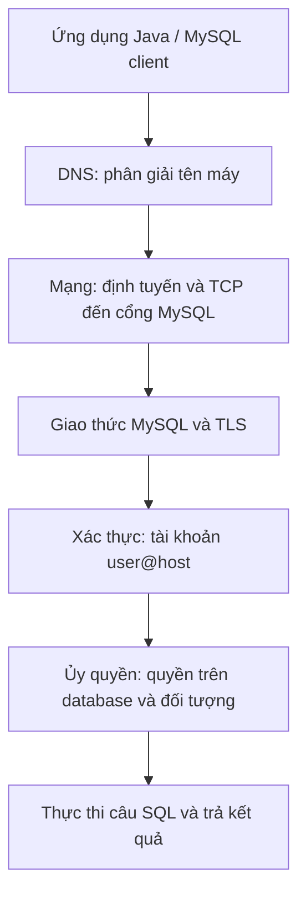

# Kiểm tra kết nối theo lớp: DNS, mạng, giao thức, xác thực và quyền

Khi ứng dụng không kết nối được MySQL, thông báo lỗi thường chỉ cho biết một phần của vấn đề. Một lỗi phân giải tên máy khác hoàn toàn với lỗi cổng TCP bị chặn; cả hai lại khác với lỗi đăng nhập sai mật khẩu hoặc thiếu quyền đọc bảng. Chẩn đoán theo từng lớp giúp xác định yêu cầu đã đi đến đâu và chọn đúng công cụ để kiểm tra.

Trong module **DATABASE_MYSQL**, việc kiểm tra kết nối là kỹ năng vận hành nền tảng bên cạnh thiết kế bảng, SQL, index và transaction. Bài học này sử dụng MySQL client, các lệnh mạng trên Windows/Linux, MySQL Workbench và JDBC để lần lượt kiểm tra DNS, mạng, giao thức MySQL, xác thực và quyền.

## 1. Nhìn kết nối như một chuỗi lớp

Giả sử ứng dụng Java kết nối đến máy chủ `db.example.internal`, cổng `3306`, database `mysql_lab`. Một kết nối thành công phải vượt qua các lớp theo thứ tự khái quát:



| Lớp | Câu hỏi cần trả lời | Công cụ hoặc phép thử |
|---|---|---|
| DNS | Tên máy có phân giải thành địa chỉ IP phù hợp không? | `Resolve-DnsName`, `nslookup`, `getent hosts` |
| Mạng/TCP | Máy khách có mở được kết nối TCP đến đúng IP và cổng không? | `Test-NetConnection`, `nc`, kiểm tra listener và firewall |
| Giao thức/TLS | Hai đầu có trao đổi được giao thức MySQL và thống nhất cấu hình TLS không? | MySQL client, `mysqladmin`, tùy chọn SSL của client/driver |
| Xác thực | Máy chủ có chấp nhận đúng account và phương thức xác thực không? | MySQL client, `USER()`, `CURRENT_USER()`, kiểm tra account bằng tài khoản quản trị |
| Quyền | Account đã đăng nhập có quyền thực hiện câu SQL trên database/bảng không? | `SHOW GRANTS`, thử thao tác SQL phù hợp |

Hãy thực hiện các phép thử từ đúng môi trường chạy ứng dụng. Nếu Java chạy trong container hoặc trên một máy chủ khác, kiểm tra từ laptop của lập trình viên không chứng minh rằng container hoặc máy chủ ứng dụng có cùng DNS, route và quyền truy cập mạng.

## 2. Chuẩn bị thông tin kết nối

Trước khi kiểm tra, ghi lại các thông tin mà ứng dụng thực sự sử dụng:

| Thông tin | Ví dụ minh họa | Ý nghĩa |
|---|---|---|
| Hostname | `db.example.internal` | Tên DNS hoặc địa chỉ máy chủ MySQL |
| IP dự kiến | `10.20.0.15` | Địa chỉ mà DNS hoặc cấu hình mạng cần đưa đến |
| Port | `3306` | Cổng TCP MySQL đang lắng nghe; có thể đã được đổi trong cấu hình |
| Database | `mysql_lab` | Schema ứng dụng muốn sử dụng |
| Username | `mysql_lab_user` | Tên người dùng; MySQL còn xét phần host của account |
| TLS | Bắt buộc hoặc tùy chọn theo môi trường | Yêu cầu mã hóa và kiểm tra chứng thư máy chủ |

Không mặc định mọi máy chủ MySQL đều dùng cổng `3306`. Nếu được cung cấp cấu hình khác, hãy kiểm tra đúng cổng đó. Không đưa mật khẩu vào tài liệu chẩn đoán, ảnh chụp màn hình hoặc lịch sử dòng lệnh.

## 3. Lớp 1 — Kiểm tra DNS

DNS chuyển hostname thành địa chỉ IP. Nếu hostname sai chính tả, bản ghi không tồn tại hoặc máy khách đang dùng DNS resolver không phù hợp, kết nối sẽ thất bại trước khi có thể nói chuyện với MySQL.

Trên Windows PowerShell:

```powershell
Resolve-DnsName db.example.internal
```

Hoặc dùng lệnh phổ biến trên nhiều hệ điều hành:

```bash
nslookup db.example.internal
```

Trên Linux, có thể xem kết quả phân giải theo cấu hình hệ thống:

```bash
getent hosts db.example.internal
```

Đối chiếu địa chỉ trả về với thông tin của môi trường. Một hostname có thể trả về nhiều địa chỉ A/AAAA hoặc thay đổi theo mạng nội bộ, VPN và DNS split-horizon. Nếu máy khách nhận một IP khác với IP mong đợi, hãy kiểm tra DNS suffix, VPN, resolver và bản ghi DNS với người quản trị mạng.

Có thể thử kết nối bằng IP để khoanh vùng lỗi DNS, nhưng đây chỉ là phép thử chẩn đoán. Nếu máy chủ dùng TLS với xác minh danh tính, kết nối bằng IP có thể không khớp tên trong chứng thư. Khi vận hành, hãy dùng hostname đúng với chứng thư và cấu hình DNS đã được phê duyệt.

**Dấu hiệu thường gặp:** `Unknown MySQL server host` hoặc lỗi không phân giải được hostname thường hướng đến DNS, hostname hoặc resolver. Lỗi này chưa nói gì về mật khẩu hay quyền SQL.

## 4. Lớp 2 — Kiểm tra mạng và cổng TCP

Sau khi biết IP, kiểm tra xem máy khách có thiết lập được kết nối TCP đến cổng MySQL không.

Trên Windows PowerShell:

```powershell
Test-NetConnection db.example.internal -Port 3306
```

Đọc trường `TcpTestSucceeded`:

- `True`: TCP handshake đến host và port đã thành công. Điều này xác nhận đường TCP đang mở tại thời điểm thử, nhưng chưa chứng minh MySQL authentication hoặc quyền SQL hoạt động.
- `False`: có thể do máy chủ không lắng nghe trên cổng đó, firewall chặn, route/VPN sai, địa chỉ đích không đúng hoặc dịch vụ chưa chạy.

Trên Linux hoặc macOS, nếu đã cài netcat:

```bash
nc -vz -w 5 db.example.internal 3306
```

`succeeded` thường cho biết kết nối TCP đã mở; `timed out` thường gợi ý gói tin bị chặn hoặc không có phản hồi; `connection refused` thường cho biết máy đích có thể truy cập nhưng không có tiến trình chấp nhận kết nối tại cổng đó hoặc có thiết bị mạng chủ động từ chối.

Không dùng `ping` làm bằng chứng duy nhất. Ping kiểm tra ICMP, trong khi MySQL sử dụng TCP. Nhiều mạng chặn ICMP nhưng vẫn cho phép TCP 3306; ngược lại, ping thành công không có nghĩa cổng MySQL đang mở.

### Kiểm tra phía máy chủ

Nếu có quyền trên máy chủ MySQL, hãy xác minh cổng và địa chỉ lắng nghe. Trong một phiên SQL quản trị:

```sql
SHOW VARIABLES LIKE 'port';
SHOW VARIABLES LIKE 'bind_address';
```

Trên Linux, kiểm tra socket đang lắng nghe:

```bash
ss -lntp | grep 3306
```

Trên Windows PowerShell:

```powershell
Get-NetTCPConnection -State Listen -LocalPort 3306
```

Các lệnh trên cần được đối chiếu với cổng thực tế. Nếu MySQL chỉ bind vào `127.0.0.1`, máy từ xa sẽ không thể kết nối qua giao diện mạng đó. Việc thay đổi `bind_address` cần tuân theo cấu hình triển khai và chính sách mạng; không mở dịch vụ ra mọi giao diện chỉ để làm phép thử.

Kiểm tra firewall của máy chủ, firewall mạng, security group hoặc quy tắc VPN. Quy tắc cần cho phép nguồn kết nối thực tế của ứng dụng đến đúng IP/cổng MySQL. Nếu dùng Docker, hãy kiểm tra tên service, network và port mapping; `localhost` bên trong container ứng dụng thường chỉ trỏ về chính container đó.

## 5. Lớp 3 — Kiểm tra giao thức MySQL và TLS

Khi TCP đã mở, máy khách và máy chủ bắt đầu trao đổi theo giao thức MySQL. Máy chủ gửi gói chào ban đầu (initial handshake), trong đó có thông tin phiên bản và plugin xác thực. Client phản hồi với khả năng giao thức và thông tin xác thực tương ứng. Nếu bật TLS, hai bên thương lượng và thiết lập kênh TLS theo khả năng của client/server trước khi tiếp tục trao đổi dữ liệu xác thực.

Một cổng TCP mở chưa chắc là MySQL Server. Dịch vụ khác có thể đang dùng nhầm cổng; proxy hoặc cấu hình TLS không tương thích cũng có thể khiến handshake thất bại.

### Thử bằng MySQL client

Dùng MySQL command-line client để kiểm tra một kết nối thực tế. Thay hostname, port, username và database theo cấu hình:

```bash
mysql --protocol=TCP \
  --host=db.example.internal \
  --port=3306 \
  --connect-timeout=5 \
  --user=mysql_lab_user \
  --password \
  --database=mysql_lab
```

Client sẽ hỏi mật khẩu tương tác. `--protocol=TCP` buộc dùng TCP, hữu ích khi muốn loại trừ việc client chọn socket hoặc named pipe cho kết nối cục bộ. `--connect-timeout` giới hạn thời gian chờ thiết lập kết nối; nó không phải giới hạn thời gian thực thi SQL.

Nếu cần xác minh TLS và chứng thư, dùng CA được tổ chức tin cậy cung cấp:

```bash
mysql --protocol=TCP \
  --host=db.example.internal \
  --port=3306 \
  --user=mysql_lab_user \
  --password \
  --ssl-mode=VERIFY_IDENTITY \
  --ssl-ca=/path/to/trusted-ca.pem \
  --database=mysql_lab
```

`VERIFY_IDENTITY` yêu cầu mã hóa và xác minh danh tính máy chủ theo chứng thư, bao gồm việc tên host phải khớp danh tính trong chứng thư. Đường dẫn CA chỉ là ví dụ; hãy dùng CA và hostname đúng của môi trường. Nếu chỉ dùng `REQUIRED`, kết nối yêu cầu TLS nhưng không thực hiện cùng mức xác minh danh tính như `VERIFY_IDENTITY`.

Sau khi kết nối, có thể kiểm tra trạng thái TLS của phiên:

```sql
SHOW SESSION STATUS LIKE 'Ssl_cipher';
```

Giá trị `Ssl_cipher` không rỗng cho biết phiên đang sử dụng cipher TLS. Nếu tổ chức yêu cầu xác minh chứng thư, cần kiểm tra cấu hình xác minh ở client/driver; chỉ thấy cipher không chứng minh rằng hostname đã được xác minh.

**Dấu hiệu thường gặp:** lỗi `Lost connection` trong lúc handshake, lỗi SSL/certificate, protocol mismatch hoặc client quá cũ thường hướng đến giao thức, TLS, proxy hoặc khác biệt phiên bản client/server. Hãy xem lỗi gốc và log máy chủ; không tắt xác minh TLS như một cách sửa mặc định.

## 6. Lớp 4 — Kiểm tra xác thực tài khoản

Xác thực (authentication) trả lời câu hỏi: máy chủ có chấp nhận danh tính đăng nhập hay không? Trong MySQL, account được định danh bằng cặp `user` và `host`, ví dụ:

```sql
CREATE USER 'mysql_lab_user'@'localhost'
    IDENTIFIED BY 'replace-with-a-unique-password';

CREATE USER 'mysql_lab_user'@'10.20.0.25'
    IDENTIFIED BY 'replace-with-another-unique-password';
```

Hai account trên là hai danh tính khác nhau. Một ứng dụng kết nối từ xa có thể không khớp account `'mysql_lab_user'@'localhost'`, dù tên người dùng và mật khẩu có vẻ đúng. Phần host phải phù hợp với nguồn kết nối theo cách MySQL nhận diện.

Nếu MySQL trả `Access denied for user`, hãy kiểm tra lần lượt:

1. Username và mật khẩu mà ứng dụng thực sự gửi có đúng không; kiểm tra biến môi trường và secret/config đang được nạp.
2. Account có tồn tại với phần host phù hợp không; không giả định `'user'@'localhost'` giống `'user'@'%'` hoặc `'user'@'10.20.0.25'`.
3. Tài khoản có bị khóa hoặc mật khẩu hết hạn theo chính sách không.
4. Client/driver có hỗ trợ plugin xác thực mà server yêu cầu không. MySQL 8 thường sử dụng `caching_sha2_password` làm plugin mặc định cho account mới; driver cũ có thể không tương thích. Nên cập nhật Connector/J hoặc MySQL client phù hợp trước khi xem xét thay đổi chính sách xác thực.
5. Nếu account yêu cầu kết nối an toàn, client có đang sử dụng TLS đúng cấu hình không.

Sau khi đăng nhập thành công, chạy:

```sql
SELECT USER(), CURRENT_USER(), DATABASE();
```

- `USER()` cho biết username và host mà client cung cấp trong kết nối.
- `CURRENT_USER()` cho biết account MySQL thực tế được dùng để kiểm tra quyền.
- `DATABASE()` cho biết database mặc định hiện tại; giá trị có thể là `NULL` nếu chưa chọn database.

Nếu có quyền quản trị, xem định nghĩa account và trạng thái bằng các lệnh phù hợp:

```sql
SHOW CREATE USER 'mysql_lab_user'@'10.20.0.25';
SHOW GRANTS FOR 'mysql_lab_user'@'10.20.0.25';
```

Thay cặp user/host bằng account cần kiểm tra. Không chia sẻ đầu ra có thông tin nhạy cảm ra kênh công khai. Không sửa plugin xác thực hoặc đặt lại mật khẩu một cách tùy tiện khi chưa xác định nguyên nhân.

## 7. Lớp 5 — Kiểm tra quyền trên database và đối tượng

Ủy quyền (authorization) chỉ được xét sau khi account đã xác thực thành công. Một kết nối có thể đăng nhập được nhưng vẫn không được phép chọn database, đọc bảng hoặc thực hiện lệnh cập nhật.

Khi đã đăng nhập bằng tài khoản ứng dụng, kiểm tra quyền hiện tại:

```sql
SHOW GRANTS;
SELECT CURRENT_USER(), DATABASE();
```

Nếu có quyền quản trị, có thể xem grant của account cụ thể:

```sql
SHOW GRANTS FOR 'mysql_lab_user'@'10.20.0.25';
```

Đọc kỹ phạm vi của quyền:

| Phạm vi grant | Ví dụ | Phạm vi tác động |
|---|---|---|
| Toàn cục | `ON *.*` | Toàn máy chủ, tùy loại quyền |
| Database | `ON mysql_lab.*` | Các đối tượng thuộc `mysql_lab` |
| Bảng | `ON mysql_lab.customers` | Một bảng cụ thể |
| Cột | `ON mysql_lab.customers (email)` | Các cột được chỉ định, với quyền hỗ trợ cấp cột |

Thử một câu lệnh đọc đơn giản trong database đã được cấp quyền:

```sql
USE mysql_lab;
SELECT 1;
```

`SELECT 1` xác nhận phiên có thể thực thi một biểu thức đơn giản; nó không chứng minh account có quyền đọc mọi bảng. Để kiểm tra quyền đọc dữ liệu, cần truy vấn một bảng mà ứng dụng thực sự cần sử dụng:

```sql
SELECT id, email
FROM customers
LIMIT 1;
```

Nếu nhận lỗi quyền trên database hoặc bảng, quản trị viên cần xem grant ở đúng cấp và cấp quyền tối thiểu cần thiết, ví dụ:

```sql
GRANT SELECT
ON mysql_lab.customers
TO 'mysql_lab_user'@'10.20.0.25';
```

Không cấp `ALL PRIVILEGES` hoặc quyền toàn cục chỉ để làm biến mất lỗi. Hãy xác định câu SQL cần quyền nào và đối tượng nào trước khi điều chỉnh.

**Một số mã lỗi dễ phân biệt:**

- `1045 Access denied for user`: thường là lỗi xác thực hoặc account/host không khớp.
- `1044 Access denied for database`: đã đến bước yêu cầu truy cập database nhưng account không có quyền phù hợp.
- `1142 ... command denied`: account thiếu quyền thực hiện lệnh trên đối tượng cụ thể.

Thông điệp và mã lỗi cần được đọc trong ngữ cảnh. Nếu lỗi xảy ra trước khi tạo được phiên, hãy kiểm tra các lớp DNS, TCP, giao thức và xác thực trước khi xem grant.

## 8. Dùng các công cụ phù hợp

Không có một công cụ đơn lẻ kiểm tra được mọi lớp. Hãy dùng công cụ tương ứng với câu hỏi cần trả lời:

| Công cụ | Phù hợp để | Giới hạn cần nhớ |
|---|---|---|
| MySQL command-line client (`mysql`) | Kiểm tra handshake, TLS, đăng nhập, chạy SQL và xem lỗi gốc | Cần cài client; kết quả chỉ phản ánh môi trường chạy lệnh |
| MySQL Workbench | Quản lý connection profile, kết nối tương tác, xem schema và chạy SQL | Profile có thể lưu thông tin nhạy cảm; kết nối thành công không chứng minh ứng dụng dùng cùng cấu hình |
| `Resolve-DnsName`, `nslookup`, `getent` | Kiểm tra DNS và địa chỉ được phân giải | Không kiểm tra cổng TCP hoặc MySQL authentication |
| `Test-NetConnection`, `nc` | Kiểm tra khả năng mở TCP tới host/port | Không xác minh giao thức MySQL, tài khoản hoặc quyền SQL |
| JDBC với Connector/J | Kiểm tra đúng driver và cấu hình mà ứng dụng Java sử dụng | Cần chạy từ đúng runtime/configuration của ứng dụng để kết quả có ý nghĩa |
| Log MySQL Server | Đối chiếu lỗi phía máy chủ như xác thực, TLS hoặc kết nối | Cần quyền truy cập log và thời điểm xảy ra lỗi chính xác |

Trong MySQL Workbench, tạo hoặc mở connection profile rồi nhập hostname, port, username và phương thức xác thực. Dùng chức năng **Test Connection** để kiểm tra. Nếu cần kiểm tra TLS, mở phần cấu hình SSL và chọn CA/cách xác minh theo yêu cầu của máy chủ. Tránh lưu mật khẩu trên máy dùng chung; chỉ lưu trong vault hoặc cơ chế bảo vệ phù hợp với chính sách của tổ chức.

## 9. Kiểm tra bằng chính ứng dụng Java

Một MySQL client kết nối thành công nhưng ứng dụng Java thất bại có thể do hai bên dùng cấu hình khác nhau: hostname, port, username, biến môi trường, TLS, phiên bản Connector/J hoặc vị trí chạy ứng dụng.

Đoạn mã sau minh họa phép thử JDBC tối thiểu. Dự án cần khai báo MySQL Connector/J và import các kiểu JDBC tương ứng:

```java
String url = "jdbc:mysql://db.example.internal:3306/mysql_lab";
String username = "mysql_lab_user";
String password = System.getenv("MYSQL_LAB_PASSWORD");

if (password == null || password.isBlank()) {
    throw new IllegalStateException("MYSQL_LAB_PASSWORD is not configured");
}

try (Connection connection =
         DriverManager.getConnection(url, username, password);
     Statement statement = connection.createStatement();
     ResultSet resultSet = statement.executeQuery("SELECT 1")) {

    if (resultSet.next()) {
        System.out.println("MySQL connection is ready");
    }
} catch (SQLException exception) {
    System.err.println("SQLState: " + exception.getSQLState());
    System.err.println("Vendor code: " + exception.getErrorCode());
    throw exception;
}
```

Ví dụ chỉ kiểm tra khả năng mở kết nối và thực thi một câu SQL đơn giản. Để kiểm tra quyền nghiệp vụ, cần thử truy vấn hoặc thao tác trên đúng bảng mà chức năng sử dụng. Không ghi password, chuỗi kết nối có secret hoặc dữ liệu nhạy cảm vào log.

Nếu ứng dụng dùng connection pool, hãy kiểm tra lỗi gốc trong exception chain và cấu hình pool như thời gian chờ lấy connection, thời gian chờ kết nối và validation query. Pool có thể tiếp tục trả về lỗi kết nối cũ sau khi mạng hoặc máy chủ đã phục hồi; kiểm tra log và thời điểm lỗi trước khi kết luận nguyên nhân.

Với Connector/J, nếu môi trường yêu cầu xác minh TLS, cấu hình SSL mode và CA tương ứng theo phiên bản driver. Ví dụ thuộc tính `sslMode=VERIFY_IDENTITY` yêu cầu xác minh danh tính máy chủ; hostname trong JDBC URL cần khớp chứng thư. Không chuyển sang chế độ bỏ qua xác minh để che lỗi chứng thư.

## 10. Quy trình khoanh vùng theo dấu hiệu lỗi

| Dấu hiệu | Lớp nên kiểm tra trước | Bước tiếp theo |
|---|---|---|
| `Unknown MySQL server host` | DNS | Kiểm tra hostname, resolver, VPN và bản ghi A/AAAA |
| `Connection timed out` | Mạng/TCP | Kiểm tra route, VPN, firewall, IP và port từ đúng máy khách |
| `Connection refused` | Listener/TCP | Kiểm tra MySQL service, cổng lắng nghe, bind address hoặc port mapping |
| TCP mở nhưng handshake thất bại | Giao thức/TLS | Xác nhận đúng dịch vụ ở port đó, xem TLS, proxy, phiên bản client/server và log máy chủ |
| `SSL connection error` hoặc lỗi chứng thư | TLS | Kiểm tra CA, thời hạn chứng thư, hostname/SAN và SSL mode |
| `Access denied for user` / `1045` | Xác thực | Kiểm tra mật khẩu, user@host, trạng thái account và auth plugin |
| `Access denied for database` / `1044` | Quyền database | Kiểm tra database đích và grant trên schema |
| `command denied` / `1142` | Quyền đối tượng | Kiểm tra grant trên bảng/cột và quyền cần cho câu SQL |
| CLI thành công nhưng Java lỗi | Cấu hình ứng dụng | So sánh URL, runtime host, driver, secret, TLS và connection pool |

Một quy trình ngắn có thể áp dụng cho mỗi sự cố:

1. Ghi lại thời điểm, hostname, port, database, môi trường chạy và thông báo lỗi đầy đủ; che mọi secret.
2. Phân giải hostname từ chính máy hoặc container chạy ứng dụng.
3. Kiểm tra TCP đến đúng IP/port; nếu thất bại, xử lý mạng, listener hoặc firewall trước.
4. Dùng MySQL client với TCP để xác nhận handshake và TLS.
5. Đăng nhập bằng đúng account của ứng dụng; xác minh `USER()` và `CURRENT_USER()`.
6. Chạy câu SQL tối thiểu, rồi kiểm tra grant trên đúng database/bảng mà chức năng cần truy cập.
7. Lặp lại phép thử bằng ứng dụng Java để xác nhận cấu hình runtime thực tế.

Thay đổi mỗi lần một yếu tố và ghi lại kết quả trước/sau. Cách này giúp xác định chính xác lớp gây lỗi và tránh mở rộng quyền hoặc nới lỏng mạng ngoài nhu cầu.

## 11. Bài tập thực hành

Giả sử bạn được cung cấp hostname `db.example.internal`, port `3306`, database `mysql_lab` và account `mysql_lab_user` trong một môi trường thử nghiệm.

1. Dùng `Resolve-DnsName` hoặc `nslookup` để ghi lại địa chỉ IP mà máy khách nhận được.
2. Dùng `Test-NetConnection` trên Windows hoặc `nc` trên Linux/macOS để kiểm tra TCP port `3306`.
3. Dùng MySQL client với `--protocol=TCP` để thử đăng nhập và chạy `SELECT VERSION(), @@port;`.
4. Chạy `SHOW SESSION STATUS LIKE 'Ssl_cipher';` để kiểm tra phiên có sử dụng TLS hay không.
5. Chạy `SELECT USER(), CURRENT_USER(), DATABASE();` để xác định account được MySQL sử dụng.
6. Chạy `SHOW GRANTS;` và giải thích quyền nào áp dụng trên database hoặc bảng.
7. Thử đọc một bảng được cấp quyền, sau đó thử một thao tác mà account không được cấp và ghi lại mã lỗi.
8. Chạy ứng dụng Java từ đúng môi trường triển khai và so sánh kết quả với MySQL client.

Bạn hoàn thành bài khi có thể chỉ ra yêu cầu đã đi qua lớp nào, lớp nào thất bại, bằng chứng từ công cụ nào và hành động khắc phục tương ứng. Việc phân biệt DNS, TCP, giao thức, xác thực và quyền giúp xử lý sự cố MySQL có hệ thống, đồng thời giữ cấu hình mạng và quyền truy cập ở mức cần thiết.
