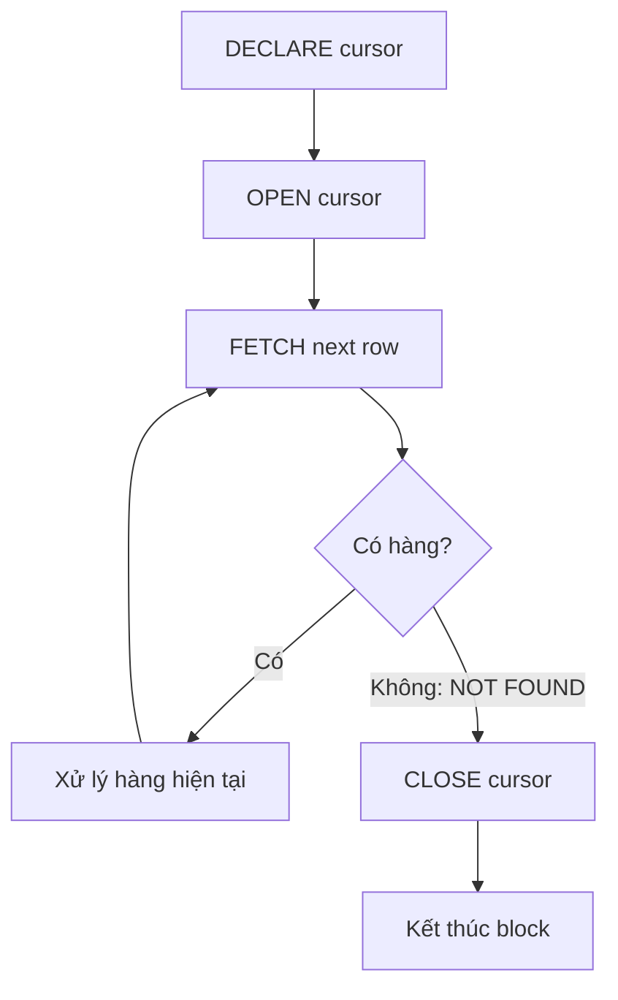

# Cursor chỉ đọc, đi một chiều và đặc điểm tập kết quả

Cursor (con trỏ) trong MySQL cho phép stored program duyệt từng hàng của tập kết quả do một câu `SELECT` tạo ra. Cursor hữu ích khi mỗi hàng cần được xử lý tuần tự bằng logic thủ tục. Tuy nhiên, cursor của MySQL có ba đặc tính cần hiểu rõ: **asensitive**, **read-only** và **non-scrollable**. Cursor không phải con trỏ có thể tùy ý di chuyển hoặc cập nhật trực tiếp hàng hiện tại.

Bài học thuộc module **DATABASE_MYSQL**. Module hướng tới việc làm chủ MySQL từ thiết kế bảng, kiểu dữ liệu, khóa và truy vấn SQL đến index, transaction và kiểm soát đồng thời; đồng thời thực hành đọc kế hoạch thực thi, tối ưu truy vấn, phân quyền, sao lưu và xử lý các vấn đề vận hành cơ sở dữ liệu quan hệ. Trong chương **Cursor và xử lý lỗi**, bài này tập trung vào cursor chỉ đọc, đi một chiều và đặc điểm tập kết quả. `SPECIAL_NOTE` được cung cấp rỗng, vì vậy không có ràng buộc riêng bổ sung cho bài.

## 1. Cursor là gì?

Cursor là đối tượng trong stored program gắn với một câu truy vấn `SELECT`. Khi mở cursor, MySQL khởi tạo tập kết quả; mỗi lệnh `FETCH` lấy hàng tiếp theo vào các biến đã khai báo. Khi không còn hàng, MySQL phát điều kiện `NOT FOUND` để routine có thể kết thúc vòng lặp.

Vòng đời cơ bản:

1. **DECLARE**: khai báo cursor và câu `SELECT` tạo tập kết quả.
2. **OPEN**: mở cursor, khởi tạo tập kết quả.
3. **FETCH**: lấy từng hàng theo thứ tự tiến về phía trước.
4. **CLOSE**: đóng cursor và giải phóng tài nguyên liên quan.

Sơ đồ:



Cursor thường được dùng trong procedure khi cần duyệt kết quả của một truy vấn. Các câu lệnh xử lý mỗi hàng có thể là phép tính, kiểm tra điều kiện, gọi routine khác hoặc thực hiện DML riêng biệt theo khóa của hàng.

## 2. Ba đặc tính của cursor trong MySQL

Cursor trong stored program của MySQL có ba đặc tính chính:

| Đặc tính | Ý nghĩa | Hệ quả |
|---|---|---|
| **Asensitive** | Server có thể tạo bản sao của tập kết quả hoặc không; routine không được giả định một mô hình copy cố định. | Không dựa vào giả định rằng cursor luôn là snapshot độc lập hoặc luôn phản ánh thay đổi mới nhất. |
| **Read-only** | Không thể cập nhật hàng hiện tại thông qua cursor. | Không có thao tác update-current-row qua cursor; muốn sửa dữ liệu phải chạy DML riêng. |
| **Non-scrollable** | Chỉ duyệt theo hướng tiến đến hàng tiếp theo. | Không thể quay lui, nhảy đến hàng bất kỳ hoặc đọc lại hàng trước bằng cursor. |

Đây là giới hạn có chủ đích của cursor MySQL. Khi thiết kế routine, hãy dùng cursor như một bộ duyệt tuần tự của kết quả truy vấn, không xem nó như một bản ghi đang được khóa hoặc một vị trí có thể cập nhật.

## 3. Asensitive: không giả định cách server giữ tập kết quả

`Asensitive` nghĩa là server có thể hoặc không tạo một bản sao của bảng kết quả. Định nghĩa này không cam kết cursor luôn đọc từ một bản sao vật lý cố định, cũng không cam kết cursor sẽ thấy mọi thay đổi phát sinh trên bảng nền sau khi mở.

Điều cần làm:

- Xác định đúng câu `SELECT` của cursor và điều kiện lọc.
- Nếu thứ tự xử lý có ý nghĩa, chỉ định `ORDER BY`.
- Nếu tính đúng đắn phụ thuộc vào dữ liệu đồng thời thay đổi, thiết kế transaction và isolation level rõ ràng.
- Không dùng cursor để suy luận rằng hàng đã fetch sẽ tự động được khóa để ngăn session khác sửa.
- Không dựa vào việc cập nhật bảng nền trong vòng lặp sẽ làm thay đổi hay không thay đổi các hàng còn lại trong tập cursor.

Ví dụ, cursor đọc đơn hàng đang mở:

```sql
DECLARE cur_open_orders CURSOR FOR
    SELECT order_id, customer_id, total_amount
    FROM orders
    WHERE status = 'OPEN'
    ORDER BY order_date, order_id;
```

`ORDER BY order_date, order_id` xác định thứ tự có thể lặp lại khi `order_id` là khóa duy nhất. Nếu chỉ sắp xếp theo ngày mà nhiều đơn có cùng ngày, thứ tự giữa các đơn đó không được xác định đầy đủ.

## 4. Read-only: cursor không cập nhật hàng hiện tại

Cursor MySQL chỉ đọc. Không có cú pháp tương đương `UPDATE ... WHERE CURRENT OF cursor_name` để sửa trực tiếp hàng mà cursor đang trỏ đến.

Nếu cần cập nhật hàng đã đọc, hãy lấy khóa chính từ cursor rồi thực hiện câu lệnh DML riêng:

```sql
UPDATE orders
SET review_status = 'CHECKED'
WHERE order_id = v_order_id;
```

Ở đây `v_order_id` là biến đã được `FETCH` từ cursor. DML được thực hiện trên bảng như một câu lệnh độc lập; tính đúng đắn khi có nhiều session cùng sửa dữ liệu cần được bảo vệ bằng điều kiện cập nhật, transaction và quy tắc khóa phù hợp.

Read-only mô tả khả năng cập nhật **qua cursor**. Nó không có nghĩa toàn bộ procedure chỉ được đọc dữ liệu: routine vẫn có thể chạy câu `INSERT`, `UPDATE` hoặc `DELETE` riêng nếu có quyền và đáp ứng các quy tắc của stored program.

## 5. Non-scrollable: chỉ FETCH tiến về phía trước

Cursor MySQL không hỗ trợ cuộn tùy ý. Lệnh `FETCH` lấy hàng kế tiếp; không có các hướng như `PRIOR`, `FIRST`, `LAST`, `ABSOLUTE` hoặc `RELATIVE`.

| Nhu cầu | Cursor MySQL |
|---|---|
| Lấy hàng kế tiếp | Hỗ trợ bằng `FETCH` |
| Quay lại hàng vừa đọc | Không hỗ trợ |
| Nhảy đến hàng thứ N | Không hỗ trợ |
| Đọc hàng cuối rồi quay lại đầu | Không hỗ trợ |
| Duyệt lại từ đầu | Đóng rồi mở cursor lại để khởi tạo lần duyệt mới |

Nếu cần phân trang, tìm kiếm theo vị trí hoặc quay lại một hàng, hãy thiết kế truy vấn với khóa sắp xếp và điều kiện phân trang (keyset pagination), hoặc truy vấn lại theo khóa. Không nên giữ cursor mở chỉ để mô phỏng một tập kết quả có thể cuộn.

## 6. Khai báo cursor bằng DECLARE

Cú pháp:

```sql
DECLARE cursor_name CURSOR FOR select_statement;
```

`select_statement` là câu `SELECT` cung cấp các cột sẽ được lấy bằng `FETCH`. Câu truy vấn của cursor không dùng mệnh đề `INTO` để nhận kết quả; các biến nhận hàng được khai báo ở lệnh `FETCH`.

Ví dụ:

```sql
DECLARE cur_customers CURSOR FOR
    SELECT customer_id, customer_name
    FROM customers
    WHERE is_active = 1
    ORDER BY customer_id;
```

Có thể dùng tham số procedure hoặc biến local đã khai báo trước cursor trong điều kiện truy vấn:

```sql
DECLARE cur_customer_orders CURSOR FOR
    SELECT order_id, total_amount
    FROM orders
    WHERE customer_id = p_customer_id
    ORDER BY order_date, order_id;
```

Ở ví dụ thứ hai, `p_customer_id` là tham số của routine bao quanh. Cursor không phải prepared statement động; câu truy vấn của cursor được xác định trong phần khai báo.

## 7. Thứ tự khai báo trong BEGIN ... END

Trong một block stored program, thứ tự khai báo là quan trọng:

1. Biến cục bộ và condition.
2. Cursor.
3. Handler.
4. Các câu lệnh thực thi.

Ví dụ khung khai báo:

```sql
BEGIN
    DECLARE v_done BOOLEAN DEFAULT FALSE;
    DECLARE v_order_id BIGINT;
    DECLARE v_total DECIMAL(14, 2);

    DECLARE cur_orders CURSOR FOR
        SELECT order_id, total_amount
        FROM orders
        ORDER BY order_id;

    DECLARE CONTINUE HANDLER FOR NOT FOUND
        SET v_done = TRUE;

    -- Các câu lệnh OPEN, FETCH, CLOSE đặt sau phần khai báo.
END
```

Không đặt `DECLARE` sau câu `SET`, `OPEN` hoặc câu SQL thực thi đầu tiên trong cùng block. Nếu routine có block lồng nhau, mỗi block có vùng khai báo và phạm vi biến/handler riêng.

## 8. OPEN, FETCH và CLOSE

### 8.1. OPEN

`OPEN cursor_name` mở cursor và khởi tạo tập kết quả từ câu `SELECT` đã khai báo:

```sql
OPEN cur_orders;
```

Không mở lại cursor khi nó vẫn đang mở. Nếu cần một lượt duyệt mới, hãy đóng cursor trước rồi mở lại.

### 8.2. FETCH

Cú pháp:

```sql
FETCH cursor_name INTO var_name [, var_name] ...;
```

Số biến đích phải khớp số cột trong danh sách `SELECT` của cursor. Thứ tự biến cũng phải tương ứng với thứ tự cột:

```sql
DECLARE cur_orders CURSOR FOR
    SELECT order_id, customer_id, total_amount
    FROM orders;

-- Sau OPEN:
FETCH cur_orders
INTO v_order_id, v_customer_id, v_total_amount;
```

Chọn kiểu dữ liệu biến nhận tương thích với kiểu cột để tránh chuyển đổi ngoài ý muốn, mất độ chính xác hoặc cảnh báo.

### 8.3. CLOSE

`CLOSE cursor_name` đóng cursor đã mở:

```sql
CLOSE cur_orders;
```

Đóng cursor sau khi hoàn tất duyệt, kể cả khi tập kết quả rỗng. Đóng cursor không commit hay rollback transaction; đó là hai cơ chế riêng biệt.

## 9. NOT FOUND và cách kết thúc vòng lặp

Khi `FETCH` không còn hàng để đọc, MySQL phát điều kiện `NOT FOUND` (SQLSTATE class `02`). Nếu không có handler phù hợp, điều kiện này có thể kết thúc routine. Cách phổ biến là khai báo `CONTINUE HANDLER` để đặt cờ kết thúc:

```sql
DECLARE v_done BOOLEAN DEFAULT FALSE;

DECLARE CONTINUE HANDLER FOR NOT FOUND
    SET v_done = TRUE;
```

Vòng lặp phải kiểm tra cờ ngay sau `FETCH` và trước khi xử lý biến đích:

```sql
read_loop: LOOP
    FETCH cur_orders INTO v_order_id, v_total;

    IF v_done THEN
        LEAVE read_loop;
    END IF;

    -- Xử lý hàng vừa fetch thành công.
END LOOP;
```

Không xử lý các biến đích sau một lần `FETCH` thất bại: giá trị còn lại có thể là dữ liệu của hàng trước đó. Cờ `v_done` giúp phân biệt hàng hợp lệ với lần fetch đã hết tập kết quả.

### 9.1. Tại sao dùng CONTINUE HANDLER?

`CONTINUE HANDLER` xử lý condition rồi tiếp tục thực thi tại vị trí sau câu lệnh gây condition. Vì vậy, sau `FETCH`, chương trình có thể kiểm tra `v_done` và chủ động `LEAVE` vòng lặp.

Ngược lại, `EXIT HANDLER` kết thúc block nơi handler được khai báo sau khi chạy phần thân handler. Nếu dùng EXIT cho điều kiện hết hàng, routine có thể thoát khỏi block chứa vòng lặp trước khi chạy phần xử lý đóng cursor dự kiến. Với vòng lặp fetch thông thường, CONTINUE HANDLER kết hợp cờ done là mẫu dễ kiểm soát.

### 9.2. Tập kết quả rỗng

Nếu câu `SELECT` của cursor không trả hàng:

1. `OPEN` vẫn mở cursor.
2. `FETCH` đầu tiên phát `NOT FOUND`.
3. Handler đặt cờ done thành TRUE.
4. Vòng lặp thoát mà không xử lý biến đích.
5. Routine vẫn chạy `CLOSE` để đóng cursor.

Không cần kiểm tra số hàng bằng một câu truy vấn riêng trước khi mở cursor; có thể để chính lần `FETCH` đầu tiên xử lý trường hợp rỗng.

## 10. Ví dụ hoàn chỉnh: duyệt đơn hàng theo khách hàng

Procedure sau đếm số đơn và cộng tổng tiền bằng cursor. Ví dụ dùng `orders` có các cột `order_id`, `customer_id`, `order_date` và `total_amount`.

```sql
DELIMITER $$

CREATE PROCEDURE summarize_customer_orders_cursor(
    IN p_customer_id BIGINT,
    OUT p_order_count INT,
    OUT p_total_amount DECIMAL(14, 2)
)
BEGIN
    DECLARE v_done BOOLEAN DEFAULT FALSE;
    DECLARE v_order_id BIGINT;
    DECLARE v_order_date DATE;
    DECLARE v_amount DECIMAL(14, 2);

    DECLARE cur_orders CURSOR FOR
        SELECT order_id, order_date, total_amount
        FROM orders
        WHERE customer_id = p_customer_id
        ORDER BY order_date, order_id;

    DECLARE CONTINUE HANDLER FOR NOT FOUND
        SET v_done = TRUE;

    SET p_order_count = 0;
    SET p_total_amount = 0;

    OPEN cur_orders;

    read_loop: LOOP
        FETCH cur_orders
        INTO v_order_id, v_order_date, v_amount;

        IF v_done THEN
            LEAVE read_loop;
        END IF;

        SET p_order_count = p_order_count + 1;
        SET p_total_amount = p_total_amount + v_amount;
    END LOOP;

    CLOSE cur_orders;
END$$

DELIMITER ;
```

Gọi procedure:

```sql
CALL summarize_customer_orders_cursor(
    1001,
    @order_count,
    @total_amount
);

SELECT
    @order_count AS order_count,
    @total_amount AS total_amount;
```

Kết quả là số hàng và tổng `total_amount` của khách hàng được truyền vào. Vì ví dụ giả định `total_amount` không NULL, phép cộng trực tiếp là phù hợp. Nếu cột cho phép NULL, cần quy định cách xử lý NULL, ví dụ chuyển thành 0 khi FETCH hoặc khi cộng.

Ví dụ nhằm minh họa vòng đời cursor. Với phép đếm và cộng tổng đơn giản, truy vấn theo tập hợp thường ngắn hơn và hiệu quả hơn:

```sql
SELECT
    COUNT(*),
    COALESCE(SUM(total_amount), 0)
INTO
    p_order_count,
    p_total_amount
FROM orders
WHERE customer_id = p_customer_id;
```

Trong ứng dụng thực tế, ưu tiên phép toán set-based khi có thể diễn đạt nghiệp vụ bằng một hoặc vài câu SQL.

## 11. NOT FOUND có thể đến từ câu lệnh khác

`NOT FOUND` không chỉ phát sinh khi cursor đã hết hàng. Một câu `SELECT ... INTO` không tìm thấy hàng cũng phát condition thuộc class `02`. Nếu cùng một handler `NOT FOUND` đang đặt cờ `v_done` cho cursor, một truy vấn phụ không tìm thấy dữ liệu có thể làm vòng lặp kết thúc sớm.

Có hai cách thiết kế:

- Bảo đảm câu truy vấn phụ luôn trả đúng một hàng, chẳng hạn tra cứu bằng khóa ngoại có ràng buộc phù hợp.
- Đặt truy vấn phụ trong một block lồng nhau với handler riêng để condition NOT FOUND của nó không làm thay đổi cờ kết thúc cursor.

Ví dụ block lồng nhau:

Khai báo `v_customer_missing` ở đầu block ngoài, trước cursor và handler. Trong vòng lặp, đặt lại cờ rồi dùng handler riêng ở block con:

```sql
SET v_customer_missing = FALSE;

BEGIN
    DECLARE CONTINUE HANDLER FOR NOT FOUND
        SET v_customer_missing = TRUE;

    SELECT customer_name
    INTO v_customer_name
    FROM customers
    WHERE customer_id = v_customer_id;
END;

IF v_customer_missing THEN
    -- Xử lý trường hợp không tìm thấy customer.
END IF;
```

Handler bên trong block chỉ xử lý condition trong phạm vi block đó. Handler NOT FOUND ở block ngoài vẫn dành cho thao tác FETCH cursor. Khi dùng block lồng nhau, khai báo biến và handler của block con phải đứng trước câu lệnh thực thi đầu tiên của block con.

## 12. Đóng cursor khi có lỗi SQL

Nếu lỗi xảy ra sau `OPEN` nhưng trước `CLOSE`, routine có thể thoát khỏi luồng xử lý dự kiến. Một `EXIT HANDLER FOR SQLEXCEPTION` giúp thực hiện cleanup rồi phát lại lỗi để caller biết thao tác đã thất bại.

Mẫu quản lý trạng thái cursor:

```sql
DELIMITER $$

CREATE PROCEDURE process_orders_safely(
    IN p_customer_id BIGINT
)
BEGIN
    DECLARE v_done BOOLEAN DEFAULT FALSE;
    DECLARE v_cursor_open BOOLEAN DEFAULT FALSE;
    DECLARE v_order_id BIGINT;
    DECLARE v_amount DECIMAL(14, 2);

    DECLARE cur_orders CURSOR FOR
        SELECT order_id, total_amount
        FROM orders
        WHERE customer_id = p_customer_id
        ORDER BY order_id;

    DECLARE CONTINUE HANDLER FOR NOT FOUND
        SET v_done = TRUE;

    DECLARE EXIT HANDLER FOR SQLEXCEPTION
    BEGIN
        IF v_cursor_open THEN
            CLOSE cur_orders;
            SET v_cursor_open = FALSE;
        END IF;
        RESIGNAL;
    END;

    OPEN cur_orders;
    SET v_cursor_open = TRUE;

    read_loop: LOOP
        FETCH cur_orders INTO v_order_id, v_amount;

        IF v_done THEN
            LEAVE read_loop;
        END IF;

        -- Đặt logic xử lý từng hàng tại đây.
    END LOOP;

    CLOSE cur_orders;
    SET v_cursor_open = FALSE;
END$$

DELIMITER ;
```

Biến `v_cursor_open` chỉ được đặt TRUE sau khi `OPEN` thành công và được đặt FALSE sau khi đóng. Handler kiểm tra cờ trước khi `CLOSE` để tránh đóng một cursor chưa mở hoặc đã đóng. `RESIGNAL` chuyển lỗi ban đầu về caller thay vì che giấu lỗi bằng cách chỉ kết thúc procedure.

Đây là mẫu cleanup. Nếu routine còn quản lý transaction, việc đóng cursor không thay thế rollback; transaction cần được xử lý theo hợp đồng riêng. Không tự động thêm `ROLLBACK` vào mọi handler nếu procedure được gọi trong transaction do caller sở hữu.

## 13. Cursor và transaction

Cursor và transaction giải quyết hai vấn đề khác nhau:

- Cursor quyết định cách routine duyệt các hàng của một tập kết quả.
- Transaction quyết định ranh giới nguyên tử, khả năng nhìn thấy dữ liệu và cách phối hợp các thay đổi giữa nhiều session.

Một số nguyên tắc:

1. Mở cursor không đồng nghĩa mọi hàng trong kết quả đã bị khóa để ngăn session khác cập nhật.
2. Cursor asensitive không hứa một bản sao độc lập cố định; không dựa vào giả định về thay đổi đồng thời.
3. Nếu routine vừa đọc vừa cập nhật dữ liệu, hãy xác định rõ isolation level, điều kiện DML và khóa cần thiết.
4. Tránh giữ cursor mở quá lâu trong khi chờ thao tác bên ngoài hoặc chờ người dùng.
5. Nếu xử lý lượng dữ liệu lớn, cân nhắc chia lô và commit theo ranh giới nghiệp vụ phù hợp.

Ví dụ cursor đọc danh sách khóa rồi cập nhật trạng thái theo khóa:

```sql
UPDATE orders
SET review_status = 'CHECKED'
WHERE order_id = v_order_id
  AND review_status = 'PENDING';

IF ROW_COUNT() = 0 THEN
    -- Hàng có thể đã được session khác xử lý hoặc trạng thái đã đổi.
END IF;
```

Điều kiện trạng thái trong `WHERE` giúp tránh ghi đè một thay đổi không còn phù hợp. Cần quyết định cách xử lý khi số hàng cập nhật bằng 0 theo quy tắc nghiệp vụ.

## 14. Thứ tự hàng và tính ổn định của kết quả

Quan hệ trong SQL không có thứ tự mặc định. Nếu routine cần xử lý hàng theo một trình tự cụ thể, câu truy vấn khai báo cursor phải có `ORDER BY`.

Không nên chỉ sắp xếp theo một cột có thể trùng:

```sql
-- Thứ tự giữa các hàng cùng order_date không được xác định đầy đủ.
SELECT order_id, order_date
FROM orders
ORDER BY order_date;
```

Nên thêm khóa duy nhất làm tiêu chí phụ:

```sql
SELECT order_id, order_date
FROM orders
ORDER BY order_date, order_id;
```

Thứ tự ổn định giúp kết quả lab có thể lặp lại, log dễ đối chiếu và logic xử lý tuần tự dễ kiểm tra. `ORDER BY` cũng có thể làm phát sinh sort; hãy kiểm tra index và execution plan nếu tập kết quả lớn.

## 15. Chi phí và giới hạn vận hành

Cursor xử lý từng hàng nên thường có overhead lớn hơn một câu lệnh set-based tương đương. Khi duyệt nhiều hàng, mỗi vòng lặp có thể bao gồm thao tác fetch, chuyển đổi giá trị, nhánh điều kiện và nhiều câu SQL bổ sung.

| Rủi ro | Vì sao xảy ra | Cách giảm thiểu |
|---|---|---|
| Nhiều vòng lặp | Mỗi hàng được xử lý tuần tự | Dùng aggregate, JOIN, UPDATE/INSERT theo tập hợp nếu có thể. |
| Truy vấn N+1 | Mỗi hàng lại phát sinh một truy vấn phụ | JOIN dữ liệu cần dùng vào SELECT cursor hoặc gom truy vấn. |
| Cursor mở lâu | Routine xử lý nhiều việc trong lúc giữ cursor | Giới hạn tập kết quả, xử lý nhanh, đóng sớm. |
| Tập kết quả lớn | Tăng tài nguyên và thời gian duyệt | Lọc sớm, chỉ chọn cột cần thiết, chia lô. |
| Thứ tự không ổn định | SELECT không có ORDER BY hoặc ORDER BY không duy nhất | Thêm tiêu chí sắp xếp duy nhất. |
| Lỗi giữa vòng lặp | Cursor chưa được đóng theo luồng bình thường | Có handler cleanup và phát lại lỗi. |
| Cạnh tranh cập nhật | Session khác sửa hàng sau khi cursor đọc | Dùng điều kiện DML, transaction và xử lý xung đột rõ ràng. |

Không dùng cursor chỉ vì muốn thực hiện một phép cộng, đếm, lọc hoặc cập nhật hàng loạt mà SQL có thể xử lý trực tiếp.

## 16. Khi nào nên dùng cursor?

Cursor có thể phù hợp khi:

- Mỗi hàng cần một chuỗi xử lý tuần tự với nhánh logic khác nhau.
- Kết quả một bước quyết định tham số cho bước tiếp theo.
- Routine cần gọi một routine khác cho từng hàng và không thể diễn đạt hợp lý bằng phép toán theo tập hợp.
- Tập dữ liệu được giới hạn và chi phí tuần tự đã được đo/đánh giá.

Ưu tiên set-based SQL khi:

- Tính tổng, trung bình, số lượng, min/max.
- Cập nhật nhiều hàng theo cùng một điều kiện.
- Kết hợp dữ liệu từ nhiều bảng.
- Phân loại hoặc lọc dữ liệu bằng biểu thức SQL.
- Có thể xử lý toàn bộ nghiệp vụ bằng một câu lệnh hoặc một vài câu lệnh theo tập hợp.

Ví dụ, đếm và cộng tiền bằng cursor:

```sql
FETCH cur_orders INTO v_amount;
SET v_count = v_count + 1;
SET v_total = v_total + v_amount;
```

Thường có thể thay bằng:

```sql
SELECT
    COUNT(*),
    COALESCE(SUM(total_amount), 0)
INTO v_count, v_total
FROM orders
WHERE customer_id = p_customer_id;
```

Phép tính set-based để optimizer xử lý toàn bộ tập hàng và thường ít overhead hơn.

## 17. Giới hạn của câu SELECT khai báo cursor

Câu truy vấn gắn với cursor có một số giới hạn cần nhớ:

- Phải là câu `SELECT` dùng để xác định tập kết quả.
- Không đặt `INTO variable_list` trong câu `SELECT` khai báo cursor; biến nhận dữ liệu nằm ở lệnh `FETCH`.
- Không thể thay câu truy vấn bằng một prepared statement động tại thời điểm mở cursor.
- Các biến routine và tham số có thể được tham chiếu trong điều kiện truy vấn để lọc tập kết quả.
- Danh sách cột trong `SELECT` phải tương ứng chính xác với số biến và thứ tự biến của `FETCH`.

Ví dụ hợp lệ với tham số procedure:

```sql
DECLARE cur_orders CURSOR FOR
    SELECT order_id, total_amount
    FROM orders
    WHERE customer_id = p_customer_id
      AND status = p_status
    ORDER BY order_date, order_id;
```

Muốn thay đổi điều kiện, có thể truyền giá trị khác vào tham số procedure trước khi mở cursor. Không thể dùng một chuỗi SQL tùy ý rồi `PREPARE` nó thành cursor query theo cách của dynamic SQL.

## 18. Quản lý nhiều cursor và phạm vi

Một block có thể khai báo nhiều cursor. Mỗi cursor cần tên riêng trong phạm vi khai báo và có vòng đời mở/đóng riêng:

```sql
DECLARE cur_customers CURSOR FOR
    SELECT customer_id
    FROM customers
    ORDER BY customer_id;

DECLARE cur_orders CURSOR FOR
    SELECT order_id
    FROM orders
    WHERE customer_id = v_customer_id
    ORDER BY order_id;
```

Nếu dùng cursor lồng nhau, hãy quản lý cờ kết thúc riêng cho từng vòng lặp và handler trong block thích hợp. Không dùng chung một cờ done cho hai cursor nếu hai cursor có thể kết thúc độc lập.

Ví dụ cấu trúc block lồng nhau:

```sql
outer_loop: LOOP
    FETCH cur_customers INTO v_customer_id;

    IF v_customers_done THEN
        LEAVE outer_loop;
    END IF;

    BEGIN
        DECLARE v_orders_done BOOLEAN DEFAULT FALSE;

        DECLARE cur_orders CURSOR FOR
            SELECT order_id
            FROM orders
            WHERE customer_id = v_customer_id
            ORDER BY order_id;

        DECLARE CONTINUE HANDLER FOR NOT FOUND
            SET v_orders_done = TRUE;

        OPEN cur_orders;

        inner_loop: LOOP
            FETCH cur_orders INTO v_order_id;

            IF v_orders_done THEN
                LEAVE inner_loop;
            END IF;

            -- Xử lý order_id.
        END LOOP;

        CLOSE cur_orders;
    END;
END LOOP;
```

Ví dụ chỉ minh họa phạm vi handler và cờ kết thúc. Trong procedure hoàn chỉnh, cursor ngoài cần handler NOT FOUND ở block ngoài; handler trong block con không nên làm thay đổi cờ của cursor ngoài. Đánh giá kỹ chi phí truy vấn lồng nhau vì mỗi customer có thể mở và duyệt một cursor riêng cho orders.

## 19. Các lỗi thường gặp

| Lỗi | Nguyên nhân | Cách xử lý |
|---|---|---|
| FETCH trước OPEN | Cursor chưa được khởi tạo | Gọi OPEN trước lần FETCH đầu tiên. |
| OPEN cursor hai lần | Cursor vẫn đang mở | CLOSE cursor trước khi mở lại. |
| CLOSE cursor chưa mở | Luồng xử lý đi vào cleanup sai trạng thái | Theo dõi trạng thái mở hoặc cấu trúc luồng để CLOSE đúng một lần. |
| Quên CLOSE | Cursor còn mở trong khi routine tiếp tục làm việc | Đóng sau vòng lặp và có handler cleanup cho lỗi. |
| FETCH hết hàng nhưng vẫn xử lý biến | Không kiểm tra cờ done sau FETCH | Kiểm tra NOT FOUND trước khi dùng biến đích. |
| Dùng một cờ done cho cursor lồng nhau | Hai tập kết quả có thể hết ở thời điểm khác nhau | Tách cờ và handler theo block/cursor. |
| SELECT ... INTO phụ làm cursor dừng sớm | Handler NOT FOUND của cursor cũng bắt lỗi không tìm thấy hàng ở truy vấn phụ | Dùng handler riêng trong block con hoặc bảo đảm truy vấn trả một hàng. |
| Số biến FETCH không khớp số cột | Danh sách nhận không tương ứng SELECT list | Đối chiếu số lượng và thứ tự cột/biến. |
| Dùng FETCH PRIOR hoặc LAST | Cursor MySQL không scrollable | Truy vấn lại theo khóa hoặc dùng phân trang. |
| Cố UPDATE qua cursor | Cursor read-only | Dùng DML riêng với khóa đã fetch. |
| Không có ORDER BY | Thứ tự hàng không được đảm bảo | Thêm ORDER BY với tiêu chí phụ duy nhất. |
| Cursor xử lý hàng triệu bản ghi | Chi phí tuần tự và tài nguyên quá lớn | Lọc sớm, chia lô hoặc chuyển sang set-based SQL. |

## 20. Lab thực hành

Lab dùng hai bảng thử nghiệm `customers` và `orders`. Chạy trong schema lab mới; nếu các bảng đã tồn tại, kiểm tra cấu trúc và dữ liệu trước khi chạy lại. Không chạy DDL mẫu trên production.

### 20.1. Chuẩn bị dữ liệu

```sql
CREATE TABLE customers (
    customer_id BIGINT NOT NULL PRIMARY KEY,
    customer_name VARCHAR(150) NOT NULL,
    is_active TINYINT NOT NULL
) ENGINE = InnoDB;

CREATE TABLE orders (
    order_id BIGINT NOT NULL PRIMARY KEY,
    customer_id BIGINT NOT NULL,
    order_date DATE NOT NULL,
    total_amount DECIMAL(14, 2) NOT NULL,
    status VARCHAR(20) NOT NULL,
    KEY idx_orders_customer_date (customer_id, order_date, order_id)
) ENGINE = InnoDB;

INSERT INTO customers (customer_id, customer_name, is_active)
VALUES
    (1001, 'An Nguyen', 1),
    (1002, 'Binh Tran', 1),
    (1003, 'Chi Le', 0);

INSERT INTO orders
    (order_id, customer_id, order_date, total_amount, status)
VALUES
    (5001, 1001, '2026-11-01', 1200000, 'PAID'),
    (5002, 1001, '2026-11-05', 800000, 'OPEN'),
    (5003, 1002, '2026-11-06', 2500000, 'PAID');
```

### 20.2. Tạo procedure duyệt khách hàng đang hoạt động

```sql
DELIMITER $$

CREATE PROCEDURE list_active_customers_cursor()
BEGIN
    DECLARE v_done BOOLEAN DEFAULT FALSE;
    DECLARE v_customer_id BIGINT;
    DECLARE v_customer_name VARCHAR(150);

    DECLARE cur_customers CURSOR FOR
        SELECT customer_id, customer_name
        FROM customers
        WHERE is_active = 1
        ORDER BY customer_id;

    DECLARE CONTINUE HANDLER FOR NOT FOUND
        SET v_done = TRUE;

    OPEN cur_customers;

    read_loop: LOOP
        FETCH cur_customers
        INTO v_customer_id, v_customer_name;

        IF v_done THEN
            LEAVE read_loop;
        END IF;

        SELECT
            v_customer_id AS customer_id,
            v_customer_name AS customer_name;
    END LOOP;

    CLOSE cur_customers;
END$$

DELIMITER ;

CALL list_active_customers_cursor();
```

Procedure trả một result set cho mỗi lần xử lý hàng. Cách này hữu ích để quan sát vòng lặp trong lab, nhưng trong ứng dụng nên tránh phát hàng loạt result set nhỏ nếu có thể trả một result set duy nhất bằng SELECT.

### 20.3. Thử tập kết quả rỗng

Gọi procedure với điều kiện không có hàng bằng cách tạo một biến thể chỉ lọc khách hàng không tồn tại, hoặc thay câu SELECT của cursor trong lab để trả 0 hàng. Xác nhận lần FETCH đầu tiên kích hoạt handler và cursor vẫn được CLOSE.

### 20.4. So sánh với truy vấn set-based

```sql
SELECT
    customer_id,
    COUNT(*) AS order_count,
    COALESCE(SUM(total_amount), 0) AS total_amount
FROM orders
GROUP BY customer_id
ORDER BY customer_id;
```

So sánh cách viết cursor với truy vấn aggregate: độ dài mã, số lần fetch, số câu SQL thực thi và khả năng optimizer xử lý theo tập hợp.

### 20.5. Kiểm tra execution plan

```sql
EXPLAIN
SELECT order_id, order_date, total_amount
FROM orders
WHERE customer_id = 1001
ORDER BY order_date, order_id;
```

Quan sát access type, index được chọn, số hàng ước lượng và bước sort. Cursor không làm cho câu SELECT nền tự động nhanh hơn; hiệu năng vẫn phụ thuộc truy vấn, index, cardinality và kích thước tập kết quả.

## 21. Bài tập tự luyện

### Bài tập 1: Duyệt kết quả theo thứ tự xác định

Tạo procedure dùng cursor đọc các đơn hàng của một khách hàng theo ngày.

**Yêu cầu:** dùng `ORDER BY order_date, order_id`; giải thích vì sao cần khóa phụ trong thứ tự.

### Bài tập 2: Xử lý tập kết quả rỗng

Thay điều kiện cursor để không có hàng nào thỏa mãn.

**Yêu cầu:** chứng minh handler `NOT FOUND` được gọi ở lần `FETCH` đầu tiên và không xử lý các biến đích.

### Bài tập 3: Tách handler cho truy vấn phụ

Trong vòng lặp cursor, tra cứu tên khách hàng bằng `SELECT ... INTO`.

**Yêu cầu:** tạo block con với handler NOT FOUND riêng; xác nhận truy vấn phụ không đặt cờ kết thúc cursor ngoài.

### Bài tập 4: Cleanup khi có lỗi

Thêm một câu lệnh có thể phát sinh lỗi trong vòng lặp.

**Yêu cầu:** dùng `EXIT HANDLER FOR SQLEXCEPTION`, kiểm tra trạng thái cursor trước khi đóng và dùng `RESIGNAL` để trả lỗi cho caller.

### Bài tập 5: So sánh cursor với set-based SQL

Tính số đơn hàng và tổng tiền của mỗi khách hàng bằng cursor, sau đó viết lại bằng `GROUP BY`.

**Yêu cầu:** so sánh số câu lệnh, độ phức tạp, khả năng tối ưu và hiệu năng trên tập dữ liệu lớn.

### Bài tập 6: Cập nhật theo khóa đã fetch

Đọc các đơn hàng có trạng thái PENDING bằng cursor rồi cập nhật từng hàng theo khóa chính.

**Yêu cầu:** dùng điều kiện trạng thái trong `WHERE`, kiểm tra `ROW_COUNT()` và giải thích cách xử lý khi session khác đã thay đổi hàng.

## 22. Checklist trước khi dùng cursor

- [ ] Đã xác nhận bài toán cần xử lý tuần tự và không thể diễn đạt hợp lý bằng set-based SQL.
- [ ] Cursor query chỉ chọn các cột thực sự cần thiết.
- [ ] Đã khai báo biến/condition trước cursor và cursor trước handler.
- [ ] Đã dùng `ORDER BY` với tiêu chí phụ duy nhất nếu thứ tự quan trọng.
- [ ] Số cột SELECT khớp số biến trong FETCH.
- [ ] Đã OPEN trước FETCH và CLOSE sau khi duyệt.
- [ ] Handler NOT FOUND đặt cờ done và vòng lặp kiểm tra cờ ngay sau FETCH.
- [ ] Không xử lý biến đích sau lần FETCH không có hàng.
- [ ] Truy vấn SELECT ... INTO phụ không vô tình kích hoạt handler kết thúc cursor.
- [ ] Cursor lồng nhau dùng cờ và handler riêng.
- [ ] Có cleanup khi SQLEXCEPTION xảy ra sau OPEN.
- [ ] Đã hiểu cursor là asensitive, read-only và non-scrollable.
- [ ] Không giả định cursor tự khóa các hàng hoặc cung cấp snapshot cố định.
- [ ] Nếu cần DML, dùng khóa đã fetch và điều kiện cập nhật phù hợp.
- [ ] Transaction và isolation level được thiết kế riêng với vòng đời cursor.
- [ ] Tập kết quả được giới hạn và thời gian giữ cursor mở được kiểm soát.
- [ ] Đã đo/đánh giá chi phí so với truy vấn set-based.

## 23. Ghi nhớ

Cursor MySQL trong stored program có ba đặc tính: **asensitive** (server có thể hoặc không tạo bản sao tập kết quả), **read-only** (không cập nhật hàng hiện tại qua cursor) và **non-scrollable** (chỉ FETCH tiến về phía trước).

Vòng đời cursor gồm `DECLARE`, `OPEN`, `FETCH` và `CLOSE`. Khi hết hàng, `FETCH` phát `NOT FOUND`; mẫu phổ biến là `CONTINUE HANDLER` đặt cờ done, vòng lặp kiểm tra cờ rồi thoát bằng `LEAVE`. Cần chú ý handler NOT FOUND có thể bắt cả trường hợp SELECT ... INTO không tìm thấy hàng trong cùng phạm vi.

Cursor không thay thế transaction, không tự bảo đảm khóa hàng và không khiến truy vấn nền nhanh hơn. Hãy giới hạn tập kết quả, xác định thứ tự bằng ORDER BY, đóng cursor trong cả luồng thành công lẫn lỗi, và ưu tiên set-based SQL khi nghiệp vụ có thể diễn đạt theo tập hợp.
