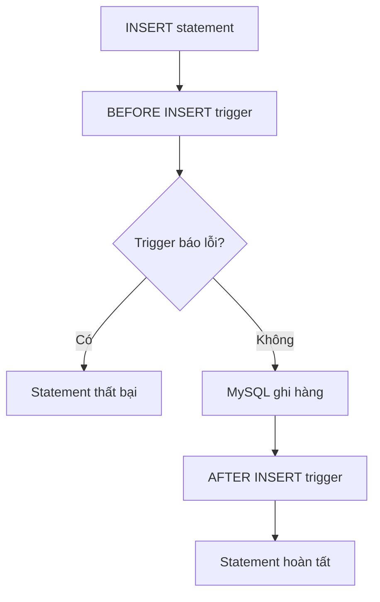

# NEW, OLD và khả năng thay đổi giá trị trong BEFORE trigger

Trong MySQL, `NEW` và `OLD` tham chiếu đến các giá trị của hàng đang được trigger xử lý. Chỉ `BEFORE INSERT` và `BEFORE UPDATE` mới cho phép gán lại `NEW.column`; `OLD` luôn chỉ đọc.

## 1. NEW và OLD là gì?

`NEW` và `OLD` là pseudo-row (hàng giả lập) mà MySQL cung cấp cho trigger:

- `NEW.column_name` tham chiếu giá trị của hàng mới được chèn hoặc giá trị mới đề xuất khi cập nhật.
- `OLD.column_name` tham chiếu giá trị hiện có trước khi cập nhật hoặc trước khi xóa.

Hai tên này chỉ có ý nghĩa trong ngữ cảnh trigger. Chúng không phải tên bảng, không phải alias trong câu SELECT và không thể dùng tùy ý trong procedure/function thông thường.

## 2. Sự kiện nào có NEW và OLD?

MySQL hỗ trợ trigger theo ba sự kiện DML: `INSERT`, `UPDATE` và `DELETE`. Sự kiện quyết định pseudo-row nào có sẵn:

| Sự kiện | Thời điểm | NEW | OLD |
|---|---|---|---|
| INSERT | BEFORE INSERT | Có | Không |
| INSERT | AFTER INSERT | Có | Không |
| UPDATE | BEFORE UPDATE | Có | Có |
| UPDATE | AFTER UPDATE | Có | Có |
| DELETE | BEFORE DELETE | Không | Có |
| DELETE | AFTER DELETE | Không | Có |

Ghi nhớ:

- INSERT tạo hàng mới nên không có giá trị OLD.
- DELETE loại bỏ hàng cũ nên không có giá trị NEW.
- UPDATE thay thế trạng thái cũ bằng trạng thái mới nên có cả hai.

## 3. Khi nào được thay đổi NEW?

| Loại trigger | Đọc NEW | Gán NEW.column | Đọc OLD | Gán OLD.column |
|---|---:|---:|---:|---:|
| BEFORE INSERT | Có | Có | Không có | Không |
| AFTER INSERT | Có | Không | Không có | Không |
| BEFORE UPDATE | Có | Có | Có | Không |
| AFTER UPDATE | Có | Không | Có | Không |
| BEFORE DELETE | Không có | Không | Có | Không |
| AFTER DELETE | Không có | Không | Có | Không |

Chỉ trong `BEFORE INSERT` và `BEFORE UPDATE` mới được gán giá trị cho cột của `NEW`. Cú pháp:

```sql
SET NEW.column_name = expression;
```

Không thể gán trực tiếp cho `OLD`. Không thể sửa `NEW` trong AFTER trigger vì tại thời điểm đó thao tác ghi hàng đã xảy ra. Nếu cần chuẩn hóa hoặc tính giá trị trước khi ghi, hãy dùng BEFORE trigger.

## 4. BEFORE và AFTER khác nhau ở đâu?

**BEFORE trigger** chạy trước khi MySQL hoàn tất thao tác ghi hàng:

- Có thể kiểm tra dữ liệu đầu vào.
- Có thể gán lại các cột cho phép của `NEW` trong BEFORE INSERT/UPDATE.
- Có thể từ chối thao tác bằng cách phát lỗi, ví dụ `SIGNAL SQLSTATE '45000'`.

**AFTER trigger** chạy sau khi thao tác hàng đã được thực hiện:

- Có thể đọc giá trị hàng sau thao tác qua `NEW` hoặc giá trị trước thao tác qua `OLD` tùy event.
- Thích hợp cho hành động phụ thuộc vào hàng đã ghi, ví dụ thêm bản ghi audit vào bảng khác.
- Không thể gán lại `NEW` để thay đổi hàng vừa ghi.

Sơ đồ luồng INSERT:



Đối với UPDATE, luồng tương tự nhưng BEFORE UPDATE có cả `OLD` và `NEW`. Đối với DELETE, trigger có thể đọc `OLD` nhưng không có `NEW`.

## 5. NEW trong BEFORE INSERT

Trong BEFORE INSERT, `NEW.column` đại diện cho giá trị hàng sắp được chèn. Trigger có thể chuẩn hóa hoặc tính lại giá trị trước khi hàng được ghi.

Ví dụ chuẩn hóa SKU và tên sản phẩm:

```sql
DELIMITER $$

CREATE TRIGGER bi_products_normalize
BEFORE INSERT ON products
FOR EACH ROW
BEGIN
    SET NEW.sku = UPPER(TRIM(NEW.sku));
    SET NEW.product_name = TRIM(NEW.product_name);
END$$

DELIMITER ;
```

Khi ứng dụng chạy:

```sql
INSERT INTO products (sku, product_name, price, stock)
VALUES (' ab-100 ', '  Wireless Mouse  ', 250000, 20);
```

Hàng được lưu với SKU đã loại khoảng trắng và chuyển thành chữ hoa, tên sản phẩm được loại khoảng trắng ở hai đầu. Ứng dụng không cần lặp lại cùng quy tắc ở mọi nơi ghi dữ liệu.

Không nên biến trigger thành nơi âm thầm thay đổi dữ liệu quá nhiều. Chỉ chuẩn hóa những quy tắc ổn định, có hợp đồng rõ ràng và được kiểm thử ở mọi luồng ghi.

## 6. NEW và OLD trong BEFORE UPDATE

Trong BEFORE UPDATE:

- `OLD.column` là giá trị trước khi UPDATE.
- `NEW.column` là giá trị UPDATE đang đề xuất.
- Có thể gán lại `NEW.column` để thay đổi giá trị cuối cùng được ghi.

Ví dụ chuẩn hóa email và cập nhật thời điểm sửa:

```sql
DELIMITER $$

CREATE TRIGGER bu_customers_normalize
BEFORE UPDATE ON customers
FOR EACH ROW
BEGIN
    SET NEW.email = LOWER(TRIM(NEW.email));

    IF NOT (NEW.email <=> OLD.email)
       OR NOT (NEW.full_name <=> OLD.full_name) THEN
        SET NEW.updated_at = CURRENT_TIMESTAMP;
    END IF;
END$$

DELIMITER ;
```

Toán tử `<=>` là phép so sánh bằng an toàn với NULL. Nó trả TRUE khi hai vế đều NULL, trong khi `=` có thể trả UNKNOWN nếu một vế NULL. Dùng `NOT (a <=> b)` để kiểm tra hai giá trị có thực sự khác nhau kể cả trường hợp NULL.

Ví dụ:

```sql
UPDATE customers
SET email = '  USER@EXAMPLE.COM  '
WHERE customer_id = 1001;
```

Trigger chuẩn hóa giá trị email trước khi lưu. Nếu email sau chuẩn hóa khác email cũ, trigger cập nhật `updated_at`.

## 7. OLD chỉ đọc: so sánh trạng thái trước và sau

`OLD` rất hữu ích khi cần xác định dữ liệu có thay đổi hay không hoặc ghi lại trạng thái trước thao tác.

Ví dụ chỉ ghi audit khi giá sản phẩm thực sự đổi:

```sql
DELIMITER $$

CREATE TRIGGER au_products_price_audit
AFTER UPDATE ON products
FOR EACH ROW
BEGIN
    IF NOT (NEW.price <=> OLD.price) THEN
        INSERT INTO product_price_audit (
            product_id,
            old_price,
            new_price,
            changed_at
        )
        VALUES (
            OLD.product_id,
            OLD.price,
            NEW.price,
            CURRENT_TIMESTAMP
        );
    END IF;
END$$

DELIMITER ;
```

Trong AFTER UPDATE, trigger chỉ đọc `OLD.price` và `NEW.price` rồi ghi một hàng vào bảng audit khác. Nó không gán `NEW.price`.

Nếu bảng audit dùng InnoDB và thao tác UPDATE nằm trong transaction InnoDB, thay đổi audit tham gia cùng transaction; nếu transaction rollback, bản ghi audit cũng rollback.

## 8. Dùng BEFORE trigger để kiểm tra và từ chối dữ liệu

Không phải quy tắc nào cũng nên tự động sửa. Khi dữ liệu không hợp lệ, BEFORE trigger có thể phát lỗi để hủy thao tác:

```sql
DELIMITER $$

CREATE TRIGGER bi_orders_validate
BEFORE INSERT ON orders
FOR EACH ROW
BEGIN
    IF NEW.quantity IS NULL OR NEW.quantity <= 0 THEN
        SIGNAL SQLSTATE '45000'
            SET MESSAGE_TEXT = 'quantity must be greater than zero';
    END IF;

    IF NEW.unit_price IS NULL OR NEW.unit_price < 0 THEN
        SIGNAL SQLSTATE '45000'
            SET MESSAGE_TEXT = 'unit_price must not be negative';
    END IF;

    SET NEW.line_total = ROUND(
        NEW.quantity * NEW.unit_price,
        2
    );
END$$

DELIMITER ;
```

Trong ví dụ, hai điều kiện đầu từ chối hàng sai dữ liệu; nếu hợp lệ, trigger tính `line_total` và gán vào `NEW.line_total` trước khi ghi. Bảng `orders` trong ví dụ phải có các cột `quantity`, `unit_price` và `line_total` với kiểu dữ liệu phù hợp.

`SIGNAL SQLSTATE '45000'` là cách phát sinh lỗi do ứng dụng định nghĩa. Client nhận lỗi và câu lệnh DML thất bại. Với bảng transactional như InnoDB, thay đổi của statement bị rollback theo ngữ nghĩa statement/transaction.

Nếu mục tiêu chỉ là giới hạn giá trị, cân nhắc `CHECK constraint` hoặc kiểu dữ liệu/NOT NULL phù hợp trước khi dùng trigger. Constraint thường biểu đạt quy tắc toàn hàng rõ ràng hơn và được kiểm tra trực tiếp bởi server.

## 9. Tính toán giá trị trong BEFORE trigger

Một trường hợp điển hình là tính giá trị dẫn xuất từ các cột đầu vào:

```sql
DELIMITER $$

CREATE TRIGGER bi_order_items_total
BEFORE INSERT ON order_items
FOR EACH ROW
BEGIN
    SET NEW.line_total = ROUND(
        NEW.quantity * NEW.unit_price,
        2
    );
END$$

CREATE TRIGGER bu_order_items_total
BEFORE UPDATE ON order_items
FOR EACH ROW
BEGIN
    SET NEW.line_total = ROUND(
        NEW.quantity * NEW.unit_price,
        2
    );
END$$

DELIMITER ;
```

Hai trigger bảo đảm giá trị `line_total` được tính lại trước khi ghi cả INSERT lẫn UPDATE. Nếu biểu thức là phép tính xác định chỉ dựa trên các cột cùng hàng, hãy cân nhắc **generated column** thay vì trigger. Generated column làm rõ quan hệ dữ liệu ngay trong định nghĩa bảng và tránh phải duy trì hai trigger đồng bộ.

Trigger phù hợp hơn khi quy tắc cần thao tác thủ tục, kiểm tra điều kiện phức tạp hoặc phối hợp với bảng khác mà constraint/generated column không biểu đạt được.

## 10. NEW và cột AUTO_INCREMENT

Trong BEFORE INSERT, nếu cột là AUTO_INCREMENT và ứng dụng không chỉ định giá trị, `NEW.auto_increment_column` là 0 vì giá trị tự sinh cuối cùng chưa được cấp tại thời điểm BEFORE trigger chạy.

Không viết logic BEFORE INSERT phụ thuộc vào việc đọc ID tự sinh cuối cùng. Nếu cần ghi audit gắn với ID vừa cấp, hãy dùng AFTER INSERT và đọc `NEW.id` ở đó.

Ví dụ:

```sql
CREATE TRIGGER ai_products_audit
AFTER INSERT ON products
FOR EACH ROW
INSERT INTO product_audit (
    product_id,
    action_name,
    action_time
)
VALUES (
    NEW.product_id,
    'INSERT',
    CURRENT_TIMESTAMP
);
```

Định nghĩa dạng một câu lệnh có thể không cần `BEGIN ... END`. Khi body có nhiều câu lệnh, dùng compound statement và delimiter phù hợp với client.

## 11. Phân biệt gán NEW với UPDATE bảng đích

Trong BEFORE INSERT/UPDATE, câu lệnh:

```sql
SET NEW.status = 'READY';
```

thay đổi giá trị của hàng đang được thao tác. Đây là cơ chế được MySQL hỗ trợ trực tiếp cho BEFORE trigger.

Không thay thế nó bằng cách chạy UPDATE lên chính bảng đang kích hoạt trigger:

```sql
UPDATE products
SET status = 'READY'
WHERE product_id = NEW.product_id;
```

MySQL không cho trigger hoặc stored function sửa một bảng mà câu lệnh đã gọi trigger đang sử dụng. Cố làm như trên có thể gặp lỗi 1442. Quy tắc này ngăn trigger đệ quy hoặc xung đột với thao tác DML đang thực hiện.

Hãy dùng `SET NEW.column = ...` để điều chỉnh hàng hiện tại trong BEFORE trigger. Nếu cần ghi thêm dữ liệu vào bảng khác, có thể thực hiện DML trên bảng phụ phù hợp, ví dụ bảng audit, miễn là tuân thủ các giới hạn khác của trigger.

## 12. Những giới hạn quan trọng trong trigger

Trigger chạy trong ngữ cảnh của câu lệnh đã kích hoạt nó, vì vậy MySQL giới hạn một số thao tác:

- Trigger không trả result set trực tiếp cho client.
- Không dùng các câu lệnh điều khiển transaction như `START TRANSACTION`, `COMMIT` hoặc `ROLLBACK` trong trigger.
- Không dùng SQL prepared statement động bằng `PREPARE`/`EXECUTE`.
- Không gọi procedure có khả năng trả result set cho client hoặc dùng dynamic SQL bị cấm trong stored program.
- Không sửa bảng đang được câu lệnh gọi trigger sử dụng; muốn thay giá trị hàng hiện tại trong BEFORE trigger thì gán `NEW.column`.
- Không dùng `RETURN` để thoát trigger; có thể dùng label và `LEAVE` trong compound statement khi cần.
- Không gán giá trị cho generated column; để MySQL tính generated column theo biểu thức đã khai báo.

Trigger không có tham số riêng do ứng dụng truyền vào. Nó nhận ngữ cảnh thông qua sự kiện DML và các giá trị `NEW`/`OLD`.

## 13. Trigger chạy theo từng hàng

MySQL trigger là row-level trigger và định nghĩa có mệnh đề `FOR EACH ROW`. Nếu một câu UPDATE tác động đến 500 hàng, trigger tương ứng được kích hoạt cho từng hàng bị tác động.

Ví dụ:

```sql
UPDATE products
SET price = price * 1.05
WHERE category_id = 10;
```

Nếu câu lệnh thay đổi 500 hàng, BEFORE UPDATE và AFTER UPDATE trigger (nếu có) chạy tương ứng trên từng hàng. Vì vậy:

- Tránh truy vấn phụ đắt tiền lặp lại cho mỗi hàng.
- Tạo index phù hợp cho các truy vấn mà trigger thực hiện.
- Không đặt tác vụ tổng hợp lớn hoặc gọi API bên ngoài trong trigger.
- Đo thời gian câu DML tổng thể, vì chi phí trigger được cộng vào câu lệnh gọi nó.

Không có statement-level trigger chạy đúng một lần cho toàn bộ câu UPDATE trong MySQL.

## 14. Thứ tự trigger và INSERT ... ON DUPLICATE KEY UPDATE

MySQL cho phép nhiều trigger cùng event và timing trên các phiên bản hỗ trợ tính năng này (từ MySQL 5.7.2). Mặc định, trigger được thực thi theo thứ tự tạo; có thể khai báo `FOLLOWS` hoặc `PRECEDES` để chỉ định quan hệ thứ tự với trigger khác cùng timing/event.

Ví dụ:

```sql
DELIMITER $$

CREATE TRIGGER bi_products_audit_context
BEFORE INSERT ON products
FOR EACH ROW
PRECEDES bi_products_normalize
BEGIN
    SET NEW.source_system = COALESCE(
        NEW.source_system,
        'UNKNOWN'
    );
END$$

DELIMITER ;
```

Tên trigger được tham chiếu trong `PRECEDES` phải là trigger cùng bảng, cùng event và cùng timing đã tồn tại. Kiểm tra phiên bản server và thứ tự thực tế trước khi dựa vào quan hệ giữa nhiều trigger.

Với `INSERT ... ON DUPLICATE KEY UPDATE`, MySQL có thể kích hoạt cả luồng trigger INSERT và UPDATE:

1. BEFORE INSERT chạy trước.
2. Nếu không có duplicate key, hàng được chèn rồi AFTER INSERT chạy.
3. Nếu có duplicate key, MySQL chuyển sang nhánh UPDATE; BEFORE UPDATE và AFTER UPDATE chạy theo thao tác cập nhật đó.

Vì vậy, không giả định một câu upsert chỉ chạy trigger INSERT. Nếu trigger chuẩn hóa hoặc audit dữ liệu, cần kiểm tra cả hai nhánh.

## 15. OLD trong BEFORE DELETE và AFTER DELETE

DELETE không có hàng NEW. Trigger chỉ đọc được hàng sắp bị xóa thông qua `OLD`:

```sql
DELIMITER $$

CREATE TRIGGER bd_customers_protect
BEFORE DELETE ON customers
FOR EACH ROW
BEGIN
    IF OLD.is_vip = 1 THEN
        SIGNAL SQLSTATE '45000'
            SET MESSAGE_TEXT = 'VIP customer cannot be deleted';
    END IF;
END$$

DELIMITER ;
```

Ví dụ từ chối xóa khách hàng VIP. Nếu cần ghi nhận hàng đã xóa, dùng AFTER DELETE để ghi các giá trị OLD vào bảng audit:

```sql
DELIMITER $$

CREATE TRIGGER ad_customers_audit
AFTER DELETE ON customers
FOR EACH ROW
BEGIN
    INSERT INTO customer_delete_audit (
        customer_id,
        customer_name,
        deleted_at
    )
    VALUES (
        OLD.customer_id,
        OLD.customer_name,
        CURRENT_TIMESTAMP
    );
END$$

DELIMITER ;
```

AFTER DELETE không thể tham chiếu `NEW` vì hàng đã bị xóa và không có trạng thái hàng mới.

## 16. Trigger, lỗi và transaction

Trigger chạy trong cùng câu lệnh đã kích hoạt nó. Với bảng transactional như InnoDB:

- Nếu BEFORE trigger phát lỗi, thao tác ghi hàng không tiếp tục.
- Nếu AFTER trigger phát lỗi, câu lệnh DML gọi trigger thất bại.
- Nếu câu lệnh nằm trong transaction rồi transaction rollback, thay đổi transactional do trigger thực hiện trên bảng InnoDB cũng rollback.

Không nên giả định hành vi rollback tương tự với bảng dùng storage engine không hỗ trợ transaction. Khi trigger cập nhật nhiều bảng, hãy dùng engine transactional nhất quán nếu nghiệp vụ cần tính nguyên tử.

Trigger không thể tự COMMIT hoặc ROLLBACK. Transaction thuộc về câu lệnh/caller; lỗi trong trigger được trả về cho caller để ứng dụng quyết định xử lý transaction theo hợp đồng.

## 17. Tạo, xem và quản lý trigger

### 17.1. Cú pháp tạo trigger

```sql
CREATE TRIGGER trigger_name
trigger_time trigger_event
ON table_name
FOR EACH ROW
trigger_body;
```

Trong đó:

- `trigger_time` là `BEFORE` hoặc `AFTER`.
- `trigger_event` là `INSERT`, `UPDATE` hoặc `DELETE`.
- `FOR EACH ROW` cho biết trigger chạy theo từng hàng.
- `trigger_body` có thể là một câu lệnh hoặc block `BEGIN ... END`.

### 17.2. Xem định nghĩa và danh sách trigger

```sql
SHOW TRIGGERS FROM shop_db;

SHOW CREATE TRIGGER shop_db.bi_products_normalize;
```

Có thể truy vấn metadata:

```sql
SELECT
    TRIGGER_SCHEMA,
    TRIGGER_NAME,
    EVENT_MANIPULATION,
    EVENT_OBJECT_TABLE,
    ACTION_TIMING,
    ACTION_ORDER,
    ACTION_STATEMENT,
    DEFINER
FROM INFORMATION_SCHEMA.TRIGGERS
WHERE TRIGGER_SCHEMA = 'shop_db'
ORDER BY EVENT_OBJECT_TABLE, EVENT_MANIPULATION, ACTION_TIMING, ACTION_ORDER;
```

`ACTION_TIMING` cho biết BEFORE/AFTER; `EVENT_MANIPULATION` cho biết INSERT/UPDATE/DELETE; `ACTION_ORDER` giúp kiểm tra thứ tự nhiều trigger cùng event/timing.

### 17.3. Xóa trigger

```sql
DROP TRIGGER IF EXISTS shop_db.bi_products_normalize;
```

Thay đổi trigger thường được triển khai bằng DROP rồi CREATE lại. Trước khi thay, xác định các câu DML bị ảnh hưởng, thứ tự trigger, quyền definer và tác động của thay đổi tới ứng dụng.

### 17.4. Quyền

Tài khoản triển khai cần quyền `TRIGGER` trên bảng liên quan để tạo hoặc xóa trigger. Body trigger có thể cần thêm quyền trên các bảng mà nó đọc/ghi; security context của trigger gắn với definer. Tài khoản ứng dụng ghi dữ liệu cũng phải có các quyền DML phù hợp với thao tác mà nó thực hiện.

Không cấp quyền tạo trigger cho tài khoản ứng dụng runtime nếu ứng dụng chỉ cần INSERT/UPDATE/DELETE. Tách quyền migration khỏi quyền runtime và kiểm tra definer tồn tại, có quyền tối thiểu cần thiết.

## 18. Lab: chuẩn hóa và audit giá sản phẩm

Lab tạo hai bảng độc lập để thử BEFORE INSERT, BEFORE UPDATE và AFTER UPDATE. Chạy trong schema thử nghiệm; nếu bảng đã tồn tại, kiểm tra cấu trúc trước khi chạy lại. Không chạy DDL này trên production.

### 18.1. Tạo bảng

```sql
CREATE TABLE trigger_lab_products (
    product_id BIGINT NOT NULL AUTO_INCREMENT PRIMARY KEY,
    sku VARCHAR(40) NOT NULL,
    product_name VARCHAR(120) NOT NULL,
    price DECIMAL(12, 2) NOT NULL,
    stock INT NOT NULL,
    updated_at DATETIME NOT NULL DEFAULT CURRENT_TIMESTAMP
) ENGINE = InnoDB;

CREATE TABLE trigger_lab_price_audit (
    audit_id BIGINT NOT NULL AUTO_INCREMENT PRIMARY KEY,
    product_id BIGINT NOT NULL,
    old_price DECIMAL(12, 2) NOT NULL,
    new_price DECIMAL(12, 2) NOT NULL,
    changed_at DATETIME NOT NULL
) ENGINE = InnoDB;
```

### 18.2. BEFORE INSERT: chuẩn hóa và xác thực NEW

```sql
DELIMITER $$

CREATE TRIGGER bi_trigger_lab_products
BEFORE INSERT ON trigger_lab_products
FOR EACH ROW
BEGIN
    SET NEW.sku = UPPER(TRIM(NEW.sku));
    SET NEW.product_name = TRIM(NEW.product_name);

    IF NEW.price IS NULL OR NEW.price < 0 THEN
        SIGNAL SQLSTATE '45000'
            SET MESSAGE_TEXT = 'price must not be negative';
    END IF;

    IF NEW.stock IS NULL OR NEW.stock < 0 THEN
        SIGNAL SQLSTATE '45000'
            SET MESSAGE_TEXT = 'stock must not be negative';
    END IF;

    SET NEW.updated_at = CURRENT_TIMESTAMP;
END$$

DELIMITER ;
```

Thử chèn:

```sql
INSERT INTO trigger_lab_products
    (sku, product_name, price, stock)
VALUES
    (' kb-200 ', '  Mechanical Keyboard  ', 1250000, 15);

SELECT *
FROM trigger_lab_products;
```

Kết quả cần thấy SKU là `KB-200` và tên sản phẩm đã được trim.

### 18.3. BEFORE UPDATE: chuẩn hóa NEW và đọc OLD

```sql
DELIMITER $$

CREATE TRIGGER bu_trigger_lab_products
BEFORE UPDATE ON trigger_lab_products
FOR EACH ROW
BEGIN
    SET NEW.sku = UPPER(TRIM(NEW.sku));
    SET NEW.product_name = TRIM(NEW.product_name);

    IF NEW.price IS NULL OR NEW.price < 0
       OR NEW.stock IS NULL OR NEW.stock < 0 THEN
        SIGNAL SQLSTATE '45000'
            SET MESSAGE_TEXT = 'price and stock must not be negative';
    END IF;

    IF NOT (NEW.price <=> OLD.price)
       OR NOT (NEW.stock <=> OLD.stock)
       OR NOT (NEW.product_name <=> OLD.product_name) THEN
        SET NEW.updated_at = CURRENT_TIMESTAMP;
    END IF;
END$$

DELIMITER ;
```

Thử cập nhật:

```sql
UPDATE trigger_lab_products
SET product_name = '  Mechanical Keyboard Pro  ',
    price = 1390000
WHERE sku = 'KB-200';

SELECT *
FROM trigger_lab_products;
```

BEFORE UPDATE đọc `OLD` để so sánh, chuẩn hóa `NEW` và đặt thời điểm cập nhật trước khi hàng được ghi.

### 18.4. AFTER UPDATE: ghi audit khi giá đổi

```sql
DELIMITER $$

CREATE TRIGGER au_trigger_lab_products_price
AFTER UPDATE ON trigger_lab_products
FOR EACH ROW
BEGIN
    IF NOT (NEW.price <=> OLD.price) THEN
        INSERT INTO trigger_lab_price_audit (
            product_id,
            old_price,
            new_price,
            changed_at
        )
        VALUES (
            OLD.product_id,
            OLD.price,
            NEW.price,
            CURRENT_TIMESTAMP
        );
    END IF;
END$$

DELIMITER ;
```

Xem lịch sử:

```sql
SELECT *
FROM trigger_lab_price_audit
ORDER BY audit_id;
```

Audit chỉ được ghi khi giá thay đổi. Nếu chỉ đổi tên sản phẩm hoặc số lượng, trigger không thêm bản ghi giá.

### 18.5. Thử dữ liệu không hợp lệ

Chạy câu lệnh sau và quan sát lỗi SQLSTATE `45000`:

```sql
INSERT INTO trigger_lab_products
    (sku, product_name, price, stock)
VALUES
    ('BAD-01', 'Invalid Product', -10, 5);
```

Sau lỗi, kiểm tra bảng sản phẩm để xác nhận hàng không hợp lệ không được chèn.

## 19. Các lỗi thường gặp

| Lỗi | Nguyên nhân | Cách xử lý |
|---|---|---|
| Dùng OLD trong INSERT | INSERT không có hàng cũ | Dùng NEW. |
| Dùng NEW trong DELETE | DELETE không có hàng mới | Dùng OLD. |
| Gán NEW trong AFTER trigger | Hàng đã được ghi | Chuyển phép gán sang BEFORE INSERT/UPDATE. |
| Gán OLD.column | OLD chỉ đọc | Dùng NEW trong BEFORE nếu cần thay giá trị hàng mới. |
| UPDATE lại chính bảng đang kích hoạt trigger | Bảng đã được câu lệnh ngoài sử dụng | Gán NEW.column trong BEFORE trigger. |
| Dùng ID AUTO_INCREMENT trong BEFORE INSERT | ID cuối cùng chưa được cấp | Dùng AFTER INSERT nếu cần ID đã sinh. |
| Cập nhật generated column trong trigger | Giá trị do MySQL tính từ biểu thức | Không gán generated column. |
| Trigger chạy quá nhiều truy vấn | Trigger là row-level, chạy cho từng hàng | Tối ưu body và truy vấn set-based ở nơi phù hợp. |
| Audit bị lặp | Không so sánh OLD và NEW | Chỉ ghi audit khi giá trị thực sự đổi. |
| Trigger lỗi do definer/quyền | Definer không tồn tại hoặc thiếu quyền trên bảng phụ | Kiểm tra security context và quyền cần thiết. |
| Upsert không chạy như dự kiến | Nhánh duplicate kích hoạt luồng UPDATE | Kiểm tra cả trigger INSERT và UPDATE. |
| Không thấy trigger trong metadata | Thiếu quyền xem hoặc đang xem sai schema | Kiểm tra schema, SHOW TRIGGERS và quyền TRIGGER. |

## 20. Chọn BEFORE, AFTER, constraint hay generated column

Không phải mọi quy tắc dữ liệu đều cần trigger:

| Nhu cầu | Cơ chế nên cân nhắc | Lý do |
|---|---|---|
| Chuẩn hóa giá trị hàng trước khi ghi | BEFORE INSERT/UPDATE và gán NEW | Có thể điều chỉnh trực tiếp hàng đang ghi. |
| Từ chối giá trị vi phạm điều kiện trên cùng hàng | NOT NULL, CHECK, UNIQUE, FK | Constraint khai báo rõ ràng và được server kiểm tra trực tiếp. |
| Tính cột dẫn xuất từ các cột cùng hàng | Generated column | Quan hệ tính toán nằm ngay trong định nghĩa bảng. |
| Ghi lịch sử thay đổi sau khi ghi hàng | AFTER INSERT/UPDATE/DELETE | Có thể đọc NEW/OLD và ghi audit sang bảng khác. |
| Từ chối thao tác theo quy tắc nghiệp vụ cần logic thủ tục | BEFORE trigger với SIGNAL | Có thể kiểm tra điều kiện và phát lỗi có thông điệp. |
| Cập nhật chính hàng đang ghi | BEFORE trigger với SET NEW.column | Không cần UPDATE lại bảng đang được câu lệnh sử dụng. |

Ưu tiên constraint và generated column cho quy tắc đơn giản, khai báo được ở cấp schema. Dùng trigger khi cần logic theo sự kiện, chuẩn hóa có điều kiện, kiểm tra thủ tục hoặc audit.

## 21. Các lưu ý về phạm vi và tính đúng đắn

- NEW/OLD chỉ đại diện hàng của bảng gắn với trigger; muốn đọc dữ liệu bảng khác phải truy vấn bảng đó bằng SQL.
- Trigger chạy cho từng hàng, vì vậy một câu DML nhiều hàng có thể gọi trigger rất nhiều lần.
- Trigger không thay thế foreign key, unique constraint hay transaction.
- Kiểm tra liên hàng bằng cách SELECT rồi quyết định ghi có thể gặp race condition khi nhiều session chạy đồng thời. Dùng constraint, khóa và transaction phù hợp thay vì chỉ dựa vào trigger.
- Các hành động cascade do foreign key thực hiện không kích hoạt trigger.
- TRUNCATE TABLE không tương đương DELETE từng hàng và không chạy DELETE trigger.
- Trigger không thể gọi trực tiếp dịch vụ bên ngoài một cách an toàn trong transaction; hãy ghi outbox/audit vào bảng transactional rồi xử lý bên ngoài theo cơ chế riêng.

Khi dùng OLD và NEW để so sánh, ưu tiên phép so sánh null-safe nếu cột có thể NULL. Khi thay đổi NEW, chỉ gán những cột mà trigger được phép thay đổi và bảo đảm giá trị cuối cùng vẫn thỏa constraint của bảng.

## 22. Bài tập thực hành

### Bài tập 1: Chuẩn hóa khi INSERT

Tạo BEFORE INSERT trigger chuẩn hóa mã SKU bằng TRIM và UPPER.

**Yêu cầu:** chèn một SKU có khoảng trắng và chữ thường; kiểm tra giá trị được lưu.

### Bài tập 2: So sánh OLD và NEW

Tạo BEFORE UPDATE trigger cập nhật updated_at khi email hoặc tên khách hàng thay đổi.

**Yêu cầu:** dùng phép so sánh null-safe để xử lý cả trường hợp NULL.

### Bài tập 3: Chặn dữ liệu sai

Tạo BEFORE INSERT trigger từ chối số lượng nhỏ hơn hoặc bằng 0 bằng SIGNAL SQLSTATE '45000'.

**Yêu cầu:** quan sát lỗi ở client và xác nhận hàng không hợp lệ không được ghi.

### Bài tập 4: Ghi audit sau UPDATE

Tạo AFTER UPDATE trigger ghi old_price và new_price khi giá sản phẩm thay đổi.

**Yêu cầu:** cập nhật tên nhưng không đổi giá, sau đó cập nhật giá; so sánh số hàng audit.

### Bài tập 5: DELETE chỉ có OLD

Tạo AFTER DELETE trigger ghi ID và tên hàng đã xóa vào bảng audit.

**Yêu cầu:** giải thích vì sao không thể tham chiếu NEW trong DELETE trigger.

### Bài tập 6: AUTO_INCREMENT

Tạo BEFORE INSERT và AFTER INSERT trigger để quan sát khác biệt của NEW.id.

**Yêu cầu:** giải thích vì sao ID tự sinh chưa sẵn sàng trong BEFORE INSERT và đã có trong AFTER INSERT.

### Bài tập 7: Trigger và upsert

Tạo trigger cho INSERT và UPDATE, sau đó chạy INSERT ... ON DUPLICATE KEY UPDATE với khóa đã tồn tại.

**Yêu cầu:** ghi log để xác định các trigger nào chạy trong nhánh insert mới và nhánh duplicate.

### Bài tập 8: Trigger hay generated column?

Cho bảng có quantity, unit_price và line_total.

**Yêu cầu:** triển khai line_total bằng generated column, sau đó so sánh với phương án BEFORE INSERT/UPDATE trigger; nêu ưu/nhược điểm.

## 23. Checklist review trigger

- [ ] Đã chọn đúng event INSERT, UPDATE hoặc DELETE.
- [ ] Đã chọn BEFORE hay AFTER theo thời điểm cần xử lý.
- [ ] Đã xác nhận NEW/OLD có sẵn theo event.
- [ ] Chỉ gán NEW.column trong BEFORE INSERT/UPDATE.
- [ ] Không gán OLD hoặc NEW trong AFTER trigger.
- [ ] Đã xử lý NULL rõ ràng, dùng phép so sánh null-safe khi cần.
- [ ] Không dựa vào AUTO_INCREMENT trong BEFORE INSERT.
- [ ] Không gán generated column.
- [ ] Không UPDATE lại bảng đang được câu lệnh gọi trigger sử dụng.
- [ ] Đã kiểm tra ảnh hưởng row-level khi DML tác động nhiều hàng.
- [ ] Đã xem xét constraint/generated column trước khi dùng trigger.
- [ ] Trigger audit chỉ ghi khi OLD và NEW thực sự khác nhau.
- [ ] Đã kiểm tra quyền TRIGGER, quyền bảng phụ và definer.
- [ ] Đã xem định nghĩa và thứ tự trigger trong metadata.
- [ ] Đã kiểm tra transaction/rollback và storage engine của các bảng liên quan.
- [ ] Đã kiểm tra cả nhánh INSERT và UPDATE của upsert.
- [ ] Đã đo chi phí của trigger trên câu DML thực tế.

## 24. Ghi nhớ

NEW là giá trị hàng mới được chèn hoặc giá trị UPDATE đang đề xuất; OLD là giá trị hàng trước UPDATE hoặc trước DELETE. INSERT chỉ có NEW, DELETE chỉ có OLD, còn UPDATE có cả hai.

Chỉ BEFORE INSERT và BEFORE UPDATE cho phép gán NEW.column để điều chỉnh hàng trước khi ghi. OLD luôn chỉ đọc; AFTER trigger cũng chỉ đọc NEW/OLD vì thao tác hàng đã xảy ra. Dùng BEFORE để chuẩn hóa, tính giá trị hoặc từ chối dữ liệu bằng SIGNAL; dùng AFTER khi cần hành động phụ thuộc vào hàng đã ghi, chẳng hạn audit sang bảng khác.

Trigger là row-level, chạy trong ngữ cảnh câu lệnh DML và không thể tự quản lý transaction. Không UPDATE lại chính bảng đang kích hoạt trigger; hãy gán NEW trong BEFORE. Ưu tiên constraint hoặc generated column cho quy tắc đơn giản, và luôn kiểm tra quyền, definer, tác động đồng thời, hiệu năng và cả các nhánh upsert trước khi triển khai.
