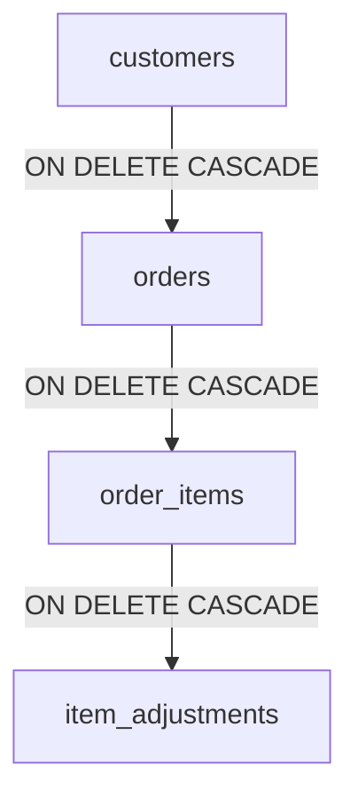

# Trigger, ràng buộc khóa ngoại và hành vi CASCADE

Trigger và foreign key đều phản ứng với thay đổi dữ liệu, nhưng chúng có nhiệm vụ khác nhau. Foreign key bảo vệ quan hệ giữa bảng cha và bảng con; các hành động tham chiếu như ON DELETE CASCADE hoặc ON UPDATE CASCADE tự động cập nhật hàng con khi khóa được tham chiếu ở bảng cha thay đổi. Trigger thực thi một nhóm câu lệnh SQL khi một hàng trong bảng được INSERT, UPDATE hoặc DELETE.

Điểm dễ gây lỗi trong thiết kế là giả định rằng mọi hàng bị xóa hoặc cập nhật do CASCADE cũng sẽ kích hoạt trigger trên bảng con. Với MySQL, cascaded foreign key actions mặc định không kích hoạt trigger. MySQL 9.7 có một cơ chế opt-in giới hạn cho InnoDB khi xử lý foreign key ở SQL layer; cơ chế này cần được hiểu chính xác theo phiên bản và cấu hình. Nếu trigger được dùng để audit, đồng bộ hoặc phát sinh side effect, việc bỏ qua khác biệt này có thể làm thiếu dữ liệu audit hoặc tạo kết quả không nhất quán.

Bài này giải thích cách foreign key và trigger phối hợp, các referential action, thứ tự BEFORE/AFTER, giới hạn của trigger trên cascade, khác biệt phiên bản MySQL, ảnh hưởng của foreign_key_checks, replication, transaction và cách kiểm thử an toàn.

## 1. Bảng cha, bảng con và foreign key

Foreign key biểu diễn quan hệ tham chiếu giữa hai bảng:

- Bảng cha (parent table) chứa khóa được tham chiếu.
- Bảng con (child table) chứa cột hoặc nhóm cột tham chiếu đến khóa ở bảng cha.
- Constraint được khai báo ở bảng con.

Ví dụ một khách hàng có nhiều đơn hàng:

```sql
CREATE TABLE customers (
    id BIGINT UNSIGNED NOT NULL,
    full_name VARCHAR(150) NOT NULL,
    PRIMARY KEY (id)
) ENGINE=InnoDB;

CREATE TABLE orders (
    id BIGINT UNSIGNED NOT NULL,
    customer_id BIGINT UNSIGNED NOT NULL,
    order_total DECIMAL(12,2) NOT NULL,
    created_at DATETIME NOT NULL,
    PRIMARY KEY (id),
    KEY idx_orders_customer_id (customer_id),
    CONSTRAINT fk_orders_customer
        FOREIGN KEY (customer_id)
        REFERENCES customers(id)
        ON UPDATE CASCADE
        ON DELETE CASCADE
) ENGINE=InnoDB;
```

Trong ví dụ:

- customers là parent.
- orders là child.
- orders.customer_id tham chiếu customers.id.
- ON UPDATE CASCADE cho phép thay đổi khóa customers.id và cập nhật giá trị tương ứng ở orders.
- ON DELETE CASCADE tự động xóa các order khi customer bị xóa.

Foreign key giúp MySQL từ chối dữ liệu mồ côi. Ví dụ không thể INSERT một order với customer_id không tồn tại khi kiểm tra foreign key đang được bật.

### 1.1. Điều kiện cơ bản của foreign key

Với InnoDB:

- Bảng cha và bảng con phải dùng storage engine hỗ trợ foreign key; InnoDB là lựa chọn phổ biến.
- Các cột tương ứng phải có kiểu tương thích. Với kiểu số nguyên, kích thước và thuộc tính signed/unsigned phải khớp; với kiểu chuỗi nonbinary, character set và collation phải tương thích.
- Cột tham chiếu ở bảng cha phải có index phù hợp. Nên tham chiếu PRIMARY KEY hoặc UNIQUE KEY chuẩn.
- Bảng con cần index có các cột foreign key ở đầu index theo đúng thứ tự. InnoDB tự tạo index nếu chưa có index phù hợp, nhưng khai báo tường minh giúp kiểm soát tên và thứ tự.
- Không dùng prefix index cho cột foreign key.
- Một foreign key có thể gồm nhiều cột; số lượng và thứ tự cột ở hai phía phải tương ứng.

InnoDB từng cho phép tham chiếu một số index không unique trong các trường hợp không chuẩn. Khả năng này đã bị deprecated trong MySQL 9.7 và phụ thuộc cấu hình restrict_fk_on_non_standard_key. Thiết kế mới nên dùng khóa PRIMARY hoặc UNIQUE thực sự để quan hệ có semantics rõ ràng và dễ nâng cấp.

### 1.2. Kiểm tra foreign key hiện có

Đọc định nghĩa bảng:

```sql
SHOW CREATE TABLE customers;
SHOW CREATE TABLE orders;
```

Liệt kê quan hệ trong schema hiện tại:

```sql
SELECT
    TABLE_NAME AS child_table,
    CONSTRAINT_NAME,
    COLUMN_NAME AS child_column,
    REFERENCED_TABLE_NAME AS parent_table,
    REFERENCED_COLUMN_NAME AS parent_column
FROM information_schema.KEY_COLUMN_USAGE
WHERE CONSTRAINT_SCHEMA = DATABASE()
  AND REFERENCED_TABLE_NAME IS NOT NULL
ORDER BY TABLE_NAME, CONSTRAINT_NAME, ORDINAL_POSITION;
```

Truy vấn cho thấy bảng nào đang tham chiếu đến bảng nào. Khi chuẩn bị đổi ON DELETE hoặc ON UPDATE, phải xem xét mọi bảng con trong chuỗi quan hệ.

## 2. Các hành động tham chiếu ON DELETE và ON UPDATE

Foreign key có thể khai báo hành động khi khóa được tham chiếu ở parent bị DELETE hoặc UPDATE.

| Referential action | Khi parent DELETE/UPDATE | Hệ quả ở child |
|---|---|---|
| RESTRICT | Từ chối thao tác nếu còn hàng con tham chiếu | Hàng con giữ nguyên |
| NO ACTION | Với InnoDB tương đương RESTRICT và kiểm tra ngay | Hàng con giữ nguyên |
| CASCADE | Cho phép thao tác trên parent | Xóa hoặc cập nhật các hàng con tương ứng |
| SET NULL | Cho phép thao tác trên parent | Đặt cột foreign key ở child thành NULL |
| SET DEFAULT | Được parser nhận diện nhưng bị InnoDB và NDB từ chối trong foreign key definition | Không dùng được với các engine này |

Nếu không khai báo ON DELETE hoặc ON UPDATE, hành vi mặc định là RESTRICT/NO ACTION theo engine.

### 2.1. RESTRICT

RESTRICT ngăn xóa hoặc thay đổi khóa parent nếu có hàng child tham chiếu:

```sql
CONSTRAINT fk_orders_customer
    FOREIGN KEY (customer_id)
    REFERENCES customers(id)
    ON DELETE RESTRICT
```

Ví dụ, nếu customers.id = 10 đang có order, câu DELETE sau bị từ chối:

```sql
DELETE FROM customers
WHERE id = 10;
```

Dùng RESTRICT khi dữ liệu con cần được giữ lại hoặc phải được xử lý theo quy trình nghiệp vụ rõ ràng trước khi xóa parent.

### 2.2. NO ACTION

NO ACTION là từ khóa theo chuẩn SQL. Với InnoDB, NO ACTION tương đương RESTRICT: kiểm tra được thực hiện ngay và thao tác parent bị từ chối nếu còn hàng con tham chiếu. InnoDB không trì hoãn kiểm tra foreign key đến thời điểm COMMIT.

NDB có semantics khác: NO ACTION có thể trì hoãn kiểm tra đến commit. Không suy luận hành vi của NDB từ InnoDB.

### 2.3. CASCADE

CASCADE tự động truyền thao tác từ parent sang child:

- ON DELETE CASCADE: xóa hàng con tham chiếu khi hàng cha bị xóa.
- ON UPDATE CASCADE: cập nhật giá trị foreign key ở child khi giá trị khóa parent thay đổi.

Ví dụ:

```sql
CONSTRAINT fk_orders_customer
    FOREIGN KEY (customer_id)
    REFERENCES customers(id)
    ON DELETE CASCADE
    ON UPDATE CASCADE
```

Khi xóa customer:

```sql
DELETE FROM customers
WHERE id = 10;
```

MySQL tự động xóa các hàng orders có customer_id = 10. Không cần phát lệnh DELETE riêng cho từng order.

CASCADE phù hợp khi vòng đời dữ liệu con phụ thuộc hoàn toàn vào parent, ví dụ order_items phụ thuộc order trong một mô hình mà xóa order đồng nghĩa xóa chi tiết. Không dùng CASCADE chỉ để tiết kiệm vài câu SQL nếu dữ liệu con cần được lưu để audit, báo cáo hoặc tuân thủ chính sách lưu trữ.

### 2.4. SET NULL

SET NULL giữ lại hàng con nhưng xóa liên kết bằng cách đặt cột foreign key thành NULL:

```sql
CREATE TABLE employees (
    id BIGINT UNSIGNED NOT NULL,
    department_id BIGINT UNSIGNED NULL,
    full_name VARCHAR(150) NOT NULL,
    PRIMARY KEY (id),
    KEY idx_employees_department (department_id),
    CONSTRAINT fk_employees_department
        FOREIGN KEY (department_id)
        REFERENCES departments(id)
        ON DELETE SET NULL
) ENGINE=InnoDB;
```

Khi department bị xóa, employee vẫn còn nhưng department_id trở thành NULL.

Các cột foreign key phải cho phép NULL. Nếu khai báo NOT NULL rồi chọn ON DELETE SET NULL hoặc ON UPDATE SET NULL, thiết kế không hợp lệ hoặc thao tác không thể hoàn tất theo yêu cầu.

Với foreign key nhiều cột, SET NULL đặt các cột foreign key liên quan thành NULL.

### 2.5. SET DEFAULT

MySQL nhận diện cú pháp SET DEFAULT, nhưng InnoDB và NDB từ chối định nghĩa foreign key dùng ON DELETE SET DEFAULT hoặc ON UPDATE SET DEFAULT. Không dùng SET DEFAULT như một phương án thay thế cho SET NULL trong thiết kế InnoDB.

Nếu cần chuyển hàng con sang một giá trị mặc định, hãy thiết kế quy trình cập nhật rõ ràng bằng ứng dụng hoặc stored program, đồng thời kiểm tra parent mặc định tồn tại và hợp lệ trước khi xóa parent.

### 2.6. Tránh dùng MATCH trong định nghĩa foreign key của MySQL

MySQL nhận diện cú pháp MATCH FULL, MATCH PARTIAL và MATCH SIMPLE, nhưng InnoDB và NDB không thực thi semantics của MATCH theo chuẩn. Việc thêm MATCH vào định nghĩa foreign key còn có thể khiến MySQL bỏ qua các mệnh đề ON DELETE và ON UPDATE trong cùng constraint. Vì vậy, không thêm MATCH clause vào foreign key nếu đang dựa vào CASCADE, RESTRICT hoặc SET NULL.

## 3. CASCADE nhiều cấp và khóa ngoại tự tham chiếu

Một quan hệ có thể tạo thành chuỗi nhiều cấp:



Khi xóa customer, thao tác có thể lan qua orders, order_items và item_adjustments nếu mỗi quan hệ được khai báo CASCADE.

Với InnoDB, các thao tác cascade được thực hiện theo thứ tự duyệt sâu trên index tương ứng với foreign key. MySQL giới hạn độ sâu cascade tối đa 15 cấp; vượt giới hạn làm câu lệnh thất bại.

Self-referencing foreign key cũng có thể tạo cascade trong cùng bảng, ví dụ cây danh mục có parent_id tham chiếu id của chính bảng categories. Phải đánh giá kỹ khả năng xóa một nhánh lớn và số hàng bị ảnh hưởng.

Trong MySQL 9.7 khi cascade-trigger execution được bật cho SQL-layer foreign key handling, các chuỗi trigger cascade có thêm giới hạn: tối đa 30 bảng tham gia tổng cộng trong các chain cascade của một statement. Vòng quan hệ lặp lại được phát hiện để tránh theo đuổi vô hạn; trigger cố tái nhập đường cascade đang hoạt động có thể làm statement thất bại.

## 4. Trigger trong MySQL hoạt động theo hàng

Trigger là database object gắn với một bảng. Trigger được kích hoạt khi SQL statement INSERT, UPDATE hoặc DELETE làm thay đổi hàng trong bảng đó.

MySQL hỗ trợ hai thời điểm:

- BEFORE: chạy trước khi thao tác trên hàng được thực hiện.
- AFTER: chạy sau khi thao tác trên hàng hoàn tất.

Và ba sự kiện:

- INSERT
- UPDATE
- DELETE

Tất cả trigger của MySQL là row-level trigger với FOR EACH ROW. MySQL không hỗ trợ statement-level trigger chạy một lần cho toàn bộ câu lệnh.

Ví dụ một câu UPDATE thay đổi 100 hàng sẽ kích hoạt trigger tương ứng cho từng hàng bị thay đổi, tức tối đa 100 lần cho trigger đó.

### 4.1. OLD và NEW

Trigger truy cập dữ liệu hàng thông qua OLD và NEW:

| Sự kiện | OLD | NEW |
|---|---|---|
| INSERT | Không có | Giá trị hàng sắp được thêm |
| UPDATE | Giá trị trước cập nhật | Giá trị sau cập nhật |
| DELETE | Giá trị hàng sắp bị xóa | Không có |

Trong BEFORE INSERT và BEFORE UPDATE, trigger có thể gán giá trị cho các cột NEW. OLD chỉ để đọc; NEW trong AFTER trigger không thể sửa để thay đổi hàng đã ghi.

Ví dụ chuẩn hóa tên trước khi insert:

```sql
DELIMITER //

CREATE TRIGGER bi_customers_normalize_name
BEFORE INSERT ON customers
FOR EACH ROW
BEGIN
    SET NEW.full_name = TRIM(NEW.full_name);
END//

DELIMITER ;
```

Ví dụ chặn thay đổi giá trị khóa:

```sql
DELIMITER //

CREATE TRIGGER bu_customers_validate_id
BEFORE UPDATE ON customers
FOR EACH ROW
BEGIN
    IF NEW.id <> OLD.id THEN
        SIGNAL SQLSTATE '45000'
            SET MESSAGE_TEXT = 'Customer ID cannot be changed';
    END IF;
END//

DELIMITER ;
```

Trong ví dụ này, trigger phát sinh lỗi trước khi hàng được cập nhật nếu ứng dụng cố thay đổi id.

### 4.2. Trigger không phải constraint thay thế

Trigger có thể kiểm tra hoặc ghi dữ liệu phụ, nhưng foreign key vẫn là công cụ phù hợp để bảo vệ quan hệ tham chiếu. Dùng trigger tự kiểm tra parent thay cho foreign key có thể gặp race condition khi hai transaction đồng thời thêm child và xóa parent.

Foreign key được engine kiểm tra và khóa các bản ghi/index cần thiết trong quá trình thực hiện. Một trigger tự viết bằng SELECT đơn thuần không tự động có cùng semantics đồng thời.

### 4.3. Trigger có thể ghi sang bảng khác

Một trigger thường dùng để ghi audit:

```sql
CREATE TABLE customer_audit (
    audit_id BIGINT UNSIGNED NOT NULL AUTO_INCREMENT,
    customer_id BIGINT UNSIGNED NOT NULL,
    action_name VARCHAR(20) NOT NULL,
    changed_at DATETIME NOT NULL,
    PRIMARY KEY (audit_id)
) ENGINE=InnoDB;
```

```sql
DELIMITER //

CREATE TRIGGER ad_customers_audit
AFTER DELETE ON customers
FOR EACH ROW
BEGIN
    INSERT INTO customer_audit(
        customer_id,
        action_name,
        changed_at
    )
    VALUES (
        OLD.id,
        'DELETE',
        CURRENT_TIMESTAMP
    );
END//

DELIMITER ;
```

Khi câu DELETE trực tiếp xóa hàng customers, trigger ghi một bản ghi audit. Nếu trigger lỗi, câu DELETE bị lỗi. Với các bảng InnoDB, thay đổi trong cùng statement/transaction được rollback theo semantics transaction.

Trigger không được sửa một bảng đang được statement gọi trigger sử dụng để đọc hoặc ghi. Ví dụ, không nên cố viết trigger trên customers để tự DELETE orders trong khi câu DELETE parent đang sử dụng orders qua foreign key cascade; hãy để foreign key thực hiện cascade hoặc xử lý bằng một quy trình ứng dụng rõ ràng.

## 5. Thứ tự BEFORE/AFTER và nhiều trigger

Đối với một thao tác hàng trực tiếp:

1. BEFORE trigger chạy trước khi hàng được thay đổi.
2. MySQL thực hiện thao tác hàng và kiểm tra các constraint liên quan.
3. AFTER trigger chạy sau khi thao tác hàng hoàn tất.

BEFORE trigger thường dùng để chuẩn hóa hoặc từ chối dữ liệu; AFTER trigger thường dùng để ghi audit hoặc cập nhật dữ liệu phụ.

MySQL cho phép nhiều trigger có cùng timing và event trên một bảng trong các phiên bản hỗ trợ. Mặc định chúng chạy theo thứ tự tạo. Có thể chỉ định FOLLOWS hoặc PRECEDES sau FOR EACH ROW để xác định thứ tự tương đối với một trigger khác cùng timing/event.

```sql
CREATE TRIGGER bi_customers_set_name
BEFORE INSERT ON customers
FOR EACH ROW
SET NEW.full_name = TRIM(NEW.full_name);
```

```sql
CREATE TRIGGER bi_customers_validate_name
BEFORE INSERT ON customers
FOR EACH ROW FOLLOWS bi_customers_set_name
BEGIN
    IF NEW.full_name = '' THEN
        SIGNAL SQLSTATE '45000'
            SET MESSAGE_TEXT = 'Customer name is required';
    END IF;
END;
```

Thứ tự trigger chỉ xác định trong cùng một event và timing. Không dùng FOLLOWS/PRECEDES để sắp xếp trigger BEFORE với AFTER hoặc INSERT với UPDATE.

## 6. Điều quan trọng: CASCADE mặc định không kích hoạt trigger ở child

Đây là quy tắc phải nhớ khi kết hợp foreign key với trigger:

**Theo mặc định, các hành động foreign key được cascade không kích hoạt trigger trên các hàng child bị thay đổi.**

Giả sử:

- customers là parent.
- orders là child.
- orders có ON DELETE CASCADE.
- orders có AFTER DELETE trigger để ghi order_delete_audit.

Khi chạy:

```sql
DELETE FROM customers
WHERE id = 10;
```

MySQL xóa customer 10 và tự động xóa các order tham chiếu đến customer đó. Tuy nhiên, theo hành vi mặc định, AFTER DELETE trigger trên orders không chạy cho các hàng bị xóa bởi foreign key cascade. Vì vậy order_delete_audit không tự có bản ghi cho những hàng orders bị cascade xóa.

### 6.1. Trigger trên parent và trigger trên child

Phân biệt hai trường hợp:

| Thao tác | Trigger trên parent | Trigger trên child |
|---|---|---|
| DELETE trực tiếp một hàng parent | Có kích hoạt theo DELETE statement | Không tự kích hoạt chỉ vì child bị CASCADE theo mặc định |
| DELETE trực tiếp một hàng child | Không | Có kích hoạt theo DELETE statement |
| UPDATE trực tiếp khóa parent có ON UPDATE CASCADE | Trigger UPDATE trên parent được kích hoạt | Trigger UPDATE trên child không được kích hoạt theo mặc định |
| Parent action dùng SET NULL | Trigger trên parent được kích hoạt theo thao tác trực tiếp | Trigger UPDATE trên child không được kích hoạt theo mặc định |

Trigger gắn với parent vẫn chạy vì parent là đối tượng được SQL statement trực tiếp thay đổi. Việc engine/server tự động thay đổi child theo referential action là phần không kích hoạt trigger child theo mặc định.

### 6.2. Vì sao MySQL có quy tắc này?

Foreign key cascade là hành động do cơ chế referential integrity thực hiện. Trigger là cơ chế chạy theo SQL statement tác động trực tiếp lên bảng. MySQL truyền thống không gọi trigger cho các thay đổi child được sinh ra nội bộ bởi foreign key action.

Vì vậy, không thể dựa vào trigger child để bảo đảm audit, notification, đồng bộ hoặc tính toán phụ cho mọi cascade trong cấu hình mặc định.

## 7. Khác biệt theo phiên bản MySQL

Hành vi trigger khi có foreign key cascade cần được kiểm tra theo phiên bản:

| Phiên bản | Trigger trên child khi CASCADE/SET NULL | Ghi chú |
|---|---|---|
| MySQL 5.7 | Không được kích hoạt bởi foreign key actions | Không có tùy chọn opt-in tương đương |
| MySQL 8.0 | Không được kích hoạt bởi foreign key actions | Không giả định trigger child chạy khi parent cascade |
| MySQL 9.7 | Mặc định vẫn không kích hoạt | Có opt-in giới hạn cho InnoDB khi foreign key handling ở SQL layer |

### 7.1. Tùy chọn enable_cascade_triggers trong MySQL 9.7

MySQL 9.7 bổ sung khả năng kích hoạt trigger trên các hàng child được thay đổi bởi CASCADE và SET NULL khi InnoDB sử dụng SQL-layer foreign key handling.

Để cơ chế này có hiệu lực, phải thỏa cả hai điều kiện:

1. InnoDB dùng SQL-layer foreign key handling, tức innodb_native_foreign_keys=OFF.
2. Session thực hiện thao tác đặt enable_cascade_triggers=ON.

Ví dụ kiểm tra cấu hình:

```sql
SHOW VARIABLES LIKE 'innodb_native_foreign_keys';
SELECT @@SESSION.enable_cascade_triggers;
```

Bật cho session hiện tại:

```sql
SET SESSION enable_cascade_triggers = ON;
```

Lưu ý:

- enable_cascade_triggers là tùy chọn theo session; bật ở một connection không có nghĩa mọi connection trong connection pool đều được bật.
- Tùy chọn này chỉ có tác dụng với InnoDB khi foreign key handling được thực hiện ở SQL layer.
- Nếu innodb_native_foreign_keys=ON, enable_cascade_triggers không có tác dụng.
- Không áp dụng tùy chọn này cho InnoDB native foreign key handling hoặc NDB như một cách bật trigger cascade chung.
- MySQL 5.7 và 8.0 không có khả năng opt-in này; không dùng cú pháp cấu hình của 9.7 trên server cũ.

Không nên bật tùy chọn này trong production chỉ để làm cho audit trigger chạy mà chưa kiểm thử tác động đến thứ tự trigger, hiệu năng, replication và rollback. Cần kiểm tra chính xác cấu hình của từng session thực hiện DML.

### 7.2. Trigger nào chạy khi cascade trigger được bật?

Khi cascade-trigger execution được bật trong đúng cấu hình MySQL 9.7:

| Referential action trên child | Trigger child được kích hoạt |
|---|---|
| ON DELETE CASCADE | BEFORE DELETE, sau đó AFTER DELETE |
| ON UPDATE CASCADE | BEFORE UPDATE, sau đó AFTER UPDATE |
| ON DELETE SET NULL | BEFORE UPDATE, sau đó AFTER UPDATE |
| ON UPDATE SET NULL | BEFORE UPDATE, sau đó AFTER UPDATE |
| RESTRICT / NO ACTION | Không có hàng child được thay đổi nên không có trigger child từ cascade |

Các trigger được gọi một lần cho mỗi hàng child bị tác động. Với cascade nhiều cấp, BEFORE trigger chạy từ parent hướng xuống các descendant; AFTER trigger chạy theo chiều ngược lại, từ child sâu nhất trở về parent.

Với cascaded DELETE, OLD chứa hàng child bị xóa. Với cascaded UPDATE hoặc SET NULL, OLD chứa giá trị trước cascade và NEW chứa giá trị sau cascade, bao gồm các cột được đặt thành NULL.

Nếu một trigger được kích hoạt bởi cascade phát sinh lỗi, statement khởi tạo cascade thất bại và các thay đổi trong toàn bộ chuỗi cascade do statement đó thực hiện được rollback.

### 7.3. Ví dụ hành vi trong MySQL 9.7

Giả sử orders có AFTER DELETE trigger ghi audit. Với InnoDB SQL-layer foreign key handling và enable_cascade_triggers=ON ở session:

```sql
SET SESSION enable_cascade_triggers = ON;

DELETE FROM customers
WHERE id = 10;
```

Các trigger trên child orders có thể chạy cho từng order bị xóa do ON DELETE CASCADE. Nếu dùng native InnoDB foreign key handling (innodb_native_foreign_keys=ON), tùy chọn enable_cascade_triggers không làm trigger child chạy; hành vi mặc định vẫn áp dụng.

Không được suy luận rằng chỉ cần SET SESSION enable_cascade_triggers=ON là đủ. Phải xác minh innodb_native_foreign_keys và đúng phiên bản server.

## 8. foreign_key_checks ảnh hưởng thế nào đến CASCADE và trigger?

Biến foreign_key_checks cho phép tạm tắt kiểm tra foreign key trong session hoặc ở phạm vi cấu hình được hỗ trợ:

```sql
SET SESSION foreign_key_checks = 0;
```

Khi foreign_key_checks bị tắt:

- DML không kiểm tra sự tồn tại của parent theo foreign key.
- RESTRICT checks không được thực hiện.
- Referential actions như CASCADE và SET NULL không được thực hiện.
- Không có trigger child được kích hoạt thông qua foreign key action bị bỏ qua.

Bật lại:

```sql
SET SESSION foreign_key_checks = 1;
```

không có nghĩa MySQL quét và xác thực lại toàn bộ dữ liệu đã ghi trong thời gian tắt checks. Các hàng mồ côi có thể vẫn tồn tại. Vì vậy, tắt foreign_key_checks khi import dữ liệu cần một bước kiểm tra và đối soát riêng trước khi coi dữ liệu là hợp lệ.

Không dùng foreign_key_checks=0 như cách khắc phục lâu dài cho lỗi CASCADE hoặc lỗi thứ tự nạp dữ liệu.

## 9. Trigger, lỗi và transaction khi có cascade

Với InnoDB, trigger chạy trong ngữ cảnh của statement/transaction đã kích hoạt nó. Trigger không tự mở transaction độc lập.

Các quy tắc quan trọng:

- Trigger không được dùng START TRANSACTION, COMMIT hoặc ROLLBACK để tự điều khiển transaction.
- Nếu BEFORE trigger lỗi, thao tác trên hàng tương ứng không được thực hiện.
- Nếu AFTER trigger lỗi, statement gây trigger thất bại.
- Với bảng transactional như InnoDB, lỗi trong trigger làm rollback thay đổi của statement theo semantics transaction.
- Khi cascade-trigger execution được bật và trigger child phát sinh lỗi, statement khởi tạo cascade cùng các thay đổi cascade bị rollback.
- Nếu trigger ghi sang bảng nontransactional, thay đổi ở bảng đó không được rollback giống InnoDB. Tránh trộn engine khi cần audit có tính nguyên tử.

Ví dụ kiểm thử trong transaction:

```sql
START TRANSACTION;

DELETE FROM customers
WHERE id = 10;

SELECT *
FROM orders
WHERE customer_id = 10;

SELECT *
FROM order_delete_audit
WHERE customer_id = 10;

ROLLBACK;
```

Trong môi trường test, dùng các bảng InnoDB để có thể rollback thao tác xóa và bản ghi audit. Kết quả SELECT cần được diễn giải theo cấu hình cascade-trigger thực tế của server.

## 10. Trigger và replication

Trigger ảnh hưởng đến replication theo binary logging format:

| Binlog format | Hành vi trigger trên replica |
|---|---|
| STATEMENT | Statement được chạy lại trên replica; trigger tương ứng trên replica cũng chạy |
| ROW | Thay đổi hàng do trigger tạo ra được ghi dưới dạng row events; trigger trên replica không chạy lại cho thay đổi đó |
| MIXED | Phụ thuộc statement được ghi theo statement hay row format |

Với row-based replication, trigger trên source đã tạo thay đổi; replica nhận các thay đổi hàng tương ứng. Nếu trigger chạy thêm lần nữa trên replica, tác động có thể bị nhân đôi, nên trigger không được kích hoạt lại theo cách đó.

Cascade-induced child triggers tuân theo các quy tắc replication tương ứng. Với SQL-layer foreign key handling và cascade triggers trong MySQL 9.7, statement-based applier sử dụng giá trị enable_cascade_triggers của source. Do đó, cấu hình và binlog format phải được kiểm thử đồng bộ giữa source và replica.

Trước khi triển khai trigger có side effect như ghi audit, cộng số dư hoặc tạo notification:

- Xác định binlog_format thực tế.
- Xác định trigger chạy ở source hay replica.
- Tránh side effect ngoài database không có cơ chế idempotency.
- Kiểm thử failover và replication lag.
- Kiểm tra cấu hình session nếu phụ thuộc enable_cascade_triggers.

## 11. Thiết kế audit khi parent bị CASCADE xóa child

Giả sử yêu cầu nghiệp vụ là lưu lại mọi order bị xóa, kể cả khi customer bị xóa và orders bị CASCADE.

### 11.1. Tạo child audit trigger để quan sát hành vi

Tạo bảng audit và trigger trên orders:

```sql
CREATE TABLE order_delete_audit (
    audit_id BIGINT UNSIGNED NOT NULL AUTO_INCREMENT,
    order_id BIGINT UNSIGNED NOT NULL,
    customer_id BIGINT UNSIGNED NOT NULL,
    deleted_at DATETIME NOT NULL,
    PRIMARY KEY (audit_id),
    KEY idx_order_delete_audit_customer (customer_id, deleted_at)
) ENGINE=InnoDB;
```

```sql
DELIMITER //

CREATE TRIGGER ad_orders_audit
AFTER DELETE ON orders
FOR EACH ROW
BEGIN
    INSERT INTO order_delete_audit(
        order_id,
        customer_id,
        deleted_at
    )
    VALUES (
        OLD.id,
        OLD.customer_id,
        CURRENT_TIMESTAMP
    );
END//

DELIMITER ;
```

Trigger này ghi audit khi DELETE trực tiếp một hàng orders. Nếu orders bị xóa bởi ON DELETE CASCADE trong cấu hình mặc định, trigger không chạy và bảng audit không nhận bản ghi tương ứng.

### 11.2. Không dựa vào child trigger theo mặc định

Một AFTER DELETE trigger trên orders không tự ghi audit cho các hàng bị xóa do CASCADE trong cấu hình mặc định. Nếu hệ thống chỉ kiểm thử DELETE trực tiếp trên orders, lỗi thiết kế có thể không được phát hiện.

Phải kiểm thử cả hai luồng:

```sql
-- Luong 1: xoa truc tiep child
DELETE FROM orders
WHERE id = 1001;

-- Luong 2: xoa parent, child bi CASCADE
DELETE FROM customers
WHERE id = 10;
```

Audit cho luồng 1 có thể được ghi bởi child trigger. Audit cho luồng 2 không được ghi bởi child trigger theo mặc định.

### 11.3. Các lựa chọn thiết kế

| Cách làm | Khi phù hợp | Điểm cần kiểm soát |
|---|---|---|
| Audit ở ứng dụng trước khi xóa parent | Ứng dụng sở hữu use case xóa | Phải ghi audit và xóa parent trong cùng transaction; mọi đường xóa khác cũng phải tuân thủ |
| Stored procedure thực hiện xóa theo thứ tự rõ | Muốn tập trung quy trình xóa trong database | Procedure xóa/ghi audit child trước rồi mới xóa parent; quyền ứng dụng cần giới hạn để không bypass |
| Giữ dữ liệu bằng soft delete | Cần lịch sử hoặc khôi phục | Định nghĩa trạng thái, thời hạn lưu và quy trình archive |
| MySQL 9.7 SQL-layer cascade triggers | Muốn trigger child chạy khi đúng điều kiện kỹ thuật | Chỉ hoạt động với innodb_native_foreign_keys=OFF và session enable_cascade_triggers=ON; phải kiểm thử replication |
| Audit parent-level | Chỉ cần ghi nhận parent bị xóa | Không cung cấp chi tiết từng child đã bị cascade |

Không nên bỏ foreign key để ép trigger tự xóa child. Cách đó làm mất lớp bảo vệ referential integrity và có thể tạo race condition giữa các transaction.

### 11.4. Ví dụ quy trình xóa tường minh

Nếu nghiệp vụ yêu cầu audit từng order, có thể triển khai một procedure sở hữu quy trình:

```sql
DELIMITER //

CREATE PROCEDURE delete_customer_with_order_audit(
    IN p_customer_id BIGINT UNSIGNED
)
BEGIN
    DECLARE EXIT HANDLER FOR SQLEXCEPTION
    BEGIN
        ROLLBACK;
        RESIGNAL;
    END;

    START TRANSACTION;

    DELETE FROM orders
    WHERE customer_id = p_customer_id;

    DELETE FROM customers
    WHERE id = p_customer_id;

    COMMIT;
END//

DELIMITER ;
```

Trong ví dụ, DELETE trực tiếp trên orders kích hoạt ad_orders_audit cho từng hàng; sau đó DELETE customer không còn hàng orders để cascade xóa. EXIT handler rollback và phát lại lỗi nếu một bước thất bại. Đây là procedure sở hữu transaction: chỉ gọi khi caller không có transaction đang hoạt động, vì START TRANSACTION có thể kết thúc transaction đang chờ của session. Trong production cần kiểm tra số hàng và xử lý trường hợp customer không tồn tại. Nếu caller sở hữu transaction, hãy bỏ START TRANSACTION/COMMIT/ROLLBACK khỏi procedure và để caller quản lý transaction cùng lỗi.

Với quy trình tường minh, cân nhắc khóa parent trước khi đọc/xóa child để ngăn các giao dịch đồng thời thêm order mới trong lúc xóa. Foreign key vẫn phải được giữ để bảo vệ tính toàn vẹn.

## 12. Tác động đến hiệu năng và khóa

CASCADE có thể tác động đến nhiều hàng và nhiều bảng trong một statement. Chi phí không chỉ là xóa hoặc cập nhật hàng parent:

- MySQL phải tìm các hàng child theo index foreign key.
- Mỗi hàng child bị tác động có thể cần xóa/cập nhật index và ghi undo/redo log.
- Cascade nhiều cấp làm tăng số lượng hàng và index entry phải xử lý.
- Nếu cascade triggers được bật trong MySQL 9.7, trigger được chạy cho từng hàng child bị ảnh hưởng, làm tăng thêm CPU, I/O và số thao tác.
- Các transaction đồng thời có thể tranh chấp lock trên parent/child index records và phát sinh deadlock.

Khuyến nghị:

- Luôn có index phù hợp ở cột child foreign key.
- Tránh cascade trên tập dữ liệu rất lớn mà không đo thời gian và lock.
- Với thao tác xóa lớn, cân nhắc batch theo khóa ổn định hoặc quy trình archive.
- Giữ thứ tự truy cập bảng nhất quán giữa các transaction để giảm deadlock.
- Theo dõi thời gian statement, lock wait, deadlock và replication lag.
- Nếu dùng trigger audit, index bảng audit theo khóa tra cứu và thời điểm.

Không mặc định CASCADE luôn nhanh hơn lệnh DELETE thủ công. CASCADE giúp đảm bảo hành động tham chiếu đúng và nguyên tử, nhưng vẫn phải xử lý toàn bộ hàng liên quan.

## 13. Các giới hạn quan trọng của trigger trong bài toán foreign key

| Giới hạn | Hệ quả |
|---|---|
| Trigger chỉ là FOR EACH ROW | Một statement nhiều hàng có thể kích hoạt trigger rất nhiều lần |
| Trigger không được kích hoạt bởi FK actions theo mặc định | Không dùng child trigger làm audit cascade nếu chưa cấu hình đúng |
| Trigger không được sửa bảng đang được statement gọi trigger sử dụng | Không tự xóa child trong trigger parent để thay thế FK cascade |
| Trigger không được COMMIT/ROLLBACK transaction | Transaction phải do caller hoặc stored procedure sở hữu |
| Trigger không thể trả result set như procedure | Không dùng trigger làm API trả dữ liệu |
| Trigger không dùng RETURN để thoát | Dùng LEAVE cho block có nhãn nếu cần kết thúc sớm |
| Trigger không gắn vào view hoặc TEMPORARY table | Trigger phải gắn với permanent base table |
| Trigger lỗi có thể làm statement thất bại | Cần kiểm soát quyền, dữ liệu và lỗi của mọi bảng phụ thuộc |
| Nontransactional table không rollback cùng InnoDB | Audit có thể còn lại dù statement InnoDB thất bại nếu ghi vào engine khác |

## 14. Chẩn đoán và quan sát trigger/foreign key

### 14.1. Liệt kê trigger

```sql
SHOW TRIGGERS;
```

Hoặc truy vấn metadata:

```sql
SELECT
    TRIGGER_NAME,
    EVENT_MANIPULATION,
    EVENT_OBJECT_TABLE,
    ACTION_TIMING,
    ACTION_STATEMENT,
    DEFINER
FROM information_schema.TRIGGERS
WHERE TRIGGER_SCHEMA = DATABASE()
ORDER BY EVENT_OBJECT_TABLE, ACTION_TIMING, EVENT_MANIPULATION;
```

### 14.2. Đọc định nghĩa trigger

```sql
SHOW CREATE TRIGGER ad_customers_audit;
```

Đọc lại trigger body, DEFINER và SQL mode được lưu tại thời điểm tạo trigger. Trigger sử dụng SQL mode đã lưu khi được tạo, không nhất thiết là SQL mode hiện tại của session đang gọi DML.

### 14.3. Kiểm tra foreign key và index

```sql
SHOW CREATE TABLE orders;

SHOW INDEX FROM orders;
```

Đối chiếu cột foreign key, parent key, ON DELETE/ON UPDATE action và index. Nếu foreign key có nhiều cột, kiểm tra thứ tự cột trong index.

### 14.4. Kiểm tra cấu hình cascade trigger trong MySQL 9.7

```sql
SHOW VARIABLES LIKE 'innodb_native_foreign_keys';
SELECT @@SESSION.enable_cascade_triggers;
SELECT @@SESSION.foreign_key_checks;
```

Chỉ đánh giá enable_cascade_triggers khi server là MySQL 9.7 và InnoDB dùng SQL-layer foreign key handling. Nếu native foreign key handling đang bật, setting cascade trigger không có tác dụng.

## 15. Lỗi thường gặp và cách khắc phục

| Triệu chứng | Nguyên nhân thường gặp | Hướng xử lý |
|---|---|---|
| DELETE parent bị từ chối | Còn hàng child và action là RESTRICT/NO ACTION | Xóa/di chuyển child theo nghiệp vụ hoặc chọn action phù hợp |
| DELETE parent xóa nhiều dữ liệu ngoài dự kiến | ON DELETE CASCADE lan qua nhiều cấp | Kiểm tra toàn bộ quan hệ trước khi xóa; thử trong transaction |
| SET NULL không hợp lệ | Cột child khai báo NOT NULL | Cho phép NULL hoặc chọn action khác |
| Child trigger không ghi audit khi parent bị xóa | FK cascade mặc định không kích hoạt trigger child | Dùng quy trình audit tường minh hoặc tính năng opt-in đúng điều kiện ở MySQL 9.7 |
| Bật enable_cascade_triggers nhưng child trigger vẫn không chạy | innodb_native_foreign_keys=ON, engine/version không hỗ trợ hoặc session khác | Xác minh version, engine, biến native FK và session thực hiện DML |
| Foreign key không tạo được | Kiểu cột không tương thích, thiếu index hoặc parent key không phù hợp | Đọc lỗi DDL, SHOW CREATE TABLE và sửa cấu trúc khóa |
| Dữ liệu mồ côi sau import | foreign_key_checks đã bị tắt | Chạy truy vấn đối soát orphan; không kỳ vọng bật lại biến tự sửa dữ liệu |
| Trigger chạy hai lần trên hệ thống replica | Hiểu sai statement-based và row-based replication | Kiểm tra binlog_format và thiết kế side effect idempotent |
| Cascade chậm hoặc deadlock | Nhiều hàng child, index thiếu hoặc transaction truy cập khác thứ tự | Tối ưu index, batch và thống nhất thứ tự truy cập |
| Trigger làm statement thất bại | SIGNAL, lỗi constraint hoặc lỗi ghi bảng phụ | Đọc diagnostics, kiểm tra quyền và dữ liệu đầu vào |

## 16. Những hiểu lầm thường gặp

| Hiểu lầm | Thực tế |
|---|---|
| ON DELETE CASCADE giống DELETE SQL trực tiếp trên child | Cascade là referential action; trigger child mặc định không chạy |
| AFTER DELETE trigger luôn audit mọi hàng bị xóa | Trigger chỉ chạy cho thay đổi trực tiếp theo SQL và các trường hợp cascade opt-in cụ thể ở MySQL 9.7 |
| Bật enable_cascade_triggers là đủ | Cần MySQL 9.7, SQL-layer InnoDB FK handling và session setting ON |
| InnoDB native FK handling cũng dùng được enable_cascade_triggers | Tùy chọn không có tác dụng khi innodb_native_foreign_keys=ON |
| NO ACTION luôn được trì hoãn đến COMMIT | Với InnoDB, NO ACTION tương đương RESTRICT và kiểm tra ngay |
| SET NULL có thể dùng với cột NOT NULL | Cột foreign key phải cho phép NULL |
| SET DEFAULT là lựa chọn hợp lệ cho InnoDB | InnoDB và NDB từ chối định nghĩa này |
| Tắt foreign_key_checks chỉ tắt kiểm tra nhưng vẫn cascade | Khi tắt, checks và referential actions đều không được thực hiện |
| Bật lại foreign_key_checks tự xác thực dữ liệu cũ | Không có bước quét và sửa orphan tự động |
| Trigger có thể tự COMMIT sau khi ghi audit | Trigger không được điều khiển transaction bằng COMMIT/ROLLBACK |
| Có thể tự DELETE child trong trigger parent thay cho CASCADE | Có thể vi phạm giới hạn sửa bảng đang được statement sử dụng và gây race condition |

## 17. Checklist thiết kế trigger và foreign key

- Đã xác định đúng parent và child table chưa?
- Parent key có phải PRIMARY KEY hoặc UNIQUE KEY chuẩn không?
- Child có index phù hợp theo đúng thứ tự foreign key columns không?
- Kiểu dữ liệu, signedness, character set và collation có tương thích không?
- ON DELETE và ON UPDATE action có đúng vòng đời dữ liệu không?
- CASCADE có thể xóa bao nhiêu hàng và lan qua bao nhiêu cấp?
- SET NULL có các cột child cho phép NULL không?
- Có đang dùng SET DEFAULT hoặc MATCH clause không được hỗ trợ đúng semantics không?
- Trigger có đúng timing BEFORE/AFTER và event INSERT/UPDATE/DELETE không?
- Trigger dùng OLD/NEW đúng sự kiện và đúng thời điểm không?
- Có giả định sai rằng cascade mặc định kích hoạt trigger child không?
- Nếu dựa vào MySQL 9.7 enable_cascade_triggers, đã xác minh SQL-layer FK handling và session setting chưa?
- Có kiểm thử luồng DELETE trực tiếp child và DELETE parent gây cascade riêng biệt không?
- Trigger audit và bảng nghiệp vụ có cùng transactional engine không?
- Có kiểm tra foreign_key_checks và đối soát dữ liệu sau import không?
- Replication format và trigger side effect đã được kiểm thử chưa?
- Đã đo lock, deadlock, thời gian cascade và replication lag trên dữ liệu đại diện chưa?

## 18. Bài tập thực hành

### Bài 1 — So sánh RESTRICT và CASCADE

Tạo bảng customers và orders. Khai báo foreign key với ON DELETE RESTRICT, thử xóa parent còn child và ghi lại kết quả. Sau đó đổi sang ON DELETE CASCADE và xác nhận các hàng child bị xóa.

### Bài 2 — SET NULL

Tạo departments và employees với department_id cho phép NULL. Khai báo ON DELETE SET NULL. Xóa một department và xác nhận employee còn tồn tại nhưng department_id trở thành NULL.

### Bài 3 — Trigger audit trên child

Tạo AFTER DELETE trigger trên orders để ghi order_delete_audit. Thử DELETE trực tiếp một order và sau đó DELETE customer gây CASCADE. So sánh số bản ghi audit trong cấu hình mặc định.

### Bài 4 — Kiểm thử khác biệt MySQL 9.7

Trên môi trường thử nghiệm MySQL 9.7, xác minh innodb_native_foreign_keys và enable_cascade_triggers. So sánh hành vi khi SQL-layer handling và session cascade trigger được bật với hành vi mặc định. Không áp dụng cấu hình này cho production trước khi kiểm tra replication và transaction.

### Bài 5 — Thiết kế quy trình audit

Đề xuất cách bảo đảm mọi order bị xóa đều được audit khi customer bị xóa. So sánh application-owned transaction, stored procedure xóa tường minh, soft delete và cascade trigger opt-in.

## 19. Tài liệu tham khảo chính thức

- [MySQL 9.7 — FOREIGN KEY Constraints](https://dev.mysql.com/doc/refman/9.7/en/create-table-foreign-keys.html)
- [MySQL 9.7 — CREATE TRIGGER Statement](https://dev.mysql.com/doc/refman/9.7/en/create-trigger.html)
- [MySQL 9.7 — Trigger Syntax and Examples](https://dev.mysql.com/doc/refman/9.7/en/trigger-syntax.html)
- [MySQL 9.7 — Using Triggers](https://dev.mysql.com/doc/refman/9.7/en/triggers.html)
- [MySQL 9.7 — Restrictions on Stored Programs](https://dev.mysql.com/doc/refman/9.7/en/stored-program-restrictions.html)
- [MySQL 9.7 — Replication and Triggers](https://dev.mysql.com/doc/refman/9.7/en/replication-features-triggers.html)
- [MySQL 9.7 — Server System Variables](https://dev.mysql.com/doc/refman/9.7/en/server-system-variables.html)
- [MySQL 8.0 — FOREIGN KEY Constraints](https://dev.mysql.com/doc/refman/8.0/en/create-table-foreign-keys.html)
- [MySQL 8.0 — Trigger Syntax and Examples](https://dev.mysql.com/doc/refman/8.0/en/trigger-syntax.html)
- [MySQL 5.7 — FOREIGN KEY Constraints](https://dev.mysql.com/doc/refman/5.7/en/create-table-foreign-keys.html)

## Kết luận

Foreign key bảo vệ quan hệ parent/child và quyết định điều gì xảy ra khi khóa parent bị xóa hoặc cập nhật. RESTRICT/NO ACTION ngăn thao tác khi còn hàng con; CASCADE truyền thao tác xuống child; SET NULL giữ hàng con nhưng bỏ liên kết. Trigger là cơ chế row-level chạy theo INSERT, UPDATE hoặc DELETE trực tiếp trên bảng, với BEFORE/AFTER và dữ liệu OLD/NEW. Điểm quan trọng nhất là foreign key cascade mặc định không kích hoạt trigger child. MySQL 9.7 có tùy chọn opt-in cho InnoDB SQL-layer foreign key handling khi innodb_native_foreign_keys=OFF và enable_cascade_triggers=ON trong session; cấu hình này không có tác dụng với native InnoDB foreign key handling. Vì vậy, nếu cần audit mọi hàng bị cascade, phải thiết kế quy trình và kiểm thử theo đúng version, engine, session, transaction và replication format thay vì giả định trigger luôn chạy.
