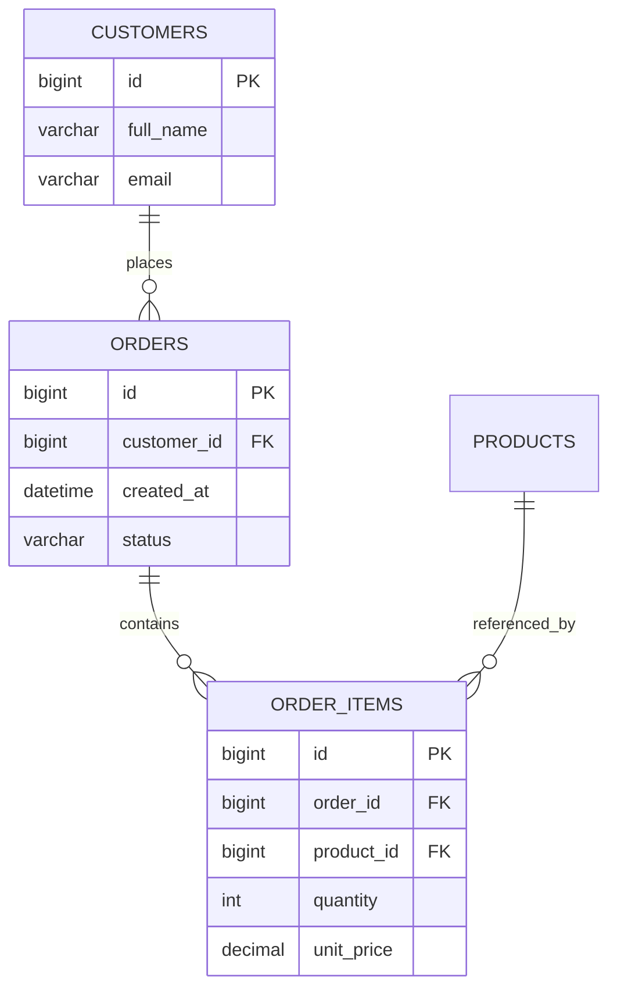
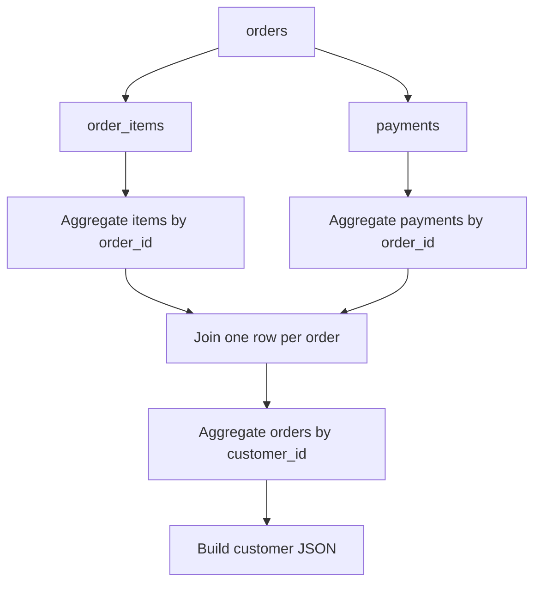

# JSON_OBJECT, JSON_ARRAY và tạo tài liệu từ dữ liệu quan hệ

Ứng dụng thường lưu dữ liệu theo mô hình quan hệ nhưng cần trao đổi với API, dịch vụ tích hợp hoặc giao diện bằng JSON. MySQL cung cấp `JSON_OBJECT()` và `JSON_ARRAY()` để ghép giá trị SQL thành object và array; `JSON_OBJECTAGG()` và `JSON_ARRAYAGG()` để gom nhiều hàng thành một cấu trúc JSON. Khi kết hợp các hàm này theo từng cấp quan hệ, một truy vấn có thể tạo tài liệu gồm thông tin parent, danh sách child và các object lồng nhau.

Thiết kế tài liệu JSON từ bảng quan hệ đòi hỏi quyết định rõ cấu trúc đầu ra, cách xử lý NULL, hàng con không tồn tại, khóa trùng, thứ tự phần tử và số lượng dữ liệu. Nếu JOIN nhiều quan hệ một-nhiều rồi aggregate cùng lúc, kết quả có thể bị nhân bản. Nếu dùng `JSON_ARRAYAGG()` mà giả định thứ tự phần tử luôn ổn định, API có thể trả dữ liệu không nhất quán.

Bài này tập trung vào bốn hàm tạo cấu trúc JSON, cách lồng object/array, cách dựng tài liệu từ parent-child, xử lý trường hợp rỗng và NULL, tránh nhân bản hàng, chọn kiểu dữ liệu đầu ra và kiểm soát hiệu năng.

## 1. Từ mô hình quan hệ đến tài liệu JSON

Trong mô hình quan hệ, một thực thể thường được lưu ở nhiều bảng:

- `customers`: thông tin khách hàng.
- `orders`: đơn hàng thuộc khách hàng.
- `order_items`: các dòng sản phẩm trong đơn hàng.

Quan hệ:



Một API có thể cần một tài liệu cho khách hàng:

```json
{
  "id": 120,
  "name": "Nguyen An",
  "email": "an@example.test",
  "orders": [
    {
      "id": 9001,
      "status": "PAID",
      "items": [
        {
          "productId": 501,
          "quantity": 2,
          "unitPrice": 125000.00
        }
      ]
    }
  ]
}
```

Các thành phần JSON tương ứng với dữ liệu quan hệ:

| Thành phần JSON | Nguồn dữ liệu | Hàm thường dùng |
|---|---|---|
| Object khách hàng | Một hàng `customers` | `JSON_OBJECT()` |
| Mảng đơn hàng | Nhiều hàng `orders` cùng customer | `JSON_ARRAYAGG()` |
| Object của một đơn hàng | Một hàng `orders` | `JSON_OBJECT()` |
| Mảng dòng hàng | Nhiều hàng `order_items` cùng order | `JSON_ARRAYAGG()` |
| Object thuộc tính động | Nhiều cặp key/value | `JSON_OBJECTAGG()` |

Quy tắc thiết kế hữu ích: một hàng parent thường trở thành JSON object; quan hệ một-nhiều thường trở thành JSON array; tập cặp key/value có khóa duy nhất thường trở thành JSON object.

## 2. JSON_OBJECT(): tạo object từ các cặp key/value

`JSON_OBJECT()` nhận danh sách các cặp khóa và giá trị, rồi trả về một JSON object.

```sql
SELECT JSON_OBJECT(
    'id', 120,
    'name', 'Nguyen An',
    'active', TRUE,
    'score', 9.5
) AS customer_document;
```

Kết quả:

```json
{
  "id": 120,
  "name": "Nguyen An",
  "active": true,
  "score": 9.5
}
```

### 2.1. Cú pháp và quy tắc

```sql
JSON_OBJECT([key, value[, key, value] ...])
```

- Số đối số phải là số chẵn vì mỗi key cần một value.
- Tên key không được là SQL `NULL`; nếu có key NULL, MySQL phát sinh lỗi.
- Value có thể là SQL `NULL`; giá trị đó được biểu diễn thành JSON `null`.
- Không truyền đối số cũng hợp lệ và trả object rỗng `{}`.
- Key trong JSON object là chuỗi. MySQL chuyển key sang dạng chuỗi phù hợp khi tạo object.

Ví dụ:

```sql
SELECT
    JSON_OBJECT() AS empty_object,
    JSON_OBJECT('nickname', NULL) AS explicit_null,
    JSON_OBJECT('id', 7, 'name', 'Lan') AS normal_object;
```

Kết quả tương ứng là `{}`, `{"nickname": null}` và object có hai thuộc tính `id`, `name`.

Các trường hợp lỗi:

```sql
-- Lỗi: số đối số lẻ
SELECT JSON_OBJECT('id', 7, 'name');

-- Lỗi: key là SQL NULL
SELECT JSON_OBJECT(NULL, 'value');
```

### 2.2. Tạo object trực tiếp từ một hàng

```sql
SELECT JSON_OBJECT(
    'id', c.id,
    'name', c.full_name,
    'email', c.email,
    'createdAt', c.created_at
) AS customer_json
FROM customers AS c
WHERE c.id = 120;
```

Mỗi hàng kết quả của SELECT tạo ra một JSON object. Nếu truy vấn trả về nhiều hàng, SQL result set có nhiều cột `customer_json`, mỗi hàng là một tài liệu riêng.

Nếu API cần một mảng gồm toàn bộ khách hàng, bọc object trong `JSON_ARRAYAGG()`:

```sql
SELECT JSON_ARRAYAGG(
    JSON_OBJECT(
        'id', c.id,
        'name', c.full_name,
        'email', c.email
    )
) AS customers_json
FROM customers AS c
WHERE c.active = 1;
```

Nếu không có hàng phù hợp, `JSON_ARRAYAGG()` trả SQL `NULL`; xử lý kết quả rỗng bằng `COALESCE()` khi hợp đồng API yêu cầu `[]`.

### 2.3. Key trùng trong JSON_OBJECT()

MySQL chuẩn hóa JSON object và loại bỏ key trùng. Từ MySQL 8.0.3, với key xuất hiện nhiều lần trong cùng object, giá trị cuối cùng được giữ lại; các bản trước 8.0.3 giữ lần xuất hiện đầu tiên:

```sql
SELECT JSON_OBJECT(
    'status', 'PENDING',
    'id', 120,
    'status', 'PAID'
) AS result;
```

Trên MySQL 8.0.3 trở lên, object kết quả chỉ còn một thuộc tính `status` với giá trị `PAID`. Trên các bản cũ hơn 8.0.3, giá trị `PENDING` ở lần xuất hiện đầu tiên được giữ lại. Không thiết kế object có key trùng để dựa vào thứ tự ghi đè; hãy bảo đảm mỗi key xuất hiện đúng một lần.

MySQL có thể sắp xếp key trong biểu diễn nội bộ/đầu ra của JSON object để hỗ trợ lookup. Thứ tự hiển thị key không phải hợp đồng dữ liệu và có thể thay đổi giữa các phiên bản. Nếu thứ tự quan trọng, dùng JSON array thay vì dựa vào thứ tự key của object.

## 3. JSON_ARRAY(): tạo array từ danh sách giá trị

`JSON_ARRAY()` nhận danh sách giá trị và trả về JSON array theo đúng thứ tự đối số:

```sql
SELECT JSON_ARRAY(
    120,
    'Nguyen An',
    TRUE,
    NULL,
    9.5
) AS values_json;
```

Kết quả:

```json
[120, "Nguyen An", true, null, 9.5]
```

### 3.1. Cú pháp và quy tắc

```sql
JSON_ARRAY([value[, value] ...])
```

- Có thể truyền 0 hoặc nhiều đối số.
- Không truyền đối số trả array rỗng `[]`.
- SQL `NULL` trở thành JSON `null`.
- Giá trị ngày/giờ được biểu diễn thành JSON string.
- Giá trị JSON trả về từ hàm tạo JSON khác có thể được lồng như một JSON value.

Ví dụ array lồng nhau:

```sql
SELECT JSON_ARRAY(
    1,
    JSON_OBJECT('code', 'A01', 'enabled', TRUE),
    JSON_ARRAY('red', 'green', 'blue')
) AS nested_json;
```

Kết quả có một số, một object và một array con:

```json
[
  1,
  {"code": "A01", "enabled": true},
  ["red", "green", "blue"]
]
```

### 3.2. Phân biệt JSON null, chuỗi "null" và SQL NULL

Ba giá trị sau khác nhau:

| Giá trị tạo ra | Ý nghĩa |
|---|---|
| `JSON_ARRAY(NULL)` | Array chứa JSON null: `[null]` |
| `JSON_ARRAY('null')` | Array chứa chuỗi ký tự: `["null"]` |
| `SELECT NULL` | SQL NULL, không phải JSON document |

Ví dụ:

```sql
SELECT
    JSON_ARRAY(NULL) AS json_null,
    JSON_ARRAY('null') AS string_null,
    NULL AS sql_null;
```

Đừng dùng chuỗi `'null'` để thay thế JSON null. Khi tạo tài liệu, truyền SQL NULL trực tiếp nếu muốn giá trị JSON null.

## 4. Lồng JSON_OBJECT() và JSON_ARRAY()

Hai hàm tạo cấu trúc cơ bản có thể lồng tùy ý để xây dựng tài liệu nhiều cấp.

Ví dụ một sản phẩm có danh sách tag:

```sql
SELECT JSON_OBJECT(
    'id', p.id,
    'name', p.name,
    'tags', JSON_ARRAY('sale', 'featured'),
    'dimensions', JSON_OBJECT(
        'width', p.width,
        'height', p.height,
        'unit', 'cm'
    )
) AS product_document
FROM products AS p
WHERE p.id = 501;
```

JSON object/array trả về từ các hàm JSON được giữ là JSON value khi lồng trong một hàm tạo JSON khác. Ngược lại, một chuỗi văn bản trông giống JSON vẫn là JSON string nếu không được parse/cast:

```sql
SELECT
    JSON_OBJECT('payload', '{"a": 1}') AS as_string,
    JSON_OBJECT('payload', CAST('{"a": 1}' AS JSON)) AS as_document;
```

Trường `payload` ở kết quả đầu là chuỗi có nội dung JSON; ở kết quả sau là object JSON lồng bên trong. Khi dữ liệu đầu vào đã là JSON text hợp lệ và cần lồng như document, dùng `CAST(... AS JSON)` hoặc hàm trả JSON phù hợp.

Không tự nối chuỗi bằng `CONCAT()` để tạo JSON nếu có thể dùng các hàm JSON. `JSON_OBJECT()` và `JSON_ARRAY()` tự xử lý escape cho dấu nháy, dấu gạch chéo ngược và ký tự đặc biệt trong giá trị chuỗi.

## 5. JSON_ARRAYAGG(): gom nhiều hàng thành một array

`JSON_ARRAYAGG(expr)` lấy một giá trị từ mỗi hàng và gom thành một JSON array:

```sql
SELECT
    o.customer_id,
    JSON_ARRAYAGG(o.id) AS order_ids
FROM orders AS o
GROUP BY o.customer_id;
```

Ví dụ kết quả:

```json
[9001, 9002, 9003]
```

Thực tế thường aggregate object thay vì chỉ một cột:

```sql
SELECT
    o.customer_id,
    JSON_ARRAYAGG(
        JSON_OBJECT(
            'id', o.id,
            'status', o.status,
            'createdAt', o.created_at,
            'total', o.total_amount
        )
    ) AS orders
FROM orders AS o
GROUP BY o.customer_id;
```

Mỗi phần tử array là một object đại diện cho một hàng orders.

### 5.1. Hành vi với NULL và tập kết quả rỗng

- Nếu biểu thức đầu vào của một hàng là SQL NULL, phần tử tương ứng là JSON `null`.
- Nếu tập kết quả không có hàng, hàm trả SQL NULL.
- Hàm có thể trả NULL khi xảy ra lỗi.
- Thứ tự phần tử trong array do `JSON_ARRAYAGG()` tạo ra không được bảo đảm.

Ví dụ:

```sql
SELECT
    JSON_ARRAYAGG(v) AS values_json
FROM (
    SELECT NULL AS v
) AS source_rows;
```

Kết quả là `[null]`, không phải SQL NULL và cũng không phải `[]`.

### 5.2. Xử lý array rỗng bằng COALESCE

Khi không có hàng con, `JSON_ARRAYAGG()` trả SQL NULL. Nếu API quy ước quan hệ một-nhiều không có phần tử phải trả array rỗng, dùng:

```sql
COALESCE(
    (
        SELECT JSON_ARRAYAGG(
            JSON_OBJECT('id', o.id, 'status', o.status)
        )
        FROM orders AS o
        WHERE o.customer_id = c.id
    ),
    JSON_ARRAY()
)
```

Kết quả khi không có order là `[]`. Điều này khác với `[null]`, vốn có nghĩa array có một phần tử null.

### 5.3. Không dựa vào thứ tự của JSON_ARRAYAGG

MySQL quy định thứ tự phần tử của `JSON_ARRAYAGG()` là undefined. `ORDER BY` ở SELECT ngoài chỉ sắp xếp các hàng kết quả, không tạo hợp đồng thứ tự cho các phần tử bên trong array aggregate.

Nếu thứ tự là một phần của hợp đồng API, ví dụ danh sách dòng hàng phải theo `line_number`, không giả định array aggregate tự giữ thứ tự. Các lựa chọn an toàn:

- Trả các hàng quan hệ với `ORDER BY` rõ ràng rồi để ứng dụng dựng array.
- Dùng một quy trình tạo JSON có thứ tự được kiểm soát và kiểm thử trên đúng phiên bản MySQL; không dựa vào thứ tự tình cờ của execution plan.
- Nếu thứ tự không có ý nghĩa nghiệp vụ, ghi rõ array là tập phần tử không có bảo đảm thứ tự.

Đặc biệt, không coi thứ tự vật lý của clustered index hoặc thứ tự xuất hiện trong một lần chạy là cam kết lâu dài.

## 6. JSON_OBJECTAGG(): gom các cặp key/value thành object

`JSON_OBJECTAGG(key, value)` lấy hai biểu thức từ mỗi hàng và gom thành một JSON object:

```sql
SELECT
    customer_id,
    JSON_OBJECTAGG(setting_name, setting_value) AS preferences
FROM customer_settings
GROUP BY customer_id;
```

Ví dụ một khách hàng có các cặp thiết lập:

```json
{
  "language": "vi",
  "theme": "dark",
  "newsletter": true
}
```

Hàm này hữu ích khi cột trong bảng biểu diễn thuộc tính động và mỗi key trong một nhóm phải đại diện cho một giá trị.

### 6.1. Quy tắc key và value

- Hàm nhận đúng hai đối số: key và value.
- Key không được là SQL NULL; nếu có key NULL, MySQL phát sinh lỗi.
- Value có thể là SQL NULL và được biểu diễn thành JSON null.
- Không có hàng đầu vào thì hàm trả SQL NULL.
- Key được chuyển thành chuỗi để làm tên thuộc tính JSON.

Ví dụ:

```sql
SELECT JSON_OBJECTAGG(attribute_name, attribute_value)
FROM product_attributes
WHERE product_id = 501;
```

Trước khi aggregate, cần xác định `attribute_name` có thể NULL hay không và có trùng trong cùng một product hay không.

### 6.2. Key trùng: last duplicate key wins

JSON object không thể giữ nhiều thuộc tính có cùng tên theo semantics JSON của MySQL. Từ MySQL 8.0.3, khi `JSON_OBJECTAGG()` gặp key trùng, sau khi chuẩn hóa chỉ giá trị cuối cùng được giữ lại; trước 8.0.3, lần xuất hiện đầu tiên được giữ lại.

Với grouped aggregate thông thường, thứ tự hàng đầu vào không được bảo đảm. Do đó nếu có key trùng, giá trị được giữ lại có thể không xác định và thay đổi theo execution plan hoặc dữ liệu, bất kể phiên bản chọn lần xuất hiện đầu hay cuối.

Không dùng duplicate key như một cách chọn phiên bản mới nhất. Hãy giải quyết trùng lặp trước khi aggregate.

Ví dụ chọn bản ghi thiết lập mới nhất cho từng key:

```sql
WITH ranked_settings AS (
    SELECT
        customer_id,
        setting_name,
        setting_value,
        ROW_NUMBER() OVER (
            PARTITION BY customer_id, setting_name
            ORDER BY updated_at DESC, id DESC
        ) AS rn
    FROM customer_settings
)
SELECT
    customer_id,
    JSON_OBJECTAGG(setting_name, setting_value) AS preferences
FROM ranked_settings
WHERE rn = 1
GROUP BY customer_id;
```

`ROW_NUMBER()` chọn đúng một hàng cho mỗi cặp customer/key. `updated_at DESC, id DESC` tạo thứ tự ưu tiên có tie-breaker; sau đó `JSON_OBJECTAGG()` không còn key trùng.

MySQL cũng hỗ trợ `JSON_ARRAYAGG()` và `JSON_OBJECTAGG()` như window function từ 8.0.14. Với `JSON_OBJECTAGG()` dạng window, `ORDER BY` của window frame có thể xác định hàng thắng khi key bị trùng nếu thứ tự có tie-breaker đầy đủ. Tài liệu MySQL vẫn xác định thứ tự phần tử của `JSON_ARRAYAGG()` là không được bảo đảm. Dù vậy, nếu mục tiêu là object map chỉ có một giá trị cho mỗi key, lọc bản ghi trùng trước khi aggregate thường dễ hiểu và dễ bảo trì hơn.

## 7. Phân biệt bốn hàm tạo và aggregate

| Hàm | Đầu vào | Kết quả | Mục đích |
|---|---|---|---|
| `JSON_OBJECT()` | Các cặp key/value của một biểu thức/hàng | Một object | Tạo thuộc tính cố định |
| `JSON_ARRAY()` | Danh sách giá trị | Một array | Tạo array có số phần tử biết trước |
| `JSON_OBJECTAGG()` | Nhiều hàng gồm key và value | Một object | Tạo map từ tập hàng |
| `JSON_ARRAYAGG()` | Nhiều hàng gồm một biểu thức | Một array | Tạo danh sách từ tập hàng |

Ví dụ:

```sql
-- Object cố định từ một hàng
SELECT JSON_OBJECT('id', id, 'name', full_name)
FROM customers;

-- Array cố định từ các biểu thức
SELECT JSON_ARRAY('draft', 'published', 'archived');

-- Object động từ nhiều hàng
SELECT JSON_OBJECTAGG(setting_name, setting_value)
FROM customer_settings
WHERE customer_id = 120;

-- Array từ nhiều hàng
SELECT JSON_ARRAYAGG(id)
FROM orders
WHERE customer_id = 120;
```

Không nhầm `JSON_OBJECT()` với `JSON_OBJECTAGG()`: một hàm nhận cặp đối số đã biết trước, hàm kia đọc nhiều hàng và gom thành object.

### 7.1. Ghi chú tương thích phiên bản

Hai hàm aggregate `JSON_ARRAYAGG()` và `JSON_OBJECTAGG()` có từ MySQL 5.7.22. Từ MySQL 8.0.14, cả hai còn có thể dùng như window function khi có mệnh đề `OVER`. Từ MySQL 8.0.3, JSON normalization áp dụng quy tắc last duplicate key wins; trước 8.0.3, lần xuất hiện đầu tiên được giữ lại. Khả năng window không làm thay đổi quy tắc quan trọng của `JSON_ARRAYAGG()`: tài liệu MySQL vẫn xác định thứ tự phần tử array là không được bảo đảm. Với `JSON_OBJECTAGG()` dạng window, `ORDER BY` của window frame có thể xác định hàng thắng khi key bị trùng nếu thứ tự có tie-breaker đầy đủ. Các ví dụ dùng CTE và `ROW_NUMBER()` cần MySQL 8.0; trên MySQL 5.7.22, thay CTE bằng derived table và dùng anti-join/`NOT EXISTS` để loại bản ghi key cũ.

Ví dụ chọn bản ghi mới nhất trên MySQL 5.7.22 mà không dùng window function:

```sql
SELECT
    s.customer_id,
    JSON_OBJECTAGG(s.setting_name, s.setting_value) AS preferences
FROM customer_settings AS s
WHERE NOT EXISTS (
    SELECT 1
    FROM customer_settings AS newer
    WHERE newer.customer_id = s.customer_id
      AND newer.setting_name = s.setting_name
      AND (
          newer.updated_at > s.updated_at
          OR (
              newer.updated_at = s.updated_at
              AND newer.id > s.id
          )
      )
)
GROUP BY s.customer_id;
```

Ví dụ giả định `updated_at` không NULL và `id` là khóa duy nhất dùng làm tie-breaker. Nếu cột thời gian có thể NULL, phải quy định thứ tự NULL tường minh trong điều kiện so sánh.

## 8. Tạo tài liệu một cấp từ parent và child

Giả sử cần trả một khách hàng cùng danh sách đơn hàng. Có thể dùng correlated subquery để tạo array child cho từng parent:

```sql
SELECT JSON_OBJECT(
    'id', c.id,
    'name', c.full_name,
    'email', c.email,
    'orders',
    COALESCE(
        (
            SELECT JSON_ARRAYAGG(
                JSON_OBJECT(
                    'id', o.id,
                    'status', o.status,
                    'createdAt', o.created_at,
                    'total', o.total_amount
                )
            )
            FROM orders AS o
            WHERE o.customer_id = c.id
        ),
        JSON_ARRAY()
    )
) AS customer_document
FROM customers AS c
WHERE c.id = 120;
```

Truy vấn tạo một object cho customer. Subquery tìm các order theo `customer_id`, tạo một object cho mỗi order và gom thành array. Nếu không có order, `COALESCE()` trả `[]`.

### 8.1. Khi nào correlated subquery phù hợp?

Phù hợp khi:

- Chỉ lấy một hoặc một số ít parent theo khóa.
- Mỗi parent có số child vừa phải.
- Muốn biểu diễn cấu trúc JSON lồng nhau rõ ràng.
- Có index trên cột foreign key ở bảng child, ví dụ `orders(customer_id)`.

Khi lấy hàng nghìn parent, correlated subquery có thể được thực hiện nhiều lần và tốn chi phí. Khi đó, cân nhắc aggregate child theo parent trong CTE/derived table rồi JOIN vào tập parent.

## 9. Tạo tài liệu nhiều cấp bằng CTE và aggregate theo từng tầng

Khi cần customer → orders → order_items, nên tạo JSON theo từng tầng quan hệ:

1. Gom `order_items` thành một array cho từng order.
2. Gắn array items vào object order và gom orders theo customer.
3. Gắn array orders vào object customer.

Ví dụ:

```sql
WITH item_documents AS (
    SELECT
        oi.order_id,
        JSON_ARRAYAGG(
            JSON_OBJECT(
                'productId', oi.product_id,
                'quantity', oi.quantity,
                'unitPrice', oi.unit_price,
                'lineTotal', oi.quantity * oi.unit_price
            )
        ) AS items
    FROM order_items AS oi
    GROUP BY oi.order_id
),
order_documents AS (
    SELECT
        o.customer_id,
        JSON_ARRAYAGG(
            JSON_OBJECT(
                'id', o.id,
                'status', o.status,
                'createdAt', o.created_at,
                'total', o.total_amount,
                'items', COALESCE(i.items, JSON_ARRAY())
            )
        ) AS orders
    FROM orders AS o
    LEFT JOIN item_documents AS i
        ON i.order_id = o.id
    GROUP BY o.customer_id
)
SELECT JSON_OBJECT(
    'id', c.id,
    'name', c.full_name,
    'email', c.email,
    'orders', COALESCE(od.orders, JSON_ARRAY())
) AS customer_document
FROM customers AS c
LEFT JOIN order_documents AS od
    ON od.customer_id = c.id
WHERE c.id = 120;
```

CTE `item_documents` tạo tối đa một hàng cho mỗi order_id. CTE `order_documents` tạo tối đa một hàng cho mỗi customer_id. Truy vấn cuối cùng chỉ JOIN các tập đã aggregate nên không nhân bản order hoặc item.

### 9.1. Vì sao phải aggregate từng tầng?

Giả sử một order có 3 dòng hàng và một bảng khác có 2 payment. Nếu JOIN order_items và payments cùng lúc trước khi aggregate, một order có thể tạo ra 3 × 2 = 6 hàng trung gian. `JSON_ARRAYAGG()` khi đó có thể lặp mỗi item hai lần và mỗi payment ba lần.

Sơ đồ:



Aggregate từng nhánh một-nhiều trước khi JOIN các nhánh giúp mỗi nhánh chỉ còn tối đa một hàng trên khóa parent. Đây là cách tránh lỗi nhân bản phổ biến khi dựng JSON từ nhiều bảng con.

### 9.2. LEFT JOIN trực tiếp và phần tử giả

Một lỗi khác là JOIN parent với child rồi aggregate trực tiếp:

```sql
SELECT
    c.id,
    JSON_ARRAYAGG(
        JSON_OBJECT(
            'orderId', o.id,
            'status', o.status
        )
    ) AS orders
FROM customers AS c
LEFT JOIN orders AS o
    ON o.customer_id = c.id
GROUP BY c.id;
```

Nếu customer không có order, LEFT JOIN vẫn tạo một hàng với các cột `o.*` là NULL. `JSON_OBJECT()` tạo object có `orderId: null` và `status: null`; `JSON_ARRAYAGG()` gom object đó thành array có một phần tử giả, thay vì `[]`.

Cách xử lý tốt hơn là aggregate child trong CTE/derived table riêng rồi LEFT JOIN kết quả đã aggregate, như ví dụ ở phần trước. Khi không có nhóm child, CTE không có hàng tương ứng; cột aggregate ở phía JOIN là SQL NULL và `COALESCE(..., JSON_ARRAY())` trả array rỗng.

Không dùng `JSON_ARRAYAGG(CASE WHEN o.id IS NOT NULL THEN JSON_OBJECT(...) END)` với kỳ vọng hàng NULL bị bỏ qua: biểu thức CASE trả SQL NULL và JSON_ARRAYAGG biểu diễn nó thành phần tử JSON null.

## 10. Tạo object động bằng JSON_OBJECTAGG

Một số mô hình lưu thuộc tính dạng key/value:

| product_id | attribute_name | attribute_value |
|---:|---|---|
| 501 | color | black |
| 501 | material | leather |
| 501 | waterproof | true |

Có thể chuyển thành object:

```sql
SELECT
    product_id,
    JSON_OBJECTAGG(attribute_name, attribute_value) AS attributes
FROM product_attributes
GROUP BY product_id;
```

Kết quả:

```json
{
  "color": "black",
  "material": "leather",
  "waterproof": "true"
}
```

Nếu cần lồng attributes vào product document:

```sql
WITH attribute_documents AS (
    SELECT
        product_id,
        JSON_OBJECTAGG(attribute_name, attribute_value) AS attributes
    FROM product_attributes
    GROUP BY product_id
)
SELECT JSON_OBJECT(
    'id', p.id,
    'name', p.name,
    'attributes', COALESCE(a.attributes, JSON_OBJECT())
) AS product_document
FROM products AS p
LEFT JOIN attribute_documents AS a
    ON a.product_id = p.id;
```

Ở đây `COALESCE(..., JSON_OBJECT())` dùng object rỗng `{}` khi sản phẩm chưa có thuộc tính. Chỉ dùng `JSON_OBJECTAGG()` nếu key có ý nghĩa duy nhất trong phạm vi một product; nếu thuộc tính có thể lặp, nên dùng array hoặc xác định quy tắc chọn một giá trị.

## 11. NULL, thiếu key và collection rỗng

JSON phân biệt:

- Key không tồn tại.
- Key tồn tại với giá trị JSON null.
- Key tồn tại với array rỗng.
- Key tồn tại với object rỗng.

Các trường hợp này có ý nghĩa API khác nhau:

| Biểu diễn | Ý nghĩa thường gặp |
|---|---|
| Không có `middleName` | Thuộc tính không được cung cấp/không áp dụng |
| `"middleName": null` | Thuộc tính được biết nhưng chưa có giá trị |
| `"orders": []` | Đã truy vấn quan hệ và không có order |
| `"attributes": {}` | Không có thuộc tính động |

`JSON_OBJECT()` luôn tạo key mà bạn truyền vào, kể cả khi value là SQL NULL:

```sql
SELECT JSON_OBJECT(
    'id', 120,
    'middleName', NULL,
    'orders', JSON_ARRAY()
);
```

Kết quả có cả `middleName: null` và `orders: []`.

Nếu cần bỏ hẳn một key khi không có giá trị, có thể tạo object rồi dùng `JSON_REMOVE()`:

```sql
SELECT JSON_REMOVE(
    JSON_OBJECT(
        'id', c.id,
        'middleName', c.middle_name
    ),
    IF(c.middle_name IS NULL, '$.middleName', '$.not_present')
) AS customer_document
FROM customers AS c;
```

Khi `middle_name` là NULL, đường dẫn `$.middleName` bị loại bỏ; nếu có giá trị, đường dẫn không tồn tại `$.not_present` không làm thay đổi object. Chỉ dùng cách này khi hợp đồng JSON yêu cầu thiếu key thay vì JSON null. Với nhiều thuộc tính tùy chọn, cân nhắc tạo các phần object có điều kiện rồi ghép bằng hàm merge phù hợp.

Đối với collection, hãy thống nhất quy ước: không có hàng con nên là `[]` hay `null`. API thường dễ dùng hơn khi collection luôn là array và trả `[]` khi rỗng.

## 12. Kiểu dữ liệu SQL khi chuyển thành JSON

Hàm JSON chuyển giá trị SQL thành kiểu JSON phù hợp, nhưng cần nghĩ đến cách client giải mã:

| Kiểu SQL | Biểu diễn JSON thường gặp | Điểm cần lưu ý |
|---|---|---|
| `INT`, `BIGINT` | Number | Client JavaScript có giới hạn số nguyên chính xác |
| `DECIMAL` | Number | Client dùng floating point có thể làm tròn số tiền |
| `VARCHAR`, `TEXT` | String | MySQL escape ký tự đặc biệt |
| `DATE`, `TIME`, `DATETIME`, `TIMESTAMP` | String | Thống nhất định dạng và múi giờ |
| SQL `NULL` | JSON `null` | Khác với key bị thiếu |
| `TRUE`, `FALSE` | JSON boolean | Trong biểu thức SQL MySQL, TRUE/FALSE có giá trị số 1/0 nhưng hàm JSON thể hiện boolean |

### 12.1. BIGINT và JavaScript

JavaScript `Number` chỉ biểu diễn chính xác mọi số nguyên đến `2^53 - 1`. Nếu ID kiểu BIGINT có thể vượt giới hạn đó, client JavaScript có nguy cơ làm tròn khi parse JSON.

Nếu hợp đồng API yêu cầu bảo toàn tuyệt đối ID lớn, có thể xuất ID dưới dạng chuỗi:

```sql
SELECT JSON_OBJECT(
    'id', CAST(c.id AS CHAR),
    'name', c.full_name
)
FROM customers AS c;
```

Quyết định number hay string phải thống nhất giữa các endpoint và client; không đổi kiểu tùy từng truy vấn.

### 12.2. DECIMAL và dữ liệu tiền tệ

Nếu client xử lý tiền bằng binary floating point, giá trị thập phân có thể không được giữ chính xác. Với hệ thống cần độ chính xác tài chính, cân nhắc serialize số tiền thành chuỗi thập phân hoặc dùng thư viện decimal ở client:

```sql
SELECT JSON_OBJECT(
    'amount', CAST(o.total_amount AS CHAR),
    'currency', o.currency_code
)
FROM orders AS o;
```

Nếu API quy định amount là JSON number, phải bảo đảm mọi client dùng cách parse phù hợp và kiểm thử giá trị biên.

### 12.3. Ngày giờ và múi giờ

JSON không có kiểu DATE/TIMESTAMP riêng; giá trị ngày giờ được serialize thành string. `TIMESTAMP` chịu ảnh hưởng múi giờ session khi đọc, còn `DATETIME` lưu giá trị ngày giờ không tự mang múi giờ.

Nếu nhiều dịch vụ trao đổi cùng tài liệu, nên thống nhất UTC hoặc một quy ước ISO 8601 có offset. Không trộn giá trị local time và UTC mà không có thông tin phân biệt.

## 13. JSON document và JSON text

Kết quả của `JSON_OBJECT()`, `JSON_ARRAY()`, `JSON_ARRAYAGG()` và `JSON_OBJECTAGG()` là JSON value. Một chuỗi có nội dung giống JSON không tự động trở thành JSON object:

```sql
SELECT
    JSON_OBJECT('meta', '{"source":"api"}') AS text_value,
    JSON_OBJECT(
        'meta',
        CAST('{"source":"api"}' AS JSON)
    ) AS json_value;
```

Trong kết quả thứ nhất, `meta` là string. Trong kết quả thứ hai, `meta` là object lồng. Phân biệt hai trường hợp trước khi gửi API hoặc lưu vào cột JSON.

MySQL chuẩn hóa JSON value khi tạo hoặc lưu: khoảng trắng không cần thiết có thể bị loại bỏ và key trùng được xử lý theo quy tắc phiên bản tương ứng (last duplicate key wins từ 8.0.3; trước đó giữ key xuất hiện đầu tiên). Không so sánh JSON bằng cách kỳ vọng chuỗi hiển thị giữ nguyên thứ tự key hoặc khoảng trắng ban đầu.

## 14. Đưa tài liệu JSON vào cột JSON

Một kết quả tạo từ các hàm JSON có thể được lưu vào cột JSON nếu nghiệp vụ cần snapshot hoặc payload:

```sql
CREATE TABLE customer_snapshots (
    snapshot_id BIGINT UNSIGNED NOT NULL AUTO_INCREMENT,
    customer_id BIGINT UNSIGNED NOT NULL,
    document JSON NOT NULL,
    created_at DATETIME NOT NULL,
    PRIMARY KEY (snapshot_id),
    KEY idx_customer_snapshots_customer (customer_id, created_at)
) ENGINE=InnoDB;
```

Tạo snapshot:

```sql
INSERT INTO customer_snapshots(
    customer_id,
    document,
    created_at
)
SELECT
    c.id,
    JSON_OBJECT(
        'id', c.id,
        'name', c.full_name,
        'email', c.email
    ),
    CURRENT_TIMESTAMP
FROM customers AS c
WHERE c.id = 120;
```

Cột JSON xác thực nội dung theo cú pháp JSON. Lưu snapshot có nghĩa dữ liệu document phản ánh thời điểm tạo; nó không tự cập nhật khi bảng quan hệ thay đổi.

Không lưu mọi response JSON vào bảng chỉ vì có thể. Nếu dữ liệu là dữ liệu nghiệp vụ có quan hệ và cần cập nhật, ràng buộc hoặc truy vấn thường xuyên, giữ nguồn chuẩn trong các bảng quan hệ. Dùng JSON snapshot cho cache, payload tích hợp, audit snapshot hoặc cấu trúc linh hoạt có chủ đích.

## 15. Hiệu năng khi tạo JSON từ dữ liệu quan hệ

Tạo JSON trong SQL giúp giảm số lượt round-trip và có thể giảm lượng logic mapping ở ứng dụng. Nhưng server phải đọc hàng, join, aggregate, cấp phát bộ nhớ và serialize document.

Các điểm cần kiểm soát:

- Lọc parent sớm bằng điều kiện có index, thay vì dựng JSON cho toàn bộ bảng rồi mới lọc.
- Có index trên foreign key phía child, ví dụ `orders(customer_id)` và `order_items(order_id)`.
- Aggregate mỗi quan hệ một-nhiều trước khi JOIN các nhánh khác.
- Giới hạn số parent mỗi request bằng pagination hoặc khóa truy vấn.
- Tránh tạo một JSON document khổng lồ chứa toàn bộ lịch sử nhiều năm.
- Chỉ chọn thuộc tính cần trả; không serialize cột nhạy cảm hoặc dữ liệu lớn không cần thiết.
- Kiểm tra kích thước gói tin, `max_allowed_packet`, memory và thời gian truy vấn.
- Dùng `EXPLAIN` để kiểm tra access path của các truy vấn con và CTE/derived table.

### 15.1. N+1 query và tạo JSON trong database

Một cách làm ở ứng dụng là:

1. Query danh sách 100 customer.
2. Với từng customer, query orders.
3. Với từng order, query order_items.

Đây có thể tạo ra hàng trăm lượt truy vấn. Một truy vấn JSON lồng hoặc vài truy vấn theo batch có thể giảm round-trip.

Tuy nhiên, không phải lúc nào một truy vấn JSON lớn cũng tốt hơn. So sánh:

- Tổng số round-trip.
- Số hàng đọc và hàng trung gian.
- Kích thước document.
- CPU và memory trên MySQL.
- Khả năng cache, pagination và xử lý lỗi ở ứng dụng.

Với API phân trang, thường nên phân trang parent trước rồi mới tạo JSON cho nhóm parent đó.

### 15.2. Kiểm tra kế hoạch thực thi

Ví dụ:

```sql
EXPLAIN
SELECT JSON_OBJECT(
    'id', c.id,
    'orders',
    COALESCE(
        (
            SELECT JSON_ARRAYAGG(JSON_OBJECT('id', o.id))
            FROM orders AS o
            WHERE o.customer_id = c.id
        ),
        JSON_ARRAY()
    )
)
FROM customers AS c
WHERE c.id BETWEEN 100 AND 200;
```

Kiểm tra:

- `customers` có dùng range/ref access theo index phù hợp không?
- Subquery `orders` có dùng index trên `customer_id` không?
- Estimated rows có hợp lý với dữ liệu thực không?
- Có scan quá nhiều hàng hoặc materialize trung gian lớn không?

`EXPLAIN ANALYZE` có thể giúp đo thực thi thực tế trên các phiên bản hỗ trợ, nhưng nó chạy câu lệnh. Chỉ dùng với truy vấn đọc và môi trường phù hợp; không chạy thử các câu DML gây side effect chỉ để xem plan.

## 16. Bảo mật và hợp đồng API

JSON document thường được gửi ra ngoài database. Vì vậy, danh sách key được tạo phải là danh sách được cho phép:

- Không dùng `JSON_OBJECT('row', t.*)`; MySQL không có cú pháp này và việc tự liệt kê cột giúp kiểm soát schema.
- Không đưa password hash, token, secret, thông tin thanh toán hoặc cột nội bộ vào document nếu API không cần.
- Dùng alias/key ổn định theo hợp đồng API; tránh để tên cột vật lý tự quyết định tên JSON.
- Quy định rõ field nào có thể null, field nào có thể thiếu và collection rỗng biểu diễn ra sao.
- Với key động từ dữ liệu, xác thực tên key và xử lý key trùng trước `JSON_OBJECTAGG()`.
- Không nối input người dùng trực tiếp vào SQL; dùng prepared statement cho giá trị lọc.

Ví dụ chỉ xuất trường công khai:

```sql
SELECT JSON_OBJECT(
    'id', c.id,
    'displayName', c.full_name,
    'email', c.email
) AS public_customer
FROM customers AS c
WHERE c.id = ?;
```

Danh sách key ở đây được kiểm soát tường minh; các cột nội bộ khác không vô tình bị xuất ra.

## 17. Lỗi thường gặp và cách khắc phục

| Triệu chứng | Nguyên nhân | Cách khắc phục |
|---|---|---|
| JSON_OBJECT báo lỗi số đối số | Số đối số lẻ | Truyền đủ cặp key/value |
| JSON_OBJECT hoặc JSON_OBJECTAGG báo lỗi key NULL | Tên key là SQL NULL | Lọc hoặc chuẩn hóa key trước khi tạo object |
| Giá trị JSON lồng bị quote thành string | Đầu vào là chuỗi JSON text | Dùng hàm trả JSON hoặc `CAST(... AS JSON)` |
| Không có child nhưng kết quả là SQL NULL | JSON_ARRAYAGG không có hàng đầu vào | Dùng `COALESCE(..., JSON_ARRAY())` |
| Không có child nhưng kết quả là `[null]` hoặc object null | LEFT JOIN tạo một hàng child giả | Aggregate child riêng rồi LEFT JOIN kết quả |
| Phần tử array bị lặp | JOIN nhiều quan hệ một-nhiều làm nhân bản hàng | Aggregate từng nhánh trước khi JOIN |
| Thứ tự phần tử thay đổi | JSON_ARRAYAGG không bảo đảm thứ tự | Không dựa vào thứ tự ngầm; tạo array theo quy trình có thứ tự được kiểm soát |
| Giá trị JSON_OBJECTAGG thay đổi khi key trùng | Quy tắc giữ key đầu/cuối tùy phiên bản và thứ tự hàng không xác định | Loại duplicate trước, dùng quy tắc ưu tiên rõ ràng |
| Client đọc sai ID lớn | BIGINT vượt miền số nguyên chính xác của JavaScript Number | Serialize ID thành chuỗi theo hợp đồng API |
| Số tiền bị sai số ở client | Client parse JSON number thành binary floating point | Dùng decimal type hoặc serialize decimal thành string |
| Document quá lớn hoặc truy vấn chậm | Aggregate quá nhiều hàng/quan hệ | Pagination, giới hạn phạm vi, index và đo execution plan |
| JSON key order khác giữa các phiên bản | Không có bảo đảm thứ tự key trong object | Không dùng thứ tự key làm semantics |

## 18. Quy trình thiết kế một JSON document

Trước khi viết SQL, xác định:

1. Root document là object hay array?
2. Key nào là bắt buộc, key nào có thể thiếu?
3. SQL NULL phải thành JSON null hay bỏ key?
4. Quan hệ một-nhiều nào trở thành array?
5. Quan hệ key/value nào phù hợp thành object?
6. Collection không có hàng phải là `[]`, `{}` hay `null`?
7. Có key trùng không? Nếu có, quy tắc chọn giá trị là gì?
8. Array có yêu cầu thứ tự không?
9. ID, tiền tệ và ngày giờ cần kiểu JSON nào cho client?
10. Kích thước document và số parent tối đa mỗi request là bao nhiêu?

Sau đó triển khai theo thứ tự:

- Tạo object một hàng bằng `JSON_OBJECT()`.
- Tạo array cố định bằng `JSON_ARRAY()`.
- Aggregate từng quan hệ một-nhiều bằng `JSON_ARRAYAGG()`.
- Aggregate key/value sau khi xử lý duplicate bằng `JSON_OBJECTAGG()`.
- Lồng các JSON value theo cấu trúc document.
- Dùng `COALESCE()` cho collection rỗng theo hợp đồng.
- Kiểm tra dữ liệu biên, execution plan và kích thước payload.

## 19. Bài tập thực hành

### Bài 1 — Tạo object từ hàng customer

Viết SELECT tạo JSON object gồm `id`, `fullName`, `email` và `createdAt` từ một hàng customers. Kiểm tra kết quả khi email là NULL.

### Bài 2 — Tạo array các trạng thái

Dùng `JSON_ARRAY()` tạo array gồm các trạng thái đơn hàng. Thử truyền SQL NULL và chuỗi `'null'`, giải thích sự khác nhau.

### Bài 3 — Gom orders theo customer

Dùng `JSON_ARRAYAGG(JSON_OBJECT(...))` tạo danh sách order cho từng customer. Đảm bảo customer không có order trả `[]`.

### Bài 4 — Tạo object thuộc tính động

Dùng `JSON_OBJECTAGG(attribute_name, attribute_value)` tạo object thuộc tính sản phẩm. Thử key NULL và key trùng; sau đó dùng `ROW_NUMBER()` chọn bản ghi mới nhất trước khi aggregate.

### Bài 5 — Tạo document ba cấp

Tạo tài liệu customer → orders → items bằng hai CTE aggregate từng tầng. So sánh kết quả với truy vấn JOIN cả ba bảng trước khi aggregate và xác định vì sao có thể bị nhân bản.

### Bài 6 — Thiết kế hợp đồng API

Chọn cách biểu diễn `middleName` khi không có dữ liệu: thiếu key hay JSON null. Chọn cách biểu diễn orders không có hàng: array rỗng hay null. Ghi lại lý do và kiểm thử client.

## 20. Checklist trước khi đưa JSON query vào production

- Root object/array đúng với hợp đồng API chưa?
- `JSON_OBJECT()` có đủ cặp key/value và không có key NULL không?
- `JSON_ARRAY()` có đúng thứ tự đối số không?
- `JSON_ARRAYAGG()` có được bọc `COALESCE()` khi cần collection rỗng không?
- Đã nhớ rằng phần tử `JSON_ARRAYAGG()` không có thứ tự được bảo đảm chưa?
- `JSON_OBJECTAGG()` đã loại key NULL và duplicate chưa?
- Các nhánh một-nhiều đã aggregate riêng trước khi JOIN chưa?
- LEFT JOIN có tạo object/array phần tử giả khi child không tồn tại không?
- JSON value lồng nhau có thực sự là JSON document, không phải chuỗi JSON text không?
- Đã quy định rõ SQL NULL, JSON null, key thiếu và collection rỗng chưa?
- BIGINT, DECIMAL và ngày giờ có phù hợp với cách client parse không?
- Document chỉ chứa các trường được phép công khai chưa?
- Parent đã được lọc/paginate trước khi tạo document lớn chưa?
- Index foreign key và execution plan đã được kiểm tra chưa?
- Đã đo kích thước payload, thời gian, memory và số hàng aggregate chưa?
- Có kiểm thử trường hợp không có parent, không có child, child NULL, key trùng và dữ liệu lớn chưa?

## 21. Tài liệu tham khảo chính thức

- [MySQL 9.7 — Functions That Create JSON Values](https://dev.mysql.com/doc/refman/9.7/en/json-creation-functions.html)
- [MySQL 9.7 — Aggregate Function Descriptions: JSON_ARRAYAGG and JSON_OBJECTAGG](https://dev.mysql.com/doc/refman/9.7/en/aggregate-functions.html)
- [MySQL 9.7 — The JSON Data Type](https://dev.mysql.com/doc/refman/9.7/en/json.html)
- [MySQL 9.7 — JSON Function Reference](https://dev.mysql.com/doc/refman/9.7/en/json-function-reference.html)
- [MySQL 9.7 — JSON Table Functions](https://dev.mysql.com/doc/refman/9.7/en/json-table-functions.html)
- [MySQL 8.0 — Functions That Create JSON Values](https://dev.mysql.com/doc/refman/8.0/en/json-creation-functions.html)
- [MySQL 8.0 — Aggregate Function Descriptions](https://dev.mysql.com/doc/refman/8.0/en/aggregate-functions.html)
- [MySQL 8.0 — The JSON Data Type](https://dev.mysql.com/doc/refman/8.0/en/json.html)
- [MySQL 5.7.22 Release Notes — JSON aggregation functions](https://dev.mysql.com/doc/relnotes/mysql/5.7/en/news-5-7-22.html)

## Kết luận

`JSON_OBJECT()` và `JSON_ARRAY()` tạo cấu trúc từ các giá trị đã biết; `JSON_OBJECTAGG()` và `JSON_ARRAYAGG()` gom nhiều hàng thành object hoặc array. Để dựng tài liệu từ mô hình quan hệ, hãy chuyển một hàng parent thành object, quan hệ một-nhiều thành array và aggregate từng tầng trước khi JOIN các nhánh để tránh nhân bản hàng. Xử lý rõ SQL NULL, key trùng, collection rỗng, thứ tự array và kiểu số/ngày giờ theo hợp đồng API. Khi document lớn, lọc và phân trang parent sớm, bảo đảm index cho quan hệ child và đo execution plan để cân bằng chi phí giữa database và ứng dụng.
