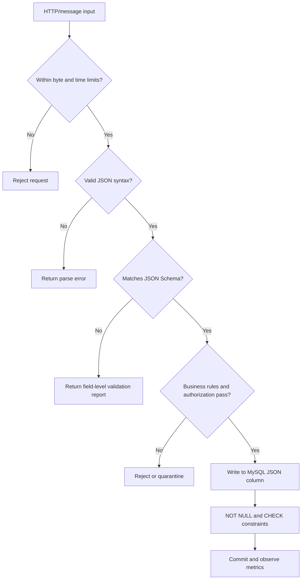

# Kiểm tra JSON schema, giới hạn kích thước và dữ liệu đầu vào

Kiểu `JSON` của MySQL bảo đảm giá trị lưu vào là JSON hợp lệ về cú pháp, nhưng điều đó chưa chứng minh dữ liệu đúng cấu trúc nghiệp vụ. Một payload có thể parse được mà vẫn thiếu `eventId`, chứa `quantity` âm, có mảng quá dài hoặc mang thêm trường mà hệ thống không chấp nhận. Vì vậy, quy trình nhận JSON cần nhiều lớp kiểm tra: giới hạn request trước khi parse, xác thực cú pháp, xác thực schema, kiểm tra quy tắc nghiệp vụ và áp dụng ràng buộc ở database.

Trong MySQL 8.0, các hàm `JSON_VALID()`, `JSON_TYPE()`, `JSON_LENGTH()` và `JSON_STORAGE_SIZE()` giúp kiểm tra hình dạng và kích thước tài liệu. Từ MySQL 8.0.17, `JSON_SCHEMA_VALID()` và `JSON_SCHEMA_VALIDATION_REPORT()` cho phép xác thực theo JSON Schema Draft 4. Có thể kết hợp schema validation với `CHECK` constraint trên bảng InnoDB để dữ liệu không hợp lệ bị từ chối ngay cả khi một đường ghi khác bỏ qua tầng ứng dụng.

Trong module `DATABASE_MYSQL`, mục tiêu là thiết kế hợp đồng JSON rõ ràng, kiểm soát kích thước theo đúng đơn vị, phát hiện lỗi đầu vào có thể giải thích được và giữ các invariant quan trọng ở nơi dữ liệu được lưu. Schema validation không thay thế kiểm tra quyền, tính nhất quán giữa nhiều bảng hoặc xác thực nghiệp vụ cần truy vấn trạng thái hiện tại.

## Mục tiêu

Sau bài này, bạn có thể:

- Phân biệt JSON hợp lệ về cú pháp với JSON hợp lệ theo schema và quy tắc nghiệp vụ.
- Kiểm tra kiểu gốc bằng `JSON_TYPE()` và số phần tử bằng `JSON_LENGTH()`.
- Đo kích thước biểu diễn nhị phân bằng `JSON_STORAGE_SIZE()` và hiểu giới hạn của phép đo này.
- Dùng `JSON_SCHEMA_VALID()` để kiểm tra document theo JSON Schema Draft 4.
- Dùng `JSON_SCHEMA_VALIDATION_REPORT()` để giải thích vị trí và keyword gây lỗi.
- Thiết kế schema có `type`, `required`, `properties`, `additionalProperties`, `items` và giới hạn số lượng/độ dài.
- Kết hợp JSON schema với `NOT NULL` và `CHECK` constraint.
- Phân biệt giới hạn request, `max_allowed_packet`, kích thước JSON nội bộ và giới hạn nghiệp vụ.
- Xác thực dữ liệu ở API/application trước khi gửi tới MySQL.
- Xử lý payload sai, quá lớn, quá sâu hoặc không đúng tenant một cách an toàn.
- Theo dõi tỷ lệ lỗi, kích thước và thay đổi schema theo phiên bản.

## 1. Bốn lớp kiểm tra JSON

Một payload có thể qua lớp này nhưng thất bại ở lớp tiếp theo:

| Lớp | Câu hỏi | Ví dụ lỗi |
|---|---|---|
| Giới hạn truyền nhận | Request có nằm trong giới hạn byte/thời gian không? | Body 20 MB trong khi API chỉ nhận 1 MB |
| Cú pháp JSON | Chuỗi có phải JSON hợp lệ không? | Thiếu dấu ngoặc kép, dấu phẩy sai vị trí |
| Schema | Kiểu, trường bắt buộc, cấu trúc và cardinality có đúng không? | `quantity` là chuỗi, thiếu `eventId`, mảng có 10.000 phần tử |
| Quy tắc nghiệp vụ | Giá trị có hợp lệ trong ngữ cảnh hệ thống không? | Khách hàng không thuộc tenant, trạng thái không cho phép, mã tham chiếu không tồn tại |

Không nên gộp tất cả thành một lỗi “invalid JSON”. Mỗi lớp có cách xử lý và thông điệp phù hợp riêng. Ví dụ, request quá lớn có thể bị từ chối ở gateway trước khi chiếm bộ nhớ parser; JSON sai cú pháp có thể trả lỗi định dạng; schema sai có thể chỉ rõ trường; còn vi phạm nghiệp vụ cần kết quả kiểm tra từ domain/service.



Tầng ứng dụng có thể trả lỗi thân thiện và kiểm tra quyền theo request context. Database vẫn cần giữ các ràng buộc bất biến mà mọi writer phải tuân thủ.

## 2. JSON column kiểm tra cú pháp, không tự kiểm tra schema

MySQL có kiểu dữ liệu `JSON`. Khi insert một chuỗi vào cột JSON, MySQL parse và từ chối văn bản không phải JSON hợp lệ. Giá trị được lưu dưới dạng binary JSON để truy cập thành phần hiệu quả hơn; khoảng trắng và cách trình bày ban đầu không được bảo toàn như một bản sao raw text.

Ví dụ:

```sql
CREATE TABLE inbound_event (
    event_id BIGINT UNSIGNED NOT NULL AUTO_INCREMENT,
    payload JSON NOT NULL,
    received_at DATETIME(6) NOT NULL DEFAULT CURRENT_TIMESTAMP(6),
    PRIMARY KEY (event_id)
) ENGINE=InnoDB;

INSERT INTO inbound_event (payload)
VALUES ('{"eventType":"order.created","orderId":"ORD-1001"}');
```

Giá trị sau đây là JSON sai cú pháp nên không thể ghi vào cột `JSON`:

```sql
-- Sai: giá trị string trong JSON phải dùng dấu ngoặc kép.
INSERT INTO inbound_event (payload)
VALUES ('{eventType:"order.created"}');
```

Ngược lại, JSON sau hợp lệ về cú pháp nhưng có thể không phù hợp schema của event:

```json
{
  "eventType": 42,
  "orderId": [],
  "unexpected": true
}
```

Cột `JSON` không tự biết `eventType` phải là string, `orderId` phải là mã đơn hàng hay `unexpected` có bị cấm hay không. Những quy tắc đó phải được định nghĩa bằng schema hoặc logic nghiệp vụ.

## 3. Kiểm tra cú pháp và kiểu JSON

### 3.1. JSON_VALID()

`JSON_VALID(value)` trả `1` nếu đối số là JSON hợp lệ, `0` nếu không hợp lệ và `NULL` nếu đối số là `NULL`.

```sql
SELECT
    JSON_VALID('{"eventId":"evt-1"}') AS valid_document,
    JSON_VALID('{eventId:"evt-1"}') AS invalid_document,
    JSON_VALID(NULL) AS null_document;
```

Kết quả tương ứng là `1`, `0` và `NULL`. Khi giá trị đã nằm trong cột `JSON`, cú pháp đã được MySQL xác thực lúc ghi; `JSON_VALID()` hữu ích hơn khi kiểm tra raw text hoặc dữ liệu legacy trong cột `TEXT`.

### 3.2. JSON_TYPE()

`JSON_TYPE()` cho biết kiểu JSON ở cấp hiện tại. Các kết quả thường gặp gồm `OBJECT`, `ARRAY`, `STRING`, `INTEGER`, `DOUBLE`, `DECIMAL`, `BOOLEAN` và `NULL`.

```sql
SELECT
    JSON_TYPE('{"a":1}') AS object_type,
    JSON_TYPE('[1,2]') AS array_type,
    JSON_TYPE('"hello"') AS string_type,
    JSON_TYPE('true') AS boolean_type,
    JSON_TYPE('null') AS json_null_type;
```

Phân biệt SQL `NULL` với JSON literal `null`: SQL `NULL` biểu thị không có giá trị SQL, còn JSON `null` là một giá trị JSON hợp lệ. Với một cột JSON nullable, có thể tồn tại cả SQL `NULL` và JSON `null`; dùng `IS NULL` và `JSON_TYPE()` để phân biệt.

Ví dụ buộc payload phải là object:

```sql
SELECT event_id
FROM inbound_event
WHERE JSON_TYPE(payload) = 'OBJECT';
```

Không ép mọi payload thành object nếu hợp đồng cho phép array hoặc scalar. Kiểu gốc cần được quy định ngay trong API/schema.

### 3.3. JSON_LENGTH()

`JSON_LENGTH()` trả số phần tử của array, số member của object; với scalar trả `1`. Có thể truyền JSON path để đếm một nhánh cụ thể.

```sql
SELECT
    JSON_LENGTH('[10,20,30]') AS array_items,
    JSON_LENGTH('{"a":1,"b":2}') AS object_members,
    JSON_LENGTH('"one"') AS scalar_length,
    JSON_LENGTH('{"items":[1,2,3]}', '$.items') AS nested_items;
```

Kết quả lần lượt là `3`, `2`, `1` và `3`. Hàm này không đo byte. Một array có 10 phần tử string rất dài có cùng `JSON_LENGTH()` với array 10 số nguyên, nhưng kích thước lưu trữ khác nhau.

### 3.4. JSON_DEPTH()

`JSON_DEPTH()` trả độ sâu lồng nhau của document. Hàm hữu ích khi kiểm tra dữ liệu có cấu trúc lồng quá sâu so với quy ước ứng dụng. MySQL cũng có giới hạn độ sâu JSON khi parse; kiểm tra sớm giúp trả lỗi dễ hiểu và tránh xử lý cấu trúc không cần thiết.

```sql
SELECT JSON_DEPTH('{"a":{"b":{"c":1}}}') AS document_depth;
```

Độ sâu không thay thế schema validation. Một document có độ sâu thấp vẫn có thể có hàng nghìn phần tử hoặc trường sai kiểu.

## 4. Đo kích thước JSON

Không có một con số “kích thước JSON” duy nhất. Cần phân biệt byte nhận từ client, kích thước văn bản JSON, binary JSON representation và dung lượng thực tế trên storage engine.

### 4.1. JSON_STORAGE_SIZE()

`JSON_STORAGE_SIZE(json_doc)` trả số byte dùng cho binary representation của document JSON. Đây là chỉ số hữu ích để quan sát kích thước JSON sau khi MySQL parse.

```sql
SELECT
    JSON_STORAGE_SIZE('{"id":100,"status":"paid"}') AS binary_json_bytes,
    OCTET_LENGTH('{"id":100,"status":"paid"}') AS text_json_bytes;
```

Hai giá trị có thể khác nhau vì binary JSON dùng representation riêng. Với giá trị trong cột JSON, `JSON_STORAGE_SIZE()` báo dung lượng binary representation trước các partial update đã thực hiện trên document. Vì vậy, hãy dùng hàm này để quan sát storage; không xem nó là phép đo chính xác kích thước logic hiện tại sau mọi partial update. Hàm cũng không phải kích thước HTTP request, không phải dung lượng toàn bộ row InnoDB và không tính mọi overhead của page/index/redo/undo.

Với cột JSON đã lưu:

```sql
SELECT
    event_id,
    JSON_STORAGE_SIZE(payload) AS payload_storage_bytes,
    JSON_LENGTH(payload) AS top_level_members
FROM inbound_event
ORDER BY event_id DESC
LIMIT 20;
```

### 4.2. JSON_STORAGE_FREE()

InnoDB có thể thực hiện một số partial update tại chỗ đối với JSON document. `JSON_STORAGE_FREE()` cho biết khoảng trống được giải phóng trong binary JSON storage sau các partial update được hỗ trợ. Giá trị này không phải dung lượng row có thể cấp phát tùy ý và không phải phép đo tổng dung lượng tiết kiệm trên đĩa.

```sql
SELECT
    event_id,
    JSON_STORAGE_SIZE(payload) AS storage_bytes,
    JSON_STORAGE_FREE(payload) AS reusable_free_bytes
FROM inbound_event;
```

Không dùng `JSON_STORAGE_FREE()` làm giới hạn payload đầu vào. Để giới hạn kích thước logic hiện tại, đo `OCTET_LENGTH(CAST(json_doc AS CHAR CHARACTER SET utf8mb4))` cho JSON text đã serialize hoặc kiểm soát byte raw ở gateway/application tùy yêu cầu. Dùng `JSON_STORAGE_SIZE()` để quan sát binary storage, có lưu ý về partial update.

### 4.3. Đo raw text và byte request

Nếu API nhận JSON qua HTTP, byte của request body được biết ở gateway/application trước khi parse. SQL `OCTET_LENGTH(CAST(payload AS CHAR))` chỉ đo dạng text được serialize từ giá trị JSON hiện có; nó không thể khôi phục whitespace hoặc byte encoding ban đầu của request.

Ví dụ đo chuỗi UTF-8:

```sql
SET @raw_json = '{"message":"Xin chào"}';

SELECT
    CHAR_LENGTH(@raw_json) AS character_count,
    OCTET_LENGTH(@raw_json) AS utf8_byte_count;
```

`CHAR_LENGTH()` đếm ký tự theo character set của chuỗi; `OCTET_LENGTH()` đếm byte. Với tiếng Việt và emoji, số byte thường lớn hơn số ký tự. Nếu giới hạn API là 64 KiB, so sánh byte chứ không so sánh số ký tự.

### 4.4. Không nhầm size limit với max_allowed_packet

`max_allowed_packet` giới hạn kích thước packet/message mà client và server chấp nhận, đồng thời ảnh hưởng tới một số string/intermediate result lớn. Giá trị cấu hình ở client và server đều có thể quan trọng.

```sql
SHOW VARIABLES LIKE 'max_allowed_packet';
```

Đây là giới hạn kỹ thuật của giao tiếp MySQL, không phải chính sách nghiệp vụ cho từng JSON document. Nếu tăng `max_allowed_packet` để nhận payload lớn hơn, vẫn cần giới hạn request riêng để tránh một client gửi tài liệu khổng lồ làm tiêu tốn bộ nhớ, CPU hoặc thời gian parse.

Một chính sách có thể gồm:

- API gateway: tối đa 256 KiB cho request body.
- Application: tối đa 200 KiB cho JSON sau parse, tối đa 100 phần tử `items`.
- Database: `CHECK` constraint có thể giới hạn kích thước văn bản JSON đã serialize; đây không phải số byte raw ban đầu của HTTP request.
- MySQL connection: `max_allowed_packet` đủ cho protocol/statement hợp lệ, có headroom cho overhead.

Các con số chỉ là ví dụ thiết kế. Chọn giới hạn theo workload, latency, kích thước row và năng lực server thực tế.

## 5. JSON Schema trong MySQL

JSON Schema mô tả cấu trúc và quy tắc hình dạng của document. MySQL 8.0.17+ cung cấp `JSON_SCHEMA_VALID()` để trả kết quả hợp lệ/không hợp lệ và `JSON_SCHEMA_VALIDATION_REPORT()` để tạo báo cáo lỗi.

MySQL triển khai JSON Schema Draft 4 với tập keyword được hỗ trợ. Không mặc định mọi keyword của các bản JSON Schema mới hơn đều được hỗ trợ. Trước khi dựa vào một keyword, kiểm tra tài liệu đúng phiên bản MySQL; các ví dụ trong bài dùng các keyword phổ biến như `type`, `required`, `properties`, `additionalProperties`, `items`, `minimum`, `maxLength` và `maxItems`.

### 5.1. Ví dụ schema cho order event

Schema dưới đây yêu cầu document là object, chỉ cho phép các trường đã khai báo, bắt buộc có `eventId`, `orderId`, `amount` và `items`, đồng thời giới hạn độ dài và số lượng phần tử.

```sql
SET @order_schema = '{
  "$schema": "http://json-schema.org/draft-04/schema#",
  "type": "object",
  "additionalProperties": false,
  "required": ["eventId", "orderId", "amount", "items"],
  "properties": {
    "eventId": {
      "type": "string",
      "minLength": 1,
      "maxLength": 64
    },
    "orderId": {
      "type": "string",
      "minLength": 1,
      "maxLength": 40
    },
    "amount": {
      "type": "number",
      "minimum": 0
    },
    "items": {
      "type": "array",
      "minItems": 1,
      "maxItems": 100,
      "items": {
        "type": "object",
        "additionalProperties": false,
        "required": ["sku", "quantity"],
        "properties": {
          "sku": {
            "type": "string",
            "minLength": 1,
            "maxLength": 50
          },
          "quantity": {
            "type": "integer",
            "minimum": 1,
            "maximum": 9999
          }
        }
      }
    }
  }
}';
```

Schema này kiểm tra kiểu và giới hạn cấu trúc. Nó chưa xác minh `orderId` có tồn tại, `eventId` có trùng trong tenant, tổng `amount` có bằng tổng dòng hàng hoặc người gửi có quyền tạo order hay không. Các quy tắc đó cần unique key, foreign key, transaction hoặc application/domain logic phù hợp.

### 5.2. Kiểm tra một document

```sql
SET @order_doc = '{
  "eventId": "evt-1001",
  "orderId": "ORD-1001",
  "amount": 180.50,
  "items": [
    {"sku": "SKU-RED-01", "quantity": 2},
    {"sku": "SKU-BLU-02", "quantity": 1}
  ]
}';

SELECT
    JSON_VALID(@order_doc) AS syntax_ok,
    JSON_SCHEMA_VALID(@order_schema, @order_doc) AS schema_ok;
```

Kết quả mong đợi là cả hai cột đều bằng `1`. `JSON_VALID()` chỉ trả lời chuỗi có phải JSON hay không; `JSON_SCHEMA_VALID()` kiểm tra document có khớp schema hay không.

### 5.3. Document sai schema

Ví dụ payload thiếu `eventId`, `amount` là string và `items` rỗng:

```sql
SET @bad_order_doc = '{
  "orderId": "ORD-1002",
  "amount": "180.50",
  "items": []
}';

SELECT
    JSON_VALID(@bad_order_doc) AS syntax_ok,
    JSON_SCHEMA_VALID(@order_schema, @bad_order_doc) AS schema_ok;
```

JSON vẫn hợp lệ về cú pháp nên `syntax_ok = 1`, nhưng `schema_ok = 0`. Đây là lý do cần tách parse validation khỏi schema validation.

### 5.4. JSON_SCHEMA_VALIDATION_REPORT()

Khi schema validation thất bại, báo cáo giúp tìm keyword và vị trí gây lỗi:

```sql
SELECT JSON_PRETTY(
    JSON_SCHEMA_VALIDATION_REPORT(@order_schema, @bad_order_doc)
) AS validation_report;
```

Báo cáo có thể chứa `valid`, `reason`, `schema-location`, `document-location` và `schema-failed-keyword`. Dùng báo cáo để ánh xạ thành lỗi API có cấu trúc, ví dụ `items` không đạt `minItems` hoặc `amount` sai `type`. Không trả nguyên văn nội bộ hoặc toàn bộ payload nhạy cảm trong response/log công khai.

### 5.5. Schema không phải ngôn ngữ truy vấn dữ liệu

Schema kiểm tra một document độc lập. Nó không thay thế:

- Unique constraint để ngăn trùng `eventId`.
- Foreign key hoặc truy vấn để xác nhận `orderId` thuộc tenant.
- Transaction để cập nhật nhiều bảng nhất quán.
- Kiểm tra quyền người gửi và quy tắc chuyển trạng thái.
- Kiểm tra idempotency khi cùng event được gửi lại.

Không nhúng mọi quy tắc nghiệp vụ vào JSON Schema. Giữ schema tập trung vào cấu trúc, kiểu, trường bắt buộc và giới hạn cục bộ.

## 6. Giới hạn trường, mảng và độ sâu

### 6.1. Giới hạn số lượng phần tử

Dùng `minItems`/`maxItems` để giới hạn array. Dùng `minProperties`/`maxProperties` cho số member object nếu phiên bản hỗ trợ keyword đó.

Ví dụ schema giới hạn tối đa 100 line items:

```json
{
  "type": "array",
  "minItems": 1,
  "maxItems": 100,
  "items": {"type": "object"}
}
```

Giới hạn cardinality tránh một payload nhỏ về số trường nhưng có hàng triệu phần tử ngắn, gây tốn CPU khi validate hoặc khi ứng dụng lặp qua array.

### 6.2. Giới hạn độ dài string

Dùng `minLength`, `maxLength` và `pattern` cho trường string. Lưu ý JSON Schema tính độ dài theo ký tự Unicode, còn giới hạn network/storage thường tính byte. Nếu yêu cầu là tối đa 128 byte UTF-8, cần kiểm tra byte ở application hoặc bằng phép đo phù hợp; `maxLength: 128` không đồng nghĩa tối đa 128 byte.

```json
{
  "type": "string",
  "minLength": 1,
  "maxLength": 80,
  "pattern": "^[A-Z0-9-]+$"
}
```

Pattern nên ngắn, dễ review và tránh biểu thức chính quy có backtracking quá tốn kém ở tầng application. Không dùng regex như một cách parse JSON.

### 6.3. Giới hạn số

Dùng `minimum`, `maximum` và `multipleOf` nếu được hỗ trợ cho field numeric. Nhưng đối với tiền tệ, cần cân nhắc representation chính xác và scale: JSON number có thể được parse thành số decimal/double theo semantics của JSON implementation. Nếu cần độ chính xác tiền tệ và tính toán kế toán, cân nhắc chuyển giá trị sang `DECIMAL` trong cột quan hệ sau khi validate.

Ví dụ:

```json
{
  "type": "number",
  "minimum": 0,
  "maximum": 1000000000
}
```

Schema không thay thế precision/scale của cột `DECIMAL(12,2)` hoặc kiểm tra tổng tiền khớp với các dòng hàng.

### 6.4. Giới hạn độ sâu

JSON lồng sâu có thể làm parser, validator và code đệ quy tiêu tốn stack/CPU. MySQL có giới hạn độ sâu JSON khi parse; ứng dụng nên đặt ngưỡng thấp hơn phù hợp với hợp đồng dữ liệu thay vì dựa vào giới hạn tối đa của server. Dùng `JSON_DEPTH()` để quan sát document đã parse; gateway/parser có thể cần giới hạn trước khi tạo object graph.

## 7. Lưu schema và quản lý phiên bản

Có ba cách phổ biến để quản lý schema:

1. Giữ schema trong source code/application và validate trước khi gửi tới database.
2. Dùng `CHECK` constraint với schema literal ổn định để database enforce cấu trúc.
3. Lưu schema có version trong bảng metadata và application chọn đúng schema theo loại/version của payload.

Không mặc định MySQL có một kho JSON Schema trung tâm tự động liên kết với mọi JSON column. Nếu schema thay đổi, cần quản lý version, tương thích ngược và rollout theo quy trình migration.

Ví dụ payload mang version:

```json
{
  "schemaVersion": 2,
  "eventType": "order.created",
  "eventId": "evt-1001"
}
```

Quy tắc triển khai:

- Không âm thầm đổi nghĩa field cũ.
- Ưu tiên thêm field optional trước, sau đó mới yêu cầu field bắt buộc khi mọi producer đã nâng cấp.
- Xác định thời gian hỗ trợ đồng thời nhiều schema version.
- Có test fixtures cho document hợp lệ, không hợp lệ và payload cũ.
- Khi schema literal trong `CHECK` thay đổi, dùng migration có kế hoạch vì `ALTER TABLE` có thể cần kiểm tra dữ liệu hiện có.
- Không cho client tự gửi schema tùy ý để database tin schema đó là chuẩn; schema là policy do hệ thống kiểm soát.

## 8. Enforce schema và giới hạn tại database

Từ MySQL 8.0.16, `CHECK` constraints được thực thi. MySQL 8.0.17+ có `JSON_SCHEMA_VALID()` để kết hợp kiểm tra schema trong constraint. Với bản cũ hơn, không giả định `CHECK` đang được enforce hoặc hàm JSON Schema có sẵn; kiểm tra phiên bản và giữ validation ở application cho tới khi nâng cấp.

### 8.1. Bảng có CHECK constraint

```sql
CREATE TABLE order_event (
    event_id BIGINT UNSIGNED NOT NULL AUTO_INCREMENT,
    payload JSON NOT NULL,
    received_at DATETIME(6) NOT NULL DEFAULT CURRENT_TIMESTAMP(6),
    PRIMARY KEY (event_id),
    CONSTRAINT chk_order_event_object
        CHECK (JSON_TYPE(payload) = 'OBJECT'),
    CONSTRAINT chk_order_event_size
        CHECK (OCTET_LENGTH(CAST(payload AS CHAR CHARACTER SET utf8mb4)) <= 65536),
    CONSTRAINT chk_order_event_schema
        CHECK (
            JSON_SCHEMA_VALID(
                '{"type":"object","required":["eventId","eventType"],"additionalProperties":false,"properties":{"eventId":{"type":"string","minLength":1,"maxLength":64},"eventType":{"type":"string","enum":["order.created","order.cancelled"]}}}',
                payload
            )
        )
) ENGINE=InnoDB;
```

Các constraint đảm bảo payload không phải SQL `NULL`, phải là JSON object, có dạng JSON text serialize không vượt ngưỡng 64 KiB và có hai trường bắt buộc đúng kiểu/giá trị. Đây là kích thước text chuẩn hóa do MySQL serialize, không phải raw HTTP bytes. Ví dụ schema trong constraint cố ý nhỏ và ổn định; schema phức tạp có thể phù hợp hơn với application validation kết hợp các constraint cốt lõi ở database.

### 8.2. Thử insert hợp lệ và không hợp lệ

```sql
INSERT INTO order_event (payload)
VALUES ('{"eventId":"evt-2001","eventType":"order.created"}');

-- Thiếu eventId: bị chk_order_event_schema từ chối.
INSERT INTO order_event (payload)
VALUES ('{"eventType":"order.created"}');

-- eventType không nằm trong enum: bị từ chối.
INSERT INTO order_event (payload)
VALUES ('{"eventId":"evt-2002","eventType":"order.shipped"}');
```

Constraint không tự tạo thông điệp nghiệp vụ chi tiết như API validator. Ứng dụng cần bắt lỗi constraint và ánh xạ sang lỗi phù hợp, đồng thời tránh trả nội dung SQL hoặc payload nhạy cảm cho caller.

### 8.3. CHECK và NULL semantics

Trong SQL, một `CHECK` constraint thất bại khi biểu thức là `FALSE`; biểu thức `UNKNOWN` (thường do `NULL`) không bị coi là vi phạm. Vì vậy, nếu trường bắt buộc phải có giá trị, kết hợp `NOT NULL` với `CHECK`.

```sql
CREATE TABLE webhook_message (
    message_id BIGINT UNSIGNED NOT NULL AUTO_INCREMENT,
    payload JSON NOT NULL,
    PRIMARY KEY (message_id),
    CONSTRAINT chk_webhook_payload_type
        CHECK (JSON_TYPE(payload) = 'OBJECT')
) ENGINE=InnoDB;
```

`NOT NULL` chặn SQL NULL. JSON literal `null` vẫn là một giá trị JSON hợp lệ nhưng `JSON_TYPE(payload)` trả `NULL` dạng chuỗi `"NULL"` (kiểu JSON), khác SQL NULL; constraint object sẽ từ chối nó.

### 8.4. Đừng dùng CHECK để kiểm tra dữ liệu ở bảng khác

MySQL CHECK constraint không phải nơi thực hiện subquery hoặc truy vấn bảng khác. Nếu cần xác minh `customerId` tồn tại và thuộc tenant, dùng foreign key nếu mô hình quan hệ phù hợp hoặc kiểm tra trong transaction/application. Schema JSON chỉ xác minh document cục bộ.

## 9. Validation trong application trước khi ghi

Ứng dụng là nơi thích hợp để kiểm tra giới hạn request trước parse, chọn schema theo event type/version, trả lỗi theo field và xác minh quyền người gửi.

Một pipeline thực tế:

1. Đọc content length/stream và dừng khi vượt byte limit; không buffer vô hạn.
2. Kiểm tra content type và encoding theo hợp đồng API.
3. Parse JSON bằng parser có giới hạn depth/size nếu thư viện hỗ trợ.
4. Xác thực top-level type và JSON Schema theo version.
5. Kiểm tra business rules, tenant ownership, authorization và idempotency.
6. Chuẩn hóa giá trị cần lưu thành cột quan hệ có kiểu rõ ràng nếu cần lọc/join thường xuyên.
7. Ghi JSON và các cột quan hệ trong cùng transaction.
8. Xử lý lỗi `CHECK`, unique key và foreign key từ database như lớp phòng vệ cuối.
9. Ghi metric về kích thước, schema version và loại lỗi; tránh log raw payload nhạy cảm.

### 9.1. Không chỉ kiểm tra ở client

Validation ở frontend giúp người dùng sửa dữ liệu sớm nhưng không phải ranh giới tin cậy. Client có thể bị sửa, request có thể được gửi trực tiếp hoặc có producer khác ghi vào cùng database. Validation quan trọng cần được thực hiện ở server-side application và những invariant cần bảo vệ phải được enforce tại database.

### 9.2. Không chỉ kiểm tra ở database

Database constraint không biết request body gốc dài bao nhiêu byte trước parse, không biết user đang đăng nhập là ai nếu application không truyền một security context đáng tin cậy, và không nên chịu trách nhiệm tạo toàn bộ thông điệp lỗi API. Giới hạn network/parser và authorization cần được xử lý trước khi DML.

## 10. Dùng hàm JSON để kiểm tra payload đã lưu

### 10.1. Kiểm tra kiểu và trường bắt buộc

```sql
SELECT event_id
FROM order_event
WHERE JSON_TYPE(payload) <> 'OBJECT'
   OR JSON_EXTRACT(payload, '$.eventId') IS NULL
   OR JSON_EXTRACT(payload, '$.eventType') IS NULL;
```

Lưu ý `JSON_EXTRACT()` trả SQL `NULL` khi path không tìm thấy, nhưng JSON literal `null` là một giá trị JSON có kiểu `NULL`. Nếu cần phân biệt missing với JSON null, dùng `JSON_CONTAINS_PATH()` và `JSON_TYPE()`.

```sql
SELECT
    event_id,
    JSON_CONTAINS_PATH(payload, 'one', '$.eventId') AS has_event_id,
    JSON_TYPE(JSON_EXTRACT(payload, '$.eventId')) AS event_id_type
FROM order_event;
```

### 10.2. Kiểm tra schema version

```sql
SELECT
    JSON_UNQUOTE(JSON_EXTRACT(payload, '$.schemaVersion')) AS schema_version,
    COUNT(*) AS event_count
FROM order_event
GROUP BY JSON_UNQUOTE(JSON_EXTRACT(payload, '$.schemaVersion'));
```

Thống kê version giúp xác định producer cũ còn gửi payload hay không trước khi bỏ hỗ trợ schema cũ.

### 10.3. Tìm document lớn

```sql
SELECT
    event_id,
    JSON_STORAGE_SIZE(payload) AS storage_bytes,
    JSON_LENGTH(payload) AS top_level_members
FROM order_event
WHERE JSON_STORAGE_SIZE(payload) > 32768
ORDER BY storage_bytes DESC;
```

Nếu truy vấn kiểm tra thường xuyên trên bảng lớn, có thể duy trì cột metadata như `payload_bytes` được tính ở application và đối chiếu định kỳ; không tạo index trên biểu thức JSON chỉ vì một truy vấn chẩn đoán hiếm khi chạy.

## 11. Dữ liệu nhạy cảm và thông điệp lỗi

JSON thường chứa email, địa chỉ, token, thông tin thanh toán hoặc dữ liệu cá nhân. Khi validation thất bại:

- Không log toàn bộ payload theo mặc định.
- Không đưa token, secret hoặc giá trị nhạy cảm vào `JSON_SCHEMA_VALIDATION_REPORT` gửi cho client.
- Log event/request ID, schema version, keyword và JSON path cần thiết.
- Giới hạn độ dài thông điệp lỗi và số lỗi trả về.
- Không phản chiếu nguyên văn input vào HTML/log mà không encode.
- Kiểm tra quyền truy cập dữ liệu sau schema validation; một document đúng schema vẫn có thể chứa ID của tenant khác.

Schema validation là kiểm tra hình dạng, không phải xác thực danh tính hay phân quyền.

## 12. Lỗi thường gặp và cách xử lý

| Hiện tượng | Nguyên nhân | Cách xử lý |
|---|---|---|
| `JSON_VALID()` trả 1 nhưng insert bị từ chối | Cú pháp đúng nhưng CHECK/schema/business rule thất bại | Xem validation report và constraint gây lỗi |
| `JSON_SCHEMA_VALID()` không tồn tại | Server cũ hơn MySQL 8.0.17 hoặc tương thích khác | Kiểm tra version; validate ở application hoặc nâng cấp |
| CHECK không chặn dữ liệu | MySQL cũ trước 8.0.16 hoặc constraint không được enforce như dự kiến | Kiểm tra phiên bản và `SHOW CREATE TABLE` |
| `JSON_LENGTH()` nhỏ nhưng payload quá lớn | Đếm phần tử, không đếm byte | Dùng byte limit ở application hoặc `OCTET_LENGTH(CAST(payload AS CHAR CHARACTER SET utf8mb4))` cho text đã serialize |
| `JSON_STORAGE_SIZE()` khác HTTP body size | Binary JSON đã parse/chuẩn hóa, không giữ whitespace/encoding ban đầu | Đo raw bytes ở gateway/application |
| Ký tự tiếng Việt vượt giới hạn | Character count khác UTF-8 byte count | Dùng `OCTET_LENGTH()` hoặc byte count tại application |
| `CHECK` không bắt SQL NULL | SQL CHECK cho phép biểu thức UNKNOWN | Dùng `NOT NULL` cùng CHECK |
| JSON `null` bị nhầm với SQL NULL | Hai loại NULL khác nhau | Kết hợp `IS NULL`, `JSON_TYPE()` và `JSON_CONTAINS_PATH()` |
| Document hợp schema nhưng sai tenant | Schema không kiểm tra authorization | Kiểm tra quyền/tenant trong transaction nghiệp vụ |
| Validation report quá chi tiết | Log/response làm lộ dữ liệu hoặc cấu trúc nội bộ | Chỉ trả lỗi field-level đã lọc, không trả raw payload |
| Payload lồng quá sâu hoặc mảng quá dài | Thiếu depth/cardinality limit | Đặt giới hạn ở parser và schema |
| Schema mới làm producer cũ lỗi | Thay đổi breaking chưa có rollout | Version hóa schema và triển khai tương thích theo giai đoạn |

## 13. Quy trình vận hành và giám sát

Theo dõi các chỉ số sau theo loại event/producer/schema version:

- Số request bị từ chối vì vượt byte limit.
- Số lỗi parse JSON.
- Số lỗi schema theo `schema-failed-keyword` và document path.
- Phân bố `JSON_STORAGE_SIZE()` theo percentile, đặc biệt p95/p99.
- Số phần tử array lớn nhất và độ sâu document.
- Số lỗi CHECK/unique/foreign key ở database.
- Tỷ lệ payload theo schema version.
- Thời gian parse/validate và thời gian ghi database.

Không chỉ nhìn giá trị trung bình: một tỷ lệ nhỏ payload cực lớn có thể gây spike bộ nhớ hoặc latency. Có thể lấy mẫu document lớn để phân tích sau khi loại bỏ dữ liệu nhạy cảm.

Khi thay đổi schema:

1. Thêm test fixtures và chạy validation với dữ liệu đại diện.
2. Đo tỷ lệ payload hiện tại sẽ thất bại dưới schema mới.
3. Triển khai producer tương thích trước nếu cần.
4. Triển khai application validator và database constraint theo rollout plan.
5. Theo dõi lỗi theo producer/version.
6. Chỉ loại bỏ schema cũ khi không còn writer hợp lệ sử dụng nó.

## 14. Bài thực hành

Thực hiện trên MySQL 8.0.17+ trong schema lab:

1. Tạo bảng có cột `JSON NOT NULL`; thử insert một JSON object hợp lệ và một chuỗi sai cú pháp.
2. Chạy `JSON_VALID()` với object, array, string, boolean, JSON `null` và SQL `NULL`.
3. Dùng `JSON_TYPE()` để phân biệt `OBJECT`, `ARRAY`, `STRING`, `INTEGER`, `BOOLEAN` và JSON `NULL`.
4. Dùng `JSON_LENGTH()` cho object, array, scalar và nested path; giải thích vì sao hàm không đo byte.
5. So sánh `CHAR_LENGTH()` và `OCTET_LENGTH()` với chuỗi có tiếng Việt và emoji.
6. So sánh `JSON_STORAGE_SIZE()` với `OCTET_LENGTH()` của raw text cho cùng document.
7. Tạo schema Draft 4 cho order event với required fields, type, enum, min/max và `additionalProperties:false`.
8. Kiểm tra một payload hợp lệ bằng `JSON_SCHEMA_VALID()`.
9. Tạo payload sai kiểu, thiếu trường và array rỗng; xác nhận schema validation trả 0.
10. Dùng `JSON_SCHEMA_VALIDATION_REPORT()` để lấy keyword và document path gây lỗi.
11. Tạo bảng có CHECK buộc payload là OBJECT và giới hạn `OCTET_LENGTH(CAST(payload AS CHAR CHARACTER SET utf8mb4))`; thử insert payload vượt ngưỡng.
12. Thêm CHECK dùng `JSON_SCHEMA_VALID()`; xác nhận payload thiếu field bị từ chối.
13. Thử SQL NULL và JSON literal `null`; giải thích vai trò của `NOT NULL` và `JSON_TYPE()`.
14. Kiểm tra `max_allowed_packet` và mô phỏng giới hạn request nhỏ hơn packet limit ở tầng application.
15. Thiết kế schema version 1 và 2; lập kế hoạch rollout không làm producer cũ bị lỗi đột ngột.
16. Tạo báo cáo metric về số payload lỗi theo keyword, kích thước p95/p99 và schema version mà không log raw payload.

Bạn hoàn thành bài khi có thể chỉ ra payload thất bại ở lớp nào, giới hạn nào đo byte hay số phần tử, và invariant nào phải được giữ ở database.

## 15. Nguyên tắc cần ghi nhớ

- Cột `JSON` kiểm tra cú pháp JSON; nó không tự enforce hợp đồng nghiệp vụ.
- Tách giới hạn request, parse, schema validation và business validation.
- `JSON_VALID()` kiểm tra cú pháp; `JSON_TYPE()` kiểm tra kiểu gốc; `JSON_LENGTH()` đếm member/phần tử.
- `JSON_STORAGE_SIZE()` đo binary JSON representation trước partial updates; không phải raw HTTP body hay phép đo chính xác text size hiện tại sau mọi partial update.
- `CHAR_LENGTH()` đếm ký tự; `OCTET_LENGTH()` đếm byte.
- `max_allowed_packet` là giới hạn giao tiếp MySQL, không phải giới hạn payload nghiệp vụ.
- MySQL 8.0.17+ cung cấp `JSON_SCHEMA_VALID()` và `JSON_SCHEMA_VALIDATION_REPORT()` theo hỗ trợ JSON Schema Draft 4.
- Kiểm tra keyword schema theo tài liệu đúng phiên bản; không giả định mọi tính năng Draft mới đều có.
- Dùng `required`, `type`, `properties`, `additionalProperties`, `items`, `minItems`, `maxItems`, `minLength`, `maxLength`, `minimum` và `maximum` để kiểm soát cấu trúc.
- Kết hợp `NOT NULL` và `CHECK`; CHECK không coi UNKNOWN/NULL là vi phạm.
- JSON Schema không xác minh tenant, authorization, foreign key, idempotency hay trạng thái nghiệp vụ.
- Validate ở server-side application và giữ invariant quan trọng ở database.
- Version hóa schema, rollout tương thích và theo dõi lỗi theo producer/version.
- Không log raw payload nhạy cảm hoặc trả validation report nội bộ trực tiếp cho client.
