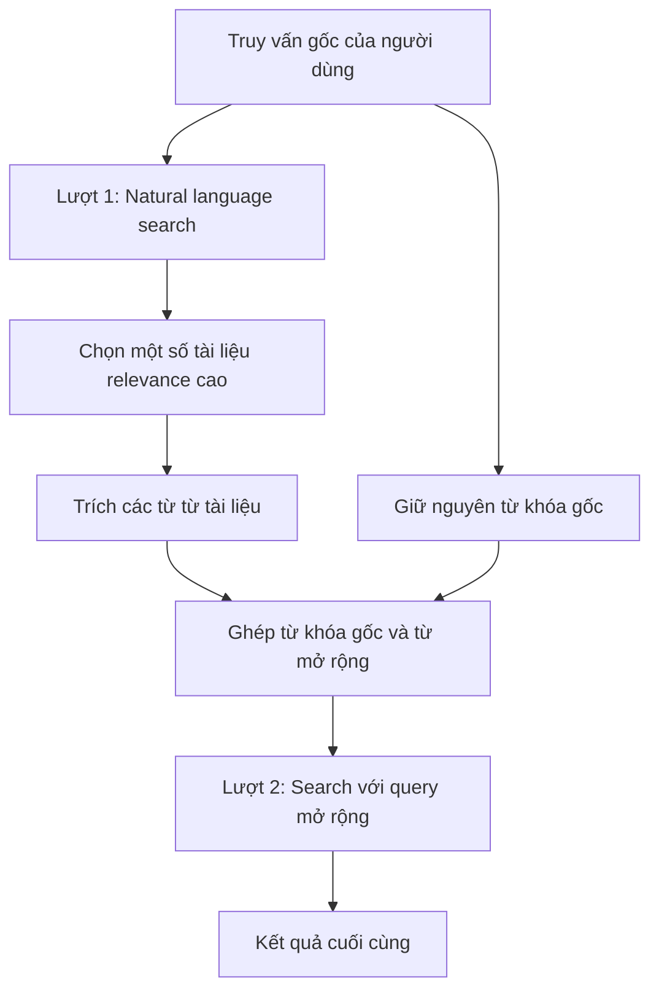

# Query expansion và đánh đổi độ liên quan

Khi người dùng nhập một truy vấn ngắn như `database`, họ có thể đang tìm tài liệu về MySQL, Oracle, DB2, RDBMS hoặc những khái niệm liên quan. MySQL có cơ chế **query expansion** để mở rộng truy vấn dựa trên những tài liệu phù hợp nhất ở lượt tìm đầu tiên.

Query expansion có thể giúp tìm được tài liệu không chứa từ khóa ban đầu nhưng có nội dung liên quan. Đổi lại, kết quả thường rộng hơn và dễ chứa tài liệu không thực sự phù hợp. Đây là một đánh đổi giữa **recall** (khả năng tìm đủ tài liệu liên quan) và **precision** (tỷ lệ tài liệu trả về thực sự hữu ích).

Bài học này giải thích cách MySQL thực hiện query expansion, cách dùng `WITH QUERY EXPANSION`, cách đọc điểm relevance và cách quyết định có nên bật chế độ này hay không. Trọng tâm là hiểu giới hạn của cơ chế mở rộng tự động và đánh giá nó bằng dữ liệu tìm kiếm thực tế.

## 1. Query expansion giải quyết vấn đề nào?

Một truy vấn tìm kiếm có thể quá ngắn hoặc thiếu ngữ cảnh. Người dùng nhập một từ khóa nhưng kỳ vọng hệ thống hiểu các thuật ngữ thường xuất hiện cùng chủ đề đó.

Ví dụ:

- Truy vấn `database` có thể hàm ý MySQL, Oracle, DB2, relational database hoặc RDBMS.
- Truy vấn `Maigret` có thể bị gõ sai thành `Megre`, nhưng các từ còn lại trong truy vấn vẫn dẫn đến một tài liệu đúng.
- Truy vấn `replication` có thể dẫn đến các tài liệu nói về binary log, replica, failover hoặc read scale.

Full-text search tự nó không phải công cụ hiểu ngữ nghĩa. Nó lập chỉ mục từ đã được parser tách ra và tính mức độ liên quan dựa trên nội dung tài liệu. Query expansion bổ sung một lớp phản hồi tự động: lấy một số tài liệu có điểm cao ở lượt tìm đầu, dùng các từ trong những tài liệu đó để mở rộng truy vấn rồi tìm lại.

Query expansion của MySQL còn được gọi là **blind query expansion** hoặc **automatic relevance feedback**. Từ “blind” nhấn mạnh rằng hệ thống tự suy ra thuật ngữ mở rộng từ các kết quả đầu tiên, không chờ người dùng đánh dấu tài liệu nào là hữu ích.

## 2. Điều kiện để sử dụng

Query expansion là một biến thể của natural language full-text search. Cần có `FULLTEXT` index phù hợp và các cột trong `MATCH()` phải thuộc cùng một bảng.

Ví dụ bảng bài viết:

```sql
CREATE TABLE articles (
    id BIGINT UNSIGNED NOT NULL AUTO_INCREMENT,
    tenant_id BIGINT UNSIGNED NOT NULL,
    title VARCHAR(200) NOT NULL,
    body TEXT NOT NULL,
    published_at DATETIME NOT NULL,
    PRIMARY KEY (id),
    KEY ix_articles_tenant_published (tenant_id, published_at),
    FULLTEXT KEY ft_articles_title_body (title, body)
) ENGINE=InnoDB
  DEFAULT CHARACTER SET utf8mb4;
```

Chỉ InnoDB và MyISAM hỗ trợ `FULLTEXT` index. Các cột được lập chỉ mục phải thuộc nhóm `CHAR`, `VARCHAR` hoặc `TEXT`. Ví dụ này dùng InnoDB để tận dụng giao dịch và đặc tính lưu trữ của engine.

Một truy vấn `MATCH(title, body)` phải khớp với danh sách cột của một `FULLTEXT` index tương ứng. Nếu muốn tìm chỉ trong `title`, cần một `FULLTEXT` index riêng cho `title`; không mặc định rằng index ghép `(title, body)` có thể thay thế mọi tổ hợp `MATCH()` khác.

Query expansion không phải một loại index riêng. Nó thay đổi cách diễn giải truy vấn trên full-text index hiện có.

## 3. Cơ chế hai lượt của MySQL

Khi bật query expansion, MySQL thực hiện tìm kiếm theo hai lượt:

1. **Lượt đầu:** chạy natural language search với chuỗi người dùng nhập.
2. **Chọn tài liệu phản hồi:** lấy một số tài liệu có độ liên quan cao từ kết quả lượt đầu.
3. **Mở rộng truy vấn:** lấy các từ xuất hiện trong những tài liệu được chọn và nối chúng vào truy vấn gốc.
4. **Lượt hai:** chạy tìm kiếm lại với chuỗi đã mở rộng.
5. **Trả kết quả:** trả các hàng từ lượt tìm thứ hai.

Sơ đồ:



Điểm quan trọng: kết quả cuối cùng là kết quả của lượt hai. Vì truy vấn ở lượt hai có thêm thuật ngữ, một tài liệu không chứa từ khóa gốc vẫn có thể được trả về nếu nó khớp các thuật ngữ được bổ sung.

Ví dụ minh họa:

- Người dùng tìm `database`.
- Các tài liệu phù hợp nhất ở lượt đầu thường đề cập `MySQL`, `RDBMS` và `relational database`.
- Những thuật ngữ đó được dùng để mở rộng truy vấn.
- Lượt hai có thể tìm thêm tài liệu chứa `MySQL` hoặc `RDBMS` dù tài liệu không chứa chính xác từ `database`.

Đây là suy luận dựa trên từ đồng xuất hiện trong tài liệu. Nó không phải từ điển synonym, semantic search hay mô hình embedding.

## 4. Cú pháp WITH QUERY EXPANSION

Cú pháp tổng quát của full-text search:

```sql
MATCH (col1, col2, ...)
AGAINST (expr [search_modifier])
```

Query expansion được bật bằng một trong hai dạng:

```sql
AGAINST ('database' WITH QUERY EXPANSION)

AGAINST (
    'database'
    IN NATURAL LANGUAGE MODE WITH QUERY EXPANSION
)
```

Hai dạng trên đều thực hiện natural language search có query expansion. Dạng thứ hai viết rõ search mode nên dễ đọc hơn khi đặt cạnh các truy vấn natural language khác.

Không dùng `WITH QUERY EXPANSION` cùng `IN BOOLEAN MODE`. Query expansion là biến thể của natural language search, không phải một modifier để ghép tùy ý với boolean search.

## 5. So sánh tìm kiếm thông thường và tìm kiếm mở rộng

Trước tiên, chạy truy vấn natural language thông thường:

```sql
SELECT
    id,
    title,
    MATCH(title, body)
        AGAINST (? IN NATURAL LANGUAGE MODE) AS relevance
FROM articles
WHERE MATCH(title, body)
    AGAINST (? IN NATURAL LANGUAGE MODE)
ORDER BY relevance DESC, id ASC
LIMIT 20;
```

Sau đó chạy truy vấn có query expansion:

```sql
SELECT
    id,
    title,
    MATCH(title, body)
        AGAINST (
            ? IN NATURAL LANGUAGE MODE WITH QUERY EXPANSION
        ) AS relevance
FROM articles
WHERE MATCH(title, body)
    AGAINST (
        ? IN NATURAL LANGUAGE MODE WITH QUERY EXPANSION
    )
ORDER BY relevance DESC, id ASC
LIMIT 20;
```

Ứng dụng bind cùng chuỗi tìm kiếm vào hai placeholder trong mỗi truy vấn. Dùng prepared statement để truyền dữ liệu người dùng, tránh nối chuỗi đầu vào trực tiếp vào SQL.

| Đặc điểm | Natural language thông thường | Query expansion |
|---|---|---|
| Truy vấn lượt đầu | Có | Có |
| Lấy từ từ tài liệu relevance cao | Không | Có |
| Chạy lượt tìm thứ hai | Không | Có |
| Có thể trả tài liệu không chứa từ gốc | Ít khả năng hơn | Có |
| Phạm vi kết quả | Thường hẹp hơn | Thường rộng hơn |
| Nguy cơ nhiễu | Thấp hơn tương đối | Cao hơn |
| Chi phí xử lý | Thường thấp hơn | Có thêm lượt tìm và xử lý |

Trong ví dụ, `ORDER BY relevance DESC, id ASC` sắp xếp theo điểm relevance rồi dùng `id` làm tie-breaker để thứ tự ổn định hơn khi nhiều hàng có cùng điểm. Nếu bỏ `ORDER BY`, MySQL có thể tự sắp xếp theo relevance trong một số điều kiện của natural language full-text index scan, nhưng không nên dựa vào hành vi ngầm đó như hợp đồng API.

## 6. Hiểu điểm relevance

`MATCH(...) AGAINST(...)` trả về một giá trị số biểu diễn mức độ tương đồng giữa truy vấn và phần văn bản được lập chỉ mục. Điểm không phải xác suất tài liệu đúng và cũng không phải phần trăm mức độ liên quan.

Đối với natural language search, MySQL tính relevance dựa trên các yếu tố như:

- Số từ trong tài liệu.
- Số từ duy nhất trong tài liệu.
- Tổng số từ trong collection được lập chỉ mục.
- Số tài liệu chứa một từ cụ thể.

Điểm thường không âm; giá trị 0 biểu thị không có mức tương đồng. Relevance phụ thuộc vào collection và thống kê từ của index, nên kết quả có thể thay đổi khi dữ liệu được thêm, sửa hoặc xóa.

Khi bật query expansion, truy vấn dùng ở lượt hai có thêm các từ được lấy từ tài liệu lượt đầu. Vì vậy, điểm relevance của lượt hai phản ánh truy vấn mở rộng. Không nên so sánh trực tiếp điểm của hai truy vấn khác nhau như thể chúng cùng một thang đo tuyệt đối.

### 6.1. Đừng xem relevance là xác suất

Ví dụ:

| Tài liệu | Điểm minh họa | Diễn giải |
|---|---:|---|
| A | 2.8 | Khớp tương đối tốt với tập từ tìm kiếm |
| B | 1.4 | Khớp yếu hơn A trong cùng truy vấn |
| C | 0.7 | Có một số tín hiệu khớp |

Các con số chỉ minh họa thứ tự trong một lần tìm. Điểm `2.8` không có nghĩa tài liệu đúng 280% hoặc có xác suất liên quan 2.8 lần. Hãy đánh giá bằng chất lượng tài liệu trong top K, không đặt ngưỡng điểm tùy tiện rồi diễn giải nó thành xác suất.

### 6.2. Điều kiện tự sắp xếp theo relevance

Khi `MATCH()` được dùng trong `WHERE`, MySQL có thể tự trả kết quả theo relevance giảm dần nếu thỏa các điều kiện nhất định, gồm:

- Không có `ORDER BY` tường minh.
- Truy vấn dùng full-text index scan thay vì table scan.
- Nếu có JOIN, full-text index scan phải là bảng không hằng đầu tiên trong thứ tự JOIN.

Khi ứng dụng cần thứ tự rõ ràng, hãy viết `ORDER BY relevance DESC` và thêm khóa duy nhất làm tie-breaker. Nếu có bộ lọc tenant, trạng thái hoặc ngày đăng, kiểm tra kế hoạch thực thi và thứ tự trả về thay vì giả định engine luôn tự xếp hạng.

## 7. Lợi ích: tăng recall cho truy vấn ngắn

Query expansion có ích khi truy vấn ban đầu quá ngắn để thể hiện đầy đủ ý định.

Ví dụ truy vấn `database`:

| Tài liệu | Nội dung | Có từ `database`? |
|---|---|---|
| A | MySQL Tutorial: DBMS và relational systems | Có thể không |
| B | Database design fundamentals | Có |
| C | MySQL performance tuning | Có thể không |
| D | Oracle database administration | Có |

Nếu tài liệu B và D nổi bật ở lượt đầu, các từ như `MySQL`, `Oracle` hoặc `DBMS` có thể được đưa vào truy vấn mở rộng. Lượt hai có cơ hội tìm tài liệu A hoặc C, dù chúng không chứa từ `database`.

Lợi ích chính:

- Tìm được tài liệu liên quan nhưng dùng thuật ngữ khác.
- Bù một phần ngữ cảnh mà người dùng không nhập vào.
- Giảm phụ thuộc vào việc người dùng biết đúng tên kỹ thuật.
- Có thể giúp với truy vấn ngắn, từ khóa chưa đầy đủ hoặc lỗi chính tả nhẹ khi các từ còn lại dẫn tới tài liệu liên quan.

Query expansion không đảm bảo tìm được synonym thật sự. Nó chỉ mở rộng theo các từ có mặt trong một số tài liệu được xếp hạng cao ở lượt đầu.

## 8. Đánh đổi precision và recall

Trong hệ thống tìm kiếm, hai khái niệm cần phân biệt:

- **Precision@K:** trong K kết quả đầu, có bao nhiêu kết quả thực sự hữu ích?
- **Recall:** trong toàn bộ tài liệu thực sự liên quan, hệ thống tìm được bao nhiêu?

Ví dụ, có 10 tài liệu liên quan trong collection:

| Cách tìm | Kết quả trả về | Tài liệu liên quan | Precision | Recall |
|---|---:|---:|---:|---:|
| Natural language | 5 | 4 | 80% | 40% |
| Query expansion | 12 | 7 | 58.3% | 70% |

Đây là số liệu giả định để minh họa. Query expansion tìm được nhiều tài liệu liên quan hơn, nhưng trong nhóm kết quả cũng có thêm tài liệu không hữu ích.

Tùy sản phẩm, đánh đổi này có thể tốt hoặc xấu:

- Công cụ khám phá kiến thức có thể chấp nhận kết quả rộng hơn để người dùng tìm thấy chủ đề liên quan.
- Trang tìm kiếm sản phẩm cần kết quả chính xác cao có thể ưu tiên precision, vì tài liệu sai chủ đề làm giảm khả năng mua hàng.
- Công cụ tra cứu vận hành hoặc sự cố có thể cần recall cao, nhưng phải giữ các bộ lọc quan trọng để không làm loãng kết quả.
- Tìm kiếm pháp lý, y tế hoặc dữ liệu tuân thủ cần kiểm soát chặt chất lượng và phạm vi; không mặc định bật mở rộng chỉ vì truy vấn ngắn.

Không có một cấu hình tối ưu cho mọi loại nội dung. Hãy chọn theo chi phí của việc bỏ sót và chi phí của việc trả về tài liệu nhiễu.

## 9. Rủi ro query drift và nhiễu

Query expansion có thể làm truy vấn trôi khỏi ý định ban đầu (**query drift**). Vấn đề xuất hiện khi tài liệu có điểm cao ở lượt đầu chứa các từ thường gặp nhưng không phản ánh đúng nhu cầu người dùng.

Ví dụ người dùng tìm `lock` để tìm khóa giao dịch. Một tài liệu phổ biến có thể nói nhiều về khóa cửa, bảo mật vật lý hoặc lock screen. Nếu tài liệu đó lọt vào nhóm phản hồi, các từ mở rộng có thể kéo lượt hai sang một chủ đề khác.

Các nguồn gây nhiễu thường gặp:

1. **Tài liệu quá tổng quát:** có nhiều từ phổ biến và nhiều chủ đề không liên quan.
2. **Tài liệu quá dài:** chứa nhiều từ ngẫu nhiên, làm tăng cơ hội thêm thuật ngữ ngoài ý định.
3. **Nội dung SEO hoặc spam:** lặp nhiều từ phổ biến khiến tài liệu nổi bật ở lượt đầu.
4. **Tài liệu cũ:** thuật ngữ từng phổ biến nhưng không còn phù hợp với câu hỏi hiện tại.
5. **Trùng lặp nội dung:** nhiều bản sao có thể làm một nhóm thuật ngữ chi phối.
6. **Truy vấn gốc mơ hồ:** một từ có nhiều nghĩa khiến lượt đầu chọn sai chủ đề.
7. **Corpus trộn nhiều lĩnh vực:** các tài liệu thuộc lĩnh vực khác nhau cùng tham gia một collection.

Một khi thuật ngữ nhiễu được thêm vào, lượt hai có thể trả nhiều tài liệu không chứa từ khóa gốc. Đó là hành vi có chủ đích của cơ chế mở rộng, nhưng có thể gây bất ngờ nếu giao diện hiển thị kết quả như thể chúng đều khớp chính xác.

## 10. Khi nào nên bật query expansion?

| Tình huống | Khuyến nghị | Lý do |
|---|---|---|
| Một từ khóa ngắn, rộng | Có thể thử | Người dùng có thể dựa vào ngữ cảnh ngầm |
| Truy vấn chỉ có một vài từ phổ biến | Thử có kiểm soát | Có cơ hội bổ sung thuật ngữ đồng xuất hiện |
| Người dùng muốn khám phá chủ đề | Có thể phù hợp | Recall rộng thường có giá trị |
| Truy vấn dài, nhiều thuật ngữ cụ thể | Thường không cần | Truy vấn đã mang đủ ngữ cảnh |
| Mã định danh, số đơn hàng, email | Không dùng | Cần exact lookup, không phải mở rộng từ |
| Cụm từ chính xác hoặc câu trích dẫn | Không dùng làm mặc định | Từ bổ sung có thể làm lệch mục tiêu |
| Truy vấn có điều kiện bắt buộc | Không dùng thay boolean mode | Query expansion không áp dụng cho boolean search |
| Kết quả phải rất chính xác | Chỉ bật sau đánh giá | Nhiễu có thể gây hậu quả lớn |

Một chiến lược giao diện có thể là:

- Dùng natural language search làm mặc định.
- Chỉ cung cấp “Mở rộng kết quả” như một lựa chọn phụ khi truy vấn ngắn.
- Hiển thị nhãn cho biết kết quả đã được mở rộng.
- Giữ các bộ lọc nghiệp vụ và quyền truy cập ở tầng truy vấn/ứng dụng.
- Cho phép người dùng quay lại danh sách kết quả gốc.

Không nên tự bật query expansion cho mọi truy vấn chỉ để tăng số lượng kết quả.

## 11. Ví dụ thực hành: tìm tài liệu kỹ thuật

Giả sử bảng `articles` chứa hướng dẫn MySQL, Oracle và khái niệm cơ sở dữ liệu. Tạo index:

```sql
CREATE FULLTEXT INDEX ft_articles_title_body
ON articles(title, body);
```

Tìm kiếm tự nhiên:

```sql
SELECT
    id,
    title,
    MATCH(title, body)
        AGAINST ('database' IN NATURAL LANGUAGE MODE) AS score
FROM articles
WHERE MATCH(title, body)
    AGAINST ('database' IN NATURAL LANGUAGE MODE)
ORDER BY score DESC, id ASC
LIMIT 10;
```

Tìm kiếm có mở rộng:

```sql
SELECT
    id,
    title,
    MATCH(title, body)
        AGAINST (
            'database'
            IN NATURAL LANGUAGE MODE WITH QUERY EXPANSION
        ) AS score
FROM articles
WHERE MATCH(title, body)
    AGAINST (
        'database'
        IN NATURAL LANGUAGE MODE WITH QUERY EXPANSION
    )
ORDER BY score DESC, id ASC
LIMIT 10;
```

So sánh hai tập kết quả:

- Những hàng xuất hiện ở cả hai tập thường có tín hiệu khớp từ truy vấn gốc và/hoặc từ mở rộng.
- Hàng chỉ xuất hiện ở tập mở rộng có thể khớp các từ lấy từ tài liệu relevance cao ở lượt đầu.
- Hàng biến mất khỏi top 10 có thể bị đẩy xuống do thứ hạng thay đổi ở lượt hai.

Đừng giả định mọi hàng mới đều là synonym đúng. Mở nội dung tài liệu và đánh giá theo mục đích tìm kiếm thực tế.

## 12. Dùng query expansion với bộ lọc nghiệp vụ

Query expansion không thay thế bộ lọc dữ liệu. Nếu ứng dụng chỉ cho phép người dùng xem bài viết đã xuất bản của tenant hiện tại, điều kiện đó vẫn phải được áp dụng:

```sql
SELECT
    id,
    title,
    MATCH(title, body)
        AGAINST (
            ? IN NATURAL LANGUAGE MODE WITH QUERY EXPANSION
        ) AS score
FROM articles
WHERE tenant_id = ?
  AND published_at <= CURRENT_TIMESTAMP
  AND MATCH(title, body)
        AGAINST (
            ? IN NATURAL LANGUAGE MODE WITH QUERY EXPANSION
        )
ORDER BY score DESC, id ASC
LIMIT 20;
```

Bind chuỗi tìm kiếm vào hai placeholder thứ nhất và thứ ba; bind tenant ID vào placeholder thứ hai. Bộ lọc quyền truy cập phải được xác thực ở backend và áp dụng cho mọi truy vấn.

Với hệ thống đa tenant hoặc nội dung nhạy cảm, cần kiểm thử riêng phạm vi collection và cách dữ liệu trong lượt phản hồi có thể ảnh hưởng đến kết quả mở rộng. Không dùng query expansion làm cơ chế phân quyền hoặc cách ly dữ liệu.

Nếu cần bảo đảm ngữ nghĩa mở rộng hoàn toàn độc lập theo tenant hoặc theo nhóm quyền, hãy đánh giá kiến trúc corpus/index phù hợp thay vì giả định bộ lọc SQL sau cùng đã giải quyết mọi yêu cầu cách ly.

## 13. Tokenizer, stopword và độ dài từ

Query expansion chỉ có thể mở rộng bằng những từ mà full-text parser nhận diện và index lưu giữ. Vì vậy, chất lượng của nó phụ thuộc vào cách MySQL tách từ và cấu hình full-text.

Các yếu tố cần xem:

- **Parser:** quyết định ranh giới token trong văn bản.
- **Stopword:** các từ bị loại khỏi full-text index hoặc bỏ qua khi tìm kiếm.
- **Độ dài token:** từ quá ngắn hoặc quá dài theo cấu hình có thể không được lập chỉ mục.
- **Character set/collation:** ảnh hưởng đến việc xử lý ký tự và so sánh từ.
- **Ngôn ngữ nội dung:** không phải ngôn ngữ nào cũng phân tách từ bằng dấu cách.

Với InnoDB, các biến độ dài token gồm `innodb_ft_min_token_size` và `innodb_ft_max_token_size`. Với MyISAM, dùng `ft_min_word_len` và `ft_max_word_len`. Cấu hình stopword cũng có khác biệt giữa engine.

Một từ bị bỏ qua trong index không thể trở thành tín hiệu mở rộng đáng tin cậy. Nếu thay đổi cấu hình token size hoặc stopword, cần xem hướng dẫn phiên bản cụ thể và xây dựng lại `FULLTEXT` index khi yêu cầu. Nhiều biến cấu hình phải được đặt lúc khởi động server.

### 13.1. Ngôn ngữ không có dấu cách phân tách từ

Với tiếng Trung, tiếng Nhật và một số ngôn ngữ dạng chữ tượng hình, parser mặc định không thể luôn xác định ranh giới từ theo dấu cách. MySQL có ngram full-text parser cho các ngôn ngữ như tiếng Trung, tiếng Nhật và tiếng Hàn; MeCab là plugin parser cho tiếng Nhật.

Nếu corpus chứa nhiều ngôn ngữ, hãy kiểm thử parser trên dữ liệu thật. Query expansion không sửa được lỗi phân tách token của parser; nó chỉ sử dụng những token đã được nhận diện.

### 13.2. Từ khóa ngắn hoặc stopword

Truy vấn quá ngắn có thể không có token hợp lệ để tìm. Nếu từ khóa là stopword hoặc ngắn hơn ngưỡng index, cả lượt đầu có thể không tạo được tập tài liệu phản hồi hữu ích. Khi lượt đầu không có tài liệu phù hợp, query expansion không có ngữ cảnh đáng tin để mở rộng.

Hãy kiểm tra stopword và giới hạn token trước khi kết luận rằng query expansion không hoạt động.

## 14. Chi phí hiệu năng

Query expansion thực hiện hai lượt tìm kiếm và cần xử lý các tài liệu phản hồi để tạo truy vấn thứ hai. Do đó, nó thường tốn tài nguyên hơn natural language search thông thường.

Các yếu tố ảnh hưởng:

- Số lượng tài liệu trong collection.
- Kích thước và độ dài văn bản được lập chỉ mục.
- Mức độ phổ biến của từ khóa gốc.
- Số lượng tài liệu khớp ở lượt đầu.
- Chất lượng và cấu hình FULLTEXT index.
- Tần suất gọi query expansion và mức tải đồng thời.

`LIMIT 20` giới hạn số hàng trả về cho ứng dụng; không nên coi nó là cam kết rằng MySQL chỉ xử lý 20 tài liệu trong các bước nội bộ của query expansion.

Đo riêng latency p50/p95, CPU và số hàng trả về cho hai chế độ. Một truy vấn mở rộng trả thêm nhiều tài liệu nhưng chậm hơn đáng kể có thể không phù hợp với yêu cầu phản hồi của giao diện.

## 15. Đọc execution plan và đo thực tế

Dùng `EXPLAIN` để xem truy vấn có dùng full-text index và các bộ lọc khác như thế nào:

```sql
EXPLAIN
SELECT
    id,
    title,
    MATCH(title, body)
        AGAINST (
            'database'
            IN NATURAL LANGUAGE MODE WITH QUERY EXPANSION
        ) AS score
FROM articles
WHERE MATCH(title, body)
    AGAINST (
        'database'
        IN NATURAL LANGUAGE MODE WITH QUERY EXPANSION
    )
ORDER BY score DESC, id ASC
LIMIT 20;
```

Kiểm tra:

- Có sử dụng `FULLTEXT` access path như kỳ vọng không?
- Bộ lọc `tenant_id` hoặc `published_at` có làm thay đổi kế hoạch thực thi không?
- Có bước sort bổ sung do `ORDER BY` không?
- Số hàng ước tính và số hàng thực tế có chênh lệch lớn không?
- Query expansion có làm latency tăng vượt ngân sách không?

`EXPLAIN ANALYZE` chạy câu lệnh để đo thực tế trên các phiên bản hỗ trợ. Chỉ dùng với truy vấn đọc trong môi trường phù hợp; không chạy DML gây side effect chỉ để xem kế hoạch.

## 16. Đánh giá chất lượng bằng bộ truy vấn chuẩn

Không đánh giá query expansion bằng một vài truy vấn dễ nhớ. Hãy xây dựng bộ truy vấn đại diện cho cách người dùng tìm kiếm.

Một bộ đánh giá nên có:

- Truy vấn ngắn và rộng.
- Truy vấn dài, nhiều thuật ngữ cụ thể.
- Truy vấn viết sai chính tả nhẹ.
- Truy vấn có từ đồng xuất hiện nhưng khác chủ đề.
- Truy vấn có thuật ngữ chuyên ngành.
- Truy vấn có từ stopword hoặc token ngắn.
- Truy vấn thuộc từng tenant, ngôn ngữ hoặc danh mục nội dung.

Với mỗi truy vấn, người đánh giá gán nhãn tài liệu liên quan theo một thang nhất quán, ví dụ:

| Nhãn | Ý nghĩa |
|---:|---|
| 0 | Không liên quan |
| 1 | Có liên quan nhẹ, chỉ hữu ích như tham khảo phụ |
| 2 | Liên quan rõ, có thể trả lời một phần ý định |
| 3 | Rất liên quan, trả lời trực tiếp nhu cầu |

So sánh natural language và query expansion trên cùng bộ truy vấn, cùng snapshot dữ liệu và cùng giới hạn top K.

### 16.1. Chỉ số nên theo dõi

| Chỉ số | Ý nghĩa | Khi nào hữu ích |
|---|---|---|
| Precision@K | Tỷ lệ kết quả liên quan trong K vị trí đầu | Đo độ sạch của top results |
| Recall@K | Tỷ lệ tài liệu liên quan được tìm thấy trong K kết quả | Đo khả năng tìm đủ |
| MRR | Vị trí của kết quả liên quan đầu tiên | Khi người dùng thường chọn kết quả đầu |
| nDCG@K | Chất lượng xếp hạng có xét mức độ liên quan | Khi có nhãn nhiều cấp |
| p50/p95 latency | Thời gian phản hồi | Đánh giá trải nghiệm và tải |
| Empty-result rate | Tỷ lệ truy vấn không có kết quả | Phát hiện vấn đề token/stopword |

Không tối ưu một chỉ số đơn lẻ. Ví dụ recall tăng nhưng precision giảm mạnh có thể làm người dùng mất thời gian lọc nhiễu. Hãy chọn ngưỡng chấp nhận theo mục tiêu sản phẩm.

### 16.2. A/B test có kiểm soát

Một thử nghiệm phù hợp:

1. Chọn tập truy vấn đại diện và định nghĩa nhãn relevance.
2. Chạy baseline natural language search.
3. Chạy cùng truy vấn với query expansion.
4. So sánh top K, precision, recall, nDCG và latency.
5. Phân tích riêng theo loại truy vấn, ngôn ngữ và nhóm nội dung.
6. Nếu triển khai cho người dùng, chia traffic có kiểm soát và theo dõi hành vi tiếp tục tìm kiếm, click, thời gian đến kết quả hữu ích.

Không dùng điểm relevance của hai chế độ làm chỉ số duy nhất vì mỗi chế độ có thể đánh giá trên một chuỗi từ khác nhau.

## 17. Các lựa chọn thay thế khi cần kiểm soát cao hơn

Query expansion phù hợp khi chấp nhận việc hệ thống tự suy ra thuật ngữ. Nếu cần kiểm soát chặt, cân nhắc:

| Cách tiếp cận | Kiểm soát | Đặc điểm |
|---|---|---|
| Từ đồng nghĩa do ứng dụng quản lý | Cao | Nhóm synonym được định nghĩa và review |
| Mở rộng truy vấn theo taxonomy | Cao | Dùng danh mục nghiệp vụ, alias và mã chuẩn |
| Boolean full-text search | Cao với điều kiện từ | Cho phép bắt buộc, loại trừ hoặc tăng trọng số từ |
| Tìm kiếm kết hợp metadata | Cao với filter | Ghép full-text với category, trạng thái, tenant, thời gian |
| Search engine chuyên dụng | Tùy nền tảng | Có thể cung cấp synonym, analyzers, fuzzy match và ranking tùy chỉnh |

Boolean full-text search của MySQL có cú pháp và hành vi riêng. Ví dụ:

```sql
SELECT
    id,
    title,
    MATCH(title, body) AGAINST (
        '+mysql +replication -deprecated'
        IN BOOLEAN MODE
    ) AS score
FROM articles
WHERE MATCH(title, body) AGAINST (
    '+mysql +replication -deprecated'
    IN BOOLEAN MODE
);
```

Trong boolean mode, dấu `+` yêu cầu từ phải xuất hiện, dấu `-` loại từ và từ không có toán tử thường mang ý nghĩa OR. Boolean mode phù hợp khi người dùng hoặc ứng dụng cần điều kiện rõ ràng. Nó không thể kết hợp trực tiếp với `WITH QUERY EXPANSION`.

## 18. Lỗi thường gặp

| Triệu chứng | Nguyên nhân có thể | Cách xử lý |
|---|---|---|
| Query expansion không thêm kết quả | Lượt đầu không có tài liệu đủ liên quan | Kiểm tra từ khóa, parser, stopword và token size |
| Kết quả quá rộng | Truy vấn gốc quá chung hoặc tài liệu phản hồi nhiễu | Chỉ bật cho truy vấn ngắn phù hợp; đánh giá top K |
| Kết quả đi lệch chủ đề | Query drift từ các từ đồng xuất hiện | Làm sạch corpus, kiểm thử bộ truy vấn đại diện |
| Tài liệu liên quan không xuất hiện | Token bị loại hoặc dùng parser không phù hợp | Kiểm tra FULLTEXT index và cấu hình tokenizer |
| Lỗi khi MATCH nhiều cột | Cột MATCH không khớp FULLTEXT index | Tạo index đúng tổ hợp cột hoặc sửa MATCH |
| Không dùng được trên engine | Engine không hỗ trợ FULLTEXT | Dùng InnoDB/MyISAM hoặc hệ tìm kiếm khác |
| Truy vấn chậm hơn baseline | Có thêm lượt tìm và xử lý mở rộng | Đo latency, giới hạn phạm vi và chỉ bật có điều kiện |
| Thứ tự kết quả không ổn định khi bằng điểm | Không có tie-breaker | Thêm khóa duy nhất vào ORDER BY |
| Không thể ghép boolean mode | Query expansion chỉ áp dụng natural language | Chọn một mode phù hợp mục tiêu tìm kiếm |

## 19. Bài tập thực hành

### Bài 1 — Quan sát hai lượt tìm kiếm

Tạo bảng `articles` với `FULLTEXT(title, body)`. Chạy truy vấn `database` bằng natural language mode và query expansion. Ghi lại các ID chỉ xuất hiện ở lượt hai.

### Bài 2 — Phân tích tài liệu phản hồi

Mở các tài liệu có điểm cao ở lượt đầu. Liệt kê các từ khóa liên quan xuất hiện trong chúng. Đánh giá từ nào thực sự mở rộng đúng chủ đề và từ nào có nguy cơ gây nhiễu.

### Bài 3 — Đo precision@10

Chọn 20 truy vấn ngắn, đánh nhãn thủ công top 10 của từng chế độ. Tính precision@10 và so sánh kết quả.

### Bài 4 — Tìm query drift

Chọn một truy vấn đa nghĩa như `lock` hoặc `index`. Tạo dữ liệu có tài liệu thuộc nhiều lĩnh vực. Quan sát query expansion có mở rộng sang lĩnh vực không mong muốn hay không.

### Bài 5 — Kiểm tra stopword và token size

Thử truy vấn bằng một từ ngắn và một stopword. Kiểm tra cấu hình full-text phù hợp với engine, sau đó giải thích vì sao lượt đầu có thể không tạo được tài liệu phản hồi.

### Bài 6 — So sánh theo nhóm truy vấn

Chia truy vấn thành nhóm ngắn, dài, có mã định danh và có cụm từ chính xác. Đề xuất nhóm nào nên bật query expansion, nhóm nào nên giữ natural language search.

### Bài 7 — Thiết kế fallback

Thiết kế logic ứng dụng: chạy natural language trước, chỉ hiển thị nút mở rộng khi truy vấn ngắn hoặc người dùng yêu cầu. Xác định cách ghi log chế độ tìm kiếm và đo latency.

## 20. Checklist trước khi bật trong production

- FULLTEXT index có đúng engine và đúng tổ hợp cột không?
- Các cột trong MATCH() có khớp index không?
- Truy vấn có thật sự thuộc natural language search không?
- Từ khóa gốc có đủ ngắn để query expansion có ích không?
- Stopword và token size có làm lượt đầu không có kết quả không?
- Parser có phù hợp với ngôn ngữ của corpus không?
- Các bộ lọc tenant, quyền truy cập, trạng thái và ngày tháng vẫn được áp dụng không?
- Top kết quả có được đánh giá bằng nhãn relevance thực tế không?
- Precision@K và recall@K có đạt mục tiêu không?
- Query drift và tài liệu nhiễu có được kiểm tra không?
- Latency p50/p95 và tải server có nằm trong ngân sách không?
- Có tie-breaker để thứ tự kết quả ổn định khi điểm bằng nhau không?
- Có fallback về natural language search khi query expansion không hữu ích không?
- Giao diện có cho người dùng biết kết quả đã được mở rộng không?
- Có kế hoạch theo dõi chất lượng khi corpus và nội dung thay đổi không?

## 21. Tài liệu tham khảo chính thức

- [MySQL 9.7 — Full-Text Searches with Query Expansion](https://dev.mysql.com/doc/refman/9.7/en/fulltext-query-expansion.html)
- [MySQL 9.7 — Full-Text Search Functions](https://dev.mysql.com/doc/refman/9.7/en/fulltext-search.html)
- [MySQL 9.7 — Natural Language Full-Text Searches](https://dev.mysql.com/doc/refman/9.7/en/fulltext-natural-language.html)
- [MySQL 9.7 — Full-Text Restrictions](https://dev.mysql.com/doc/refman/9.7/en/fulltext-restrictions.html)
- [MySQL 8.4 — Full-Text Searches with Query Expansion](https://dev.mysql.com/doc/refman/8.4/en/fulltext-query-expansion.html)
- [MySQL 8.4 — Fine-Tuning MySQL Full-Text Search](https://dev.mysql.com/doc/refman/8.4/en/fulltext-fine-tuning.html)
- [MySQL 8.4 — Full-Text Indexes](https://dev.mysql.com/doc/refman/8.4/en/column-indexes.html)
- [MySQL 8.4 — Boolean Full-Text Searches](https://dev.mysql.com/doc/refman/8.4/en/fulltext-boolean.html)

## Kết luận

`WITH QUERY EXPANSION` giúp MySQL mở rộng natural language search bằng các từ lấy từ một số tài liệu có relevance cao ở lượt đầu, rồi chạy lượt tìm thứ hai. Cơ chế này có thể tăng recall cho truy vấn ngắn và thiếu ngữ cảnh, nhưng cũng làm tăng nhiễu, giảm precision và có nguy cơ query drift. Hãy dùng nó có chọn lọc, kiểm tra parser/stopword/FULLTEXT index, giữ nguyên các bộ lọc quyền truy cập, đo hiệu năng và đánh giá bằng bộ truy vấn có nhãn relevance. Khi cần kiểm soát thuật ngữ hoặc điều kiện bắt buộc, dùng synonym/taxonomy do ứng dụng quản lý, boolean search hoặc một hệ tìm kiếm có khả năng ranking phù hợp hơn.
