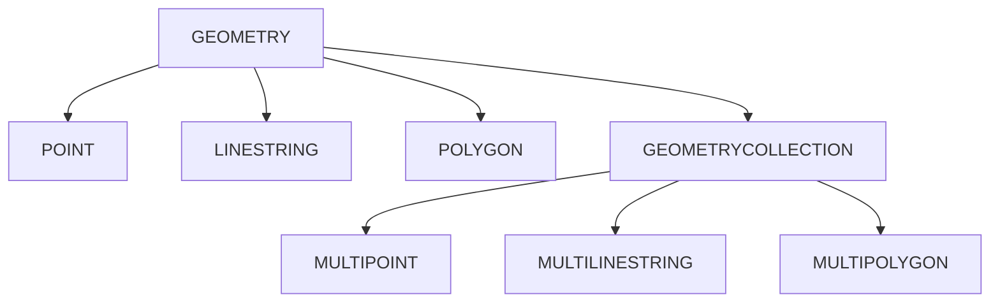

# Geometry, Point, LineString, Polygon và các kiểu tập hợp

MySQL hỗ trợ kiểu dữ liệu không gian (spatial data) để lưu và truy vấn hình học như điểm tọa độ, đường đi, vùng địa lý và tập hợp hình học. Các giá trị này không chỉ là cặp số `x, y`: chúng có kiểu hình học, hệ tọa độ tham chiếu (SRID), quy tắc trục tọa độ và các phép toán không gian.

Kiểu tổng quát `GEOMETRY` có thể chứa nhiều loại hình học. Các kiểu cụ thể gồm `POINT`, `LINESTRING`, `POLYGON` và các kiểu tập hợp `MULTIPOINT`, `MULTILINESTRING`, `MULTIPOLYGON`, `GEOMETRYCOLLECTION`. Chọn kiểu đúng giúp schema diễn đạt rõ dữ liệu mong đợi và cho phép MySQL kiểm tra subtype khi ghi.

Spatial data phù hợp với vị trí cửa hàng, điểm giao nhận, tuyến đường, ranh giới khu vực, vùng phục vụ hoặc các đối tượng bản đồ. Để dữ liệu có ý nghĩa, phải xác định SRID và thứ tự tọa độ ngay từ đầu. Cùng một cặp số có thể biểu diễn vị trí khác nhau nếu hiểu nhầm longitude/latitude hoặc dùng sai hệ tọa độ.

## 1. Spatial data khác dữ liệu số thông thường

Một cột `DECIMAL` có thể lưu longitude và latitude riêng, nhưng database không tự biết hai giá trị đó tạo thành một điểm địa lý. Kiểu `POINT` biểu diễn một đối tượng hình học có cấu trúc; các hàm spatial có thể kiểm tra giao nhau, nằm trong vùng, khoảng cách hoặc xuất dữ liệu sang WKT/GeoJSON.

Ví dụ:

```sql
CREATE TABLE delivery_locations (
    location_id BIGINT UNSIGNED NOT NULL AUTO_INCREMENT,
    label VARCHAR(150) NOT NULL,
    position POINT NOT NULL SRID 4326,
    PRIMARY KEY (location_id)
) ENGINE=InnoDB;
```

`position` là một geometry kiểu `POINT` thuộc SRID 4326. MySQL có thể kiểm tra giá trị gán vào cột đúng kiểu geometry và đúng SRID được khai báo.

Nếu chỉ cần lưu hai con số để tính toán nghiệp vụ đơn giản, hai cột số có thể đủ. Nếu cần spatial predicate, index không gian, chuyển đổi tọa độ hoặc trao đổi dữ liệu GIS, kiểu geometry cung cấp ngữ nghĩa phù hợp hơn.

## 2. Hệ phân cấp các kiểu hình học

MySQL tổ chức các kiểu spatial theo một hệ phân cấp:



`GEOMETRY` là kiểu tổng quát. Các kiểu đơn mô tả một hình học; các kiểu `MULTI...` chứa nhiều thành phần cùng loại; `GEOMETRYCOLLECTION` có thể chứa nhiều loại hình học khác nhau.

| Kiểu | Mô tả | Ví dụ ứng dụng |
| --- | --- | --- |
| `GEOMETRY` | Bất kỳ hình học được hỗ trợ | Cột dùng chung cho nhiều loại đối tượng |
| `POINT` | Một vị trí | Cửa hàng, trạm, điểm giao hàng |
| `LINESTRING` | Một đường gồm các điểm theo thứ tự | Tuyến đường, đường ống, lộ trình |
| `POLYGON` | Một vùng có đường bao ngoài và có thể có lỗ | Khu vực phục vụ, thửa đất, vùng địa lý |
| `MULTIPOINT` | Tập hợp các điểm | Các vị trí đo hoặc cụm điểm |
| `MULTILINESTRING` | Tập hợp các đường | Mạng đoạn đường hoặc các nhánh tuyến |
| `MULTIPOLYGON` | Tập hợp các vùng | Quần đảo, nhiều vùng rời nhau |
| `GEOMETRYCOLLECTION` | Tập hợp có thể trộn loại | Kết quả phân tích gồm điểm, đường và vùng |

## 3. POINT: biểu diễn một vị trí

`POINT` biểu diễn một vị trí với hai tọa độ trong không gian hai chiều. Với hệ Cartesian, hai tọa độ thường được gọi là X và Y. Với hệ geographic như EPSG:4326, cần chú ý thứ tự trục được định nghĩa bởi SRS và tùy chọn axis order khi đọc/ghi.

WKT của một điểm:

```text
POINT(10 20)
```

Tạo bảng và chèn điểm Cartesian SRID 0:

```sql
CREATE TABLE map_points (
    point_id BIGINT UNSIGNED NOT NULL AUTO_INCREMENT,
    name VARCHAR(120) NOT NULL,
    position POINT NOT NULL,
    PRIMARY KEY (point_id)
) ENGINE=InnoDB;

INSERT INTO map_points (name, position)
VALUES ('origin', ST_GeomFromText('POINT(10 20)', 0));
```

Đọc lại:

```sql
SELECT
    point_id,
    name,
    ST_AsText(position) AS position_wkt,
    ST_SRID(position) AS srid,
    ST_X(position) AS x_value,
    ST_Y(position) AS y_value
FROM map_points;
```

Với SRID 0, `ST_X()` và `ST_Y()` trả tọa độ X/Y theo hệ Cartesian. Không diễn giải hai giá trị này là longitude/latitude nếu chưa xác nhận SRID và axis order.

## 4. LINESTRING: đường gồm các điểm có thứ tự

`LINESTRING` chứa một dãy tọa độ được nối theo thứ tự. Một LineString không rỗng cần ít nhất hai điểm; thứ tự điểm quyết định hình dạng và hướng của đường.

WKT ví dụ:

```text
LINESTRING(0 0, 10 10, 20 5)
```

Tạo bảng lưu tuyến:

```sql
CREATE TABLE routes (
    route_id BIGINT UNSIGNED NOT NULL AUTO_INCREMENT,
    route_name VARCHAR(150) NOT NULL,
    path LINESTRING NOT NULL,
    PRIMARY KEY (route_id)
) ENGINE=InnoDB;

INSERT INTO routes (route_name, path)
VALUES (
    'sample-route',
    ST_GeomFromText('LINESTRING(0 0, 10 10, 20 5)', 0)
);
```

LineString có thể chứa nhiều điểm trung gian để mô tả đường cong gần đúng bằng các đoạn thẳng. Nó không tự mang ý nghĩa “đường một chiều”, “tốc độ” hay “thời gian di chuyển”; các thuộc tính nghiệp vụ đó cần cột riêng.

Một đường có thể tự cắt hoặc đi qua cùng một tọa độ nhiều lần. Điều đó không nhất thiết làm LineString sai về mặt cấu trúc, nhưng có thể ảnh hưởng ý nghĩa của ứng dụng và các phép toán tiếp theo.

## 5. POLYGON: vùng có đường bao và lỗ bên trong

`POLYGON` mô tả một vùng phẳng. Thành phần đầu tiên là exterior ring (đường bao ngoài); các ring tiếp theo, nếu có, là interior ring (lỗ bên trong vùng).

Một ring là một LineString khép kín: tọa độ đầu và cuối phải trùng nhau. Ring cần ít nhất bốn tọa độ tính cả điểm lặp ở cuối để khép kín. Các quy tắc hình học hợp lệ còn yêu cầu ring không tự giao cắt theo mô hình OGC và các lỗ phải nằm đúng trong vùng bao.

WKT polygon đơn giản:

```text
POLYGON((0 0, 10 0, 10 10, 0 10, 0 0))
```

Polygon có một lỗ:

```text
POLYGON(
  (0 0, 20 0, 20 20, 0 20, 0 0),
  (5 5, 5 10, 10 10, 10 5, 5 5)
)
```

Ring thứ nhất là đường bao ngoài; ring thứ hai mô tả vùng rỗng bên trong. Thứ tự các tọa độ trong WKT cần nhất quán với SRID và axis order của hình học.

## 6. MULTIPOINT: nhiều điểm trong một geometry

`MULTIPOINT` chứa một tập hợp các `POINT`. Ví dụ biểu diễn ba trạm đo:

```text
MULTIPOINT((10 40), (40 30), (20 20))
```

Tạo và đọc:

```sql
CREATE TABLE survey_clusters (
    cluster_id BIGINT UNSIGNED NOT NULL AUTO_INCREMENT,
    cluster_name VARCHAR(120) NOT NULL,
    stations MULTIPOINT NOT NULL,
    PRIMARY KEY (cluster_id)
) ENGINE=InnoDB;

INSERT INTO survey_clusters (cluster_name, stations)
VALUES (
    'north-sites',
    ST_GeomFromText('MULTIPOINT((10 40), (40 30), (20 20))', 0)
);
```

`MULTIPOINT` hữu ích khi nhiều điểm được xem như một đối tượng logic. Nếu từng điểm cần ID, trạng thái, thời gian hoặc quan hệ độc lập, lưu mỗi điểm thành một hàng `POINT` riêng thường linh hoạt hơn.

## 7. MULTILINESTRING: nhiều đoạn đường

`MULTILINESTRING` chứa nhiều `LINESTRING`. Các thành phần có thể rời nhau hoặc nối về mặt hình học; kiểu dữ liệu không tự đảm bảo chúng tạo thành một mạng đường liên tục.

```text
MULTILINESTRING(
  (0 0, 10 10, 20 5),
  (30 10, 40 20)
)
```

Ứng dụng có thể dùng kiểu này để biểu diễn các nhánh đường hoặc nhiều đoạn thuộc cùng một đối tượng tuyến. Nếu từng đoạn cần thuộc tính riêng như tên đường, giới hạn tốc độ hoặc trạng thái thi công, cân nhắc lưu từng đoạn trong bảng riêng và liên kết bằng khóa ngoại.

## 8. MULTIPOLYGON: nhiều vùng rời nhau

`MULTIPOLYGON` chứa nhiều `POLYGON`. Nó phù hợp với một thực thể địa lý gồm nhiều vùng không liền nhau, chẳng hạn một đơn vị hành chính có nhiều đảo.

```text
MULTIPOLYGON(
  ((0 0, 10 0, 10 10, 0 10, 0 0)),
  ((20 20, 30 20, 30 30, 20 30, 20 20))
)
```

Mỗi thành phần là một polygon có ring ngoài và có thể có ring trong. Nếu vùng chỉ có một polygon, dùng `POLYGON`; nếu nhiều polygon thuộc cùng một đối tượng, `MULTIPOLYGON` mô tả đúng cấu trúc hơn.

## 9. GEOMETRYCOLLECTION: tập hợp hình học khác loại

`GEOMETRYCOLLECTION` có thể chứa các loại hình học khác nhau trong cùng một giá trị:

```text
GEOMETRYCOLLECTION(
  POINT(10 20),
  LINESTRING(0 0, 10 10),
  POLYGON((20 20, 30 20, 30 30, 20 30, 20 20))
)
```

Kiểu này hữu ích cho kết quả tổng hợp hoặc dữ liệu GIS có nhiều thành phần. Tuy nhiên, nó làm consumer phải kiểm tra type của từng thành phần trước khi xử lý. Nếu mỗi hàng nghiệp vụ chỉ nên chứa một loại hình học cụ thể, dùng cột subtype như `POINT` hoặc `POLYGON` để ràng buộc dữ liệu chặt hơn.

## 10. GEOMETRY: kiểu tổng quát

Cột `GEOMETRY` có thể chứa bất kỳ subtype spatial được hỗ trợ. Điều này linh hoạt nhưng không thể hiện rõ một hàng phải là điểm, đường hay vùng.

Ví dụ:

```sql
CREATE TABLE map_features (
    feature_id BIGINT UNSIGNED NOT NULL AUTO_INCREMENT,
    feature_name VARCHAR(150) NOT NULL,
    shape GEOMETRY NOT NULL,
    PRIMARY KEY (feature_id)
) ENGINE=InnoDB;
```

Có thể lưu `POINT`, `LINESTRING` hoặc `POLYGON` vào `shape`. Khi đọc, dùng `ST_GeometryType(shape)` để biết subtype. Nếu ứng dụng cần index/logic riêng theo từng loại, có thể tách bảng theo subtype hoặc dùng discriminator có constraint.

## 11. Chọn kiểu cụ thể hay kiểu tổng quát

| Nhu cầu | Kiểu nên cân nhắc | Lý do |
| --- | --- | --- |
| Mỗi hàng luôn là một vị trí | `POINT` | Ràng buộc subtype rõ |
| Mỗi hàng là một tuyến liên tục | `LINESTRING` | Biểu diễn chuỗi tọa độ có thứ tự |
| Mỗi hàng là một vùng | `POLYGON` | Có ring ngoài và lỗ |
| Một thực thể gồm nhiều điểm | `MULTIPOINT` | Nhóm các điểm thành một giá trị |
| Một thực thể gồm nhiều tuyến | `MULTILINESTRING` | Nhóm các đường |
| Một thực thể gồm nhiều vùng | `MULTIPOLYGON` | Nhóm các polygon |
| Một feature có nhiều subtype | `GEOMETRYCOLLECTION` | Cho phép thành phần khác loại |
| Bảng cần lưu nhiều subtype không cố định | `GEOMETRY` | Linh hoạt, cần kiểm tra type khi đọc |

Ưu tiên kiểu cụ thể nếu nghiệp vụ có hợp đồng rõ. Kiểu tổng quát chỉ nên dùng khi tính đa dạng của geometry là yêu cầu thực sự, không phải vì chưa quyết định được schema.

## 12. WKT: biểu diễn hình học dạng văn bản

Well-Known Text (WKT) là định dạng văn bản mô tả geometry, dễ đọc và thuận tiện cho ví dụ, import/export hoặc debug.

Ví dụ:

```text
POINT(10 20)
LINESTRING(0 0, 10 10, 20 5)
POLYGON((0 0, 10 0, 10 10, 0 10, 0 0))
MULTIPOINT((10 40), (40 30))
```

MySQL cung cấp constructor như `ST_GeomFromText()` và các hàm subtype tương ứng để chuyển WKT thành geometry:

```sql
SELECT ST_GeomFromText('POINT(10 20)', 0);
```

Đưa geometry ra WKT:

```sql
SELECT ST_AsText(position)
FROM map_points;
```

WKT không tự đảm bảo ứng dụng hiểu đúng SRID. Khi trao đổi tọa độ, lưu/gửi SRID riêng hoặc dùng API có trường SRID rõ ràng. Với geographic SRS, xác định axis order khi parse/serialize.

## 13. WKB: biểu diễn hình học dạng nhị phân

Well-Known Binary (WKB) là biểu diễn nhị phân của geometry. WKB phù hợp với trao đổi dữ liệu giữa các hệ thống hoặc driver spatial mà không phải parse chuỗi WKT.

MySQL có các hàm:

```sql
SELECT ST_AsWKB(position)
FROM map_points;
```

và constructor:

```sql
SELECT ST_GeomFromWKB(?, 0);
```

Trong đó `?` là giá trị binary được bind bởi driver. WKB chuẩn không chứa SRID; vì vậy cần truyền SRID riêng khi tạo geometry hoặc dùng định dạng trao đổi có metadata SRID.

Biểu diễn nội bộ geometry của MySQL không nên bị nhầm với WKB thuần. MySQL lưu thêm thông tin SRID trong representation nội bộ; ứng dụng nên dùng các hàm `ST_AsWKB()`/`ST_GeomFromWKB()` thay vì tự cắt ghép byte theo layout nội bộ.

## 14. GeoJSON: trao đổi dữ liệu với ứng dụng bản đồ

GeoJSON là định dạng JSON phổ biến cho dữ liệu địa lý. Một Point GeoJSON:

```json
{
  "type": "Point",
  "coordinates": [106.7009, 10.7769]
}
```

Một Feature có properties và geometry:

```json
{
  "type": "Feature",
  "properties": {"name": "Central station"},
  "geometry": {
    "type": "Point",
    "coordinates": [106.7009, 10.7769]
  }
}
```

MySQL có `ST_AsGeoJSON()` để xuất geometry sang GeoJSON và `ST_GeomFromGeoJSON()` để đọc GeoJSON trong các phiên bản hỗ trợ. GeoJSON theo quy ước phổ biến sử dụng longitude trước, latitude sau cho tọa độ geographic.

Khi trao đổi với hệ thống bản đồ, kiểm tra SRID và thứ tự trục ở cả hai đầu. Không giả định thứ tự tọa độ GeoJSON giống mặc định axis order của mọi geographic SRS trong MySQL.

## 15. Tạo geometry bằng constructor functions

Các constructor thường gặp:

| Hàm | Mục đích |
| --- | --- |
| `ST_GeomFromText()` | Parse WKT thành geometry |
| `ST_PointFromText()` | Parse WKT Point |
| `ST_GeomFromWKB()` | Parse WKB thành geometry |
| `ST_PointFromWKB()` | Parse WKB Point |
| `ST_GeomFromGeoJSON()` | Parse GeoJSON thành geometry |
| `ST_SRID()` | Đọc hoặc gán SRID theo overload được hỗ trợ |
| `ST_Transform()` | Chuyển tọa độ sang SRS đích trên phiên bản hỗ trợ |

Ví dụ tạo điểm và polygon Cartesian:

```sql
SELECT ST_GeomFromText('POINT(5 8)', 0) AS point_value;

SELECT ST_GeomFromText(
    'POLYGON((0 0, 10 0, 10 10, 0 10, 0 0))',
    0
) AS polygon_value;
```

Các constructor có overload và tùy chọn theo phiên bản. Trước khi dùng trong migration, kiểm tra cú pháp với phiên bản MySQL mục tiêu và đảm bảo SRID đầu vào phù hợp với cột.

## 16. SRID: hệ tọa độ tham chiếu

SRID (Spatial Reference System Identifier) xác định hệ tọa độ và cách diễn giải các tọa độ geometry. Cùng một cặp số có thể mang ý nghĩa rất khác nhau tùy SRID. Cú pháp khai báo cột `... SRID n` có từ MySQL 8.0.3.

Hai trường hợp thường gặp:

- **SRID 0:** hệ Cartesian mặc định; tọa độ là các đơn vị trên mặt phẳng, không tự mang ý nghĩa kinh/vĩ độ.
- **SRID 4326:** hệ geographic WGS 84 thường dùng với longitude/latitude và GPS. SRS EPSG:4326 định nghĩa thứ tự trục chính thức là latitude rồi longitude; MySQL mặc định tuân theo axis order của SRS khi parse/serialize, trừ khi chỉ định tùy chọn khác.

Kiểm tra SRID:

```sql
SELECT ST_SRID(position)
FROM delivery_locations;
```

Một geometry không có SRID đúng có thể dẫn đến phép toán sai hoặc lỗi khi kết hợp với geometry thuộc SRS khác. Không gán SRID 4326 chỉ vì hai con số trông giống longitude/latitude; xác minh nguồn dữ liệu và thứ tự trục trước.

## 17. Axis order: longitude và latitude

Đây là lỗi phổ biến khi dùng EPSG:4326. Nhiều API bản đồ và GeoJSON gửi tọa độ theo thứ tự longitude, latitude. Tuy nhiên, định nghĩa trục của EPSG:4326 là latitude, longitude. MySQL 8.0 hỗ trợ tùy chọn `axis-order` cho các hàm đọc/ghi WKT/GeoJSON phù hợp. Các hàm `ST_Longitude()` và `ST_Latitude()` có từ MySQL 8.0.12.

Ví dụ tạo điểm ở Thành phố Hồ Chí Minh, với input theo thứ tự longitude rồi latitude:

```sql
SELECT
    ST_SRID(g.point_value) AS srid,
    ST_Longitude(g.point_value) AS longitude,
    ST_Latitude(g.point_value) AS latitude
FROM (
    SELECT ST_GeomFromText(
        'POINT(106.7009 10.7769)',
        4326,
        'axis-order=long-lat'
    ) AS point_value
) AS g;
```

`ST_Longitude()` và `ST_Latitude()` giúp đọc đúng thành phần theo ý nghĩa geographic. Không suy luận longitude luôn bằng `ST_X()` và latitude luôn bằng `ST_Y()` khi SRS có axis order khác X/Y thông thường.

Khi dùng MySQL phiên bản không hỗ trợ tùy chọn axis order, hãy kiểm tra tài liệu đúng phiên bản và chuyển đổi tọa độ ở tầng ứng dụng theo một quy ước duy nhất. Không trộn dữ liệu lat-long và long-lat trong cùng cột.

## 18. Gán SRID khác với chuyển đổi tọa độ

Gán SRID chỉ thay metadata mô tả hệ tọa độ; nó không tự biến đổi giá trị tọa độ. Overload `ST_SRID(geometry, srid)` đặt SRID cho geometry nhưng không chiếu lại tọa độ. Chuyển đổi hệ tọa độ phải dùng phép biến đổi phù hợp.

Ví dụ về ý nghĩa:

- Một điểm có tọa độ `(106.7, 10.77)` được gán nhãn SRID 4326 không có nghĩa MySQL đã sửa thứ tự hoặc xác minh nguồn tọa độ.
- Chuyển một điểm từ geographic SRS sang projected SRS cần phép biến đổi tọa độ như `ST_Transform()` trên phiên bản hỗ trợ.

Ví dụ:

```sql
SELECT ST_Transform(position, 3857)
FROM delivery_locations;
```

EPSG:3857 là hệ projected thường dùng trong bản đồ web. `ST_Transform()` được hỗ trợ từ MySQL 8.0.13. Chỉ dùng khi MySQL có định nghĩa SRS và phép biến đổi cần thiết; kiểm tra kết quả, đơn vị và giới hạn vùng áp dụng. Không thay SRID bằng một lời gọi gán metadata khi mục tiêu thực sự là chuyển đổi tọa độ.

## 19. Kiểm tra subtype và thành phần geometry

Một số hàm introspection giúp kiểm tra cấu trúc:

```sql
SELECT
    ST_GeometryType(position) AS geometry_type,
    ST_SRID(position) AS srid,
    ST_IsEmpty(position) AS is_empty,
    ST_IsValid(position) AS is_valid
FROM delivery_locations;
```

Với geometry tập hợp, có thể dùng các hàm như `ST_NumGeometries()` và `ST_GeometryN()` để đếm/lấy thành phần. Với LineString, `ST_NumPoints()` và `ST_PointN()` hỗ trợ kiểm tra số lượng/vị trí điểm. Với Polygon, các hàm như `ST_ExteriorRing()`, `ST_NumInteriorRings()` và `ST_InteriorRingN()` giúp đọc ring.

Các hàm cụ thể có thể có khác biệt hỗ trợ theo phiên bản và loại geometry. Dùng `ST_GeometryType()` để xác nhận subtype trước khi gọi hàm chỉ áp dụng cho một loại nhất định.

## 20. Geometry hợp lệ và geometry không hợp lệ

Một geometry có cú pháp WKT hợp lệ chưa chắc đã hợp lệ theo topology OGC. Ví dụ polygon có ring tự cắt hoặc ring không khép kín có thể không hợp lệ.

Kiểm tra:

```sql
SELECT ST_IsValid(
    ST_GeomFromText(
        'POLYGON((0 0, 10 10, 10 0, 0 10, 0 0))',
        0
    )
) AS is_valid;
```

`ST_IsValid()` trả kết quả cho biết geometry có hợp lệ theo kiểm tra được hỗ trợ hay không. Không nên coi việc constructor parse thành công là bằng chứng polygon có topology hợp lệ.

Quy trình nhập dữ liệu GIS nên kiểm tra:

- Kiểu hình học có đúng hợp đồng dữ liệu không.
- SRID có đúng nguồn dữ liệu không.
- Polygon ring có khép kín không.
- LineString có đủ điểm không.
- Polygon có tự giao cắt hoặc có lỗ nằm ngoài exterior ring không.
- Tọa độ có nằm trong phạm vi hợp lý của hệ tọa độ không.

## 21. Phép toán hình học cơ bản

MySQL cung cấp các nhóm hàm để kiểm tra quan hệ và đo đạc geometry:

| Nhóm | Ví dụ hàm | Câu hỏi |
| --- | --- | --- |
| Quan hệ topology | `ST_Contains`, `ST_Within`, `ST_Intersects`, `ST_Touches`, `ST_Crosses`, `ST_Overlaps`, `ST_Disjoint` | Hai hình học có quan hệ gì? |
| Khoảng cách | `ST_Distance`, `ST_Distance_Sphere` | Hai hình học cách nhau bao xa? |
| Hình bao | `ST_Envelope` | Hình chữ nhật nhỏ nhất bao quanh geometry là gì? |
| Thuộc tính | `ST_Area`, `ST_Length`, `ST_Perimeter` | Diện tích, chiều dài, chu vi là bao nhiêu? |
| Kiểm tra | `ST_IsEmpty`, `ST_IsValid`, `ST_GeometryType` | Geometry rỗng, hợp lệ và thuộc loại nào? |

Ví dụ kiểm tra một điểm nằm trong vùng:

```sql
SELECT ST_Contains(
    ST_GeomFromText(
        'POLYGON((0 0, 10 0, 10 10, 0 10, 0 0))',
        0
    ),
    ST_GeomFromText('POINT(5 5)', 0)
) AS point_inside;
```

`ST_Contains(polygon, point)` kiểm tra quan hệ hình học chính xác theo định nghĩa của hàm. Điểm nằm đúng trên biên có semantics khác với điểm nằm bên trong; cần chọn predicate phù hợp với quy tắc nghiệp vụ.

## 22. Khoảng cách và đơn vị đo

Đơn vị kết quả phụ thuộc hệ tọa độ và hàm được dùng. Với SRID 0 Cartesian, khoảng cách là đơn vị tọa độ của mặt phẳng. Nếu hai tọa độ thực chất là longitude/latitude nhưng geometry mang SRID 0, phép Euclidean distance không phải khoảng cách địa lý đáng tin cậy.

`ST_Distance()` trả khoảng cách theo đơn vị được quy định bởi SRS và overload được dùng; `ST_Distance_Sphere()` ước tính khoảng cách trên mặt cầu và trả về mét. Ví dụ:

```sql
SELECT ST_Distance_Sphere(
    ST_GeomFromText('POINT(106.7009 10.7769)', 4326,
                   'axis-order=long-lat'),
    ST_GeomFromText('POINT(106.6810 10.7626)', 4326,
                   'axis-order=long-lat')
) AS distance_meters;
```

`ST_Distance_Sphere()` là phép tính gần đúng theo mô hình hình cầu; không thay thế mọi phép đo geodesic chính xác. Với hệ tọa độ projected, cần biết đơn vị của SRS (mét, foot hoặc đơn vị khác) trước khi hiển thị kết quả.

## 23. Spatial index: lưu trữ và truy vấn theo vùng

Spatial index của MySQL sử dụng cấu trúc R-tree để hỗ trợ truy vấn theo minimum bounding rectangle (MBR). Với InnoDB, spatial index được tạo bằng `SPATIAL INDEX`; cột geometry cần `NOT NULL`.

Ví dụ:

```sql
CREATE TABLE places (
    place_id BIGINT UNSIGNED NOT NULL AUTO_INCREMENT,
    place_name VARCHAR(150) NOT NULL,
    location POINT NOT NULL SRID 4326,
    PRIMARY KEY (place_id),
    SPATIAL INDEX spx_places_location (location)
) ENGINE=InnoDB;
```

Từ MySQL 8.0.13, optimizer có thể sử dụng spatial index trên cột có SRID cố định (SRID-restricted column). Khả năng hỗ trợ và yêu cầu cụ thể phụ thuộc phiên bản; xác nhận trên server đích bằng `EXPLAIN`.

Spatial index chủ yếu lọc ứng viên theo MBR. Với hình dạng phức tạp, MBR có thể chứa vùng trống không thuộc geometry thật. Do đó, có thể cần bước lọc chính xác bằng `ST_Contains()` hoặc `ST_Intersects()` sau bước lọc MBR.

## 24. MBR predicate và phép kiểm tra chính xác

MBR (Minimum Bounding Rectangle) là hình chữ nhật nhỏ nhất song song trục tọa độ bao quanh geometry. Các hàm như `MBRContains()`, `MBRWithin()` và `MBRIntersects()` so sánh các hình bao, không so sánh toàn bộ topology thực.

Ví dụ tìm các điểm nằm trong MBR của vùng tìm kiếm, sau đó xác nhận chính xác:

```sql
SELECT p.place_id, p.place_name
FROM places AS p
JOIN (
    SELECT ST_GeomFromText(
        'POLYGON((106.68 10.76, 106.73 10.76, 106.73 10.80,
                 106.68 10.80, 106.68 10.76))',
        4326,
        'axis-order=long-lat'
    ) AS search_area
) AS q
  ON MBRContains(q.search_area, p.location)
 AND ST_Contains(q.search_area, p.location);
```

`MBRContains()` giúp thu hẹp ứng viên và có thể tận dụng spatial index. `ST_Contains()` xác nhận quan hệ chính xác với polygon thật. Với vùng hình chữ nhật đơn giản, MBR và polygon có thể trùng nhau; với polygon lõm hoặc có lỗ, bước exact predicate rất quan trọng.

Không phải mọi spatial predicate đều được optimizer tăng tốc bằng spatial index theo cùng cách. Kiểm tra `EXPLAIN` trên đúng phiên bản và dữ liệu thực tế.

## 25. Lưu ý về SRID và spatial index

- Các geometry tham gia phép toán cần có SRID tương thích; khác SRS có thể dẫn đến lỗi hoặc kết quả không có ý nghĩa.
- Cột có SRID cố định giúp database bảo đảm dữ liệu cùng hệ tọa độ và là điều kiện quan trọng để optimizer dùng spatial index trong MySQL 8.0.
- Spatial index cần geometry column `NOT NULL` trong InnoDB.
- MBR predicate tạo tập ứng viên; exact predicate kiểm tra hình học thực.
- Spatial index không thay thế B-tree index trên ID, tenant, status hoặc timestamp.
- Nếu truy vấn kết hợp tenant và vùng, cần index quan hệ riêng cho tenant và spatial index cho geometry; optimizer chọn kế hoạch dựa trên chi phí.

## 26. Dùng geometry từ Java/JDBC

Ứng dụng Java có thể gửi WKT qua parameter binding và để MySQL tạo geometry:

```java
String sql = "INSERT INTO places (place_name, location) "
        + "VALUES (?, ST_GeomFromText(?, 4326, 'axis-order=long-lat'))";

try (PreparedStatement statement = connection.prepareStatement(sql)) {
    statement.setString(1, "Central station");
    statement.setString(2, "POINT(106.7009 10.7769)");
    statement.executeUpdate();
}
```

Đọc geometry thành WKT/GeoJSON:

```java
String sql = "SELECT ST_AsText(location, 'axis-order=long-lat') AS wkt, "
        + "ST_AsGeoJSON(location) AS geojson "
        + "FROM places WHERE place_id = ?";

try (PreparedStatement statement = connection.prepareStatement(sql)) {
    statement.setLong(1, placeId);
    try (ResultSet rs = statement.executeQuery()) {
        if (rs.next()) {
            String wkt = rs.getString("wkt");
            String geoJson = rs.getString("geojson");
        }
    }
}
```

Bind giá trị thay vì nối WKT trực tiếp vào SQL. Validate số tọa độ và SRID ở tầng ứng dụng; database vẫn phải kiểm tra subtype/SRID để bảo vệ dữ liệu. Nếu dùng WKB, dùng API binary của JDBC (`setBytes`/`getBytes`) và constructor/export WKB phù hợp.

## 27. Lỗi và hiểu nhầm thường gặp

| Hiểu nhầm / lỗi | Thực tế | Cách xử lý |
| --- | --- | --- |
| POINT luôn là longitude, latitude | Thứ tự phụ thuộc SRID/axis order | Dùng SRID rõ và tùy chọn axis order |
| SRID 0 là GPS | SRID 0 là Cartesian mặc định | Dùng geographic SRS đúng như 4326 cho tọa độ địa lý |
| Gán SRID đồng nghĩa chuyển đổi tọa độ | Gán SRID chỉ đổi metadata | Dùng `ST_Transform()` để biến đổi tọa độ |
| WKT hợp lệ đồng nghĩa polygon hợp lệ | Cú pháp parse được chưa bảo đảm topology hợp lệ | Kiểm tra `ST_IsValid()` |
| POLYGON chỉ có một ring | Có ring ngoài và có thể có nhiều ring lỗ | Hiểu cấu trúc exterior/interior ring |
| MULTI type luôn tốt hơn lưu nhiều hàng | Mỗi thành phần trong MULTI không có khóa/thuộc tính riêng | Chọn theo vòng đời và truy vấn nghiệp vụ |
| GEOMETRYCOLLECTION có cùng subtype | Nó có thể chứa nhiều loại khác nhau | Kiểm tra `ST_GeometryType()` từng thành phần |
| WKB luôn mang SRID | WKB chuẩn không chứa SRID | Truyền SRID riêng hoặc dùng format có metadata |
| Spatial index kiểm tra topology chính xác | R-tree lọc theo MBR | Kết hợp MBR candidate và exact predicate |
| ST_Distance trên SRID 0 luôn ra mét | Kết quả theo đơn vị Cartesian | Chọn SRS và hàm khoảng cách đúng |
| Mọi cột geometry đều dùng spatial index được | Còn phụ thuộc NOT NULL, SRID restriction và phiên bản | Kiểm tra DDL và EXPLAIN |

## 28. Quy trình thiết kế cột spatial

1. Xác định đối tượng là điểm, đường, vùng hay tập hợp.
2. Chọn subtype cụ thể nếu cấu trúc nghiệp vụ ổn định.
3. Xác định hệ tọa độ nguồn và SRID chính xác.
4. Chốt quy ước axis order giữa Java, GeoJSON và MySQL.
5. Tạo cột geometry có SRID cố định nếu dữ liệu cùng SRS.
6. Dùng `NOT NULL` nếu geometry bắt buộc; thêm spatial index khi workload cần.
7. Validate subtype, topology, tọa độ và dữ liệu thiếu.
8. Chọn WKT/WKB/GeoJSON theo nhu cầu trao đổi; quản lý SRID riêng nếu format không chứa nó.
9. Dùng spatial predicate đúng semantics; phân biệt MBR với exact geometry.
10. Xác nhận đơn vị đo và phép biến đổi tọa độ.
11. Dùng `EXPLAIN` để kiểm tra spatial index được chọn.
12. Kiểm thử dữ liệu biên: điểm trên ranh giới, polygon có lỗ, geometry rỗng và khác SRID.

## 29. Bài tập thực hành

1. Tạo bảng lưu `POINT` với SRID 0; insert và đọc lại bằng `ST_AsText`, `ST_X`, `ST_Y`.
2. Tạo `LINESTRING` có ít nhất ba điểm; dùng `ST_NumPoints()` và `ST_PointN()` kiểm tra.
3. Tạo `POLYGON` có exterior ring và một interior ring; kiểm tra `ST_IsValid()`.
4. Tạo một geometry cho từng kiểu `MULTIPOINT`, `MULTILINESTRING`, `MULTIPOLYGON` và `GEOMETRYCOLLECTION`.
5. Dùng `ST_GeometryType()` và `ST_SRID()` để kiểm tra subtype/SRID.
6. Chuyển geometry sang WKT, WKB và GeoJSON; so sánh format và metadata SRID.
7. Tạo điểm EPSG:4326 theo `axis-order=long-lat`; xác nhận bằng `ST_Longitude()` và `ST_Latitude()`.
8. Thử parse cùng WKT geographic với axis order khác nhau và quan sát khác biệt.
9. So sánh gán SRID với `ST_Transform()` trên môi trường hỗ trợ; ghi lại thay đổi tọa độ.
10. Tạo bảng `places` có cột POINT SRID 4326 và SPATIAL INDEX.
11. Dùng `MBRContains()` để lọc ứng viên và `ST_Contains()` để xác nhận chính xác.
12. Đo khoảng cách giữa hai điểm geographic bằng `ST_Distance_Sphere()`; ghi rõ kết quả là mét xấp xỉ.
13. Dùng `EXPLAIN` xác nhận truy vấn MBR có sử dụng spatial index hay không.
14. Viết Java/JDBC insert một điểm bằng WKT parameter binding và đọc GeoJSON.

## 30. Ghi nhớ

MySQL spatial data dùng hệ kiểu geometry gồm `GEOMETRY`, `POINT`, `LINESTRING`, `POLYGON`, `MULTIPOINT`, `MULTILINESTRING`, `MULTIPOLYGON` và `GEOMETRYCOLLECTION`. POINT là vị trí; LINESTRING là dãy điểm có thứ tự; POLYGON là vùng có ring ngoài và có thể có ring lỗ; MULTI gom nhiều hình cùng loại; GEOMETRYCOLLECTION cho phép trộn loại. Chọn subtype cụ thể nếu nghiệp vụ có cấu trúc ổn định.

WKT dễ đọc, WKB là binary, GeoJSON thuận tiện cho hệ thống bản đồ. Geometry phải gắn với SRID phù hợp; SRID 0 là Cartesian, SRID 4326 là geographic WGS 84. Chú ý axis order của EPSG:4326 và quy ước longitude/latitude của GeoJSON. Gán SRID không chuyển đổi tọa độ; dùng `ST_Transform()` khi cần đổi hệ tọa độ. Kiểm tra topology bằng `ST_IsValid()`, phân biệt MBR predicate với exact predicate và xác nhận spatial index bằng `EXPLAIN`. Thiết kế tốt bắt đầu từ kiểu hình học, SRID, axis order và semantics truy vấn rõ ràng.
