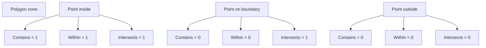

# ST_Contains, ST_Within, ST_Intersects và điều kiện quan hệ

Một hệ thống bản đồ hoặc giao hàng thường cần trả lời những câu hỏi như: điểm giao hàng có nằm trong vùng phục vụ không, hai khu vực có chồng lấn không, tuyến đường có cắt qua vùng cấm không? Đây là các câu hỏi về **quan hệ không gian** giữa hai hình học.

MySQL cung cấp các hàm quan hệ không gian như `ST_Contains()`, `ST_Within()` và `ST_Intersects()`. Ba hàm này đều kiểm tra quan hệ topo giữa hai geometry, nhưng ý nghĩa và thứ tự đối số khác nhau. Dùng nhầm thứ tự có thể làm truy vấn trả kết quả ngược hoặc bỏ sót điểm nằm trên biên.

Bài này giải thích điều kiện đúng/sai của từng hàm, quan hệ giữa chúng, cách xử lý boundary, SRID và hệ tọa độ, cách viết truy vấn cho điểm-vùng và vùng-vùng, cùng cách kết hợp điều kiện chính xác với spatial index.

## 1. Geometry và quan hệ không gian

MySQL biểu diễn dữ liệu không gian bằng kiểu `GEOMETRY` và các kiểu con:

| Kiểu | Ý nghĩa | Ví dụ |
|---|---|---|
| `POINT` | Một vị trí | Vị trí cửa hàng |
| `LINESTRING` | Một đường gồm các điểm nối tiếp | Tuyến giao hàng |
| `POLYGON` | Một vùng có biên khép kín | Khu vực phục vụ |
| `MULTIPOINT` | Nhiều điểm | Các trạm lấy hàng |
| `MULTILINESTRING` | Nhiều đường | Mạng lưới tuyến |
| `MULTIPOLYGON` | Nhiều vùng | Các vùng hành chính rời nhau |
| `GEOMETRYCOLLECTION` | Tập geometry có thể khác kiểu | Kết quả tổng hợp |

Các hàm quan hệ nhận geometry làm đối số. Chúng trả lời hình học này nằm trong, chứa hoặc giao với hình học kia theo quy tắc topo; chúng không trực tiếp trả về khoảng cách hay thời gian di chuyển.

Ví dụ:

- `ST_Contains(zone, point)`: vùng có chứa điểm hay không.
- `ST_Within(point, zone)`: điểm có nằm trong vùng hay không.
- `ST_Intersects(route, restricted_area)`: tuyến đường có giao với vùng hạn chế hay không.

## 2. Tạo geometry để thử nghiệm

Có thể tạo geometry từ Well-Known Text (WKT) bằng `ST_GeomFromText()`:

```sql
SET @zone = ST_GeomFromText(
    'POLYGON((
        0 0,
        10 0,
        10 10,
        0 10,
        0 0
    ))'
);

SET @inside_point = ST_GeomFromText('POINT(5 5)');
SET @edge_point = ST_GeomFromText('POINT(0 5)');
SET @outside_point = ST_GeomFromText('POINT(12 5)');
```

Các geometry trong ví dụ này dùng SRID mặc định 0, phù hợp để minh họa tọa độ phẳng Cartesian. Polygon phải có vòng ngoài khép kín: điểm cuối trùng điểm đầu.

Kiểm tra biểu diễn:

```sql
SELECT
    ST_AsText(@zone) AS zone_wkt,
    ST_AsText(@inside_point) AS inside_wkt,
    ST_SRID(@zone) AS zone_srid,
    ST_SRID(@inside_point) AS point_srid;
```

Trong ứng dụng thực tế, nên lưu geometry với SRID phù hợp và dùng cùng SRID cho các phép so sánh.

## 3. ST_Contains(): geometry thứ nhất chứa geometry thứ hai

Cú pháp:

```sql
ST_Contains(g1, g2)
```

Hàm trả về 1 khi `g1` chứa `g2` theo điều kiện topo của phép contains; trả về 0 nếu không thỏa. Nếu đối số là SQL `NULL` hoặc geometry rỗng, kết quả là `NULL`; các điều kiện lỗi về SRID và tính hợp lệ được trình bày ở mục 13.

Ví dụ:

```sql
SELECT ST_Contains(@zone, @inside_point) AS contains_inside;
```

Kết quả:

```text
1
```

`ST_Contains(A, B)` có nghĩa A là geometry bao chứa, B là geometry được kiểm tra. Thứ tự này rất quan trọng:

```sql
-- Vung chua diem
SELECT ST_Contains(@zone, @inside_point);

-- Doi doi so se hoi mot cau hoi khac
SELECT ST_Contains(@inside_point, @zone);
```

Không đảo đối số chỉ vì tên hàm có chữ “contains”. Hãy đọc theo mẫu: `ST_Contains(container, candidate)`.

### 3.1. Điều kiện topo của Contains

Theo định nghĩa topo kiểu OGC/DE-9IM, `ST_Contains(A, B)` đúng khi:

- Không có điểm nào của B nằm bên ngoài A.
- Phần interior của B có ít nhất một điểm nằm trong interior của A.

Điều kiện thứ hai giải thích vì sao một điểm chỉ nằm trên đường biên polygon không được xem là được polygon chứa. Tất cả điểm của B phải nằm trong A hoặc trên biên A, nhưng hai interior cũng phải giao nhau.

### 3.2. Ví dụ vùng chứa điểm

```sql
SELECT
    ST_Contains(@zone, @inside_point) AS inside_result,
    ST_Contains(@zone, @edge_point) AS edge_result,
    ST_Contains(@zone, @outside_point) AS outside_result;
```

Với polygon hình vuông ở ví dụ:

| Điểm | Vị trí | `ST_Contains(zone, point)` |
|---|---|---:|
| `(5, 5)` | Bên trong | 1 |
| `(0, 5)` | Trên biên | 0 |
| `(12, 5)` | Bên ngoài | 0 |

Nếu nghiệp vụ cần tính cả điểm nằm trên biên là thuộc vùng, `ST_Contains()` không thể hiện đúng quy tắc đó. Cần chọn predicate phù hợp hoặc định nghĩa chính sách biên riêng.

## 4. ST_Within(): geometry thứ nhất nằm trong geometry thứ hai

Cú pháp:

```sql
ST_Within(g1, g2)
```

`ST_Within(A, B)` kiểm tra A có nằm trong B hay không. Đây là quan hệ đảo chiều của `ST_Contains()`:

```sql
ST_Within(A, B) = ST_Contains(B, A)
```

Ví dụ:

```sql
SELECT
    ST_Within(@inside_point, @zone) AS point_within_zone,
    ST_Contains(@zone, @inside_point) AS zone_contains_point;
```

Hai biểu thức phải cho cùng kết quả vì chúng biểu diễn cùng một quan hệ nhưng đảo vị trí đối số.

Đọc đối số theo mẫu: `ST_Within(candidate, container)`. Nếu muốn kiểm tra điểm có nằm trong vùng không, đặt điểm trước và vùng sau.

### 4.1. Boundary với Within

Điểm chỉ nằm trên biên polygon cũng không được xem là nằm trong polygon theo `ST_Within()`:

```sql
SELECT
    ST_Within(@inside_point, @zone) AS inside_result,
    ST_Within(@edge_point, @zone) AS edge_result,
    ST_Within(@outside_point, @zone) AS outside_result;
```

Kết quả lần lượt là 1, 0, 0. Quy tắc này tương ứng với kết quả của `ST_Contains()` khi đảo hai đối số.

## 5. ST_Intersects(): hai geometry có ít nhất một điểm chung

Cú pháp:

```sql
ST_Intersects(g1, g2)
```

`ST_Intersects(A, B)` trả về 1 nếu A và B có ít nhất một điểm chung; ngược lại trả 0. Quan hệ này đối xứng:

```sql
ST_Intersects(A, B) = ST_Intersects(B, A)
```

Ví dụ:

```sql
SELECT
    ST_Intersects(@zone, @inside_point) AS inside_result,
    ST_Intersects(@zone, @edge_point) AS edge_result,
    ST_Intersects(@zone, @outside_point) AS outside_result;
```

Kết quả:

| Điểm | Quan hệ với polygon | `ST_Intersects(zone, point)` |
|---|---|---:|
| `(5, 5)` | Bên trong | 1 |
| `(0, 5)` | Trên biên | 1 |
| `(12, 5)` | Bên ngoài, không chạm biên | 0 |

Khác với `ST_Contains()` và `ST_Within()`, `ST_Intersects()` tính cả trường hợp chỉ chạm nhau ở biên. Vì vậy, nó thường phù hợp khi cần tìm mọi đối tượng có giao điểm với vùng tìm kiếm.

## 6. So sánh ba hàm

| Hàm | Câu hỏi | Thứ tự đối số | Đặc điểm |
|---|---|---|---|
| `ST_Contains(A, B)` | A có chứa B không? | Container trước, candidate sau | Interior của hai geometry phải giao nhau |
| `ST_Within(A, B)` | A có nằm trong B không? | Candidate trước, container sau | Là phép đảo của Contains |
| `ST_Intersects(A, B)` | A và B có điểm chung không? | Đối xứng | Chỉ cần có ít nhất một điểm chung |

Với một polygon và ba điểm thử:

| Vị trí điểm | Contains(polygon, point) | Within(point, polygon) | Intersects(polygon, point) |
|---|---:|---:|---:|
| Bên trong | 1 | 1 | 1 |
| Trên biên | 0 | 0 | 1 |
| Bên ngoài | 0 | 0 | 0 |

Điểm cần nhớ:

- `Contains` và `Within` diễn đạt quan hệ bao chứa theo hai hướng.
- `Intersects` rộng hơn: bên trong, chạm biên hoặc cắt qua đều có thể là giao nhau.
- Không thay `Contains` bằng `Intersects` nếu nghiệp vụ yêu cầu đối tượng nằm trọn trong vùng.

## 7. Hiểu chính xác điều kiện boundary

Boundary là nguồn gây lỗi phổ biến trong truy vấn không gian. Với polygon, boundary gồm các đường bao ngoài và đường bao của các lỗ (interior rings) nếu có.

### 7.1. Điểm bên trong, trên biên và bên ngoài



Ví dụ kiểm tra điểm chạm biên:

```sql
SELECT
    ST_Contains(@zone, @edge_point) AS is_contained,
    ST_Within(@edge_point, @zone) AS is_within,
    ST_Intersects(@zone, @edge_point) AS intersects;
```

Kết quả là `0, 0, 1`. Đây không phải lỗi tính toán; đó là khác biệt định nghĩa giữa bao chứa và giao nhau.

### 7.2. Đối tượng nằm hoàn toàn trên biên

Một `LINESTRING` nằm dọc theo biên polygon có thể giao với polygon nhưng không thỏa điều kiện contains vì interior của line không giao với interior của polygon. Nếu nghiệp vụ muốn chấp nhận đường nằm trên ranh giới, phải định nghĩa điều kiện khác thay vì suy ra từ `ST_Contains()`.

### 7.3. Polygon có lỗ

Điểm nằm trong phần lỗ của polygon không thuộc polygon, dù điểm đó có thể nằm bên trong bounding rectangle của polygon. Với hình học thật:

- Điểm trong phần vật liệu của polygon: có thể thỏa Contains/Within.
- Điểm trên đường biên ngoài hoặc đường biên lỗ: không thỏa Contains/Within theo điều kiện interior.
- Điểm trong lỗ: không nằm trong polygon.

Đây cũng là ví dụ cho thấy kiểm tra bounding rectangle không đủ để xác nhận quan hệ topo chính xác.

## 8. Kết hợp điều kiện quan hệ trong truy vấn

Giả sử có các bảng:

- `service_zones`: polygon mô tả vùng phục vụ.
- `stores`: point mô tả vị trí cửa hàng.
- `roads`: linestring mô tả tuyến đường.

Tìm cửa hàng nằm trong một vùng:

```sql
SELECT
    s.id,
    s.name
FROM stores AS s
JOIN service_zones AS z
    ON z.id = 10
WHERE ST_Contains(z.area, s.location);
```

Nếu muốn diễn đạt từ phía cửa hàng:

```sql
SELECT
    s.id,
    s.name
FROM stores AS s
JOIN service_zones AS z
    ON z.id = 10
WHERE ST_Within(s.location, z.area);
```

Hai truy vấn dùng cùng một quan hệ không gian. Chọn cách viết làm rõ vai trò container/candidate để giảm nhầm lẫn.

Tìm các tuyến đường giao với vùng hạn chế:

```sql
SELECT
    r.id,
    r.route_name
FROM roads AS r
JOIN restricted_areas AS a
    ON a.id = 5
WHERE ST_Intersects(r.path, a.area);
```

Một tuyến chỉ chạm biên vùng hạn chế cũng được trả về. Nếu nghiệp vụ chỉ coi tuyến đi vào phần bên trong là vi phạm, cần mô hình hóa quy tắc đó rõ hơn.

## 9. Mô hình dữ liệu và SRID

Mỗi geometry có một SRID (Spatial Reference System Identifier), xác định hệ tọa độ và ý nghĩa tọa độ. Không nên so sánh geometry chỉ vì chúng có cùng số tọa độ.

Ví dụ:

- SRID 0 thường được dùng cho tọa độ phẳng Cartesian không gắn hệ tọa độ địa lý.
- SRID 4326 thường biểu diễn tọa độ địa lý WGS 84.

Các hàm quan hệ không gian thuộc nhóm SRID-restricted: hai geometry cần cùng SRID. So sánh geometry khác SRID có thể phát sinh lỗi thay vì tự chuyển đổi. Các hàm object-shape như `ST_Contains()`, `ST_Within()` và `ST_Intersects()` hỗ trợ cả Cartesian SRS lẫn geographic SRS; phép tính được thực hiện theo SRS tương ứng.

Kiểm tra SRID:

```sql
SELECT
    ST_SRID(location) AS srid,
    COUNT(*) AS row_count
FROM stores
GROUP BY ST_SRID(location);
```

Không dùng `ST_SRID(geom, target_srid)` để giả định rằng tọa độ đã được chuyển đổi. Gán SRID chỉ thay đổi thông tin hệ tọa độ của geometry; chuyển đổi tọa độ giữa hai SRS cần dùng `ST_Transform()` khi nguồn và đích được hỗ trợ.

### 9.1. Axis order của SRID 4326

Một lỗi thường gặp là nhầm thứ tự longitude/latitude. Theo định nghĩa EPSG của SRID 4326, trục được định nghĩa theo latitude rồi longitude; nhiều ứng dụng bản đồ lại truyền longitude rồi latitude.

MySQL hỗ trợ tùy chọn axis order khi đọc WKT. Nếu dữ liệu đầu vào theo thứ tự longitude-latitude, có thể chỉ rõ:

```sql
SET @new_york_point = ST_GeomFromText(
    'POINT(-73.9857 40.7484)',
    4326,
    'axis-order=long-lat'
);
```

Tùy chọn `axis-order=long-lat` nói rõ tọa độ trong WKT được truyền theo longitude trước, latitude sau. Khi xuất WKT hoặc đọc dữ liệu từ nguồn khác, hãy giữ quy ước axis order nhất quán và kiểm tra bằng `ST_AsText()`.

Không trộn geometry SRID 0 với SRID 4326 trong một phép quan hệ. Cũng không so sánh tọa độ địa lý theo đơn vị độ như thể chúng là mét.

### 9.2. Tạo bảng với SRID rõ ràng

Ví dụ:

```sql
CREATE TABLE stores (
    id BIGINT UNSIGNED NOT NULL,
    name VARCHAR(150) NOT NULL,
    location POINT NOT NULL SRID 4326,
    PRIMARY KEY (id),
    SPATIAL INDEX sx_stores_location (location)
) ENGINE=InnoDB;

CREATE TABLE service_zones (
    id BIGINT UNSIGNED NOT NULL,
    zone_name VARCHAR(150) NOT NULL,
    area POLYGON NOT NULL SRID 4326,
    PRIMARY KEY (id),
    SPATIAL INDEX sx_service_zones_area (area)
) ENGINE=InnoDB;
```

Spatial index của MySQL yêu cầu cột geometry được lập chỉ mục là `NOT NULL`. Với các phiên bản hiện đại, khai báo SRID cố định cho cột giúp kiểm soát dữ liệu đồng nhất và là điều kiện quan trọng để optimizer sử dụng spatial index.

## 10. Phân biệt quan hệ chính xác và MBR

Spatial index của MySQL là R-tree index trên **minimum bounding rectangle (MBR)** của geometry. MBR là hình chữ nhật nhỏ nhất song song với trục tọa độ bao quanh geometry.

Điều này tạo ra hai nhóm hàm:

| Nhóm | Ví dụ | Ý nghĩa |
|---|---|---|
| Quan hệ topo chính xác | `ST_Contains`, `ST_Within`, `ST_Intersects` | Kiểm tra hình học thực |
| Quan hệ bounding rectangle | `MBRContains`, `MBRWithin`, `MBRIntersects` | Kiểm tra hình chữ nhật bao quanh |

MBR giúp lọc nhanh các ứng viên, nhưng không xác nhận hình học thực sự thỏa quan hệ. Với polygon lõm hoặc polygon có lỗ, hai bounding rectangle giao nhau không có nghĩa hai polygon giao nhau.

### 10.1. Ví dụ false positive của MBR

Một polygon hình chữ L có thể có MBR là hình chữ nhật lớn. Một điểm nằm trong phần trống của hình chữ nhật nhưng bên ngoài polygon thật có thể thỏa `MBRContains()` trong khi `ST_Contains()` trả 0.

Vì vậy:

- `MBRContains()` không thay thế `ST_Contains()`.
- `MBRIntersects()` không thay thế `ST_Intersects()`.
- MBR predicate phù hợp để tạo tập ứng viên; exact predicate dùng để xác nhận kết quả cuối cùng.

### 10.2. Kết hợp MBR filter và exact predicate

Ví dụ tìm các điểm có khả năng nằm trong polygon tìm kiếm:

```sql
SET @search_area = ST_GeomFromText(
    'POLYGON((106.60 10.70, 106.70 10.70, 106.70 10.80, 106.60 10.80, 106.60 10.70))',
    4326,
    'axis-order=long-lat'
);

SELECT
    s.id,
    s.name
FROM stores AS s
WHERE MBRContains(@search_area, s.location)
  AND ST_Contains(@search_area, s.location);
```

Điều kiện MBR có thể thu hẹp ứng viên bằng spatial index nếu cấu trúc truy vấn và phiên bản optimizer hỗ trợ. Điều kiện `ST_Contains()` xác nhận quan hệ topo chính xác và loại các false positive.

Với tìm kiếm giao nhau:

```sql
SELECT
    r.id,
    r.route_name
FROM roads AS r
WHERE MBRIntersects(@search_area, r.path)
  AND ST_Intersects(@search_area, r.path);
```

Không mặc định mọi truy vấn dùng MBR đều sử dụng được index. Cần kiểm tra `EXPLAIN`, kiểu cột, SRID, `NOT NULL` và hình dạng biểu thức. Nếu optimizer không chọn spatial index, xem lại truy vấn và phân bố dữ liệu.

Ví dụ dùng vùng nhỏ quanh một khu vực địa lý để minh họa axis order. Với vùng lớn, vùng gần cực hoặc vùng cắt qua kinh tuyến 180°, bounding box địa lý có thể có semantics phức tạp hơn; hãy kiểm tra kết quả theo SRS và phiên bản server thực tế.

## 11. Spatial index và điều kiện sử dụng

Tạo spatial index:

```sql
ALTER TABLE stores
ADD SPATIAL INDEX sx_stores_location (location);
```

Một số điều kiện cần nhớ:

- Engine và kiểu cột phải hỗ trợ spatial index.
- Cột geometry được lập chỉ mục phải `NOT NULL`.
- Cột geometry phải được khai báo với SRID cố định (SRID-restricted); cột không khai báo SRID cụ thể không được optimizer dùng cho access path không gian.
- Các phép so sánh dựa trên MBR là dạng truy vấn phù hợp với spatial index; exact predicate vẫn cần bước xác nhận topo.
- Spatial index lưu MBR, không lưu toàn bộ quan hệ topo đã tính sẵn.
- Exact predicate có thể cần kiểm tra hình học sau bước lọc ứng viên.

Xem index:

```sql
SHOW INDEX FROM stores;

SELECT
    INDEX_NAME,
    COLUMN_NAME,
    INDEX_TYPE
FROM information_schema.STATISTICS
WHERE TABLE_SCHEMA = DATABASE()
  AND TABLE_NAME = 'stores';
```

Kiểm tra kế hoạch:

```sql
EXPLAIN
SELECT id, name
FROM stores
WHERE MBRContains(@search_area, location)
  AND ST_Contains(@search_area, location);
```

Spatial index đặc biệt hữu ích khi truy vấn có vùng tìm kiếm chọn lọc trên tập geometry lớn. Nếu phần lớn dữ liệu đều nằm trong vùng, optimizer có thể chọn cách truy cập khác.

### 11.1. Khác biệt optimizer giữa MySQL 9.7 và bản cũ

Optimizer MySQL 9.7 kiểm tra SRID của cột được lập chỉ mục và thực hiện phép tính bounding box phù hợp với SRS đó. Trước MySQL 9.7, optimizer thực hiện so sánh spatial index theo Cartesian; kết quả không được xác định nếu cột chứa SRID địa lý. Vì vậy, khi nâng cấp từ bản cũ, cần rà soát cột geometry, SRID thực tế và spatial index trước khi dựa vào kết quả lọc MBR cho geographic SRS.

## 12. Kết hợp điều kiện không gian và điều kiện quan hệ thông thường

Trong ứng dụng thực tế, truy vấn thường cần cả điều kiện không gian và điều kiện nghiệp vụ:

- Cửa hàng phải nằm trong vùng phục vụ.
- Cửa hàng phải đang hoạt động.
- Cửa hàng phải thuộc tenant hiện tại.
- Loại cửa hàng phải phù hợp với yêu cầu.

Ví dụ:

```sql
SELECT
    s.id,
    s.name
FROM stores AS s
WHERE s.tenant_id = ?
  AND s.status = 'ACTIVE'
  AND MBRContains(@search_area, s.location)
  AND ST_Contains(@search_area, s.location)
ORDER BY s.id
LIMIT 100;
```

Điều kiện tenant và trạng thái không được bỏ qua chỉ vì đã có spatial predicate. Trong hệ thống đa tenant, xác thực tenant ở backend và giữ điều kiện phân quyền trong mọi truy vấn.

Có thể kết hợp với bán kính, nhưng phải phân biệt quan hệ topo với khoảng cách:

- `ST_Contains()` trả lời điểm có nằm trong vùng hay không.
- `ST_Intersects()` trả lời hai hình học có giao nhau hay không.
- `ST_Distance()` hoặc hàm khoảng cách phù hợp trả lời hai vị trí cách nhau bao xa theo SRS và semantics tương ứng.

Không dùng `ST_Intersects()` để thay cho “cách nhau dưới 500 mét”.

## 13. NULL, geometry rỗng và dữ liệu không hợp lệ

Trước khi áp dụng predicate, cần xác định trạng thái của geometry:

- Cột có thể là SQL `NULL` hay bị ràng buộc `NOT NULL`?
- Geometry có rỗng không?
- Polygon có hợp lệ không?
- SRID có đúng không?
- Tọa độ có nằm trong miền hợp lệ của SRS không?

Các hàm quan hệ object-shape trong MySQL trả về `NULL` nếu bất kỳ đối số nào là SQL `NULL` hoặc geometry rỗng. Trong `WHERE`, điều kiện `NULL` không được xem là TRUE nên hàng không được chọn.

Các trường hợp lỗi khác cần phân biệt:

- Geometry không đúng cú pháp có thể phát sinh `ER_GIS_INVALID_DATA`.
- SRID không được định nghĩa có thể phát sinh `ER_SRS_NOT_FOUND`.
- Hai geometry có SRS khác nhau phát sinh `ER_GIS_DIFFERENT_SRIDS`; MySQL không tự chuyển đổi.
- Geometry đúng cú pháp nhưng không hợp lệ về mặt hình học có thể cho kết quả TRUE/FALSE không xác định hoặc phát sinh lỗi. Không dựa vào kết quả predicate để thay thế bước validate dữ liệu.

Dùng các hàm kiểm tra phù hợp:

```sql
SELECT
    id,
    ST_SRID(area) AS srid,
    ST_IsValid(area) AS is_valid
FROM service_zones;
```

`ST_IsValid()` giúp phát hiện geometry không hợp lệ theo quy tắc hình học. Với dữ liệu đầu vào từ người dùng hoặc hệ thống bên ngoài, nên kiểm tra trước khi lưu và xử lý lỗi constructor/validation ở tầng ingest.

Không tự sửa geometry sai bằng cách chỉ gán SRID. Nếu polygon tự cắt, vòng không khép kín hoặc tọa độ sai trục, cần sửa dữ liệu nguồn hoặc dùng quy trình làm sạch geometry có kiểm soát.

## 14. Các quan hệ topo khác để hiểu phạm vi

Ba hàm trong bài là nền tảng, nhưng MySQL còn có các predicate khác:

| Hàm | Ý nghĩa khái quát |
|---|---|
| `ST_Disjoint(A, B)` | Không có điểm chung |
| `ST_Touches(A, B)` | Có điểm chung nhưng interior không giao nhau |
| `ST_Crosses(A, B)` | Các hình học cắt nhau theo điều kiện topo của kiểu hình học |
| `ST_Overlaps(A, B)` | Giao nhau nhưng không hình nào hoàn toàn nằm trong hình kia, theo điều kiện topo |
| `ST_Equals(A, B)` | Hai hình học biểu diễn cùng một tập điểm |

Không suy ra các predicate này chỉ bằng cách đảo đối số. Ví dụ `ST_Intersects()` đối xứng, còn `ST_Contains()` và `ST_Within()` có hướng.

Nếu nghiệp vụ yêu cầu “nằm hoàn toàn bên trong và không chạm biên”, hãy xác định điều kiện topo chính xác thay vì chỉ dựa vào tên hàm.

## 15. Quy trình chọn predicate

| Câu hỏi nghiệp vụ | Predicate nên bắt đầu xem xét |
|---|---|
| Điểm có nằm bên trong vùng không, không tính biên? | `ST_Within(point, polygon)` hoặc `ST_Contains(polygon, point)` |
| Geometry B có được geometry A bao chứa không? | `ST_Contains(A, B)` |
| Hai vùng có bất kỳ điểm chung nào, kể cả chạm biên? | `ST_Intersects(A, B)` |
| Tuyến có chạm vùng cấm không? | `ST_Intersects(route, restricted_area)` |
| Điểm trên ranh giới có được xem là thuộc vùng không? | `ST_Intersects()` có thể nhận diện tiếp xúc; định nghĩa chính sách biên riêng |
| Hai vị trí cách nhau bao xa? | Hàm khoảng cách phù hợp, không phải ba predicate này |

Trước khi triển khai, hãy viết câu hỏi bằng lời và gắn vai trò cho từng đối số:

1. Geometry nào là vùng/container?
2. Geometry nào là đối tượng được kiểm tra?
3. Boundary có được tính là hợp lệ không?
4. Chỉ cần có giao điểm hay cần nằm trọn trong vùng?
5. Hai geometry có cùng SRID không?

## 16. Ví dụ tổng hợp: kiểm tra điểm giao hàng trong vùng phục vụ

Tạo một vùng phẳng minh họa:

```sql
CREATE TABLE demo_zones (
    id INT NOT NULL PRIMARY KEY,
    zone_name VARCHAR(100) NOT NULL,
    area POLYGON NOT NULL
) ENGINE=InnoDB;

INSERT INTO demo_zones(id, zone_name, area)
VALUES (
    1,
    'Central',
    ST_GeomFromText(
        'POLYGON((0 0, 10 0, 10 10, 0 10, 0 0))'
    )
);
```

Tạo các điểm thử:

```sql
CREATE TABLE demo_deliveries (
    id INT NOT NULL PRIMARY KEY,
    delivery_code VARCHAR(30) NOT NULL,
    location POINT NOT NULL
) ENGINE=InnoDB;

INSERT INTO demo_deliveries(id, delivery_code, location)
VALUES
    (1, 'IN-001', ST_GeomFromText('POINT(5 5)')),
    (2, 'EDGE-001', ST_GeomFromText('POINT(0 5)')),
    (3, 'OUT-001', ST_GeomFromText('POINT(12 5)'));
```

Tìm điểm nằm trong vùng, không tính boundary:

```sql
SELECT
    d.id,
    d.delivery_code
FROM demo_deliveries AS d
JOIN demo_zones AS z
    ON z.id = 1
WHERE ST_Within(d.location, z.area);
```

Kết quả chỉ có `IN-001`.

Tìm mọi điểm giao với vùng, bao gồm điểm nằm trên boundary:

```sql
SELECT
    d.id,
    d.delivery_code
FROM demo_deliveries AS d
JOIN demo_zones AS z
    ON z.id = 1
WHERE ST_Intersects(d.location, z.area);
```

Kết quả có `IN-001` và `EDGE-001`. `OUT-001` nằm ngoài và không chạm vùng.

Hai bảng demo dùng SRID 0 và chỉ phục vụ kiểm chứng logic topo. Ví dụ này không dùng để đo spatial index; phần spatial index production cần cột `NOT NULL` có SRID cố định như ví dụ `stores` và `service_zones` ở mục 9.2.

## 17. Hiệu năng và cách đọc kế hoạch

Spatial predicate có thể tốn chi phí vì MySQL phải kiểm tra hình học. Với dữ liệu lớn:

- Dùng SRID đúng và nhất quán.
- Dùng spatial index cho cột geometry có `NOT NULL` khi phù hợp.
- Dùng MBR predicate làm bước lọc ứng viên nếu optimizer có thể tận dụng index.
- Dùng exact predicate để xác nhận kết quả cuối.
- Kết hợp điều kiện tenant/trạng thái có chọn lọc.
- Tránh biến đổi geometry của cột được lập chỉ mục trong biểu thức lọc nếu điều đó làm mất khả năng dùng index.
- Kiểm tra `EXPLAIN` trên dữ liệu có phân bố gần với production.

Ví dụ một điểm tìm kiếm nằm trong vùng:

```sql
EXPLAIN
SELECT id, name
FROM stores
WHERE MBRContains(@search_area, location)
  AND ST_Contains(@search_area, location)
  AND status = 'ACTIVE';
```

Đọc kế hoạch:

- `key` có phải spatial index mong đợi không?
- `type` và số hàng ước tính có hợp lý không?
- Bộ lọc `status` có được áp dụng hiệu quả không?
- Có quá nhiều candidate MBR bị loại bởi exact predicate không?
- Nếu không dùng spatial index, truy vấn có đang chọn phần lớn bảng hoặc thiếu điều kiện SRID/NOT NULL không?

Spatial index không bảo đảm truy vấn luôn nhanh. Khi vùng tìm kiếm bao phủ gần hết dữ liệu, table scan có thể rẻ hơn.

## 18. Lỗi thường gặp và cách khắc phục

| Triệu chứng | Nguyên nhân | Cách xử lý |
|---|---|---|
| `ST_Contains()` trả 0 cho điểm nằm trên ranh giới | Contains yêu cầu interior giao nhau; điểm biên không thỏa | Dùng predicate theo đúng chính sách boundary |
| `ST_Within()` trả 0 dù điểm nằm trên đường biên | Within là phép đảo của Contains | Dùng `ST_Intersects()` nếu chỉ cần chạm vùng |
| `ST_Intersects()` trả 1 cho điểm chạm biên | Đây là hành vi đúng của intersects | Giữ kết quả nếu boundary được tính là giao |
| Kết quả sai khi đảo đối số | Contains/Within có hướng | Đặt container và candidate đúng thứ tự |
| Lỗi khác SRID | Geometry không cùng hệ tọa độ | Kiểm tra SRID và chuyển đổi tọa độ có chủ đích |
| Điểm lệch xa khi dùng SRID 4326 | Nhầm longitude/latitude hoặc axis order | Xác định axis order và kiểm tra WKT |
| MBR trả nhiều hàng hơn exact predicate | MBR chỉ là hình chữ nhật bao | Dùng exact predicate làm bước xác nhận |
| Spatial index không được chọn | Cột không `NOT NULL`, không SRID-restricted hoặc truy vấn không phù hợp | Kiểm tra DDL, SRID và `EXPLAIN` |
| Polygon không hợp lệ | Vòng tự cắt hoặc dữ liệu đầu vào sai | Validate và làm sạch nguồn geometry |
| Truy vấn theo bán kính trả kết quả sai | Dùng predicate topo thay cho khoảng cách | Dùng hàm khoảng cách phù hợp với SRS |

## 19. Bài tập thực hành

### Bài 1 — Phân biệt ba predicate

Tạo polygon hình vuông và ba điểm: bên trong, trên biên, bên ngoài. Chạy `ST_Contains()`, `ST_Within()` và `ST_Intersects()`. Ghi lại kết quả và giải thích vì sao điểm trên biên cho ba giá trị khác nhau.

### Bài 2 — Kiểm tra thứ tự đối số

Chạy `ST_Contains(polygon, point)` và `ST_Contains(point, polygon)`. Sau đó chạy hai dạng tương đương `ST_Within(point, polygon)` và `ST_Within(polygon, point)`.

### Bài 3 — Tuyến đường giao vùng cấm

Tạo một `LINESTRING` cắt qua polygon, một line chỉ chạm biên và một line nằm hoàn toàn bên ngoài. Dùng `ST_Intersects()` để xác định các trường hợp có điểm chung.

### Bài 4 — Polygon có lỗ

Tạo polygon có interior ring. Thử một điểm nằm trong phần vật liệu, một điểm nằm trong lỗ và một điểm trên đường biên lỗ. So sánh exact predicate với MBR predicate.

### Bài 5 — SRID và axis order

Tạo hai point với SRID 4326, một point dùng `axis-order=long-lat`. Kiểm tra `ST_AsText()` và `ST_SRID()`. Tạo geometry khác SRID và quan sát lỗi khi so sánh.

### Bài 6 — Spatial index

Tạo bảng point có cột `NOT NULL SRID 4326` và spatial index. Chạy truy vấn MBR filter kết hợp exact predicate; dùng `EXPLAIN` để kiểm tra access path.

## 20. Checklist trước khi đưa spatial predicate vào production

- Đã xác định đúng kiểu geometry và quan hệ parent/candidate chưa?
- Đã chọn đúng thứ tự đối số cho `ST_Contains()` hoặc `ST_Within()` chưa?
- Đã quyết định điểm trên boundary có được tính là thuộc vùng không?
- Đã dùng `ST_Intersects()` chỉ khi bất kỳ điểm chung nào là đủ chưa?
- Hai geometry có cùng SRID không?
- Axis order và đơn vị tọa độ có đúng với nguồn dữ liệu không?
- Geometry có hợp lệ và không rỗng ngoài ý muốn không?
- Cột spatial index có `NOT NULL` và SRID cố định phù hợp không?
- Đã phân biệt exact predicate với MBR predicate chưa?
- Nếu dùng MBR để lọc ứng viên, có exact predicate xác nhận chưa?
- Đã kiểm tra `EXPLAIN` trên dữ liệu đại diện chưa?
- Các điều kiện tenant, trạng thái và quyền truy cập vẫn được áp dụng chưa?
- Nếu yêu cầu là bán kính/khoảng cách, đã dùng hàm distance thay vì predicate topo chưa?
- Đã kiểm thử boundary, polygon có lỗ, geometry rỗng, NULL và SRID khác nhau chưa?

## 21. Tài liệu tham khảo chính thức

- [MySQL 9.7 — Spatial Relation Functions That Use Object Shapes](https://dev.mysql.com/doc/refman/9.7/en/spatial-relation-functions-object-shapes.html)
- [MySQL 9.7 — Relation Functions That Use Minimum Bounding Rectangles](https://dev.mysql.com/doc/refman/9.7/en/spatial-relation-functions-mbr.html)
- [MySQL 9.7 — Spatial Data Types](https://dev.mysql.com/doc/refman/9.7/en/spatial-type-overview.html)
- [MySQL 9.7 — Spatial Reference System Support](https://dev.mysql.com/doc/refman/9.7/en/spatial-reference-systems.html)
- [MySQL 9.7 — Creating Spatial Indexes](https://dev.mysql.com/doc/refman/9.7/en/creating-spatial-indexes.html)
- [MySQL 9.7 — SPATIAL Index Optimization](https://dev.mysql.com/doc/refman/9.7/en/spatial-index-optimization.html)
- [MySQL 9.7 — WKT Format](https://dev.mysql.com/doc/refman/9.7/en/gis-wkt-functions.html)
- [MySQL 8.4 — Spatial Relation Functions That Use Object Shapes](https://dev.mysql.com/doc/refman/8.4/en/spatial-relation-functions-object-shapes.html)
- [MySQL 8.4 — Optimizing Spatial Analysis](https://dev.mysql.com/doc/refman/8.4/en/optimizing-spatial-analysis.html)

## Kết luận

`ST_Contains(A, B)` kiểm tra A có chứa B; `ST_Within(A, B)` kiểm tra A có nằm trong B và là phép đảo của Contains; `ST_Intersects(A, B)` chỉ cần hai geometry có ít nhất một điểm chung nên bao gồm cả trường hợp chạm biên. Hãy xác định rõ boundary, thứ tự đối số và SRID trước khi viết truy vấn. Spatial index của MySQL dựa trên MBR nên có thể dùng để lọc ứng viên, còn exact predicate cần xác nhận quan hệ topo thực. Khi kết hợp đúng predicate, hệ tọa độ, index và bộ lọc nghiệp vụ, truy vấn không gian sẽ dễ kiểm chứng và phù hợp hơn với yêu cầu ứng dụng.
