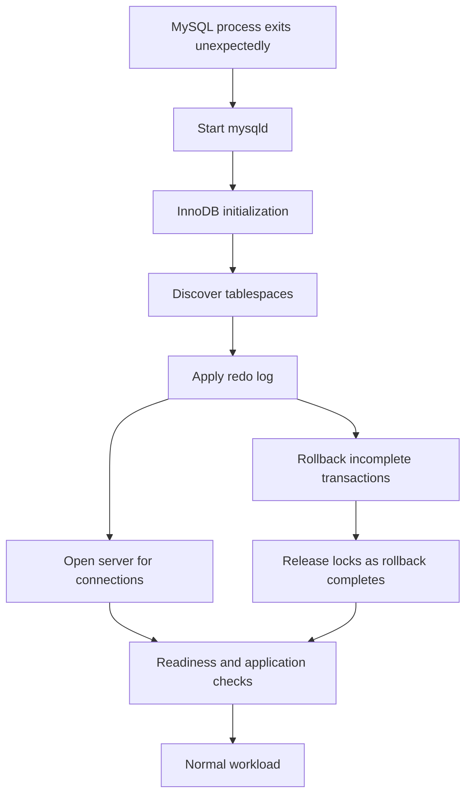

# Khởi động, tắt máy chủ an toàn và kiểm tra crash recovery

MySQL là một tiến trình máy chủ quản lý kết nối, transaction, buffer pool, redo log, undo log và các tablespace. Khởi động hoặc dừng `mysqld` vì vậy không chỉ là bật hay tắt một service của hệ điều hành. Người vận hành cần biết instance nào đang chạy, data directory nào được sử dụng, cách yêu cầu shutdown có kiểm soát và cách xác minh InnoDB đã phục hồi sau một lần dừng bất thường.

Một lần dừng đúng quy trình cho phép MySQL đóng kết nối, xử lý transaction còn mở, flush dữ liệu và đóng storage engine. Nếu tiến trình bị kill, máy mất điện hoặc hệ điều hành gặp sự cố, InnoDB sẽ tự chạy crash recovery khi khởi động lại. Crash recovery thường tự động xử lý được sự cố tiến trình, nhưng không thay thế backup khi data file hoặc thiết bị lưu trữ bị hỏng.

Bài học này tập trung vào vòng đời của MySQL Server: xác định đúng instance, khởi động bằng service manager, dừng an toàn, hiểu các chế độ `innodb_fast_shutdown`, theo dõi log và kiểm chứng crash recovery. Phần cuối trình bày cách xử lý khi server không khởi động được và giới hạn của `innodb_force_recovery`.

## 1. Vòng đời của MySQL Server

Tiến trình `mysqld` đọc cấu hình, mở data directory, khởi tạo storage engine, phục hồi trạng thái cần thiết rồi mới nhận kết nối. Khi shutdown, server ngừng nhận kết nối mới, kết thúc hoạt động hiện tại, đóng bảng và storage engine, sau đó thoát.

| Giai đoạn | Việc MySQL thực hiện | Điều người vận hành cần xác minh |
|---|---|---|
| Chuẩn bị startup | Đọc option file, tham số command line và môi trường | Đúng binary, cấu hình, service và data directory |
| Khởi tạo server | Tạo thread nội bộ, mở log, khởi tạo plugin/engine | Error log không có lỗi cấu hình hoặc quyền truy cập |
| InnoDB initialization | Đọc system tablespace, redo/undo và metadata | Không thiếu file hoặc gặp lỗi I/O |
| Crash recovery nếu cần | Phát hiện tablespace, apply redo, rollback transaction chưa commit | Theo dõi tiến trình recovery trong error log |
| Ready | Mở listener và nhận kết nối | Kiểm tra đúng host, port, server UUID và truy vấn |
| Shutdown | Ngừng nhận kết nối, kết thúc thread, đóng bảng và engine | Đợi process thoát và xác nhận shutdown hoàn tất |

MySQL có thể được quản lý bởi systemd, Windows Service Control Manager, container runtime hoặc một process supervisor khác. Hãy chọn một cơ chế quản lý nhất quán cho mỗi instance. Không khởi chạy thêm một `mysqld` thủ công trên cùng data directory khi service hiện tại vẫn đang quản lý instance đó.

## 2. Xác định đúng instance trước khi thao tác

Trên một máy có nhiều instance, service name, port và data directory có thể khác nhau. Trước khi restart hoặc shutdown, cần xác định chính xác instance đích.

Kết nối bằng tài khoản quản trị phù hợp:

```sql
SELECT
    VERSION() AS mysql_version,
    @@hostname AS server_host,
    @@port AS server_port,
    @@server_uuid AS server_uuid,
    @@datadir AS data_directory,
    @@socket AS socket_path;

SHOW VARIABLES LIKE 'log_error';
SHOW VARIABLES LIKE 'pid_file';
SHOW GLOBAL STATUS LIKE 'Uptime';
```

Các giá trị cần ghi lại:

- `@@server_uuid`: định danh instance trong môi trường replication.
- `@@port` và `@@socket`: endpoint mà client đang sử dụng.
- `@@datadir`: thư mục dữ liệu của instance.
- `log_error`: đích ghi error log; giá trị có thể là file hoặc được chuyển tới system log tùy cấu hình.
- `Uptime`: số giây từ lần khởi động gần nhất, hữu ích để xác nhận instance vừa restart.

Không suy ra instance chỉ từ tên host hoặc tên service. Nếu kết nối nhầm port, lệnh shutdown có thể dừng một instance khác với instance đang được kiểm tra.

### 2.1. Kiểm tra từ hệ điều hành

Trên Linux với systemd:

```bash
systemctl list-unit-files | grep -E 'mysql|mysqld'
systemctl status mysqld
ps -ef | grep '[m]ysqld'
```

Tên service có thể là `mysqld` hoặc `mysql`, tùy bản phân phối và cách cài đặt. Đối chiếu service với cấu hình và PID file trước khi thao tác.

Trên Windows PowerShell:

```powershell
Get-Service -Name '*mysql*'
Get-CimInstance Win32_Service |
    Where-Object { $_.Name -like '*mysql*' } |
    Select-Object Name, State, StartName, PathName
```

`PathName` giúp nhận diện binary và các startup argument của service; nếu có tùy chọn chỉ định option file, bạn cũng có thể thấy nó ở đây. Ví dụ service thường có tên `MySQL80`, nhưng tên thực tế phải lấy từ máy đang vận hành.

## 3. Khởi động MySQL bằng service manager

Với cài đặt Linux dùng systemd:

```bash
sudo systemctl start mysqld
sudo systemctl status mysqld
sudo journalctl -u mysqld -n 200 --no-pager
```

Thay `mysqld` bằng tên unit thực tế nếu hệ thống dùng `mysql`. Package MySQL trên Linux thường tích hợp systemd; trong trường hợp đó, hãy dùng service manager thay vì tự chạy một tiến trình thứ hai bằng `mysqld_safe`.

Trên Windows, dùng đúng service name đã xác định:

```powershell
Start-Service -Name 'MySQL80'
Get-Service -Name 'MySQL80'
```

Thay `MySQL80` bằng tên service trên máy. Nếu service không khởi động, mở error log mà service cấu hình và kiểm tra Windows Event Viewer khi cần.

### 3.1. Khởi động thủ công trong môi trường phù hợp

Với một số cài đặt Unix không dùng systemd, MySQL có thể được khởi động bằng `mysqld_safe`:

```bash
bin/mysqld_safe --user=mysql &
```

Hoặc chạy trực tiếp server ở foreground để quan sát log trong môi trường thử nghiệm:

```bash
bin/mysqld --user=mysql --console
```

Không chạy `mysqld` với quyền root. Server nên chạy bằng tài khoản hệ điều hành chuyên dụng, thường là `mysql`, để giới hạn quyền truy cập file. Không dùng các lệnh thủ công này để cạnh tranh quyền quản lý với service manager.

### 3.2. Những điều cần kiểm tra khi startup thất bại

Nếu server thoát ngay sau khi start, đọc error log từ thời điểm khởi động gần nhất. Các nguyên nhân phổ biến:

- Option file có biến không hợp lệ hoặc giá trị sai kiểu.
- Service dùng một `datadir` khác với nơi chứa dữ liệu dự kiến.
- Tài khoản hệ điều hành không có quyền đọc/ghi data directory hoặc log directory.
- Port đã được tiến trình khác sử dụng.
- File tablespace, redo log hoặc undo tablespace bị thiếu.
- Disk đầy, filesystem read-only hoặc thiết bị lưu trữ báo lỗi I/O.
- Data directory được tạo bởi phiên bản MySQL không tương thích.
- InnoDB không thể hoàn thành initialization hoặc crash recovery.

Không xóa file trong data directory để “thử khởi động lại”. Trước khi thay đổi cấu hình hoặc file, giữ nguyên hiện trạng, lưu log và xác định nguyên nhân.

## 4. Kiểm tra server đã sẵn sàng

Service ở trạng thái `active` chưa đủ để chứng minh MySQL sẵn sàng phục vụ workload. Cần kiểm tra cả kết nối, truy vấn và danh tính instance.

Kiểm tra bằng `mysqladmin`:

```bash
mysqladmin -h 127.0.0.1 -P 3306 -u healthcheck -p ping
mysqladmin -h 127.0.0.1 -P 3306 -u healthcheck -p version
```

`ping` kiểm tra server có phản hồi hay không; `version` trả thông tin server và uptime. Dùng tài khoản kiểm tra quyền tối thiểu và nhập mật khẩu ở prompt, không ghi password trực tiếp trong command line.

Sau đó chạy truy vấn xác nhận:

```sql
SELECT
    1 AS connectivity_check,
    VERSION() AS version,
    @@server_uuid AS server_uuid,
    @@datadir AS data_directory,
    @@GLOBAL.innodb_force_recovery AS force_recovery;

SHOW GLOBAL STATUS LIKE 'Uptime';
SHOW ENGINE INNODB STATUS;
```

Kiểm tra:

- Kết nối tới đúng host và port.
- `server_uuid`, `datadir` và version khớp với instance dự kiến.
- `innodb_force_recovery` bằng 0 trong hoạt động bình thường.
- Không có lỗi InnoDB mới trong error log.
- Ứng dụng thực hiện được các truy vấn readiness cần thiết.
- Nếu là replica, replication thread và trạng thái lag đáp ứng yêu cầu vận hành.

`mysqladmin ping` chỉ chứng minh server phản hồi ở mức kết nối. Nó không thay thế kiểm tra truy vấn của ứng dụng, quyền truy cập schema, replication hoặc khả năng ghi.

## 5. Chuẩn bị một lần shutdown có kế hoạch

Shutdown an toàn bắt đầu từ việc ngừng tạo workload mới. Không nên chỉ gửi lệnh dừng service trong lúc ứng dụng vẫn liên tục mở kết nối hoặc gửi transaction mới.

Quy trình chuẩn bị:

1. Xác nhận instance, host, port, service và data directory.
2. Thông báo hoặc bật maintenance mode theo quy trình của ứng dụng.
3. Loại instance khỏi load balancer hoặc dừng traffic mới nếu kiến trúc có hỗ trợ.
4. Tạm dừng worker, scheduler và job có thể mở transaction mới.
5. Kiểm tra transaction đang chạy và truy vấn dài.
6. Với replica hoặc cluster, phối hợp với cơ chế replication/failover và runbook của topology.
7. Xác nhận backup gần nhất và kế hoạch khởi động lại khi đây là thay đổi có rủi ro.

Kiểm tra transaction đang mở:

```sql
SELECT
    trx_id,
    trx_state,
    trx_started,
    trx_mysql_thread_id,
    trx_query
FROM information_schema.innodb_trx
ORDER BY trx_started;
```

Xem kết nối và câu lệnh đang hoạt động:

```sql
SHOW FULL PROCESSLIST;
```

Các truy vấn này giúp phát hiện transaction lâu, import, DDL hoặc workload còn chạy. Không mặc định rằng số connection bằng 0 là điều kiện bắt buộc; điều quan trọng là đã ngừng workload mới và hiểu các transaction còn lại sẽ được xử lý ra sao.

## 6. Các cách yêu cầu shutdown

### 6.1. Dùng mysqladmin

`mysqladmin shutdown` là cách yêu cầu MySQL dừng thông qua giao thức quản trị:

```bash
mysqladmin -h 127.0.0.1 -P 3306 -u shutdown_admin -p shutdown
```

Tài khoản cần quyền `SHUTDOWN`. Lệnh sẽ hỏi password tại prompt. Không lưu password dạng văn bản trong shell history, script hoặc process arguments.

### 6.2. Dùng câu lệnh SQL SHUTDOWN

Một tài khoản có quyền `SHUTDOWN` cũng có thể yêu cầu server dừng từ SQL:

```sql
SHUTDOWN;
```

Sau khi lệnh được chấp nhận, kết nối client bị đóng vì server đang tắt. Đây là lệnh quản trị ở cấp server, không phải lệnh có thể rollback như một câu lệnh DML.

### 6.3. Dùng service manager

Với systemd:

```bash
sudo systemctl stop mysqld
sudo systemctl status mysqld
```

Với Windows PowerShell:

```powershell
Stop-Service -Name 'MySQL80'
Get-Service -Name 'MySQL80'
```

Service manager gửi yêu cầu dừng tới tiến trình dịch vụ. Thay service name bằng giá trị thực tế đã xác minh ở mục 2.

### 6.4. Dùng tín hiệu hệ điều hành

Trên Unix, `mysqld` có thể xử lý `SIGTERM` như một yêu cầu shutdown. Service manager thường là nơi thích hợp để gửi tín hiệu này vì nó cũng theo dõi trạng thái và timeout của service.

Không dùng `kill -9`, `taskkill /F`, tắt nguồn hoặc xóa PID file để thay cho shutdown bình thường. Những hành động đó có thể khiến server thoát bất thường và buộc InnoDB chạy crash recovery ở lần khởi động tiếp theo.

## 7. Shutdown diễn ra như thế nào?

Khi shutdown được khởi tạo, MySQL thực hiện các bước chính:

1. Tạo shutdown thread nếu cần.
2. Ngừng nhận kết nối mới qua TCP/IP, socket, named pipe hoặc shared memory.
3. Đánh dấu và kết thúc hoạt động của các client thread hiện có.
4. Rollback transaction mở của các connection bị kết thúc.
5. Đóng table cache và các bảng đang mở.
6. Yêu cầu mỗi storage engine thực hiện công việc cần thiết trước khi đóng.
7. Kết thúc tiến trình `mysqld`.

Với InnoDB, shutdown thông thường flush dữ liệu cần thiết, ghi trạng thái LSN vào tablespace và dừng thread nội bộ. MyISAM flush các thay đổi index đang chờ. Các bảng không hỗ trợ transaction không có bảo đảm rollback giống InnoDB; một statement nhiều hàng có thể để lại trạng thái cập nhật một phần nếu bị ngắt giữa chừng.

Vì vậy, ứng dụng nên hoàn thành hoặc dừng workload có kế hoạch trước khi shutdown. Không nên dựa vào việc server sẽ tự rollback mọi loại thao tác trên mọi storage engine.

## 8. innodb_fast_shutdown và ba chế độ dừng

`innodb_fast_shutdown` điều khiển một số công việc InnoDB thực hiện trong giai đoạn shutdown. Giá trị mặc định là `1`.

| Giá trị | Chế độ | Hành vi |
|---:|---|---|
| `0` | Slow shutdown | Thực hiện full purge và merge change buffer trước khi đóng; có thể kéo dài đáng kể |
| `1` | Fast shutdown (mặc định) | Bỏ qua full purge và change buffer merge ở thời điểm shutdown; vẫn là shutdown có kiểm soát |
| `2` | Cold shutdown | Flush log rồi đóng theo cách tương tự trạng thái sau crash; lần startup tiếp theo cần crash recovery |

Kiểm tra giá trị:

```sql
SHOW GLOBAL VARIABLES LIKE 'innodb_fast_shutdown';
```

### 8.1. Giá trị 1 — lựa chọn thông thường

Giá trị `1` là mặc định phù hợp cho phần lớn lần dừng thường ngày. InnoDB không thực hiện full purge và change buffer merge trước khi đóng, nhưng MySQL vẫn đi qua shutdown sequence có kiểm soát.

Đây không phải crash shutdown. Sau khi server thoát sạch, lần khởi động sau thông thường không cần chạy crash recovery như một lần bị kill đột ngột.

### 8.2. Giá trị 0 — trước khi nâng cấp phiên bản lớn

Giá trị `0` yêu cầu InnoDB thực hiện slow shutdown, bao gồm full purge và change buffer merge. Công việc này có thể mất nhiều phút hoặc nhiều giờ nếu còn lượng dữ liệu đệm lớn.

MySQL khuyến nghị slow shutdown trước khi upgrade hoặc downgrade giữa các major release để các data file được chuẩn bị đầy đủ cho quá trình có thể thay đổi định dạng file.

Có thể đặt giá trị cho lần shutdown sắp tới:

```sql
SET GLOBAL innodb_fast_shutdown = 0;
SHOW GLOBAL VARIABLES LIKE 'innodb_fast_shutdown';
```

Sau đó yêu cầu shutdown có kiểm soát. `SET GLOBAL` thay đổi runtime của instance hiện tại; nếu dùng cấu hình persist hoặc option file, cần kiểm tra để không vô tình giữ chế độ slow shutdown cho các lần dừng về sau.

### 8.3. Giá trị 2 — cold shutdown

Giá trị `2` flush InnoDB log rồi đóng theo trạng thái tương tự một lần crash. Tài liệu MySQL nêu rằng các transaction đã commit không bị mất do riêng chế độ này, nhưng startup kế tiếp sẽ cần crash recovery và có thể lâu hơn.

Đây là chế độ dành cho tình huống khẩn cấp hoặc troubleshooting đặc biệt, không phải lựa chọn thường ngày để tăng tốc shutdown. Không nhầm giá trị `2` với việc dùng `kill -9`: một bên vẫn là chế độ shutdown do InnoDB quản lý, bên kia là ép tiến trình thoát ngay.

## 9. Xác nhận shutdown đã hoàn tất

Sau khi gửi yêu cầu shutdown:

- Chờ service manager báo service đã dừng.
- Xác nhận process `mysqld` của đúng instance đã thoát.
- Kiểm tra error log hoặc system journal có thông báo hoàn tất shutdown.
- Xác nhận port/socket của instance không còn nhận kết nối.
- Không xóa, di chuyển hoặc chỉnh sửa data file khi tiến trình còn hoạt động.

Trên Linux:

```bash
sudo systemctl is-active mysqld
sudo systemctl status mysqld
sudo journalctl -u mysqld -n 200 --no-pager
pgrep -a mysqld
```

Trên Windows:

```powershell
Get-Service -Name 'MySQL80'
Get-Process -Name 'mysqld' -ErrorAction SilentlyContinue
```

Nếu `mysqld` vẫn còn chạy, đừng vội kill process. Đọc log, xem service manager đang chờ điều gì và kiểm tra transaction hoặc hoạt động engine còn kéo dài.

## 10. Crash recovery là gì?

InnoDB sử dụng redo log để ghi lại các thay đổi cần thiết cho việc phục hồi sau sự cố và undo log để rollback transaction chưa commit hoặc phục vụ MVCC. Dữ liệu đã commit có thể vẫn còn trong buffer pool và chưa được ghi hết vào data page của tablespace khi server bất ngờ thoát.

Sau một lần server exit không sạch, InnoDB tự kiểm tra log và thực hiện crash recovery:

- **Roll-forward:** áp dụng redo log cần thiết vào tablespace để đưa page về trạng thái nhất quán.
- **Rollback:** hoàn tác transaction chưa commit tại thời điểm crash. Transaction ở trạng thái XA PREPARED cần được phối hợp với transaction coordinator theo quy trình XA, không nên xem như transaction thường đã tự động rollback.

Crash recovery thường tự động khi restart server. DBA không cần tự chạy câu lệnh SQL để replay redo log.

### 10.1. Vì sao cần redo log?

Một transaction có thể cập nhật page trong buffer pool trước khi page đó được flush xuống data file. Redo log ghi lại thay đổi đủ để InnoDB tái áp dụng chúng sau sự cố.

Ví dụ:

1. Transaction cập nhật số dư tài khoản.
2. InnoDB ghi redo log theo quy tắc durability đã cấu hình.
3. Transaction commit.
4. Data page có thể chưa được ghi ngay xuống tablespace.
5. Server mất điện.
6. Khi restart, InnoDB dùng redo log để khôi phục thay đổi cần thiết.

Redo log không phải bản sao đầy đủ của database và không thay thế backup.

### 10.2. Vì sao cần undo log?

Undo log giữ thông tin để hoàn tác thay đổi của transaction chưa commit và hỗ trợ consistent read. Nếu server crash khi transaction còn mở, InnoDB phục hồi trạng thái page bằng redo rồi rollback transaction chưa hoàn tất bằng undo.

Ví dụ:

```sql
START TRANSACTION;

UPDATE accounts
SET balance = balance - 100
WHERE account_id = 10;

-- Giả sử server dừng bất thường trước COMMIT.
```

Sau khi crash recovery hoàn tất, thay đổi chưa commit không được xem là transaction thành công. InnoDB rollback transaction đó.

## 11. Các bước InnoDB crash recovery

Quá trình phục hồi có thể gồm các bước sau:

1. **Tablespace discovery:** tìm các tablespace cần thiết để áp dụng redo log.
2. **Redo log application:** đọc redo log và áp dụng thay đổi cần thiết trong giai đoạn initialization, trước khi server nhận kết nối.
3. **Rollback transaction chưa hoàn tất:** rollback transaction đang active khi server gặp sự cố.
4. **Change buffer merge và purge:** các công việc nền này tiếp tục theo cơ chế hoạt động bình thường; không phải tất cả đều là bước bắt buộc phải hoàn tất trước khi nhận kết nối.

Sau khi redo log application hoàn tất, InnoDB cố gắng cho phép server nhận kết nối sớm. Rollback các transaction chưa commit có thể tiếp tục ở background song song với workload mới. Vì vậy, trong một khoảng thời gian, kết nối mới có thể gặp lock conflict với transaction đang được rollback.

Nếu redo log files bị thiếu khi startup, InnoDB có thể bỏ qua bước redo log application. Đây là lý do không được tự xóa hoặc di chuyển redo log để “làm sạch” recovery; thiếu redo log phải được xem là một sự cố cần điều tra và đối chiếu backup.

Sơ đồ khái quát:



Đây là sơ đồ khái niệm. Thời gian và thứ tự công việc nền cụ thể phụ thuộc vào dữ liệu, log, storage engine và phiên bản MySQL.

## 12. Crash recovery không đồng nghĩa phục hồi từ backup

Phân biệt ba tình huống:

| Tình huống | Cơ chế phù hợp |
|---|---|
| `mysqld` bị kill hoặc máy khởi động lại đột ngột, data file còn nguyên | Restart server và để InnoDB tự crash recovery |
| Một vài page hoặc table bị hỏng | Điều tra corruption; có thể dump phần còn đọc được, nhưng thường cần backup sạch |
| Disk hoặc data directory bị mất/hỏng | Restore backup; nếu cần, replay binary log để point-in-time recovery |

Crash recovery xử lý tính nhất quán sau lần thoát bất thường. Nó không thể tái tạo file tablespace đã mất hoặc sửa mọi hỏng hóc vật lý của thiết bị.

Với corruption hoặc disk failure, quy trình chuẩn là khôi phục từ backup không bị hỏng, sau đó áp dụng binary log để đưa dữ liệu tới thời điểm mong muốn nếu đã bật binary logging và có đủ log.

Không coi việc server khởi động thành công là bằng chứng mọi dữ liệu đều còn nguyên. Cần kiểm tra error log, tính toàn vẹn dữ liệu và ứng dụng sau khi phục hồi.

## 13. Đọc error log để xác nhận recovery

Error log là nguồn chính để biết server đã phát hiện crash recovery, đang xử lý redo, rollback transaction hay gặp lỗi gì.

Lấy vị trí log:

```sql
SHOW VARIABLES LIKE 'log_error';
```

Trên Linux dùng systemd, log có thể được gửi tới journal:

```bash
sudo journalctl -u mysqld --since '30 minutes ago' --no-pager
```

Nếu `log_error` chỉ tới file, đọc file đó bằng công cụ log của hệ điều hành. Trên Windows, kiểm tra file error log theo cấu hình MySQL và Event Viewer nếu service không khởi động.

Khi xem log, tìm các nhóm thông tin:

- Thời điểm tiến trình khởi động và phiên bản server.
- InnoDB initialization và thông báo phát hiện trạng thái phục hồi.
- Redo log scan/application và LSN nếu được ghi.
- Tablespace nào được mở hoặc bị thiếu.
- Transaction rollback hoặc lock conflict trong giai đoạn sau recovery.
- Lỗi I/O, checksum, permission, disk full hoặc corruption.
- Thông báo server đã sẵn sàng nhận kết nối.

Đừng phụ thuộc vào một chuỗi log cố định giữa mọi phiên bản. Cấu trúc và câu chữ log có thể thay đổi; hãy đọc các thông báo theo thời gian và đối chiếu với error code, file, tablespace và hành động được ghi.

## 14. Kiểm tra sau khi crash recovery

Sau khi server nhận kết nối, thực hiện checklist theo đúng instance:

```sql
SELECT
    VERSION() AS version,
    @@server_uuid AS server_uuid,
    @@datadir AS datadir,
    @@GLOBAL.innodb_force_recovery AS force_recovery;

SHOW GLOBAL STATUS LIKE 'Uptime';
SHOW ENGINE INNODB STATUS;
SHOW GLOBAL STATUS LIKE 'Innodb_buffer_pool_pages_dirty';
```

Tiếp theo:

1. Xác nhận `innodb_force_recovery = 0`.
2. Đọc toàn bộ error log từ lúc startup, không chỉ dòng cuối.
3. Kiểm tra schema và bảng trọng yếu bằng các truy vấn ứng dụng có kiểm soát.
4. Kiểm tra transaction, lock wait và rollback còn chạy.
5. Kiểm tra replication nếu instance là source hoặc replica.
6. Xác nhận backup và binary log còn sẵn sàng cho phương án phục hồi nếu phát hiện corruption.
7. Theo dõi latency, disk I/O, connection count và error rate trước khi mở toàn bộ traffic.

`SHOW ENGINE INNODB STATUS` cung cấp ảnh chụp trạng thái nội bộ tại thời điểm truy vấn. Nó hữu ích để kiểm tra transaction, semaphore, I/O và trạng thái InnoDB, nhưng không thay thế việc đọc error log hoặc xác minh dữ liệu nghiệp vụ.

### 14.1. Kiểm tra replication nếu là replica

Với MySQL 8.0.22 trở lên:

```sql
SHOW REPLICA STATUS\G
```

Kiểm tra trạng thái I/O thread, SQL/applier thread, lỗi replication gần nhất và lag. Các phiên bản cũ hơn dùng cú pháp `SHOW SLAVE STATUS`; hãy dùng đúng cú pháp của phiên bản đang vận hành.

Không đưa replica trở lại phục vụ đọc hoặc failover chỉ dựa trên việc service đã `active`. Cần xác nhận replication đã bắt kịp và topology vẫn đúng.

## 15. innodb_force_recovery: chỉ dùng trong tình huống khẩn cấp

`innodb_force_recovery` cho phép cố khởi động InnoDB trong một số tình huống corruption nghiêm trọng để có thể dump dữ liệu còn đọc được. Đây không phải công cụ sửa chữa data file và không nên bật trong startup bình thường.

Đây là startup option, không phải biến runtime để thay đổi bằng `SET GLOBAL`. Muốn bật hoặc tắt, phải thay đổi option file/command line rồi khởi động lại instance.

Giá trị mặc định là `0`. Khi buộc phải dùng:

- Đảm bảo có bản sao vật lý của data directory trước khi thử.
- Bắt đầu với giá trị `1`.
- Chỉ tăng từng mức nếu mức trước không thể khởi động hoặc dump dữ liệu.
- Mục tiêu là đọc và export dữ liệu còn tốt để xây dựng lại instance.
- Sau khi dump, khôi phục từ backup sạch hoặc tạo lại instance; loại bỏ cấu hình recovery trước khi chạy bình thường.

### 15.1. Ý nghĩa các mức

| Mức | Hành vi chính | Rủi ro |
|---:|---|---|
| `0` | Startup bình thường | Không phải forced recovery |
| `1` | Bỏ qua một số page/index record bị đánh dấu corrupt để cố đọc dữ liệu | Có thể bỏ qua bản ghi hỏng |
| `2` | Không chạy master thread và purge thread | Các hoạt động nền bị tắt |
| `3` | Không rollback transaction sau crash recovery | Trạng thái transaction chưa hoàn tất không được xử lý như bình thường |
| `4` | Không chạy insert buffer merge và không tính table statistics | Có thể làm hỏng vĩnh viễn data file; InnoDB read-only |
| `5` | Không scan undo log khi startup | Có thể coi transaction chưa hoàn tất như đã commit; rủi ro hỏng dữ liệu |
| `6` | Không apply redo log | Page có thể ở trạng thái cũ; nguy cơ corruption nghiêm trọng |

Khi `innodb_force_recovery` lớn hơn 0, InnoDB chặn `INSERT`, `UPDATE` và `DELETE`. Từ mức 4 trở lên, InnoDB ở chế độ read-only. Mức 4, 5 và 6 có thể gây corruption vĩnh viễn; mức 6 đặc biệt nguy hiểm vì bỏ qua redo roll-forward.

### 15.2. Cách cấu hình tạm thời để dump dữ liệu

Chỉ sau khi đã có bản sao vật lý và runbook xử lý corruption, thêm tạm vào option file mà instance thực sự đọc:

```ini
[mysqld]
innodb_force_recovery=1
```

Khởi động lại bằng đúng service manager, theo dõi error log, sau đó chỉ thực hiện các thao tác đọc/export cần thiết:

```sql
SELECT COUNT(*) FROM critical_table;
```

Hoặc dùng `mysqldump`/công cụ backup phù hợp để export phần dữ liệu có thể đọc. Không tiếp tục workload ứng dụng và không dùng instance forced recovery như một primary đang phục vụ giao dịch.

Sau khi hoàn tất:

1. Lưu dump và log ở nơi an toàn.
2. Dừng instance theo quy trình đã chọn.
3. Gỡ `innodb_force_recovery` khỏi option file hoặc command line.
4. Phục hồi từ backup sạch hoặc dựng lại instance.
5. Xác minh instance mới ở chế độ bình thường với `innodb_force_recovery=0`.

Không để sót `innodb_force_recovery` trong cấu hình lâu dài. Khi server có thể khởi động ở forced recovery, điều đó chỉ có nghĩa dữ liệu còn đọc được có thể được export; nó không chứng minh database đã được sửa.

## 16. Những thao tác tuyệt đối không dùng để “làm sạch” recovery

Khi InnoDB đang recovery hoặc server không khởi động:

- Không xóa redo log để ép startup.
- Không xóa undo tablespace, system tablespace hoặc file `.ibd` theo phỏng đoán.
- Không đổi tên file data directory để né lỗi missing tablespace.
- Không copy data file trong khi `mysqld` vẫn chạy.
- Không khởi động nhiều tiến trình `mysqld` cùng dùng một data directory.
- Không nâng cấp/downgrade binary trước khi xác định tương thích data file và trạng thái shutdown.
- Không lặp lại restart liên tục nếu log cho thấy recovery vẫn đang tiến triển.

Redo log chứa thông tin cần thiết để đưa page về trạng thái nhất quán. Xóa redo log không phải phương pháp tăng tốc recovery an toàn. Chỉ xem xét thao tác với redo log theo quy trình được tài liệu MySQL cho phép, sau clean shutdown và khi có lý do kỹ thuật rõ ràng.

## 17. Shutdown kéo dài hoặc bị treo

Shutdown có thể lâu do transaction dài, statement đang chạy, purge backlog, change buffer merge hoặc I/O chậm. Đặc biệt, `innodb_fast_shutdown=0` có thể mất nhiều thời gian vì yêu cầu full purge và merge.

Nếu shutdown chưa hoàn tất:

1. Kiểm tra service manager và PID của đúng instance.
2. Đọc error log hoặc journal để biết server đang ở giai đoạn nào.
3. Nếu server còn nhận truy vấn, xem `SHOW FULL PROCESSLIST` và `information_schema.innodb_trx`.
4. Kiểm tra disk I/O, dung lượng đĩa và lỗi thiết bị.
5. Xác định có đang thực hiện slow shutdown do `innodb_fast_shutdown=0` hay không.
6. Chờ công việc có thể hoàn tất nếu log và I/O cho thấy tiến triển.
7. Chỉ dùng biện pháp can thiệp tiến trình theo runbook sự cố đã được phê duyệt.

Không gửi liên tiếp nhiều lệnh stop, không xóa PID file và không dùng force-kill như cách xử lý mặc định. Nếu tiến trình buộc phải bị dừng bất thường, hãy chuẩn bị theo dõi crash recovery ở lần startup tiếp theo.

## 18. Startup kéo dài hoặc crash recovery có vẻ bị kẹt

Một lần recovery có thể kéo dài khi redo log lớn, nhiều tablespace cần xử lý hoặc transaction lớn phải rollback. Không nên kết luận server bị treo chỉ vì startup lâu hơn bình thường.

Kiểm tra theo thứ tự:

- Error log có tiếp tục ghi tiến độ hoặc thông báo mới không?
- CPU và disk I/O của `mysqld` có hoạt động không?
- Disk còn dung lượng và filesystem còn writable không?
- Các file tablespace được tham chiếu có tồn tại và có quyền truy cập không?
- Có lỗi checksum, I/O, redo log hoặc undo log không?
- Có cấu hình sai `datadir`, `innodb_directories` hoặc đường dẫn tablespace không?
- Có sự thay đổi phiên bản binary hoặc option file trước lần restart không?

Nếu log lặp lại cùng một lỗi hoặc recovery dừng do missing/corrupt file, lưu log và bản sao hiện trạng trước khi thử bất kỳ thay đổi nào. Với disk failure hoặc corruption nghiêm trọng, chuyển sang quy trình restore backup và point-in-time recovery thay vì tự xóa file để ép startup.

## 19. Durability, log flush và giới hạn của crash recovery

Crash recovery giúp InnoDB đưa cấu trúc dữ liệu về trạng thái nhất quán, nhưng mức độ bảo vệ transaction đã commit còn phụ thuộc cấu hình flush và độ tin cậy của storage stack.

Các biến thường được xem cùng nhau:

| Biến | Vai trò | Giá trị thường dùng khi ưu tiên durability |
|---|---|---|
| `innodb_flush_log_at_trx_commit` | Điều khiển cách flush redo log tại commit | `1` |
| `sync_binlog` | Điều khiển đồng bộ binary log | `1` khi bật binary logging và cần độ bền cao |
| `innodb_doublewrite` | Giảm rủi ro page corruption do ghi page không đầy đủ | Giữ `ON` trong đa số hệ thống |

Kiểm tra cấu hình:

```sql
SHOW GLOBAL VARIABLES
WHERE Variable_name IN (
    'innodb_flush_log_at_trx_commit',
    'sync_binlog',
    'innodb_doublewrite'
);
```

Với InnoDB transaction và binary logging, MySQL khuyến nghị `innodb_flush_log_at_trx_commit=1` và `sync_binlog=1` cho durability/consistency cao. Tuy nhiên, phần cứng hoặc hệ điều hành có thể báo flush hoàn tất trước khi dữ liệu thực sự ổn định trên thiết bị. Cấu hình tốt không loại bỏ nhu cầu backup và kiểm thử restore.

## 20. Quy trình runbook: restart có kế hoạch

Ví dụ runbook cho một standalone MySQL instance trên Linux/systemd:

### Trước khi restart

```sql
SELECT
    @@hostname,
    @@port,
    @@server_uuid,
    @@datadir;

SHOW GLOBAL STATUS LIKE 'Uptime';
SHOW GLOBAL VARIABLES LIKE 'innodb_fast_shutdown';

SELECT
    trx_id,
    trx_state,
    trx_started,
    trx_mysql_thread_id
FROM information_schema.innodb_trx;
```

Ghi lại kết quả, bật maintenance mode ở ứng dụng, dừng job mới và xác nhận backup/rollback plan.

### Thực hiện shutdown

```bash
sudo systemctl stop mysqld
sudo systemctl status mysqld
sudo journalctl -u mysqld -n 200 --no-pager
```

Chỉ tiếp tục khi service đã dừng và log xác nhận shutdown hoàn tất. Nếu dừng kéo dài, quay lại runbook shutdown kéo dài ở mục 17.

### Khởi động lại

```bash
sudo systemctl start mysqld
sudo systemctl status mysqld
sudo journalctl -u mysqld -n 200 --no-pager
```

### Xác minh

```bash
mysqladmin -h 127.0.0.1 -P 3306 -u healthcheck -p ping
mysqladmin -h 127.0.0.1 -P 3306 -u healthcheck -p version
```

Sau đó chạy truy vấn kiểm tra instance, `innodb_force_recovery`, error log, bảng trọng yếu và replication nếu có. Chỉ mở lại traffic khi các điều kiện readiness của ứng dụng đều đạt.

## 21. Runbook: xử lý sau một lần server exit bất thường

Khi MySQL bị kill, máy mất điện hoặc container bị dừng cưỡng bức:

1. Xác định nguyên nhân process exit từ system log, container event hoặc crash report.
2. Xác nhận không còn tiến trình `mysqld` khác đang dùng data directory.
3. Kiểm tra disk, filesystem, quyền và các đường dẫn tablespace.
4. Khởi động lại bằng service manager đúng của instance.
5. Theo dõi error log trong suốt giai đoạn InnoDB initialization và crash recovery.
6. Không xóa redo log hoặc chỉnh sửa data file để ép server lên.
7. Sau khi server nhận kết nối, xác minh UUID, datadir, version, `innodb_force_recovery=0` và trạng thái InnoDB.
8. Kiểm tra transaction rollback, lock wait, bảng nghiệp vụ và replication.
9. Nếu phát hiện corruption hoặc disk failure, dừng việc ghi mới theo runbook và chuyển sang restore backup/PITR.
10. Ghi lại thời gian downtime, nguyên nhân, log liên quan và hành động khắc phục.

## 22. Khác biệt theo môi trường triển khai

| Môi trường | Cách quản lý vòng đời | Điều cần chú ý |
|---|---|---|
| Linux với systemd | `systemctl start/stop/status` | Unit name, journal, timeout và restart policy |
| Windows Service | `Start-Service` / `Stop-Service` | Đúng service name, service account và error log |
| Container | Container runtime gửi tín hiệu dừng | Grace period đủ dài để MySQL shutdown sạch |
| Kubernetes | Orchestrator gửi termination signal | `terminationGracePeriodSeconds`, readiness và persistent volume |
| HA/replication | Cluster manager hoặc replication runbook | Tránh failover ngoài kế hoạch và kiểm tra topology sau restart |

Với Docker, `docker stop` gửi tín hiệu dừng và chờ trong khoảng grace period trước khi có thể gửi kill signal. Cấu hình thời gian chờ đủ dài để MySQL hoàn tất shutdown:

```bash
docker stop --time 120 mysql-db
```

Thay tên container và timeout theo workload. `docker kill` có thể làm container thoát đột ngột; không dùng làm cách dừng bình thường.

Trong Kubernetes, readiness probe nên loại pod khỏi traffic trước khi terminate. Grace period phải phù hợp với thời gian shutdown thực tế; nếu quá ngắn, runtime có thể buộc container dừng trước khi MySQL hoàn tất.

## 23. Lỗi thường gặp và hướng điều tra

| Triệu chứng | Nguyên nhân có thể | Hướng xử lý |
|---|---|---|
| Service báo active nhưng ứng dụng không kết nối | Sai port, socket, host hoặc server chưa ready | Kiểm tra ping, endpoint và error log |
| `mysqld` thoát ngay sau startup | Cấu hình, permission, port hoặc data directory | Đọc error log từ lần start mới nhất |
| Startup lâu sau power loss | InnoDB đang redo/undo recovery | Theo dõi log và I/O, không restart liên tục |
| Kết nối mới gặp lock wait sau recovery | Rollback transaction cũ vẫn đang chạy | Theo dõi InnoDB status và chờ rollback |
| Shutdown kéo dài | Transaction dài, purge/merge hoặc slow shutdown | Kiểm tra processlist, innodb_trx và `innodb_fast_shutdown` |
| Lỗi missing tablespace | File hoặc đường dẫn tablespace không còn đúng | Xác minh datadir, `innodb_directories` và backup |
| Lỗi khác phiên bản | Binary không tương thích với data dictionary/file format | Xác định version trước đó và quy trình upgrade/downgrade |
| Server chỉ lên với forced recovery | Có vấn đề corruption hoặc recovery nghiêm trọng | Dump dữ liệu, restore/rebuild; không tiếp tục workload |
| Replica lên nhưng không bắt kịp | I/O/applier thread lỗi hoặc relay log cần recovery | Kiểm tra replica status và relay-log recovery |
| Shutdown bị service manager kill | Timeout ngắn hoặc server đang xử lý công việc dài | Điều chỉnh grace period theo runbook và điều tra thời gian shutdown |

## 24. Bài tập thực hành

### Bài 1 — Nhận diện instance

Chạy các truy vấn `VERSION()`, `@@server_uuid`, `@@port`, `@@datadir`, `log_error` và `Uptime`. Viết một checklist để xác định đúng instance trước khi restart.

### Bài 2 — Quan sát shutdown có kế hoạch

Trong môi trường thử nghiệm, theo dõi error log trước và sau `mysqladmin shutdown`. Xác định thời điểm server ngừng nhận kết nối, đóng engine và thoát.

### Bài 3 — So sánh innodb_fast_shutdown

Đọc tài liệu về các giá trị 0, 1 và 2. Tạo một bảng so sánh thời gian shutdown, công việc InnoDB và tác động tới startup kế tiếp. Không thử giá trị 2 trên dữ liệu production.

### Bài 4 — Mô phỏng crash recovery

Trên instance lab có backup, tạo workload InnoDB rồi mô phỏng một lần dừng bất thường bằng môi trường thử nghiệm được kiểm soát. Theo dõi error log ở lần start sau và xác định dấu hiệu redo application/transaction rollback.

### Bài 5 — Kiểm tra readiness

Viết script kiểm tra service state, `mysqladmin ping`, UUID, datadir, `innodb_force_recovery`, truy vấn ứng dụng và replication status. Giải thích vì sao chỉ kiểm tra process còn sống là chưa đủ.

### Bài 6 — Đọc tình huống corruption

Đọc một error log giả lập có lỗi tablespace hoặc redo. Phân loại lỗi nào phù hợp với restart thông thường, lỗi nào cần restore backup, và khi nào chỉ nên dùng `innodb_force_recovery` để dump dữ liệu.

### Bài 7 — Thiết kế runbook

Viết runbook restart cho một MySQL instance được quản lý bằng systemd hoặc Windows Service. Bao gồm pre-check, maintenance mode, shutdown, xác minh process exit, startup, log check và readiness.

## 25. Checklist trước và sau restart

### Trước shutdown

- Đã xác nhận đúng host, port, server UUID, service name và data directory chưa?
- Đã biết service manager nào đang quản lý instance chưa?
- Đã bật maintenance mode hoặc ngừng traffic mới chưa?
- Đã dừng job và scheduler tạo transaction mới chưa?
- Đã kiểm tra transaction dài và DDL đang chạy chưa?
- Đã xác nhận backup/rollback plan chưa?
- Có cần `innodb_fast_shutdown=0` trước major upgrade không?
- Có runbook riêng cho replica hoặc cluster không?

### Sau shutdown

- Service manager báo service đã dừng chưa?
- Process của đúng instance đã thoát chưa?
- Error log có xác nhận shutdown hoàn tất không?
- Không có tiến trình khác đang dùng cùng data directory chứ?

### Sau startup

- Service và process đã sẵn sàng chưa?
- `mysqladmin ping` và truy vấn readiness có thành công không?
- UUID, version, port và datadir có đúng không?
- Error log có lỗi InnoDB, tablespace, redo hoặc I/O không?
- `innodb_force_recovery` có bằng 0 không?
- Transaction rollback và lock wait có đang ảnh hưởng workload không?
- Replication hoặc cluster state đã ổn định chưa?
- Ứng dụng có thể đọc/ghi các bảng trọng yếu không?
- Traffic chỉ được mở lại sau khi readiness đạt yêu cầu chứ?

## 26. Tài liệu tham khảo chính thức

- [MySQL 9.7 — InnoDB Recovery](https://dev.mysql.com/doc/refman/9.7/en/innodb-recovery.html)
- [MySQL 9.7 — Forcing InnoDB Recovery](https://dev.mysql.com/doc/refman/9.7/en/forcing-innodb-recovery.html)
- [MySQL 9.7 — InnoDB Startup Options and System Variables](https://dev.mysql.com/doc/refman/9.7/en/innodb-parameters.html)
- [MySQL 8.4 — The Server Shutdown Process](https://dev.mysql.com/doc/refman/8.4/en/server-shutdown.html)
- [MySQL 8.4 — Starting the Server](https://dev.mysql.com/doc/refman/8.4/en/starting-server.html)
- [MySQL 8.4 — Managing MySQL Server with systemd](https://dev.mysql.com/doc/refman/8.4/en/using-systemd.html)
- [MySQL 8.4 — SHUTDOWN Statement](https://dev.mysql.com/doc/refman/8.4/en/shutdown.html)
- [MySQL 9.7 — What to Do If MySQL Keeps Crashing](https://dev.mysql.com/doc/refman/9.7/en/crashing.html)

## Kết luận

Khởi động và dừng MySQL an toàn cần phối hợp service manager, ứng dụng và storage engine. Với shutdown thông thường, hãy ngừng workload mới, dùng `mysqladmin shutdown` hoặc service manager và chờ process thoát sạch. Nếu server dừng bất thường, để InnoDB tự chạy crash recovery: phát hiện tablespace, apply redo và rollback transaction chưa commit. Xác minh trạng thái bằng error log, `innodb_force_recovery`, truy vấn readiness và replication trước khi mở lại traffic. Chỉ dùng `innodb_force_recovery` trong tình huống corruption nghiêm trọng để export dữ liệu; nó không sửa database và không thay thế backup/PITR.
