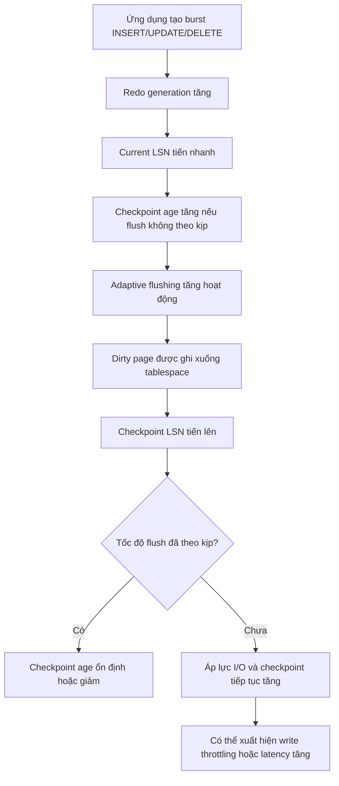

# Hiệu năng hệ thống

## Redo capacity, checkpoint age và tải ghi đột biến

Khi ứng dụng ghi dữ liệu nhanh hơn tốc độ InnoDB có thể flush các dirty page xuống tablespace, lượng redo chưa được checkpoint sẽ tăng. Một đợt ghi đột biến có thể làm checkpoint age tăng nhanh, kích hoạt adaptive flushing mạnh hơn và cuối cùng gây áp lực I/O hoặc làm transaction phải chờ. `innodb_redo_log_capacity` cung cấp khoảng đệm cho redo trong các đợt tải ngắn, nhưng không làm storage ghi nhanh hơn và không giải quyết được tình trạng tải ghi cao kéo dài.

Để chẩn đoán đúng, cần phân biệt ba tốc độ: tốc độ sinh redo, tốc độ flush dirty page để tiến checkpoint và tốc độ đồng bộ redo phục vụ commit. Chúng liên quan với nhau nhưng không phải cùng một hoạt động. Việc tăng redo capacity, thay đổi `innodb_io_capacity` hay chỉnh durability chỉ có ý nghĩa khi số liệu cho thấy đúng nút thắt.

### 1. Redo log, LSN và checkpoint

InnoDB dùng redo log theo nguyên tắc write-ahead logging (WAL). Khi transaction thay đổi một page, InnoDB tạo redo record mô tả thay đổi cần thiết để có thể tái áp dụng sau crash. Page đã thay đổi trong buffer pool trở thành dirty page. Commit có thể hoàn tất sau khi redo cần thiết được ghi bền vững theo chính sách cấu hình, dù data page tương ứng chưa được ghi xuống tablespace.

Các khái niệm chính:

| Khái niệm | Ý nghĩa |
| --- | --- |
| LSN (Log Sequence Number) | Vị trí logic tăng dần trong luồng redo log; có thể xem như mốc byte để so sánh tiến độ |
| Current LSN | Vị trí redo mới nhất được tạo |
| Flushed LSN | Mốc redo đã được flush theo trạng thái InnoDB báo cáo |
| Checkpoint LSN | Mốc redo mà InnoDB đã bảo đảm các thay đổi trước mốc đó được ghi vào data file theo quy tắc checkpoint |
| Dirty page | Page trong buffer pool đã bị thay đổi nhưng chưa được flush hoàn toàn xuống tablespace |
| Checkpoint age | Khoảng cách giữa current LSN và checkpoint LSN |
| Redo capacity | Dung lượng redo mà InnoDB quản lý để chứa lịch sử redo cần thiết trước khi có thể tái sử dụng vùng log |

Checkpoint là quá trình tiến mốc an toàn để InnoDB có thể tái sử dụng phần redo cũ. InnoDB dùng fuzzy checkpoint: không cần dừng toàn bộ workload để flush mọi page cùng lúc. Background flushing và adaptive flushing ghi các dirty page theo tiến độ, giúp checkpoint di chuyển dần.

### 2. Checkpoint age được tính như thế nào?

Checkpoint age là lượng redo được tạo sau checkpoint hiện tại:

\[
\text{checkpoint age} = \text{current LSN} - \text{last checkpoint LSN}
\]

Các LSN được biểu diễn theo byte, vì vậy hiệu số cũng có đơn vị byte. Ví dụ, nếu current LSN là 9.800.000.000 và checkpoint LSN là 7.300.000.000 thì checkpoint age xấp xỉ 2,5 GB.

Checkpoint age không phải số byte dirty page, cũng không phải chính xác phần trăm file redo đang được ghi. Nó biểu thị độ dài redo mà InnoDB vẫn cần giữ lại vì các thay đổi tương ứng chưa được checkpoint an toàn. Một page có thể được sửa nhiều lần và tạo nhiều redo record trước khi được flush; do đó không thể suy ra checkpoint age bằng cách cộng kích thước dirty page.

Khi checkpoint age thấp và ổn định, InnoDB có đủ khoảng trống để tiếp nhận redo mới. Khi age tăng liên tục, tốc độ sinh redo đang vượt tốc độ tiến checkpoint trong khoảng thời gian quan sát. Nếu age tiến gần giới hạn vận hành của redo capacity, InnoDB phải tăng cường flush và có thể hạn chế tốc độ ghi để tránh hết chỗ tái sử dụng redo.

Không nên diễn giải `checkpoint age / innodb_redo_log_capacity` như một tỷ lệ phần trăm chính xác của log đã dùng. InnoDB giữ các khoảng an toàn và ngưỡng nội bộ; giới hạn checkpoint thực tế thấp hơn hoặc được điều tiết so với dung lượng cấu hình.

### 3. Redo capacity trong các phiên bản MySQL

Trong MySQL 8.0.30 trở lên, biến `innodb_redo_log_capacity` điều khiển tổng dung lượng redo log. Đây là biến động, có thể thay đổi khi máy chủ đang chạy. Khi được đặt, nó thay thế cách cấu hình dung lượng dựa trên tích `innodb_log_file_size` và `innodb_log_files_in_group` của các phiên bản cũ.

Trước MySQL 8.0.30, dung lượng redo truyền thống được xác định bằng:

\[
\text{redo capacity} \approx \text{innodb\_log\_file\_size} \times \text{innodb\_log\_files\_in\_group}
\]

Các biến legacy này bị deprecated từ MySQL 8.0.30. Khi vận hành phiên bản cũ, cần làm theo quy trình thay đổi redo log tương ứng với phiên bản; không xóa hoặc đổi tên file redo trực tiếp khi mysqld đang chạy.

Kiểm tra phiên bản và cấu hình hiện tại:

```sql
SELECT VERSION();

SHOW GLOBAL VARIABLES LIKE 'innodb_redo_log_capacity';
SHOW GLOBAL VARIABLES LIKE 'innodb_log_file_size';
SHOW GLOBAL VARIABLES LIKE 'innodb_log_files_in_group';
```

Một số biến legacy có thể không còn xuất hiện hoặc không còn được dùng làm cấu hình có hiệu lực ở phiên bản mới. Hãy căn cứ vào phiên bản thực tế và biến được hỗ trợ trên server.

Ví dụ cấu hình 4 GiB trên MySQL 8.0.30 trở lên:

```sql
SET GLOBAL innodb_redo_log_capacity = 4294967296;
```

Để lưu cấu hình qua restart trên phiên bản hỗ trợ `SET PERSIST` và khi tài khoản có quyền phù hợp:

```sql
SET PERSIST innodb_redo_log_capacity = 4294967296;
```

Hoặc cấu hình trong option file:

```ini
[mysqld]
innodb_redo_log_capacity = 4G
```

Thay đổi capacity có thể khiến InnoDB điều chỉnh file redo trong nền và thực hiện thêm I/O. Không nên thay đổi liên tục theo từng đợt tải nhỏ; hãy đo xu hướng và áp dụng giá trị ổn định có đủ headroom.

### 4. Redo capacity không giống redo log buffer

`innodb_log_buffer_size` và `innodb_redo_log_capacity` điều khiển hai vùng khác nhau:

| Biến | Phạm vi | Tác động chính |
| --- | --- | --- |
| `innodb_log_buffer_size` | Bộ nhớ trong RAM | Vùng đệm redo trước khi ghi vào redo log file; buffer quá nhỏ có thể làm transaction lớn phải flush log buffer thường xuyên hơn |
| `innodb_redo_log_capacity` | Dung lượng redo log được quản lý trên storage, từ MySQL 8.0.30 | Khoảng redo có thể giữ trước khi checkpoint phải tiến đủ để tái sử dụng log |

Tăng log buffer có thể hữu ích cho transaction rất lớn tạo nhiều redo trong thời gian ngắn. Nó không làm tăng redo capacity và không giải quyết tình trạng checkpoint age tăng kéo dài. Ngược lại, tăng redo capacity không nhất thiết cải thiện một transaction đang phải flush log buffer vì buffer trong RAM quá nhỏ.

Kiểm tra cả hai:

```sql
SHOW GLOBAL VARIABLES LIKE 'innodb_log_buffer_size';
SHOW GLOBAL VARIABLES LIKE 'innodb_redo_log_capacity';
```

### 5. Ba tốc độ cần phân biệt khi tải ghi tăng

Để hiểu áp lực redo, hãy tách ba hoạt động:

1. **Redo generation:** tốc độ transaction tạo redo mới; current LSN tăng theo hoạt động ghi.
2. **Checkpoint advancement:** tốc độ checkpoint LSN tiến lên khi dirty page được flush đủ để tái sử dụng redo cũ.
3. **Redo flush for commit:** tốc độ ghi/đồng bộ redo log để đáp ứng yêu cầu commit và durability.

Redo flush cho commit không đồng nghĩa với checkpoint. Một transaction có thể được xác nhận commit sau khi redo đã được flush, trong khi data page vẫn dirty và checkpoint chưa tiến qua phần redo tương ứng. Vì vậy, `innodb_flush_log_at_trx_commit=1` không có nghĩa mọi data page đều được ghi xuống tablespace tại mỗi commit.

`sync_binlog` điều khiển đồng bộ binary log, là một log khác với InnoDB redo. Hai biến `innodb_flush_log_at_trx_commit` và `sync_binlog` liên quan đến durability của commit khi dùng InnoDB và binary logging; chúng không phải nút chỉnh tốc độ checkpoint.

### 6. Tải ghi đột biến làm checkpoint age thay đổi ra sao?

Trong tải bình thường, redo generation và checkpoint advancement có thể gần cân bằng. Khi có burst ghi, current LSN tăng nhanh hơn checkpoint LSN. Chênh lệch tích lũy làm checkpoint age tăng.



Một burst ngắn có thể được hấp thụ nhờ phần redo capacity còn trống. Khi burst kết thúc, nếu storage có đủ năng lực, checkpoint advancement sẽ vượt redo generation trong một khoảng thời gian và age giảm dần. Nếu tải ghi cao kéo dài, age sẽ tiếp tục tích lũy dù capacity lớn; khi gần ngưỡng, InnoDB phải flush mạnh hơn hoặc làm chậm người ghi.

### 7. Nhận diện dấu hiệu checkpoint pressure

Không dựa vào một dấu hiệu đơn lẻ. Hãy kết hợp:

- Checkpoint age cao và tiếp tục tăng qua nhiều mẫu.
- Khoảng cách giữa current LSN và checkpoint LSN mở rộng nhanh.
- Dirty page tăng hoặc không giảm dù tải ghi đã giảm.
- Pending writes hoặc độ trễ ghi storage tăng.
- Hoạt động flush tăng mạnh và ảnh hưởng latency của transaction.
- Transaction ghi bắt đầu chậm lại khi InnoDB phải bảo vệ khoảng redo còn lại.
- Checkpoint không tiến đủ nhanh trong khi redo generation vẫn cao.

Một checkpoint age cao nhưng đang giảm có thể là hệ thống đang hồi phục sau burst. Một age thấp nhưng tăng rất nhanh cũng cần theo dõi nếu tốc độ sinh redo đột ngột tăng. Xu hướng và tốc độ thay đổi thường hữu ích hơn một snapshot riêng lẻ.

### 8. Đọc LOG trong SHOW ENGINE INNODB STATUS

Lệnh sau cung cấp ảnh chụp nhiều chỉ số nội bộ:

```sql
SHOW ENGINE INNODB STATUS\G
```

Trong phần `LOG`, tìm các trường tương tự:

```text
Log sequence number          9800000000
Log flushed up to             9795000000
Pages flushed up to            7400000000
Last checkpoint at             7300000000
0 pending log flushes, 0 pending chkp writes
```

Các con số trên chỉ là ví dụ minh họa. Tên trường và cách trình bày có thể khác theo phiên bản. `Log sequence number` thể hiện current LSN; `Last checkpoint at` là mốc checkpoint dùng để tính age. `Log flushed up to` phản ánh tiến độ flush redo, còn thông tin page flush/checkpoint giúp hiểu tiến độ ghi data page.

Với ví dụ trên:

\[
9.8\text{ GB} - 7.3\text{ GB} = 2.5\text{ GB checkpoint age}
\]

Không nhầm `Log flushed up to` với `Last checkpoint at`: redo đã flush để đáp ứng durability có thể đi trước checkpoint vì các dirty page tương ứng chưa được ghi xong xuống tablespace.

### 9. Theo dõi LSN bằng INNODB_METRICS

MySQL cung cấp các bộ đếm InnoDB qua `INFORMATION_SCHEMA.INNODB_METRICS`. Các metric LSN thường dùng gồm `log_lsn_current`, `log_lsn_flushed` và `log_lsn_last_checkpoint`. Trước tiên, kiểm tra chúng có sẵn và đang được enable:

```sql
SELECT NAME, COUNT, STATUS, COMMENT
FROM information_schema.innodb_metrics
WHERE NAME IN (
    'log_lsn_current',
    'log_lsn_flushed',
    'log_lsn_last_checkpoint',
    'log_waits',
    'log_write_requests',
    'log_writes'
)
ORDER BY NAME;
```

Nếu metric cần thiết đang disabled, có thể bật nhóm log để quan sát:

```sql
SET GLOBAL innodb_monitor_enable = 'module_log';
```

Sau khi kết thúc đợt đo, có thể tắt nhóm metric nếu chính sách vận hành yêu cầu:

```sql
SET GLOBAL innodb_monitor_disable = 'module_log';
```

Không phải mọi bản build hoặc phiên bản đều cung cấp cùng tập metric; hãy kiểm tra kết quả truy vấn trước khi đưa tên metric vào dashboard tự động. Bật metric cũng cần quyền quản trị phù hợp.

Có thể tính checkpoint age từ hai LSN:

```sql
SELECT
    MAX(CASE WHEN NAME = 'log_lsn_current' THEN COUNT END)
      AS current_lsn,
    MAX(CASE WHEN NAME = 'log_lsn_last_checkpoint' THEN COUNT END)
      AS checkpoint_lsn,
    MAX(CASE WHEN NAME = 'log_lsn_current' THEN COUNT END)
      - MAX(CASE WHEN NAME = 'log_lsn_last_checkpoint' THEN COUNT END)
      AS checkpoint_age_bytes
FROM information_schema.innodb_metrics
WHERE NAME IN ('log_lsn_current', 'log_lsn_last_checkpoint');
```

Đối chiếu kết quả với `SHOW ENGINE INNODB STATUS`. Nếu metric bị disabled hoặc không có giá trị, dùng output status hoặc bật metric được hỗ trợ trước khi thu thập.

### 10. Đo tốc độ sinh redo và tốc độ checkpoint

Một mẫu đơn lẻ cho biết trạng thái tại thời điểm chụp; hai mẫu có timestamp cho biết tốc độ. Lấy current LSN và checkpoint LSN tại hai thời điểm cách nhau một khoảng xác định:

\[
\text{redo generation rate} = \frac{LSN_{current,2} - LSN_{current,1}}{\Delta t}
\]

\[
\text{checkpoint advancement rate} = \frac{LSN_{checkpoint,2} - LSN_{checkpoint,1}}{\Delta t}
\]

\[
\text{age growth rate} = \text{redo generation rate} - \text{checkpoint advancement rate}
\]

Nếu age growth rate dương, checkpoint age tăng trong khoảng đo. Nếu âm, checkpoint đang bắt kịp và age giảm. Đây là tốc độ trung bình trong khoảng lấy mẫu, không phải tốc độ tức thời.

Ví dụ hai snapshot cách nhau 60 giây:

| Chỉ số | Snapshot 1 | Snapshot 2 | Chênh lệch |
| --- | ---: | ---: | ---: |
| Current LSN | 10.0 GB | 16.0 GB | +6.0 GB |
| Checkpoint LSN | 8.0 GB | 9.8 GB | +1.8 GB |
| Checkpoint age | 2.0 GB | 6.2 GB | +4.2 GB |

Trong phút đó, redo generation trung bình là 100 MB/s, checkpoint advancement trung bình là 30 MB/s, nên age tăng khoảng 70 MB/s. Nếu burst kết thúc và checkpoint tăng nhanh hơn current LSN, age sẽ giảm.

Để dashboard hữu ích, lưu giá trị LSN kèm timestamp và tính delta giữa các lần scrape. Nếu MySQL restart hoặc metric reset, LSN có thể thay đổi theo vòng đời instance; phát hiện restart/uptime thay đổi trước khi tính rate để tránh tạo số liệu âm hoặc đột biến giả.

### 11. Theo dõi dirty page và năng lực flush

Checkpoint tiến lên nhờ flush dirty page. Theo dõi dirty page cùng checkpoint age để phân biệt tải ghi cao với năng lực ghi nền không theo kịp.

```sql
SHOW GLOBAL STATUS LIKE 'Innodb_buffer_pool_pages_dirty';
SHOW GLOBAL STATUS LIKE 'Innodb_buffer_pool_pages_total';
SHOW GLOBAL STATUS LIKE 'Innodb_buffer_pool_pages_flushed';
SHOW GLOBAL STATUS LIKE 'Innodb_data_pending_writes';

SHOW GLOBAL VARIABLES LIKE 'innodb_io_capacity';
SHOW GLOBAL VARIABLES LIKE 'innodb_io_capacity_max';
SHOW GLOBAL VARIABLES LIKE 'innodb_adaptive_flushing';
```

Dirty page ratio có thể ước tính bằng:

\[
\text{dirty page ratio} = \frac{\text{pages dirty}}{\text{pages total}} \times 100\%
\]

Số dirty page tăng không tự động là sự cố. Trong workload ghi bình thường, InnoDB chủ động giữ dirty page trong buffer pool để gom I/O. Điều đáng quan tâm là dirty page và checkpoint age cùng tăng, pending write/latency cao và checkpoint không tiến đủ nhanh.

`innodb_io_capacity` và `innodb_io_capacity_max` ảnh hưởng mục tiêu hoạt động I/O nền và mức flush tối đa mà InnoDB dùng trong một số cơ chế. Chúng không phải giới hạn IOPS tuyệt đối của thiết bị. Đặt quá thấp có thể khiến dirty page tích lũy; đặt quá cao có thể làm flush cạnh tranh với truy vấn và workload ứng dụng. Cần căn cứ vào khả năng storage thực tế.

### 12. Chọn redo capacity theo workload

Không có một giá trị redo capacity tối ưu cho mọi máy chủ. Hãy chọn dựa trên:

1. Tốc độ sinh redo bình thường và trong burst.
2. Thời lượng burst thường gặp và burst lớn nhất cần hấp thụ.
3. Tốc độ checkpoint advancement trong cùng điều kiện tải.
4. Headroom hiện tại của checkpoint age.
5. Năng lực ghi bền vững của storage sau khi burst kết thúc.
6. Mục tiêu thời gian crash recovery và dung lượng disk có thể dành cho redo.

Một ước lượng sơ bộ cho lượng age tăng thêm trong burst:

\[
\text{redo tích lũy thêm} \approx
\max(0, \text{generation rate} - \text{checkpoint rate})
\times \text{burst duration}
\]

Ví dụ minh họa: trong một burst 180 giây, redo generation là 120 MB/s và checkpoint advancement là 80 MB/s. Age tăng thêm khoảng:

\[
(120 - 80) \times 180 = 7{,}200\text{ MB} \approx 7.2\text{ GB}
\]

Nếu checkpoint age trước burst đã là 2 GB, đợt tải này có thể làm age tăng lên khoảng 9,2 GB trước khi tính đến biến động tốc độ flush và các ngưỡng an toàn. Đây không phải công thức cấu hình trực tiếp; hãy dùng nhiều chu kỳ đo, headroom và giới hạn recovery để chọn capacity.

Capacity lớn hơn có thể hấp thụ burst lâu hơn trước khi checkpoint pressure trở nên nghiêm trọng. Nhưng nếu tốc độ sinh redo cao hơn năng lực flush trong thời gian dài, age vẫn sẽ tiến gần ngưỡng. Tăng capacity chỉ trì hoãn thời điểm áp lực xuất hiện.

### 13. Vì sao không nên đặt redo capacity quá lớn?

Redo capacity quá nhỏ có thể làm checkpoint pressure xuất hiện sớm trong burst. Ngược lại, capacity quá lớn cũng có chi phí:

- Tăng dung lượng storage dành cho redo log.
- Cho phép checkpoint age tích lũy lớn hơn trước khi buộc phải flush mạnh; khi crash, lượng redo cần xử lý có thể lớn hơn và recovery có thể kéo dài.
- Che khuất vấn đề storage ghi không theo kịp trong thời gian dài.
- Làm người vận hành nhầm rằng có thể tăng capacity thay cho giải quyết workload hoặc I/O.

Redo capacity không có nghĩa InnoDB luôn phải replay toàn bộ capacity sau crash. Recovery phụ thuộc checkpoint thực tế, redo cần xử lý, trạng thái page và hiệu năng storage. Tuy vậy, một capacity lớn cho phép khoảng cách current LSN tới checkpoint có thể lớn hơn, vì vậy phải tính tới recovery objective.

Chọn mức vừa đủ để hấp thụ burst đã đo, giữ headroom an toàn và đáp ứng mục tiêu phục hồi; sau đó xác nhận bằng tải thử và theo dõi production.

### 14. Adaptive flushing và các biến I/O liên quan

InnoDB dùng adaptive flushing để điều chỉnh tốc độ flush dirty page theo áp lực redo và trạng thái buffer pool. Khi checkpoint age tăng hoặc tiến gần các ngưỡng nội bộ, InnoDB có thể tăng tốc độ flush nhằm ngăn redo log cạn khoảng tái sử dụng.

Các biến thường cần xem cùng nhau:

| Biến | Vai trò | Cách tiếp cận |
| --- | --- | --- |
| `innodb_adaptive_flushing` | Bật/tắt cơ chế adaptive flushing | Thường nên giữ mặc định trừ khi có bằng chứng rõ ràng và kế hoạch thử nghiệm |
| `innodb_io_capacity` | Mức I/O nền mà InnoDB dùng làm tham chiếu cho một số hoạt động flush/maintenance | Căn theo khả năng storage bền vững, không lấy theo burst IOPS ngắn |
| `innodb_io_capacity_max` | Mức trần cao hơn cho một số hoạt động I/O nền khi cần tăng tốc | Đánh giá để tránh flush cạnh tranh quá mức với workload |
| `innodb_max_dirty_pages_pct` | Ngưỡng tỷ lệ dirty page mục tiêu trong một số cơ chế flush | Không dùng thay thế việc theo dõi checkpoint age |
| `innodb_max_dirty_pages_pct_lwm` | Ngưỡng thấp để bắt đầu/điều chỉnh flush sớm hơn theo dirty page | Điều chỉnh chỉ khi đã hiểu tương tác với adaptive flushing |

Không nên tắt adaptive flushing để giảm I/O khi checkpoint age đang tăng. Điều đó có thể khiến InnoDB ít chủ động hơn trong việc đưa checkpoint tiến lên. Cũng không nên tăng `innodb_io_capacity_max` quá cao mà không đo độ trễ thiết bị; flush mạnh có thể làm ứng dụng đọc/ghi cạnh tranh cùng storage.

### 15. Phân biệt checkpoint pressure với redo durability pressure

Một hệ thống có thể chậm khi commit vì phải flush redo log, dù checkpoint age vẫn thấp. Ngược lại, checkpoint age có thể cao do dirty page chưa được ghi, dù redo đã được flush cho các transaction commit.

| Triệu chứng | Khu vực cần xem |
| --- | --- |
| Commit latency tăng, pending log flush tăng | Redo log flush, fsync latency, `innodb_flush_log_at_trx_commit`, storage log path |
| Checkpoint age tăng và dirty page tăng | Data page flushing, adaptive flushing, I/O capacity và storage tablespace |
| Checkpoint age cao nhưng redo flush vẫn theo kịp | Phân biệt redo đã bền vững với data page chưa checkpoint |
| `log_waits` tăng | Kiểm tra log buffer và hoạt động chờ liên quan đến redo; đối chiếu transaction lớn và log buffer size |
| Binary log sync chậm | `sync_binlog`, binlog filesystem và I/O; đây là đường log khác với redo |

`innodb_flush_log_at_trx_commit=1` yêu cầu flush redo theo mỗi commit (có thể được group commit gom lượt I/O). Giá trị `2` ghi redo ở mỗi commit nhưng flush xuống storage theo chu kỳ; giá trị `0` trì hoãn cả ghi và flush theo chu kỳ. Các giá trị này thay đổi mức durability khi crash, không phải cách an toàn để xử lý checkpoint age tăng.

### 16. Tải ghi đột biến: điều tra nguồn sinh redo

Khi thấy checkpoint age tăng, hãy tìm câu lệnh và workload tạo redo. Những nguồn thường gặp:

- Bulk insert hoặc import dữ liệu lớn.
- `UPDATE` hàng loạt trên cột được index hóa, làm thay đổi clustered record và secondary index.
- `DELETE` hàng loạt, tạo undo/redo và công việc purge.
- Ghi nhiều bảng trong một transaction lớn.
- Secondary index rộng hoặc nhiều index làm tăng write amplification.
- Nhiều worker cùng ghi với concurrency cao.
- DDL/rebuild hoặc tác vụ bảo trì tạo I/O lớn.

Có thể dùng Performance Schema statement digest để tìm câu lệnh ghi có tổng thời gian hoặc số lần chạy cao. Kết hợp slow query log, application metrics, batch/job logs và số hàng bị ảnh hưởng. Mục tiêu là phân biệt một job lớn bất thường với workload bình thường tăng đều.

### 17. Runbook khi checkpoint age tăng nhanh

Khi hệ thống đang có burst ghi và checkpoint age tăng, thực hiện theo trình tự:

1. **Xác nhận instance và thời điểm:** kiểm tra version, uptime, role primary/replica, lịch batch và thay đổi vừa triển khai.
2. **Lấy baseline:** chụp `SHOW ENGINE INNODB STATUS\G`, current LSN, checkpoint LSN, dirty page, pending writes và storage latency.
3. **Đo xu hướng:** lấy ít nhất hai mẫu có timestamp; tính redo generation rate, checkpoint advancement rate và age growth rate.
4. **Tìm nguồn ghi:** xem statement digest, slow log, số lượng transaction, batch import, update/delete và tác vụ DDL.
5. **Đánh giá storage:** kiểm tra write throughput, latency, queue depth, IOPS, filesystem space và các workload khác dùng chung thiết bị.
6. **Giảm burst có kiểm soát:** giới hạn concurrency, giảm batch size, tạm hoãn job không khẩn cấp hoặc điều tiết producer.
7. **Cho checkpoint hồi phục:** theo dõi age và dirty page sau khi giảm tải; bảo đảm storage có đủ năng lực flush.
8. **Xem lại capacity:** chỉ tăng redo capacity nếu burst đã đo cần thêm headroom, storage vẫn có thể checkpoint sau burst và recovery objective chấp nhận được.
9. **Điều chỉnh I/O cẩn trọng:** xem `innodb_io_capacity` và `innodb_io_capacity_max` cùng độ trễ storage; tránh tăng mù quáng.
10. **Xác nhận sau xử lý:** age giảm, pending writes bình thường hóa, latency ổn định và replica lag không tiếp tục tăng.

Không xóa file redo, không kill hàng loạt transaction và không hạ durability trong lúc sự cố nếu chưa hiểu tác động dữ liệu. Nếu disk sắp đầy hoặc checkpoint pressure gây ảnh hưởng nghiêm trọng, ưu tiên runbook incident của tổ chức và phối hợp DBA/hạ tầng.

### 18. Ví dụ truy vấn quan sát cấu hình và metric

Ghi nhận các biến liên quan:

```sql
SHOW GLOBAL VARIABLES
WHERE Variable_name IN (
    'innodb_redo_log_capacity',
    'innodb_log_buffer_size',
    'innodb_adaptive_flushing',
    'innodb_io_capacity',
    'innodb_io_capacity_max',
    'innodb_max_dirty_pages_pct',
    'innodb_max_dirty_pages_pct_lwm',
    'innodb_flush_log_at_trx_commit',
    'sync_binlog'
);
```

Lấy các metric LSN và log:

```sql
SELECT NAME, COUNT, STATUS
FROM information_schema.innodb_metrics
WHERE NAME LIKE 'log\_%'
ORDER BY NAME;
```

Lấy trạng thái buffer pool và I/O:

```sql
SHOW GLOBAL STATUS
WHERE Variable_name IN (
    'Innodb_buffer_pool_pages_dirty',
    'Innodb_buffer_pool_pages_total',
    'Innodb_buffer_pool_pages_flushed',
    'Innodb_data_pending_reads',
    'Innodb_data_pending_writes',
    'Innodb_log_waits'
);
```

Tên status variable có thể khác giữa phiên bản; nếu một biến không có, xem `SHOW GLOBAL STATUS LIKE 'Innodb%';` và dùng metric tương đương được hỗ trợ. Ghi snapshot kèm thời gian và tính delta, không chỉ lưu giá trị cuối.

### 19. Thiết kế giám sát và cảnh báo

Dashboard redo/checkpoint nên có các biểu đồ theo thời gian:

- Current LSN và checkpoint LSN.
- Checkpoint age theo byte và theo tỷ lệ tham chiếu với capacity.
- Redo generation rate và checkpoint advancement rate.
- Dirty page count/ratio và tốc độ pages flushed.
- Pending data writes, write latency, throughput và storage queue depth.
- Commit latency, transaction throughput, redo log waits.
- Batch/job throughput, số hàng thay đổi và replica lag.

Thiết kế cảnh báo theo xu hướng và thời gian duy trì, ví dụ age tăng liên tục cùng write latency cao hoặc age vượt ngưỡng vận hành đã kiểm chứng. Không đặt alert chỉ dựa trên một ngưỡng phần trăm chung cho mọi workload. Ngưỡng cần được hiệu chỉnh bằng tải thử, capacity thực tế và mục tiêu recovery.

Mỗi alert nên gợi ý hành động cụ thể: chụp InnoDB Status, kiểm tra LSN delta, tìm nguồn ghi, xem pending writes và kiểm tra storage. Tránh cảnh báo lặp liên tục khi hệ thống đang tự hồi phục; dùng thời gian duy trì, hysteresis và phân cấp severity.

### 20. Các sai lầm thường gặp

| Sai lầm | Vì sao không đúng | Cách tiếp cận tốt hơn |
| --- | --- | --- |
| Tăng redo capacity mỗi khi thấy age cao | Có thể chỉ trì hoãn pressure nếu storage không theo kịp | Đo generation và checkpoint rate trước |
| Cho rằng capacity lớn luôn tăng throughput | Capacity là khoảng đệm, không làm thiết bị ghi nhanh hơn | Xử lý write amplification, concurrency hoặc I/O bottleneck |
| Đồng nhất redo flush với checkpoint | Commit durability và data page flushing là hai mốc khác nhau | Theo dõi flushed LSN và checkpoint LSN riêng |
| Hạ `innodb_flush_log_at_trx_commit` để giảm checkpoint age | Biến này thay đổi durability của commit, không trực tiếp giải quyết dirty page flush | Giữ durability theo RPO; tối ưu nguồn ghi và checkpoint |
| Tăng `innodb_io_capacity_max` lên rất cao | Có thể làm I/O nền tranh chấp với workload | Đo storage và điều chỉnh từng bước |
| Chỉ nhìn dirty page ratio | Dirty page cao có thể là trạng thái bình thường | Ghép với age trend, pending writes và latency |
| Coi checkpoint age/capacity là phần trăm log dùng chính xác | Có các ngưỡng an toàn và cơ chế điều tiết nội bộ | Dùng như chỉ báo tương đối, đối chiếu trạng thái engine |
| Bỏ qua thời gian crash recovery | Capacity lớn cho phép age lớn và có thể tăng lượng redo cần phục hồi | Cân bằng burst tolerance với recovery objective |

### 21. Checklist thiết kế capacity và xử lý burst

1. Xác định phiên bản MySQL và cách cấu hình redo được hỗ trợ.
2. Ghi lại `innodb_redo_log_capacity` hoặc dung lượng redo theo biến legacy của phiên bản cũ.
3. Đo current LSN, checkpoint LSN và checkpoint age theo thời gian.
4. Tính redo generation rate, checkpoint advancement rate và age growth rate.
5. Theo dõi dirty page, pending writes, storage latency và throughput.
6. Tìm nguồn ghi tạo burst bằng statement digest, slow log và job metrics.
7. Ước lượng lượng redo tăng thêm trong burst và headroom cần thiết.
8. Cân nhắc dung lượng disk và thời gian crash recovery trước khi tăng capacity.
9. Điều chỉnh adaptive flushing/I/O capacity chỉ sau khi xác định năng lực storage.
10. Giữ các thiết lập durability theo yêu cầu dữ liệu; không dùng chúng làm nút chỉnh checkpoint.
11. Kiểm chứng bằng workload đại diện và theo dõi sau thay đổi.
12. Lưu runbook, ngưỡng cảnh báo và quy trình rollback cấu hình.

Redo capacity tạo khoảng đệm để InnoDB hấp thụ các đợt ghi ngắn; checkpoint age cho biết lượng redo chưa được checkpoint an toàn. Theo dõi đồng thời tốc độ sinh redo, tốc độ tiến checkpoint, dirty page và năng lực storage sẽ giúp phân biệt burst tạm thời với tình trạng ghi vượt năng lực kéo dài. Từ đó có thể chọn capacity hợp lý, điều tiết workload và bảo vệ cả hiệu năng lẫn thời gian phục hồi.
