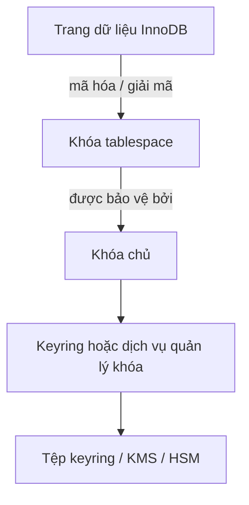

# Tablespace encryption, keyring, sao lưu khóa và điều kiện sử dụng

Mã hóa tablespace giúp bảo vệ dữ liệu InnoDB khi tệp cơ sở dữ liệu nằm trên ổ đĩa, thiết bị lưu trữ hoặc bản sao vật lý bị truy cập trái phép. Để cơ chế này hoạt động, MySQL cần một nơi lưu trữ khóa đáng tin cậy (keyring), quy trình quản lý vòng đời khóa và bản sao lưu có thể khôi phục đồng bộ với dữ liệu đã mã hóa.

Trong module `DATABASE_MYSQL`, chủ đề này nối bảo mật với các công việc vận hành đã học: thiết kế bảng và tablespace, truy vấn dữ liệu, kiểm soát giao dịch, sao lưu và phục hồi. Mã hóa chỉ có giá trị khi khóa còn sử dụng được và quy trình khôi phục đã được kiểm chứng.

Sau bài học, bạn có thể:

- Giải thích mối quan hệ giữa khóa tablespace, khóa chủ và keyring.
- Xác định loại tablespace và phiên bản MySQL phù hợp để bật mã hóa.
- Tạo hoặc chuyển đổi bảng InnoDB sang tablespace được mã hóa.
- Kiểm tra trạng thái mã hóa và thực hiện xoay khóa chủ.
- Thiết kế bản sao lưu dữ liệu cùng keyring, sau đó thử khôi phục an toàn.
- Nhận diện lỗi thường gặp khi MySQL không tìm thấy khóa hoặc keyring không sẵn sàng.

## 1. Mã hóa tablespace bảo vệ điều gì?

Mã hóa dữ liệu khi lưu trữ (*encryption at rest*) biến nội dung dữ liệu trên thiết bị lưu trữ thành dữ liệu không thể đọc trực tiếp nếu không có khóa. Với InnoDB, MySQL thực hiện mã hóa và giải mã trong quá trình ghi, đọc trang dữ liệu. Ứng dụng vẫn truy vấn bảng bằng SQL bình thường; ứng dụng không phải tự giải mã từng hàng.

Mã hóa tablespace hữu ích khi cần giảm rủi ro từ:

- Người có được bản sao tệp `.ibd` hoặc thiết bị lưu trữ nhưng không có khóa.
- Bản sao lưu vật lý, snapshot hoặc thiết bị lưu trữ bị thất lạc.
- Việc tháo ổ đĩa hoặc chuyển thiết bị giữa các môi trường.

Mã hóa at rest không thay thế các lớp bảo vệ khác. Khi MySQL đang chạy và người dùng có quyền SQL phù hợp, dữ liệu vẫn được trả về ở dạng rõ. Cơ chế này cũng không tự mã hóa kết nối mạng, dữ liệu trong bộ nhớ, log ứng dụng, bản xuất SQL hoặc mọi loại log của MySQL. Hãy dùng TLS cho kết nối, phân quyền SQL cho người dùng, bảo vệ máy chủ và bật mã hóa riêng cho các loại log hoặc tệp tạm nếu yêu cầu bảo mật bao gồm chúng.

## 2. Kiến trúc khóa: tablespace key và keyring

InnoDB dùng hai lớp khóa chính:

1. **Khóa tablespace** (*tablespace key*) dùng để mã hóa nội dung của một tablespace.
2. **Khóa chủ** (*master encryption key*) dùng để mã hóa bảo vệ khóa tablespace. Khóa chủ được quản lý thông qua keyring.

Có thể hình dung luồng bảo vệ như sau:



Khi tạo tablespace được mã hóa, InnoDB tạo khóa tablespace và lưu khóa này ở dạng được bảo vệ bằng khóa chủ. Khi cần đọc dữ liệu, MySQL lấy khóa chủ từ keyring, mở khóa tablespace rồi giải mã trang dữ liệu. Keyring vì vậy là thành phần thiết yếu của khả năng truy cập dữ liệu, không phải một tệp cấu hình phụ có thể tùy ý bỏ qua.

**Keyring** là giao diện và kho lưu trữ khóa mà MySQL sử dụng. Tùy phiên bản và cách triển khai, keyring có thể được cung cấp bởi component, plugin hoặc tích hợp với hệ thống quản lý khóa bên ngoài. Một số lựa chọn thường gặp gồm:

| Cách lưu khóa | Đặc điểm | Cân nhắc vận hành |
|---|---|---|
| Keyring lưu trong tệp cục bộ | Dễ thiết lập cho môi trường học tập hoặc thử nghiệm | Phải giới hạn quyền đọc tệp, bảo vệ thư mục và sao lưu riêng; người có quyền đọc tệp có thể lấy được vật liệu khóa |
| Keyring component | Cơ chế component của các bản MySQL hỗ trợ | Cấu hình và cách nạp component phụ thuộc bản phát hành; cần bảo đảm component sẵn sàng trong giai đoạn khởi động |
| KMS hoặc HSM bên ngoài | Tách quản lý khóa khỏi máy chủ cơ sở dữ liệu, có thể hỗ trợ kiểm soát truy cập và kiểm toán tập trung | Cần kiểm tra kết nối, danh tính dịch vụ, tính sẵn sàng, giới hạn API và quy trình khôi phục khi dịch vụ khóa gián đoạn |

Với hệ thống sản xuất, nên chọn giải pháp quản lý khóa đáp ứng chính sách của tổ chức, có kiểm soát truy cập, kiểm toán, sao lưu và quy trình phục hồi độc lập. Tệp keyring cục bộ có thể phù hợp cho phòng lab, nhưng bản thân việc đặt khóa trong một tệp không tạo ra một hệ thống quản lý khóa có độ sẵn sàng cao.

## 3. Điều kiện và phạm vi áp dụng

Trước khi bật mã hóa, cần xác nhận các điều kiện sau:

- **Đúng storage engine:** các ví dụ trong bài sử dụng InnoDB. Tùy chọn mã hóa tablespace của InnoDB không tự áp dụng cho bảng thuộc engine khác.
- **Đúng loại tablespace:** bảng dùng tablespace riêng theo tệp (*file-per-table*) có thể được mã hóa theo thuộc tính của bảng/tablespace. General tablespace có thuộc tính mã hóa ở cấp tablespace; các bảng đặt trong đó dùng chung thuộc tính này.
- **Đúng phiên bản:** cú pháp, component/plugin keyring, loại tablespace được hỗ trợ và các biến cấu hình thay đổi theo phiên bản MySQL. Đặc biệt, khả năng mã hóa system tablespace, undo tablespace, redo log, temporary tablespace và binary log không giống nhau ở mọi bản phát hành.
- **Keyring sẵn sàng:** MySQL phải nạp và truy cập được keyring trước khi InnoDB cần mở các tablespace được mã hóa. Tên component/plugin và cách cấu hình phải khớp chính xác với bản phát hành đang chạy.
- **Quyền hệ điều hành phù hợp:** tài khoản dịch vụ MySQL cần quyền cần thiết để đọc/ghi kho khóa; người dùng và tiến trình không liên quan không được đọc hoặc thay thế kho khóa.
- **Có quy trình sao lưu khóa:** phải có bản sao khóa được bảo vệ và có thể khôi phục. Một bản sao lưu dữ liệu không kèm vật liệu khóa tương ứng có thể không sử dụng được.

Không nên suy luận rằng bật mã hóa bảng sẽ mã hóa toàn bộ dữ liệu của instance. Mã hóa tablespace, redo/undo log, binary log, relay log và tệp tạm là các phạm vi riêng. Hãy lập danh sách dữ liệu cần bảo vệ rồi đối chiếu tính năng được hỗ trợ trong đúng phiên bản MySQL đang vận hành.

## 4. Cấu hình keyring trước khi tạo dữ liệu mã hóa

Quy trình cấu hình ở mức tổng quát gồm các bước:

1. Xác định chính xác phiên bản MySQL và chọn keyring component/plugin được hỗ trợ cho phiên bản đó. Với các bản mới, ưu tiên cơ chế component được tài liệu MySQL khuyến nghị; không sao chép cấu hình plugin cũ sang bản mới mà chưa kiểm tra trạng thái hỗ trợ.
2. Chọn nơi lưu khóa. Nếu dùng tệp, đặt tệp trong thư mục được bảo vệ bằng quyền hệ điều hành, cân nhắc đặt ngoài thư mục dữ liệu MySQL và bảo đảm chỉ tài khoản dịch vụ cùng quy trình quản trị được phép truy cập.
3. Cấu hình MySQL nạp keyring đúng giai đoạn khởi động. Keyring phải khả dụng trước khi InnoDB khởi tạo hoặc mở tablespace cần khóa. Cách nạp component và plugin khác nhau giữa các dòng phiên bản, vì vậy phải dùng hướng dẫn tương ứng với bản phát hành thay vì dùng một lệnh cài đặt chung cho mọi máy chủ.
4. Khởi động hoặc khởi động lại theo quy trình thay đổi của môi trường. Kiểm tra log máy chủ để xác nhận keyring đã được nạp và không có lỗi quyền truy cập, đường dẫn hoặc kết nối KMS.
5. Thử nghiệm việc khởi động lại máy chủ và truy cập dữ liệu đã mã hóa trước khi triển khai trên dữ liệu quan trọng.

Ví dụ cấu hình keyring dạng tệp trong các bản MySQL cũ có thể dùng plugin `keyring_file` cùng các tùy chọn chỉ định tệp dữ liệu và nạp plugin sớm. Đây là ví dụ theo họ phiên bản, không phải cấu hình áp dụng cho mọi bản MySQL:

```ini
# Ví dụ minh họa cho bản phát hành còn hỗ trợ keyring_file plugin.
early-plugin-load=keyring_file.so
keyring_file_data=/var/lib/mysql-keyring/keyring
```

Trước khi sử dụng ví dụ này, hãy xác nhận plugin còn được hỗ trợ trong bản MySQL của bạn, đường dẫn tồn tại, quyền truy cập đúng và thư mục được bảo vệ. Nếu bản phát hành sử dụng keyring component, hãy làm theo quy trình cài đặt component và tệp cấu hình riêng của component đó. Không nạp đồng thời nhiều cơ chế keyring chỉ để thử nghiệm nếu chưa hiểu rõ cách chúng quản lý cùng một tập khóa.

Đối với KMS/HSM, ngoài việc cấu hình component phù hợp, cần kiểm tra danh tính mà MySQL dùng để gọi dịch vụ, quyền lấy khóa, chứng thư hoặc thông tin xác thực, kết nối mạng, giới hạn tốc độ và phương án vận hành khi KMS tạm thời không truy cập được.

## 5. Tạo và chuyển bảng sang tablespace được mã hóa

### 5.1. Tạo bảng InnoDB được mã hóa

Với bảng dùng tablespace riêng theo tệp, có thể khai báo thuộc tính `ENCRYPTION='Y'` khi tạo bảng:

```sql
CREATE TABLE customer_profile (
    customer_id BIGINT UNSIGNED NOT NULL,
    full_name VARCHAR(150) NOT NULL,
    email VARCHAR(255) NOT NULL,
    created_at DATETIME NOT NULL DEFAULT CURRENT_TIMESTAMP,
    PRIMARY KEY (customer_id),
    UNIQUE KEY uq_customer_email (email)
) ENGINE=InnoDB
  ENCRYPTION='Y';
```

Khi keyring đã sẵn sàng và phiên bản hỗ trợ cú pháp này, InnoDB tạo tablespace tương ứng với thuộc tính mã hóa. Các thao tác `SELECT`, `INSERT`, `UPDATE` và `DELETE` tiếp tục dùng SQL bình thường.

### 5.2. Bật mã hóa cho bảng đã tồn tại

Với bảng InnoDB đủ điều kiện, có thể yêu cầu chuyển đổi bằng:

```sql
ALTER TABLE customer_profile ENCRYPTION='Y';
```

Thao tác chuyển đổi có thể đọc/ghi lại dữ liệu và tiêu tốn I/O, CPU cùng dung lượng tạm. Trên bảng lớn, hãy đo thời gian trong môi trường thử nghiệm, kiểm tra dung lượng đĩa, đánh giá ảnh hưởng đến tải giao dịch và chọn cửa sổ triển khai phù hợp. Không giả định câu lệnh hoàn tất tức thì hoặc không ảnh hưởng đến ứng dụng.

Để bỏ mã hóa cho bảng đủ điều kiện, cú pháp thường dùng là:

```sql
ALTER TABLE customer_profile ENCRYPTION='N';
```

Chỉ thực hiện khi chính sách cho phép. Việc bỏ mã hóa là một thay đổi bảo mật cần được phê duyệt và kiểm tra giống như khi bật mã hóa.

### 5.3. Dùng general tablespace

General tablespace có thể chứa nhiều bảng InnoDB. Thuộc tính mã hóa được đặt ở cấp tablespace, do đó các bảng nằm trong tablespace đó tuân theo thuộc tính chung:

```sql
CREATE TABLESPACE secure_ts
    ADD DATAFILE 'secure_ts.ibd'
    ENGINE=InnoDB
    ENCRYPTION='Y';

CREATE TABLE payment_record (
    payment_id BIGINT UNSIGNED NOT NULL,
    amount DECIMAL(15,2) NOT NULL,
    created_at DATETIME NOT NULL,
    PRIMARY KEY (payment_id)
) ENGINE=InnoDB
  TABLESPACE secure_ts;
```

Để thay đổi thuộc tính của general tablespace, cú pháp trên các bản hỗ trợ có dạng:

```sql
ALTER TABLESPACE secure_ts
    ENCRYPTION='Y'
    ENGINE=InnoDB;
```

Hãy kiểm tra giới hạn của phiên bản trước khi chuyển đổi. Không phải mọi thao tác di chuyển bảng, loại tablespace hoặc cấu hình InnoDB đều có thể kết hợp tùy ý. Với general tablespace, cần quản lý quyền truy cập và phân loại dữ liệu ở cấp tablespace vì nhiều bảng có thể cùng nằm trong một đơn vị lưu trữ.

### 5.4. Thiết lập mặc định

Một số bản MySQL cung cấp biến như `default_table_encryption` hoặc các biến InnoDB để kiểm soát mặc định mã hóa cho tablespace mới. Phạm vi, giá trị hợp lệ và hành vi ghi đè phụ thuộc phiên bản. Trước khi đặt mặc định ở cấp instance hoặc schema, hãy xác nhận:

- Bảng mới sẽ được mã hóa theo mặc định hay chỉ khi khai báo rõ.
- Người dùng có được phép ghi đè mặc định hay cần quyền quản trị mã hóa riêng.
- Bảng hiện có có được chuyển đổi hay mặc định chỉ ảnh hưởng đối tượng mới.
- Các job tạo bảng, migration và công cụ triển khai có tương thích với mặc định mới hay không.

Thiết lập mặc định giúp giảm nguy cơ quên mã hóa bảng mới, nhưng không thay thế việc kiểm tra trạng thái thực tế.

## 6. Kiểm tra trạng thái mã hóa

Sau khi tạo hoặc chuyển đổi bảng, cần xác minh ở cả định nghĩa đối tượng và metadata InnoDB.

Kiểm tra định nghĩa bảng:

```sql
SHOW CREATE TABLE customer_profile\G
```

Kiểm tra trạng thái tablespace trong các bản MySQL có cung cấp cột tương ứng:

```sql
SELECT
    NAME,
    SPACE_TYPE,
    ENCRYPTION
FROM INFORMATION_SCHEMA.INNODB_TABLESPACES
ORDER BY NAME;
```

Giá trị `ENCRYPTION` cho biết metadata của tablespace có đánh dấu mã hóa hay không. Hãy đối chiếu tên tablespace với bảng cần kiểm tra; một instance có thể chứa nhiều loại tablespace với trạng thái khác nhau.

Kiểm tra plugin keyring trên hệ thống sử dụng plugin:

```sql
SELECT PLUGIN_NAME, PLUGIN_STATUS
FROM INFORMATION_SCHEMA.PLUGINS
WHERE PLUGIN_NAME LIKE 'keyring%';
```

Truy vấn trên chỉ phản ánh plugin. Nếu máy chủ sử dụng component, cần kiểm tra trạng thái component bằng cơ chế được tài liệu của bản phát hành cung cấp, đồng thời kiểm tra log khởi động. Không kết luận component chưa được nạp chỉ vì nó không xuất hiện trong `INFORMATION_SCHEMA.PLUGINS`.

Một lần kiểm tra đầy đủ nên xác nhận cả bốn điểm: keyring đang hoạt động, tablespace mục tiêu có `ENCRYPTION` phù hợp, máy chủ khởi động lại vẫn mở được bảng, và quy trình backup/restore vẫn lấy được khóa. Chỉ thấy `ENCRYPTION='Y'` chưa chứng minh rằng quy trình khôi phục đã an toàn.

## 7. Xoay vòng khóa chủ

Khóa cần được xoay vòng theo chính sách định kỳ, khi có nghi ngờ lộ khóa hoặc khi chính sách quản trị yêu cầu. Với InnoDB, câu lệnh thường dùng để xoay khóa chủ là:

```sql
ALTER INSTANCE ROTATE INNODB MASTER KEY;
```

Tài khoản thực hiện cần quyền quản trị mã hóa phù hợp với phiên bản MySQL; không nên cấp quyền rộng hơn cần thiết chỉ để chạy thao tác này. Trước khi thực hiện, hãy kiểm tra hướng dẫn cho đúng phiên bản và bảo đảm keyring đang hoạt động ổn định.

Ở mức khái niệm, thao tác xoay khóa tạo khóa chủ mới và dùng khóa mới để bảo vệ lại các khóa tablespace. Dữ liệu vẫn được truy cập qua SQL, nhưng thao tác có thể tạo tải I/O và công việc nền. Thời gian hoàn tất phụ thuộc số lượng tablespace, dung lượng và cấu hình máy chủ. Theo dõi log, tải hệ thống và trạng thái sau khi xoay khóa; không dừng máy chủ hoặc xóa vật liệu khóa cũ khi chưa hiểu rõ trạng thái chuyển đổi và yêu cầu khôi phục.

Quy trình xoay khóa nên có các bước:

1. Xác nhận bản sao lưu dữ liệu và keyring gần nhất có thể khôi phục.
2. Xác nhận quyền truy cập keyring, dung lượng đĩa và tình trạng InnoDB.
3. Thực hiện xoay khóa trong cửa sổ thay đổi đã chọn.
4. Theo dõi log và kiểm tra metadata tablespace sau khi thao tác hoàn tất.
5. Tạo bản sao lưu mới theo quy trình của tổ chức; ghi nhận phiên bản MySQL, thời điểm xoay khóa và định danh bản sao lưu.
6. Giữ lại bản sao keyring cần thiết cho các bản backup lịch sử theo chính sách lưu trữ và phục hồi.

## 8. Sao lưu keyring và khôi phục dữ liệu

Đây là phần quyết định một hệ thống mã hóa có thể phục hồi sau sự cố hay không. Tệp dữ liệu được mã hóa và vật liệu khóa tạo thành một cặp phụ thuộc. Nếu có các trang dữ liệu nhưng không còn khóa chủ cần thiết để mở khóa tablespace, MySQL không thể giải mã dữ liệu đó.

### 8.1. Nguyên tắc sao lưu

- **Sao lưu khóa độc lập với máy chủ dữ liệu:** nếu máy chủ hoặc ổ đĩa dữ liệu hỏng, bản sao khóa vẫn phải còn khả dụng.
- **Bảo vệ bản sao khóa ở mức cao:** giới hạn người truy cập, mã hóa nơi lưu bản sao, kiểm toán thao tác và lưu thông tin xác thực phục hồi ở kênh được kiểm soát.
- **Giữ tính nhất quán:** ghi nhận bản backup dữ liệu được tạo vào thời điểm nào và cần những khóa nào. Khi xoay khóa, phải hiểu bản keyring hiện tại còn giữ các khóa cần cho backup cũ hay không.
- **Không chỉ sao chép thư mục dữ liệu:** backup vật lý phải tuân thủ quy trình của công cụ backup, đồng thời bao gồm hoặc tham chiếu đến vật liệu khóa cần thiết.
- **Không đưa khóa vào mã nguồn hoặc kho Git:** tránh ghi tệp keyring, mật khẩu KMS, token và thông tin xác thực vào repository, log hoặc ticket không được bảo vệ.
- **Thử phục hồi:** một bản backup chỉ được xem là đáng tin cậy khi đã có lần khôi phục thử thành công bằng đúng dữ liệu và khóa tương ứng.

### 8.2. Lập bộ backup có thể khôi phục

Với mỗi bộ backup, lưu hồ sơ gồm:

| Thành phần | Nội dung cần ghi nhận |
|---|---|
| Dữ liệu | Tên instance, loại backup, thời điểm, phạm vi bảng/tablespace và vị trí lưu |
| Khóa | Bản sao keyring hoặc tham chiếu đến phiên bản khóa trong KMS/HSM; không ghi bí mật trực tiếp vào hồ sơ |
| Phiên bản | Phiên bản MySQL, cấu hình keyring và phiên bản công cụ backup |
| Quan hệ thời gian | Thời điểm backup so với lần xoay khóa gần nhất và các thay đổi cấu hình liên quan |
| Kiểm chứng | Kết quả kiểm tra tính toàn vẹn và lần restore thử gần nhất |

Với keyring dạng tệp, hãy dùng quy trình sao lưu nhất quán và bảo vệ quyền truy cập cho cả bản gốc lẫn bản sao. Không chỉnh sửa thủ công nội dung keyring. Với KMS/HSM, xác nhận rằng khóa và chính sách truy cập vẫn tồn tại trong thời gian lưu backup; nếu tổ chức có cơ chế vô hiệu hóa hoặc xóa khóa, cần kiểm soát chặt các thao tác đó.

### 8.3. Quy trình khôi phục thử

1. Chuẩn bị máy chủ phục hồi cô lập, dùng phiên bản MySQL tương thích với backup.
2. Khôi phục hoặc cấu hình keyring trước khi mở dữ liệu được mã hóa.
3. Khôi phục dữ liệu bằng đúng công cụ và quy trình đã tạo backup.
4. Kiểm tra log khởi động, khả năng mở tablespace và truy vấn một tập dữ liệu kiểm thử.
5. Kiểm tra tính toàn vẹn ở mức ứng dụng, số lượng bản ghi hoặc checksum theo quy trình của hệ thống.
6. Ghi lại thời gian phục hồi, bước cần thao tác thủ công và mọi khác biệt so với runbook.

Không thử phục hồi bằng cách ghi đè trực tiếp lên máy chủ sản xuất. Dùng môi trường cô lập để tránh ảnh hưởng dữ liệu đang phục vụ ứng dụng và để có thể lặp lại bài kiểm tra.

### 8.4. Ví dụ về sai lệch khóa và dữ liệu

Giả sử nhóm vận hành tạo backup vật lý tại thời điểm T1. Sau đó nhóm xoay khóa chủ tại T2. Khi khôi phục backup T1, máy chủ cần keyring có thể mở các khóa tablespace đã được backup tại T1. Nếu bản keyring dùng để phục hồi chỉ chứa các khóa mới và không còn khóa cần thiết cho T1, restore có thể thất bại dù các tệp dữ liệu đã được sao lưu đầy đủ.

Vì vậy, phải xác định rõ chính sách giữ khóa lịch sử và cách tạo snapshot keyring phù hợp với từng bộ backup. Không giả định rằng bản keyring mới nhất luôn có thể mở mọi backup cũ.

## 9. Nhân bản, HA và khôi phục thảm họa

Mỗi máy chủ MySQL trong topology cần được xem là một môi trường thực thi có cấu hình keyring riêng. Với replica, node dự phòng hoặc máy chủ DR, hãy kiểm tra:

- Keyring đã được cấu hình và nạp đúng trên từng node trước khi node cần mở tablespace mã hóa.
- Mỗi node có quyền truy cập đúng khóa hoặc dịch vụ quản lý khóa theo kiến trúc đã chọn.
- Quy trình dựng replica mới, thay thế node và chuyển vùng dự phòng có bước chuẩn bị keyring.
- Bản backup dùng cho DR đi kèm thông tin khóa và quy trình truy cập khóa đã được kiểm chứng.
- Việc xoay khóa, thu hồi quyền hoặc thay đổi KMS được truyền đạt tới nhóm quản trị tất cả node liên quan.

Không sao chép mù quáng tệp keyring đang hoạt động giữa các máy chủ. Cách phân phối khóa phụ thuộc kiến trúc keyring, định danh instance và chính sách của KMS/HSM. Hãy dùng quy trình được nhà cung cấp hỗ trợ để bảo đảm mỗi node truy cập đúng khóa mà không làm lộ bí mật.

## 10. Lỗi thường gặp và cách điều tra

| Triệu chứng | Nguyên nhân có thể | Hướng kiểm tra |
|---|---|---|
| MySQL không mở được tablespace đã mã hóa | Keyring chưa nạp, thiếu khóa hoặc không truy cập được kho khóa | Kiểm tra log khởi động, trạng thái component/plugin, đường dẫn và quyền hệ điều hành |
| Restore báo không tìm thấy khóa | Dùng sai bản keyring hoặc backup dữ liệu không khớp với khóa được giữ lại | Đối chiếu thời điểm backup, lịch sử xoay khóa và bản sao keyring tương ứng |
| Tạo bảng mã hóa thất bại | Keyring chưa sẵn sàng, engine hoặc loại tablespace không hỗ trợ, cú pháp không đúng phiên bản | Xác nhận engine, phiên bản, cú pháp và lỗi chi tiết trong log |
| Bảng cũ vẫn chưa mã hóa | Chỉ đặt mặc định cho bảng mới hoặc lệnh chuyển đổi chưa chạy thành công | Kiểm tra `SHOW CREATE TABLE` và metadata trong `INNODB_TABLESPACES` |
| Máy chủ lỗi sau khi thay đổi cấu hình keyring | Sai đường dẫn, sai quyền, cấu hình component/plugin không tương thích hoặc dịch vụ KMS không truy cập được | Khôi phục cấu hình đã biết hoạt động, kiểm tra log và phục hồi keyring từ bản sao an toàn |
| Xoay khóa kéo dài | Nhiều tablespace, tải I/O cao hoặc công việc nền chưa hoàn tất | Theo dõi log và tải máy chủ; không xóa khóa hoặc dừng quy trình tùy tiện |

Khi điều tra, giữ nguyên bản sao keyring và log liên quan trước khi sửa cấu hình. Không thử tạo một keyring mới trên dữ liệu đã mã hóa rồi kỳ vọng MySQL tự tìm lại khóa cũ. Tạo keyring mới không khôi phục được vật liệu khóa đã mất.

## 11. Quy trình triển khai thực tế

Một thay đổi mã hóa nên được thực hiện theo trình tự có thể kiểm tra:

1. **Phân loại dữ liệu:** xác định bảng, schema, tablespace và log nào cần mã hóa; xác định yêu cầu tuân thủ và người chịu trách nhiệm.
2. **Kiểm tra tương thích:** ghi nhận phiên bản MySQL, storage engine, loại tablespace và cơ chế keyring được hỗ trợ.
3. **Chuẩn bị khóa:** cấu hình keyring, quyền truy cập, sao lưu khóa và phương án khôi phục khi KMS hoặc máy chủ lưu khóa gặp sự cố.
4. **Thử nghiệm:** tạo một bảng kiểm thử, bật mã hóa, khởi động lại máy chủ, kiểm tra truy vấn và thử restore trên môi trường cô lập.
5. **Lập kế hoạch chuyển đổi:** đo tải, dung lượng, thời gian, ảnh hưởng đến ứng dụng và cách quay lui được chính sách cho phép.
6. **Triển khai:** bật mã hóa theo từng nhóm bảng hoặc tablespace, theo dõi log và tải hệ thống.
7. **Xác minh:** kiểm tra metadata, quyền truy cập, khả năng khởi động lại và khả năng khôi phục.
8. **Vận hành:** lập lịch xoay khóa, sao lưu keyring, kiểm tra quyền và diễn tập phục hồi định kỳ.

Checklist tối thiểu trước khi đưa vào sản xuất:

- [ ] Phiên bản MySQL và loại tablespace hỗ trợ cấu hình đã chọn.
- [ ] Keyring nạp thành công trước khi InnoDB cần mở dữ liệu mã hóa.
- [ ] Quyền truy cập kho khóa được giới hạn và có kiểm toán.
- [ ] Bảng/tablespace mục tiêu đã được xác minh có mã hóa.
- [ ] Kết nối TLS và phân quyền SQL vẫn được cấu hình theo yêu cầu riêng.
- [ ] Backup dữ liệu và keyring có quan hệ rõ ràng, được bảo vệ độc lập.
- [ ] Đã khôi phục thử thành công trên máy chủ cô lập.
- [ ] Runbook xoay khóa, xử lý mất keyring và DR có người phụ trách.

## 12. Tình huống thực hành

Một ứng dụng thanh toán dùng MySQL InnoDB. Nhóm phát triển tạo bảng `payment_record` để lưu giao dịch. Nhóm bảo mật yêu cầu dữ liệu phải được mã hóa khi lưu trữ. Nhóm vận hành đồng thời phải bảo đảm bản backup tháng trước vẫn có thể khôi phục sau khi khóa chủ được xoay vòng.

Hãy thực hiện các nhiệm vụ sau trong môi trường thử nghiệm:

1. Xác định phiên bản MySQL và loại tablespace mà bảng sẽ sử dụng.
2. Cấu hình keyring phù hợp với phiên bản; xác nhận MySQL nạp keyring thành công sau khi khởi động lại.
3. Tạo bảng InnoDB với `ENCRYPTION='Y'` hoặc chuyển đổi bảng thử nghiệm hiện có.
4. Dùng `SHOW CREATE TABLE` và `INFORMATION_SCHEMA.INNODB_TABLESPACES` để xác minh trạng thái.
5. Tạo backup dữ liệu và backup keyring theo quy trình của môi trường.
6. Thực hiện `ALTER INSTANCE ROTATE INNODB MASTER KEY` nếu phiên bản và quyền cho phép; ghi lại thời điểm.
7. Khôi phục backup đã tạo vào một máy chủ cô lập bằng bản keyring phù hợp, rồi xác nhận có thể truy vấn dữ liệu.
8. Thử tình huống cấu hình keyring sai đường dẫn trong môi trường cô lập, đọc log và khôi phục cấu hình hợp lệ.

**Câu hỏi tự đánh giá:**

- Vì sao backup tệp `.ibd` mà không có keyring tương ứng có thể không khôi phục được dữ liệu?
- Khóa tablespace và khóa chủ có nhiệm vụ khác nhau như thế nào?
- Vì sao `ENCRYPTION='Y'` trên một bảng không đồng nghĩa mọi log và tệp tạm của instance đã được mã hóa?
- Sau khi xoay khóa chủ, cần lưu lại những thông tin nào để có thể khôi phục backup cũ?
- Bạn sẽ kiểm tra điều gì trên một replica mới trước khi cho phép node đó nhận vai trò phục vụ?

## Kết luận

Mã hóa tablespace là một lớp bảo vệ quan trọng cho dữ liệu InnoDB khi lưu trữ. Độ an toàn và khả năng phục hồi phụ thuộc đồng thời vào cấu hình mã hóa, keyring, quyền truy cập, lịch sử xoay khóa và bộ backup. Hãy xem dữ liệu cùng vật liệu khóa là một cặp cần được quản lý xuyên suốt vòng đời: tạo, vận hành, sao lưu, xoay vòng và khôi phục.
