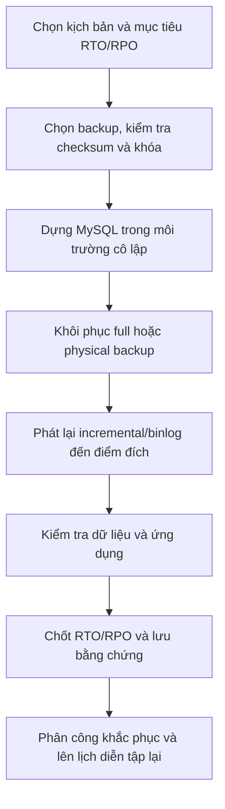

# Diễn tập khôi phục định kỳ và ghi nhận thời gian/điểm dữ liệu phục hồi

Trong module `DATABASE_MYSQL`, người học làm chủ MySQL từ thiết kế bảng, kiểu dữ liệu, khóa và truy vấn SQL đến index, transaction, kiểm soát đồng thời, đọc kế hoạch thực thi, tối ưu truy vấn, phân quyền, sao lưu và xử lý vấn đề vận hành. Bài học này tập trung vào việc chứng minh rằng bản sao lưu có thể dùng để khôi phục hệ thống, đồng thời đo được thời gian khôi phục và lượng dữ liệu có thể mất trong một sự cố.

Một tác vụ sao lưu báo thành công chỉ cho biết dữ liệu đã được ghi ra một đích lưu trữ theo quy trình của tác vụ. Nó chưa chứng minh rằng bản sao lưu đọc được, có đủ khóa giải mã, có thể nạp vào một máy chủ MySQL tương thích hoặc có thể đưa ứng dụng trở lại hoạt động trong thời gian yêu cầu. Chỉ một cuộc diễn tập khôi phục đầy đủ mới kiểm tra được cả chuỗi phụ thuộc đó.

## 1. Mục tiêu của một cuộc diễn tập khôi phục

Diễn tập khôi phục (restore drill) là hoạt động định kỳ dùng bản sao lưu và các dữ liệu phục hồi liên quan để dựng lại một môi trường MySQL, đưa dữ liệu về một thời điểm xác định, kiểm tra tính đúng đắn và ghi lại kết quả. Cuộc diễn tập cần trả lời được các câu hỏi:

- Bản sao lưu nào được chọn, được tạo lúc nào và có thể đọc/giải mã hay không?
- Có đủ binary log để khôi phục đến điểm dữ liệu cần thiết hay không?
- Mất bao lâu từ lúc bắt đầu xử lý sự cố đến khi ứng dụng có thể hoạt động trở lại?
- Dữ liệu mới nhất có thể khôi phục nằm ở thời điểm nào so với thời điểm sự cố?
- Các bước nào bị chậm, thiếu tài liệu hoặc phụ thuộc vào một người hay một hệ thống bên ngoài?
- Kết quả có đáp ứng mục tiêu khôi phục đã được thống nhất với chủ hệ thống hay không?

Phạm vi diễn tập nên bao gồm nhiều tình huống: mất máy chủ, hỏng vùng lưu trữ, xóa nhầm dữ liệu, lỗi logic trong ứng dụng, cần phục hồi đến trước một giao dịch gây hỏng dữ liệu, hoặc bản sao lưu gần nhất không sử dụng được. Không nhất thiết mô phỏng mọi tình huống trong cùng một lần; hãy chọn kịch bản rõ ràng, có tiêu chí đạt và có thể lặp lại.

## 2. Hiểu và đo RTO, RPO

Hai chỉ số cơ bản dùng để đặt mục tiêu và đánh giá khả năng khôi phục là RTO và RPO.

### RTO — Recovery Time Objective

RTO là khoảng thời gian gián đoạn tối đa mà tổ chức chấp nhận cho một dịch vụ. Khi diễn tập, cần đo thời gian thực tế để đưa dịch vụ trở lại trạng thái hoạt động đã được xác minh.

Quy ước mốc bắt đầu trước khi diễn tập. Ví dụ, `T0` có thể là thời điểm sự cố được phát hiện, thời điểm sự cố được tuyên bố hoặc thời điểm đội vận hành nhận lệnh khôi phục. Với một dịch vụ có cam kết thời gian khôi phục, nên tính cả thời gian phát hiện, đánh giá, phê duyệt, lấy bản sao lưu, dựng máy chủ, nạp dữ liệu, phát lại binary log, kiểm tra ứng dụng và chuyển lưu lượng. Nếu chỉ bấm giờ từ lúc chạy lệnh restore, kết quả sẽ không phản ánh đầy đủ thời gian gián đoạn.

```text
RTO thực tế = thời điểm dịch vụ được xác nhận hoạt động - T0
```

Ví dụ: sự cố được tuyên bố lúc 09:00 UTC; máy chủ được dựng xong lúc 09:12; nạp bản sao lưu và phát lại log hoàn tất lúc 09:42; kiểm tra ứng dụng và chuyển lưu lượng hoàn tất lúc 09:50. RTO thực tế là 50 phút. Nếu mục tiêu RTO là 60 phút, lần diễn tập này đạt mục tiêu nhưng chỉ còn 10 phút dự phòng.

### RPO — Recovery Point Objective

RPO là khoảng thời gian dữ liệu tối đa mà tổ chức chấp nhận mất khi có sự cố. RPO thực tế được xác định từ thời điểm sự cố đến giao dịch đã commit mới nhất còn hiện diện và được xác minh trong dữ liệu phục hồi.

```text
RPO thực tế = thời điểm sự cố - thời điểm commit mới nhất có thể khôi phục
```

Ví dụ: sự cố xảy ra lúc 10:40 UTC; sau khi khôi phục, giao dịch mới nhất được xác minh có thời điểm commit 10:34 UTC. RPO thực tế là 6 phút. Nếu mục tiêu RPO là 5 phút, kết quả không đạt dù máy chủ đã khởi động nhanh.

RPO không phải là tuổi của file sao lưu gần nhất. Nếu có một bản sao lưu đầy đủ từ đêm trước nhưng binary log được lưu trữ liên tục và còn đầy đủ, hệ thống có thể phát lại log để đưa dữ liệu đến gần thời điểm sự cố. Ngược lại, một bản sao lưu mới nhưng thiếu binary log cần thiết có thể khiến điểm phục hồi thực tế cũ hơn nhiều so với mong đợi.

RTO và RPO là hai mục tiêu khác nhau. Có thể đạt RPO nhưng không đạt RTO nếu nạp dữ liệu quá lâu; cũng có thể đạt RTO nhưng không đạt RPO nếu khôi phục nhanh từ bản sao lưu quá cũ. Cần ghi nhận và đánh giá riêng từng chỉ số.

## 3. Chuẩn bị dữ liệu và công cụ phục hồi

Trước khi chạy diễn tập, cần lập danh sách các thành phần mà quy trình khôi phục phụ thuộc vào.

### Chọn loại bản sao lưu

MySQL thường được sao lưu theo một hoặc kết hợp nhiều phương pháp:

| Phương pháp | Đặc điểm khi khôi phục | Điểm cần kiểm tra trong diễn tập |
|---|---|---|
| Logical backup, ví dụ `mysqldump` | Xuất cấu trúc và dữ liệu thành câu lệnh SQL; dễ chuyển giữa môi trường tương thích nhưng có thể mất nhiều thời gian với tập dữ liệu lớn. | File dump đọc được, có đủ schema, bảng, trigger, routine, event cần thiết; lệnh import không phát sinh lỗi. |
| Physical backup, ví dụ MySQL Enterprise Backup hoặc Percona XtraBackup | Sao chép dữ liệu vật lý; thường phù hợp với cơ sở dữ liệu lớn và có thể hỗ trợ incremental backup. | Phiên bản công cụ tương thích, đủ chuỗi full/incremental, đã thực hiện bước prepare/apply log theo yêu cầu của công cụ. |
| Snapshot lưu trữ hoặc máy ảo | Có thể phục hồi nhanh nếu snapshot nhất quán và hạ tầng hỗ trợ. | Snapshot nhất quán với trạng thái MySQL, có metadata cần thiết và có thể gắn/mở trên môi trường thử nghiệm. |
| Binary log | Ghi lại thay đổi sau mốc sao lưu, hỗ trợ point-in-time recovery (PITR). | Bật binary logging, log liên tục từ mốc sao lưu, file không bị thiếu/hỏng và thời gian lưu giữ đủ dài. |

Không giả định các loại bản sao lưu có quy trình restore giống nhau. Hãy dùng đúng hướng dẫn của công cụ tạo bản sao lưu, đúng phiên bản MySQL và đúng thứ tự áp dụng các bản incremental hoặc log.

### Kiểm tra binary log và thông tin mốc sao lưu

PITR thường cần một bản sao lưu nhất quán cùng vị trí binary log hoặc thông tin GTID tương ứng tại thời điểm sao lưu. Kiểm tra cấu hình trên máy chủ nguồn:

```sql
SHOW VARIABLES LIKE 'log_bin';
SHOW VARIABLES LIKE 'binlog_format';
SHOW BINARY LOGS;
```

`log_bin` cần được bật nếu quy trình dựa vào binary log. Danh sách log phải bao phủ liên tục từ mốc của bản sao lưu đến thời điểm muốn phục hồi. Lưu giữ log ở cùng máy chủ nguồn là chưa đủ; cần sao chép chúng đến nơi lưu trữ độc lập để vẫn còn dùng được khi máy chủ hoặc đĩa nguồn bị mất.

Ghi lại metadata của bản sao lưu: thời điểm bắt đầu/kết thúc, phiên bản MySQL, loại backup, schema được bao gồm, vị trí binary log và vị trí GTID nếu có, checksum, nơi lưu, khóa giải mã và thời hạn lưu giữ. Nếu dùng GTID, phải bảo toàn thông tin GTID của bản sao lưu và hiểu trạng thái GTID trên máy đích trước khi phát lại hoặc kết nối vào topology replication.

### Kiểm tra khả năng đọc và giải mã

Trước khi restore, xác minh file đã được chuyển đầy đủ bằng checksum do quy trình sao lưu tạo ra hoặc tính lại. Ví dụ trên môi trường Linux:

```bash
sha256sum shop-full.sql
```

So sánh giá trị với checksum được ghi nhận tại thời điểm sao lưu hoặc sau khi tải file về. Nếu bản sao lưu được mã hóa, kiểm tra rằng khóa và quyền truy cập khóa vẫn hoạt động. Một file mã hóa còn nguyên nhưng không thể lấy khóa giải mã vẫn không phải là bản sao lưu có thể khôi phục.

Không đưa mật khẩu, khóa mã hóa, token hoặc nội dung dữ liệu nhạy cảm vào biên bản diễn tập. Chỉ ghi mã định danh của bí mật và nơi quản lý được phép truy cập.

## 4. Dựng môi trường khôi phục an toàn

Diễn tập nên thực hiện trên một máy chủ hoặc môi trường cô lập. Môi trường này cần đủ dung lượng đĩa, CPU, RAM và băng thông để phản ánh thực tế; nếu dùng cấu hình nhỏ hơn đáng kể, thời gian đo được không đại diện cho RTO của hệ thống thật.

Trước khi nạp dữ liệu:

1. Chọn phiên bản MySQL tương thích với bản sao lưu và công cụ backup. Không giả định có thể phục hồi data directory từ phiên bản mới vào máy chủ phiên bản cũ.
2. Chuẩn bị cấu hình cần thiết như `datadir`, `innodb_log_file_size` hoặc các tùy chọn tương ứng của phiên bản, charset, collation, timezone, plugin và giới hạn tài nguyên. Chỉ áp dụng các tham số còn hợp lệ với phiên bản đang chạy.
3. Cô lập kết nối ứng dụng và replication để máy thử nghiệm không nhận ghi từ hệ thống thật, không phát email hoặc job thật và không vô tình trở thành một nút trong topology sản xuất.
4. Chuẩn bị tài khoản khôi phục có quyền tối thiểu cần thiết. Tránh dùng thông tin đăng nhập sản xuất được nhúng trong script hoặc dòng lệnh.
5. Xác định cách kiểm tra sau restore: truy vấn nghiệp vụ, số lượng bản ghi, khóa ngoại, trạng thái routine/event, tài khoản và quyền, cùng một bài kiểm tra kết nối của ứng dụng.

Nếu dữ liệu chứa thông tin cá nhân hoặc bí mật kinh doanh, áp dụng kiểm soát truy cập và quy trình che/mã hóa dữ liệu phù hợp với môi trường diễn tập. Sau khi kết thúc, xóa hoặc lưu giữ bản dữ liệu thử nghiệm theo chính sách đã phê duyệt.

## 5. Thực hiện khôi phục logical backup và PITR

Ví dụ dưới đây minh họa một quy trình logical backup cho cơ sở dữ liệu InnoDB. Cú pháp và tùy chọn cụ thể có thể khác theo phiên bản `mysqldump`; hãy kiểm tra `mysqldump --help` trên đúng máy chạy backup. Ở các phiên bản hỗ trợ `--source-data`, tùy chọn `--source-data=2` ghi vị trí binary log vào dump dưới dạng chú thích để có thể lấy mốc phát lại.

### Tạo logical backup có thông tin binary log

```bash
mysqldump \
  --login-path=backup \
  --single-transaction \
  --routines \
  --events \
  --triggers \
  --source-data=2 \
  --databases shop \
  > shop-full.sql
```

`--single-transaction` tạo snapshot nhất quán cho các bảng InnoDB mà không giữ khóa đọc trên toàn bộ thời gian dump. Cách này không bảo đảm snapshot nhất quán cho bảng không dùng transactional engine như MyISAM; đồng thời không nên chạy các thay đổi DDL như `ALTER TABLE`, `DROP TABLE`, `RENAME TABLE` hoặc `TRUNCATE TABLE` trong lúc dump. Nếu máy chủ hoặc phiên bản `mysqldump` chưa hỗ trợ `--source-data`, dùng tùy chọn tương ứng được tài liệu phiên bản đó hỗ trợ, chẳng hạn `--master-data=2` ở các bản cũ.

Tài khoản và quyền MySQL không nên được xem là đã sao lưu đầy đủ chỉ vì đã dump một schema ứng dụng. Cần có quy trình riêng để ghi nhận và phục hồi tài khoản, role, grants, cấu hình máy chủ, chứng chỉ và các bí mật cần thiết. Không phục hồi mù quáng toàn bộ schema hệ thống `mysql` sang một phiên bản khác.

### Nạp bản sao lưu vào máy chủ thử nghiệm

```bash
mysql --login-path=restore < shop-full.sql
```

Sau khi nạp, kiểm tra log lệnh và mã thoát. Không dùng tùy chọn ép tiếp tục bỏ qua lỗi import để đánh dấu một lần restore là thành công. Nếu lệnh thất bại giữa chừng, ghi nhận lỗi, làm sạch môi trường thử nghiệm theo runbook và chạy lại sau khi xử lý nguyên nhân.

### Phát lại binary log đến điểm cần phục hồi

Giả sử dump ghi nhận file binary log `binlog.000123` tại vị trí `4567`. Các file log từ đó đến trước thời điểm sự cố đã được sao chép đầy đủ vào thư mục `/backup/binlog/`. Có thể dùng `mysqlbinlog` để phát lại thay đổi đến thời điểm mục tiêu:

```bash
mysqlbinlog \
  --start-position=4567 \
  --stop-datetime="2026-11-19 10:30:00" \
  /backup/binlog/binlog.000123 \
  /backup/binlog/binlog.000124 \
  | mysql --login-path=restore
```

Đây là ví dụ minh họa; cần thay file, vị trí và thời điểm theo metadata thực tế. `--start-position` phải là vị trí được ghi nhận tại mốc backup trong file đầu tiên. `--stop-datetime` phụ thuộc cách diễn giải múi giờ của máy chạy `mysqlbinlog`; hãy đồng bộ đồng hồ, thống nhất UTC và ghi rõ múi giờ trong biên bản. Khi cần điểm dừng chính xác đến ranh giới sự kiện/giao dịch, ưu tiên vị trí log hoặc GTID đã được xác định và kiểm thử thay vì chỉ dựa vào chuỗi thời gian.

Trước khi chạy, xác minh các file log liên tục và đúng thứ tự. Thiếu một file ở giữa chuỗi có thể khiến các thay đổi sau đó không thể phát lại đầy đủ. Nếu cần dừng trước một câu lệnh gây hỏng dữ liệu, hãy xác định giao dịch mục tiêu bằng cách phân tích log trên bản sao, sau đó chọn vị trí dừng trước giao dịch đó. Không thử nghiệm thao tác này trực tiếp trên máy chủ sản xuất.

Với physical backup, các bước restore, prepare, áp dụng incremental và khởi động máy chủ phải theo đúng tài liệu của công cụ đã tạo backup. Sau khi phục hồi physical backup, quy trình PITR vẫn cần mốc binary log/GTID chính xác và log đầy đủ.

## 6. Kiểm tra dữ liệu và xác nhận dịch vụ

Máy chủ khởi động được chưa có nghĩa là dữ liệu đã phục hồi đúng. Cần xác minh theo nhiều lớp.

### Kiểm tra ở lớp MySQL

```sql
SELECT VERSION();
SHOW DATABASES;
SHOW TABLES FROM shop;
SHOW VARIABLES LIKE 'read_only';
```

Kiểm tra bảng quan trọng, cấu trúc cột, index, charset/collation, trigger, routine, event và các thiết lập liên quan. Nếu dùng InnoDB, kiểm tra các truy vấn nghiệp vụ và ràng buộc khóa ngoại trên môi trường thử nghiệm. `CHECK TABLE` có thể hỗ trợ kiểm tra một số loại bảng nhưng không thay thế việc xác minh logic dữ liệu và quy trình nghiệp vụ.

### Kiểm tra dữ liệu theo nghiệp vụ

Chọn các chỉ tiêu có thể đối chiếu được với mốc phục hồi: tổng số đơn hàng, số dư, số lượng tồn, tổng tiền theo ngày hoặc các giao dịch kiểm thử đã biết. Với dữ liệu quan trọng, dùng checksum hoặc đối chiếu tập dữ liệu theo khóa chính trên một phạm vi đã xác định. Nếu chủ đích là phục hồi trước một giao dịch sai, cần chứng minh giao dịch sai không xuất hiện và các giao dịch hợp lệ trước đó vẫn còn.

Một cách đo RPO trong môi trường diễn tập là tạo các bản ghi đánh dấu (marker) trong một schema thử nghiệm. Tạo bảng marker trước khi tạo bản backup đầy đủ để bảng có mặt trong snapshot; sau đó ghi các marker đã commit ở những thời điểm đã ghi nhận. Đặt múi giờ phiên về UTC:

```sql
SET time_zone = '+00:00';

CREATE TABLE IF NOT EXISTS shop.restore_drill_marker (
    id BIGINT UNSIGNED NOT NULL AUTO_INCREMENT PRIMARY KEY,
    marker_name VARCHAR(100) NOT NULL,
    recorded_at TIMESTAMP(6) NOT NULL DEFAULT CURRENT_TIMESTAMP(6)
) ENGINE=InnoDB;

START TRANSACTION;
INSERT INTO shop.restore_drill_marker (marker_name)
VALUES ('before-simulated-incident');
COMMIT;
```

Sau khi đã tạo backup, tiếp tục tạo các marker ở những thời điểm khác nhau trước và sau thời điểm sự cố mô phỏng; ghi lại thời điểm commit của từng marker trong biên bản ngay sau khi transaction hoàn tất. Sau khi phục hồi đến điểm đã chọn, truy vấn:

```sql
SELECT id, marker_name, recorded_at
FROM shop.restore_drill_marker
ORDER BY id;
```

Marker cuối cùng có mặt và đã commit là bằng chứng hữu ích về điểm dữ liệu được phục hồi. `recorded_at` là thời điểm ghi marker trong câu lệnh INSERT, không phải timestamp commit chính xác; để đo sát hơn, hãy ghi thời điểm hoàn tất commit ở phía bộ điều khiển diễn tập và đối chiếu với GTID/transaction ID hoặc bản ghi nghiệp vụ. Không đưa marker thử nghiệm vào dữ liệu sản xuất nếu chưa có quy trình được phê duyệt.

### Kiểm tra ở lớp ứng dụng

Chạy smoke test qua đúng driver và cấu hình kết nối mà ứng dụng sử dụng: đăng nhập, đọc bản ghi đại diện, thực hiện một thao tác ghi thử trong schema kiểm thử và rollback hoặc dọn dữ liệu sau đó. Kiểm tra các quyền, role và tài khoản ứng dụng cần thiết. Xác nhận job, scheduler, event và tích hợp bên ngoài đang ở trạng thái an toàn để không tạo tác động thật khi máy chủ thử nghiệm được khởi động.

Chỉ dừng đồng hồ RTO khi dịch vụ đạt tiêu chí phục hồi đã định nghĩa: MySQL sẵn sàng, dữ liệu hợp lệ, ứng dụng kết nối được và các kiểm tra thiết yếu thành công. Nếu chỉ máy chủ database khởi động nhưng ứng dụng chưa dùng được, RTO của dịch vụ vẫn chưa kết thúc.

## 7. Ghi nhận RTO, RPO và bằng chứng diễn tập

Mỗi lần diễn tập cần có mã định danh và biên bản có thể kiểm tra lại. Dùng cùng một quy ước thời gian, tốt nhất là UTC và định dạng ISO 8601 có ký hiệu múi giờ. Đồng bộ đồng hồ của máy chủ MySQL, máy backup, máy restore và hệ thống giám sát để tránh sai lệch khi đối chiếu.

| Trường ghi nhận | Nội dung cần lưu |
|---|---|
| Mã cuộc diễn tập | ID duy nhất, ngày thực hiện, người điều phối và người thực hiện. |
| Kịch bản | Mất máy chủ, xóa nhầm dữ liệu, lỗi logic, hỏng backup hoặc tình huống khác. |
| Mục tiêu | RTO/RPO được phê duyệt và tiêu chí dịch vụ được xem là phục hồi. |
| Nguồn phục hồi | ID bản backup, loại backup, thời điểm backup, phiên bản MySQL, checksum và vị trí lưu. |
| Mốc log | Binary log file/position hoặc GTID tại backup; danh sách log đã phát lại và điểm dừng. |
| Thời gian | `T0`, lúc bắt đầu lấy backup, dựng máy, restore, replay log, bắt đầu/kết thúc kiểm tra và lúc dịch vụ sẵn sàng. |
| Điểm dữ liệu | Thời điểm commit mới nhất được xác minh, marker/transaction ID cuối cùng và thời điểm sự cố mô phỏng. |
| Kết quả | RTO thực tế, RPO thực tế, đạt/không đạt từng mục tiêu, lỗi phát sinh và bằng chứng. |
| Hành động tiếp theo | Vấn đề, mức độ ưu tiên, người phụ trách, hạn xử lý và trạng thái xác minh lại. |

Ví dụ một bản ghi kết quả:

| Chỉ số | Mục tiêu | Kết quả diễn tập | Đánh giá |
|---|---:|---:|---|
| RTO | 60 phút | 50 phút | Đạt, còn 10 phút dự phòng |
| RPO | 5 phút | 6 phút | Không đạt, vượt 1 phút |
| Điểm phục hồi | Trước sự cố 10:40 UTC | Marker cuối lúc 10:34 UTC | Đã xác minh |
| Kiểm tra ứng dụng | Smoke test thành công | Thành công lúc 09:50 UTC | Đạt |

Không chỉ ghi con số tổng. Hãy lưu thời gian từng giai đoạn để biết phần nào chiếm nhiều thời gian nhất. Ví dụ, nếu lấy backup mất 2 phút, restore mất 25 phút, replay log mất 10 phút và kiểm tra/cutover mất 13 phút, đội vận hành có thể tập trung cải thiện đúng bước đang chi phối RTO.

## 8. Quy trình diễn tập có thể lặp lại

Một cuộc diễn tập điển hình có thể tổ chức theo luồng sau:



Thực hiện theo các bước:

1. **Chốt phạm vi.** Chọn hệ thống, schema, kịch bản, thời điểm sự cố mô phỏng và mục tiêu RTO/RPO. Xác định ai có quyền quyết định điểm phục hồi và ai xác nhận dữ liệu hợp lệ.
2. **Chọn bộ backup.** Chọn một bản backup đầy đủ và chuỗi incremental/binlog cần thiết. Xác minh checksum, quyền truy cập, khóa giải mã, metadata, phiên bản và tính liên tục của log.
3. **Bắt đầu đo thời gian.** Ghi `T0` theo quy ước của tổ chức. Ghi lại từng mốc thay vì chỉ ghi giờ bắt đầu và kết thúc.
4. **Dựng môi trường đích.** Chuẩn bị máy chủ cô lập có cấu hình phù hợp, tài khoản khôi phục và dung lượng đủ dùng.
5. **Khôi phục dữ liệu.** Nạp logical dump hoặc thực hiện restore/prepare physical backup theo hướng dẫn công cụ. Kiểm tra mã thoát và log ở từng bước.
6. **Đưa dữ liệu đến điểm đích.** Phát lại binary log hoặc áp dụng chuỗi incremental đến đúng thời điểm/transaction đã chọn. Lưu lại file, position, GTID và lệnh đã sử dụng.
7. **Xác minh.** Kiểm tra cấu trúc, dữ liệu, marker, quyền và smoke test ứng dụng. Chỉ xác nhận phục hồi khi tiêu chí đã định nghĩa đều đạt.
8. **Chốt số đo.** Tính RTO từ `T0` đến thời điểm dịch vụ sẵn sàng; tính RPO từ thời điểm sự cố đến commit mới nhất đã xác minh. So sánh riêng với mục tiêu.
9. **Ghi nhận và cải tiến.** Lưu biên bản, log đã làm sạch thông tin bí mật, lỗi, hành động khắc phục và lịch kiểm tra lại. Dọn môi trường thử nghiệm theo chính sách.

## 9. Tần suất và mức độ diễn tập

Tần suất cần dựa trên mức độ quan trọng của dịch vụ, yêu cầu hợp đồng/quy định, tần suất thay đổi dữ liệu, thời gian lưu binary log, tốc độ tăng dữ liệu và mức độ thay đổi hạ tầng. Có thể xây dựng lịch theo các mức:

- **Kiểm tra định kỳ:** xác minh khả năng đọc backup, checksum, khóa giải mã và sự hiện diện của binary log. Đây là kiểm tra nhanh, không thay thế restore drill.
- **Diễn tập restore đầy đủ:** dựng môi trường mới, nạp backup và xác minh dữ liệu/ứng dụng theo chu kỳ phù hợp với mức độ quan trọng của hệ thống.
- **Diễn tập PITR:** khôi phục đến một thời điểm trước giao dịch sai hoặc đến một transaction marker cụ thể để kiểm tra chuỗi binary log.
- **Diễn tập sự cố lớn:** kiểm tra khả năng khôi phục khi mất máy chủ/vùng lưu trữ, mất quyền truy cập kho backup hoặc cần dựng lại các phụ thuộc bên ngoài.
- **Diễn tập sau thay đổi lớn:** chạy lại sau khi nâng cấp MySQL, thay công cụ backup, thay đổi mã hóa, di chuyển kho lưu trữ, thay đổi topology hoặc thay đổi đáng kể quy mô dữ liệu.

Không dùng một lịch cố định cho mọi hệ thống. Dịch vụ có RPO tính bằng phút cần kiểm tra đường đi của binary log thường xuyên hơn dịch vụ có RPO tính bằng ngày. Nếu backup hoặc log không còn được kiểm tra trong thời gian dài, rủi ro phát hiện lỗi quá muộn sẽ tăng.

## 10. Lỗi thường gặp trong diễn tập

| Hiện tượng | Nguyên nhân có thể | Cách xử lý |
|---|---|---|
| File backup tồn tại nhưng restore thất bại | File bị thiếu/hỏng, định dạng không đúng, khóa giải mã không còn hoặc quyền truy cập kho backup sai. | Kiểm tra checksum, quyền, khóa và log của công cụ backup; khắc phục quy trình lưu trữ rồi tạo và thử lại bộ backup. |
| Restore được full backup nhưng PITR thất bại | Thiếu binary log, log không liên tục, sai vị trí bắt đầu hoặc sai múi giờ/điểm dừng. | Đối chiếu metadata backup, danh sách log, file/position hoặc GTID; kiểm tra đồng bộ thời gian và retention. |
| Máy chủ khởi động nhưng ứng dụng không dùng được | Thiếu user/grant, routine, event, cấu hình, chứng chỉ, secret hoặc dependency. | Bổ sung danh mục phụ thuộc vào runbook và đưa smoke test ứng dụng vào tiêu chí hoàn tất. |
| RTO thực tế cao hơn mục tiêu | Dung lượng restore lớn, băng thông thấp, thiếu tự động hóa, thiếu tài nguyên hoặc các bước phê duyệt kéo dài. | Dùng số đo từng giai đoạn để tìm nút thắt; tối ưu đường truyền, tài nguyên, quy trình và tài liệu. |
| RPO thực tế cao hơn mục tiêu | Backup quá thưa, binary log không được chuyển kịp thời, retention ngắn hoặc có khoảng trống trong chuỗi log. | Điều chỉnh lịch backup, giám sát độ trễ chuyển log và thời gian lưu giữ; diễn tập lại sau khi sửa. |
| Kết quả giữa các lần diễn tập không thể so sánh | Mốc bắt đầu/kết thúc, cấu hình máy, kích thước dữ liệu hoặc tiêu chí kiểm tra thay đổi mà không được ghi lại. | Chuẩn hóa quy ước đo, lưu cấu hình và metadata, ghi rõ mọi khác biệt giữa các lần chạy. |

Khi diễn tập không đạt mục tiêu, kết quả vẫn có giá trị nếu được ghi nhận trung thực. Không bỏ qua lỗi, điều chỉnh mốc thời gian sau khi chạy hoặc đánh dấu thành công chỉ vì câu lệnh cuối cùng trả về mã thoát 0. Một lần diễn tập thất bại giúp phát hiện khoảng trống trong quy trình trước khi sự cố thật xảy ra.

## 11. Bài tập thực hành

Một dịch vụ bán hàng dùng MySQL InnoDB có mục tiêu RTO 60 phút và RPO 5 phút. Hệ thống có bản sao lưu đầy đủ mỗi đêm và lưu binary log liên tục sang kho lưu trữ độc lập. Hãy thực hiện một diễn tập trên môi trường cô lập:

1. Chọn một bản backup đầy đủ, ghi nhận thời điểm, phiên bản MySQL, checksum, vị trí binary log/GTID và xác minh có khóa giải mã.
2. Tạo một số marker giao dịch đã commit sau mốc backup; ghi lại thời gian UTC của từng marker.
3. Chọn một thời điểm sự cố mô phỏng sau marker cuối, rồi dựng một máy chủ MySQL tương thích trong mạng cô lập.
4. Khôi phục bản backup, phát lại binary log đến điểm phục hồi đã chọn và ghi lại chính xác file/position hoặc GTID cuối cùng.
5. Truy vấn marker cuối cùng, đối chiếu các chỉ tiêu nghiệp vụ và chạy smoke test ứng dụng.
6. Ghi thời điểm `T0`, thời điểm dịch vụ sẵn sàng và commit mới nhất được xác minh; tính RTO/RPO thực tế rồi so sánh với mục tiêu.
7. Nếu không đạt, chỉ ra giai đoạn gây chậm hoặc khoảng trống log, đề xuất hành động có người phụ trách và thời hạn, sau đó lên lịch diễn tập lại.

Sau bài tập, người học cần giải thích được vì sao trạng thái “backup job thành công” chưa chứng minh khả năng phục hồi, vì sao PITR cần binary log liên tục từ mốc backup, vì sao RTO phải dừng ở thời điểm ứng dụng đã được xác minh và vì sao RPO phải dựa trên giao dịch mới nhất thực sự có mặt trong dữ liệu phục hồi. Đây là nền tảng để biến sao lưu MySQL thành một năng lực khôi phục có thể đo lường và cải thiện liên tục.
