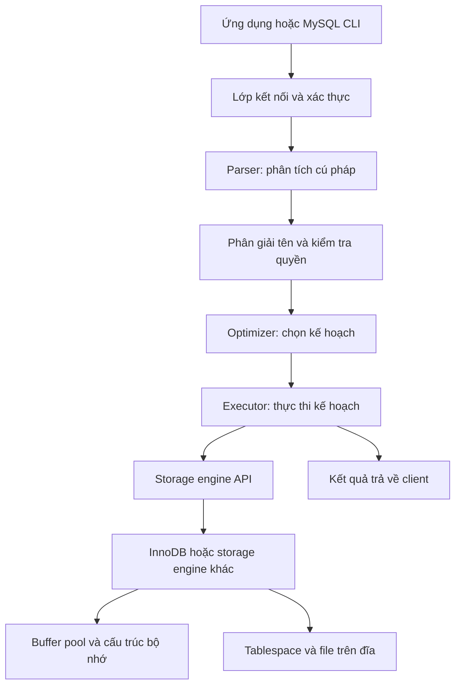

# Các lớp kết nối, phân tích cú pháp, tối ưu và thực thi SQL

Trong module **DATABASE_MYSQL**, người học làm chủ MySQL từ thiết kế bảng, kiểu dữ liệu, khóa và truy vấn SQL đến index, transaction, kiểm soát đồng thời, đọc kế hoạch thực thi, tối ưu truy vấn, phân quyền, sao lưu và vận hành. Để hiểu vì sao một câu SQL có thể chạy nhanh hoặc chậm, cần nhìn MySQL như một hệ thống gồm nhiều lớp phối hợp: lớp kết nối tiếp nhận yêu cầu, lớp SQL phân tích và tối ưu câu lệnh, bộ thực thi điều phối thao tác, còn storage engine đọc và ghi dữ liệu thực tế.

Hiểu luồng này giúp phân biệt lỗi kết nối với lỗi SQL, hiểu vai trò của index và optimizer, đọc `EXPLAIN` có cơ sở, đồng thời biết một thao tác SQL ảnh hưởng thế nào đến transaction, bộ nhớ và đĩa.

## 1. Bức tranh kiến trúc MySQL

MySQL Server thường chạy dưới dạng tiến trình `mysqld`. Client như MySQL CLI, ứng dụng Java dùng Connector/J hoặc một dịch vụ backend gửi câu lệnh đến server qua giao thức phù hợp. Phần lớn ứng dụng quan hệ dùng giao thức SQL cổ điển qua TCP/IP; client cục bộ trên Unix cũng có thể dùng Unix socket.

Kiến trúc có thể nhìn theo bốn lớp chính:

1. **Kết nối và quản lý phiên:** tiếp nhận kết nối, thương lượng giao thức, xác thực tài khoản và tạo ngữ cảnh phiên.
2. **SQL layer:** phân tích cú pháp, phân giải tên, kiểm tra quyền, tối ưu hóa và xây dựng kế hoạch thực thi.
3. **Execution layer:** điều phối các iterator hoặc thao tác đọc/ghi, áp dụng điều kiện, join, sắp xếp và tổng hợp theo kế hoạch.
4. **Storage engine layer:** cung cấp cách lưu trữ, tìm kiếm, khóa, transaction và truy cập trang dữ liệu. InnoDB là storage engine mặc định phổ biến của MySQL.

Sơ đồ dưới đây mô tả luồng khái quát của một câu SQL:



Đây là mô hình logic. Một số công việc như kiểm tra quyền, truy cập metadata, xử lý biểu thức hoặc đẩy điều kiện có thể diễn ra ở nhiều điểm trong quá trình xử lý. Không phải mọi câu lệnh đều đi qua tất cả bước theo một đường thẳng giống nhau.

## 2. Lớp kết nối và quản lý phiên

### 2.1. Tiếp nhận kết nối

Khi client kết nối đến MySQL Server, server tiếp nhận yêu cầu trên endpoint đang lắng nghe. Với TCP/IP, endpoint gồm địa chỉ host và cổng; với Unix socket, endpoint là đường dẫn socket cục bộ. Trên Windows có thể sử dụng named pipe nếu được bật.

Quá trình bắt tay thường gồm các hoạt động:

- Server gửi gói chào ban đầu, bao gồm thông tin phiên bản giao thức và cơ chế xác thực mà nó hỗ trợ.
- Client và server thương lượng các capability như giao thức, charset và các tùy chọn kết nối; nếu dùng TLS, hai bên thực hiện thương lượng TLS trước khi gửi thông tin xác thực qua kênh đã bảo vệ.
- Client gửi tên tài khoản và dữ liệu xác thực theo authentication plugin được cấu hình.
- Server xác thực tài khoản, kiểm tra nguồn kết nối và tạo session nếu thành công.

Kết nối thành công mới chỉ có nghĩa client đã vào được server. Khi thực thi câu SQL, MySQL vẫn kiểm tra quyền cần thiết đối với database, table, column hoặc thao tác tương ứng. Vì vậy, `Access denied` khi bắt tay và lỗi thiếu quyền khi chạy một câu SQL là hai tình huống cần chẩn đoán ở hai thời điểm khác nhau.

### 2.2. Thread và session

Theo mô hình mặc định phổ biến, MySQL dùng một thread phục vụ mỗi kết nối đang hoạt động. Thread xử lý yêu cầu của session đó, duy trì trạng thái phiên như:

- Các biến session, chẳng hạn `sql_mode`, `time_zone` và `autocommit`.
- Database mặc định được chọn bằng `USE`.
- Charset và collation của kết nối.
- Trạng thái transaction hiện tại và các thuộc tính liên quan.
- Prepared statement và các tài nguyên gắn với phiên.

Khi client đóng kết nối, tài nguyên phiên được giải phóng; thread có thể được đưa vào thread cache để tái sử dụng cho kết nối mới. Thread cache giúp giảm chi phí tạo thread, nhưng không có nghĩa một thread cache tương ứng với một kết nối ứng dụng đang mở.

Một số bản phân phối hoặc cấu hình thương mại có thể cung cấp thread pool để điều phối nhiều kết nối trên số worker thread được giới hạn. Đây là khác biệt về cách lập lịch xử lý; không làm thay đổi nguyên tắc client vẫn có session riêng và MySQL vẫn phải xác thực, kiểm tra quyền cho các yêu cầu.

### 2.3. Connection pool ở ứng dụng

Ứng dụng Java thường dùng connection pool như HikariCP để tái sử dụng kết nối, giới hạn số kết nối đồng thời và tránh tạo/hủy kết nối liên tục. Connection pool ở ứng dụng khác với thread cache hoặc thread pool ở MySQL Server:

| Thành phần | Nơi hoạt động | Nhiệm vụ |
|---|---|---|
| Connection pool | Ứng dụng Java/backend | Quản lý các kết nối JDBC có thể tái sử dụng |
| Thread cache | MySQL Server | Tái sử dụng thread đã phục vụ kết nối trước đó |
| Thread pool (nếu có) | MySQL Server | Điều phối việc xử lý kết nối trên worker thread |

Pool quá lớn có thể làm MySQL phải quản lý quá nhiều session đồng thời, tăng bộ nhớ và tranh chấp tài nguyên. Cấu hình pool cần dựa trên số instance ứng dụng, giới hạn kết nối server, thời gian truy vấn và tải thực tế. Không tăng `maximumPoolSize` chỉ để xử lý truy vấn chậm; cần xác định nút thắt trước.

## 3. SQL layer: phân tích và chuẩn bị câu lệnh

### 3.1. Parser phân tích cú pháp

Sau khi nhận câu lệnh, MySQL phân tích các token như từ khóa, tên bảng, tên cột, toán tử, literal và biểu thức. Parser kiểm tra cấu trúc có đúng ngữ pháp SQL mà phiên bản MySQL hỗ trợ hay không và tạo biểu diễn nội bộ (parse tree) để các bước sau xử lý.

Ví dụ:

```sql
SELECT customer_id, COUNT(*) AS order_count
FROM orders
WHERE status = 'PAID'
GROUP BY customer_id
ORDER BY order_count DESC;
```

Parser nhận diện `SELECT`, danh sách biểu thức, `FROM`, `WHERE`, `GROUP BY` và `ORDER BY`. Nếu thiếu từ khóa hoặc đặt biểu thức sai vị trí, câu lệnh có thể bị từ chối với lỗi cú pháp trước khi MySQL đọc các hàng dữ liệu.

Parser không quyết định index nào được dùng và cũng không trực tiếp đọc trang dữ liệu. Đó là công việc của optimizer, executor và storage engine.

### 3.2. Phân giải tên và metadata

Sau khi cấu trúc câu lệnh hợp lệ, MySQL cần xác định các tên trong câu SQL thực sự trỏ đến đối tượng nào:

- Database nào chứa bảng được tham chiếu?
- Bảng có tồn tại và có alias nào được khai báo?
- Cột có tồn tại trong bảng hoặc trong phạm vi truy vấn không?
- Kiểu dữ liệu và metadata của cột là gì?
- Hàm, toán tử và biểu thức có thể được áp dụng hợp lệ không?

MySQL sử dụng data dictionary để quản lý metadata của database, table, column, index và các đối tượng khác. Từ MySQL 8.0, metadata dictionary được lưu trong hệ thống data dictionary transactional của InnoDB, thay cho cơ chế file metadata rời rạc của các phiên bản cũ.

Metadata cũng được cache để giảm chi phí tra cứu lặp lại. Khi schema thay đổi, server phải duy trì tính nhất quán của metadata và xử lý việc làm mới hoặc vô hiệu hóa thông tin cache liên quan.

### 3.3. Kiểm tra quyền

MySQL áp dụng mô hình quyền ở nhiều cấp. Tài khoản được xác định bởi cặp user và host; quyền có thể áp dụng ở cấp global, database, table, column hoặc routine tùy loại grant. Khi xử lý câu lệnh, server xác định đối tượng bị tác động và kiểm tra các quyền tương ứng.

Ví dụ, tài khoản chỉ có quyền `SELECT` trên bảng `orders` có thể đọc bảng đó nhưng không thể tự động `UPDATE` hoặc `DELETE`. Một câu truy vấn join nhiều bảng cần quyền đọc trên các đối tượng liên quan. Hãy dùng `SHOW GRANTS` để kiểm tra quyền thực tế:

```sql
SHOW GRANTS FOR CURRENT_USER();
```

Nếu câu SQL đúng cú pháp nhưng báo lỗi thiếu quyền, không nên sửa query hoặc đổi giao thức kết nối một cách tùy tiện. Hãy xác định đúng tài khoản đang đăng nhập, host match và quyền cần thiết.

## 4. Optimizer: chọn kế hoạch thực thi

### 4.1. Vì sao cần optimizer?

Một câu SQL có thể được thực hiện bằng nhiều cách. Ví dụ, để tìm đơn hàng theo `customer_id`, MySQL có thể quét toàn bộ bảng hoặc dùng index trên cột đó. Với truy vấn join, optimizer còn phải chọn thứ tự join, cách truy cập từng bảng và phương pháp kết hợp hàng.

Optimizer tìm một kế hoạch có chi phí ước tính thấp theo thông tin thống kê và các quy tắc tối ưu của MySQL. Kế hoạch được chọn không nhất thiết là tốt nhất trong mọi trạng thái dữ liệu thực tế; chất lượng phụ thuộc vào thống kê, độ chọn lọc, phân bố dữ liệu, cấu trúc index và biểu thức truy vấn.

### 4.2. Các quyết định chính

Optimizer có thể thực hiện nhiều công việc, chẳng hạn:

- Đơn giản hóa biểu thức và áp dụng các phép biến đổi tương đương.
- Đẩy điều kiện lọc xuống gần nơi đọc dữ liệu hơn khi có thể.
- Chọn thứ tự join và phương pháp join phù hợp.
- Chọn access path: full table scan, index lookup, range scan hoặc các phương thức truy cập khác.
- Xác định index có thể hỗ trợ lọc, join, grouping hoặc ordering.
- Ước lượng số hàng trung gian, chi phí I/O và chi phí CPU.
- Quyết định có cần temporary table hoặc filesort cho một số thao tác hay không.

Ví dụ, nếu bảng `orders` có index trên `customer_id`, truy vấn sau có thể sử dụng index để tìm phạm vi hàng cần đọc:

```sql
SELECT order_id, order_date, total_amount
FROM orders
WHERE customer_id = 125;
```

Tuy nhiên, nếu điều kiện trả về phần lớn bảng, optimizer có thể chọn quét bảng vì chi phí đọc tuần tự được ước lượng thấp hơn nhiều lần truy cập index rồi quay lại lấy hàng. Có index không đồng nghĩa mọi truy vấn đều phải dùng index.

### 4.3. Thống kê và ước lượng

Optimizer dựa vào thống kê về bảng và index, chẳng hạn số hàng ước lượng, số giá trị phân biệt, phân bố dữ liệu và histogram khi được tạo. Thống kê không phản ánh đúng dữ liệu có thể khiến optimizer ước lượng sai số hàng và chọn kế hoạch kém.

Có thể cập nhật thống kê index bằng:

```sql
ANALYZE TABLE orders;
```

Histogram có thể giúp optimizer hiểu phân bố của một cột khi dữ liệu lệch nhiều về một số giá trị:

```sql
ANALYZE TABLE orders
  UPDATE HISTOGRAM ON status
  WITH 32 BUCKETS;
```

Việc tạo histogram cần có mục đích và theo dõi tác động; không cần tạo cho mọi cột. Khi dữ liệu thay đổi đáng kể hoặc kế hoạch truy vấn bất ngờ kém đi, hãy xem xét thống kê trước khi thêm index mới.

### 4.4. Quan sát optimizer

`EXPLAIN` cho biết kế hoạch MySQL dự định dùng:

```sql
EXPLAIN
SELECT order_id, order_date, total_amount
FROM orders
WHERE customer_id = 125;
```

Một số cột thường cần đọc:

| Cột | Ý nghĩa |
|---|---|
| `table` | Bảng hoặc đối tượng được đọc ở bước đó |
| `type` | Kiểu truy cập, từ các dạng truy cập theo khóa đến quét bảng; cần hiểu trong ngữ cảnh truy vấn |
| `possible_keys` | Các index có thể được cân nhắc |
| `key` | Index được chọn cho bước truy cập |
| `key_len` | Độ dài phần khóa được sử dụng |
| `rows` | Số hàng optimizer ước lượng phải đọc |
| `filtered` | Tỷ lệ phần trăm hàng ước tính còn lại sau điều kiện lọc tại bước đó |
| `Extra` | Thông tin bổ sung như `Using where`, `Using temporary` hoặc `Using filesort` |

Không đánh giá kế hoạch chỉ bằng một giá trị `type` hoặc bằng việc có/không có `Using filesort`. Hãy đọc toàn bộ kế hoạch, số hàng ước lượng, thứ tự join và mục tiêu của truy vấn. `Using filesort` là tên kỹ thuật của cơ chế sắp xếp bổ sung, không nhất thiết có nghĩa MySQL luôn ghi toàn bộ kết quả ra file vật lý.

MySQL 8.0.18 trở lên hỗ trợ `EXPLAIN ANALYZE` cho câu `SELECT`, thực thi truy vấn và bổ sung số liệu thực tế về thời gian cùng số hàng ở các iterator:

```sql
EXPLAIN ANALYZE
SELECT order_id, order_date, total_amount
FROM orders
WHERE customer_id = 125;
```

Lệnh này thực sự chạy truy vấn. Hãy dùng trên truy vấn đọc phù hợp, cân nhắc tải hệ thống và dữ liệu trả về trước khi chạy ở môi trường production. So sánh estimated rows với actual rows để tìm nơi optimizer ước lượng sai.

## 5. Execution layer: thực thi kế hoạch

Sau khi optimizer chọn kế hoạch, execution layer điều phối các bước để tạo kết quả. Tùy truy vấn, executor có thể:

- Mở bảng và khởi tạo access method đã chọn.
- Yêu cầu storage engine tìm hàng theo index hoặc quét phạm vi dữ liệu.
- Áp dụng điều kiện lọc và tính biểu thức.
- Kết hợp hàng từ nhiều bảng theo kế hoạch join.
- Gom nhóm, tính aggregate, sắp xếp hoặc loại bỏ hàng trùng.
- Tạo và sử dụng temporary table khi cần.
- Chuyển kết quả theo giao thức MySQL về client.

Nhiều kế hoạch truy vấn hiện đại được thực thi theo mô hình iterator: mỗi bước cung cấp hàng cho bước phía trên khi được yêu cầu. Ví dụ, bước lọc yêu cầu hàng từ bước truy cập index; bước join yêu cầu hàng từ hai nhánh; bước aggregate tiêu thụ hàng đầu vào và tạo kết quả nhóm. Mô hình này giúp các thao tác có thể phối hợp theo luồng thay vì luôn phải vật chất hóa toàn bộ kết quả trung gian.

Một số phép toán vẫn cần lưu kết quả trung gian, sắp xếp hoặc gom nhóm trước khi trả dữ liệu. Vì vậy, `LIMIT` có thể giúp giảm số hàng cần trả hoặc xử lý trong một số kế hoạch, nhưng không đảm bảo MySQL tránh được mọi công việc trước đó. Nếu cần sort hoặc aggregate trên tập dữ liệu lớn, server vẫn có thể phải đọc và xử lý nhiều hàng.

## 6. Storage engine layer và InnoDB

### 6.1. Storage engine là gì?

SQL layer hiểu câu lệnh và điều phối kế hoạch, còn storage engine đảm nhiệm cách dữ liệu được lưu và truy cập. MySQL hỗ trợ kiến trúc storage engine có thể thay đổi theo từng bảng. InnoDB là engine mặc định trong các phiên bản MySQL hiện đại và thường được dùng cho ứng dụng giao dịch vì hỗ trợ transaction, khóa hàng và MVCC.

Có thể xem engine của bảng bằng:

```sql
SHOW TABLE STATUS LIKE 'orders';
```

Hoặc truy vấn metadata:

```sql
SELECT TABLE_SCHEMA, TABLE_NAME, ENGINE
FROM information_schema.tables
WHERE TABLE_SCHEMA = DATABASE()
  AND TABLE_NAME = 'orders';
```

### 6.2. Storage engine API

Execution layer không cần tự hiểu chi tiết định dạng file của từng engine. Nó gọi các thao tác thông qua giao diện storage engine (handler API), chẳng hạn mở bảng, đọc hàng theo index, quét hàng, ghi hàng, cập nhật hoặc xóa hàng. Engine thực hiện công việc theo cách lưu trữ của nó rồi trả kết quả cho lớp phía trên.

Nhờ ranh giới này, cùng một câu SQL có thể làm việc với các bảng dùng engine khác nhau, trong phạm vi các tính năng mà engine đó hỗ trợ. Tuy nhiên, các khả năng như transaction, khóa, foreign key và crash recovery phụ thuộc engine; không nên giả định mọi engine có cùng hành vi như InnoDB.

### 6.3. InnoDB buffer pool

InnoDB tổ chức dữ liệu theo page. Buffer pool là vùng bộ nhớ chính dùng để cache page dữ liệu và index của InnoDB. Khi truy vấn cần một page:

1. InnoDB kiểm tra page đã có trong buffer pool chưa.
2. Nếu có, engine có thể đọc từ bộ nhớ mà không cần lấy page từ đĩa.
3. Nếu chưa có, engine đọc page từ tablespace vào buffer pool.
4. Khi thay đổi dữ liệu, page trong buffer pool trở thành dirty page và được ghi xuống đĩa theo cơ chế nền phù hợp.

Buffer pool lớn và được sử dụng hiệu quả có thể giảm I/O vật lý. Tuy nhiên, cấp quá nhiều bộ nhớ cho InnoDB có thể khiến hệ điều hành thiếu RAM cho connection, sort, temporary table và các tiến trình khác. Việc điều chỉnh `innodb_buffer_pool_size` cần dựa trên tổng bộ nhớ và vai trò của máy chủ.

### 6.4. Index và cấu trúc lưu trữ

Với InnoDB, bảng thường được tổ chức theo clustered index. Nếu bảng có primary key, primary key là clustered index; các bản ghi được tổ chức theo thứ tự khóa này trong cấu trúc B-tree. Mỗi secondary index lưu khóa phụ cùng giá trị primary key để xác định bản ghi tương ứng.

Hệ quả quan trọng: primary key dài làm tăng kích thước các secondary index vì khóa chính được mang theo trong mỗi mục index phụ. Một khóa chính ngắn, ổn định và phù hợp có thể giúp tiết kiệm không gian index và giảm I/O. Secondary index cũng có thể đáp ứng truy vấn dạng covering index nếu chứa đủ các cột cần thiết, tránh phải tra lại clustered index.

### 6.5. Transaction, undo và MVCC

InnoDB hỗ trợ transaction với các thuộc tính ACID. Undo log lưu thông tin cần thiết để rollback và hỗ trợ các consistent read theo MVCC. Khi một transaction cập nhật hàng, InnoDB tạo phiên bản thông tin cũ phù hợp; các transaction đọc có thể nhìn thấy phiên bản dữ liệu theo read view của mình mà không nhất thiết chặn transaction đang ghi.

MVCC không loại bỏ mọi khóa. Các thao tác ghi vẫn cần khóa để bảo vệ dữ liệu; locking read như `SELECT ... FOR UPDATE` cũng có hành vi khóa riêng. Khi transaction giữ khóa lâu hoặc cập nhật các hàng theo thứ tự khác nhau, có thể xuất hiện lock wait hoặc deadlock.

Ví dụ transaction:

```sql
START TRANSACTION;

UPDATE accounts
SET balance = balance - 100
WHERE account_id = 10;

UPDATE accounts
SET balance = balance + 100
WHERE account_id = 20;

COMMIT;
```

Nếu một bước thất bại và ứng dụng quyết định hủy toàn bộ thao tác, có thể dùng `ROLLBACK` thay cho `COMMIT`. Ứng dụng cần xử lý lỗi transaction và retry phù hợp khi gặp deadlock; không nên retry vô hạn hoặc giữ transaction mở trong lúc chờ người dùng thao tác.

### 6.6. Redo log, binary log và crash recovery

Redo log của InnoDB ghi lại thông tin cần thiết để phục hồi thay đổi đã được ghi log khi server gặp sự cố. Nó hỗ trợ durability và phục hồi trạng thái page sau crash. Undo log phục vụ rollback và các phiên bản dữ liệu cho MVCC. Binary log là log ở lớp server, ghi lại các thay đổi theo định dạng cấu hình như row-based, statement-based hoặc mixed; nó thường được dùng cho replication và point-in-time recovery.

Hai loại log này có mục đích khác nhau:

| Thành phần | Phạm vi | Mục đích chính |
|---|---|---|
| Undo log | InnoDB | Rollback và phiên bản cũ phục vụ MVCC |
| Redo log | InnoDB | Phục hồi các thay đổi đã ghi log sau crash |
| Binary log | MySQL Server | Ghi nhận thay đổi phục vụ replication và phục hồi theo thời điểm |

Khi transaction InnoDB commit và binary logging được bật, MySQL phối hợp ghi nhận transaction qua cơ chế commit hai pha nội bộ để duy trì tính nhất quán giữa redo log của InnoDB và binary log của server. Các thiết lập như `innodb_flush_log_at_trx_commit` và `sync_binlog` ảnh hưởng đến mức độ bền vững khi mất điện hoặc hệ điều hành dừng đột ngột; cần chọn giá trị theo yêu cầu durability và hiệu năng.

InnoDB còn dùng doublewrite buffer để bảo vệ page khỏi một số dạng partial page write khi ghi xuống đĩa. Khi khởi động lại sau crash, InnoDB chạy crash recovery dựa trên redo log và các cấu trúc liên quan, sau đó tiếp tục xử lý transaction chưa hoàn tất theo quy tắc phục hồi. Cơ chế này không thay thế backup; backup vẫn cần thiết để khôi phục khi mất thiết bị, xóa nhầm dữ liệu hoặc hỏng ở phạm vi vượt quá khả năng crash recovery.

## 7. Một câu SELECT đi qua hệ thống như thế nào?

Xét truy vấn:

```sql
SELECT o.order_id, o.order_date, o.total_amount
FROM orders AS o
WHERE o.customer_id = 125
  AND o.status = 'PAID'
ORDER BY o.order_date DESC
LIMIT 20;
```

Luồng xử lý có thể diễn giải như sau:

1. Client gửi câu SQL qua kết nối đã xác thực.
2. Parser phân tích cấu trúc `SELECT`, `FROM`, `WHERE`, `ORDER BY` và `LIMIT`.
3. Server phân giải `orders`, alias `o` và các cột; đồng thời xác định quyền đọc cần thiết.
4. Optimizer xem xét thống kê và index hiện có, chọn access path cùng cách xử lý sắp xếp.
5. Executor yêu cầu storage engine đọc các hàng theo kế hoạch.
6. InnoDB tìm page trong buffer pool; nếu thiếu thì đọc từ tablespace. Engine sử dụng index và cơ chế consistent read phù hợp với transaction.
7. Các điều kiện còn lại được đánh giá; executor xử lý thứ tự kết quả và giới hạn số hàng theo kế hoạch.
8. Server gửi các hàng kết quả về client.

Nếu có index phù hợp, ví dụ index ghép `(customer_id, status, order_date)`, MySQL có thể lọc và lấy hàng theo một access path hiệu quả hơn. Nhưng thứ tự cột index và khả năng tận dụng phần sắp xếp còn phụ thuộc điều kiện truy vấn, thứ tự ASC/DESC, phân bố dữ liệu và kế hoạch được optimizer chọn. Luôn xác minh bằng `EXPLAIN` thay vì kết luận chỉ từ tên index.

## 8. Một câu UPDATE đi qua hệ thống như thế nào?

Xét câu lệnh:

```sql
UPDATE products
SET stock = stock - 1
WHERE product_id = 501;
```

Luồng xử lý khác SELECT ở chỗ storage engine phải thay đổi dữ liệu và quản lý transaction:

1. Client gửi câu lệnh; parser và các bước phân giải xác định bảng, cột và biểu thức.
2. Server kiểm tra quyền `UPDATE` và quyền cần thiết đối với các cột/điều kiện được tham chiếu.
3. Optimizer chọn cách tìm hàng, thường có thể dùng primary key hoặc index trên `product_id`.
4. Executor yêu cầu InnoDB tìm hàng và lấy các khóa cần thiết để bảo vệ cập nhật.
5. InnoDB ghi thông tin undo, thay đổi page trong buffer pool và tạo redo log record tương ứng.
6. Nếu binary log được bật, server ghi nhận thay đổi theo định dạng binlog đã cấu hình.
7. Khi transaction commit, MySQL phối hợp hoàn tất commit giữa InnoDB và binary log; dữ liệu page có thể được flush xuống tablespace sau đó theo cơ chế nền.
8. Server trả số hàng bị ảnh hưởng và trạng thái thành công hoặc lỗi cho client.

Việc dữ liệu page chưa được ghi ngay xuống file tablespace không đồng nghĩa commit đã mất. Durability được hỗ trợ bởi quy trình ghi log và các thiết lập flush phù hợp. Tuy nhiên, nếu cấu hình giảm mức flush để đổi lấy hiệu năng, mức bảo vệ khi mất điện hoặc crash có thể thay đổi.

## 9. Prepared statement và tái sử dụng câu lệnh

Prepared statement cho phép client gửi mẫu SQL có placeholder, sau đó truyền giá trị tham số riêng. Ví dụ trong JDBC:

```java
String sql = "SELECT order_id, total_amount FROM orders WHERE customer_id = ?";

try (PreparedStatement statement = connection.prepareStatement(sql)) {
    statement.setLong(1, 125L);
    try (ResultSet result = statement.executeQuery()) {
        while (result.next()) {
            long orderId = result.getLong("order_id");
            BigDecimal amount = result.getBigDecimal("total_amount");
        }
    }
}
```

Với server-side prepared statement, server xử lý giai đoạn prepare để phân tích và chuẩn bị biểu diễn câu lệnh; khi execute, client gửi giá trị tham số theo giao thức. Cơ chế này giảm việc ghép chuỗi SQL và giúp ngăn SQL injection khi tham số được bind đúng cách. Server có thể phải chuẩn bị lại statement trong một số tình huống như metadata thay đổi.

Prepared statement không tự bảo đảm truy vấn nhanh. Kế hoạch vẫn phụ thuộc optimizer, thống kê, index và giá trị dữ liệu. Cũng cần phân biệt server-side prepared statement với việc driver mô phỏng prepared statement ở phía client; hành vi cụ thể phụ thuộc cấu hình Connector/J.

## 10. Quan sát kiến trúc từ MySQL

Các lệnh sau giúp kiểm tra trạng thái ở những lớp khác nhau:

```sql
-- Phiên bản và trạng thái kết nối hiện tại
SELECT VERSION(), CONNECTION_ID();

-- Số kết nối và thread đang hoạt động
SHOW GLOBAL STATUS LIKE 'Threads_connected';
SHOW GLOBAL STATUS LIKE 'Threads_running';
SHOW GLOBAL STATUS LIKE 'Threads_created';

-- Storage engine mặc định và engine được hỗ trợ
SHOW ENGINES;

-- Bộ nhớ InnoDB
SHOW GLOBAL STATUS LIKE 'Innodb_buffer_pool%';

-- Cấu hình transaction và log
SHOW GLOBAL VARIABLES WHERE Variable_name IN
  ('autocommit', 'innodb_buffer_pool_size',
   'innodb_flush_log_at_trx_commit', 'sync_binlog', 'log_bin');
```

Các chỉ số là ảnh chụp trạng thái tại thời điểm truy vấn. Cần theo dõi theo thời gian và đặt trong bối cảnh tải thực tế. Ví dụ, `Threads_connected` cao có thể phản ánh pool ứng dụng lớn hoặc nhiều client nhàn rỗi; `Threads_running` cao kéo dài có thể báo hiệu tải thực thi lớn hoặc tranh chấp; một giá trị riêng lẻ chưa đủ để kết luận lỗi.

Để quan sát truy vấn đang chạy:

```sql
SHOW FULL PROCESSLIST;
```

Lệnh này hiển thị session và trạng thái hiện tại, nhưng nội dung query có thể chứa dữ liệu nhạy cảm. Chỉ chia sẻ kết quả sau khi đã loại bỏ thông tin bí mật.

## 11. Lỗi thường gặp khi phân tích luồng SQL

| Triệu chứng | Lớp cần kiểm tra trước | Hướng điều tra |
|---|---|---|
| Không mở được kết nối | Kết nối và xác thực | Host, port/socket, firewall, TLS, tài khoản và authentication plugin |
| Lỗi cú pháp SQL | Parser | Token, dấu ngoặc, dấu phẩy, từ khóa và cú pháp theo phiên bản |
| Bảng hoặc cột không tồn tại | Phân giải tên/metadata | Database mặc định, schema, tên bảng/cột, alias và metadata |
| `Access denied` hoặc thiếu quyền | Xác thực/phân quyền | User-host match, `SHOW GRANTS` và quyền trên đối tượng |
| Truy vấn chạy chậm dù có index | Optimizer/executor/engine | `EXPLAIN`, estimated rows, actual rows, thống kê, thứ tự cột index và I/O |
| Nhiều session chờ khóa | InnoDB/transaction | Transaction mở lâu, thứ tự cập nhật, lock wait và deadlock |
| Truy vấn đọc nhiều đĩa | InnoDB/buffer pool | Working set, buffer pool, access path và khả năng cache |
| Dữ liệu phục hồi hoặc replication không như mong đợi | Redo/binlog/backup | Chính sách flush, binary log, checkpoint, backup và quy trình restore |

Phân lớp giúp chọn đúng công cụ. Không dùng `EXPLAIN` để xử lý lỗi xác thực; không tăng buffer pool để sửa câu SQL sai cú pháp; không thêm index để khắc phục firewall. Xác định nơi yêu cầu bị dừng trước rồi mới thay đổi cấu hình hoặc câu lệnh.

## 12. Bài thực hành: lần theo một truy vấn

Thực hiện trên môi trường lab hoặc database phát triển mà bạn được phép truy cập.

**Bước 1 — Xác định phiên.** Kết nối bằng MySQL CLI hoặc ứng dụng Java. Chạy `SELECT VERSION(), CONNECTION_ID();` và ghi lại phiên bản cùng connection ID.

**Bước 2 — Kiểm tra quyền và metadata.** Chạy `SELECT DATABASE();`, `SHOW GRANTS FOR CURRENT_USER();` và truy vấn `information_schema.tables` để xác định engine của bảng dùng trong bài lab.

**Bước 3 — Quan sát kế hoạch.** Chọn một truy vấn SELECT có điều kiện lọc và chạy `EXPLAIN`. Ghi lại `type`, `possible_keys`, `key`, `rows` và `Extra`. Nếu môi trường hỗ trợ MySQL 8.0.18 trở lên, dùng `EXPLAIN ANALYZE` trên truy vấn đọc có quy mô phù hợp để so sánh số hàng ước lượng với số hàng thực tế.

**Bước 4 — Đối chiếu storage engine.** Kiểm tra bảng dùng InnoDB hay engine khác. Nếu dùng InnoDB, quan sát một số trạng thái `Innodb_buffer_pool%` trước và sau khi chạy truy vấn lặp lại. Không kết luận cache hit chỉ từ một lần chạy; hãy xem các bộ đếm liên quan và hiểu ý nghĩa từng chỉ số.

**Bước 5 — Thử transaction có kiểm soát.** Trong bảng lab, mở transaction, cập nhật một hàng, đọc lại trong cùng session rồi rollback. Sau đó kiểm tra dữ liệu từ một session khác. Quan sát khác biệt giữa thay đổi chưa commit và dữ liệu đã commit; không thực hiện thử nghiệm trên bảng production.

**Bước 6 — Viết lại luồng xử lý.** Với truy vấn đã chọn, mô tả client gửi yêu cầu, parser phân tích, optimizer chọn access path, executor gọi engine và InnoDB lấy page từ buffer pool hoặc đĩa. Nêu rõ bước nào bạn đã quan sát được và bước nào chỉ suy ra từ kiến trúc.

**Kết quả cần đạt:** giải thích được vai trò từng lớp, đọc được một kế hoạch `EXPLAIN`, phân biệt SQL layer với storage engine, và liên hệ được transaction cùng buffer pool với thao tác đọc/ghi dữ liệu.

## 13. Những điểm cần ghi nhớ

- Lớp kết nối xác thực client và tạo session; connection pool ở ứng dụng là một thành phần riêng với thread cache hoặc thread pool của server.
- Parser kiểm tra cú pháp; phân giải tên và metadata xác định đối tượng; quyền được kiểm tra theo tài khoản và đối tượng bị truy cập.
- Optimizer chọn kế hoạch dựa trên thống kê và chi phí ước lượng. Index chỉ hữu ích khi phù hợp với điều kiện và kế hoạch truy vấn.
- Executor điều phối các bước; storage engine thực hiện thao tác lưu trữ cụ thể thông qua handler API.
- InnoDB dùng buffer pool để cache page, undo cho rollback/MVCC, redo cho crash recovery và phối hợp với binary log khi commit transaction.
- `EXPLAIN` cho biết kế hoạch ước lượng; `EXPLAIN ANALYZE` thực thi SELECT để cung cấp số liệu thực tế.
- Chẩn đoán theo lớp giúp tìm đúng nguyên nhân trước khi thay đổi SQL, index, quyền hoặc cấu hình máy chủ.

Khi hiểu đường đi của một câu SQL từ client đến InnoDB và quay lại, bạn có nền tảng để đọc kế hoạch thực thi, thiết kế index, quản lý transaction và xử lý các vấn đề hiệu năng hoặc vận hành MySQL một cách có hệ thống.
