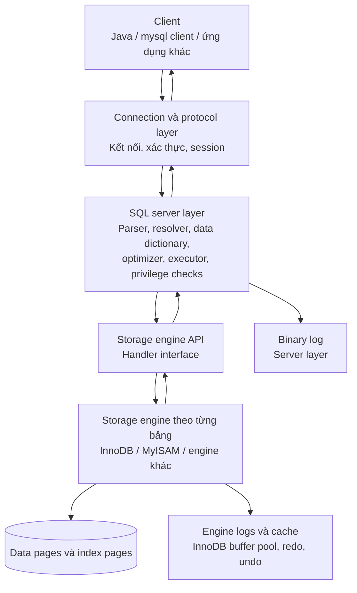

# Server layer, storage engine API và ranh giới trách nhiệm

MySQL Server được tổ chức thành hai phần có trách nhiệm khác nhau: **server layer** tiếp nhận và xử lý SQL ở mức logic; **storage engine** thực hiện việc lưu trữ và truy xuất dữ liệu ở mức vật lý. Hai phần phối hợp thông qua một giao diện nội bộ gọi là **storage engine API**, thường được nhắc đến qua handler interface.

Hiểu ranh giới này giúp giải thích vì sao cùng một câu SQL có thể chạy trên nhiều storage engine, vì sao một số tính năng thuộc máy chủ còn một số tính năng thuộc InnoDB, và cần xem lớp nào khi điều tra lỗi truy vấn, khóa, transaction hoặc phục hồi dữ liệu.

Trong module **DATABASE_MYSQL**, kiến trúc này liên kết trực tiếp với thiết kế bảng, kiểu dữ liệu, khóa, truy vấn SQL, index, transaction, kiểm soát đồng thời, execution plan, phân quyền, sao lưu và vận hành. Ví dụ, server layer kiểm tra cú pháp và quyền của câu SELECT, optimizer chọn access path, còn InnoDB đọc các trang dữ liệu và áp dụng cơ chế MVCC, khóa dòng cùng nhật ký phục hồi.

## 1. Bức tranh tổng thể

Một kết nối MySQL đi qua nhiều bước. Có thể hình dung luồng xử lý chính như sau:



Đây là sơ đồ khái niệm, không phải thứ tự gọi hàm nội bộ chính xác cho mọi câu lệnh. Một câu SQL có thể truy cập nhiều bảng, gọi nhiều thao tác engine, sử dụng temporary table hoặc đi theo execution path khác. Điểm quan trọng là server layer điều phối ngữ nghĩa SQL, còn engine phụ trách cách dữ liệu của bảng được tổ chức và thao tác.

Một MySQL instance có thể sử dụng nhiều storage engine. Engine thường được chọn ở cấp bảng, không phải chọn một engine duy nhất cho toàn bộ server. Vì vậy, hai bảng trong cùng schema có thể dùng hai engine khác nhau, dù trong hệ thống giao dịch thông thường nên thống nhất lựa chọn để có hành vi transaction dễ dự đoán.

## 2. Server layer chịu trách nhiệm gì?

Server layer là phần MySQL xử lý giao thức client, câu lệnh SQL và các quy tắc ở mức hệ quản trị cơ sở dữ liệu. Có thể chia trách nhiệm thành các nhóm sau.

### 2.1. Kết nối, xác thực và session

Khi client mở kết nối, server tiếp nhận giao thức MySQL, xác thực tài khoản, kiểm tra điều kiện kết nối và tạo ngữ cảnh session. Session chứa các trạng thái như:

- Tài khoản đang kết nối và các quyền tương ứng.
- Database mặc định được chọn.
- Biến session, SQL mode và múi giờ.
- Trạng thái transaction và một số thiết lập thực thi.
- Các thiết lập liên quan đến character set, collation và timeout.

Server kiểm tra quyền đối với database, bảng, cột hoặc thao tác cần thực hiện. Storage engine không thay thế cơ chế phân quyền SQL của server. Một ứng dụng không thể tự có quyền SELECT chỉ vì file dữ liệu trên đĩa có thể đọc được ở cấp hệ điều hành.

Ví dụ, CREATE USER, GRANT, REVOKE và việc xác thực account thuộc trách nhiệm quản trị của server layer. Engine không quyết định ứng dụng được phép đăng nhập bằng tài khoản nào.

### 2.2. Parser và phân tích ngữ nghĩa

Parser phân tích chuỗi SQL theo cú pháp MySQL và tạo cấu trúc nội bộ để các bước sau xử lý. Sau đó server phân giải tên database, bảng, cột, hàm và kiểm tra các quy tắc ngữ nghĩa liên quan.

Ví dụ:

```sql
SELECT customer_id, COUNT(*) AS order_count
FROM orders
WHERE status = 'PAID'
GROUP BY customer_id;
```

Server phải xác định orders là bảng nào, các cột có tồn tại không, biểu thức có hợp lệ không và session hiện tại có quyền đọc bảng hay không. Nếu viết sai tên cột, câu lệnh có thể thất bại trước khi engine phải đọc hàng dữ liệu.

### 2.3. Data dictionary và metadata

Data dictionary lưu metadata mà server cần để hiểu cấu trúc database: schema, bảng, cột, index, constraint và các đối tượng liên quan. Từ MySQL 8.0, MySQL sử dụng transactional data dictionary thay cho cách quản lý metadata phân tán bằng các file .frm của các phiên bản cũ.

Server chịu trách nhiệm diễn giải và quản lý metadata. Trong MySQL 8.0, data dictionary được lưu trữ bằng InnoDB trong các bảng hệ thống nội bộ; điều đó không có nghĩa ứng dụng phải truy cập trực tiếp các bảng nội bộ để quản lý schema. Hãy dùng các lệnh SQL và giao diện metadata được MySQL công bố như SHOW CREATE TABLE, INFORMATION_SCHEMA và SHOW INDEX.

Server cũng quản lý metadata locking (MDL) để điều phối xung đột giữa thao tác sử dụng đối tượng schema và thao tác thay đổi metadata. Ví dụ, một truy vấn đang sử dụng bảng có thể khiến lệnh ALTER TABLE phải chờ metadata lock phù hợp.

### 2.4. Optimizer và executor

Optimizer phân tích câu SQL, thống kê và các access path có thể dùng, sau đó chọn kế hoạch thực thi. Các quyết định có thể bao gồm:

- Thứ tự join giữa các bảng.
- Dùng table scan hay index access.
- Chọn index nào và khoảng khóa nào cần đọc.
- Cách áp dụng điều kiện lọc và phép tổng hợp.
- Cách thực hiện sort, grouping hoặc materialization khi cần.

Executor thực thi kế hoạch. Khi cần đọc hoặc ghi dữ liệu bảng, executor sử dụng storage engine API để yêu cầu engine thực hiện thao tác tương ứng.

Engine có thể cung cấp cho optimizer thông tin về index, ước lượng chi phí và số hàng. Tuy nhiên, optimizer vẫn thuộc server layer: engine cung cấp khả năng và thông tin của mình, server dùng chúng để xây dựng kế hoạch SQL.

EXPLAIN cho biết kế hoạch mà server dự định dùng; EXPLAIN ANALYZE thực thi truy vấn và cung cấp số liệu thực tế trên các iterator ở những phiên bản hỗ trợ. Hai công cụ này giúp phân tích lựa chọn của server, nhưng không hiển thị toàn bộ chi tiết vật lý của engine.

### 2.5. Binary log và điều phối replication

Binary log (binlog) thuộc lớp server. Nó ghi nhận các sự kiện thay đổi dữ liệu hoặc câu lệnh theo định dạng binlog được cấu hình, phục vụ replication và một số quy trình point-in-time recovery.

Binlog khác với redo log của InnoDB:

- Binlog ghi sự kiện ở cấp MySQL server để replica hoặc công cụ phục hồi có thể phát lại thay đổi.
- Redo log ghi thông tin phục hồi ở cấp InnoDB để đưa các thay đổi trang dữ liệu về trạng thái nhất quán sau sự cố.
- Undo log của InnoDB hỗ trợ rollback và cung cấp phiên bản dữ liệu cũ phục vụ MVCC.

Khi transaction InnoDB được commit và binlog được bật, MySQL cần phối hợp việc commit engine và ghi binlog để tránh tình trạng dữ liệu đã commit nhưng sự kiện replication bị thiếu, hoặc ngược lại. Cơ chế phối hợp này thường được gọi là two-phase commit giữa InnoDB và binlog. Nó là một ví dụ cho thấy server layer và storage engine có ranh giới riêng nhưng vẫn cần phối hợp trong một thao tác logic.

## 3. Storage engine chịu trách nhiệm gì?

Storage engine quyết định cách một bảng được lưu trữ và thao tác ở mức vật lý. Với InnoDB, các trách nhiệm quan trọng gồm:

- Lưu và đọc các trang dữ liệu, index trên thiết bị lưu trữ.
- Quản lý buffer pool để cache trang dữ liệu và index trong bộ nhớ.
- Thực hiện thao tác đọc theo index, quét hàng, chèn, cập nhật và xóa.
- Quản lý transaction, MVCC, undo log, redo log và crash recovery.
- Thực hiện khóa dòng, khóa phạm vi phù hợp và xử lý chờ khóa.
- Duy trì cấu trúc index, bao gồm clustered index và secondary index.
- Thực thi các ràng buộc quan hệ mà engine hỗ trợ, chẳng hạn foreign key trong InnoDB.

Một engine khác có thể có tập khả năng và cách triển khai khác. Vì vậy, không thể suy luận rằng mọi bảng MySQL đều có row-level locking, MVCC, foreign key hoặc transaction chỉ vì chúng được truy cập bằng cùng cú pháp SQL.

### 3.1. InnoDB là engine giao dịch mặc định

InnoDB là storage engine mặc định của MySQL trong các bản phát hành hiện đại. Nó được thiết kế cho workload giao dịch với transaction, khả năng phục hồi và kiểm soát đồng thời.

Một số thành phần quan trọng:

| Thành phần InnoDB | Vai trò |
|---|---|
| Buffer pool | Cache trang dữ liệu và index để giảm I/O vật lý |
| Clustered index | Tổ chức bản ghi của bảng theo khóa chính; dữ liệu hàng được lưu trong cấu trúc index này |
| Secondary index | Cung cấp access path bổ sung; với InnoDB, leaf entry chứa cả giá trị khóa chính để tìm hàng |
| Undo log | Lưu thông tin cần cho rollback và phiên bản dữ liệu cũ phục vụ MVCC |
| Redo log | Ghi nhận thay đổi cần thiết để phục hồi sau crash |
| Row locks | Kiểm soát xung đột ghi và các thao tác khóa hàng/phạm vi |
| Change buffer | Tối ưu một số thay đổi đối với secondary index không unique khi trang index chưa ở trong buffer pool |

Khi thiết kế bảng InnoDB, lựa chọn khóa chính ảnh hưởng tới cách dữ liệu được tổ chức. Khóa chính quá rộng làm các secondary index phải mang theo khóa chính rộng hơn, tăng kích thước index và chi phí I/O. Đây là ví dụ về việc quyết định ở cấp schema có ảnh hưởng tới cách engine lưu trữ vật lý.

### 3.2. So sánh engine để hiểu giới hạn

MyISAM là một engine không hỗ trợ transaction theo cách của InnoDB, sử dụng khóa bảng và không hỗ trợ foreign key. Nó vẫn hữu ích để hiểu kiến trúc pluggable, nhưng không nên chọn làm engine cho workload giao dịch cần rollback, MVCC hoặc khóa dòng.

| Khả năng | InnoDB | MyISAM |
|---|---|---|
| Transaction và rollback | Có | Không |
| MVCC | Có | Không |
| Kiểm soát khóa | Chủ yếu khóa dòng và các khóa phạm vi cần thiết | Khóa bảng |
| Foreign key | Có hỗ trợ | Không hỗ trợ |
| Crash recovery giao dịch | Có cơ chế phục hồi InnoDB | Không có cơ chế transaction tương đương |
| Mục tiêu sử dụng | Workload giao dịch, dữ liệu quan hệ | Engine cũ, workload đặc thù không cần transaction |

Đây là so sánh các đặc tính chính, không phải đánh giá hiệu năng tuyệt đối. Hiệu năng còn phụ thuộc schema, index, truy vấn, concurrency, thiết bị lưu trữ và cấu hình.

## 4. Storage engine API là cầu nối giữa hai lớp

Server layer không cần biết cách từng engine tổ chức từng trang dữ liệu. Thay vào đó, server gọi một giao diện trừu tượng để yêu cầu thao tác trên bảng và index. Trong MySQL, giao diện này thường được gọi là handler interface hoặc storage engine API.

Có thể hiểu API này như hợp đồng giữa server và engine:

| Server cần thực hiện | Engine cung cấp thao tác tương ứng |
|---|---|
| Mở và chuẩn bị truy cập bảng | Mở handler và cấu trúc bảng |
| Đọc một hàng theo index | Tìm kiếm qua index và trả hàng phù hợp |
| Quét bảng | Đọc lần lượt các hàng theo khả năng engine |
| Chèn, cập nhật, xóa hàng | Thực hiện thay đổi dữ liệu và index |
| Tạo hoặc xóa index | Xây dựng hoặc loại bỏ cấu trúc index vật lý |
| Bắt đầu, commit hoặc rollback transaction | Thực hiện ngữ nghĩa transaction mà engine hỗ trợ |
| Lấy thông tin thống kê và khả năng truy cập | Cung cấp metadata, ước lượng và capability cho server |

Tên thao tác trong bảng là mô tả khái niệm, không phải chữ ký hàm API để ứng dụng gọi trực tiếp. Đây là giao diện nội bộ của MySQL dành cho server và storage engine; JDBC, SQL và Connector/J là các giao diện khác ở phía client.

### 4.1. Vì sao cần một API chung?

Giả sử ứng dụng gửi cùng một câu SQL:

```sql
SELECT order_id, total_amount
FROM orders
WHERE order_id = 1001;
```

Server phân tích câu lệnh, kiểm tra quyền, tìm index phù hợp và tạo kế hoạch. Khi cần lấy hàng, server yêu cầu handler đọc theo access path đã chọn. Nếu bảng orders dùng InnoDB, handler InnoDB tìm bản ghi trong cấu trúc index của InnoDB. Nếu bảng dùng engine khác, handler của engine đó thực hiện thao tác theo cách lưu trữ riêng.

Ứng dụng vẫn gửi SQL thông qua giao thức MySQL. Nó không cần biết hàng được đặt trong B-tree, file nào được đọc hay engine dùng buffer/cache gì. Đó là lợi ích của abstraction: server có thể giữ ngữ nghĩa SQL chung, còn engine chuyên trách lưu trữ.

### 4.2. API không làm mọi engine có cùng khả năng

Giao diện chung không đồng nghĩa các engine có cùng feature set. Một engine có thể không hỗ trợ transaction, foreign key hoặc một loại index nào đó. Server và optimizer cần biết capability của engine để xác định thao tác nào hợp lệ và lựa chọn kế hoạch phù hợp.

Vì thế:

- Một lệnh COMMIT không thể biến một engine non-transactional thành engine có rollback.
- Cú pháp foreign key được parser chấp nhận không đảm bảo engine của bảng thực thi được ràng buộc đó.
- Một câu truy vấn có thể dùng index ở engine này nhưng access method, thống kê và chi phí ở engine khác.
- Hành vi khóa và mức cô lập transaction phụ thuộc vào engine và cấu hình liên quan.

Khi chọn engine, hãy xem khả năng engine công bố và kiểm thử trên phiên bản thực tế thay vì chỉ dựa vào cú pháp SQL.

## 5. Theo dõi ranh giới qua các thao tác SQL

### 5.1. Tạo bảng

Khi chạy CREATE TABLE, server phân tích DDL, xác minh quyền, kiểm tra tên và kiểu dữ liệu, cập nhật metadata và yêu cầu engine tạo cấu trúc lưu trữ tương ứng. Phần định nghĩa bảng được quản lý bởi data dictionary; engine tạo cấu trúc dữ liệu và index vật lý theo khả năng của mình.

Ví dụ chỉ định engine:

```sql
CREATE TABLE orders (
    order_id BIGINT NOT NULL,
    customer_id BIGINT NOT NULL,
    total_amount DECIMAL(12, 2) NOT NULL,
    status VARCHAR(20) NOT NULL,
    created_at TIMESTAMP NOT NULL DEFAULT CURRENT_TIMESTAMP,
    PRIMARY KEY (order_id),
    KEY idx_orders_customer_created (customer_id, created_at)
) ENGINE = InnoDB;
```

Trong câu lệnh trên:

- SQL parser và server kiểm tra cú pháp, kiểu dữ liệu, tên cột và quyền CREATE.
- Data dictionary quản lý định nghĩa bảng và index.
- InnoDB tổ chức clustered index theo order_id và tạo secondary index theo (customer_id, created_at).
- InnoDB quản lý các trang, cache và nhật ký cần thiết khi dữ liệu được ghi.

### 5.2. Đọc dữ liệu

Với câu SELECT, server xử lý cú pháp, xác minh quyền, tối ưu và thực thi kế hoạch. Khi cần dữ liệu, engine đọc trang từ buffer pool hoặc thiết bị lưu trữ, áp dụng quy tắc truy cập và trả hàng cho executor. Server tiếp tục xử lý biểu thức, join, grouping hoặc định dạng kết quả trước khi gửi về client.

Không phải mọi phép tính đều chạy trong storage engine. Một phần xử lý có thể được đẩy xuống engine khi phù hợp, nhưng SQL semantics và việc điều phối kết quả vẫn thuộc server layer.

### 5.3. Ghi dữ liệu

Với INSERT, UPDATE hoặc DELETE, server phân tích câu lệnh, kiểm tra quyền và điều phối các bước thực thi. Engine thay đổi bản ghi cùng index, kiểm tra các ràng buộc thuộc engine, quản lý khóa và ghi thông tin phục hồi cần thiết.

Nếu bảng dùng InnoDB, thay đổi nằm trong transaction và có thể rollback trước commit. Nếu bảng dùng engine non-transactional, không thể giả định thao tác đã thực hiện sẽ được hoàn tác khi transaction bị rollback.

### 5.4. Transaction và khóa

Lệnh START TRANSACTION, COMMIT và ROLLBACK được server nhận biết và điều phối. Với bảng InnoDB, engine thực hiện quản lý transaction, MVCC, undo/redo và khóa dữ liệu.

Cần phân biệt:

- **Metadata lock (MDL):** server bảo vệ metadata của đối tượng schema, ví dụ tránh DDL thay đổi bảng trong khi session khác đang dùng bảng theo cách xung đột.
- **Row lock và các khóa phạm vi:** InnoDB bảo vệ dữ liệu và index record trong các thao tác giao dịch; loại khóa thực tế phụ thuộc câu lệnh, index, isolation level và execution plan.

Ví dụ, SELECT ... FOR UPDATE trên bảng InnoDB yêu cầu khóa các bản ghi phù hợp để bảo vệ thao tác cập nhật tiếp theo trong transaction. Truy vấn thiếu index phù hợp có thể phải duyệt nhiều bản ghi và làm phạm vi khóa rộng hơn dự kiến. Điều này nối trực tiếp kiến thức index và execution plan với kiểm soát đồng thời.

### 5.5. Phục hồi sau sự cố

Khi MySQL khởi động lại sau crash, InnoDB dùng redo log và các cơ chế phục hồi liên quan để khôi phục trạng thái dữ liệu nhất quán; các transaction chưa commit được xử lý theo quy tắc recovery. Undo log còn hỗ trợ rollback và MVCC trong quá trình hoạt động.

Binlog được server dùng cho replication và phục hồi theo thời điểm. Backup cùng binlog có thể phối hợp để khôi phục tới một mốc thời gian, nhưng redo log không phải bản sao lưu thay thế. Phục hồi thành công cần quy trình backup/restore đã kiểm thử.

## 6. Cách xác định engine và kiểm tra khả năng

Không nên suy luận engine từ tên bảng hoặc từ việc MySQL server có hỗ trợ một engine nào đó. Hãy kiểm tra chính bảng đang sử dụng.

### 6.1. Liệt kê các engine có trong server

```sql
SHOW ENGINES;
```

Hoặc truy vấn metadata:

```sql
SELECT
    ENGINE,
    SUPPORT,
    TRANSACTIONS,
    XA,
    SAVEPOINTS
FROM INFORMATION_SCHEMA.ENGINES
ORDER BY ENGINE;
```

Cột SUPPORT cho biết trạng thái hỗ trợ của engine trong instance hiện tại. Giá trị có thể phản ánh engine được hỗ trợ, mặc định, bị vô hiệu hóa hoặc không được hỗ trợ tùy kết quả trả về. Các cột transaction/XA/savepoint cho biết khả năng được engine công bố.

### 6.2. Xác định engine của một bảng

```sql
SELECT
    TABLE_SCHEMA,
    TABLE_NAME,
    ENGINE
FROM INFORMATION_SCHEMA.TABLES
WHERE TABLE_SCHEMA = DATABASE()
  AND TABLE_NAME = 'orders';
```

Có thể xem định nghĩa bảng:

```sql
SHOW CREATE TABLE orders;
```

Hoặc dùng SHOW TABLE STATUS để xem trường Engine cùng một số thông tin khác:

```sql
SHOW TABLE STATUS LIKE 'orders';
```

Nếu bảng quan trọng đang dùng engine khác InnoDB, hãy kiểm tra có chủ ý hay không. Đổi engine bằng ALTER TABLE ... ENGINE = InnoDB có thể phải xây dựng lại bảng và index, cần đánh giá dung lượng, thời gian khóa, replication lag và kế hoạch backup trước khi thực hiện trên production.

### 6.3. Xem trạng thái InnoDB

Để xem thông tin chẩn đoán tổng quan về InnoDB:

```sql
SHOW ENGINE INNODB STATUS;
```

Trong mysql client, có thể thêm \G để hiển thị theo chiều dọc. Kết quả có thể chứa thông tin transaction, deadlock gần đây, semaphore, I/O và buffer pool. Đây là dữ liệu chẩn đoán tại thời điểm truy vấn, không phải báo cáo lịch sử đầy đủ.

Với MySQL 8.0, có thể xem các lock đang tồn tại qua Performance Schema, nếu tài khoản có quyền:

```sql
SELECT
    ENGINE,
    ENGINE_TRANSACTION_ID,
    THREAD_ID,
    OBJECT_SCHEMA,
    OBJECT_NAME,
    INDEX_NAME,
    LOCK_TYPE,
    LOCK_MODE,
    LOCK_STATUS
FROM performance_schema.data_locks;
```

Bảng performance_schema.data_lock_waits giúp xem quan hệ giữa lock đang chờ và lock đang chặn. Khi điều tra một truy vấn chậm hoặc transaction bị chặn, hãy kết hợp thông tin lock với câu SQL, transaction đang mở và execution plan.

## 7. Bản đồ trách nhiệm khi điều tra sự cố

Một lỗi thường liên quan đến nhiều lớp. Xác định đúng lớp chịu trách nhiệm giúp chọn công cụ và hướng xử lý chính xác.

| Triệu chứng | Lớp cần kiểm tra trước | Dữ liệu/công cụ hữu ích |
|---|---|---|
| Không đăng nhập được | Connection và authentication | Error log, account user@host, TLS, network |
| SELECT báo sai cú pháp hoặc cột không tồn tại | Parser, resolver, data dictionary | Câu SQL, SHOW CREATE TABLE, metadata |
| Truy vấn dùng sai index hoặc chạy chậm | Optimizer và executor; sau đó kiểm tra engine | EXPLAIN, EXPLAIN ANALYZE, statistics, Performance Schema |
| Không tìm thấy bảng hoặc sai định nghĩa | Data dictionary và metadata | SHOW TABLES, INFORMATION_SCHEMA, SHOW CREATE TABLE |
| Transaction bị chờ hoặc deadlock | Storage engine và transaction context | SHOW ENGINE INNODB STATUS, data_locks, data_lock_waits |
| DDL bị chờ metadata lock | Server metadata locking | performance_schema.metadata_locks, session đang giữ lock |
| Dữ liệu chưa phục hồi như mong đợi sau crash | InnoDB recovery và quy trình backup/binlog | Error log, trạng thái InnoDB, backup và binlog |
| Replica thiếu hoặc trễ sự kiện | Server binlog/replication và tải engine phía replica | Replica status, binlog position, replication worker status |

Một số tình huống có thể đi qua cả hai lớp. Ví dụ, DDL bị chặn có thể liên quan đến MDL ở server; sau khi DDL chạy, engine còn phải xây dựng lại index hoặc di chuyển dữ liệu. Không nên kết luận mọi lock đều do InnoDB hoặc mọi thao tác schema đều chỉ thuộc engine.

## 8. Các nguyên tắc thiết kế rút ra từ kiến trúc

1. **Chọn engine theo yêu cầu dữ liệu.** Với workload giao dịch quan hệ thông thường, InnoDB là lựa chọn mặc định hợp lý vì hỗ trợ transaction, MVCC, khóa dòng và foreign key.
2. **Thiết kế khóa chính có chủ đích.** Trong InnoDB, khóa chính là clustered index và được mang theo trong secondary index; kiểu và kích thước khóa ảnh hưởng đến dung lượng cùng I/O.
3. **Tạo index dựa trên truy vấn.** Server optimizer chọn access path, còn engine thực hiện truy cập index vật lý. Index phải hỗ trợ điều kiện lọc, join và thứ tự truy vấn thực tế.
4. **Phân biệt metadata lock với row lock.** Khi DDL hoặc transaction bị chờ, xác định đúng loại lock trước khi kết thúc session hoặc thay đổi schema.
5. **Dùng transaction trên engine có hỗ trợ.** Đừng dựa vào ROLLBACK để hoàn tác thay đổi trên bảng non-transactional.
6. **Hiểu các loại log.** Binlog phục vụ replication và point-in-time recovery; redo/undo thuộc cơ chế transaction và phục hồi của InnoDB. Cần backup và thử restore riêng.
7. **Quan sát cả kế hoạch và engine.** EXPLAIN cho thấy quyết định của optimizer; Performance Schema và trạng thái InnoDB bổ sung góc nhìn về lock, I/O và transaction.
8. **Không truy cập file dữ liệu trực tiếp.** Dùng SQL, backup tools và giao diện quản trị được hỗ trợ để tránh làm hỏng cấu trúc dữ liệu hoặc metadata.

## 9. Ghi nhớ

- Server layer hiểu và điều phối SQL: kết nối, xác thực, quyền, parser, data dictionary, optimizer, executor, MDL và binlog.
- Storage engine quản lý cách bảng được lưu và truy cập vật lý; InnoDB cung cấp buffer pool, index, transaction, MVCC, undo/redo, khóa và crash recovery.
- Storage engine API là giao diện nội bộ để server yêu cầu engine thao tác bảng, hàng, index và transaction. Nó không phải JDBC hay giao diện SQL của ứng dụng.
- Engine được chọn theo bảng; các bảng trong cùng instance có thể dùng engine khác nhau và có khả năng khác nhau.
- Optimizer thuộc server layer nhưng dựa vào metadata, thống kê và khả năng do engine cung cấp.
- Binlog của server khác redo/undo log của InnoDB. Ba loại log có vai trò liên quan nhưng không thay thế nhau.
- Khi điều tra lỗi, hãy xác định đó là vấn đề giao thức, SQL, metadata, execution plan, metadata lock, engine lock, transaction hay recovery.

Khi hiểu rõ ranh giới giữa server layer và storage engine, bạn có thể giải thích một câu SQL được phân tích và thực thi như thế nào, đồng thời chọn đúng công cụ để thiết kế schema, tối ưu truy vấn và xử lý sự cố MySQL.

