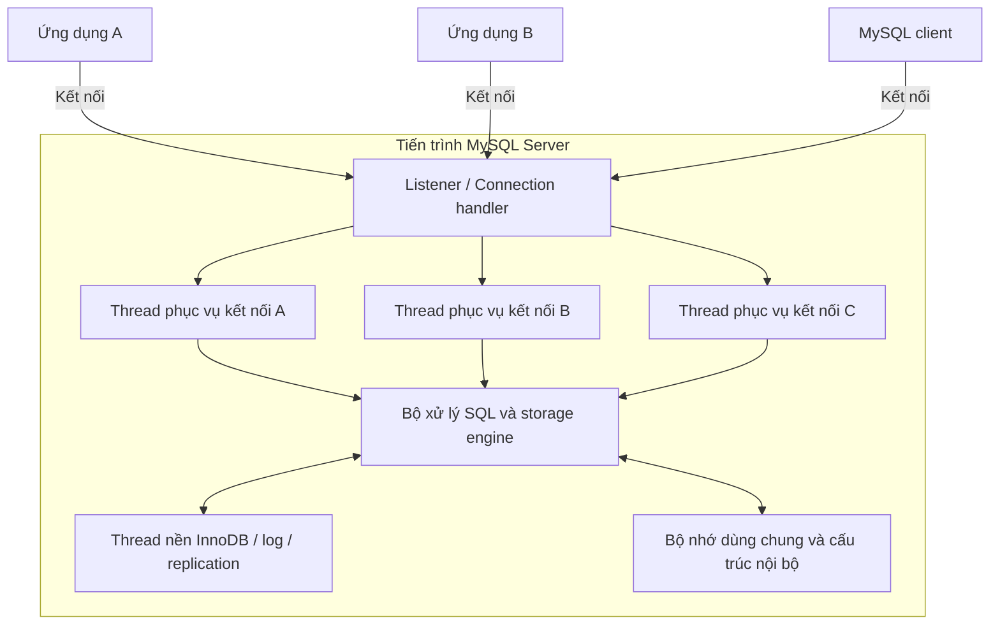
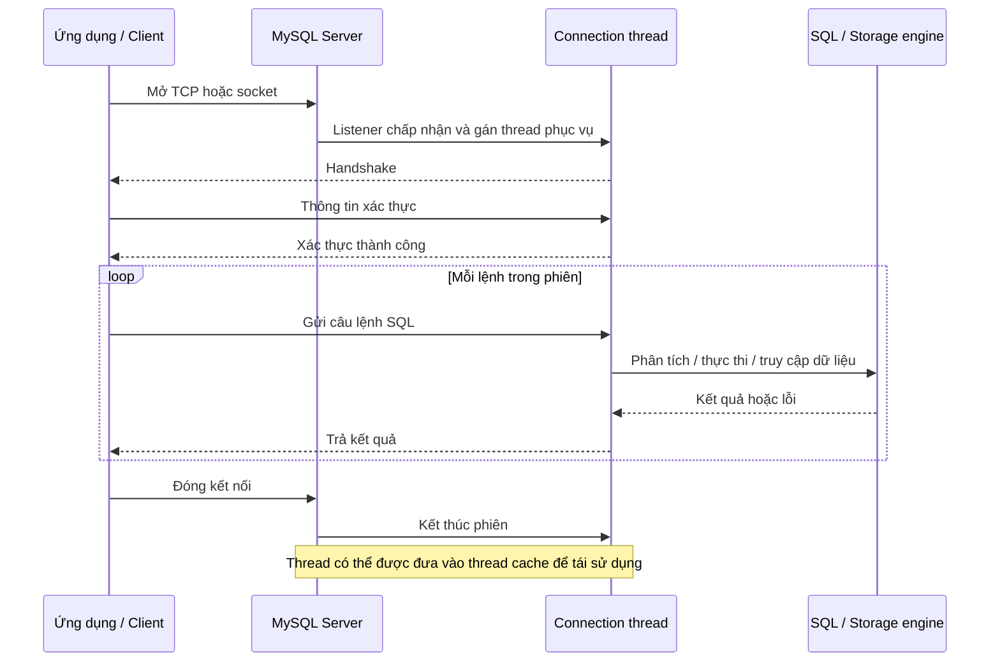

# Mô hình tiến trình, luồng phục vụ kết nối và luồng nền

## Mục tiêu

Sau bài này, bạn có thể:

- Mô tả mô hình tiến trình và đa luồng của MySQL Server.
- Giải thích cách một kết nối client được tiếp nhận, xác thực, phục vụ và kết thúc.
- Phân biệt thread phục vụ kết nối với thread nền của InnoDB, replication và các thành phần khác.
- Phân biệt thread cache của server, connection pool của ứng dụng và thread pool của MySQL.
- Dùng `SHOW PROCESSLIST`, Performance Schema và các status counter để quan sát hoạt động của thread.
- Nhận diện một số dấu hiệu về quá nhiều kết nối, thread hoạt động cao và áp lực xử lý đồng thời.

## 1. MySQL Server là một tiến trình đa luồng

Trong mô hình triển khai thông thường, MySQL Server chạy dưới dạng một tiến trình máy chủ. Trên Linux, tiến trình thường có tên `mysqld`; trên Windows, máy chủ có thể chạy dưới dạng dịch vụ với tiến trình `mysqld.exe`. Bên trong tiến trình đó, MySQL tạo và quản lý nhiều luồng thực thi (thread) để xử lý kết nối client và công việc nội bộ.

Vì vậy, không nên hình dung MySQL tạo một tiến trình hệ điều hành riêng cho từng kết nối. Trong mô hình mặc định *one-thread-per-connection*, mỗi kết nối client được phục vụ bởi một thread của server. Các thread cùng hoạt động trong tiến trình MySQL và chia sẻ tài nguyên của server, trong khi mỗi kết nối có trạng thái phiên riêng như tài khoản, database đang chọn, biến session và transaction hiện tại.

Ở mức khái quát, kiến trúc gồm ba nhóm:

1. **Tiến trình server:** quản lý cấu hình, listener, bộ nhớ dùng chung, storage engine, plugin và vòng đời server.
2. **Thread phục vụ kết nối:** tiếp nhận lệnh từ client, thực hiện các bước xử lý SQL và trả kết quả.
3. **Thread nền:** thực hiện công việc nội bộ như I/O, flush dữ liệu, purge, replication và các tác vụ định kỳ.



Sơ đồ là mô hình khái niệm. Các thread nội bộ có thể phối hợp bất đồng bộ; không phải mọi thao tác SQL đều được thực hiện tuần tự bởi một thread duy nhất từ đầu đến cuối.

## 2. Mô hình one-thread-per-connection

Với cấu hình xử lý kết nối truyền thống của MySQL, server thường tạo hoặc lấy một thread để phục vụ mỗi kết nối. Thread đó nhận lệnh từ client, xử lý lệnh và chờ lệnh tiếp theo trên cùng kết nối. Nhiều kết nối có thể được phục vụ đồng thời bởi nhiều thread.

Một thread phục vụ kết nối thường tham gia các công việc sau:

- Nhận lệnh theo giao thức client/server.
- Kiểm tra trạng thái phiên và quyền của tài khoản.
- Phân tích câu SQL, kiểm tra ngữ nghĩa và tạo kế hoạch thực thi khi cần.
- Gọi các thành phần thực thi và storage engine để đọc hoặc thay đổi dữ liệu.
- Chờ I/O, khóa hoặc tài nguyên khi thao tác chưa thể tiếp tục.
- Gửi tập kết quả, trạng thái hoàn tất hoặc thông báo lỗi về client.

Trong khi thread đang chờ client gửi lệnh tiếp theo, kết nối vẫn tồn tại và thường được thể hiện ở trạng thái `Sleep` trong process list. Một kết nối `Sleep` không đồng nghĩa với một truy vấn đang chạy; tuy nhiên, nó vẫn chiếm một connection và có thể giữ trạng thái phiên hoặc transaction chưa kết thúc.

### 2.1. Vòng đời của một kết nối



Các bước thực tế có thể khác nhau theo giao thức, plugin xác thực, loại kết nối và phiên bản. Sơ đồ tập trung vào mô hình phục vụ kết nối phổ biến.

### 2.2. Thread cache của MySQL

Tạo một thread hệ điều hành có chi phí. Khi client ngắt kết nối, MySQL có thể giữ thread vừa phục vụ kết nối trong **thread cache** để tái sử dụng cho một kết nối mới, thay vì luôn tạo thread mới.

Biến `thread_cache_size` điều khiển số thread nhàn rỗi tối đa được giữ trong cache ở mô hình phù hợp. Thread cache giúp giảm chi phí tạo và hủy thread khi ứng dụng thường xuyên mở rồi đóng kết nối. Nó không phải giới hạn số kết nối đồng thời và không thay thế connection pool của ứng dụng.

Kiểm tra cấu hình và các bộ đếm:

```sql
SHOW GLOBAL VARIABLES LIKE 'thread_cache_size';
SHOW GLOBAL STATUS LIKE 'Threads_cached';
SHOW GLOBAL STATUS LIKE 'Threads_created';
SHOW GLOBAL STATUS LIKE 'Threads_connected';
```

- `Threads_cached`: số thread hiện đang nằm trong cache.
- `Threads_created`: số thread server đã tạo để phục vụ kết nối kể từ khi server khởi động.
- `Threads_connected`: số kết nối client đang mở tại thời điểm lấy mẫu.

Nếu `Threads_created` tăng nhanh trong khi workload liên tục tạo và đóng kết nối, có thể thread cache chưa phù hợp hoặc ứng dụng đang tạo kết nối quá thường xuyên. Cần xem xu hướng theo thời gian và mô hình kết nối trước khi điều chỉnh.

## 3. Thread pool và connection pool là hai cơ chế khác nhau

Hai thuật ngữ dễ bị nhầm vì đều có chữ “pool”, nhưng chúng nằm ở hai tầng khác nhau.

| Cơ chế | Nằm ở đâu? | Quản lý gì? | Mục đích |
|---|---|---|---|
| Connection pool | Trong ứng dụng hoặc thư viện client | Các kết nối database đã mở | Tái sử dụng kết nối, giới hạn số phiên và giảm chi phí connect/disconnect |
| Thread cache | Bên trong MySQL Server | Thread phục vụ kết nối đã nhàn rỗi | Tái sử dụng thread sau khi kết nối cũ kết thúc |
| Thread pool | Bên trong MySQL Server khi có plugin phù hợp | Các worker thread xử lý công việc từ nhiều kết nối | Điều phối số worker để kiểm soát mức đồng thời và giảm áp lực khi có rất nhiều kết nối |

### 3.1. Connection pool ở phía ứng dụng

Ví dụ một ứng dụng Java dùng HikariCP có thể giữ một nhóm kết nối JDBC mở sẵn. Khi một request cần truy vấn, ứng dụng mượn một connection, thực hiện công việc rồi trả connection về pool. Kết nối vật lý không nhất thiết bị đóng sau mỗi request.

Trong mô hình one-thread-per-connection, mỗi kết nối vật lý đang mở thường gắn với một thread phục vụ ở server. Do đó, connection pool có thể giúp tránh việc tạo và hủy kết nối liên tục, nhưng pool quá lớn vẫn có thể làm server phải quản lý nhiều connection thread và trạng thái phiên.

Connection pool cần được cấu hình theo tổng số instance ứng dụng, số connection tối đa mỗi instance, thời gian chờ mượn kết nối và thời gian nhàn rỗi. Không chỉ nhìn giới hạn của một instance: nếu có 10 instance, mỗi instance tối đa 30 connection, tổng nhu cầu tiềm năng có thể lên đến 300 connection.

### 3.2. Thread pool ở phía server

Trong mô hình one-thread-per-connection, số thread phục vụ kết nối có xu hướng tăng theo số connection đang mở. Với hệ thống có rất nhiều kết nối, việc có quá nhiều thread hoạt động hoặc chờ có thể tăng mức tiêu thụ bộ nhớ, chi phí chuyển ngữ cảnh và áp lực lập lịch của hệ điều hành.

Thread pool thay đổi cách server điều phối công việc: một nhóm worker thread xử lý công việc từ nhiều kết nối, thay vì duy trì một worker riêng cho mỗi connection trong toàn bộ thời gian sống của kết nối. Cách hoạt động chi tiết và các giới hạn phụ thuộc plugin, phiên bản và sản phẩm.

MySQL Enterprise Edition cung cấp Thread Pool plugin. Không nên giả định plugin này có sẵn trong mọi bản MySQL Community hoặc có cấu hình giống MariaDB. Nếu cân nhắc thread pool, hãy xác minh edition/plugin, đọc tài liệu đúng phiên bản và đo thử với workload thực tế. Thread pool không tự sửa được truy vấn chậm, khóa tranh chấp hay thiết kế connection pool sai.

## 4. Các thread nền của MySQL và InnoDB

Thread phục vụ kết nối xử lý lệnh đến từ client. Trong khi đó, nhiều công việc cần diễn ra ngay cả khi không có client đang chạy truy vấn. MySQL và InnoDB sử dụng các thread nền để thực hiện các công việc này.

### 4.1. Thread I/O của InnoDB

InnoDB thực hiện nhiều thao tác đọc và ghi dữ liệu thông qua cơ chế I/O. Các thread I/O hỗ trợ xử lý những yêu cầu đọc/ghi bất đồng bộ, giúp tách một số công việc I/O khỏi luồng xử lý câu lệnh.

Một số biến có thể dùng để kiểm tra số thread I/O theo phiên bản:

```sql
SHOW GLOBAL VARIABLES LIKE 'innodb_read_io_threads';
SHOW GLOBAL VARIABLES LIKE 'innodb_write_io_threads';
```

Không nên tăng các giá trị này chỉ vì thấy số thread thấp. Hiệu quả phụ thuộc thiết bị lưu trữ, workload, khả năng xử lý I/O của hệ điều hành và phiên bản MySQL. Hãy đo độ trễ đọc/ghi, hàng đợi I/O và các chỉ số InnoDB trước khi điều chỉnh.

### 4.2. Page cleaner và flush trang dữ liệu

Khi InnoDB thay đổi dữ liệu, các trang trong buffer pool có thể trở thành *dirty pages* (trang đã thay đổi nhưng chưa được ghi xuống tablespace tương ứng). Thread page cleaner hỗ trợ flush dirty pages ra storage để kiểm soát lượng trang bẩn và hỗ trợ checkpoint.

Việc flush cần cân bằng giữa ghi nền và nhu cầu ghi của workload. Nếu tốc độ tạo dirty page cao hơn khả năng ghi xuống storage trong thời gian dài, áp lực I/O và checkpoint có thể ảnh hưởng độ trễ truy vấn.

### 4.3. Master thread và purge thread

InnoDB có các thread quản lý công việc nền định kỳ. Master thread thực hiện nhiều hoạt động housekeeping và điều phối công việc nội bộ; chi tiết nhiệm vụ thay đổi theo phiên bản.

Purge thread xử lý các undo record không còn cần thiết cho transaction đang hoạt động. Nếu transaction tồn tại quá lâu, InnoDB có thể chưa loại bỏ được các phiên bản dữ liệu cũ mà transaction đó còn cần nhìn thấy. History list có thể tăng và làm công việc purge khó bắt kịp.

Có thể xem cấu hình số purge thread ở các phiên bản hỗ trợ:

```sql
SHOW GLOBAL VARIABLES LIKE 'innodb_purge_threads';
```

Khi điều tra purge lag, cần xem transaction mở lâu, history list length và trạng thái InnoDB; chỉ tăng purge thread không xử lý được gốc rễ nếu ứng dụng giữ transaction quá lâu.

### 4.4. Thread liên quan redo log và binary log

Redo log giúp InnoDB phục hồi thay đổi đã commit sau sự cố. Các phiên bản MySQL hiện đại có những thread và cơ chế riêng để ghi, flush và đồng bộ redo log. Binary log ghi lại các sự kiện phục vụ replication và point-in-time recovery; các hoạt động ghi log cũng có cơ chế nội bộ riêng.

Không cần ghi nhớ tên của từng thread nội bộ để vận hành. Điều quan trọng là hiểu chúng là một phần của đường đi dữ liệu và durability. Các thay đổi liên quan flush, commit, log buffer hoặc binary log có thể tác động đến cả hiệu năng lẫn độ bền dữ liệu.

### 4.5. Thread replication

Trong replication bất đồng bộ truyền thống:

- Ở source, một binary log dump thread phục vụ replica đọc sự kiện từ binary log.
- Ở replica, receiver/I/O thread lấy sự kiện từ source và ghi vào relay log.
- Applier/SQL thread hoặc nhóm worker đọc relay log và áp dụng thay đổi vào dữ liệu replica.

Các phiên bản có parallel replication có thể sử dụng coordinator và nhiều worker để áp dụng transaction song song. Group Replication và các cơ chế HA khác có thêm thread nội bộ riêng. Vì thế, số lượng và tên thread replication phụ thuộc topology và phiên bản.

### 4.6. Event Scheduler và tác vụ nền khác

Nếu Event Scheduler được bật, MySQL có thread điều phối và thực thi các event đã lên lịch. Plugin, component hoặc tính năng khác cũng có thể tạo thread riêng. Khi đọc danh sách thread, cần phân biệt thread của server core, storage engine, replication và plugin.

## 5. Quan sát thread và kết nối đang hoạt động

### 5.1. Dùng SHOW PROCESSLIST

Lệnh cơ bản:

```sql
SHOW PROCESSLIST;
```

Để xem toàn bộ câu lệnh SQL thay vì phần bị rút gọn:

```sql
SHOW FULL PROCESSLIST;
```

Các cột thường cần chú ý:

| Cột | Ý nghĩa |
|---|---|
| `Id` | ID kết nối của client |
| `User` | Tài khoản database |
| `Host` | Host client và có thể kèm cổng nguồn |
| `db` | Database hiện được chọn |
| `Command` | Loại lệnh hoặc trạng thái phiên, ví dụ `Query` hay `Sleep` |
| `Time` | Số giây thread ở trạng thái hiện tại |
| `State` | Mô tả chi tiết hơn về trạng thái xử lý nếu có |
| `Info` | Câu lệnh hiện tại, nếu có và được phép hiển thị |

`SHOW PROCESSLIST` hữu ích để tìm kết nối đang chạy lâu, nhiều kết nối `Sleep`, hoặc trạng thái chờ khóa. Tài khoản cần quyền phù hợp (ví dụ quyền `PROCESS`) để xem hoạt động của tất cả người dùng; nếu không, kết quả có thể chỉ hiển thị các thread thuộc tài khoản hiện tại. Hãy hạn chế chia sẻ đầu ra vì cột `Info` có thể chứa dữ liệu nhạy cảm hoặc literal trong câu SQL.

### 5.2. Xem thread qua Performance Schema

Performance Schema cung cấp bảng `performance_schema.threads`, cho phép quan sát cả foreground thread và background thread. Ví dụ:

```sql
SELECT
    THREAD_ID,
    NAME,
    TYPE,
    PROCESSLIST_ID,
    PROCESSLIST_USER,
    PROCESSLIST_HOST,
    PROCESSLIST_DB,
    PROCESSLIST_COMMAND,
    PROCESSLIST_TIME,
    PROCESSLIST_STATE
FROM performance_schema.threads
ORDER BY TYPE, NAME, PROCESSLIST_TIME DESC;
```

Ý nghĩa một số cột:

- `THREAD_ID`: định danh thread nội bộ trong Performance Schema; không phải ID kết nối client.
- `NAME`: tên instrumentation của thread, thường giúp nhận diện thành phần tạo thread.
- `TYPE`: `FOREGROUND` thường đại diện thread gắn với hoạt động client; `BACKGROUND` là thread nội bộ.
- `PROCESSLIST_ID`: ID kết nối tương ứng nếu thread phục vụ client; thường `NULL` với background thread.
- Các cột `PROCESSLIST_*`: thông tin process list gắn với thread foreground.

Tên thread và mức độ chi tiết instrumentation có thể thay đổi theo phiên bản, plugin và cấu hình Performance Schema. Không viết script vận hành phụ thuộc cứng vào một tên thread nội bộ nếu chưa xác nhận tính ổn định trên phiên bản mục tiêu.

Đếm thread theo nhóm:

```sql
SELECT
    TYPE,
    NAME,
    COUNT(*) AS thread_count
FROM performance_schema.threads
GROUP BY TYPE, NAME
ORDER BY TYPE, thread_count DESC, NAME;
```

Nếu Performance Schema bị tắt hoặc instrumentation không khả dụng, truy vấn có thể không cung cấp thông tin mong muốn. Hãy kiểm tra `performance_schema` và quyền đọc metadata.

### 5.3. Theo dõi status counter

Các status counter sau thường hữu ích khi theo dõi mô hình kết nối:

```sql
SHOW GLOBAL STATUS LIKE 'Threads%';
SHOW GLOBAL STATUS LIKE 'Connections';
SHOW GLOBAL STATUS LIKE 'Max_used_connections';
```

| Counter | Ý nghĩa |
|---|---|
| `Threads_connected` | Số kết nối client đang mở tại thời điểm lấy mẫu |
| `Threads_running` | Số thread không ở trạng thái ngủ tại thời điểm lấy mẫu |
| `Threads_cached` | Số thread hiện được giữ trong thread cache |
| `Threads_created` | Tổng số thread được tạo để xử lý kết nối kể từ khi server khởi động |
| `Connections` | Tổng số lần thử kết nối tới server kể từ khi server khởi động, theo định nghĩa counter của MySQL |
| `Max_used_connections` | Số kết nối đồng thời cao nhất đã được sử dụng kể từ khi server khởi động |

Các counter có thể reset theo vòng đời server hoặc thao tác quản trị phù hợp. Khi phân tích xu hướng, hãy lưu timestamp và lấy mẫu định kỳ; một con số đơn lẻ không phản ánh toàn bộ workload.

## 6. Đọc trạng thái InnoDB

Lệnh sau hiển thị báo cáo nội bộ của InnoDB:

```sql
SHOW ENGINE INNODB STATUS\G
```

Trong MySQL client, `\G` hiển thị kết quả theo chiều dọc. Báo cáo có nhiều phần, trong đó có thể gồm:

- **BACKGROUND THREAD:** hoạt động của các thread nền InnoDB được báo cáo.
- **SEMAPHORES:** thông tin về mutex, rw-lock và tình trạng chờ đồng bộ.
- **TRANSACTIONS:** transaction đang hoạt động, transaction chờ khóa và thông tin liên quan.
- **FILE I/O:** hoạt động I/O và các bộ đếm đọc/ghi.
- **LOG:** thông tin redo log và checkpoint.
- **BUFFER POOL AND MEMORY:** trạng thái buffer pool, trang bẩn và bộ nhớ.
- **ROW OPERATIONS:** các hoạt động đọc/ghi hàng ở mức engine.

Định dạng và chi tiết của báo cáo có thể khác theo phiên bản. Đây là ảnh chụp trạng thái tại thời điểm truy vấn; khi điều tra vấn đề thoáng qua, nên lấy nhiều mẫu có khoảng cách thời gian hợp lý và so sánh chênh lệch counter.

## 7. Phân tích một số tình huống vận hành

### 7.1. Nhiều kết nối nhưng ít thread đang chạy

Giả sử:

- `Threads_connected` cao.
- `Threads_running` thấp.
- `SHOW FULL PROCESSLIST` có nhiều dòng `Sleep`.

Điều này thường cho thấy nhiều connection đang mở nhưng phần lớn đang nhàn rỗi tại thời điểm lấy mẫu. Nguyên nhân có thể là connection pool đặt quá lớn, thời gian giữ kết nối dài, ứng dụng tạo nhiều pool hoặc có kết nối không được đóng đúng cách.

Hướng điều tra:

1. Đếm connection theo `User` và `Host`.
2. So sánh tổng kích thước các connection pool với `max_connections`.
3. Kiểm tra thời gian giữ kết nối và transaction chưa kết thúc.
4. Điều chỉnh pool size, idle timeout và quy trình đóng connection sau khi xác định đúng nguyên nhân.

Không nên kết luận mọi kết nối `Sleep` đều là rò rỉ. Connection pool thường chủ động giữ kết nối nhàn rỗi để tái sử dụng.

### 7.2. Nhiều thread đang chạy

Nếu `Threads_running` cao kéo dài, server có thể đang xử lý nhiều truy vấn đồng thời hoặc nhiều thread đang chờ tài nguyên nhưng chưa ở trạng thái ngủ. Cần xem process list, trạng thái lock, CPU, I/O và thời gian truy vấn.

Các nguyên nhân có thể gồm:

- Truy vấn chậm hoặc quét lượng dữ liệu lớn.
- Tranh chấp khóa do nhiều transaction cập nhật cùng dữ liệu.
- I/O storage chậm khiến nhiều truy vấn phải chờ đọc/ghi.
- Đỉnh tải làm số request đồng thời vượt năng lực server.
- Connection pool quá lớn khiến mức đồng thời không được kiểm soát.

Biện pháp xử lý có thể là tối ưu truy vấn và index, rút ngắn transaction, giảm mức đồng thời từ ứng dụng, cải thiện storage hoặc điều chỉnh tài nguyên. Tăng thread hoặc `max_connections` không tự làm truy vấn nhanh hơn.

### 7.3. Threads_created tăng nhanh

Nếu `Threads_created` tăng nhanh so với tốc độ kết nối, server có thể phải tạo nhiều thread mới thay vì lấy thread từ cache. Kiểm tra `thread_cache_size`, `Threads_cached`, số lần mở/đóng kết nối và cách ứng dụng quản lý connection.

Giải pháp có thể là dùng connection pool đúng cách, tránh mở kết nối mới cho từng thao tác nhỏ và điều chỉnh thread cache sau khi đo. Thread cache chỉ giảm chi phí tạo thread; nó không làm giảm số connection đang mở.

### 7.4. Transaction dài làm purge không theo kịp

Một transaction đọc hoặc ghi kéo dài có thể giữ lại các phiên bản row mà transaction đó còn cần nhìn thấy. InnoDB không thể purge các undo record liên quan khi vẫn còn transaction cần chúng. Điều này có thể làm history list tăng và phát sinh thêm công việc nền.

Hãy kiểm tra transaction đang mở trong `SHOW ENGINE INNODB STATUS\G`, process list và metadata transaction phù hợp. Tìm request giữ transaction qua thời gian chờ người dùng, xử lý mạng hoặc tác vụ ngoài database; thiết kế lại để transaction ngắn và có ranh giới rõ ràng.

## 8. Các nguyên tắc khi điều chỉnh số thread và kết nối

### 8.1. Không đồng nhất max_connections với số thread nền

`max_connections` giới hạn số kết nối client đồng thời theo cấu hình server. Nó không phải tổng số thread của tiến trình. MySQL còn có thread nền cho InnoDB, replication, event scheduler và plugin; ngược lại, một số mô hình thread pool có thể điều phối nhiều connection qua một nhóm worker.

Đọc giới hạn hiện tại:

```sql
SHOW GLOBAL VARIABLES LIKE 'max_connections';
SHOW GLOBAL STATUS LIKE 'Max_used_connections';
SHOW GLOBAL STATUS LIKE 'Threads_connected';
```

Nếu `Max_used_connections` thường xuyên tiến gần giới hạn, hãy tìm hiểu nhu cầu kết nối, pool size, kết nối bị giữ lâu và khả năng tăng tải. Không tăng giới hạn một cách máy móc vì mỗi connection có thể cần bộ nhớ và tài nguyên xử lý.

### 8.2. Tính tổng connection từ nhiều instance ứng dụng

Ví dụ một hệ thống có 6 instance ứng dụng, mỗi instance cấu hình pool tối đa 20 connection. Tổng số connection tiềm năng từ ứng dụng đó là:

\[
6 \times 20 = 120\text{ connections}
\]

Con số này chưa bao gồm job nền, worker, công cụ quản trị, monitoring, backup và các dịch vụ khác. Khi thiết kế giới hạn, cần tính tổng toàn hệ thống và chừa khoảng trống cho tác vụ vận hành hoặc kết nối khẩn cấp.

### 8.3. Thay đổi cấu hình có kiểm soát

Trước khi thay đổi `thread_cache_size`, `max_connections`, số thread I/O hoặc cấu hình thread pool:

- Ghi lại giá trị hiện tại và phiên bản server.
- Thu thập baseline về kết nối, thread đang chạy, CPU, bộ nhớ, I/O và độ trễ.
- Thay đổi từng nhóm tham số trong môi trường thử nghiệm hoặc cửa sổ thay đổi phù hợp.
- Đo lại với workload tương đương và theo dõi cả hiệu năng lẫn độ ổn định.
- Có phương án rollback nếu số thread, bộ nhớ hoặc độ trễ xấu đi.

Không nên thay đổi đồng thời nhiều tham số thread vì sẽ khó xác định yếu tố tạo ra khác biệt.

## 9. Bộ truy vấn kiểm tra nhanh

Có thể dùng bộ truy vấn sau để ghi nhận tình trạng kết nối và thread ở thời điểm kiểm tra:

```sql
-- Phiên bản server
SELECT VERSION() AS server_version,
       @@version_comment AS distribution;

-- Giới hạn và cơ chế xử lý kết nối
SHOW GLOBAL VARIABLES LIKE 'max_connections';
SHOW GLOBAL VARIABLES LIKE 'thread_cache_size';
SHOW GLOBAL VARIABLES LIKE 'thread_handling';

-- Các counter kết nối/thread
SHOW GLOBAL STATUS LIKE 'Threads%';
SHOW GLOBAL STATUS LIKE 'Connections';
SHOW GLOBAL STATUS LIKE 'Max_used_connections';

-- Kết nối và câu lệnh đang hoạt động
SHOW FULL PROCESSLIST;

-- Phân loại thread trong Performance Schema
SELECT TYPE, NAME, COUNT(*) AS thread_count
FROM performance_schema.threads
GROUP BY TYPE, NAME
ORDER BY TYPE, thread_count DESC, NAME;

-- Cấu hình một số thread nền InnoDB
SHOW GLOBAL VARIABLES LIKE 'innodb_read_io_threads';
SHOW GLOBAL VARIABLES LIKE 'innodb_write_io_threads';
SHOW GLOBAL VARIABLES LIKE 'innodb_purge_threads';
```

Một số biến hoặc bảng có thể không khả dụng ở phiên bản, bản phân phối hoặc cấu hình cụ thể. Nếu truy vấn một biến không tồn tại, hãy ghi nhận khác biệt đó và tra cứu tài liệu đúng phiên bản; không tự giả định mọi bản MySQL có cùng bộ biến.

## 10. Kết luận

MySQL là một server đa luồng chạy trong tiến trình máy chủ. Trong mô hình mặc định one-thread-per-connection, thread phục vụ client nhận và xử lý các lệnh của phiên; thread cache có thể tái sử dụng thread sau khi kết nối đóng. Các thread nền của InnoDB, replication, log và scheduler tiếp tục thực hiện công việc nội bộ để lưu trữ, phục hồi và đồng bộ dữ liệu.

Khi vận hành, hãy phân biệt connection pool ở ứng dụng, thread cache và thread pool ở server. Kết hợp process list, Performance Schema, status counter và báo cáo InnoDB để xác định server đang bận vì nhiều kết nối, truy vấn chạy lâu, tranh chấp khóa hay công việc nền. Chỉ điều chỉnh số kết nối và thread sau khi đã đo workload và xác định nguyên nhân.
