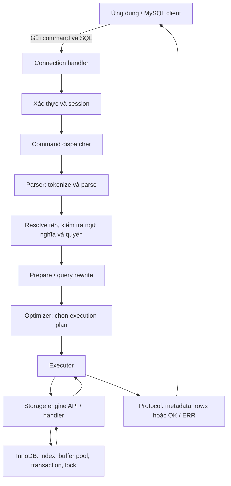
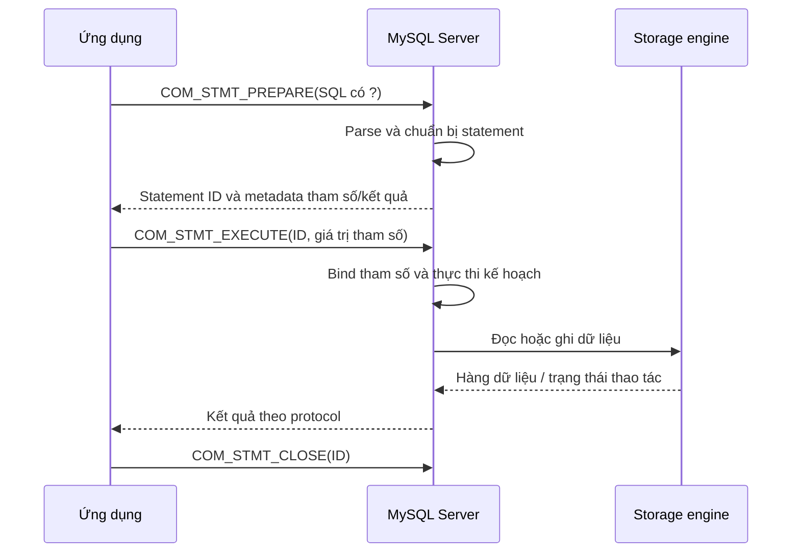
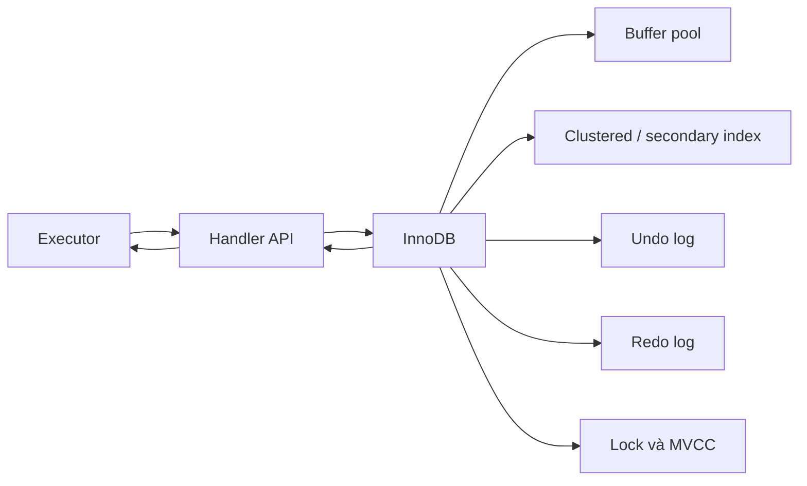

# Luồng parse, prepare, execute và trả kết quả

Khi ứng dụng gửi một câu SQL đến MySQL, câu lệnh đi qua nhiều thành phần trước khi kết quả quay về client. MySQL tiếp nhận kết nối, phân tích cú pháp, kiểm tra đối tượng và quyền truy cập, chọn cách thực thi, gọi storage engine để đọc hoặc thay đổi dữ liệu, rồi đóng gói kết quả theo giao thức client/server. Hiểu luồng này giúp ta đọc lỗi đúng tầng, giải thích vì sao một truy vấn chậm và biết prepared statement thực sự làm gì.

Bài học thuộc module **DATABASE_MYSQL**. Module hướng tới việc làm chủ MySQL từ thiết kế bảng, kiểu dữ liệu, khóa và truy vấn SQL đến index, transaction và kiểm soát đồng thời; đồng thời thực hành đọc kế hoạch thực thi, tối ưu truy vấn, phân quyền, sao lưu và xử lý các vấn đề vận hành cơ sở dữ liệu quan hệ. Trong chương **Kiến trúc**, bài này tập trung vào đường đi của một câu lệnh từ lúc client gửi đi đến khi nhận kết quả.

## 1. Bức tranh tổng thể

Một truy vấn SQL không được chuyển thẳng thành thao tác đọc tệp. MySQL Server điều phối nhiều bước: nhận lệnh, phân tích, xác định ý nghĩa của tên bảng/cột, tối ưu cách truy cập, thực thi kế hoạch và trao đổi với storage engine. Storage engine như InnoDB quản lý cấu trúc dữ liệu, index, transaction, khóa và phục hồi.



Sơ đồ mô tả các trách nhiệm logic. Trong mã nguồn và quá trình thực thi thực tế, một số bước có thể đan xen hoặc được gọi lại; chẳng hạn executor gọi storage engine nhiều lần để lấy từng hàng, và một câu lệnh có thể phải chuẩn bị lại khi metadata của đối tượng thay đổi.

Các thành phần chính:

- **Client:** ứng dụng, thư viện kết nối hoặc công cụ dòng lệnh gửi lệnh và nhận phản hồi.
- **Connection handler:** quản lý kết nối, xác thực người dùng và tạo ngữ cảnh session.
- **Parser và resolver:** phân tích cú pháp, tạo cấu trúc biểu diễn câu lệnh, xác định bảng/cột/hàm và kiểm tra tính hợp lệ.
- **Optimizer:** đánh giá các cách thực thi có thể có và chọn kế hoạch dựa trên thống kê, index, điều kiện và chi phí ước lượng.
- **Executor:** thực hiện kế hoạch đã chọn, điều phối thao tác đọc/ghi và tạo hàng kết quả.
- **Storage engine:** cung cấp thao tác lưu trữ cụ thể. InnoDB xử lý index, transaction, MVCC, khóa và log phục hồi.
- **Protocol layer:** gửi metadata, dữ liệu hàng, trạng thái thành công hoặc thông tin lỗi về client.

## 2. Kết nối và tiếp nhận command

### 2.1. Từ ứng dụng đến MySQL Server

Ứng dụng thường kết nối qua TCP/IP đến cổng MySQL (mặc định thường là `3306`), qua Unix socket trên hệ thống phù hợp hoặc qua một phương thức kết nối được cấu hình khác. Client và server trao đổi theo MySQL client/server protocol.

Khi kết nối được thiết lập, server thực hiện quá trình bắt tay và xác thực tài khoản. Việc xác thực có thể phụ thuộc plugin xác thực, mật khẩu, TLS và cấu hình server. Sau khi đăng nhập thành công, MySQL tạo một session gắn với kết nối đó. Session giữ ngữ cảnh như:

- Tài khoản và quyền hiện hành.
- Database mặc định được chọn bằng `USE` hoặc khi mở kết nối.
- Các biến session như `time_zone`, `sql_mode`, `autocommit` và charset kết nối.
- Trạng thái transaction, prepared statement và các thiết lập riêng của kết nối.

Kiểm tra thông tin phiên hiện tại:

```sql
SELECT
    CONNECTION_ID() AS connection_id,
    CURRENT_USER() AS authenticated_account,
    USER() AS client_identity,
    DATABASE() AS default_database,
    @@SESSION.autocommit AS autocommit,
    @@SESSION.time_zone AS session_time_zone,
    @@SESSION.sql_mode AS session_sql_mode;
```

`CURRENT_USER()` cho biết tài khoản MySQL được dùng để kiểm tra quyền; `USER()` phản ánh tên người dùng và host mà client trình bày khi kết nối. Hai giá trị có thể khác nhau do quy tắc khớp tài khoản `user`@`host`.

### 2.2. Command dispatcher

Sau khi kết nối sẵn sàng, client gửi một command. Một số loại command quan trọng:

| Command | Mục đích |
|---|---|
| `COM_QUERY` | Gửi câu SQL dạng văn bản, thường dùng cho truy vấn thông thường. |
| `COM_STMT_PREPARE` | Yêu cầu server chuẩn bị một prepared statement. |
| `COM_STMT_EXECUTE` | Thực thi prepared statement đã chuẩn bị với các tham số. |
| `COM_STMT_CLOSE` | Đóng prepared statement phía server. |
| `COM_INIT_DB` | Chọn database mặc định cho session; tương đương chức năng của `USE`. |
| `COM_PING` | Kiểm tra server còn phản hồi trên kết nối. |

Client thường không cần tự tạo các gói protocol này. Thư viện như MySQL Connector/J, MySQL client library hoặc driver của ngôn ngữ lập trình chịu trách nhiệm đóng gói và giải mã giao thức.

Một điểm cần phân biệt: giao thức kết nối không phải SQL. SQL là ngôn ngữ mô tả thao tác dữ liệu; protocol là cách client và server vận chuyển câu lệnh, tham số, metadata, kết quả và lỗi.

## 3. Parse: phân tích câu lệnh SQL

### 3.1. Tokenize và kiểm tra cú pháp

Parser là thành phần phân tích câu lệnh. Trước hết, chuỗi SQL được tách thành các token như từ khóa, tên định danh, literal, toán tử, dấu ngoặc và dấu phân cách. Sau đó parser kiểm tra cách các token kết hợp có đúng ngữ pháp SQL mà MySQL hỗ trợ hay không và xây dựng cấu trúc nội bộ biểu diễn câu lệnh.

Ví dụ:

```sql
SELECT customer_id, email
FROM customers
WHERE customer_id = 101;
```

Parser nhận diện đây là một câu `SELECT`, có danh sách biểu thức cần lấy, bảng nguồn và điều kiện lọc. Ở giai đoạn này, MySQL kiểm tra cú pháp của câu lệnh. Nếu thiếu `FROM`, viết sai từ khóa hoặc đóng ngoặc không đúng, server có thể trả lỗi cú pháp trước khi truy cập dữ liệu.

Ví dụ câu lệnh sai cú pháp:

```sql
SELEC customer_id FROM customers;
```

Lỗi này không liên quan đến index hay dữ liệu trong bảng. Optimizer và storage engine không thể sửa một câu SQL chưa vượt qua bước phân tích cú pháp.

### 3.2. Resolve tên và kiểm tra ngữ nghĩa

Một câu lệnh có thể đúng cú pháp nhưng vẫn không hợp lệ về ý nghĩa. MySQL cần xác định tên database, table, column, alias, hàm và kiểu dữ liệu tương ứng.

Ví dụ:

```sql
SELECT unknown_column
FROM customers;
```

Nếu bảng `customers` không có cột `unknown_column`, parser có thể nhận ra hình dạng câu lệnh nhưng bước phân giải tên sẽ phát hiện lỗi. Những kiểm tra ngữ nghĩa khác gồm tính hợp lệ của biểu thức, tương thích kiểu dữ liệu và các quy tắc áp dụng cho câu lệnh.

MySQL cũng kiểm tra quyền cần thiết đối với đối tượng được truy cập. Người dùng có thể kết nối thành công nhưng vẫn không được phép đọc một bảng hoặc cập nhật một cột. Xác thực kết nối và cấp quyền thực hiện SQL là hai việc khác nhau.

Có thể kiểm tra tài khoản hiện hành và quyền đã cấp:

```sql
SELECT CURRENT_USER();
SHOW GRANTS FOR CURRENT_USER;
```

Lỗi parse, lỗi tên cột và lỗi quyền thường xuất hiện trước khi truy vấn đọc hết dữ liệu. Khi xử lý, hãy đọc mã lỗi và thông điệp server thay vì bắt đầu bằng việc thêm index.

## 4. Prepare: chuẩn bị câu lệnh trước khi thực thi

Từ **prepare** được dùng trong MySQL ở hai ngữ cảnh có liên quan nhưng không đồng nhất:

1. Một câu SQL thông thường vẫn cần server phân tích, phân giải tên, kiểm tra và chuẩn bị thông tin nội bộ để có thể tối ưu, thực thi.
2. **Prepared statement** là tính năng cho phép client yêu cầu server chuẩn bị một câu lệnh có tham số, sau đó thực thi nhiều lần với các giá trị khác nhau.

Phần này tập trung vào prepared statement vì đây là cách ứng dụng thường dùng để gửi câu SQL có tham số.

### 4.1. Prepared statement hoạt động thế nào?

Luồng cơ bản của prepared statement phía server:



Ở bước prepare, server nhận câu SQL và tạo đối tượng prepared statement gắn với session. Server trả statement ID để client dùng trong các lần execute tiếp theo. Ở bước execute, client gửi statement ID và giá trị tham số; với prepared statement protocol, tham số được truyền theo định dạng nhị phân thay vì phải nối chuỗi SQL thủ công.

Server vẫn phải thực hiện công việc cần thiết cho mỗi lần chạy: nhận tham số, kiểm tra và chuyển kiểu, chọn hoặc cập nhật kế hoạch phù hợp, truy cập dữ liệu, giữ khóa và trả kết quả. Prepared statement không biến một truy vấn thành kết quả đã lưu sẵn.

Khi metadata của bảng hoặc đối tượng liên quan thay đổi, MySQL có thể cần tự động prepare lại statement để phản ánh cấu trúc mới. Vì vậy không nên xem prepared statement là một execution plan bất biến được cache vĩnh viễn.

### 4.2. Prepared statement bằng SQL

MySQL cho phép thao tác prepared statement trực tiếp bằng `PREPARE`, `EXECUTE` và `DEALLOCATE PREPARE`:

```sql
SET @sql =
    'SELECT customer_id, email
     FROM customers
     WHERE customer_id = ?';

PREPARE find_customer FROM @sql;

SET @customer_id = 101;
EXECUTE find_customer USING @customer_id;

SET @customer_id = 102;
EXECUTE find_customer USING @customer_id;

DEALLOCATE PREPARE find_customer;
```

`?` là parameter marker. Mỗi lần `EXECUTE`, giá trị của biến được truyền vào vị trí tương ứng. Câu SQL giữ nguyên cấu trúc, còn giá trị lọc thay đổi.

Prepared statement được tạo trong session nên phải được giải phóng khi không còn dùng. Với ứng dụng, driver và connection pool thường quản lý vòng đời statement; với SQL thủ công, cần gọi `DEALLOCATE PREPARE` khi hoàn tất.

### 4.3. Prepared statement trong Java JDBC

Trong Java, `PreparedStatement` là API quen thuộc để thực hiện SQL có tham số:

```java
String sql = """
    SELECT customer_id, email
    FROM customers
    WHERE customer_id = ?
    """;

try (Connection connection = dataSource.getConnection();
     PreparedStatement statement = connection.prepareStatement(sql)) {

    statement.setLong(1, 101L);

    try (ResultSet resultSet = statement.executeQuery()) {
        while (resultSet.next()) {
            long customerId = resultSet.getLong("customer_id");
            String email = resultSet.getString("email");
            System.out.printf("%d - %s%n", customerId, email);
        }
    }
}
```

`setLong(1, 101L)` gán tham số đầu tiên. Chỉ số tham số trong JDBC bắt đầu từ 1. Các phương thức `setString`, `setBigDecimal`, `setTimestamp` và những phương thức tương ứng khác giúp driver truyền giá trị theo kiểu phù hợp.

API JDBC `PreparedStatement` không đồng nghĩa mọi driver luôn dùng server-side prepared statement. MySQL Connector/J có thể được cấu hình để dùng prepared statement phía server, chẳng hạn qua thuộc tính `useServerPrepStmts`; hành vi cụ thể còn phụ thuộc phiên bản driver và cấu hình. Nếu cần xác nhận server-side prepare đang được dùng, hãy kiểm tra cấu hình Connector/J và quan sát hành vi thực tế thay vì chỉ dựa vào tên API.

### 4.4. Vì sao tham số giúp chống SQL injection?

Không an toàn khi ghép trực tiếp dữ liệu người dùng vào câu SQL:

```java
String sql = "SELECT * FROM customers WHERE email = '" + email + "'";
```

Nếu `email` chứa ký tự được diễn giải như một phần cú pháp SQL, cấu trúc câu lệnh có thể bị thay đổi. Với prepared statement, câu SQL và giá trị được truyền riêng:

```java
String sql = "SELECT * FROM customers WHERE email = ?";

try (PreparedStatement statement = connection.prepareStatement(sql)) {
    statement.setString(1, email);
    try (ResultSet resultSet = statement.executeQuery()) {
        // Xử lý kết quả
    }
}
```

Driver truyền giá trị như một tham số dữ liệu, nên chuỗi đầu vào không được diễn giải thành toán tử hoặc mệnh đề SQL. Đây là một lớp bảo vệ quan trọng khi dùng đúng cách, đồng thời giúp phân tách rõ cấu trúc truy vấn và dữ liệu.

Parameter marker chỉ đại diện cho **giá trị**, không thay thế được tên bảng, tên cột, từ khóa hoặc hướng sắp xếp. Ví dụ `ORDER BY ?` không có nghĩa là truyền tên cột để server sắp xếp theo cột đó; nó thường được hiểu như một biểu thức giá trị hằng. Nếu cần chọn cột sắp xếp động, hãy ánh xạ đầu vào qua danh sách identifier được cho phép trong ứng dụng rồi mới tạo phần SQL cấu trúc. Không nối trực tiếp tên cột do người dùng gửi vào câu lệnh.

## 5. Optimizer: chọn cách thực thi

Sau khi câu lệnh được phân tích và thông tin đối tượng đã được xác định, MySQL optimizer đánh giá cách thực hiện. Cùng một câu SQL có thể có nhiều kế hoạch hợp lệ nhưng chi phí khác nhau.

Với truy vấn:

```sql
SELECT order_id, created_at, total_amount
FROM orders
WHERE customer_id = 101
  AND created_at >= '2026-01-01'
ORDER BY created_at DESC
LIMIT 20;
```

Optimizer có thể xem xét:

- Quét toàn bộ bảng rồi lọc từng hàng.
- Dùng index bắt đầu bằng `customer_id` để tìm đơn của một khách hàng.
- Dùng index ghép `(customer_id, created_at)` để lọc theo khách hàng và phạm vi thời gian.
- Đọc index theo thứ tự phù hợp để giảm hoặc tránh bước sắp xếp bổ sung.
- Chọn thứ tự join và cách truy cập nếu truy vấn có nhiều bảng.

Optimizer dựa vào cấu trúc truy vấn, index, thống kê dữ liệu, ước lượng số hàng và chi phí I/O/CPU. Kế hoạch có chi phí ước lượng thấp nhất theo mô hình của optimizer không đảm bảo luôn là nhanh nhất trong mọi trạng thái tải; thống kê lỗi thời hoặc dữ liệu phân bố lệch có thể làm ước lượng không chính xác.

### 5.1. Đọc kế hoạch với `EXPLAIN`

`EXPLAIN` cho biết kế hoạch mà MySQL dự kiến dùng:

```sql
EXPLAIN
SELECT order_id, created_at, total_amount
FROM orders
WHERE customer_id = 101
  AND created_at >= '2026-01-01'
ORDER BY created_at DESC
LIMIT 20;
```

Ở định dạng bảng truyền thống, các cột thường gặp gồm:

| Cột | Ý nghĩa khái quát |
|---|---|
| `type` | Kiểu truy cập, từ các dạng quét rộng như `ALL` đến truy cập theo index như `range`, `ref` hoặc `const`. |
| `possible_keys` | Những index optimizer có thể cân nhắc. |
| `key` | Index được chọn trong kế hoạch. |
| `key_len` | Độ dài phần khóa được dùng; hữu ích khi phân tích index ghép. |
| `rows` | Số hàng ước lượng cần đọc ở bước đó. |
| `filtered` | Tỷ lệ phần trăm hàng ước tính còn lại sau điều kiện lọc tại bước đó. |
| `Extra` | Thông tin bổ sung như `Using where`, `Using index`, `Using temporary` hoặc `Using filesort`. |

`EXPLAIN FORMAT=TREE` trình bày kế hoạch dạng cây, hữu ích khi đọc thứ tự các iterator. `EXPLAIN ANALYZE` (MySQL 8.0.18 trở lên) thực sự chạy câu `SELECT` và báo thời gian cùng số hàng thực tế tại các iterator. Chỉ dùng trên truy vấn đọc mà bạn hiểu tác động; `EXPLAIN ANALYZE` có thực thi truy vấn và có thể tốn tài nguyên như truy vấn thật.

Ví dụ:

```sql
EXPLAIN FORMAT=TREE
SELECT order_id, created_at, total_amount
FROM orders
WHERE customer_id = 101
ORDER BY created_at DESC
LIMIT 20;

-- MySQL 8.0.18+: câu SELECT sẽ được thực thi để đo số liệu thực tế.
EXPLAIN ANALYZE
SELECT order_id, created_at, total_amount
FROM orders
WHERE customer_id = 101
ORDER BY created_at DESC
LIMIT 20;
```

Không nên chỉ nhìn `type` rồi kết luận truy vấn tốt hay xấu. Cần xem số hàng thực tế, số lần lặp, thời gian từng iterator, index được chọn và yêu cầu nghiệp vụ. Quét bảng nhỏ đôi khi rẻ hơn đi qua index; `Using filesort` cũng không mặc nhiên là lỗi nếu dữ liệu ít và thời gian phù hợp.

### 5.2. Index ảnh hưởng đến đường đi của truy vấn

Nếu truy vấn thường lọc theo khách hàng và sắp xếp theo thời gian, index ghép có thể phù hợp:

```sql
CREATE INDEX idx_orders_customer_created
    ON orders (customer_id, created_at);
```

Thứ tự cột trong index ghép quan trọng. Index `(customer_id, created_at)` thường hữu ích cho điều kiện bắt đầu bằng `customer_id`, và có thể hỗ trợ truy vấn theo cả hai cột. Nó không tương đương với index chỉ có `created_at` cho mọi truy vấn.

Index không đảm bảo optimizer luôn chọn nó. Nếu bảng ít hàng, điều kiện lọc không chọn lọc hoặc thống kê khiến quét bảng được ước lượng rẻ hơn, optimizer có thể chọn cách khác. Sau khi tạo index hoặc thay đổi dữ liệu đáng kể, hãy đo lại bằng `EXPLAIN` và số liệu thực tế.

## 6. Execute: executor và storage engine phối hợp

### 6.1. Executor thực hiện kế hoạch

Executor là thành phần điều phối các bước trong execution plan. Với truy vấn `SELECT`, nó yêu cầu các iterator hoặc thao tác truy cập dữ liệu cung cấp hàng, áp dụng điều kiện, kết hợp bảng, tính biểu thức, nhóm, sắp xếp và giới hạn số hàng theo kế hoạch.

Với câu `INSERT`, `UPDATE` hoặc `DELETE`, executor xác định hàng cần thay đổi, kiểm tra các điều kiện liên quan và gọi storage engine để ghi dữ liệu. Một câu lệnh có thể gọi engine nhiều lần, chẳng hạn tìm hàng qua index rồi cập nhật từng hàng phù hợp.

Executor không tự quản lý định dạng trang dữ liệu InnoDB. Nó sử dụng giao diện storage engine (handler API) mà MySQL cung cấp để yêu cầu engine đọc, ghi, khóa hoặc cung cấp thông tin cần thiết.

### 6.2. Storage engine thực hiện thao tác lưu trữ

MySQL Server cung cấp lớp SQL và điều phối truy vấn; storage engine thực hiện nhiều chi tiết lưu trữ. InnoDB là engine phổ biến cho ứng dụng giao dịch vì hỗ trợ transaction, khóa ngoại, MVCC và phục hồi sau sự cố.

Khi executor cần đọc một hàng, InnoDB có thể:

1. Tìm vị trí qua clustered index hoặc secondary index.
2. Đọc trang dữ liệu từ buffer pool nếu trang chưa có trong bộ nhớ.
3. Dùng thông tin MVCC và undo để tạo phiên bản dữ liệu mà consistent read của transaction được phép nhìn thấy.
4. Áp dụng cơ chế khóa nếu thao tác là locking read hoặc ghi.
5. Trả hàng cho executor qua handler API.

Khi ghi dữ liệu, InnoDB cập nhật cấu trúc trang và tạo thông tin log cần thiết. Redo log hỗ trợ phục hồi thay đổi đã ghi nhận; undo log hỗ trợ rollback và các phiên bản cũ cần cho MVCC. Việc ghi log, flush trang và xác nhận commit tuân theo cấu hình durability và cơ chế phục hồi của InnoDB.



Các thành phần trong sơ đồ có vai trò khác nhau: buffer pool cache trang dữ liệu và index; index hỗ trợ định vị hàng; undo hỗ trợ rollback và consistent read; redo hỗ trợ crash recovery; khóa và MVCC điều phối truy cập đồng thời. Không nên đồng nhất redo log với binary log: redo log phục vụ phục hồi nội bộ của InnoDB, còn binary log ghi nhận các thay đổi ở cấp server phục vụ replication và một số kịch bản point-in-time recovery.

### 6.3. Transaction bao quanh execute như thế nào?

Nếu `autocommit` đang bật, mỗi câu lệnh transactional độc lập thường được commit khi thành công. Khi ứng dụng mở transaction tường minh, nhiều câu SQL có thể cùng thuộc một đơn vị commit hoặc rollback.

```sql
START TRANSACTION;

UPDATE accounts
SET balance = balance - 200000
WHERE account_id = 101
  AND balance >= 200000;

-- Ứng dụng kiểm tra affected rows bằng đúng một.

UPDATE accounts
SET balance = balance + 200000
WHERE account_id = 202;

-- Chỉ commit khi mọi điều kiện nghiệp vụ đều đạt.
COMMIT;
```

Đoạn SQL là khung minh họa; ứng dụng phải kiểm tra số hàng bị tác động và gọi `ROLLBACK` khi tài khoản không tồn tại, không đủ số dư hoặc một bước cập nhật thất bại. Nếu không có nhánh kiểm soát lỗi, `COMMIT` vô điều kiện sẽ làm mất ý nghĩa nguyên tử của nghiệp vụ.

Storage engine quyết định khả năng transactional của bảng. InnoDB hỗ trợ rollback; một engine không transactional có thể không hoàn tác được thay đổi theo cùng cách. Khi thiết kế nghiệp vụ cần ACID, cần kiểm tra engine thực tế của các bảng liên quan.

## 7. Trả kết quả về client

Sau khi executor hoàn tất, MySQL gửi phản hồi qua protocol. Hình thức phản hồi phụ thuộc loại command và kết quả:

- Với câu `SELECT`, server gửi metadata của result set, sau đó gửi các hàng dữ liệu và trạng thái kết thúc.
- Với `INSERT`, `UPDATE` hoặc `DELETE` thành công, server thường trả OK packet kèm thông tin như affected rows, insert ID (nếu có), warning count và trạng thái session.
- Khi câu lệnh thất bại, server trả ERR packet chứa mã lỗi, SQLSTATE và thông điệp mô tả.
- Với prepared statement, client và server dùng các command prepared-statement; dữ liệu tham số và result row có thể được mã hóa theo binary protocol.

Ví dụ:

```sql
UPDATE customers
SET full_name = 'Nguyễn An'
WHERE customer_id = 101;

-- Ứng dụng đọc update count từ API của driver.
-- Nếu cần kiểm tra warning, chạy SHOW WARNINGS ngay sau câu UPDATE.
```

`ROW_COUNT()` phản ánh số hàng bị tác động bởi câu lệnh trước đó trong session. Cách diễn giải affected rows có thể phụ thuộc cờ client và loại thao tác; với `UPDATE`, số hàng được tìm thấy và số hàng thực sự thay đổi có thể khác nhau. Ứng dụng nên dùng API của driver để đọc update count và hiểu semantics của driver.

Kết quả `SELECT` có thể được gửi dần cho client hoặc cần xử lý trung gian trước khi gửi hết. Một số truy vấn phải materialize kết quả trung gian, sắp xếp hoặc nhóm dữ liệu; các thao tác này có thể cần temporary table hoặc filesort. Vì vậy, thời gian nhận hàng đầu tiên và thời gian đọc hết result set có thể khác nhau.

Client cũng ảnh hưởng thời gian hoàn tất: nếu ứng dụng đọc kết quả chậm, server hoặc driver có thể phải giữ tài nguyên và chờ việc tiêu thụ dữ liệu. Hãy đọc result set đúng cách, đóng cursor/statement/connection khi xong và tránh trả về hàng dữ liệu không cần thiết.

## 8. Phân biệt lỗi ở từng giai đoạn

Biết lỗi phát sinh ở bước nào giúp khoanh vùng nguyên nhân nhanh hơn:

| Giai đoạn | Ví dụ lỗi | Hướng xử lý đầu tiên |
|---|---|---|
| Kết nối/xác thực | Không kết nối được, access denied khi đăng nhập | Kiểm tra host, port, TLS, user@host, plugin xác thực và credential. |
| Parse | Sai cú pháp, thiếu dấu ngoặc, dùng cú pháp không được hỗ trợ | Kiểm tra câu SQL và phiên bản MySQL. |
| Resolve/ngữ nghĩa | Unknown column, unknown table, kiểu biểu thức không phù hợp | Kiểm tra schema, tên alias, database mặc định và kiểu dữ liệu. |
| Quyền | SELECT/UPDATE command denied | Kiểm tra `CURRENT_USER()` và `SHOW GRANTS`. |
| Prepare | Parameter marker không đúng, statement không hợp lệ hoặc metadata không còn khớp | Kiểm tra SQL template, số lượng tham số và thay đổi schema. |
| Optimize | Kế hoạch quét nhiều hàng, chọn index không phù hợp | Dùng `EXPLAIN`, kiểm tra index, thống kê và phân bố dữ liệu. |
| Execute/storage engine | Deadlock, lock wait timeout, duplicate key, foreign key violation | Kiểm tra transaction, constraint, thứ tự khóa và log lỗi. |
| Trả kết quả/client | Ứng dụng đọc sai kiểu, timeout khi truyền result set hoặc bỏ sót warning | Kiểm tra driver, kiểu ánh xạ, timeout và cách tiêu thụ result set. |

Một lỗi có thể chỉ xuất hiện khi thực thi dù prepare đã thành công. Ví dụ, giá trị tham số hợp lệ về kiểu nhưng không tìm thấy hàng; một unique key bị trùng chỉ được phát hiện khi ghi; một câu `SELECT` có thể bị chờ khóa trong một số loại truy cập. Do đó, prepare thành công không bảo đảm execute sẽ thành công.

## 9. Đo thời gian và quan sát luồng thực thi

Khi truy vấn chậm, hãy phân biệt thời gian ở client, network, server và storage engine. Một truy vấn có thể chậm vì:

- Kết nối mới và xác thực tốn thời gian do ứng dụng tạo connection quá thường xuyên.
- Parser và optimizer xử lý câu SQL rất lớn hoặc phức tạp.
- Kế hoạch truy vấn đọc nhiều hàng vì thiếu index phù hợp hoặc thống kê sai.
- Storage engine chờ I/O, lock, buffer pool hoặc tài nguyên hệ thống.
- Server phải sắp xếp/nhóm nhiều dữ liệu hoặc tạo temporary table.
- Result set quá lớn hoặc client tiêu thụ dữ liệu chậm.

Các công cụ và nguồn thông tin thường dùng:

1. **`EXPLAIN` / `EXPLAIN ANALYZE`:** xem kế hoạch ước lượng và số liệu thực thi của truy vấn đọc.
2. **Performance Schema:** quan sát statement, wait, stage, transaction và các sự kiện hiệu năng mà server thu thập.
3. **Slow query log:** tìm câu lệnh vượt ngưỡng thời gian hoặc tiêu chí đã cấu hình.
4. **`SHOW PROCESSLIST`:** xem các session và trạng thái đang chạy tại thời điểm kiểm tra.
5. **InnoDB status:** dùng `SHOW ENGINE INNODB STATUS` để xem thông tin transaction, deadlock và trạng thái engine.

Ví dụ kiểm tra session đang chạy:

```sql
SHOW FULL PROCESSLIST;

SHOW ENGINE INNODB STATUS;
```

Không bật mọi công cụ giám sát với cấu hình nặng trên production mà chưa đánh giá chi phí. Performance Schema, slow log và truy vấn chẩn đoán có thể tạo thêm overhead; hãy chọn consumer, ngưỡng và khoảng thời gian phù hợp với mục tiêu điều tra.

## 10. Một ví dụ xuyên suốt: tìm đơn hàng của khách hàng

Giả sử ứng dụng cần lấy 20 đơn mới nhất của khách hàng. Schema có index ghép `(customer_id, created_at)`.

### Bước 1: Client tạo câu lệnh có tham số

```java
String sql = """
    SELECT order_id, created_at, total_amount
    FROM orders
    WHERE customer_id = ?
    ORDER BY created_at DESC
    LIMIT ?
    """;

try (PreparedStatement statement = connection.prepareStatement(sql)) {
    statement.setLong(1, 101L);
    statement.setInt(2, 20);

    try (ResultSet rows = statement.executeQuery()) {
        while (rows.next()) {
            // Đọc từng hàng kết quả.
        }
    }
}
```

### Bước 2: Server parse và prepare

Server phân tích câu `SELECT`, xác định bảng và các cột, kiểm tra quyền đọc và chuẩn bị statement có hai vị trí tham số. Client nhận statement ID nếu driver đang dùng server-side prepared statement.

### Bước 3: Optimizer chọn kế hoạch

Optimizer đánh giá index, điều kiện `customer_id`, thứ tự `created_at` và giới hạn `LIMIT`. Index ghép có thể giúp tìm các hàng của khách hàng và đọc theo thứ tự thời gian phù hợp mà không cần quét toàn bộ bảng.

### Bước 4: Executor gọi InnoDB

Executor yêu cầu InnoDB tìm các hàng phù hợp. InnoDB truy cập index, lấy trang từ buffer pool hoặc storage, áp dụng visibility rule của transaction rồi trả hàng cho executor.

### Bước 5: Server trả result set

MySQL gửi metadata cột và các hàng kết quả về driver. Driver giải mã dữ liệu thành kiểu Java, `ResultSet` cung cấp API để ứng dụng đọc từng hàng. Khi đóng `ResultSet` và statement, ứng dụng giải phóng tài nguyên tương ứng.

Có thể kiểm tra phần optimizer độc lập với ứng dụng:

```sql
EXPLAIN FORMAT=TREE
SELECT order_id, created_at, total_amount
FROM orders
WHERE customer_id = 101
ORDER BY created_at DESC
LIMIT 20;
```

Nếu kế hoạch không dùng index như mong đợi, cần xem lại index, kiểu dữ liệu, thống kê, số lượng hàng và độ chọn lọc của điều kiện. Đừng giả định chỉ cần thêm một index bất kỳ là truy vấn sẽ nhanh hơn.

## 11. Những hiểu nhầm thường gặp

**“Parse thành công nghĩa là câu SQL chắc chắn chạy được.”** Không đúng. Tên cột có thể không tồn tại, quyền có thể thiếu, ràng buộc có thể bị vi phạm hoặc storage engine có thể gặp lỗi trong lúc execute.

**“Prepare là optimizer đã cố định kế hoạch cho mọi lần chạy.”** Không đúng. Prepared statement giữ cấu trúc câu lệnh và trạng thái chuẩn bị; mỗi lần execute vẫn cần xử lý tham số và thực thi. Thay đổi metadata có thể khiến statement phải prepare lại.

**“Dùng `PreparedStatement` nghĩa là chắc chắn server-side prepare.”** Không luôn đúng. Đây là API JDBC; driver có thể dùng server-side prepared statement hoặc cơ chế khác tùy cấu hình và phiên bản.

**“Prepared statement cho phép bind tên cột.”** Không đúng. Parameter marker đại diện cho giá trị, không đại diện cho identifier hoặc mảnh cú pháp SQL.

**“Optimizer luôn chọn kế hoạch nhanh nhất trong mọi tình huống.”** Optimizer chọn dựa trên chi phí ước lượng và thống kê hiện có. Dữ liệu thay đổi, phân bố lệch hoặc thống kê không chính xác có thể làm kế hoạch không phù hợp.

**“MySQL Server tự đọc trực tiếp mọi file dữ liệu.”** Lớp SQL giao tiếp với storage engine qua giao diện handler. InnoDB quản lý định dạng trang, index, buffer pool, transaction và log của nó.

**“Nhận được hàng đầu tiên nghĩa là truy vấn đã hoàn tất.”** Một số kết quả được gửi dần; server vẫn có thể phải tiếp tục thực thi hoặc client còn phải đọc nhiều hàng. Thời gian first row và thời gian fetch hết result set là hai chỉ số khác nhau.

## 12. Bài tập thực hành

### Bài tập 1: Phân biệt lỗi parse và lỗi resolve

Chạy hai câu lệnh sau và ghi lại mã lỗi/thông điệp:

```sql
SELEC customer_id FROM customers;

SELECT column_does_not_exist FROM customers;
```

**Yêu cầu:** giải thích câu nào sai cú pháp, câu nào đúng cú pháp nhưng không phân giải được tên cột.

### Bài tập 2: Thực hiện prepared statement

Tạo prepared statement tìm khách hàng theo ID. Thực thi ít nhất hai lần với hai giá trị khác nhau, sau đó giải phóng statement.

**Yêu cầu:** xác định statement nào được chuẩn bị, giá trị nào được bind và vì sao không cần nối giá trị vào chuỗi SQL.

### Bài tập 3: So sánh truy vấn thường và truy vấn có tham số

Viết một truy vấn `SELECT` có điều kiện theo email. Thực hiện bằng cách ghép chuỗi trong ví dụ giả lập và bằng `PreparedStatement`.

**Yêu cầu:** giải thích rủi ro SQL injection và giới hạn của parameter marker khi muốn chọn cột sắp xếp động.

### Bài tập 4: Quan sát execution plan

Chạy `EXPLAIN` cho truy vấn lấy đơn hàng mới nhất của một khách hàng. Tạo index ghép `(customer_id, created_at)` nếu phù hợp với schema, sau đó chạy `EXPLAIN` lại.

**Yêu cầu:** so sánh `key`, `type`, `rows`, `Extra` hoặc cây execution plan trước và sau. Không kết luận chỉ từ việc có index; hãy giải thích kế hoạch đã thay đổi như thế nào.

### Bài tập 5: Phân tích lỗi khi execute

Tạo một unique key cho email. Thử insert một email đã tồn tại và ghi nhận phản hồi từ server.

**Yêu cầu:** xác định vì sao câu lệnh có thể parse và prepare thành công nhưng execute thất bại do duplicate key.

### Bài tập 6: Quan sát result set và update count

Thực hiện một câu `SELECT` trả nhiều hàng và một câu `UPDATE` có điều kiện. Đọc kết quả bằng JDBC `ResultSet` và update count.

**Yêu cầu:** giải thích khác biệt giữa result set metadata/rows và OK response có affected rows.

## 13. Ghi nhớ

Luồng xử lý câu lệnh MySQL bắt đầu từ kết nối và command protocol, tiếp tục qua parse, resolve, kiểm tra quyền, prepare và tối ưu. Executor thực hiện kế hoạch bằng cách gọi storage engine qua handler API. InnoDB xử lý index, buffer pool, transaction, MVCC, khóa và log; sau đó server đóng gói metadata, hàng dữ liệu hoặc trạng thái lỗi để trả về client.

Prepared statement tách cấu trúc SQL khỏi giá trị tham số, hỗ trợ tái sử dụng statement và giảm nguy cơ SQL injection khi dùng đúng cách. Optimizer quyết định đường truy cập dữ liệu; `EXPLAIN` và các công cụ quan sát giúp kiểm tra quyết định đó. Khi truy vấn lỗi hoặc chậm, hãy xác định giai đoạn phát sinh trước rồi mới chọn cách khắc phục phù hợp.
