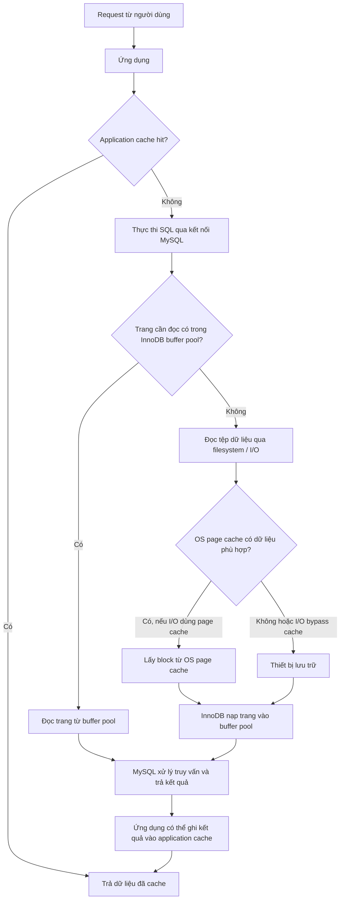
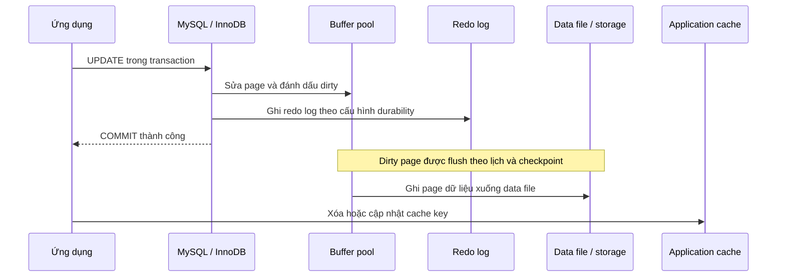

# Phân biệt buffer pool, bộ đệm hệ điều hành và cache phía ứng dụng

Một truy vấn MySQL có thể đi qua nhiều lớp lưu đệm trước khi dữ liệu được trả về cho người dùng. InnoDB giữ các trang dữ liệu và index thường dùng trong buffer pool; hệ điều hành có thể giữ các block của tệp trong page cache; ứng dụng có thể lưu đối tượng, kết quả truy vấn hoặc dữ liệu đã tổng hợp trong bộ nhớ riêng hay Redis. Ba lớp này cùng giảm độ trễ đọc nhưng lưu những loại dữ liệu khác nhau, có cơ chế hoạt động và cách làm mới khác nhau.

Bài học thuộc module `DATABASE_MYSQL`, chương Kiến trúc. Hiểu đúng các lớp cache giúp thiết kế bảng, index và truy vấn SQL hiệu quả, đọc số liệu thực thi, xử lý transaction và kiểm soát đồng thời. Khi tối ưu, cần xác định truy vấn đang tốn thời gian ở lớp nào trước khi tăng bộ nhớ hoặc thêm cache. Ví dụ tập trung vào MySQL 8.x với InnoDB.

## Mục tiêu

Sau bài này, bạn có thể:

- Phân biệt dữ liệu mà InnoDB buffer pool, OS page cache và application cache lưu giữ.
- Mô tả đường đi của một lần đọc và một lần ghi qua các lớp cache.
- Hiểu vì sao buffer pool miss không đồng nghĩa chắc chắn với một lần đọc đĩa vật lý.
- Đọc các chỉ số buffer pool cơ bản và đối chiếu với chỉ số hệ điều hành, ứng dụng.
- Chọn cách cache phù hợp, kiểm soát dữ liệu cũ và tránh các lỗi nhất quán thường gặp.

## 1. Ba lớp cache giải quyết ba vấn đề khác nhau

| Lớp | Nơi quản lý | Dữ liệu thường lưu | Phạm vi và thời gian sống | Ai chịu trách nhiệm làm mới? |
|---|---|---|---|---|
| InnoDB buffer pool | MySQL Server / InnoDB | Các trang dữ liệu và index của InnoDB; một số cấu trúc hỗ trợ truy cập | Dùng chung trong một MySQL instance, tồn tại trong bộ nhớ server và được quản lý theo vòng đời instance | InnoDB tự nạp, thay thế và flush trang theo nhu cầu |
| OS page cache | Kernel hệ điều hành | Nội dung các block của tệp mà filesystem truy cập qua cơ chế được cache | Dùng chung ở cấp hệ điều hành; có thể phục vụ nhiều tiến trình | Kernel quản lý theo áp lực bộ nhớ và chính sách I/O |
| Application cache | Ứng dụng, thư viện hoặc cache service như Redis | Đối tượng nghiệp vụ, DTO, kết quả truy vấn, cấu hình, dữ liệu tổng hợp | Theo tiến trình, cụm ứng dụng hoặc cache service; thời gian sống do ứng dụng quy định | Logic ứng dụng, TTL, sự kiện hoặc thao tác invalidation |

Không lớp nào thay thế hoàn toàn lớp còn lại. Buffer pool giúp InnoDB tránh đọc lại trang từ tầng lưu trữ; OS page cache có thể giảm I/O thiết bị khi đường I/O đi qua page cache; application cache giúp ứng dụng tránh gửi truy vấn lặp lại tới MySQL và tránh lặp lại xử lý ở tầng dịch vụ.



Sơ đồ thể hiện một đường đọc khái quát. Optimizer, các engine khác, read-ahead, nhiều trang và các bước xử lý khác có thể làm đường đi thực tế phức tạp hơn. Đặc biệt, InnoDB có thể dùng chế độ I/O trực tiếp để bỏ qua OS page cache cho data file trên nền tảng hỗ trợ.

## 2. InnoDB buffer pool

### 2.1. Buffer pool lưu gì?

InnoDB tổ chức dữ liệu trong các page. Buffer pool là vùng bộ nhớ lớn của InnoDB dùng để cache các page đã đọc từ tablespace, bao gồm page dữ liệu và page index. Khi truy vấn cần một page đã nằm trong buffer pool, InnoDB có thể đọc nó trong bộ nhớ mà không cần yêu cầu đọc lại từ file.

Buffer pool không phải bộ nhớ chứa nguyên kết quả của câu `SELECT`. Ví dụ, nếu truy vấn:

```sql
SELECT order_id, total_amount
FROM orders
WHERE customer_id = 42;
```

InnoDB có thể cần đọc page của secondary index trên `customer_id`, rồi đọc các page dữ liệu chứa những bản ghi phù hợp. Các page đó có thể được giữ trong buffer pool sau lần truy cập. Kết quả gồm các hàng và cột được gửi về client vẫn được MySQL tạo và truyền theo cơ chế thực thi truy vấn; buffer pool không lưu một bản sao kết quả theo nguyên văn SQL.

Buffer pool còn quản lý các trạng thái page như page sạch và page bẩn (dirty page), cùng những danh sách phục vụ thay thế và ghi dữ liệu. Một số cấu trúc hỗ trợ truy cập như adaptive hash index cũng liên quan đến bộ nhớ InnoDB, nhưng không nên đồng nhất chúng với page dữ liệu trong buffer pool.

### 2.2. Cache hit và cache miss

- **Buffer pool hit:** page truy vấn cần đã có trong buffer pool. InnoDB lấy page từ RAM.
- **Buffer pool miss:** page chưa có trong buffer pool. InnoDB phải yêu cầu đọc page từ tầng lưu trữ bên dưới; dữ liệu có thể được phục vụ từ OS page cache hoặc phải đọc thiết bị, tùy cấu hình I/O và trạng thái cache của hệ điều hành.

Vì vậy, một buffer pool miss không tự động đồng nghĩa với một lần đọc vật lý từ SSD/HDD. Chỉ số `Innodb_buffer_pool_reads` phản ánh số lần InnoDB phải đọc page do không tìm thấy page trong buffer pool; nó không chứng minh mỗi lần đọc đều chạm tới thiết bị lưu trữ.

### 2.3. Page sạch, page bẩn và flush

Khi transaction sửa một bản ghi, InnoDB cập nhật page tương ứng trong buffer pool và đánh dấu page là dirty. Thay đổi được bảo vệ bằng redo log theo cơ chế phục hồi của InnoDB. Page bẩn được ghi xuống data file về sau bởi các tiến trình nền hoặc khi cần giải phóng page, checkpoint hay đáp ứng áp lực ghi.

Điều này giúp thao tác sửa dữ liệu không phải chờ ghi toàn bộ page dữ liệu xuống file ở mỗi câu lệnh. Tuy nhiên, độ bền của commit còn phụ thuộc cấu hình redo log, binary log nếu bật, filesystem và thiết bị lưu trữ. Không được suy luận rằng dữ liệu đã commit chỉ nằm trong buffer pool là đã đủ bền vững.

### 2.4. Cách InnoDB giữ các page hữu ích

InnoDB quản lý các page trong buffer pool bằng các cấu trúc như LRU list và flush list. Khi cần chỗ cho page mới, InnoDB chọn page phù hợp để thay thế; page bẩn có thể cần được flush trước khi tái sử dụng. Cơ chế midpoint insertion giúp hạn chế việc một lần quét lớn đẩy toàn bộ working set đang được truy cập thường xuyên ra khỏi cache.

Đọc tuần tự, read-ahead, truy vấn quét bảng lớn và working set lớn có thể ảnh hưởng đến hành vi cache. Vì thế, tăng buffer pool không luôn giải quyết được truy vấn chậm: truy vấn có thể đọc quá nhiều page do thiếu index, chọn execution plan chưa tốt hoặc bị chờ lock.

## 3. OS page cache

OS page cache là cơ chế cache ở kernel, thường giữ các block nội dung tệp để những lần truy cập filesystem tiếp theo có thể được phục vụ từ RAM. Đây là cache dùng chung ở cấp hệ điều hành, không hiểu khái niệm SQL, bảng, index hay transaction.

Nếu MySQL đọc data file thông qua I/O có sử dụng page cache, một page không có trong InnoDB buffer pool vẫn có thể được trả về nhanh từ bộ nhớ của kernel. Nếu block cũng không nằm trong OS page cache, hệ điều hành mới cần yêu cầu thiết bị lưu trữ đọc dữ liệu.

### 3.1. OS page cache có thể trùng dữ liệu với buffer pool

Khi sử dụng buffered I/O, nội dung data file có thể đồng thời xuất hiện trong InnoDB buffer pool và OS page cache. Điều này có thể tạo hai bản cache cho một phần dữ liệu, tiêu thụ RAM ở cả MySQL và hệ điều hành. Đổi lại, OS page cache có thể hữu ích cho workload hoặc loại I/O khác.

InnoDB có tùy chọn `innodb_flush_method` để điều chỉnh cách đọc/ghi và flush file trên những nền tảng hỗ trợ. Một số chế độ như `O_DIRECT` có thể bỏ qua OS page cache đối với data file InnoDB, giảm hiện tượng double buffering. Hành vi cụ thể phụ thuộc hệ điều hành, filesystem, phiên bản MySQL và chế độ được hỗ trợ; không nên suy rộng rằng mọi I/O của MySQL đều bypass page cache.

Kiểm tra cấu hình hiện tại:

```sql
SHOW VARIABLES LIKE 'innodb_flush_method';
SHOW VARIABLES LIKE 'innodb_buffer_pool_size';
```

Không thay `innodb_flush_method` trên production chỉ vì thấy RAM dùng cho page cache. Hãy đo I/O, đánh giá workload, kiểm tra tài liệu cho đúng nền tảng và thử trong môi trường kiểm thử trước.

### 3.2. Kernel quản lý cache theo áp lực bộ nhớ

OS page cache có thể co giãn khi hệ điều hành cần RAM cho tiến trình khác. Bộ nhớ được dùng làm cache file thường có thể thu hồi, nhưng mức độ reclaim và tác động lên latency phụ thuộc workload. Nếu MySQL cấp quá nhiều RAM cho buffer pool và các vùng bộ nhớ khác, hệ điều hành có thể thiếu RAM, bắt đầu swap hoặc gây áp lực bộ nhớ. Khi đó, tăng buffer pool có thể làm hiệu năng xấu đi.

OS page cache cũng không giống swap. Page cache giữ bản sao nội dung file để tăng tốc I/O; swap dùng để chuyển các trang bộ nhớ tiến trình ra vùng lưu trữ khi thiếu RAM. Swap activity cao ở máy database thường là tín hiệu cần xem lại áp lực bộ nhớ.

## 4. Application cache

Application cache nằm ngoài InnoDB và do ứng dụng hoặc một dịch vụ cache quản lý. Nó có thể lưu dữ liệu đã được ứng dụng chuyển thành đối tượng, kết quả truy vấn, thông tin hồ sơ, cấu hình hoặc dữ liệu tổng hợp.

Các hình thức thường gặp:

- **Local in-memory cache:** cache trong heap hoặc bộ nhớ của một tiến trình ứng dụng. Truy cập nhanh nhưng mỗi instance có thể giữ một bản khác nhau.
- **Distributed cache:** Redis hoặc Memcached cho nhiều instance ứng dụng cùng truy cập. Cần tính đến mạng, tính sẵn sàng và chính sách eviction của cache service.
- **HTTP/CDN cache:** cache response hoặc nội dung tĩnh ở tầng HTTP, thường phù hợp với dữ liệu công khai hoặc nội dung có chính sách cache rõ ràng.

Application cache lưu theo key do ứng dụng thiết kế. Ví dụ `customer:42:profile:v3` có thể trỏ đến một DTO hồ sơ khách hàng. Khi có cache hit, ứng dụng có thể trả kết quả mà không mở truy vấn tới MySQL. Khi miss, ứng dụng truy vấn database, chuyển kết quả thành object rồi ghi vào cache.

### 4.1. Cache-aside

Cache-aside là mẫu phổ biến: ứng dụng tự kiểm tra cache; nếu miss thì đọc database và ghi kết quả vào cache.

```text
function getCustomer(customerId):
    key = "customer:" + customerId
    value = cache.get(key)

    if value exists:
        return value

    value = database.queryCustomer(customerId)
    if value exists:
        cache.set(key, value, ttl = 300 seconds)

    return value
```

Đây là pseudocode minh họa, không phải API của Redis hay MySQL. TTL 300 giây chỉ là giá trị ví dụ; TTL thật phải dựa trên yêu cầu freshness của nghiệp vụ. Cần định nghĩa rõ cách biểu diễn cache miss và trường hợp bản ghi không tồn tại để tránh truy vấn database liên tục cho một key không có dữ liệu (cache penetration).

### 4.2. Các chiến lược ghi và invalidation

| Chiến lược | Cách hoạt động | Đặc điểm và rủi ro |
|---|---|---|
| Cache-aside | Ứng dụng đọc cache; miss thì đọc DB. Khi ghi DB, ứng dụng xóa hoặc cập nhật cache | Linh hoạt, phổ biến; có thể có khoảng thời gian dữ liệu cũ nếu invalidation thất bại hoặc xảy ra race |
| Write-through | Lớp cache ghi đồng thời hoặc đồng bộ dữ liệu xuống DB theo thiết kế | Dễ giữ cache gần DB hơn nhưng tăng độ trễ ghi và cần xử lý lỗi hai nơi |
| Write-behind / write-back | Ghi vào cache trước, ghi DB sau theo hàng đợi hoặc tác vụ nền | Có thể tăng throughput nhưng phức tạp về durability, thứ tự, retry và nguy cơ mất dữ liệu |

Với cache-aside, một trình tự thường dùng là commit transaction trong MySQL rồi xóa cache key liên quan. Tuy nhiên, nếu có ghi đồng thời hoặc nhiều instance, vẫn có thể xuất hiện race condition: một request đọc dữ liệu cũ trước commit, rồi ghi dữ liệu cũ vào cache sau khi request ghi đã xóa key. Có thể giảm rủi ro bằng versioning, compare-and-set, event/outbox, TTL ngắn phù hợp hoặc thiết kế cache theo phiên bản dữ liệu.

Cache key cần chứa đủ ngữ cảnh ảnh hưởng tới kết quả: tenant, locale, quyền truy cập, filter, sort, phiên bản schema/DTO hoặc phiên bản dữ liệu. Thiếu thành phần trong key có thể khiến người dùng nhận dữ liệu của tenant khác hoặc dữ liệu đã được lọc theo quyền khác.

### 4.3. Các lỗi thường gặp ở application cache

- **Stale data:** cache không được invalidation khi dữ liệu gốc thay đổi.
- **Cache stampede:** nhiều request cùng miss một key và đồng thời truy vấn database.
- **Cache penetration:** liên tục truy vấn các key không tồn tại.
- **Hot key:** một key nhận lượng truy cập lớn, gây nghẽn một node hoặc một shard.
- **Eviction:** cache service loại bỏ key do áp lực bộ nhớ hoặc policy.
- **Cache poisoning / key collision:** dữ liệu sai hoặc ngữ cảnh key không đầy đủ khiến kết quả không đúng người dùng.

Có thể dùng TTL có jitter, request coalescing/single-flight, negative caching có thời hạn, giới hạn kích thước value và theo dõi eviction để giảm các vấn đề này. Với dữ liệu nhạy cảm hoặc phân quyền, correctness phải được đặt lên trước hit rate.

## 5. Đường đi của thao tác đọc và ghi

### 5.1. Đọc dữ liệu

Giả sử người dùng mở hồ sơ khách hàng `42`:

1. Ứng dụng kiểm tra application cache bằng key tương ứng.
2. Nếu hit, ứng dụng trả dữ liệu đã cache. MySQL có thể không nhận truy vấn nào.
3. Nếu miss, ứng dụng gửi SQL tới MySQL.
4. Optimizer chọn execution plan; InnoDB cần các page dữ liệu/index để thực thi.
5. Nếu page có trong buffer pool, InnoDB đọc từ RAM của MySQL.
6. Nếu page thiếu, InnoDB đọc từ data file. Tùy chế độ I/O, OS page cache có thể phục vụ block hoặc kernel yêu cầu thiết bị lưu trữ đọc.
7. InnoDB đưa page cần thiết vào buffer pool, xử lý truy vấn và gửi result set về client.
8. Ứng dụng có thể ghi object/kết quả vào application cache theo chính sách đã định.

Đường đọc cho thấy ba lớp cache có thể tránh những công việc khác nhau: application cache có thể bỏ qua toàn bộ truy vấn; buffer pool tránh đọc lại page qua tầng file I/O; OS page cache có thể tránh đọc thiết bị khi đường I/O sử dụng page cache.

### 5.2. Ghi dữ liệu

Với một câu `UPDATE`, ứng dụng thường phải ghi transaction vào MySQL. InnoDB cập nhật page trong buffer pool và đánh dấu page bẩn, đồng thời ghi redo log theo cơ chế transaction. Sau commit, các page dữ liệu bẩn có thể được flush xuống data file ở thời điểm sau. Ứng dụng cần đồng bộ hoặc invalidation application cache để tránh trả lại dữ liệu cũ.



Sơ đồ mô tả thứ tự khái quát. Việc flush redo log, binary log và page dữ liệu có quy tắc riêng; cấu hình `innodb_flush_log_at_trx_commit`, `sync_binlog`, filesystem và thiết bị lưu trữ ảnh hưởng tới bảo đảm durability. Không coi thao tác xóa cache là một phần tự động của transaction MySQL: ứng dụng cần thiết kế xử lý lỗi và retry cho bước đó.

## 6. MySQL Query Cache không phải buffer pool

MySQL từng có Query Cache để lưu kết quả của câu `SELECT` và tái sử dụng khi câu truy vấn giống nhau, nhưng Query Cache đã bị loại bỏ từ MySQL 8.0. Vì vậy, trên MySQL 8.x, không tìm `query_cache_size` hoặc `query_cache_type` để tối ưu kết quả truy vấn.

Buffer pool vẫn hoạt động, nhưng nó cache page dữ liệu và index của InnoDB thay vì lưu nguyên result set. Nếu cần cache kết quả ở cấp ứng dụng, hãy thiết kế application cache với key, TTL, invalidation và quy tắc nhất quán rõ ràng.

## 7. Đo lường hiệu quả của từng lớp

Không dùng một chỉ số hit ratio để kết luận toàn hệ thống nhanh hay chậm. Cần ghép số liệu của MySQL, hệ điều hành và ứng dụng với latency của truy vấn thực tế.

### 7.1. Quan sát InnoDB buffer pool

Kiểm tra dung lượng và phương thức I/O:

```sql
SELECT
  @@innodb_buffer_pool_size AS buffer_pool_bytes,
  @@innodb_flush_method AS flush_method;
```

Đọc các bộ đếm chính:

```sql
SHOW GLOBAL STATUS WHERE Variable_name IN (
  'Innodb_buffer_pool_read_requests',
  'Innodb_buffer_pool_reads',
  'Innodb_buffer_pool_pages_data',
  'Innodb_buffer_pool_pages_dirty',
  'Innodb_buffer_pool_pages_free',
  'Innodb_buffer_pool_wait_free',
  'Innodb_buffer_pool_read_ahead'
);
```

Ý nghĩa:

- `Innodb_buffer_pool_read_requests`: số lần đọc page logic được yêu cầu từ buffer pool.
- `Innodb_buffer_pool_reads`: số lần InnoDB phải đọc page do page không có trong buffer pool; như đã giải thích, không nhất thiết là số lần thiết bị đĩa thực sự được đọc.
- `Innodb_buffer_pool_pages_data`: số page đang chứa dữ liệu.
- `Innodb_buffer_pool_pages_dirty`: số page bẩn đang chờ flush.
- `Innodb_buffer_pool_pages_free`: số page còn trống.
- `Innodb_buffer_pool_wait_free`: số lần InnoDB phải chờ page trống; giá trị tăng có thể gợi ý áp lực thay thế/flush.
- `Innodb_buffer_pool_read_ahead`: hoạt động đọc trước; cần xem cùng workload và các bộ đếm liên quan.

Có thể ước tính tỷ lệ buffer pool hit trên một khoảng thời gian bằng delta của hai bộ đếm:

\[
\text{Hit ratio} \approx
\left(1 - \frac{\Delta\text{Innodb\_buffer\_pool\_reads}}
{\Delta\text{Innodb\_buffer\_pool\_read\_requests}}\right)\times 100\%
\]

Lấy hai mẫu ở hai thời điểm, tính chênh lệch rồi mới tính tỷ lệ. Các bộ đếm thường tích lũy từ lúc server khởi động và có thể reset khi restart; không lấy tổng tuyệt đối từ thời điểm uptime rất dài để đánh giá riêng một khoảng tải. Hit ratio cao cũng không đảm bảo truy vấn nhanh: query có thể quét quá nhiều page, CPU-bound, lock-bound hoặc trả về quá nhiều hàng.

### 7.2. Quan sát I/O file ở MySQL

Performance Schema có thể cho biết các tệp InnoDB nhận bao nhiêu thao tác đọc/ghi và lượng byte tương ứng:

```sql
SELECT
  FILE_NAME,
  COUNT_READ,
  SUM_NUMBER_OF_BYTES_READ,
  COUNT_WRITE,
  SUM_NUMBER_OF_BYTES_WRITE
FROM performance_schema.file_summary_by_instance
WHERE EVENT_NAME LIKE 'wait/io/file/innodb/%'
ORDER BY SUM_NUMBER_OF_BYTES_READ DESC
LIMIT 10;
```

Các số liệu trong Performance Schema là số liệu tích lũy theo vòng đời instrumentation/server. Hãy lấy mẫu theo khoảng thời gian và kiểm tra instrumentation có được bật hay không. `SHOW ENGINE INNODB STATUS\G` cũng cung cấp thông tin về buffer pool, pending reads/writes và hoạt động InnoDB hữu ích khi chẩn đoán.

### 7.3. Quan sát hệ điều hành

Trên Linux, các công cụ thường dùng gồm:

```bash
free -h
vmstat 1
iostat -x 1
```

- `free -h`: xem tổng RAM, memory available, cache và swap ở mức tổng quan.
- `vmstat 1`: theo dõi áp lực bộ nhớ, swap activity và một số chỉ số CPU/I/O theo chu kỳ.
- `iostat -x 1`: xem throughput, latency và mức sử dụng thiết bị block.

Trên Windows, có thể theo dõi Memory\Cache Bytes, Available MBytes, paging và PhysicalDisk latency/queue trong Performance Monitor. Tên counter và cách diễn giải phụ thuộc phiên bản Windows.

Không suy ra OS page cache hit chỉ từ một trường `Cached` trong `free`. Cần đối chiếu với loại I/O InnoDB đang dùng, page fault, thiết bị lưu trữ, latency và số liệu file I/O. Nếu InnoDB dùng direct I/O cho data file, page cache của kernel có thể không nằm trên đường đọc đó.

### 7.4. Quan sát application cache

Ứng dụng hoặc cache service nên ghi nhận tối thiểu:

- Số request, hit, miss và hit ratio theo keyspace hoặc loại dữ liệu.
- Latency p50/p95/p99 của thao tác get/set và thời gian truy vấn MySQL.
- Số eviction, lỗi kết nối, timeout, memory usage và số key hết TTL.
- Số lần invalidation, lỗi publish/consume sự kiện và độ trễ đồng bộ dữ liệu.
- Tỷ lệ request phải quay về MySQL khi cache service lỗi hoặc bị quá tải.

Hit ratio cao nhưng dữ liệu cũ, key sai tenant hoặc p99 latency tăng vẫn là một cache thiết kế không tốt. Luôn theo dõi correctness và độ mới của dữ liệu cùng với tốc độ.

## 8. Chọn kích thước buffer pool và cache ứng dụng

### 8.1. Buffer pool

`innodb_buffer_pool_size` quyết định lượng RAM dành cho InnoDB buffer pool. Mục tiêu là giữ working set thường xuyên truy cập trong RAM ở mức hợp lý. Không có tỷ lệ cố định phù hợp mọi máy.

Khi ước lượng, hãy tính cả:

- Buffer pool và các vùng bộ nhớ global khác của MySQL.
- Bộ nhớ theo kết nối/thread, sort, join, temporary table và các hoạt động đồng thời.
- Performance Schema, table/open file cache, binary log và plugin.
- Bộ nhớ cho OS, page cache nếu được dùng, agent giám sát, backup và tiến trình khác.
- Giới hạn RAM của container hoặc VM, nếu MySQL chạy trong môi trường ảo hóa.

Chỉ tăng buffer pool khi số liệu cho thấy working set không được giữ đủ trong RAM và máy còn dư bộ nhớ an toàn. Theo dõi swap, memory pressure, page reads, dirty pages và latency sau thay đổi. Không cấp buffer pool gần bằng toàn bộ RAM nếu vẫn cần chỗ cho connection, OS và các tiến trình khác.

### 8.2. Application cache

Dung lượng application cache cần dựa trên kích thước working set, tỷ lệ truy cập, kích thước value, TTL, memory policy và số lượng key. Cache nhiều dữ liệu hơn có thể giảm miss nhưng cũng tăng chi phí memory, serialization, network và invalidation.

Không cache mọi truy vấn. Ưu tiên dữ liệu:

- Được đọc lặp lại nhiều lần và ít thay đổi trong cửa sổ TTL chấp nhận được.
- Có chi phí tính toán/truy vấn cao nhưng có thể định danh bằng key ổn định.
- Có quy tắc quyền truy cập và invalidation rõ ràng.

Không nên cache kết quả nhạy cảm hoặc phụ thuộc quyền người dùng nếu key không bao gồm đầy đủ tenant/identity/authorization context. Với dữ liệu cần nhất quán ngay sau ghi, cân nhắc đọc trực tiếp từ database hoặc dùng cơ chế versioning/strong invalidation thay vì dựa vào TTL dài.

## 9. Những hiểu lầm cần tránh

| Hiểu lầm | Thực tế |
|---|---|
| Buffer pool là nơi MySQL lưu kết quả `SELECT` | Buffer pool chủ yếu cache page dữ liệu và index của InnoDB; result set được tạo trong quá trình thực thi truy vấn. |
| Buffer pool miss nghĩa là đọc SSD/HDD | InnoDB phải yêu cầu đọc page từ tầng file; OS page cache có thể phục vụ nếu đường I/O dùng page cache. |
| OS page cache luôn cache mọi data file MySQL | Còn tùy chế độ I/O, filesystem và nền tảng; direct I/O có thể bypass page cache cho data file. |
| Application cache là một phần của transaction MySQL | Cache ngoài DB cần cơ chế đồng bộ, invalidation, retry và xử lý race riêng. |
| Hit ratio càng cao càng tốt | Hit ratio phải đi cùng latency, correctness, freshness, chi phí bộ nhớ và workload. |
| MySQL 8.0 còn Query Cache để cache câu SELECT | Query Cache đã bị loại bỏ từ MySQL 8.0; buffer pool không thay thế Query Cache. |
| Tăng buffer pool luôn tăng tốc database | Quá nhiều buffer pool có thể gây memory pressure; query plan, index, lock và CPU vẫn có thể là nút thắt. |

## 10. Bài thực hành

Thực hiện trên instance lab có dữ liệu thử nghiệm, không cố tình làm lạnh cache hoặc thay đổi bộ nhớ trên production:

1. Ghi lại `@@innodb_buffer_pool_size`, `@@innodb_flush_method` và các status counter ở phần 7.1.
2. Chạy một truy vấn đọc một tập bản ghi có index. Lấy mẫu counter trước và sau truy vấn; lặp lại cùng truy vấn để quan sát thay đổi giữa lần đầu và lần đọc lặp lại.
3. Đối chiếu `Innodb_buffer_pool_reads` với `Innodb_buffer_pool_read_requests`. Giải thích vì sao số lần buffer pool miss không chứng minh số lần đọc thiết bị vật lý.
4. Lấy số liệu `performance_schema.file_summary_by_instance` và quan sát `iostat`/`vmstat` trong cùng khoảng tải. Ghi lại latency thiết bị, swap và memory available.
5. Viết một cache-aside nhỏ cho dữ liệu khách hàng trong môi trường lab. Đo hit/miss và thời gian đọc khi cache hit so với khi phải truy vấn MySQL.
6. Cập nhật một bản ghi rồi thực hiện invalidation. Thử TTL ngắn, mô phỏng invalidation thất bại và mô tả cách ứng dụng xử lý dữ liệu cũ.
7. Viết báo cáo ngắn chỉ ra lớp cache đang giảm chi phí nào, bằng chứng đo được và giới hạn của kết luận.

Bạn hoàn thành bài khi giải thích được đường đi của page và result set, phân biệt được ba loại cache, đọc được các chỉ số cơ bản và nêu được rủi ro nhất quán khi thêm cache phía ứng dụng.

## 11. Nguyên tắc tối ưu

- Tối ưu truy vấn, index và working set trước khi chỉ tăng dung lượng cache.
- Đọc buffer pool miss cùng OS I/O metrics để phân biệt miss trong InnoDB với đọc thiết bị thực tế.
- Dành RAM cho toàn bộ MySQL và hệ điều hành; theo dõi memory pressure và swap sau mọi thay đổi.
- Thiết kế application cache với key đầy đủ, TTL, invalidation và cách xử lý lỗi rõ ràng.
- Không dùng hit ratio làm mục tiêu duy nhất; theo dõi latency, freshness, correctness và chi phí vận hành.
- Không nhầm InnoDB buffer pool với MySQL Query Cache đã bị loại bỏ trong MySQL 8.0.
