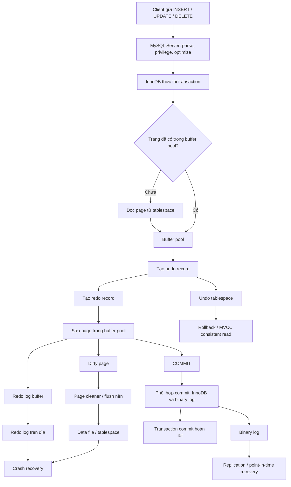

# Luồng ghi dữ liệu qua buffer pool, redo, undo và binary log

## Mục tiêu bài học

Sau bài này, bạn có thể:

- Mô tả một câu lệnh ghi đi từ lớp SQL của MySQL đến InnoDB và các trang dữ liệu.
- Phân biệt vai trò của buffer pool, undo log, redo log và binary log.
- Giải thích vì sao InnoDB có thể xác nhận COMMIT trước khi mọi trang dữ liệu được ghi xuống data file.
- Trình bày cơ chế write-ahead logging (WAL), checkpoint và phục hồi sau sự cố.
- Hiểu cách MySQL phối hợp redo log với binary log để giữ tính nhất quán khi commit.
- Đọc một số biến cấu hình và chỉ số vận hành liên quan đến độ bền dữ liệu.

MySQL không ghi toàn bộ trang dữ liệu xuống đĩa ngay tại thời điểm mỗi câu lệnh UPDATE hoặc INSERT. InnoDB thay đổi các trang đang nằm trong bộ nhớ, ghi thông tin phục hồi vào redo log, giữ phiên bản cũ bằng undo log và phối hợp với binary log ở lớp máy chủ. Các thành phần này giải quyết những vấn đề khác nhau nhưng cùng tham gia vào một luồng ghi.

Bài học tập trung vào MySQL Server sử dụng InnoDB, storage engine mặc định trong các bản MySQL hiện đại. Những engine khác có thể có cơ chế lưu trữ và transaction khác.

## 1. Bốn thành phần cần phân biệt

Trước khi theo dõi một câu lệnh ghi, hãy xác định mỗi thành phần giữ vai trò nào:

| Thành phần | Nơi hoạt động | Vai trò chính | Câu hỏi nó trả lời |
|---|---|---|---|
| Buffer pool | Bộ nhớ InnoDB | Cache các trang dữ liệu và index; nơi InnoDB thao tác trên trang đang được nạp | Trang dữ liệu nào đang có trong RAM và đã bị thay đổi? |
| Undo log | Cấu trúc transaction của InnoDB, được quản lý qua rollback segment và các tablespace liên quan | Giữ thông tin phiên bản trước để rollback và phục vụ consistent read/MVCC | Cần quay lại trạng thái nào hoặc đọc phiên bản cũ nào? |
| Redo log | Redo log buffer trong RAM và redo log trên đĩa | Ghi lại thay đổi cần thiết để InnoDB phục hồi các trang sau crash | Làm thế nào phát lại thay đổi đã được ghi log? |
| Binary log (binlog) | Lớp MySQL Server, file log trên đĩa | Ghi các sự kiện thay đổi để replication và point-in-time recovery | Những thay đổi nào đã được ghi nhận theo thứ tự để truyền hoặc phát lại? |

Có thể nhớ ngắn gọn:

- Buffer pool chứa các trang đang được sử dụng.
- Undo giữ thông tin để quay lui hoặc dựng phiên bản cũ.
- Redo giữ thông tin để tiến tới trạng thái đã ghi nhận sau crash.
- Binary log lưu luồng sự kiện ở cấp máy chủ để replica và công cụ phục hồi có thể phát lại.

Redo và undo là các cơ chế của InnoDB. Binary log thuộc lớp MySQL Server và có thể ghi nhận thay đổi từ các storage engine được hỗ trợ. Buffer pool không phải log; đó là vùng cache trang dữ liệu và index.

## 2. Toàn cảnh luồng ghi

Giả sử ứng dụng bán hàng cập nhật số lượng tồn kho. Client gửi câu lệnh đến MySQL Server. Lớp SQL phân tích câu lệnh, kiểm tra quyền và điều phối thực thi. InnoDB tìm trang chứa hàng tồn kho trong buffer pool; nếu trang chưa có trong bộ nhớ, engine đọc trang từ tablespace vào buffer pool.

Khi thực hiện thay đổi, InnoDB tạo undo record để giữ thông tin cần thiết cho rollback và consistent read, đồng thời tạo redo record để có thể phục hồi thay đổi của các trang. Trang trong buffer pool được chỉnh sửa và trở thành dirty page. Khi transaction commit, MySQL phối hợp ghi nhận transaction vào binary log và hoàn tất commit của InnoDB theo cơ chế hai pha nội bộ. Các dirty page có thể được ghi về data file sau đó bởi cơ chế flush nền.

Sơ đồ khái niệm:



Sơ đồ rút gọn các quan hệ chính. Thứ tự thực thi nội bộ có thêm bước khóa, latch, ghi log, prepare, flush và commit; phần tiếp theo giải thích từng lớp.

## 3. Buffer pool: nơi InnoDB làm việc với các trang dữ liệu

### 3.1. Trang dữ liệu và cache

InnoDB tổ chức dữ liệu và index thành các page trong tablespace. Khi cần đọc hoặc thay đổi một bản ghi, engine làm việc với page chứa bản ghi hoặc page index liên quan. Page được nạp vào **buffer pool** nếu chưa có trong bộ nhớ.

Buffer pool là vùng RAM quan trọng nhất của InnoDB. Nó cache các page dữ liệu, page index và một số loại page nội bộ. Khi truy vấn lặp lại trên dữ liệu còn trong buffer pool, InnoDB có thể tránh đọc lại từ storage. Khi cập nhật một hàng, engine thay đổi page tương ứng trong buffer pool thay vì buộc phải ghi toàn bộ page xuống data file ngay lập tức.

Một câu lệnh có thể tác động đến nhiều page: page dữ liệu, page của secondary index, page của clustered index và các cấu trúc liên quan. Vì vậy, “ghi một hàng” không nhất thiết đồng nghĩa với chỉ thay đổi một page.

### 3.2. Dirty page

Khi nội dung page trong buffer pool khác với bản trên tablespace, page đó được gọi là **dirty page**. InnoDB đánh dấu page đã thay đổi và có thể ghi nó về storage theo lịch flush nền.

Ví dụ:

```sql
UPDATE sales.inventory
SET quantity = quantity - 1
WHERE product_id = 42;
```

Nếu page chứa hàng có `product_id = 42` đang nằm trong buffer pool, InnoDB sửa page đó trong RAM. Nếu page chưa có, engine đọc page vào buffer pool trước. Sau khi sửa, page trở thành dirty. Các page index có liên quan cũng có thể bị đánh dấu dirty.

Dirty page không đồng nghĩa transaction đã commit. Một page có thể chứa thay đổi của transaction chưa commit hoặc đã commit; việc page được ghi về data file là một hoạt động flush của engine. InnoDB dựa vào redo log để bảo đảm có thể phục hồi page nếu sự cố xảy ra trong khi data page chưa được ghi.

### 3.3. Page cleaner và checkpoint

Các luồng nền của InnoDB ghi dirty page về tablespace nhằm:

- Giải phóng page trong buffer pool khi cần chỗ cho dữ liệu mới.
- Giảm lượng dirty page tồn đọng.
- Tiến checkpoint để giới hạn lượng redo cần phát lại sau crash.
- Điều tiết I/O để tránh dồn quá nhiều công việc ghi vào một thời điểm.

**Checkpoint** là mốc trong luồng redo cho biết các thay đổi trước một vị trí nhất định đã được bảo đảm ghi xuống data file theo điều kiện phục hồi của InnoDB. Khi checkpoint tiến lên, vùng redo cũ có thể được tái sử dụng. Nếu tốc độ sinh redo vượt tốc độ flush page trong thời gian dài, InnoDB có thể phải tăng cường ghi page; điều này gây áp lực I/O và có thể làm giảm throughput.

Tăng buffer pool có thể giúp cache được nhiều page hơn, nhưng không giải quyết mọi vấn đề ghi. Nếu storage chậm, workload ghi quá lớn hoặc transaction giữ page/lock lâu, hệ thống vẫn có thể nghẽn. Khi điều chỉnh, cần quan sát tỷ lệ cache hit, dirty pages, tốc độ ghi và checkpoint age thay vì chỉ nhìn kích thước RAM.

## 4. Undo log: lưu phiên bản trước để rollback và MVCC

### 4.1. Undo record được dùng khi nào?

**Undo log** giữ thông tin cần thiết để đảo ngược thay đổi của transaction và tạo các phiên bản dữ liệu cũ cho cơ chế MVCC (Multi-Version Concurrency Control).

Với một thao tác UPDATE, undo record có thể chứa giá trị cũ của các cột bị thay đổi cùng thông tin định danh bản ghi. Nếu transaction rollback, InnoDB dùng undo để khôi phục giá trị trước đó. Nếu một transaction khác cần consistent read tại một read view cũ, InnoDB có thể lần theo chuỗi phiên bản để trả về phiên bản phù hợp.

Ví dụ, hàng tồn kho có số lượng ban đầu là 10:

```sql
START TRANSACTION;

UPDATE sales.inventory
SET quantity = 9
WHERE product_id = 42;

-- Chưa COMMIT.
```

Trong lúc transaction còn mở, InnoDB đã tạo thông tin undo cho thay đổi. Nếu transaction thực hiện ROLLBACK, engine dùng undo để khôi phục số lượng về 10. Nếu transaction commit, phiên bản mới là thay đổi đã xác nhận; phiên bản cũ có thể vẫn cần tồn tại để các consistent read đang hoạt động đọc đúng snapshot.

### 4.2. Undo và MVCC

MVCC cho phép một số consistent read nhìn thấy snapshot dữ liệu phù hợp mà không cần khóa độc quyền mọi hàng đang đọc. Khi transaction đọc theo snapshot, InnoDB xác định phiên bản nào có thể nhìn thấy theo read view. Nếu page hiện tại chứa phiên bản mới hơn snapshot đó, engine có thể dùng undo chain để dựng lại phiên bản cũ.

Điều này giải thích vì sao undo không được xóa ngay sau COMMIT. Một transaction đọc dài có thể vẫn cần phiên bản cũ. InnoDB chỉ purge các undo version không còn cần thiết cho rollback hoặc read view đang tồn tại.

### 4.3. Rollback và purge là hai việc khác nhau

- **Rollback** là hoàn tác thay đổi của transaction chưa commit hoặc transaction bị hủy.
- **Purge** là dọn các phiên bản cũ không còn cần cho consistent read và các mục đích nội bộ khác.

Một transaction dài hoặc read view tồn tại lâu có thể ngăn purge dọn các phiên bản cũ. Khi đó undo history tăng lên, làm tăng công việc purge và có thể ảnh hưởng hiệu năng. Vì vậy, tránh giữ transaction mở khi ứng dụng đang chờ người dùng, gọi dịch vụ ngoài hoặc xử lý một tác vụ kéo dài.

Có thể quan sát thông tin transaction và history trong:

```sql
SHOW ENGINE INNODB STATUS\G
```

Trong phần TRANSACTIONS và HISTORY LIST LENGTH, người vận hành có thể tìm transaction đang mở và tình trạng undo history. Cần đối chiếu với workload thực tế trước khi kết luận một giá trị history là bất thường.

## 5. Redo log: ghi lại thay đổi để phục hồi sau crash

### 5.1. Redo log buffer và redo log file

Khi InnoDB thay đổi page, engine tạo các **redo record** mô tả thay đổi cần thiết để phục hồi page. Các record được đưa vào redo log buffer trong RAM, sau đó được ghi vào redo log trên storage theo cơ chế flush của InnoDB.

Redo log được thiết kế cho crash recovery. Nếu máy chủ dừng bất thường sau khi transaction đã được xác nhận commit nhưng page dữ liệu tương ứng chưa được ghi xuống tablespace, InnoDB có thể đọc redo log và phát lại thay đổi cần thiết khi khởi động.

Redo log không phải bản sao đầy đủ của table và không dùng để truy vấn dữ liệu nghiệp vụ. Nó là nhật ký phục hồi mức storage engine, được tổ chức theo luồng log sequence number (LSN).

### 5.2. Write-ahead logging (WAL)

Nguyên tắc **write-ahead logging** yêu cầu redo record cần thiết phải được ghi bền vững trước khi page chứa thay đổi tương ứng được phép ghi về data file. Nhờ đó, nếu sự cố xảy ra giữa lúc page được ghi dở hoặc chưa được ghi, InnoDB vẫn có thông tin để phục hồi.

Luồng đơn giản:

1. InnoDB sửa page trong buffer pool và sinh redo record.
2. Redo record được ghi vào redo log theo yêu cầu của transaction và chính sách flush.
3. Page có thể tiếp tục nằm trong buffer pool dưới dạng dirty page.
4. Page cleaner ghi page về tablespace ở thời điểm thích hợp.
5. Checkpoint tiến khi các thay đổi cũ hơn đã được ghi an toàn xuống data file.

Đây là lý do COMMIT không cần đợi tất cả data page của transaction được ghi xuống vị trí cuối cùng trên tablespace. Với cấu hình độ bền phù hợp, việc ghi redo log đủ để InnoDB tái tạo thay đổi đã commit sau crash.

### 5.3. LSN và checkpoint age

**LSN (Log Sequence Number)** là vị trí trong luồng redo log. InnoDB dùng LSN để theo dõi redo đã sinh ra, redo đã ghi và vị trí checkpoint. Khoảng cách giữa vị trí redo hiện tại và checkpoint thường được gọi là checkpoint age.

Nếu checkpoint age tăng nhanh và tiến gần giới hạn redo capacity, InnoDB cần flush dirty page để tạo thêm chỗ cho redo mới. Khi workload ghi tăng đột biến hoặc storage không theo kịp, checkpoint có thể trở thành yếu tố giới hạn hiệu năng.

Redo capacity lớn hơn có thể hấp thụ burst ghi lâu hơn và giảm áp lực checkpoint trong ngắn hạn, nhưng không thay thế storage đủ nhanh và không loại bỏ công việc flush. Lượng redo lớn hơn cũng có thể làm thời gian recovery sau crash dài hơn. Hãy điều chỉnh theo workload, dung lượng đĩa và mục tiêu thời gian phục hồi.

## 6. Binary log: luồng sự kiện ở lớp MySQL Server

### 6.1. Binary log ghi gì?

**Binary log (binlog)** ghi các sự kiện thay đổi do MySQL Server tạo ra. Nó được dùng chủ yếu cho:

- **Replication:** replica đọc các sự kiện từ source rồi áp dụng để theo kịp dữ liệu.
- **Point-in-time recovery:** kết hợp một bản backup với chuỗi binary log để phát lại thay đổi đến thời điểm mong muốn.
- **Audit và điều tra thay đổi:** trong phạm vi định dạng, quyền truy cập và chính sách lưu trữ cho phép.

Binary log khác redo log ở mức ghi nhận. Redo tập trung vào phục hồi page của InnoDB; binlog lưu sự kiện thay đổi ở lớp server để truyền và phát lại. Binlog không phải bản sao page trong buffer pool và không thay thế redo log cho crash recovery của InnoDB.

### 6.2. Các định dạng binary log

MySQL hỗ trợ các định dạng chính:

| Định dạng | Nội dung ghi | Đặc điểm |
|---|---|---|
| STATEMENT | Câu lệnh SQL | Gọn trong một số trường hợp nhưng có thể khó bảo đảm kết quả giống nhau nếu câu lệnh phụ thuộc môi trường hoặc không xác định |
| ROW | Thay đổi ở mức hàng | Ghi lại hàng bị tác động; thường phù hợp hơn cho replication chính xác nhưng có thể tạo log lớn |
| MIXED | Kết hợp statement và row | Server chọn định dạng tùy câu lệnh và điều kiện an toàn |

Với ROW, binlog không có nghĩa là lưu toàn bộ page của InnoDB. Nó lưu sự kiện mô tả thay đổi hàng. Một transaction có thể tạo nhiều row event và sự kiện ranh giới transaction.

### 6.3. Binlog cache và ghi file

Trong transaction, MySQL có thể lưu các sự kiện binlog vào transaction cache trước khi ghi ra file binary log khi commit. Nếu transaction lớn vượt giới hạn bộ nhớ cache, một phần có thể được lưu vào tệp tạm. Cơ chế này giúp binlog ghi các sự kiện của transaction như một nhóm có ranh giới rõ ràng.

Binary log được chia thành các file theo thứ tự. Khi vận hành, cần theo dõi dung lượng, thời hạn lưu, replica đang đọc đến đâu và backup/PITR còn cần những file nào. Xóa binlog quá sớm có thể khiến replica không bắt kịp hoặc làm mất khả năng phục hồi đến thời điểm cần thiết.

Các lệnh kiểm tra cơ bản:

```sql
SHOW VARIABLES LIKE 'log_bin';
SHOW VARIABLES LIKE 'binlog_format';
SHOW BINARY LOGS;
```

Chỉ bật và duy trì binary log khi có kế hoạch sử dụng, lưu trữ và dọn dẹp rõ ràng. Binary log có thể chứa dữ liệu nghiệp vụ nhạy cảm; giới hạn quyền đọc, bảo vệ bản sao và thời gian lưu theo chính sách của hệ thống.

## 7. COMMIT: phối hợp redo log và binary log

### 7.1. Vì sao cần phối hợp hai loại log?

Trong một transaction InnoDB, redo log giúp storage engine phục hồi thay đổi. Binary log giúp server và replica biết transaction nào cần được phát lại. Nếu một transaction được ghi vào binlog nhưng không được InnoDB commit, replica có thể áp dụng thay đổi mà source không có. Ngược lại, nếu InnoDB commit nhưng binlog không ghi nhận, replication hoặc PITR có thể bỏ sót transaction.

MySQL phối hợp hai hệ thống bằng cơ chế **internal two-phase commit** giữa server và transactional storage engine. Đây là cơ chế nội bộ để giữ sự nhất quán của commit; không đồng nghĩa với việc ứng dụng đang chạy một distributed XA transaction.

### 7.2. Hai pha ở mức khái niệm

Với transaction InnoDB có bật binary log, luồng khái niệm như sau:

1. **Prepare:** InnoDB chuẩn bị transaction và ghi thông tin redo cần thiết để có thể phục hồi trạng thái prepared.
2. **Ghi binary log:** MySQL ghi các sự kiện của transaction vào binlog và đồng bộ theo cấu hình binlog.
3. **Commit storage engine:** MySQL yêu cầu InnoDB hoàn tất commit. Redo log ghi nhận trạng thái commit và transaction được xác nhận hoàn tất.

Chi tiết triển khai có thêm các giai đoạn flush, sync và commit. Khi server crash giữa các giai đoạn, InnoDB và MySQL sử dụng thông tin redo cùng binary log để quyết định transaction prepared cần được hoàn tất hay rollback. Mục tiêu là tránh trạng thái transaction không nhất quán giữa InnoDB và binlog.

### 7.3. Group commit

Nếu nhiều transaction commit gần như đồng thời, MySQL có thể gom các thao tác ghi và đồng bộ binary log thành nhóm (group commit). Nhờ đó, một lần flush/sync có thể phục vụ nhiều transaction, giảm số lần I/O đồng bộ trên mỗi transaction mà vẫn giữ thứ tự commit phù hợp.

Group commit là một lý do khiến throughput commit không đơn giản bằng số lần gọi fsync nhân với thời gian fsync. Tuy nhiên, storage latency, kích thước transaction, contention và cấu hình log vẫn ảnh hưởng đáng kể đến hiệu năng.

## 8. Độ bền dữ liệu: hai cấu hình cần hiểu rõ

Hai biến thường được xem cùng nhau là:

- `innodb_flush_log_at_trx_commit`: điều khiển cách InnoDB ghi và flush redo log khi commit.
- `sync_binlog`: điều khiển tần suất đồng bộ binary log xuống storage.

### 8.1. innodb_flush_log_at_trx_commit

| Giá trị | Hành vi khái quát | Đánh đổi |
|---|---|---|
| 1 | Ghi redo log và flush xuống storage tại mỗi commit | Độ bền cao nhất theo cấu hình chuẩn; có thể tăng chi phí I/O đồng bộ |
| 2 | Ghi redo log vào file ở mỗi commit; flush xuống storage định kỳ, thường khoảng mỗi giây | Có thể mất các commit gần nhất nếu hệ điều hành hoặc máy bị sự cố trước lần flush |
| 0 | Ghi và flush redo log định kỳ, thường khoảng mỗi giây | Có thể mất các thay đổi gần nhất ngay cả khi tiến trình MySQL gặp sự cố |

Chu kỳ “khoảng một giây” là hành vi định kỳ, không phải cam kết thời gian chính xác. Hệ điều hành, tải và storage có thể ảnh hưởng thời điểm flush. Giá trị 1 thường được chọn khi yêu cầu độ bền commit cao. Tùy chọn này không tự bảo đảm nếu thiết bị lưu trữ hoặc tầng ảo hóa không thực thi đúng yêu cầu flush.

### 8.2. sync_binlog

| Giá trị | Hành vi khái quát |
|---|---|
| 0 | MySQL không chủ động yêu cầu đồng bộ binary log sau mỗi nhóm commit; hệ điều hành quyết định thời điểm ghi bền vững |
| 1 | Yêu cầu đồng bộ binary log sau mỗi nhóm commit |
| N lớn hơn 1 | Đồng bộ sau mỗi N nhóm commit |

Nếu binary log là thành phần quan trọng cho replication và PITR, `sync_binlog = 1` thường được chọn cùng với `innodb_flush_log_at_trx_commit = 1` để tăng độ bền của cả hai luồng log. Đây là cấu hình phổ biến cho hệ thống ưu tiên độ bền; cần đánh giá thêm hiệu năng và đặc tính storage.

Hai biến giải quyết hai luồng log khác nhau. Chỉ đặt một biến về mức bền cao không tự động làm luồng còn lại có cùng bảo đảm. Độ bền cuối cùng còn phụ thuộc hệ điều hành, filesystem, controller, cache của thiết bị và nền tảng lưu trữ có tôn trọng lệnh flush hay không.

Kiểm tra cấu hình hiện tại:

```sql
SHOW VARIABLES
WHERE Variable_name IN (
    'innodb_flush_log_at_trx_commit',
    'sync_binlog',
    'log_bin',
    'binlog_format'
);
```

Không thay đổi các biến độ bền trên production chỉ để thử nghiệm. Hãy đánh giá yêu cầu RPO, khả năng storage, tác động hiệu năng và kế hoạch kiểm thử trước khi thay đổi.

## 9. Điều gì xảy ra khi MySQL crash?

Crash có thể xảy ra ở nhiều thời điểm: khi transaction đang sửa page, sau khi redo đã ghi nhưng trước commit, sau khi binlog được ghi, hoặc sau khi commit đã được xác nhận nhưng data page vẫn còn dirty trong buffer pool.

Khi InnoDB khởi động lại, engine thực hiện crash recovery. Ở mức khái niệm:

1. InnoDB xác định checkpoint và đọc redo log cần thiết.
2. Engine phát lại redo để đưa các page về trạng thái nhất quán theo log.
3. Các transaction chưa hoàn tất được nhận diện; transaction chưa commit được rollback bằng undo.
4. Sau recovery, các transaction đã commit được giữ lại và những thay đổi chưa commit không trở thành dữ liệu đã xác nhận.

Đây là lý do redo và undo bổ sung cho nhau: redo khôi phục thay đổi đã ghi nhận ở cấp page, undo loại bỏ tác động của transaction chưa commit và hỗ trợ phiên bản cũ.

Binary log có vai trò riêng trong phối hợp commit và trong replication/PITR. Nó không thay thế quá trình InnoDB dùng redo và undo để phục hồi data page sau crash. Với transaction đang ở trạng thái prepared khi sự cố xảy ra, MySQL dùng thông tin phối hợp commit để hoàn tất hoặc rollback nhất quán giữa engine và binlog.

### Một vài tình huống điển hình

| Thời điểm crash | Điều InnoDB/MySQL cần xử lý |
|---|---|
| Page đã sửa trong RAM, redo chưa được ghi bền vững | Thay đổi có thể mất; transaction chưa được xác nhận bền vững theo cấu hình |
| Redo đã bền vững, page dữ liệu chưa flush | Phát lại redo để khôi phục page |
| Transaction chưa commit | Dùng undo để rollback phần thay đổi chưa hoàn tất |
| Binlog đã ghi, engine đang ở giai đoạn prepared | Phối hợp recovery để hoàn tất hoặc rollback transaction nhất quán |
| Commit đã xác nhận, page vẫn dirty | Giữ thay đổi đã commit bằng redo; flush page sau recovery hoặc trong hoạt động bình thường |

Bảng này mô tả các trạng thái logic, không phải lịch trình từng lệnh I/O của mọi phiên bản MySQL.

## 10. Ví dụ thực hành: theo dõi một transaction ghi

Giả sử database `sales` đã tồn tại. Tạo bảng tồn kho bằng InnoDB:

```sql
CREATE TABLE sales.inventory (
    product_id BIGINT UNSIGNED NOT NULL,
    quantity INT NOT NULL,
    updated_at TIMESTAMP NOT NULL
        DEFAULT CURRENT_TIMESTAMP
        ON UPDATE CURRENT_TIMESTAMP,
    PRIMARY KEY (product_id),
    CONSTRAINT chk_inventory_quantity CHECK (quantity >= 0)
) ENGINE = InnoDB;

INSERT INTO sales.inventory (product_id, quantity)
VALUES (42, 10);
```

Thực hiện transaction:

```sql
START TRANSACTION;

SELECT quantity
FROM sales.inventory
WHERE product_id = 42
FOR UPDATE;

UPDATE sales.inventory
SET quantity = quantity - 1
WHERE product_id = 42
  AND quantity >= 1;

-- Ứng dụng kiểm tra affected rows: nếu khác 1 thì ROLLBACK.
COMMIT;
```

Khi chạy, có thể lần theo các khái niệm:

1. InnoDB tìm page của hàng tồn kho trong buffer pool; nếu chưa có thì đọc từ tablespace.
2. SELECT FOR UPDATE lấy khóa hàng để transaction kiểm tra và cập nhật trên cùng một bản ghi mà không bị transaction khác thay đổi xen giữa.
3. InnoDB tạo undo record để có thể rollback và hỗ trợ consistent read.
4. InnoDB sinh redo record và sửa page trong buffer pool; page trở thành dirty.
5. Khi commit, MySQL phối hợp ghi transaction vào binary log (nếu bật) và hoàn tất commit của InnoDB.
6. Ứng dụng kiểm tra UPDATE có tác động đúng một hàng; nếu không, nó rollback và xử lý hết hàng. Khi hợp lệ, dirty page được flush xuống tablespace theo lịch của InnoDB; việc này có thể diễn ra sau khi COMMIT trả về.

Nếu thay COMMIT bằng ROLLBACK trước khi transaction kết thúc, InnoDB dùng undo để khôi phục số lượng. Redo vẫn có thể đã ghi những thay đổi cần thiết cho các page và undo; trong recovery, redo được phát lại trước khi transaction chưa commit được rollback.

Để quan sát cấu hình và trạng thái:

```sql
SHOW VARIABLES
WHERE Variable_name IN (
    'innodb_flush_log_at_trx_commit',
    'sync_binlog',
    'log_bin',
    'binlog_format'
);

SHOW ENGINE INNODB STATUS\G

SHOW BINARY LOGS;
```

Các lệnh hiển thị trạng thái cần quyền phù hợp. Trong hệ thống production, chỉ người vận hành được phân quyền mới nên đọc log và thông tin có thể chứa dữ liệu nhạy cảm.

## 11. Những nhầm lẫn thường gặp

| Nhầm lẫn | Cách hiểu đúng |
|---|---|
| Buffer pool là nơi lưu bền vững cuối cùng | Buffer pool là cache trong RAM; data page được quản lý trong tablespace |
| COMMIT có nghĩa tất cả page đã ghi xuống data file | Commit bền vững dựa vào log theo cấu hình; dirty page có thể được flush sau |
| Undo và redo đều là bản sao dữ liệu | Undo giữ thông tin phiên bản cũ/rollback; redo giữ thông tin phát lại thay đổi |
| Redo log dùng cho replication | Redo chủ yếu phục vụ crash recovery của InnoDB; replication dùng binary log |
| Binary log là bản copy của data file | Binlog là luồng sự kiện ở lớp server, không phải bản sao page |
| Transaction commit thì undo bị xóa ngay | Undo version có thể cần cho consistent read; purge dọn sau khi không còn cần |
| Bật binary log là đủ để bảo đảm durability | Cần phối hợp cấu hình redo và binlog cùng khả năng flush thực tế của storage |
| Page cleaner chỉ ghi page đã commit | Flush page là công việc quản lý page; WAL bảo đảm redo cần thiết được ghi trước data page |

## 12. Bài tập tự kiểm tra

1. Một UPDATE thay đổi hàng trong buffer pool. Vì sao InnoDB cần tạo cả undo record và redo record?
2. Một transaction đã commit, nhưng data page vẫn chưa được ghi xuống tablespace. Vì sao dữ liệu vẫn có thể được phục hồi sau crash?
3. Một transaction đọc snapshot cũ trong khi transaction khác cập nhật cùng hàng. Thành phần nào giúp InnoDB dựng phiên bản cũ?
4. Binary log và redo log khác nhau ở mục đích và lớp hoạt động như thế nào?
5. Vì sao production thường đánh giá cả `innodb_flush_log_at_trx_commit` và `sync_binlog`?
6. Một transaction mở trong thời gian dài có thể gây áp lực lên undo purge như thế nào?
7. Nếu checkpoint age tăng liên tục trong khi workload ghi cao, cần quan sát những thành phần nào?

**Đáp án gợi ý:**

1. Undo hỗ trợ rollback/MVCC; redo hỗ trợ phục hồi page sau crash.
2. Redo log đã ghi bền vững cho phép InnoDB phát lại thay đổi; data page có thể flush sau.
3. Undo log và read view của MVCC.
4. Redo là log phục hồi mức InnoDB; binlog là log sự kiện ở lớp MySQL Server phục vụ replication và PITR.
5. Hai biến điều khiển độ bền của hai luồng log khác nhau; cần đồng bộ cả hai theo mục tiêu RPO.
6. Read view cũ có thể cần các phiên bản trước, làm purge chưa thể dọn và undo history tăng.
7. Dirty pages, tốc độ sinh redo, redo capacity, tốc độ flush, I/O latency và transaction dài.


