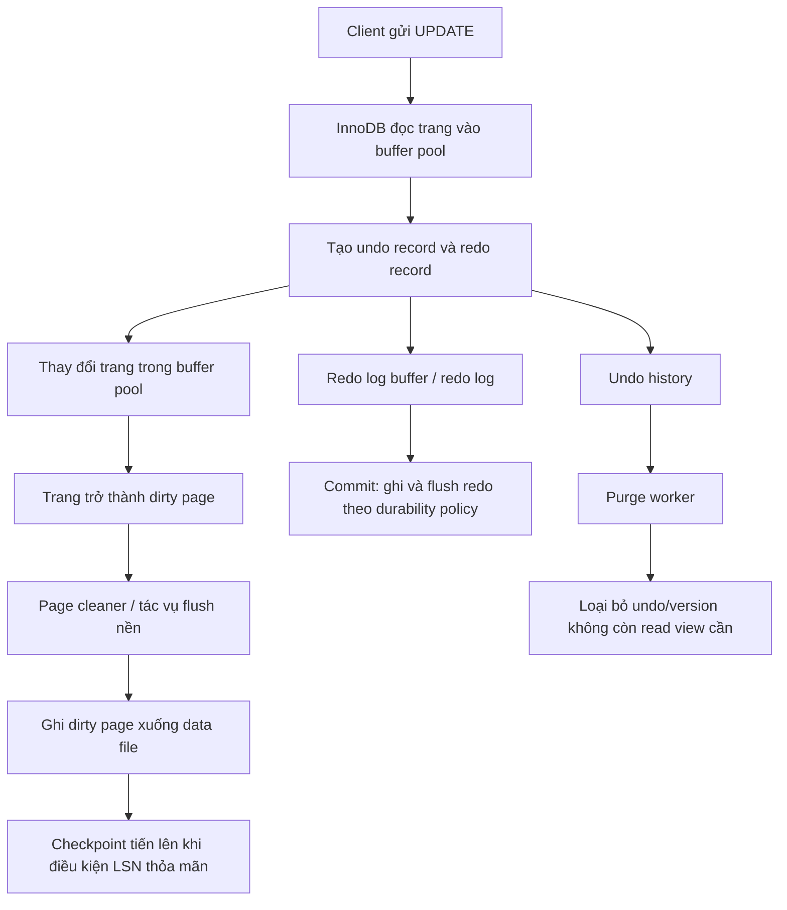

# Checkpoint, flush, purge và phối hợp các tác vụ nền

InnoDB không ghi mọi thay đổi trực tiếp xuống các trang dữ liệu trên đĩa ngay khi một câu SQL kết thúc. Để đạt hiệu năng và vẫn bảo đảm khả năng phục hồi, InnoDB kết hợp buffer pool trong bộ nhớ, redo log, undo log và nhiều tác vụ nền. Các tác vụ này ghi log, đẩy trang dữ liệu đã thay đổi xuống tablespace, tiến checkpoint và loại bỏ những phiên bản dữ liệu cũ không còn cần thiết cho consistent read.

Ba khái niệm cần phân biệt là **redo log**, **flush/checkpoint** và **purge**. Redo log ghi lại cách tái tạo thay đổi sau sự cố; flush ghi các trang dữ liệu bẩn từ buffer pool xuống storage; checkpoint đánh dấu tiến độ mà từ đó InnoDB có thể tái sử dụng phần redo log cũ; purge dọn các undo record và phiên bản hàng đã hết nhu cầu. Các hoạt động này liên hệ chặt chẽ nhưng không thay thế nhau.

Trong module `DATABASE_MYSQL`, hiểu các cơ chế này giúp bạn đọc trạng thái InnoDB, giải thích vì sao tải ghi có thể làm tăng độ trễ, phát hiện transaction giữ undo quá lâu và điều chỉnh cấu hình lưu trữ dựa trên số liệu. Nội dung tập trung vào InnoDB của MySQL; chi tiết biến cấu hình và cách hiển thị có thể khác giữa các phiên bản.

## 1. Các cấu trúc nền tảng đứng sau tác vụ nền

Trước khi tìm hiểu từng worker, cần nắm vai trò của các vùng lưu trữ:

- **Buffer pool:** vùng bộ nhớ đệm các trang dữ liệu và index. Khi truy vấn đọc một trang, InnoDB có thể lấy trang từ buffer pool thay vì đọc đĩa. Khi `INSERT`, `UPDATE` hoặc `DELETE` làm thay đổi trang, trang trong bộ nhớ trở thành *dirty page*.
- **Redo log:** nhật ký ghi lại thông tin cần thiết để phát lại thay đổi của InnoDB sau crash recovery. Redo được ghi tuần tự theo Log Sequence Number (LSN), giúp giảm việc phải ghi ngẫu nhiên mọi trang dữ liệu tại thời điểm commit.
- **Undo log:** lưu thông tin cần thiết để rollback và dựng lại phiên bản hàng cũ cho consistent read. Undo record gắn với transaction và được giữ cho tới khi không còn transaction/read view nào cần phiên bản đó.
- **Tablespace và data file:** nơi chứa trang dữ liệu, index và một số cấu trúc lưu trữ của InnoDB. Trang trong buffer pool cuối cùng phải được ghi xuống các file tương ứng.
- **Doublewrite buffer:** lớp bảo vệ một số đường ghi trang khỏi hiện tượng torn page khi sự cố xảy ra giữa lúc ghi. Nó là một phần của đường ghi trang, không phải redo log và cũng không phải checkpoint.

Một thao tác cập nhật thường tạo ra cả redo và undo. Redo giúp phát lại thay đổi đã được ghi log; undo giúp rollback hoặc cung cấp dữ liệu cũ cho consistent read. Trang dữ liệu trong buffer pool có thể vẫn chưa được ghi xuống data file khi transaction đã commit thành công, miễn là redo cần thiết đã được làm bền theo chính sách durability.

## 2. Bức tranh tổng thể: foreground và background

Luồng foreground là công việc do client trực tiếp kích hoạt: gửi SQL, đọc hoặc thay đổi hàng, commit/rollback và nhận kết quả. Luồng background làm các công việc duy trì trạng thái lưu trữ: ghi log, flush trang bẩn, tiến checkpoint, purge undo cũ, hợp nhất thay đổi được buffer và xử lý I/O.



Sơ đồ cho thấy commit và ghi trang dữ liệu là hai thời điểm khác nhau. Một transaction có thể đã commit trong khi trang tương ứng vẫn còn là dirty page. Purge cũng không chạy ngay tại thời điểm commit: một phiên bản cũ chỉ được loại bỏ khi chắc chắn không còn consistent read nào cần nó.

## 3. Redo log, LSN và checkpoint

### Redo log và Log Sequence Number

InnoDB ghi redo vào log buffer trước khi chuyển xuống redo log file. Mỗi phần redo được gắn với một LSN tăng dần. LSN biểu diễn vị trí tiến độ trong luồng redo, không phải số thứ tự transaction và cũng không phải số hàng đã cập nhật.

Có thể hình dung ba mốc khác nhau:

- **Current LSN:** vị trí redo mới nhất đã được tạo.
- **Flushed LSN:** vị trí redo đã được flush tới storage theo trạng thái InnoDB báo cáo.
- **Checkpoint LSN:** mốc redo cũ nhất mà InnoDB còn cần giữ để phục hồi những trang dữ liệu chưa được ghi tương ứng xuống data file.

Tên trường hiển thị cụ thể thay đổi theo phiên bản, nhưng nguyên tắc là: redo đã được làm bền có thể cho phép transaction commit; redo chỉ được tái sử dụng an toàn khi những thay đổi cần thiết đã được ghi xuống các trang dữ liệu và checkpoint đã tiến qua phần log tương ứng.

### Checkpoint là gì?

Checkpoint là mốc tiến độ trong redo log. Khi InnoDB flush các dirty page xuống data file, nó có thể cập nhật checkpoint dựa trên LSN của các thay đổi đã được ghi an toàn. Các redo record trước checkpoint không còn cần thiết cho crash recovery của những trang đã được đồng bộ, nên vùng redo tương ứng có thể được tái sử dụng theo vòng quay log.

InnoDB dùng **fuzzy checkpoint**: không cần dừng toàn bộ hoạt động để flush mọi dirty page cùng một lúc. Các trang được ghi dần trong nền; checkpoint tiến theo những trang có LSN cũ nhất còn cần xử lý. Điều này giúp giảm các đợt dừng dài, nhưng đòi hỏi hệ thống cân bằng tốc độ sinh redo với tốc độ flush.

Một đại lượng hữu ích là *checkpoint age*:

\[
\text{checkpoint age} = \text{current LSN} - \text{checkpoint LSN}
\]

Checkpoint age càng lớn thì càng nhiều redo nằm sau checkpoint và chưa thể tái sử dụng. Nếu tốc độ sinh redo liên tục cao hơn khả năng flush trang, checkpoint age sẽ tăng. Khi redo log tiến gần giới hạn dung lượng, InnoDB phải tăng cường flush để tạo chỗ; áp lực này có thể làm tăng I/O và độ trễ ghi.

### Dung lượng redo log và áp lực checkpoint

Dung lượng redo log cho phép InnoDB hấp thụ các đợt ghi tăng đột biến trong một khoảng thời gian. Dung lượng lớn hơn có thể giảm tần suất phải flush gấp để giải phóng log, nhưng không làm tăng tốc độ ghi thực tế của storage. Nếu thiết bị lưu trữ không theo kịp tải ghi trong thời gian dài, log lớn chỉ trì hoãn thời điểm áp lực xuất hiện.

Trên MySQL 8.0.30 trở lên, `innodb_redo_log_capacity` là biến cấu hình quản lý tổng dung lượng redo log và có thể thay đổi động. Các bản cũ hơn thường cấu hình qua `innodb_log_file_size` cùng `innodb_log_files_in_group`. Khi nâng cấp, hãy kiểm tra đúng biến có hiệu lực cho phiên bản đang chạy; không áp dụng đồng thời hướng dẫn cấu hình cũ và mới một cách máy móc.

Khi chọn dung lượng redo, cân nhắc:

- Tốc độ sinh redo ở giờ cao điểm và trong batch job.
- Khả năng ghi bền vững của thiết bị lưu trữ.
- Thời gian hệ thống có thể chấp nhận để phục hồi sau crash.
- Dung lượng bộ nhớ, buffer pool và đặc điểm workload.
- Biến động giữa tải trung bình và tải đột biến.

Redo log lớn hơn có thể làm tăng lượng redo cần xem xét trong quá trình crash recovery nếu checkpoint bị tụt xa. Vì vậy, mục tiêu là đủ khoảng đệm cho tải thực tế và có tốc độ flush ổn định, không phải đặt dung lượng lớn nhất có thể.

## 4. Flush: ghi dirty page từ buffer pool xuống storage

Khi InnoDB sửa một trang trong buffer pool, trang đó được đánh dấu là dirty. Trang dirty vẫn có thể được đọc và cập nhật tiếp trong bộ nhớ. Tác vụ flush ghi phiên bản trang hiện tại xuống data file để giảm lượng công việc còn phải phục hồi từ redo và tạo điều kiện tiến checkpoint.

### Flush trang khác với flush redo

Hai thao tác thường bị nhầm:

| Hoạt động | Dữ liệu được ghi | Mục đích |
|---|---|---|
| Flush redo log | Log buffer sang redo log file và, tùy chính sách, yêu cầu đồng bộ xuống storage | Bảo đảm redo cần cho durability và recovery. |
| Flush dirty page | Trang dữ liệu/index trong buffer pool xuống tablespace/data file | Đồng bộ trang với thay đổi đã ghi log, giải phóng buffer pool và hỗ trợ checkpoint. |

Commit thường không cần chờ mọi dirty page của transaction được ghi xuống data file. Với InnoDB, nguyên tắc write-ahead logging yêu cầu redo liên quan phải được ghi bền trước khi trang dữ liệu tương ứng được ghi xuống vị trí cuối cùng. Nhờ vậy transaction có thể commit nhanh hơn mà vẫn có thể phục hồi các trang chưa được flush sau crash.

### Khi nào InnoDB flush?

Flush diễn ra vì nhiều lý do phối hợp:

1. **Checkpoint pressure:** redo log cần thêm không gian tái sử dụng, nên InnoDB phải flush những trang liên quan để tiến checkpoint.
2. **Buffer pool cần chỗ:** truy vấn cần nạp trang mới nhưng buffer pool thiếu trang sạch có thể tái sử dụng; InnoDB flush trang dirty phù hợp.
3. **Tỷ lệ dirty page:** khi số trang bẩn tăng tới ngưỡng hoặc tốc độ bẩn hóa tăng nhanh, InnoDB tăng hoạt động flush.
4. **Yêu cầu shutdown hoặc thao tác quản trị:** một số chế độ shutdown và thao tác bảo trì có thể yêu cầu flush nhiều dữ liệu hơn.

InnoDB có thể chọn trang từ flush list theo độ cũ của LSN và từ LRU list để tạo trang sạch cho buffer pool. Các page cleaner thread thực hiện phần lớn công việc flush nền. Cơ chế và số worker chi tiết phụ thuộc phiên bản và cấu hình.

### Điều khiển tốc độ flush

Một số biến quan trọng:

| Biến | Vai trò khái quát | Cách suy nghĩ khi điều chỉnh |
|---|---|---|
| `innodb_io_capacity` | Ước lượng năng lực I/O nền mà InnoDB có thể dùng cho các tác vụ như flush và merge | Đặt theo năng lực lưu trữ thực tế; không xem đây là giới hạn cứng tổng IOPS của server. |
| `innodb_io_capacity_max` | Mức I/O nền cao hơn mà InnoDB có thể dùng khi cần tăng tốc | Có thể giúp xử lý backlog, nhưng đặt quá cao có thể cạnh tranh I/O với truy vấn foreground. |
| `innodb_adaptive_flushing` | Cho phép InnoDB điều chỉnh flush dựa trên tốc độ sinh redo và áp lực checkpoint | Thường nên đánh giá hành vi thích ứng trước khi tắt cơ chế này. |
| `innodb_max_dirty_pages_pct` | Ngưỡng tỷ lệ dirty page trong buffer pool để điều tiết flush | Không phải mục tiêu phải đạt chính xác; cần đọc cùng checkpoint age và năng lực I/O. |
| `innodb_max_dirty_pages_pct_lwm` | Ngưỡng thấp hơn để bắt đầu xem xét flush sớm | Có thể giúp tránh đợi tới khi dirty page tăng cao mới xử lý. |
| `innodb_lru_scan_depth` | Độ sâu quét LRU cho hoạt động chuẩn bị trang sạch | Tác động theo buffer pool instance và workload; tránh tăng tùy tiện. |

Các biến trên là công cụ điều tiết chứ không thay thế việc đo hiệu năng storage. Tăng `innodb_io_capacity` khi storage đã bão hòa không tạo thêm IOPS; nó có thể chỉ khiến flush tranh chấp nhiều hơn với truy vấn. Nếu capacity đặt quá thấp, dirty page và checkpoint age có thể tăng kéo dài. Hãy thay đổi từng biến có kiểm soát và so sánh trước/sau.

### Doublewrite và an toàn ghi trang

Một trang InnoDB có thể lớn hơn đơn vị ghi nguyên tử mà thiết bị đảm bảo. Nếu mất điện giữa lúc ghi trang, data file có thể chứa một trang bị ghi dở (torn page). Doublewrite buffer cung cấp một bản ghi trung gian có thể dùng để phục hồi trang trong các trường hợp được hỗ trợ. Sau khi bản ghi doublewrite hoàn tất theo cơ chế của InnoDB, trang mới được ghi tới vị trí data file cuối cùng.

Doublewrite bảo vệ đường ghi trang; redo log bảo vệ khả năng phát lại thay đổi logic của InnoDB. Hai cơ chế bổ sung cho nhau. Không nên tắt doublewrite chỉ vì đã bật redo hoặc vì storage được cho là nhanh, trừ khi đã đánh giá đầy đủ bảo đảm atomic write của nền tảng, yêu cầu durability và rủi ro dữ liệu.

## 5. Purge: dọn undo history khi không còn read view cần

### Vì sao cần undo history?

InnoDB dùng MVCC để cho phép các transaction đọc một ảnh nhất quán của dữ liệu trong khi transaction khác vẫn ghi. Khi một hàng bị cập nhật hoặc xóa, InnoDB giữ lại thông tin phiên bản cũ trong undo log để transaction có read view phù hợp có thể nhìn thấy dữ liệu như tại thời điểm của nó.

Ví dụ:

1. Transaction A bắt đầu consistent read và tạo read view.
2. Transaction B cập nhật một hàng từ `status='NEW'` thành `status='PAID'`, rồi commit.
3. Transaction A vẫn có thể cần phiên bản cũ `status='NEW'` để duy trì snapshot của nó.
4. InnoDB chưa thể purge phiên bản cũ nếu read view của A còn có thể nhìn thấy nó.
5. Khi không còn transaction/read view nào cần phiên bản đó, purge có thể dọn undo record và phiên bản cũ tương ứng.

Undo vì vậy có hai vai trò chính: rollback transaction chưa commit và cung cấp phiên bản cũ cho consistent read. Purge xử lý phần lịch sử đã hết nhu cầu sau khi transaction kết thúc; nó không phải thao tác xóa hàng hiện hành ngay khi người dùng chạy `DELETE`.

### Purge hoạt động như thế nào?

Purge là tác vụ nền đọc các undo record đã commit và xác định phần nào không còn được bất kỳ read view đang hoạt động nào cần. Khi đủ điều kiện, InnoDB có thể loại bỏ phiên bản hàng cũ và thu hồi undo record tương ứng. Công việc purge có thể được chia cho coordinator và worker tùy phiên bản, với số worker được điều khiển bằng cấu hình.

Chỉ số thường được theo dõi là **History list length (HLL)**, hiển thị trong phần TRANSACTIONS của `SHOW ENGINE INNODB STATUS`. HLL phản ánh lượng công việc lịch sử undo đang chờ purge theo cách đếm nội bộ của InnoDB; nó không đơn giản là số hàng đã xóa hoặc số byte undo. Cần quan sát xu hướng và tốc độ thay đổi, không diễn giải một giá trị đơn lẻ như ngưỡng lỗi tuyệt đối.

Nếu transaction hoặc read view tồn tại quá lâu, purge không thể đi qua những phiên bản cũ còn được snapshot cần. HLL có thể tăng dù purge worker vẫn hoạt động. Khi backlog lớn, hệ thống tốn thêm dung lượng undo, có thể làm tăng I/O và chi phí truy cập phiên bản hàng cũ.

### Tìm transaction giữ read view lâu

Có thể kiểm tra transaction đang mở bằng `INFORMATION_SCHEMA.INNODB_TRX`:

```sql
SELECT
    trx_id,
    trx_state,
    trx_started,
    TIMESTAMPDIFF(SECOND, trx_started, NOW()) AS age_seconds,
    trx_rows_locked,
    trx_rows_modified,
    trx_mysql_thread_id
FROM information_schema.innodb_trx
ORDER BY trx_started;
```

Đây là một điểm bắt đầu để tìm transaction chạy lâu. Không phải mọi transaction lâu đều giữ read view theo cùng cách; hãy kiểm tra trạng thái transaction, isolation level, câu lệnh và ứng dụng đang giữ kết nối. Đặc biệt chú ý transaction mở nhưng ứng dụng đã ngừng xử lý, batch job chạy quá lâu hoặc session `Sleep` vẫn còn transaction chưa kết thúc.

### Điều khiển purge

Một số biến liên quan:

| Biến | Vai trò |
|---|---|
| `innodb_purge_threads` | Số purge worker được cấu hình để xử lý undo history. |
| `innodb_purge_batch_size` | Kích thước batch purge theo đơn vị công việc nội bộ. |
| `innodb_max_purge_lag` | Ngưỡng backlog purge có thể khiến InnoDB trì hoãn một số thao tác DML để giảm tốc độ tạo thêm history. |
| `innodb_max_purge_lag_delay` | Giới hạn độ trễ được áp dụng trong cơ chế điều tiết purge lag. |

Tăng purge thread có thể giúp xử lý backlog nếu storage và CPU còn dư, nhưng không thể vượt qua ràng buộc do read view lâu năm. Nếu một transaction cũ đang giữ phiên bản cần thiết, thêm worker không làm cho phiên bản đó đủ điều kiện purge. Trước khi thay đổi số thread, hãy tìm transaction giữ snapshot lâu, xác định workload tạo undo và đo năng lực I/O.

Với thao tác xóa dữ liệu lớn, cân nhắc chia thành các batch nhỏ có commit rõ ràng. Một lệnh `DELETE` khổng lồ có thể tạo lượng undo lớn, giữ lock lâu và khiến purge phải xử lý backlog lớn sau commit. Batch nhỏ giúp giới hạn kích thước transaction và dễ quan sát tiến độ, nhưng cần bảo đảm điều kiện chọn hàng ổn định và xử lý được việc chạy lại.

## 6. Các tác vụ nền khác và cách chúng phối hợp

Checkpoint, flush và purge không phải toàn bộ hoạt động nền của InnoDB. Một số thành phần khác tham gia duy trì hiệu năng và tính nhất quán:

- **Log writer / log flusher:** chuyển redo từ log buffer tới redo log file và thực hiện flush theo chính sách durability, lịch ghi và nhóm commit.
- **Page cleaner:** flush dirty page từ buffer pool, hỗ trợ duy trì lượng trang sạch và tiến checkpoint.
- **Purge coordinator / workers:** xử lý undo history đã không còn read view cần.
- **I/O threads:** hỗ trợ các thao tác đọc/ghi bất đồng bộ tới storage theo kiến trúc và nền tảng.
- **Change buffer merge:** hợp nhất các thay đổi được buffer cho một số secondary index khi các trang index tương ứng được nạp hoặc trong tác vụ nền.
- **Master/background scheduling:** điều phối một số công việc định kỳ và công việc nền khác; chi tiết tổ chức thay đổi theo phiên bản MySQL.

Các luồng này cạnh tranh tài nguyên CPU, bộ nhớ và I/O. Một đợt batch update có thể đồng thời tăng redo generation, số dirty page và undo history. Log flusher phải duy trì durability cho commit; page cleaner phải ghi trang để giảm checkpoint age; purge phải dọn phiên bản cũ sau khi snapshot cho phép. Nếu storage không đủ năng lực, cả truy vấn foreground lẫn tác vụ nền đều có thể chậm.

### Nhóm commit và durability

Khi binary log được bật, MySQL cần phối hợp commit của InnoDB với việc ghi binary log để tránh trạng thái không nhất quán giữa transaction engine và binary log. Quy trình commit nội bộ sử dụng cơ chế phối hợp nhiều pha và group commit để gom công việc đồng bộ của nhiều transaction, giảm số lần flush vật lý.

Hai cấu hình thường được xem cùng nhau là:

- `innodb_flush_log_at_trx_commit`: điều khiển thời điểm ghi và flush redo log khi commit.
- `sync_binlog`: điều khiển tần suất đồng bộ binary log xuống storage.

Với `innodb_flush_log_at_trx_commit=1`, InnoDB ghi redo log và yêu cầu flush tới storage ở mỗi commit theo cơ chế của server. Giá trị `2` ghi log ở mỗi commit nhưng flush định kỳ; giá trị `0` ghi và flush định kỳ. `sync_binlog=1` yêu cầu đồng bộ binary log sau mỗi group commit. Các lựa chọn ít đồng bộ hơn có thể cải thiện throughput nhưng có nguy cơ mất một phần transaction gần thời điểm crash hoặc mất điện, tùy cấu hình hệ điều hành và thiết bị. Nếu cần durability cao khi bật binary log, cần đánh giá cả hai cấu hình cùng phần cứng lưu trữ.

Đừng nhầm `innodb_flush_log_at_trx_commit` với flush dirty page. Biến đầu điều khiển redo log ở ranh giới commit; page cleaner ghi trang dữ liệu trong buffer pool theo lịch và áp lực checkpoint.

## 7. Quan sát trạng thái bằng công cụ MySQL

### Đọc `SHOW ENGINE INNODB STATUS`

Lệnh sau cung cấp snapshot chẩn đoán rộng:

```sql
SHOW ENGINE INNODB STATUS\G
```

Các phần cần đọc:

| Phần | Thông tin hữu ích |
|---|---|
| TRANSACTIONS | Transaction đang hoạt động, lock, deadlock và History list length. |
| LOG | LSN hiện tại, redo đã flush, checkpoint và áp lực log. |
| BUFFER POOL AND MEMORY | Dirty page, page read/created/flushed và trạng thái buffer pool. |
| FILE I/O | I/O pending và hoạt động đọc/ghi của các thread. |
| INSERT BUFFER AND ADAPTIVE HASH INDEX | Trạng thái change buffer và adaptive hash index khi có thông tin. |

Output là snapshot tại thời điểm chạy. Để đánh giá xu hướng, hãy thu thập định kỳ và so sánh nhiều mẫu trong cùng điều kiện tải. Một giá trị cao thoáng qua có thể là bình thường sau batch job; một backlog liên tục tăng và không giảm mới là tín hiệu cần điều tra.

### Theo dõi status và variables

```sql
SHOW GLOBAL STATUS LIKE 'Innodb_buffer_pool_pages_dirty';
SHOW GLOBAL STATUS LIKE 'Innodb_buffer_pool_pages_total';
SHOW GLOBAL STATUS LIKE 'Innodb_buffer_pool_pages_flushed';
SHOW GLOBAL STATUS LIKE 'Innodb_log_waits';
SHOW GLOBAL STATUS LIKE 'Innodb_os_log_written';
SHOW GLOBAL STATUS LIKE 'Innodb_data_pending_fsyncs';

SHOW GLOBAL VARIABLES LIKE 'innodb_redo_log_capacity';
SHOW GLOBAL VARIABLES LIKE 'innodb_io_capacity';
SHOW GLOBAL VARIABLES LIKE 'innodb_io_capacity_max';
SHOW GLOBAL VARIABLES LIKE 'innodb_adaptive_flushing';
SHOW GLOBAL VARIABLES LIKE 'innodb_purge_threads';
```

Một số biến không tồn tại ở phiên bản cũ hoặc có tên/cách hiển thị khác. Nếu truy vấn trả về rỗng, hãy kiểm tra phiên bản và tài liệu tương ứng thay vì suy ra rằng cơ chế không tồn tại.

Các chỉ số nên được kết hợp:

- **Dirty page ratio:** `Innodb_buffer_pool_pages_dirty / Innodb_buffer_pool_pages_total`. Tỷ lệ này cho biết phần buffer pool đang chứa trang bẩn, nhưng không tự nó chứng minh checkpoint đang bị nghẽn.
- **Redo generation rate:** tốc độ tăng `Innodb_os_log_written` theo thời gian, dùng để hiểu lượng redo được ghi. Đây là bộ đếm tích lũy; cần lấy chênh lệch giữa hai mẫu có khoảng thời gian xác định.
- **Checkpoint age:** đọc các LSN trong phần LOG của InnoDB status nếu phiên bản hiển thị; so sánh current LSN với checkpoint LSN.
- **Log waits:** nếu `Innodb_log_waits` tăng, log buffer hoặc đường ghi log có thể không đáp ứng kịp nhu cầu tại một thời điểm; cần kiểm tra thêm workload và log I/O.
- **Purge backlog:** theo dõi History list length qua nhiều mẫu, đồng thời tìm transaction giữ snapshot lâu.
- **I/O pending:** xem số thao tác I/O đang chờ và đối chiếu độ trễ storage ở hệ điều hành hoặc hệ thống giám sát hạ tầng.

Không có một metric đơn lẻ đủ để kết luận nguyên nhân. Ví dụ dirty page cao có thể là kết quả bình thường của workload ghi; nếu checkpoint age ổn định và latency tốt, chưa chắc cần tăng I/O capacity. Ngược lại, dirty page vừa phải nhưng redo generation vượt khả năng flush trong thời gian dài vẫn có thể tạo checkpoint pressure.

## 8. Chẩn đoán các tình huống thường gặp

| Triệu chứng | Nguyên nhân có thể | Hướng điều tra |
|---|---|---|
| Commit hoặc ghi dữ liệu tăng độ trễ theo đợt | Checkpoint pressure, redo log gần đầy, storage flush chậm | So sánh current/checkpoint LSN, redo generation rate, log waits, dirty pages và I/O latency. |
| Dirty page tăng liên tục | Tốc độ cập nhật trang cao hơn tốc độ flush hoặc I/O capacity quá thấp | Kiểm tra batch ghi, page cleaner, I/O capacity và giới hạn storage. |
| I/O ghi nền cao, truy vấn đọc/ghi cùng chậm | Flush tranh chấp với foreground hoặc storage đã bão hòa | Đối chiếu IOPS/throughput/latency, lịch batch và số page flushed. |
| History list length tăng trong thời gian dài | Transaction/read view cũ giữ undo history hoặc purge không theo kịp | Tìm transaction lâu, snapshot mở lâu, batch DML lớn và xu hướng purge. |
| Undo tablespace tăng dung lượng | Undo history chưa được purge hoặc workload tạo undo lớn | Kiểm tra transaction lâu, purge lag, chính sách undo tablespace và lịch sử tải. |
| Sau khi xóa lượng dữ liệu lớn, hệ thống vẫn bận | Purge cần xử lý phiên bản cũ; I/O và undo cleanup còn backlog | Theo dõi HLL, transaction đang mở và chia nhỏ thao tác xóa ở lần sau. |
| Crash recovery kéo dài | Khối lượng redo cần phát lại lớn hoặc storage chậm | Kiểm tra checkpoint age trước sự cố nếu có, redo capacity và hiệu năng lưu trữ. |

### Quy trình điều tra checkpoint pressure

1. Thu thập `SHOW ENGINE INNODB STATUS` và các status counter ở nhiều thời điểm.
2. Tính tốc độ sinh redo từ chênh lệch `Innodb_os_log_written` theo giây.
3. So sánh current LSN, checkpoint LSN và checkpoint age nếu output có hiển thị.
4. Kiểm tra dirty page ratio, số page flushed và I/O latency của storage.
5. Xác định workload tạo redo: batch update, import, index build hay luồng ghi bình thường.
6. Điều chỉnh một yếu tố có cơ sở, như batch size, redo capacity hoặc I/O capacity; đo lại trong cùng điều kiện.

Nếu redo generation cao hơn năng lực flush liên tục, cần xử lý nguồn tải hoặc năng lực lưu trữ. Chỉ tăng redo capacity có thể làm hệ thống chịu được đợt burst lâu hơn, nhưng không sửa được tình trạng thiếu throughput kéo dài.

### Quy trình điều tra purge lag

1. Ghi nhận History list length và xu hướng tăng/giảm.
2. Liệt kê transaction đang mở từ `INFORMATION_SCHEMA.INNODB_TRX`.
3. Xác định transaction nào giữ consistent read lâu hoặc chạy DML khổng lồ.
4. Đối chiếu thời điểm HLL bắt đầu tăng với batch job, báo cáo dài hoặc ứng dụng giữ connection.
5. Kết thúc transaction theo quy trình ứng dụng an toàn; không kill session tùy tiện khi chưa đánh giá rollback và tác động nghiệp vụ.
6. Theo dõi HLL có giảm và dung lượng undo có ổn định sau khi purge bắt kịp hay không.

Nếu backlog do một read view lâu năm, tăng `innodb_purge_threads` thường không giải quyết được nút thắt chính. Cần giải phóng snapshot đang giữ phiên bản cũ, sau đó để purge xử lý backlog.

## 9. Nguyên tắc điều chỉnh và vận hành an toàn

- Đo tải ghi, redo generation, checkpoint age, dirty page và storage latency trước khi thay đổi cấu hình.
- Xem redo capacity như vùng đệm hấp thụ burst, không phải cách thay thế storage throughput.
- Không ép flush quá mạnh nếu I/O đang bão hòa; việc đó có thể làm truy vấn foreground chậm hơn.
- Giữ transaction ngắn và tránh để consistent read mở lâu ngoài nhu cầu.
- Chia batch update/delete lớn thành các đơn vị có kích thước và thời gian kiểm soát được.
- Không tăng purge thread trước khi xác định backlog có thực sự do thiếu năng lực purge hay bị read view giữ lại.
- Giữ chính sách durability phù hợp với RPO; đánh giá `innodb_flush_log_at_trx_commit` cùng `sync_binlog` khi bật binary log.
- Không tắt doublewrite hoặc giảm độ bền chỉ để cải thiện benchmark mà chưa đánh giá rủi ro crash và mất điện.
- Thay đổi từng tham số, ghi lại cấu hình trước/sau và đo trong tải tương đương.
- Theo dõi cả thời gian phục hồi sau crash, không chỉ throughput khi server đang chạy bình thường.

## 10. Bài tập thực hành

### Bài tập A — Quan sát checkpoint và flush

1. Ghi lại output `SHOW ENGINE INNODB STATUS` khi database ít tải.
2. Chạy một workload cập nhật nhiều hàng trong schema thử nghiệm.
3. Thu thập lại phần LOG và BUFFER POOL AND MEMORY sau các khoảng thời gian cố định.
4. So sánh LSN, checkpoint, dirty page và số trang đã flush.
5. Giải thích vì sao transaction có thể commit trước khi dirty page được ghi xuống data file.

### Bài tập B — Tạo và xử lý purge backlog trong môi trường thử nghiệm

1. Tạo một bảng thử nghiệm có nhiều hàng và mở một transaction consistent read.
2. Trong connection thứ hai, cập nhật nhiều hàng và commit theo từng batch.
3. Quan sát History list length trong InnoDB status.
4. Kiểm tra transaction đang mở bằng `INFORMATION_SCHEMA.INNODB_TRX`.
5. Kết thúc transaction đọc theo cách có kiểm soát, rồi quan sát purge bắt kịp và HLL thay đổi.
6. So sánh với trường hợp không có transaction đọc kéo dài.

Không thực hiện bài tập này trên production hoặc bảng nghiệp vụ thật vì nó cố ý tạo undo history và có thể làm tăng I/O.

### Bài tập C — Đọc và giải thích tình huống

Một server có các dấu hiệu: số trang bẩn tăng, checkpoint age tiến gần giới hạn redo, `Innodb_log_waits` bắt đầu tăng và latency ghi tăng theo đợt. Hãy đề xuất thứ tự kiểm tra và nêu dữ liệu cần thu thập trước khi tăng `innodb_redo_log_capacity` hoặc `innodb_io_capacity`.

Một tình huống khác có History list length tăng liên tục dù CPU và I/O chưa bão hòa. Hãy tìm transaction giữ read view lâu, xác định ứng dụng hoặc báo cáo tương ứng và đề xuất cách rút ngắn vòng đời snapshot.

Bạn hoàn thành bài khi có thể giải thích được sự khác nhau giữa redo flush, dirty page flush và purge; đọc được LSN/checkpoint/HLL trong InnoDB status; xác định transaction giữ undo history; và đưa ra điều chỉnh dựa trên số liệu thay vì thay đổi tham số theo cảm tính.

## 11. Ghi nhớ

Redo log hỗ trợ phục hồi và durability; dirty page flush đồng bộ trang dữ liệu trong buffer pool xuống storage; checkpoint đánh dấu phần redo đã có thể được tái sử dụng; purge dọn undo history khi không còn read view cần phiên bản cũ. Page cleaner, log flusher, purge worker và các tác vụ I/O phải phối hợp trên cùng tài nguyên hệ thống.

Khi điều tra hiệu năng InnoDB, hãy đặt câu hỏi đúng: redo đang được tạo nhanh tới mức nào, checkpoint có tiến kịp không, storage có flush đủ nhanh không, và transaction nào đang giữ phiên bản cũ? Kết hợp các câu trả lời đó với latency ứng dụng, tải CPU và số liệu storage sẽ giúp bạn phân biệt áp lực checkpoint, backlog purge và giới hạn I/O, từ đó chọn biện pháp xử lý có căn cứ.
