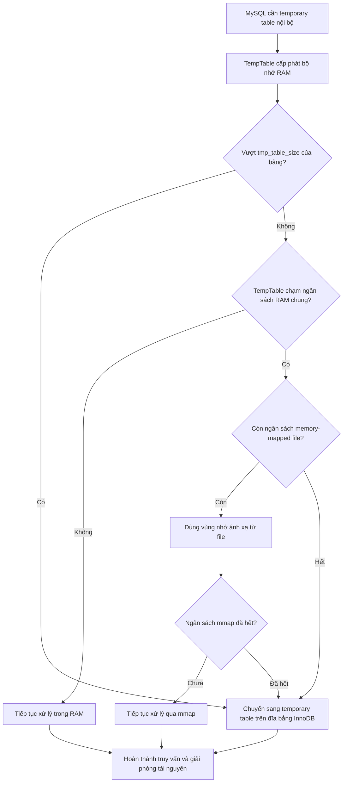

# Temporary table nội bộ và thao tác có thể tràn ra đĩa

Khi xử lý một truy vấn, MySQL đôi khi cần tạo một bảng tạm nội bộ để giữ dữ liệu trung gian trước khi trả kết quả. Bảng tạm này có thể được lưu trong bộ nhớ hoặc chuyển sang lưu trữ dựa trên đĩa khi vượt giới hạn tài nguyên hay gặp điều kiện không phù hợp với engine trong bộ nhớ. Việc chuyển sang đĩa có thể làm tăng thời gian truy vấn do phát sinh thêm thao tác đọc/ghi, đặc biệt khi dữ liệu trung gian lớn.

Trong kiến trúc **DATABASE_MYSQL**, hiểu temporary table nội bộ giúp giải thích vì sao một câu `SELECT` có thể tiêu tốn RAM, tạo I/O trên đĩa và chậm hơn dự kiến dù không hề ghi dữ liệu vào bảng nghiệp vụ. Bài này tập trung vào MySQL 8.0; hành vi và biến cấu hình có thể khác giữa các phiên bản, vì vậy cần kiểm tra phiên bản máy chủ trước khi áp dụng.

## 1. Phân biệt bảng tạm nội bộ và bảng `TEMPORARY` do người dùng tạo

Hai khái niệm có tên gần giống nhau nhưng phục vụ mục đích khác nhau:

| Tiêu chí | Temporary table nội bộ | Bảng `TEMPORARY` do người dùng tạo |
|---|---|---|
| Ai tạo? | MySQL tự tạo trong quá trình xử lý câu SQL | Người dùng hoặc ứng dụng tạo bằng `CREATE TEMPORARY TABLE` |
| Mục đích | Lưu kết quả trung gian phục vụ truy vấn | Lưu dữ liệu tạm do chương trình chủ động chuẩn bị và sử dụng |
| Có xuất hiện như bảng thông thường trong schema? | Không; được quản lý nội bộ trong quá trình thực thi | Có thể truy cập bằng tên bảng trong phiên tạo nó, nhưng không phải bảng lâu dài trong schema |
| Phạm vi tồn tại | Theo nhu cầu xử lý của câu lệnh hoặc kế hoạch thực thi | Trong session tạo bảng; tự mất khi session kết thúc hoặc có thể xóa bằng `DROP TEMPORARY TABLE` |
| Quyền tạo | MySQL tự quản lý; không cần cấp quyền `CREATE TEMPORARY TABLES` cho truy vấn chỉ đọc thông thường | Cần quyền `CREATE TEMPORARY TABLES` phù hợp |
| Engine | Do MySQL chọn theo cấu hình và nhu cầu nội bộ | Có thể chỉ định engine trong câu `CREATE TEMPORARY TABLE` |

Ví dụ bảng tạm do ứng dụng chủ động tạo:

```sql
CREATE TEMPORARY TABLE selected_customer_ids (
    customer_id BIGINT PRIMARY KEY
) ENGINE=InnoDB;

INSERT INTO selected_customer_ids (customer_id)
VALUES (101), (205), (309);

SELECT c.id, c.full_name
FROM customers AS c
JOIN selected_customer_ids AS s
  ON s.customer_id = c.id;

DROP TEMPORARY TABLE selected_customer_ids;
```

Đây là bảng do câu lệnh SQL của người dùng tạo ra. Nó không phải temporary table nội bộ mà optimizer có thể tự tạo khi xử lý `GROUP BY`, `UNION` hoặc một derived table.

Một bảng `TEMPORARY` chỉ hiển thị trong session tạo nó. Nếu session tạo bảng tạm cùng tên với một bảng lâu dài, bảng tạm sẽ che khuất tên bảng lâu dài đó trong session hiện tại cho đến khi bảng tạm bị xóa hoặc session kết thúc. Vì vậy, cần đặt tên rõ ràng và không giả định session khác có thể truy cập bảng này.

## 2. Vì sao MySQL cần temporary table nội bộ?

SQL mô tả kết quả cần lấy, nhưng để tạo ra kết quả đó MySQL có thể phải sắp xếp, nhóm, loại trùng, kết hợp hoặc vật chất hóa dữ liệu trung gian. Nếu có thể xử lý trực tiếp bằng index hoặc một chiến lược khác, optimizer có thể tránh tạo bảng tạm. Khi không thể hoặc chi phí tạo cấu trúc trung gian được ước tính là phù hợp, MySQL có thể dùng internal temporary table.

Một số trường hợp thường có khả năng cần bảng tạm:

- **`GROUP BY`**: gom nhiều bản ghi thành các nhóm để tính `COUNT`, `SUM`, `AVG` hoặc các hàm tổng hợp khác.
- **`DISTINCT`**: loại bỏ các dòng trùng lặp trong kết quả.
- **`UNION`**: kết hợp kết quả của nhiều truy vấn và loại bỏ trùng lặp khi dùng `UNION` mặc định (tương đương `UNION DISTINCT`).
- **`ORDER BY` kết hợp với thao tác khác**: khi thứ tự cần thiết không thể lấy trực tiếp từ index hoặc không trùng với thứ tự nhóm/kết quả trung gian.
- **Derived table và CTE**: một truy vấn con trong `FROM` hoặc CTE có thể được materialize thành kết quả trung gian nếu optimizer không thể hoặc không chọn merge vào truy vấn ngoài.
- **Window function và một số chiến lược thực thi khác**: MySQL có thể cần lưu dữ liệu trung gian để tính toán hoặc sắp xếp theo cửa sổ.

Đây là các tình huống có thể phát sinh temporary table, không phải quy tắc rằng cứ có `GROUP BY`, `DISTINCT`, `ORDER BY` hay CTE là chắc chắn có bảng tạm. Optimizer có thể dùng index, merge derived table, hoặc chọn chiến lược khác tùy cấu trúc truy vấn, dữ liệu, thống kê và phiên bản MySQL.

### Ví dụ: nhóm và sắp xếp kết quả

Giả sử bảng `orders` có nhiều đơn hàng. Ta muốn đếm số đơn theo khách hàng trong một khoảng thời gian và sắp xếp khách hàng có nhiều đơn nhất lên đầu:

```sql
SELECT customer_id, COUNT(*) AS order_count
FROM orders
WHERE created_at >= '2025-01-01'
GROUP BY customer_id
ORDER BY order_count DESC;
```

MySQL phải lọc đơn hàng, gom theo `customer_id`, tính số lượng và sắp xếp theo giá trị tổng hợp `order_count`. Tùy index và kế hoạch được chọn, quá trình này có thể cần temporary table và/hoặc thao tác filesort.

## 3. Temporary table có thể nằm ở đâu?

Trong MySQL 8.0, cần phân biệt hai tầng lưu trữ cho temporary table nội bộ:

1. **Trong bộ nhớ**: engine nội bộ `TempTable` là lựa chọn mặc định cho internal in-memory temporary table trong MySQL 8.0. Có thể cấu hình `internal_tmp_mem_storage_engine` sang `MEMORY` ở những môi trường phù hợp.
2. **Dựa trên đĩa**: khi bảng tạm nội bộ cần chuyển sang dạng on-disk, MySQL 8.0 hiện đại sử dụng InnoDB để lưu trữ bảng tạm nội bộ trên đĩa. Đây là dữ liệu trung gian do máy chủ quản lý, không phải bảng nghiệp vụ lâu dài mà ứng dụng tự tạo.

`TempTable` hỗ trợ các kiểu dữ liệu có độ dài thay đổi và cả `BLOB`/`TEXT`. Engine `MEMORY` có giới hạn kiểu dữ liệu khác, chẳng hạn không hỗ trợ `BLOB` và `TEXT`. Nếu đổi engine nội bộ sang `MEMORY`, một số truy vấn có cột không tương thích có thể buộc phải dùng dạng on-disk. Không nên thay engine chỉ để thử tăng tốc nếu chưa hiểu tác động đến kiểu dữ liệu và giới hạn bộ nhớ.

### Các bước chuyển từ RAM sang lưu trữ dựa trên đĩa

Ở mức khái quát, một temporary table dùng engine `TempTable` có thể trải qua các bước:



Sơ đồ mô tả cơ chế khái quát của TempTable trong MySQL 8.0. Từ MySQL 8.0.28, vượt `tmp_table_size` là giới hạn theo từng bảng và có thể khiến bảng đó chuyển sang InnoDB; chạm ngân sách RAM chung `temptable_max_ram` dẫn đến nhánh memory-mapped file, rồi mới xét `temptable_max_mmap`. Việc chọn nhánh cụ thể còn phụ thuộc phiên bản và trạng thái tài nguyên tại thời điểm chạy. Memory-mapped file vẫn là cơ chế dùng file làm hậu thuẫn cho vùng nhớ; nó không đồng nghĩa với việc một temporary table InnoDB đã được tạo theo cách mà mọi bộ đếm on-disk đều ghi nhận.

## 4. Những giới hạn ảnh hưởng đến việc tràn ra đĩa

Các biến dưới đây thường cần xem khi điều tra temporary table nội bộ trên MySQL 8.0:

| Biến | Ý nghĩa | Phạm vi cần chú ý |
|---|---|---|
| `internal_tmp_mem_storage_engine` | Chọn engine cho temporary table nội bộ trong bộ nhớ, thường là `TempTable` hoặc `MEMORY` | Ảnh hưởng đến khả năng kiểu dữ liệu và cách cấp phát bộ nhớ |
| `tmp_table_size` | Giới hạn kích thước của một số internal in-memory temporary table; từ MySQL 8.0.28, giới hạn này áp dụng cho từng bảng tạm nội bộ dùng trong bộ nhớ | Vượt giới hạn có thể khiến bảng tạm chuyển sang on-disk InnoDB |
| `temptable_max_ram` | Ngân sách RAM tổng thể mà engine `TempTable` có thể sử dụng trước khi chuyển sang cơ chế memory-mapped file | Là giới hạn dùng chung, không phải ngân sách riêng cho từng câu truy vấn |
| `temptable_max_mmap` | Giới hạn dung lượng memory-mapped file mà TempTable có thể sử dụng | Khi hết ngân sách này, temporary table nội bộ có thể chuyển sang dạng on-disk InnoDB |
| `max_heap_table_size` | Giới hạn kích thước bảng dùng engine `MEMORY` | Có liên quan khi dùng `MEMORY`; không nên nhầm nó với toàn bộ cơ chế cấp phát của TempTable |

Kiểm tra phiên bản và giá trị cấu hình trên máy chủ:

```sql
SELECT VERSION();

SHOW VARIABLES WHERE Variable_name IN (
    'internal_tmp_mem_storage_engine',
    'tmp_table_size',
    'temptable_max_ram',
    'temptable_max_mmap',
    'max_heap_table_size'
);
```

Không phải biến nào cũng có trên mọi phiên bản MySQL. Nếu một biến không xuất hiện, hãy tra tài liệu đúng phiên bản máy chủ thay vì giả định cấu hình đó đang tồn tại.

### Lưu ý riêng về phiên bản

- Trong MySQL 8.0, `TempTable` là engine mặc định cho internal in-memory temporary table. Các bản phát hành cũ hơn có hành vi và giới hạn khác.
- Từ MySQL 8.0.28, `tmp_table_size` giới hạn kích thước của từng internal in-memory temporary table; khi vượt ngưỡng, bảng có thể được chuyển sang on-disk InnoDB.
- Khi dùng engine `MEMORY`, `max_heap_table_size` cũng cần được xem xét. Không lấy một công thức giới hạn của `MEMORY` áp dụng nguyên xi cho `TempTable`.
- MySQL 5.7 và MySQL 8.0 khác nhau về engine và cơ chế temporary table nội bộ. Luôn xác minh phiên bản trước khi thay đổi biến cấu hình.

## 5. Phân biệt temporary table, filesort và thao tác I/O khác

Khi đọc `EXPLAIN`, ba khái niệm sau thường bị nhầm lẫn:

| Khái niệm | Ý nghĩa | Có đồng nghĩa với tràn temporary table ra đĩa không? |
|---|---|---|
| `Using temporary` | Kế hoạch truy vấn sử dụng temporary table nội bộ | Không. Nó không cho biết bảng tạm nằm hoàn toàn trong RAM, dùng mmap hay đã chuyển sang InnoDB trên đĩa |
| `Using filesort` | MySQL dùng thuật toán sắp xếp thay vì lấy thứ tự trực tiếp từ index | Không. Filesort có thể thực hiện trong bộ nhớ hoặc cần file tạm tùy lượng dữ liệu và giới hạn |
| `Created_tmp_disk_tables` tăng | Có thêm internal temporary table được ghi nhận là on-disk | Là tín hiệu hữu ích nhưng không phản ánh mọi trường hợp dùng memory-mapped file |

Vì vậy, không thể kết luận một truy vấn đang ghi bảng tạm ra đĩa chỉ từ dòng `Using temporary` hoặc `Using filesort`. Cần kết hợp kế hoạch thực thi, bộ đếm status, cấu hình và quan sát tải hệ thống.

## 6. Quan sát truy vấn có tạo temporary table hay không

### Dùng `EXPLAIN`

Chạy `EXPLAIN` trước khi thực thi truy vấn:

```sql
EXPLAIN
SELECT customer_id, COUNT(*) AS order_count
FROM orders
WHERE created_at >= '2025-01-01'
GROUP BY customer_id
ORDER BY order_count DESC;
```

Trong kết quả dạng bảng truyền thống, xem cột `Extra`. `Using temporary` cho biết kế hoạch có sử dụng temporary table nội bộ; `Using filesort` cho biết có bước sắp xếp theo thuật toán filesort. Đây là thông tin về kế hoạch, không trực tiếp xác định nơi temporary table được lưu. `EXPLAIN` cũng không phải danh sách đầy đủ mọi cấu trúc tạm có thể phát sinh trong toàn bộ quá trình thực thi.

Có thể xem kế hoạch dạng cây trên phiên bản hỗ trợ:

```sql
EXPLAIN FORMAT=TREE
SELECT customer_id, COUNT(*) AS order_count
FROM orders
WHERE created_at >= '2025-01-01'
GROUP BY customer_id
ORDER BY order_count DESC;
```

### Dùng `EXPLAIN ANALYZE`

Trên MySQL 8.0.18 trở lên, `EXPLAIN ANALYZE` thực thi truy vấn và hiển thị thông tin thực tế như thời gian, số dòng và số vòng lặp của các iterator:

```sql
EXPLAIN ANALYZE
SELECT customer_id, COUNT(*) AS order_count
FROM orders
WHERE created_at >= '2025-01-01'
GROUP BY customer_id
ORDER BY order_count DESC;
```

Khác với `EXPLAIN` thông thường, lệnh này thật sự chạy câu truy vấn. Chỉ dùng với câu lệnh đọc an toàn, trên môi trường và lượng dữ liệu phù hợp; không chạy tùy tiện một truy vấn nặng trên hệ thống production đang chịu tải.

### Dùng bộ đếm session

Các status variable giúp quan sát số internal temporary table được tạo trong phạm vi session. Chạy trước và sau truy vấn trên cùng một kết nối:

```sql
SHOW SESSION STATUS LIKE 'Created_tmp%';

-- Chạy truy vấn cần khảo sát tại đây.

SHOW SESSION STATUS LIKE 'Created_tmp%';
```

Hai bộ đếm thường được xem là:

- `Created_tmp_tables`: số internal temporary table được máy chủ tạo.
- `Created_tmp_disk_tables`: số internal temporary table được ghi nhận là on-disk.

So sánh chênh lệch trước và sau câu truy vấn để xem truy vấn có làm các bộ đếm tăng hay không. Bộ đếm là số tích lũy trong phạm vi session; nếu chạy nhiều câu lệnh giữa hai lần đọc, kết quả sẽ bao gồm tất cả câu lệnh đó.

**Giới hạn quan trọng:** `Created_tmp_disk_tables` không tính các temporary table được tạo bằng memory-mapped file. Do đó, giá trị không tăng không chứng minh rằng truy vấn không dùng file làm hậu thuẫn cho vùng nhớ. Hãy kết hợp với `temptable_max_ram`, `temptable_max_mmap`, kế hoạch thực thi và các chỉ số hệ thống.

Ở môi trường có Performance Schema, có thể xem thống kê tổng hợp theo digest trong `performance_schema.events_statements_summary_by_digest`, bao gồm các cột `SUM_CREATED_TMP_TABLES` và `SUM_CREATED_TMP_DISK_TABLES` nếu có ở phiên bản đang dùng. Bảng tổng hợp giúp tìm nhóm câu SQL thường tạo temporary table, nhưng cần kiểm tra quyền truy cập và thời gian reset số liệu.

## 7. Ví dụ điều tra một truy vấn tạo bảng tạm

Giả sử ứng dụng có báo cáo số đơn hàng theo khách hàng. Truy vấn hiện tại:

```sql
SELECT customer_id, COUNT(*) AS order_count
FROM orders
WHERE created_at >= '2025-01-01'
GROUP BY customer_id
ORDER BY order_count DESC;
```

Thực hiện theo trình tự:

1. Chạy `EXPLAIN` để xem MySQL có báo `Using temporary` hoặc `Using filesort` không.
2. Kiểm tra điều kiện lọc `created_at` có chọn lọc tốt không và có index phù hợp hay chưa.
3. Chạy truy vấn trong session thử nghiệm, ghi lại `Created_tmp_tables` và `Created_tmp_disk_tables` trước/sau.
4. Kiểm tra các giới hạn `tmp_table_size`, `temptable_max_ram`, `temptable_max_mmap` và engine nội bộ.
5. Dùng `EXPLAIN ANALYZE` trong môi trường phù hợp để so sánh số dòng thực tế và thời gian ở từng bước.

Ví dụ, có thể cân nhắc index trên cột lọc và cột nhóm:

```sql
CREATE INDEX idx_orders_created_customer
    ON orders (created_at, customer_id);
```

Index này có thể giúp MySQL lọc theo khoảng thời gian và đọc các giá trị liên quan hiệu quả hơn, nhưng không bảo đảm loại bỏ temporary table hoặc filesort. Index có thứ tự cột khác có thể phù hợp hơn tùy độ chọn lọc, kiểu truy vấn và workload. Hãy đo bằng `EXPLAIN` và dữ liệu thực tế trước khi quyết định giữ index.

Một tình huống khác là kết hợp hai tập khách hàng:

```sql
SELECT customer_id FROM online_orders
UNION
SELECT customer_id FROM store_orders;
```

`UNION` loại bỏ bản ghi trùng nên có thể cần cấu trúc trung gian để khử trùng. Nếu nghiệp vụ chấp nhận giữ cả dòng trùng, có thể dùng:

```sql
SELECT customer_id FROM online_orders
UNION ALL
SELECT customer_id FROM store_orders;
```

`UNION ALL` tránh bước loại trùng của `UNION`, nhưng không bảo đảm toàn bộ truy vấn không dùng temporary table nếu còn các thao tác khác như `ORDER BY`, grouping hoặc materialization.

## 8. Cách giảm nhu cầu tạo bảng tạm lớn

Khi phát hiện truy vấn tạo temporary table lớn hoặc thường xuyên chuyển sang đĩa, hãy xem lại SQL và mô hình dữ liệu trước khi tăng giới hạn bộ nhớ.

### Giảm số dòng đi vào bước xử lý trung gian

Đặt điều kiện lọc phù hợp để giảm dữ liệu cần nhóm, sắp xếp hoặc loại trùng. Kiểm tra index cho cột lọc và điều kiện join. Một index phù hợp có thể giảm số dòng phải đọc, dù optimizer vẫn có thể cần bảng tạm cho các bước tiếp theo.

### Chỉ chọn các cột cần thiết

Tránh `SELECT *` trong các truy vấn tạo tập kết quả trung gian. Chọn đúng các cột cần cho kết quả cuối cùng giúp giảm độ rộng của từng dòng, giảm lượng dữ liệu phải giữ trong RAM hoặc ghi ra đĩa. Điều này đặc biệt đáng chú ý với cột lớn như `TEXT`, `BLOB` hoặc chuỗi dài.

### Xem lại `DISTINCT` và `UNION`

Nếu dùng `DISTINCT` chỉ để che việc join tạo ra nhiều dòng ngoài dự kiến, hãy kiểm tra lại điều kiện join và quan hệ dữ liệu. Nếu nghiệp vụ không yêu cầu loại trùng, dùng `UNION ALL` thay cho `UNION` để tránh chi phí khử trùng. Chỉ thay đổi khi kết quả trùng lặp thực sự được phép.

### Thiết kế `GROUP BY` và `ORDER BY` có chủ đích

Kiểm tra xem index có thể hỗ trợ điều kiện lọc, thứ tự nhóm hoặc thứ tự sắp xếp hay không. Thứ tự cột trong composite index rất quan trọng. Không tạo index tùy tiện: index tăng dung lượng lưu trữ và chi phí ghi, cập nhật, xóa; đồng thời optimizer không phải lúc nào cũng chọn index chỉ vì nó tồn tại.

### Kiểm soát materialization của derived table và CTE

Derived table hoặc CTE có thể được merge vào truy vấn ngoài hoặc materialize thành kết quả trung gian. Tránh tạo một tập dữ liệu trung gian rất lớn khi chỉ cần một phần nhỏ; đẩy điều kiện lọc xuống vị trí hợp lý và chọn cột cần dùng. Đọc kế hoạch thực thi để xác định optimizer đã merge hay materialize thay vì đoán từ cú pháp.

### Phân trang và tổng hợp theo nhu cầu

Với báo cáo lớn, cân nhắc giới hạn phạm vi thời gian, phân trang theo khóa ổn định hoặc tổng hợp theo kỳ. Tránh buộc máy chủ sắp xếp và giữ toàn bộ tập dữ liệu lớn nếu giao diện chỉ cần một phần kết quả.

## 9. Điều chỉnh giới hạn bộ nhớ một cách thận trọng

Nếu truy vấn hợp lý nhưng dữ liệu trung gian thường xuyên vượt ngưỡng, có thể đánh giá lại các biến temporary table. Tuy nhiên, tăng `tmp_table_size` không phải giải pháp mặc định. Một giới hạn lớn hơn cho phép từng temporary table giữ nhiều dữ liệu trong RAM hơn; khi nhiều session chạy truy vấn đồng thời, tổng mức tiêu thụ bộ nhớ có thể tăng mạnh.

Trước khi thay đổi cấu hình:

1. Xác định phiên bản MySQL và engine internal temporary table hiện tại.
2. Thu thập số liệu truy vấn, số lượng session đồng thời, dung lượng RAM máy chủ và mức sử dụng bộ nhớ thực tế.
3. Xác định giới hạn nào đang bị chạm: giới hạn từng bảng, ngân sách RAM chung của TempTable hay ngân sách mmap.
4. Thay đổi từng biến trong môi trường thử nghiệm, đo lại latency, throughput, RAM và I/O.
5. Kiểm tra tác động với tải đồng thời trước khi triển khai production.

Không đặt `tmp_table_size` hoặc `temptable_max_ram` quá lớn chỉ vì một truy vấn đơn lẻ bị chậm. `temptable_max_ram` là ngân sách dùng chung của TempTable, còn giới hạn từng bảng và giới hạn mmap có vai trò riêng. Việc tăng một biến có thể chỉ chuyển nút thắt sang biến khác hoặc làm áp lực RAM của máy chủ tăng lên.

Temporary table nội bộ trên đĩa là tài nguyên tạm do MySQL quản lý. Không tìm rồi xóa thủ công file tạm hoặc tablespace của MySQL để xử lý một truy vấn chậm. Hãy để máy chủ quản lý vòng đời và điều tra qua SQL, status, Performance Schema và công cụ giám sát hệ điều hành.

## 10. Bài tập thực hành

Thực hiện trên môi trường MySQL thử nghiệm có bảng `orders` đủ dữ liệu:

1. Chạy truy vấn `GROUP BY` và `ORDER BY` ở phần ví dụ; ghi lại kết quả `EXPLAIN`, đặc biệt là `Extra`.
2. Đọc `Created_tmp_tables` và `Created_tmp_disk_tables` trước/sau khi chạy truy vấn trong cùng session.
3. Kiểm tra giá trị `internal_tmp_mem_storage_engine`, `tmp_table_size`, `temptable_max_ram` và `temptable_max_mmap`.
4. Thêm index phù hợp với điều kiện lọc và nhóm; chạy lại `EXPLAIN` và so sánh số dòng ước tính, kế hoạch được chọn.
5. Thử thay `UNION` bằng `UNION ALL` trong trường hợp dữ liệu trùng lặp được phép; xác minh kết quả nghiệp vụ trước khi so sánh hiệu năng.
6. Chạy `EXPLAIN ANALYZE` trên truy vấn đọc trong môi trường thử nghiệm để xem số dòng và thời gian thực tế.
7. Giải thích vì sao `Using temporary` không chứng minh bảng tạm đã tràn ra đĩa và vì sao `Created_tmp_disk_tables` không phản ánh mọi memory-mapped file.

Bạn hoàn thành bài khi phân biệt được bảng `TEMPORARY` do người dùng tạo với temporary table nội bộ, đọc được dấu hiệu trong kế hoạch thực thi, biết cách theo dõi các bộ đếm và giải thích các giới hạn RAM/mmap/đĩa. Từ đó, bạn có thể tối ưu truy vấn và cấu hình dựa trên bằng chứng thay vì chỉ tăng bộ nhớ theo cảm tính.
