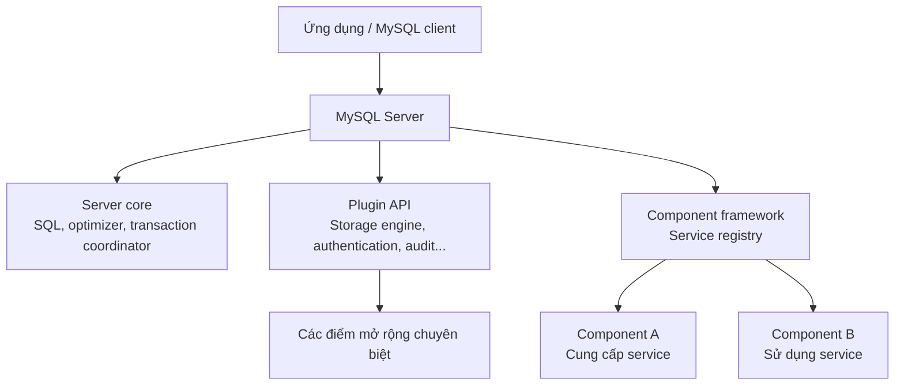
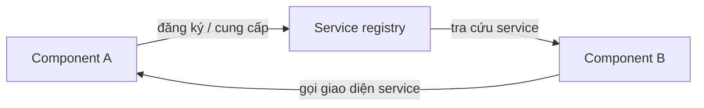

# Plugin, component và cơ chế mở rộng máy chủ

MySQL Server được thiết kế theo hướng có thể mở rộng một số chức năng thông qua plugin và component. Nhờ các cơ chế này, máy chủ có thể bổ sung storage engine, phương thức xác thực, khả năng audit, bộ phân tích văn bản hoặc dịch vụ hỗ trợ mà không phải thay đổi toàn bộ mã nguồn server.

Trong kiến trúc MySQL hiện đại, **plugin** là cơ chế mở rộng lâu đời với nhiều loại điểm mở rộng chuyên biệt; **component** là mô hình mở rộng mới hơn, dựa trên các service có thể được cung cấp và sử dụng giữa những thành phần độc lập. Hai cơ chế cùng tồn tại và phục vụ các mục đích khác nhau. Chúng không phải hai tên gọi thay thế trực tiếp cho nhau.

Bài học này giải thích vai trò của plugin và component, cách MySQL nạp và quản lý chúng, cách kiểm tra trạng thái, cũng như các nguyên tắc bảo mật và vận hành khi cài phần mở rộng vào server.

## 1. Vì sao MySQL cần cơ chế mở rộng?

Một hệ quản trị cơ sở dữ liệu phải phục vụ nhiều nhu cầu khác nhau. Ứng dụng giao dịch cần storage engine có transaction và khóa; hệ thống doanh nghiệp có thể cần xác thực qua một dịch vụ tập trung; tổ chức vận hành cần ghi nhận hoạt động để audit; một số workload cần bộ phân tích văn bản hoặc hàm xử lý bổ sung.

Nếu mọi chức năng đều phải tích hợp cứng vào một chương trình duy nhất, việc phát triển, triển khai và nâng cấp sẽ khó linh hoạt. Cơ chế mở rộng cho phép MySQL nạp những phần mã chuyên biệt theo nhu cầu. Server duy trì các giao diện mở rộng và quản lý vòng đời của phần mã đó.



Một phần mở rộng chạy bên trong tiến trình `mysqld` hoặc được server nạp vào tiến trình đó. Do vậy, nó có thể tham gia trực tiếp vào hoạt động của database và có ảnh hưởng đến hiệu năng, độ ổn định, tính sẵn sàng cũng như bảo mật của máy chủ.

## 2. Plugin trong MySQL là gì?

Plugin là mô-đun mã được MySQL Server nạp thông qua một giao diện plugin đã định nghĩa. Plugin triển khai một loại chức năng cụ thể mà server hỗ trợ. Một số loại plugin thường gặp:

| Loại plugin | Vai trò | Ví dụ về nhu cầu |
| --- | --- | --- |
| Storage engine | Cung cấp cách lưu trữ, đọc, ghi và quản lý bảng | Chọn engine phù hợp với đặc tính workload |
| Authentication | Bổ sung cách xác thực tài khoản kết nối | Tích hợp phương thức xác thực của tổ chức |
| Audit | Ghi nhận hoạt động cần theo dõi | Theo dõi sự kiện đăng nhập hoặc truy vấn theo chính sách |
| Full-text parser | Tùy biến cách phân tích token cho tìm kiếm toàn văn | Xử lý ngôn ngữ hoặc quy tắc tách từ đặc thù |
| Daemon | Chạy một chức năng nền được server hỗ trợ | Bổ sung tác vụ nền theo giao diện plugin |
| Replication | Mở rộng một số hành vi liên quan replication | Tích hợp hoặc tùy biến chức năng sao chép theo điểm mở rộng được hỗ trợ |

InnoDB là storage engine quan trọng và được tích hợp sẵn trong các bản MySQL hiện đại. Các plugin khác có thể được cung cấp cùng bản phân phối MySQL, bởi nhà cung cấp hoặc bên thứ ba. Việc một plugin có sẵn hay không còn phụ thuộc phiên bản, nền tảng, edition và cách đóng gói.

Plugin thường được triển khai dưới dạng thư viện động có phần mở rộng phụ thuộc hệ điều hành, chẳng hạn `.so` trên Linux hoặc `.dll` trên Windows. Thư viện chứa mã triển khai giao diện plugin mà MySQL Server hiểu. Một thư viện có thể cung cấp một hoặc nhiều plugin, tùy thiết kế.

### 2.1. Plugin API và vòng đời

Plugin được phát triển theo plugin API của MySQL. Thư viện mô tả plugin, loại plugin và các hàm khởi tạo hoặc kết thúc. Khi nạp, server kiểm tra thông tin plugin, gọi phần khởi tạo và đăng ký chức năng tương ứng. Khi gỡ, server gọi phần kết thúc nếu plugin hỗ trợ quy trình đó.

Vòng đời khái quát:

1. Nhà cung cấp biên dịch plugin tương thích với nền tảng và phiên bản MySQL mục tiêu.
2. Quản trị viên đặt thư viện vào thư mục plugin được cấu hình cho server.
3. MySQL nạp plugin khi cài động hoặc khi khởi động theo cấu hình.
4. Plugin khởi tạo và đăng ký loại chức năng mà nó cung cấp.
5. Server sử dụng plugin khi xử lý hoạt động tương ứng.
6. Quản trị viên có thể gỡ plugin động bằng câu lệnh hỗ trợ nếu plugin không còn được sử dụng và không có phụ thuộc ngăn cản.

Plugin là mã native chạy cùng tiến trình server, vì vậy lỗi bộ nhớ, deadlock, crash hoặc lỗi tương thích trong plugin có thể làm ảnh hưởng toàn bộ `mysqld`.

## 3. Các cách nạp và quản lý plugin

MySQL hỗ trợ plugin được tích hợp sẵn, plugin được liên kết tĩnh và plugin được nạp động. Khả năng cài hoặc gỡ ở runtime phụ thuộc cách plugin được xây dựng và loại plugin.

### 3.1. Cài plugin động bằng SQL

Với plugin hỗ trợ cài động, cú pháp tổng quát là:

```sql
INSTALL PLUGIN plugin_name SONAME 'plugin_library';
```

Trong đó:

- `plugin_name` là tên plugin được khai báo bên trong thư viện.
- `plugin_library` là tên thư viện chứa plugin, không phải đường dẫn tùy ý.
- Thư viện phải nằm trong thư mục plugin được MySQL cho phép và phải tương thích với server đang chạy.

Đây là cú pháp mẫu để hiểu cơ chế, không phải lệnh có thể chạy nguyên trạng: cần thay bằng tên plugin và thư viện thật từ gói cài đặt đáng tin cậy. Không tải một file thư viện bất kỳ rồi cài vào server production.

Khi cài thành công, plugin được nạp vào server hiện tại và thông tin cài đặt động được lưu trong metadata của MySQL để plugin có thể được nạp lại ở những lần khởi động sau.

### 3.2. Gỡ plugin động

Cú pháp tổng quát:

```sql
UNINSTALL PLUGIN plugin_name;
```

Trước khi gỡ, cần xác định plugin có đang được dùng bởi storage engine, tài khoản, cấu hình xác thực hoặc chức năng khác hay không. Một số plugin không thể gỡ khi server đang sử dụng hoặc khi chúng được nạp theo cách không hỗ trợ gỡ động. Hãy đọc tài liệu của plugin và thử trên môi trường kiểm thử trước khi thay đổi production.

Nếu plugin còn được khai báo trong cấu hình khởi động, việc gỡ bằng SQL có thể không duy trì được sau lần restart tiếp theo. Khi đó phải rà soát cả cấu hình startup, ví dụ `plugin-load` hoặc `plugin-load-add`, và chỉ bỏ khai báo sau khi xác nhận server có thể khởi động bình thường mà không cần plugin đó.

### 3.3. Nạp plugin khi khởi động

Quản trị viên có thể cấu hình plugin cần nạp khi MySQL khởi động. Ví dụ cấu hình minh họa trong nhóm `[mysqld]`:

```ini
[mysqld]
plugin-load-add=plugin_name=plugin_library.so
```

Tên thư viện và cú pháp cụ thể phải theo tài liệu plugin và hệ điều hành. `plugin-load-add` cho phép bổ sung plugin vào danh sách nạp; cần hiểu sự khác nhau giữa tùy chọn thay thế danh sách và tùy chọn bổ sung danh sách để tránh vô tình bỏ các plugin khác. Không sao chép ví dụ với tên thư viện giả định vào cấu hình thật.

### 3.4. Thư mục plugin

Có thể kiểm tra thư mục plugin mà server sử dụng:

```sql
SHOW VARIABLES LIKE 'plugin_dir';
```

MySQL chỉ nạp thư viện từ vị trí được cấu hình và chấp nhận theo quy tắc bảo mật của server. Không nên thay đổi quyền thư mục này để mọi người dùng đều có thể ghi file. Người có thể ghi mã native vào thư mục plugin có khả năng đưa mã chạy trong tiến trình database.

## 4. Kiểm tra plugin đã cài

Lệnh sau hiển thị danh sách plugin mà server nhận biết:

```sql
SHOW PLUGINS;
```

Có thể truy vấn metadata qua `INFORMATION_SCHEMA.PLUGINS`:

```sql
SELECT
    PLUGIN_NAME,
    PLUGIN_VERSION,
    PLUGIN_STATUS,
    PLUGIN_TYPE,
    PLUGIN_LIBRARY
FROM INFORMATION_SCHEMA.PLUGINS
ORDER BY PLUGIN_TYPE, PLUGIN_NAME;
```

Các cột giúp xác định tên, phiên bản, trạng thái, loại plugin và thư viện tương ứng. Một số plugin được tích hợp sẵn có thể không có tên thư viện động. Trạng thái và thông tin cụ thể phụ thuộc plugin và phiên bản server.

Metadata cài đặt plugin động cũng có thể được kiểm tra trong bảng hệ thống `mysql.plugin`:

```sql
SELECT name, dl
FROM mysql.plugin
ORDER BY name;
```

Không sửa trực tiếp bảng `mysql.plugin` để cài hoặc gỡ plugin. Dùng `INSTALL PLUGIN` và `UNINSTALL PLUGIN` để MySQL quản lý vòng đời và metadata đúng cách.

## 5. Component framework là gì?

Component là mô hình mở rộng được MySQL giới thiệu trong dòng MySQL 8.0. Thay vì chỉ gắn một mô-đun vào một loại plugin API chuyên biệt, component framework cung cấp cơ chế **service registry** để component đăng ký service và component khác có thể sử dụng service đó.

Một service là giao diện chức năng được công bố để component khác gọi. Component có thể cung cấp service, sử dụng service hoặc thực hiện cả hai vai trò. Component framework quản lý việc đăng ký và tra cứu service, giúp các thành phần tách rời nhau hơn.

Ví dụ về quan hệ khái niệm:



Component A có thể cung cấp một service; Component B chỉ cần biết giao diện service được công bố để sử dụng chức năng đó. B không cần phụ thuộc trực tiếp vào chi tiết triển khai nội bộ của A. Cách tổ chức này giúp MySQL phát triển các chức năng mô-đun và quản lý phụ thuộc giữa các thành phần rõ ràng hơn.

Component framework không có nghĩa là mọi phần mở rộng đều tự động an toàn hoặc có thể thay thế plugin. Component vẫn chạy trong ngữ cảnh server, vẫn cần tương thích ABI/API và có thể ảnh hưởng đến độ ổn định của `mysqld`.

## 6. Cài đặt và gỡ component

Component được quản lý bằng câu lệnh riêng, khác với cú pháp plugin. Một component có thể được cài bằng URI xác định nguồn component. Với component được cung cấp dưới dạng thư viện trong plugin directory, dạng phổ biến là `file://`:

```sql
INSTALL COMPONENT 'file://component_name';
```

Đây là cú pháp mẫu. `component_name` phải được thay bằng component có thật, được đóng gói cho đúng phiên bản và nền tảng. Thư viện phải được đặt ở vị trí MySQL cho phép; component có thể có yêu cầu cấu hình hoặc phụ thuộc riêng cần đáp ứng trước khi cài.

Gỡ component bằng:

```sql
UNINSTALL COMPONENT 'file://component_name';
```

Không gỡ component khi component khác còn phụ thuộc vào service mà nó cung cấp. Trước khi thay đổi, kiểm tra tài liệu component, cấu hình khởi động và log server. Một số component quan trọng có thể cần được nạp rất sớm trong quá trình khởi động hoặc có yêu cầu thứ tự khởi tạo đặc biệt; không nên cài/gỡ chúng theo cách tùy tiện khi server đang phục vụ dữ liệu.

### 6.1. Kiểm tra component đã đăng ký

Metadata về component đã cài được lưu trong bảng hệ thống `mysql.component`. Có thể kiểm tra URI của các component đã đăng ký:

```sql
SELECT component_id, component_group_id, component_urn
FROM mysql.component
ORDER BY component_id;
```

Bảng này mô tả các component được đăng ký để server nạp. Nó không phải danh sách đầy đủ mọi service đang tồn tại trong tiến trình, cũng không thay thế việc kiểm tra log và tài liệu component. Không chỉnh sửa trực tiếp bảng `mysql.component`; dùng `INSTALL COMPONENT` và `UNINSTALL COMPONENT` để quản lý.

## 7. Plugin và component khác nhau thế nào?

Hai cơ chế có điểm chung là mở rộng server bằng mô-đun được MySQL quản lý, nhưng cách tổ chức và mục đích khác nhau:

| Tiêu chí | Plugin | Component |
| --- | --- | --- |
| Kiến trúc | Plugin API với các loại plugin chuyên biệt | Component framework và service registry |
| Cách tích hợp | Triển khai giao diện của loại plugin mà server hỗ trợ | Cung cấp hoặc sử dụng service được công bố |
| Quản lý SQL | `INSTALL PLUGIN`, `UNINSTALL PLUGIN` | `INSTALL COMPONENT`, `UNINSTALL COMPONENT` |
| Metadata cài động | Bảng `mysql.plugin` | Bảng `mysql.component` |
| Điểm mở rộng | Storage engine, authentication, audit, parser và các loại plugin khác | Chức năng mô-đun có thể tương tác thông qua service |
| Quan hệ với phiên bản | Phụ thuộc plugin API, ABI và phiên bản server | Phụ thuộc component framework, service API và phiên bản server |

Không phải plugin nào cũng có phiên bản component tương đương; cũng không phải component nào có thể thay bằng plugin. Khi lựa chọn, hãy xác định chức năng cần mở rộng, kiểm tra tài liệu chính thức của đúng phiên bản MySQL và dùng đúng cơ chế cài đặt mà nhà cung cấp hướng dẫn.

## 8. Loadable functions và các cơ chế mở rộng liên quan

Ngoài plugin và component, MySQL còn có những cơ chế mở rộng hẹp hơn. Một ví dụ là **User-Defined Function (UDF)**, cho phép bổ sung hàm có thể gọi trong biểu thức SQL. UDF là một cơ chế mở rộng riêng, không đồng nhất với plugin hoặc component.

UDF được đăng ký bằng câu lệnh `CREATE FUNCTION ... SONAME` theo giao diện loadable function mà MySQL hỗ trợ. Khi thiết kế UDF, cần chú ý thư viện native, kiểu dữ liệu đầu vào/đầu ra, hành vi khi có `NULL`, lỗi thực thi và khả năng tương thích. UDF cũng chạy trong tiến trình server, do đó có cùng nhóm rủi ro về mã native và độ ổn định.

Không nên chọn UDF chỉ vì muốn gom logic nghiệp vụ vào database. Trước tiên hãy xem có thể biểu diễn bằng SQL chuẩn, stored function, view hoặc xử lý ở tầng ứng dụng hay không. Chỉ dùng mã mở rộng khi có lý do kỹ thuật rõ ràng và có quy trình kiểm thử, triển khai, thu hồi.

## 9. Bảo mật khi cài phần mở rộng

Plugin, component và UDF là mã có thể được thực thi trong tiến trình MySQL Server. Đây là ranh giới bảo mật quan trọng: người có quyền cài phần mở rộng có thể đưa mã chạy với quyền của tiến trình database trên máy chủ.

Áp dụng các nguyên tắc sau:

1. Chỉ cài phần mở rộng từ nhà cung cấp đáng tin cậy và nguồn phân phối được xác minh.
2. Kiểm tra chữ ký, checksum hoặc cơ chế xác thực gói do nhà cung cấp công bố.
3. Xác nhận phiên bản MySQL, hệ điều hành, kiến trúc CPU và ABI mà thư viện hỗ trợ.
4. Không cho tài khoản ứng dụng thông thường quyền cài hoặc gỡ plugin/component.
5. Giới hạn quyền ghi vào `plugin_dir` cho tài khoản triển khai được kiểm soát.
6. Đánh giá các quyền hệ điều hành mà tiến trình `mysqld` có thể sử dụng khi phần mở rộng chạy.
7. Kiểm thử cài đặt, khởi động lại, gỡ bỏ và phục hồi trên môi trường staging.
8. Sao lưu cấu hình và dữ liệu liên quan trước khi thay đổi phần mở rộng quan trọng.
9. Theo dõi log, lỗi khởi tạo, crash và thay đổi hiệu năng sau khi triển khai.

Không coi plugin hoặc component là sandbox. Một lỗi trong mã native có thể làm dừng server, gây rò rỉ bộ nhớ, truy cập tài nguyên ngoài dự kiến hoặc làm hỏng dữ liệu nếu phần mở rộng thao tác sai.

## 10. Quy trình triển khai phần mở rộng có kiểm soát

Một quy trình triển khai nên có các bước sau:

1. **Xác định nhu cầu:** ghi rõ chức năng cần bổ sung, vì sao chức năng sẵn có của MySQL chưa đáp ứng.
2. **Chọn loại mở rộng:** plugin, component hay UDF dựa trên điểm mở rộng mà server hỗ trợ.
3. **Kiểm tra tương thích:** xác minh phiên bản, edition, nền tảng, thư viện phụ thuộc và yêu cầu khởi động.
4. **Đánh giá bảo mật:** xác minh nguồn gói, quyền cài đặt, quyền filesystem và dữ liệu mà phần mở rộng có thể truy cập.
5. **Thử trên staging:** đo hiệu năng, thử restart, kiểm tra lỗi và xác nhận các chức năng hiện tại vẫn hoạt động.
6. **Chuẩn bị rollback:** xác định cách gỡ phần mở rộng, khôi phục cấu hình và xử lý dữ liệu mà phần mở rộng đã tạo.
7. **Triển khai production:** thực hiện trong cửa sổ thay đổi phù hợp và theo dõi log cùng chỉ số server.
8. **Ghi nhận vận hành:** lưu tên, phiên bản, nguồn gói, cấu hình, ngày triển khai và người chịu trách nhiệm.

Khi nâng cấp MySQL, phải kiểm tra lại khả năng tương thích của từng phần mở rộng. Không giả định một thư viện hoạt động trên phiên bản cũ sẽ tiếp tục tương thích với phiên bản server mới.

## 11. Kiểm tra và xử lý sự cố

Khi plugin hoặc component không hoạt động, kiểm tra theo thứ tự:

- Xác nhận đúng thư viện và phiên bản cho hệ điều hành/kiến trúc.
- Kiểm tra `plugin_dir` và quyền đọc thư viện của tài khoản chạy `mysqld`.
- Xem trạng thái plugin bằng `SHOW PLUGINS` hoặc `INFORMATION_SCHEMA.PLUGINS`.
- Với component, xem `mysql.component` và log khởi động để tìm lỗi nạp hoặc thiếu service dependency.
- Kiểm tra cấu hình `plugin-load`/`plugin-load-add` và các khai báo khởi động liên quan.
- Kiểm tra log MySQL để tìm lỗi symbol, ABI, thư viện phụ thuộc hoặc lỗi khởi tạo.
- Đối chiếu phiên bản server với ma trận tương thích do nhà cung cấp công bố.

Không xóa file thư viện đang được server sử dụng hoặc chỉnh sửa trực tiếp metadata trong các bảng hệ thống để cố khắc phục. Dùng câu lệnh quản lý chính thức, dừng hoặc restart theo tài liệu và có kế hoạch rollback.

## 12. Ví dụ quy trình kiểm kê plugin và component

Các câu lệnh sau giúp người quản trị kiểm kê trước và sau một đợt thay đổi. Chúng chỉ đọc metadata:

```sql
-- Kiểm tra vị trí thư viện plugin
SHOW VARIABLES LIKE 'plugin_dir';

-- Kiểm kê plugin và trạng thái
SHOW PLUGINS;

-- Kiểm tra chi tiết các plugin
SELECT PLUGIN_NAME, PLUGIN_STATUS, PLUGIN_TYPE, PLUGIN_LIBRARY
FROM INFORMATION_SCHEMA.PLUGINS
ORDER BY PLUGIN_NAME;

-- Kiểm kê các plugin cài động
SELECT name, dl
FROM mysql.plugin
ORDER BY name;

-- Kiểm kê component đã đăng ký
SELECT component_id, component_group_id, component_urn
FROM mysql.component
ORDER BY component_id;
```

Lưu kết quả kiểm kê cùng phiên bản MySQL và cấu hình triển khai. Khi so sánh sau nâng cấp hoặc sau thay đổi, cần phân biệt plugin/component được cài động với những chức năng đã tích hợp sẵn trong server.

## 13. Ghi nhớ

Plugin và component là hai cơ chế mở rộng quan trọng của MySQL Server. Plugin triển khai các giao diện chuyên biệt như storage engine, authentication, audit hoặc full-text parser. Component sử dụng component framework và service registry để các thành phần cung cấp, tra cứu và sử dụng service. Chúng có câu lệnh quản lý và metadata riêng: plugin dùng `INSTALL PLUGIN`/`UNINSTALL PLUGIN` và `mysql.plugin`; component dùng `INSTALL COMPONENT`/`UNINSTALL COMPONENT` và `mysql.component`.

Phần mở rộng là mã chạy cùng tiến trình server, vì vậy phải kiểm tra nguồn gói, tính tương thích, quyền filesystem, quyền cài đặt và hành vi sau restart. Chỉ cài phần mở rộng khi có nhu cầu rõ ràng, kiểm thử trên staging, chuẩn bị rollback và theo dõi server sau triển khai. Hiểu đúng các cơ chế này giúp mở rộng MySQL có kiểm soát mà vẫn bảo vệ tính ổn định, an toàn và khả năng vận hành của cơ sở dữ liệu.
