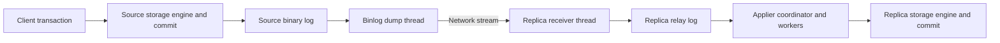
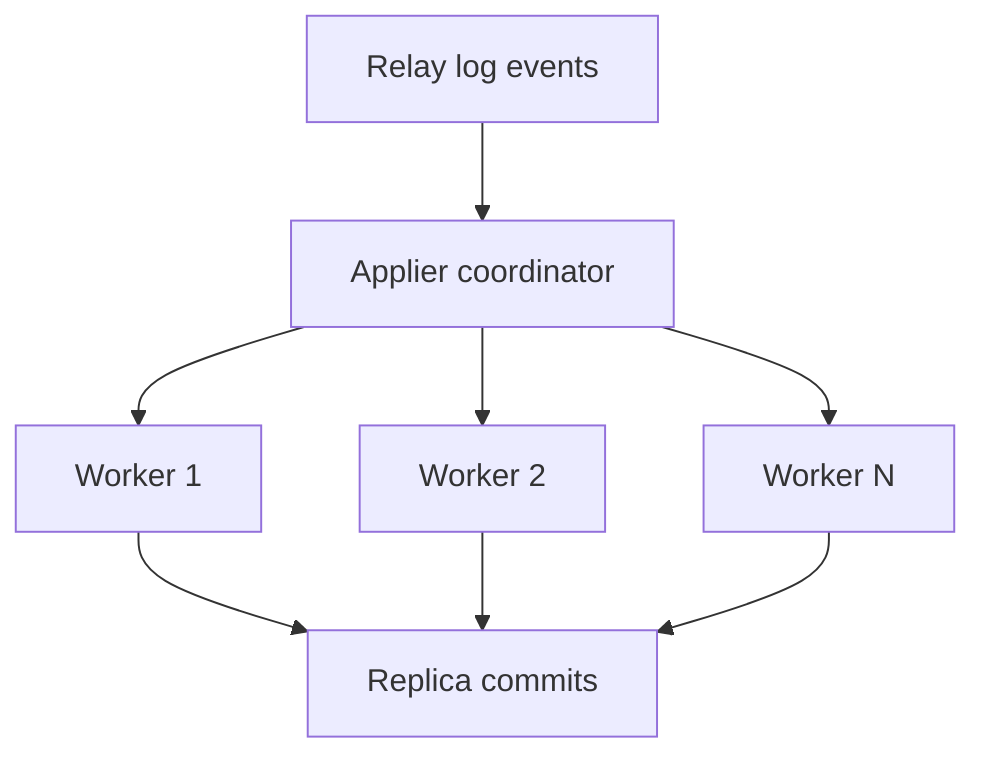

# Luồng binlog dump, receiver, relay log và applier

## Mục tiêu

MySQL replication chuyển các thay đổi đã ghi vào binary log của máy chủ nguồn sang một hoặc nhiều máy chủ replica. Luồng này có nhiều thành phần nối tiếp nhau: source đọc binlog và gửi sự kiện, receiver nhận dữ liệu qua kết nối mạng, relay log lưu sự kiện ở replica, rồi applier đọc relay log và thực thi transaction. Hiểu rõ từng chặng giúp bạn xác định dữ liệu đang chậm ở mạng, ở khâu ghi relay log hay ở khâu thực thi.

Bài học thuộc module **DATABASE_MYSQL**, nơi bạn làm việc với thiết kế bảng, kiểu dữ liệu, khóa, SQL, index, transaction, kiểm soát đồng thời, kế hoạch thực thi, tối ưu truy vấn và vận hành cơ sở dữ liệu quan hệ. Trong replication, luồng binlog là cơ chế vận chuyển thay đổi; GTID giúp định danh transaction và hỗ trợ replica yêu cầu đúng phần lịch sử còn thiếu.

Sau bài học, bạn có thể:

- Mô tả vai trò của binlog dump thread, receiver thread, relay log và applier.
- Phân biệt vị trí đã đọc từ source với vị trí đã được áp dụng trên replica.
- Giải thích cách GTID đi qua luồng replication và cách auto-position chọn transaction cần nhận.
- Quan sát trạng thái replication bằng `SHOW REPLICA STATUS` và Performance Schema.
- Khoanh vùng lỗi kết nối, lỗi ghi relay log, lỗi áp dụng transaction và replication lag.

## 1. Toàn cảnh luồng replication

Trong mô hình thông thường, ứng dụng ghi transaction lên source. Khi transaction được commit, các thay đổi đủ điều kiện được ghi vào binary log. Replica kết nối tới source, nhận các binlog event, lưu chúng trong relay log của chính replica, sau đó applier thực thi các transaction đó trên dữ liệu replica.



Mỗi thành phần có nhiệm vụ riêng:

| Thành phần | Chạy ở đâu | Nhiệm vụ |
|---|---|---|
| Binary log | Source | Lưu các sự kiện thay đổi dữ liệu và một số thay đổi liên quan đến transaction |
| Binlog dump thread | Source | Đọc binlog từ vị trí replica yêu cầu và gửi event qua kết nối replication |
| Receiver thread | Replica | Kết nối source, nhận event và ghi vào relay log |
| Relay log | Replica | Hàng đợi bền vững chứa event đã nhận, chờ applier xử lý |
| Applier | Replica | Đọc relay log, thực thi transaction và cập nhật trạng thái đã áp dụng |

Luồng receiver và applier có thể tiến triển độc lập. Receiver thường nhận trước một lượng dữ liệu, còn applier xử lý dần. Vì vậy, replica có thể đã nhận một transaction nhưng chưa áp dụng transaction đó. Đây là lý do cần phân biệt trạng thái *retrieved* và *executed* khi theo dõi GTID.

## 2. Source binary log và binlog dump thread

Binary log (binlog) là nhật ký các event mà MySQL dùng cho replication và point-in-time recovery. Binlog có thể ghi theo định dạng `ROW`, `STATEMENT` hoặc `MIXED`; với `ROW`, event mô tả thay đổi trên hàng dữ liệu, còn `STATEMENT` ghi câu lệnh SQL. Định dạng và nội dung event ảnh hưởng cách replica tái tạo thay đổi.

Để phát sự kiện replication, source cần bật binary logging và có `server_id` duy nhất trong topology. Ví dụ cấu hình thường gặp:

```ini
[mysqld]
server_id = 101
log_bin = mysql-bin
binlog_format = ROW
```

Đây là cấu hình minh họa; tên file, đường dẫn và lựa chọn format phải phù hợp với phiên bản, dung lượng lưu trữ và chính sách vận hành. Với MySQL hiện đại, `ROW` thường là lựa chọn phổ biến cho replication vì event mô tả thay đổi hàng cụ thể.

Khi replica kết nối, source tạo một binlog dump thread cho kết nối đó. Thread này đọc các event từ binlog bắt đầu tại file/position được yêu cầu hoặc từ tập GTID mà replica chưa có, rồi gửi event qua giao thức replication. Source có thể phục vụ nhiều replica bằng nhiều kết nối và thread tương ứng.

Các lệnh quan sát ở source:

```sql
SHOW BINARY LOGS;
SHOW MASTER STATUS;

SHOW PROCESSLIST;
```

`SHOW MASTER STATUS` là cú pháp quen thuộc trên MySQL 8.0; ở phiên bản mới hơn, tên lệnh có thể đã được thay bằng `SHOW BINARY LOG STATUS`. `SHOW PROCESSLIST` giúp nhận diện kết nối/thread replication, nhưng tên trạng thái hiển thị có thể khác theo phiên bản.

Source phải giữ các binlog cần thiết cho replica. Nếu source purge file trước khi replica nhận đủ transaction, replica có thể không tiếp tục được theo file/position. Với GTID, source cũng cần giữ lại các transaction mà replica chưa có; auto-position không thể tải một transaction đã bị purge khỏi mọi binlog sẵn có.

## 3. Receiver thread trên replica

Receiver thread (trong các phiên bản cũ thường được gọi là I/O thread) mở kết nối tới source bằng account replication đã được cấp quyền phù hợp. Nó gửi thông tin vị trí hoặc GTID đã biết, đọc luồng event từ source và ghi event vào relay log của replica.

Cấu hình account replication trên source có thể được tạo như sau:

```sql
CREATE USER 'repl'@'10.20.30.22'
  IDENTIFIED BY '<replication-secret>'
  REQUIRE SSL;

GRANT REPLICATION SLAVE
  ON *.*
  TO 'repl'@'10.20.30.22';
```

Quyền `REPLICATION SLAVE` là tên quyền được dùng trong nhiều phiên bản MySQL cho mục đích lấy binlog; một số tên lệnh và thuật ngữ quản trị đã được đổi sang `REPLICA` trong các bản mới. Hãy xác minh cú pháp và quyền theo đúng phiên bản máy chủ. Account replication chỉ nên được phép kết nối từ host replica, dùng TLS khi phù hợp và có secret riêng.

Trên replica, cấu hình kết nối tới source. Ví dụ cú pháp mới trong MySQL 8.0.23 trở lên:

```sql
CHANGE REPLICATION SOURCE TO
  SOURCE_HOST = 'mysql-source.example.net',
  SOURCE_PORT = 3306,
  SOURCE_USER = 'repl',
  SOURCE_PASSWORD = '<replication-secret>',
  SOURCE_AUTO_POSITION = 1;

START REPLICA;
```

Ví dụ này giả định GTID auto-position đã được cấu hình ở cả hai máy và replica đã được khởi tạo từ một bản sao dữ liệu tương thích. Không đặt mật khẩu thật vào script, history hoặc log; dùng cơ chế triển khai secret được kiểm soát. Với MySQL trước 8.0.23, cú pháp cũ `CHANGE MASTER TO` và các tên `MASTER_*` vẫn có thể cần thiết.

Receiver ghi event nhận được vào relay log và cập nhật metadata về nguồn, file/position hoặc tập GTID đã nhận. Nếu kết nối bị ngắt, receiver có thể kết nối lại và tiếp tục từ trạng thái đã lưu, miễn là source vẫn còn giữ phần binlog cần thiết.

Receiver có thể bị chậm do DNS, firewall, TLS, mạng, giới hạn kết nối, tải source hoặc tốc độ ghi đĩa relay log. Khi receiver không chạy, applier có thể vẫn xử lý phần relay log đã nhận trước đó, nhưng hàng đợi sẽ không được bổ sung event mới.

## 4. Relay log: hàng đợi bền vững trên replica

Relay log là tập file log do replica quản lý. Nó chứa các event receiver đã lấy từ source và applier sẽ đọc để thực thi. Có thể xem relay log như một vùng đệm bền vững giữa quá trình nhận dữ liệu qua mạng và quá trình áp dụng transaction.

Relay log có cơ chế xoay file tương tự binlog. Replica lưu metadata về file relay log hiện tại, vị trí đã nhận và vị trí applier đã xử lý. Tên file thường có dạng cấu hình theo `relay_log`; không nên tự ý xóa hoặc chỉnh sửa file relay log khi replication đang chạy.

Các biến cần quan tâm gồm:

```sql
SELECT VARIABLE_NAME, VARIABLE_VALUE
FROM performance_schema.global_variables
WHERE VARIABLE_NAME IN (
  'relay_log', 'relay_log_index', 'relay_log_recovery',
  'relay_log_purge', 'sync_relay_log',
  'sync_relay_log_info', 'relay_log_space_limit'
);
```

Tên và khả năng hỗ trợ biến có thể khác theo phiên bản. Metadata replication được lưu trong repository; các bản MySQL hiện đại mặc định dùng bảng hệ thống cho metadata quan trọng. `relay_log_recovery=ON` giúp replica khôi phục relay log sau crash theo metadata replication, nhưng cần được cấu hình và kiểm tra theo phiên bản, repository và mô hình triển khai.

Nếu receiver nhanh hơn applier, relay log sẽ tăng dung lượng. Theo dõi dung lượng ổ đĩa và tốc độ tăng của relay log để tránh làm đầy filesystem. Khi applier xử lý xong, relay log cũ có thể được purge theo cơ chế quản lý của MySQL. Không dùng thao tác xóa file thủ công để giải phóng dung lượng vì có thể làm hỏng trạng thái replication.

## 5. Applier: thực thi transaction trên replica

Applier đọc event từ relay log và thực thi transaction lên storage engine của replica. Trong cấu hình đơn luồng, một SQL/applier thread xử lý tuần tự. Với replication song song, coordinator phân phối transaction cho nhiều worker theo quan hệ phụ thuộc và thứ tự commit cần được bảo toàn.



Việc chạy nhiều worker không có nghĩa mọi transaction được áp dụng tùy ý. MySQL sử dụng thông tin phụ thuộc và cơ chế commit để giữ các ràng buộc thứ tự cần thiết. Mức song song hiệu quả phụ thuộc workload: transaction đụng nhiều bảng hoặc cùng một hàng có thể khó chạy song song; transaction độc lập có thể được áp dụng đồng thời.

Replica chỉ được xem là bắt kịp khi applier đã áp dụng đến vị trí hoặc GTID cần thiết. Một receiver khỏe mạnh không đảm bảo applier khỏe mạnh. Ví dụ, một transaction có lỗi duplicate key hoặc thiếu bảng có thể làm applier dừng trong khi receiver vẫn tiếp tục nhận dữ liệu.

Các biến thường dùng để điều chỉnh applier song song gồm `replica_parallel_workers` và `replica_parallel_type` tùy phiên bản. Một số bản dùng tên cũ `slave_parallel_workers`. Tăng worker không phải cách khắc phục mọi lag: cần xác định transaction đang chờ lock, xung đột dữ liệu, I/O chậm, CPU bão hòa hay phụ thuộc tuần tự.

Trên replica dùng cho đọc, có thể bật `read_only` và `super_read_only` để hạn chế ghi trực tiếp từ client. Các luồng replication nội bộ vẫn có thể áp dụng transaction. Đây là lớp bảo vệ bổ sung, không thay thế việc phân quyền account và giám sát thay đổi ngoài luồng replication.

## 6. GTID đi qua các chặng như thế nào?

Global Transaction Identifier (GTID) là định danh duy nhất cho một transaction đã commit trong topology GTID. GTID thường có dạng `source_uuid:transaction_number`, ví dụ `3E11FA47-71CA-11E1-9E33-C80AA9429562:42`. GTID giúp MySQL theo dõi transaction nào đã thực thi mà không phụ thuộc hoàn toàn vào tên file và byte position của binlog.

Khi transaction được ghi vào binlog trên source, GTID event gắn định danh cho transaction. Binlog dump thread gửi event đó tới replica; receiver ghi event vào relay log. Khi applier thực thi transaction thành công, GTID tương ứng được ghi nhận trong trạng thái đã thực thi của replica.

Với GTID auto-position, replica thông báo cho source tập GTID mà nó đã thực thi. Source so sánh tập này với các GTID có trong binlog và gửi những transaction còn thiếu mà source vẫn còn giữ. Nhờ vậy, khi replica kết nối lại hoặc đổi source trong topology phù hợp, MySQL có thể tìm phần transaction cần nhận mà không phải người vận hành tự tính file/position.

Các biến và trạng thái GTID cần hiểu:

| Tên | Ý nghĩa |
|---|---|
| `gtid_executed` | Tập GTID đã thực thi trên instance |
| `gtid_purged` | Tập GTID đã bị purge khỏi các binary log của instance |
| `Retrieved_Gtid_Set` | GTID replica đã nhận từ source, thường còn có thể đang chờ applier |
| `Executed_Gtid_Set` | GTID replica đã thực thi |

Ví dụ, nếu `Retrieved_Gtid_Set` tiến xa hơn `Executed_Gtid_Set`, receiver đã lấy dữ liệu trước applier. Khoảng chênh có thể biểu thị backlog đang nằm trong relay log. Nếu cả hai tập đều đứng yên, hãy kiểm tra receiver, source binlog và applier để tìm chặng bị dừng.

Để sử dụng GTID auto-position, topology cần được cấu hình nhất quán. Những thiết lập nền tảng thường gồm:

```ini
[mysqld]
server_id = 102
log_bin = mysql-bin
gtid_mode = ON
enforce_gtid_consistency = ON
log_replica_updates = ON
```

`server_id` phải duy nhất trong topology. `log_replica_updates=ON` thường cần thiết khi replica cũng phát binlog cho replica cấp dưới hoặc khi cần giữ các transaction đã nhận trong binlog cục bộ. Tên biến có thể dùng `log_slave_updates` trên phiên bản cũ.

GTID mode cần được triển khai theo quy trình chuyển đổi phù hợp với trạng thái hiện tại của hệ thống. Bật `gtid_mode=ON` không tự động làm cho dữ liệu ban đầu của source và replica đồng bộ. Khi khởi tạo replica từ backup, cần bảo đảm trạng thái GTID trong bản backup tương thích và không bỏ sót transaction cần thiết.

## 7. Khởi tạo và vận hành luồng GTID replication

Một quy trình triển khai tổng quát có thể gồm:

1. Cấu hình `server_id` duy nhất, bật binlog và chuẩn bị `gtid_mode` cùng `enforce_gtid_consistency` trên các máy.
2. Tạo account replication trên source, giới hạn host và cấp quyền lấy binlog.
3. Tạo bản sao dữ liệu ban đầu nhất quán từ source bằng công cụ backup phù hợp.
4. Phục hồi bản sao lên replica và xác minh dữ liệu cùng trạng thái GTID được giữ đúng.
5. Cấu hình `CHANGE REPLICATION SOURCE TO ... SOURCE_AUTO_POSITION=1` trên replica.
6. Chạy `START REPLICA` và kiểm tra receiver, applier, GTID retrieved/executed.
7. Thử ghi một transaction kiểm soát trên source và xác minh nó xuất hiện trên replica.

Không bỏ qua bước seed dữ liệu ban đầu. GTID giúp xác định transaction cần nhận tiếp theo; nó không tự tạo các hàng dữ liệu đã có trước thời điểm replication bắt đầu. Nếu backup được tạo ở thời điểm T, replica phải bắt đầu từ trạng thái dữ liệu và GTID phù hợp với T.

Khi đổi source hoặc dựng lại replica, cần kiểm tra GTID đã thực thi, GTID đã purge ở source, các transaction có thể bị thiếu và nguy cơ split-brain. Không tùy tiện dùng `RESET MASTER`, `RESET BINARY LOGS AND GTIDS` hoặc chỉnh `gtid_purged` trên instance đang có dữ liệu thật; các thao tác này có thể làm thay đổi lịch sử GTID và ảnh hưởng khả năng nối lại replication.

## 8. Quan sát trạng thái từng chặng

Trên replica, bắt đầu bằng:

```sql
SHOW REPLICA STATUS\G
```

Ở phiên bản cũ, lệnh có thể là `SHOW SLAVE STATUS`. Các trường hữu ích gồm:

| Trường | Cách đọc |
|---|---|
| `Replica_IO_Running` | Receiver thread có đang chạy không |
| `Replica_SQL_Running` | Applier có đang chạy không |
| `Source_Host` | Máy chủ nguồn mà replica đang kết nối |
| `Source_Log_File` | Binlog source mà receiver đang đọc |
| `Read_Source_Log_Pos` | Vị trí receiver đã đọc từ binlog source |
| `Relay_Log_File`, `Relay_Log_Pos` | File/vị trí relay log liên quan đến applier |
| `Relay_Source_Log_File`, `Exec_Source_Log_Pos` | File/vị trí source tương ứng với tiến độ áp dụng |
| `Retrieved_Gtid_Set` | GTID đã nhận |
| `Executed_Gtid_Set` | GTID đã thực thi |
| `Last_IO_Error`, `Last_SQL_Error` | Lỗi gần nhất ở receiver hoặc applier |
| `Seconds_Behind_Source` | Ước lượng độ trễ theo trạng thái replication; không phải phép đo đầy đủ mọi dạng lag |

`SHOW REPLICA STATUS` là ảnh chụp trạng thái tại thời điểm truy vấn. Trên replica nhiều channel, cần kiểm tra đúng channel. Các tên cột có thể thay đổi theo phiên bản MySQL.

Performance Schema cung cấp thông tin chi tiết hơn về connection và applier:

```sql
SELECT CHANNEL_NAME, SERVICE_STATE, RECEIVED_TRANSACTION_SET,
       LAST_ERROR_NUMBER, LAST_ERROR_MESSAGE
FROM performance_schema.replication_connection_status;

SELECT CHANNEL_NAME, WORKER_ID, SERVICE_STATE,
       LAST_ERROR_NUMBER, LAST_ERROR_MESSAGE
FROM performance_schema.replication_applier_status_by_worker;
```

Các bảng Performance Schema và cột có sẵn phụ thuộc phiên bản. Nếu truy vấn báo không có bảng hoặc cột, hãy xem schema của phiên bản đang chạy và dùng `SHOW REPLICA STATUS` làm điểm bắt đầu.

## 9. Chẩn đoán lag và lỗi theo chặng

**Receiver không chạy:** kiểm tra `Last_IO_Error`, hostname/IP, port, firewall, DNS, TLS, account replication, quyền `REPLICATION SLAVE`, `server_id` và việc source còn giữ binlog cần thiết. Kiểm tra cả trạng thái kết nối trên source.

**Receiver chạy nhưng applier dừng:** xem `Last_SQL_Error`, log lỗi, worker status và transaction đang áp dụng. Lỗi duplicate key, thiếu bảng, khác biệt schema hoặc thao tác không hợp lệ có thể làm applier dừng. Sửa nguyên nhân dữ liệu hoặc schema theo quy trình; không bỏ qua event một cách tùy tiện vì có thể tạo sai lệch dữ liệu.

**Relay log tăng liên tục:** so sánh tốc độ nhận và tốc độ áp dụng. Nếu receiver nhanh nhưng applier chậm, xem CPU, I/O, lock wait, transaction lớn, xung đột khóa và số worker. Nếu relay log tăng vì applier dừng, xử lý lỗi applier trước.

**`Seconds_Behind_Source` bằng 0 nhưng vẫn có vấn đề:** giá trị này có thể là `NULL` khi replica không thể xác định độ trễ, và có thể không phản ánh chính xác độ trễ đầu cuối trong mọi tình huống. Kết hợp timestamp commit, GTID retrieved/executed, trạng thái worker, độ trễ ứng dụng và heartbeat replication.

**GTID nhận và thực thi không tiến triển:** xác định chặng bị dừng bằng receiver/applier status. Nếu replica thiếu transaction đã bị purge khỏi source, có thể cần khởi tạo lại từ backup phù hợp hoặc lấy transaction từ một nguồn còn giữ binlog; không thể khôi phục transaction chỉ từ auto-position nếu không còn bản sao ở đâu.

Không tự ý chạy `SQL_SLAVE_SKIP_COUNTER` hoặc bỏ qua GTID transaction để làm replication chạy tiếp mà chưa đánh giá dữ liệu. Với GTID, bỏ qua transaction cần quy trình được thiết kế riêng, có ghi nhận và xác minh tính nhất quán sau thao tác.

## 10. Bài tập thực hành

Trên hai máy MySQL thử nghiệm, dựng một topology source/replica dùng GTID:

- Cấu hình `server_id` khác nhau, bật binlog, `gtid_mode=ON` và `enforce_gtid_consistency=ON` theo quy trình của phiên bản.
- Tạo account replication giới hạn host và dùng TLS nếu môi trường hỗ trợ.
- Seed replica bằng bản backup nhất quán, sau đó cấu hình `SOURCE_AUTO_POSITION=1` và chạy replica.
- Ghi một transaction thử nghiệm trên source, kiểm tra `Retrieved_Gtid_Set` và `Executed_Gtid_Set` trên replica.
- Tạm dừng applier trong môi trường thử nghiệm, ghi thêm transaction trên source và quan sát receiver tiếp tục nhận vào relay log.
- Khởi động lại applier, xác nhận GTID được thực thi và dữ liệu replica bắt kịp.
- Gây một lỗi kết nối có kiểm soát để quan sát receiver reconnect; khôi phục kết nối và xác nhận luồng tiếp tục.

**Tiêu chí hoàn thành:** bạn có thể chỉ ra binlog dump thread, receiver, relay log và applier; giải thích khác biệt giữa GTID đã nhận và đã thực thi; đọc trạng thái replication; và xác định chặng gây ra lag hoặc lỗi.

## Kết luận

Luồng replication MySQL gồm source binlog và dump thread, receiver trên replica, relay log làm hàng đợi, rồi applier thực thi transaction. GTID định danh transaction xuyên suốt các chặng và cho phép auto-position yêu cầu phần lịch sử còn thiếu. Khi vận hành, hãy quan sát riêng trạng thái nhận và áp dụng, bảo đảm source còn giữ binlog cần thiết, và xử lý lỗi tại đúng chặng trước khi đưa replica trở lại phục vụ.
