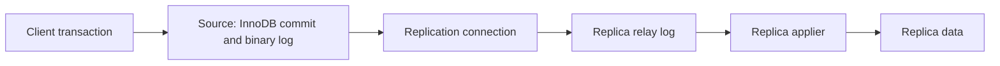

# Asynchronous/semi-synchronous replication và điều kiện xác nhận commit

Trong module `DATABASE_MYSQL`, người học làm chủ MySQL từ thiết kế bảng, kiểu dữ liệu, khóa và truy vấn SQL đến index, transaction, kiểm soát đồng thời, đọc kế hoạch thực thi, tối ưu truy vấn, phân quyền, sao lưu và xử lý các vấn đề vận hành cơ sở dữ liệu quan hệ. Bài học này giải thích cách MySQL truyền transaction từ source sang replica, sự khác nhau giữa asynchronous và semi-synchronous replication, và ý nghĩa chính xác của một lần xác nhận commit.

Điểm quan trọng khi vận hành replication là phân biệt ba sự kiện: transaction đã commit trên source, transaction đã được replica nhận và ghi vào relay log, và transaction đã được replica applier thực thi. Ba sự kiện này có thể xảy ra ở những thời điểm khác nhau. Hiểu rõ ranh giới đó giúp thiết kế RPO, chọn replica để failover và giải thích đúng mức độ an toàn mà một phản hồi `COMMIT` mang lại.

## 1. Luồng replication trong MySQL

Trong mô hình source/replica, source nhận câu lệnh ghi từ client và ghi các thay đổi vào binary log. Replica duy trì kết nối đến source, nhận các sự kiện binary log, ghi chúng vào relay log cục bộ rồi áp dụng các sự kiện để cập nhật dữ liệu của mình.

Luồng cơ bản gồm các thành phần:

1. **Transaction trên source:** ứng dụng thực hiện thay đổi dữ liệu và gửi `COMMIT`.
2. **Binary log:** MySQL ghi các sự kiện cần truyền sang replica theo định dạng binlog được cấu hình.
3. **Replication connection/receiver:** luồng nhận trên replica đọc binary log từ source và chuyển sự kiện vào relay log.
4. **Relay log:** lưu tạm các sự kiện chờ được áp dụng trên replica.
5. **Applier:** luồng SQL hoặc các worker song song đọc relay log và thực thi thay đổi lên storage engine của replica.



Source và replica có `server_id` duy nhất trong topology. Khi dùng GTID, mỗi transaction được định danh bằng một global transaction identifier, giúp theo dõi tập transaction đã nhận và đã thực thi, đồng thời đơn giản hóa việc định vị transaction khi đổi source. GTID hỗ trợ quản lý tiến độ replication nhưng tự nó không làm cho replication trở thành đồng bộ.

## 2. Asynchronous replication: source không đợi replica

Với asynchronous replication, source xử lý transaction và trả kết quả commit cho client theo cơ chế commit cục bộ. Việc gửi sự kiện đến replica diễn ra độc lập sau đó. Source không đợi replica xác nhận đã nhận hoặc áp dụng transaction trước khi trả lời client.

Ví dụ, ứng dụng chuyển trạng thái đơn hàng sang `PAID` và nhận phản hồi `COMMIT` thành công. Ngay lúc đó, replica có thể chưa nhận transaction, hoặc đã nhận transaction vào relay log nhưng chưa áp dụng vào bảng. Một truy vấn đọc ngay trên replica có thể vẫn thấy trạng thái cũ.

Trình tự điển hình:

```text
Client             Source                 Replica
  |                   |                       |
  |--- UPDATE ------->|                       |
  |--- COMMIT ------->|                       |
  |<-- OK ------------|                       |
  |                   |--- binlog events ---->|
  |                   |                       |-- relay log
  |                   |                       |-- apply transaction
```

Ưu điểm của asynchronous replication là độ trễ commit thấp và source không bị chặn khi replica chậm hoặc mất kết nối. Đây là lựa chọn phù hợp khi hệ thống chấp nhận replica có độ trễ và có cơ chế xử lý mất dữ liệu trong tình huống failover.

Rủi ro chính xuất hiện khi source gặp sự cố sau khi đã trả lời client nhưng trước khi transaction được truyền đến replica. Nếu promote một replica chưa nhận transaction đó, dữ liệu đã được client xác nhận có thể không tồn tại trên máy chủ mới. Khoảng dữ liệu có thể mất phụ thuộc vào độ trễ truyền log, khoảng trống log và cách chọn replica khi failover.

## 3. Semi-synchronous replication: chờ replica xác nhận đã nhận transaction

Semi-synchronous replication bổ sung một bước chờ xác nhận từ replica. Khi source xử lý transaction, source gửi sự kiện binlog đến các replica và đợi đủ số ACK được cấu hình trước khi hoàn tất phản hồi commit cho client. Trong MySQL, ACK được gửi khi replica đã nhận các sự kiện của transaction và ghi chúng vào relay log theo cơ chế của semi-sync plugin.

ACK này xác nhận transaction đã được replica nhận và ghi vào relay log. Nó **không có nghĩa** replica applier đã thực thi transaction và dữ liệu đã xuất hiện trong các bảng trên replica. Vì vậy, semi-sync làm giảm nguy cơ mất transaction đã được xác nhận trong một số kịch bản lỗi source, nhưng không biến mọi truy vấn đọc trên replica thành truy vấn đọc dữ liệu mới nhất.

Trình tự khái quát:

```text
Client             Source                 Replica
  |                   |                       |
  |--- UPDATE ------->|                       |
  |--- COMMIT ------->|                       |
  |                   |--- binlog events ---->|
  |                   |                       |-- write relay log
  |                   |<------ ACK ------------|
  |<-- OK ------------|                       |
  |                   |                       |-- apply transaction
```

Một số điểm cần nhớ:

- Source chờ ACK từ số replica tối thiểu đã cấu hình, thường là một replica.
- Replica ACK sau khi nhận và ghi transaction vào relay log; applier có thể vẫn đang xử lý transaction trước đó.
- Nếu không nhận đủ ACK trong thời gian chờ, source có thể chuyển sang asynchronous mode để tiếp tục phục vụ ghi.
- Khi replica đủ điều kiện kết nối lại, semi-sync có thể được kích hoạt trở lại; cần theo dõi trạng thái thực tế thay vì chỉ nhìn cấu hình `enabled`.

Semi-sync có thể tăng độ trễ commit do phụ thuộc mạng và thời gian ghi relay log. Nếu cấu hình phải chờ ACK từ hai replica, commit có thể chậm hơn cấu hình chỉ cần một ACK. Cấu hình số ACK cần cân bằng giữa khả năng chịu lỗi, vị trí địa lý của replica và độ trễ mà ứng dụng chấp nhận.

## 4. Điều kiện xác nhận commit và wait point

Trong MySQL semi-sync, biến `rpl_semi_sync_source_wait_point` quyết định source chờ ACK ở giai đoạn nào của quá trình commit. Hai giá trị quan trọng là `AFTER_SYNC` và `AFTER_COMMIT`.

### AFTER_SYNC

Với `AFTER_SYNC`, source ghi transaction vào binary log và đồng bộ binary log theo cấu hình, sau đó chờ ACK từ replica. Khi nhận đủ ACK, source mới commit transaction vào storage engine và trả kết quả cho client.

Trình tự:

1. Transaction được chuẩn bị và ghi vào binary log trên source.
2. Binary log được đồng bộ theo cấu hình durability của source.
3. Source gửi sự kiện đến replica và chờ đủ ACK.
4. Source commit transaction vào storage engine.
5. Source trả thành công cho client.

Với wait point này, transaction chưa được commit trong storage engine để các transaction khác trên source nhìn thấy trước khi ACK đến. Đây thường là lựa chọn phù hợp khi ưu tiên tính nhất quán của failover hơn khả năng cho các session khác quan sát transaction trong lúc source đang đợi ACK.

### AFTER_COMMIT

Với `AFTER_COMMIT`, source commit transaction vào storage engine sau khi ghi và đồng bộ binary log, rồi mới chờ ACK từ replica trước khi trả kết quả cho client.

Điều này có nghĩa là transaction đã được commit trên source và có thể được session khác nhìn thấy trong lúc session ban đầu vẫn đang chờ ACK. Nếu source gặp sự cố trong khoảng thời gian đó, ứng dụng khác có thể đã quan sát dữ liệu trên source dù transaction chưa được xác nhận bởi replica. Khi chọn replica để failover, cần đặc biệt thận trọng với tình huống này.

### So sánh hai wait point

| Tiêu chí | `AFTER_SYNC` | `AFTER_COMMIT` |
|---|---|---|
| Thời điểm chờ ACK | Sau khi ghi và đồng bộ binlog, trước khi commit storage engine | Sau khi commit storage engine, trước khi trả kết quả cho client |
| Session khác nhìn thấy transaction trên source | Sau khi ACK và commit hoàn tất | Có thể nhìn thấy trước khi ACK đến |
| Quan hệ giữa phản hồi commit và ACK | Client chỉ nhận phản hồi sau ACK và commit storage engine | Client nhận phản hồi sau ACK, dù transaction đã commit trước đó |
| Đặc điểm | Hạn chế cửa sổ transaction đã hiển thị trên source nhưng chưa được replica xác nhận | Cho phép transaction được nhìn thấy trên source trong lúc chờ replica |

Không nên thay đổi wait point tùy tiện trong production. Hãy xác định yêu cầu nhất quán, kiểm tra tài liệu đúng phiên bản MySQL và diễn tập failover với cấu hình dự kiến trước khi áp dụng.

## 5. Cấu hình semi-sync trong MySQL 8.0.26 trở lên

Semi-sync replication sử dụng plugin ở cả source và replica. Ví dụ dưới đây dùng tên plugin và biến theo thuật ngữ source/replica trong các phiên bản MySQL hiện đại. Với MySQL cũ hơn, tên plugin và biến có thể vẫn dùng thuật ngữ `master`/`slave`; hãy kiểm tra tài liệu đúng phiên bản trước khi chạy.

### Điều kiện nền tảng

Một cấu hình replication có GTID thường cần các thiết lập cơ bản sau. `server_id` phải khác nhau trên từng máy chủ:

```ini
# Source
[mysqld]
server_id=101
log_bin=mysql-bin
gtid_mode=ON
enforce_gtid_consistency=ON
binlog_format=ROW
sync_binlog=1
innodb_flush_log_at_trx_commit=1
```

```ini
# Replica
[mysqld]
server_id=102
log_bin=mysql-bin
relay_log=relay-bin
gtid_mode=ON
enforce_gtid_consistency=ON
binlog_format=ROW
log_replica_updates=ON
read_only=ON
super_read_only=ON
```

`sync_binlog=1` yêu cầu đồng bộ binary log ở mỗi commit; `innodb_flush_log_at_trx_commit=1` yêu cầu InnoDB flush redo log theo mỗi commit. Đây là các thiết lập quan trọng cho durability cục bộ của source. Chúng có chi phí I/O và vẫn phụ thuộc vào hệ điều hành, controller và thiết bị lưu trữ có thực hiện đúng yêu cầu flush hay không.

### Cài plugin và bật semi-sync

Trên source:

```sql
INSTALL PLUGIN rpl_semi_sync_source SONAME 'semisync_source.so';

SET PERSIST rpl_semi_sync_source_enabled = ON;
SET PERSIST rpl_semi_sync_source_wait_for_replica_count = 1;
SET PERSIST rpl_semi_sync_source_timeout = 10000;
SET PERSIST rpl_semi_sync_source_wait_point = 'AFTER_SYNC';
```

Trên replica:

```sql
INSTALL PLUGIN rpl_semi_sync_replica SONAME 'semisync_replica.so';
SET PERSIST rpl_semi_sync_replica_enabled = ON;
```

`rpl_semi_sync_source_wait_for_replica_count` là số ACK tối thiểu source cần nhận cho một transaction. Ví dụ đặt `2` nghĩa là source đợi hai replica xác nhận. `rpl_semi_sync_source_timeout` tính bằng mili giây; ví dụ `10000` tương ứng 10 giây. Khi hết thời gian mà chưa nhận đủ ACK, source có thể quay về asynchronous mode.

`SET PERSIST` lưu cấu hình để có hiệu lực sau khi khởi động lại trên MySQL hỗ trợ lệnh này. Plugin phải được cài thành công và tương thích với bản build MySQL. Nếu plugin đã được cài trước đó, không chạy lặp lại `INSTALL PLUGIN`; hãy kiểm tra trạng thái trong `INFORMATION_SCHEMA.PLUGINS` hoặc `SHOW PLUGINS`.

Thiết lập replication connection và GTID auto-position theo topology đang dùng, sau đó khởi động replica. Ví dụ cú pháp trên các phiên bản dùng `CHANGE REPLICATION SOURCE TO`:

```sql
CHANGE REPLICATION SOURCE TO
    SOURCE_HOST = 'mysql-source.example.net',
    SOURCE_USER = 'replication_user',
    SOURCE_PASSWORD = 'LAY_TU_KHO_BI_MAT',
    SOURCE_AUTO_POSITION = 1;

START REPLICA;
```

Giá trị mật khẩu ở đây chỉ là chỗ giữ chỗ. Hãy quản lý thông tin xác thực qua secret manager và giới hạn quyền của tài khoản replication. Trên phiên bản MySQL cũ, cú pháp có thể là `CHANGE MASTER TO` và `START SLAVE`.

## 6. Kiểm tra trạng thái và tiến độ xác nhận

Không thể kết luận semi-sync đang bảo vệ transaction chỉ từ việc biến `rpl_semi_sync_source_enabled` có giá trị `ON`. Cần kiểm tra trạng thái plugin, kết nối replica và các counter runtime.

Trên source:

```sql
SHOW VARIABLES LIKE 'rpl_semi_sync%';
SHOW STATUS LIKE 'Rpl_semi_sync%';
SHOW PLUGINS;
```

Các status variable có tiền tố `Rpl_semi_sync` cho biết trạng thái hoạt động và số liệu chờ ACK. Đặc biệt, kiểm tra trạng thái semi-sync thực tế của source, số replica semi-sync đang kết nối, số transaction đã nhận ACK và số transaction phải tiếp tục theo async mode. Tên status cụ thể có thể khác giữa các phiên bản; dùng kết quả `SHOW STATUS` của máy chủ đang vận hành làm căn cứ.

Trên replica:

```sql
SHOW REPLICA STATUS\G
```

Các trường thường cần xem gồm:

- `Replica_IO_Running` và `Replica_SQL_Running`: luồng nhận và luồng áp dụng có đang chạy hay không.
- `Retrieved_Gtid_Set`: tập GTID replica đã nhận từ source.
- `Executed_Gtid_Set`: tập GTID đã được thực thi trên replica.
- `Last_IO_Error` và `Last_SQL_Error`: lỗi ở luồng nhận hoặc áp dụng.
- `Seconds_Behind_Source`: chỉ số độ trễ ước lượng; không nên dùng riêng nó để chứng minh replica đã bắt kịp hoặc semi-sync đang hoạt động.

`Retrieved_Gtid_Set` và `Executed_Gtid_Set` giúp phân biệt transaction đã được nhận vào luồng relay với transaction đã được applier thực thi. Một GTID có thể đã được nhận nhưng chưa có trong tập GTID đã thực thi. Đây là lý do ACK semi-sync không đồng nghĩa transaction đã có thể đọc từ replica.

### Chờ replica thực thi một GTID cụ thể

Khi cần xác nhận transaction đã được áp dụng trên replica, có thể dùng `WAIT_FOR_EXECUTED_GTID_SET()`:

```sql
SELECT WAIT_FOR_EXECUTED_GTID_SET('source_uuid:1-12345', 10);
```

Thay `source_uuid:1-12345` bằng GTID thực tế cần chờ. Hàm trả về `0` khi tập GTID đã được thực thi trong thời hạn; trả về `1` nếu hết thời gian chờ; `NULL` nếu xảy ra lỗi. Hàm này hữu ích cho kiểm tra read-after-write trên replica hoặc bước xác nhận trước khi promote replica.

GTID set có thể lấy từ trạng thái replication, binary log hoặc công cụ quan sát transaction của hệ thống. Trong môi trường có nhiều transaction đồng thời, không lấy toàn bộ `@@GLOBAL.gtid_executed` rồi mặc định rằng mọi GTID mới đều thuộc về một transaction thử nghiệm duy nhất; cần xác định chính xác GTID mục tiêu.

## 7. Điều gì xảy ra khi replica chậm hoặc mất kết nối?

Semi-sync có timeout để tránh source chờ vô hạn khi replica không phản hồi. Khi không nhận đủ ACK trong thời gian cấu hình, source chuyển sang asynchronous mode và tiếp tục xử lý transaction theo cơ chế async. Điều này duy trì khả năng ghi của hệ thống nhưng làm giảm mức bảo vệ dữ liệu trong khoảng thời gian semi-sync không hoạt động.

Các tình huống thường gặp:

| Tình huống | Hành vi có thể xảy ra | Việc cần kiểm tra |
|---|---|---|
| Replica khỏe và phản hồi nhanh | Source nhận đủ ACK trước timeout và trả commit cho client sau wait point. | Semi-sync status đang hoạt động; số ACK đạt cấu hình. |
| Replica nhận log nhưng applier chậm | Source vẫn có thể nhận ACK vì transaction đã được ghi vào relay log; dữ liệu trên replica chưa chắc đã được áp dụng. | So sánh `Retrieved_Gtid_Set` với `Executed_Gtid_Set`, theo dõi relay log và applier lag. |
| Replica mất kết nối | Source chờ đến timeout; sau đó có thể tiếp tục theo asynchronous mode. | Trạng thái semi-sync, counter transaction async, lỗi kết nối và thời gian gián đoạn. |
| Cấu hình cần hai ACK nhưng chỉ một replica sẵn sàng | Source không đủ số ACK trước timeout và có thể chuyển về async. | Số replica kết nối, cấu hình wait count, timeout và phân bố replica. |
| Replica ACK rồi gặp sự cố | Transaction có thể còn trong relay log của replica khác đã ACK; cần xác định chính xác replica nào giữ transaction và có thể phục hồi được hay không. | Tính liên tục của relay log, trạng thái lưu trữ, GTID và thứ tự áp dụng trước khi promote. |

Khi semi-sync tự chuyển về async, không được báo cáo rằng mọi transaction vẫn có bảo đảm semi-sync. Cần cảnh báo vận hành, điều tra nguyên nhân và xác nhận trạng thái đã hoạt động trở lại. Nếu ứng dụng yêu cầu không được ghi khi không có ACK, cần thiết kế chính sách dừng ghi hoặc fail closed ở lớp vận hành/ứng dụng; timeout mặc định của semi-sync không tự cung cấp chính sách đó.

## 8. Chọn replica để failover và vai trò của GTID

Khi source hỏng, không nên promote replica chỉ vì nó đang báo `Replica_IO_Running=Yes` hoặc `Seconds_Behind_Source=0`. Cần so sánh tiến độ transaction và xác định transaction cuối cùng mà ứng dụng đã được xác nhận.

GTID giúp so sánh các tập transaction. Ví dụ, `GTID_SUBTRACT()` có thể xác định tập GTID có ở source nhưng chưa có trong tập đã thực thi trên replica:

```sql
SELECT GTID_SUBTRACT(
    'SOURCE_EXECUTED_GTID_SET',
    'REPLICA_EXECUTED_GTID_SET'
) AS transactions_missing_on_replica;
```

Đây là ví dụ khái niệm; thay hai chuỗi bằng GTID set thực tế. Kết quả không rỗng cho biết replica còn thiếu một số transaction trong tập so sánh. Trong sự cố, source có thể không còn truy cập được, vì vậy cần dùng bản ghi GTID đã lưu, relay log và bằng chứng từ các replica để chọn candidate.

Trước khi promote:

1. Xác định transaction cuối cùng đã được client xác nhận trên source nếu có thể.
2. So sánh `Retrieved_Gtid_Set` và `Executed_Gtid_Set` của các replica; kiểm tra transaction đã nhận nhưng chưa áp dụng.
3. Để replica được chọn áp dụng hết các transaction cần giữ lại. Chỉ promote sau khi xác minh trạng thái dữ liệu và GTID.
4. Ngăn source cũ tiếp tục nhận ghi (fencing) để tránh split-brain.
5. Cập nhật topology, định tuyến ứng dụng và cấu hình source mới theo runbook; xác minh các replica còn lại theo source mới.

Semi-sync không tự chọn replica an toàn nhất, không tự fencing source cũ và không thay thế hệ thống quản lý failover. GTID auto-position giúp replica kết nối lại theo tập transaction đã có, nhưng không tự giải quyết transaction bị thiếu, transaction ngoài luồng (errant transaction) hoặc xung đột dữ liệu.

## 9. Độ bền dữ liệu và các giới hạn của semi-sync

Để hiểu mức bảo vệ thực tế, cần xem cả source, replica, hệ điều hành và phần cứng lưu trữ.

- **Durability trên source:** `sync_binlog=1` và `innodb_flush_log_at_trx_commit=1` thường được dùng khi ưu tiên độ bền commit. Cần kiểm tra thiết bị lưu trữ thực hiện flush đúng cam kết.
- **ACK trên replica:** ACK semi-sync xác nhận sự kiện đã được nhận và ghi vào relay log theo cơ chế plugin. Việc khôi phục relay log sau mất điện còn phụ thuộc cấu hình đồng bộ log và độ tin cậy của storage.
- **Số replica xác nhận:** đợi nhiều ACK có thể giảm rủi ro khi một replica hỏng, nhưng tăng độ trễ và có thể khiến source thường xuyên timeout nếu replica ở xa.
- **Applier lag:** transaction có thể đã được ACK nhưng chưa áp dụng; đọc trên replica có thể trả dữ liệu cũ cho đến khi applier chạy xong.
- **Failover:** nếu replica duy nhất đã ACK bị mất đồng thời với source, hoặc quy trình failover chọn nhầm replica chưa nhận transaction, dữ liệu đã xác nhận vẫn có thể bị mất.
- **Timeout fallback:** trong thời gian semi-sync ngừng hoạt động và source tiếp tục async, các transaction mới không có cùng mức xác nhận từ replica.

Semi-sync là cơ chế xác nhận nhận log với một số replica. Nó không phải giao thức consensus phân tán, không bảo đảm tất cả replica đã áp dụng transaction và không thay thế backup. Lỗi logic, `DELETE` nhầm hoặc mã độc có thể được replication truyền sang mọi replica; vẫn cần bản sao lưu độc lập và diễn tập khôi phục.

## 10. Lựa chọn mô hình theo yêu cầu ứng dụng

| Yêu cầu | Asynchronous | Semi-synchronous |
|---|---|---|
| Độ trễ commit | Thường thấp hơn vì source không đợi ACK | Tăng theo độ trễ mạng và thời gian replica ghi relay log |
| Khi replica mất kết nối | Source tiếp tục ghi nếu source còn hoạt động | Sau timeout có thể fallback sang async |
| Xác nhận transaction ở replica | Không có xác nhận trước phản hồi commit | Có ACK từ số replica tối thiểu, xác nhận đã nhận/ghi relay log |
| Đảm bảo replica đã áp dụng | Không | Không; cần chờ GTID được thực thi |
| Rủi ro mất transaction khi source hỏng | Cao hơn nếu replica chưa nhận log | Thấp hơn cho transaction đã được ACK, với điều kiện replica ACK còn khả dụng và failover đúng |
| Phù hợp | Hệ thống ưu tiên throughput và chấp nhận replica lag | Hệ thống cần giảm nguy cơ mất transaction đã xác nhận và chấp nhận thêm commit latency |

Không có một cấu hình phù hợp cho mọi workload. Hãy dựa vào RPO, RTO, vị trí địa lý, độ trễ mạng, số replica, khả năng chịu lỗi của kho lưu trữ và yêu cầu đọc dữ liệu mới nhất. Với thao tác cần read-after-write, có thể đọc từ source hoặc chờ GTID mục tiêu được thực thi trên replica trước khi đọc.

## 11. Bài tập thực hành

Thiết lập một source và hai replica trong môi trường thử nghiệm, bật GTID và thử cả asynchronous lẫn semi-synchronous replication.

1. Cấu hình `server_id` riêng, binary log, `gtid_mode=ON` và `enforce_gtid_consistency=ON` trên các máy chủ. Thiết lập replication bằng GTID auto-position.
2. Chạy một transaction ghi marker trên source và ghi nhận GTID của transaction. Quan sát thời điểm source trả lời commit, thời điểm GTID xuất hiện trong `Retrieved_Gtid_Set` và thời điểm xuất hiện trong `Executed_Gtid_Set` của replica.
3. Bật semi-sync với yêu cầu một ACK. Kiểm tra trạng thái plugin và lặp lại transaction marker. Xác định vì sao ACK có thể đến trước khi marker xuất hiện trong bảng trên replica.
4. Đặt `rpl_semi_sync_source_wait_point` lần lượt là `AFTER_SYNC` và `AFTER_COMMIT` trong môi trường thử nghiệm. Quan sát thời điểm transaction có thể được session khác đọc trên source và ghi nhận khác biệt.
5. Ngắt kết nối một replica trong môi trường thử nghiệm, theo dõi timeout và trạng thái fallback. Ghi nhận khoảng thời gian source tiếp tục chạy async và cảnh báo cần có trong hệ thống giám sát.
6. Dùng `WAIT_FOR_EXECUTED_GTID_SET()` trên replica để chờ transaction marker được áp dụng; so sánh với bằng chứng ACK semi-sync.
7. Lập biên bản gồm commit latency, số ACK, trạng thái semi-sync, GTID đã nhận/đã thực thi, lỗi phát sinh và đánh giá mức đáp ứng RPO.

Không mô phỏng ngắt mạng, kill process hoặc promote replica trên hệ thống sản xuất. Bài thực hành chỉ hoàn tất khi người học giải thích được source đang xác nhận điều gì cho client, replica ACK xác nhận điều gì, vì sao relay log có thể chứa transaction chưa được áp dụng và vì sao GTID cùng runbook failover vẫn cần thiết ngay cả khi semi-sync đang bật.
