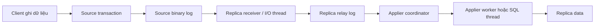

# Replication lag, relay log và cách đo độ trễ thực tế

Một replica MySQL có thể kết nối bình thường nhưng dữ liệu vẫn chậm hơn source vài giây, vài phút hoặc lâu hơn. Để tìm nguyên nhân, cần tách độ trễ thành hai chặng: **nhận sự kiện từ source** và **áp dụng sự kiện lên replica**. Relay log nằm giữa hai chặng này. Khi đo đúng từng phần, người vận hành biết replica đang chậm vì mạng/receiver, vì applier xử lý không kịp, hay vì phép đo đang phản ánh một khoảng thời gian không có giao dịch mới.

`Seconds_Behind_Source` là chỉ số tiện để quan sát nhanh, nhưng không mô tả đầy đủ độ mới của dữ liệu mà ứng dụng đọc được. Nên kết hợp trạng thái replication, lượng relay log tồn đọng, GTID đã nhận/chưa áp dụng, timestamp của transaction và heartbeat do ứng dụng ghi trên source.

## 1. Luồng nhận và áp dụng giao dịch

Trong replication bất đồng bộ thông thường, luồng dữ liệu có thể mô tả như sau:



Các bước diễn ra như sau:

1. Transaction commit trên source và được ghi vào binary log.
2. Receiver thread trên replica kết nối source, đọc binary log và ghi event nhận được vào relay log cục bộ.
3. Applier đọc event từ relay log, thực thi các thay đổi lên bảng của replica.
4. Khi transaction được áp dụng thành công, metadata replication được cập nhật và relay log đã xử lý có thể được dọn theo cơ chế quản lý của server.

Với cấu hình một applier thread, một luồng SQL đọc và áp dụng relay log. Khi bật multi-threaded applier, coordinator phân phối transaction cho nhiều worker theo các quan hệ phụ thuộc và quy tắc commit order. Một transaction lớn hoặc một worker bị khóa có thể khiến phần còn lại bị chậm, dù các worker khác vẫn hoạt động.

| Thành phần | Nhiệm vụ | Dấu hiệu có vấn đề |
|---|---|---|
| Source binary log | Lưu các transaction đã commit trên source | Log không được giữ đủ lâu hoặc không có log cần thiết để replica tiếp tục. |
| Receiver / I/O thread | Đọc binlog từ source và ghi relay log | Kết nối lỗi, mạng chậm, quyền replication sai, receiver dừng. |
| Relay log | Hàng đợi event trên replica chờ applier | Dung lượng tăng liên tục, transaction cũ nằm lâu chưa được áp dụng. |
| Applier coordinator | Lập lịch và theo dõi worker | Coordinator bị dừng hoặc chờ dependency/worker. |
| Applier worker | Thực thi transaction trên replica | Lock contention, lỗi duplicate key, thiếu row, DDL chậm hoặc thiếu tài nguyên. |

Trong MySQL 8.0.22 trở lên, thuật ngữ `SOURCE` và `REPLICA` thay thế dần `MASTER` và `SLAVE` trong nhiều câu lệnh, biến và cột trạng thái. Bài này dùng cú pháp mới như `SHOW REPLICA STATUS`, `START REPLICA`; trên bản cũ, tên tương ứng có thể là `SHOW SLAVE STATUS`, `START SLAVE`.

## 2. Relay log là gì và đọc nó như thế nào?

Relay log là tập file trên replica lưu các event đã nhận từ binary log của source nhưng chưa nhất thiết đã được áp dụng. Nó có định dạng event tương tự binary log, gồm transaction, row event, statement event và các metadata cần thiết để applier xử lý. Relay log thường có file index để theo dõi thứ tự các file.

Một số trường trong `SHOW REPLICA STATUS` giúp định vị receiver và applier:

| Trường | Ý nghĩa |
|---|---|
| `Relay_Log_File`, `Relay_Log_Pos` | File và vị trí hiện tại trong relay log mà applier đang xử lý. |
| `Relay_Source_Log_File` | File binary log của source chứa event mà applier đang xử lý hoặc đã xử lý đến. |
| `Exec_Source_Log_Pos` | Position trên binary log source tương ứng với tiến độ áp dụng. |
| `Source_Log_File`, `Read_Source_Log_Pos` | File và position mà receiver đã đọc từ source. |
| `Relay_Log_Space` | Tổng dung lượng relay log hiện có trên replica, tính bằng byte. |

Các position chỉ so sánh trực tiếp được trong cùng một file. Không lấy `Read_Source_Log_Pos - Exec_Source_Log_Pos` nếu hai trường thuộc hai file khác nhau. Khi file đã rotate, hãy so sánh cả tên file, GTID set và trạng thái transaction; một phép trừ position đơn lẻ có thể cho kết quả vô nghĩa.

Có thể xem event trong relay log bằng:

```sql
SHOW RELAYLOG EVENTS
IN 'replica-relay.000015'
FROM 4
LIMIT 30;
```

Tên file thực tế lấy từ `Relay_Log_File` hoặc relay log index. Lệnh này giúp quan sát thứ tự event, position và loại event. Khi cần xem row change, hãy đọc bản binary log tương ứng bằng `mysqlbinlog` với `--verbose --base64-output=DECODE-ROWS`; các dòng `###` chỉ phục vụ phân tích, không phải câu SQL để replay.

Không xóa hoặc sửa relay log bằng tay. Server quản lý vị trí đọc, file index và metadata applier; thay đổi file bên ngoài có thể làm sai lệch trạng thái replication. Nếu relay log bị hỏng sau sự cố, hãy dùng quy trình khôi phục đã kiểm chứng. Tùy topology và cấu hình, `relay_log_recovery=ON` có thể yêu cầu replica bỏ relay log chưa áp dụng và lấy lại từ source khi khởi động; điều này chỉ khả thi nếu source còn giữ đủ binary log và metadata replication/GTID còn đáng tin cậy.

## 3. Kiểm tra nhanh trạng thái replica

Trên MySQL 8.0.22 trở lên, chạy:

```sql
SHOW REPLICA STATUS\G
```

Các trường nên xem cùng nhau:

- `Replica_IO_Running`: receiver thread có đang chạy không.
- `Replica_SQL_Running`: applier có đang chạy không.
- `Seconds_Behind_Source`: ước lượng độ trễ dựa trên timestamp event.
- `Last_IO_Error`, `Last_SQL_Error`: lỗi gần nhất của receiver và applier.
- `Source_Log_File`, `Read_Source_Log_Pos`: tiến độ nhận từ source.
- `Relay_Source_Log_File`, `Exec_Source_Log_Pos`: tiến độ áp dụng.
- `Relay_Log_Space`: dung lượng relay log.
- `Retrieved_Gtid_Set`, `Executed_Gtid_Set`: tập GTID đã nhận và tập GTID đã thực thi trên replica.
- `Replica_SQL_Running_State`: trạng thái hiện tại của applier, hữu ích để nhận ra nó đang chờ event, dependency hay lock.

Không kết luận replica khỏe chỉ vì `Replica_IO_Running` và `Replica_SQL_Running` đều là `Yes`. Hai thread có thể chạy nhưng applier vẫn chậm, hoặc replica có lỗi logic/dữ liệu mà trạng thái kết nối không phản ánh. Ngược lại, nếu một thread là `No`, hãy đọc thông tin lỗi trước khi restart thread; restart lặp lại không xử lý được nguyên nhân như duplicate key, thiếu row hoặc thiếu binary log.

Với nhiều replication channel, kiểm tra từng channel:

```sql
SHOW REPLICA STATUS FOR CHANNEL 'orders_channel'\G
```

Các bảng Performance Schema cũng có `CHANNEL_NAME`, vì vậy cần nhóm và giám sát theo channel thay vì gộp mọi luồng vào một số liệu chung.

## 4. Phân biệt receive lag và apply lag

### Receive lag: replica chưa nhận kịp source

Receive lag xuất hiện khi receiver chưa đọc được các event mới nhất từ source. Những nguyên nhân thường gặp là:

- Mạng giữa source và replica có độ trễ, mất gói hoặc băng thông không đủ.
- Receiver thread bị dừng do lỗi kết nối, quyền truy cập hoặc cấu hình source.
- Source quá tải, binary log khó đọc kịp hoặc replica bị giới hạn tài nguyên khi ghi relay log.
- Source đã purge file mà replica cần đọc, khiến replica không thể tiếp tục từ coordinate hiện tại.

Dấu hiệu điển hình: `Read_Source_Log_Pos`/`Source_Log_File` không tiến lên trong khi source vẫn có transaction mới; `Retrieved_Gtid_Set` không tăng; `Replica_IO_Running` là `No` hoặc `Connecting`; `Last_IO_Error` có nội dung. Nếu receiver đã nhận hết event hiện có và source đang nhàn rỗi, không có receive backlog dù replica không có giao dịch mới để nhận.

### Apply lag: relay log đã nhận nhưng chưa áp dụng kịp

Apply lag xuất hiện khi receiver vẫn nhận event nhưng applier không xử lý kịp. Dấu hiệu thường gặp:

- `Retrieved_Gtid_Set` tăng nhanh hơn `Executed_Gtid_Set`.
- `Relay_Log_Space` tăng kéo dài thay vì trở về mức nền.
- `Source_Log_File`/`Read_Source_Log_Pos` tiến xa hơn `Relay_Source_Log_File`/`Exec_Source_Log_Pos`.
- `Replica_SQL_Running_State` cho thấy worker đang chạy transaction lâu, chờ lock hoặc chờ transaction phụ thuộc.
- Worker hoặc coordinator có lỗi SQL, làm tiến độ áp dụng bị dừng.

Một relay log lớn tại một thời điểm chưa đủ để kết luận có sự cố: có thể source vừa tạo một transaction lớn hoặc replica đang xử lý một đợt tải ngắn. Hãy quan sát xu hướng theo thời gian và xem backlog có tiếp tục tăng hay giảm.

## 5. Đọc các chỉ số trong Performance Schema

`performance_schema.replication_connection_status` cung cấp trạng thái của receiver, bao gồm GTID set đã nhận và timestamp của transaction mới nhất được đưa vào relay log:

```sql
SELECT
    CHANNEL_NAME,
    SERVICE_STATE,
    RECEIVED_TRANSACTION_SET,
    LAST_QUEUED_TRANSACTION,
    LAST_QUEUED_TRANSACTION_ORIGINAL_COMMIT_TIMESTAMP,
    LAST_QUEUED_TRANSACTION_IMMEDIATE_COMMIT_TIMESTAMP,
    LAST_QUEUED_TRANSACTION_END_QUEUE_TIMESTAMP,
    LAST_ERROR_NUMBER,
    LAST_ERROR_MESSAGE
FROM performance_schema.replication_connection_status;
```

Các cột `ORIGINAL_COMMIT_TIMESTAMP` và `IMMEDIATE_COMMIT_TIMESTAMP` giúp phân biệt thời điểm commit ở source gốc và source trực tiếp đang gửi cho replica. Điều này hữu ích trong topology nhiều tầng: một transaction có thể đi qua nhiều replica trước khi đến replica hiện tại.

Để kiểm tra worker đang áp dụng transaction nào và transaction gần nhất đã hoàn tất:

```sql
SELECT
    CHANNEL_NAME,
    WORKER_ID,
    SERVICE_STATE,
    LAST_APPLIED_TRANSACTION,
    LAST_APPLIED_TRANSACTION_ORIGINAL_COMMIT_TIMESTAMP,
    LAST_APPLIED_TRANSACTION_IMMEDIATE_COMMIT_TIMESTAMP,
    LAST_APPLIED_TRANSACTION_END_APPLY_TIMESTAMP,
    APPLYING_TRANSACTION,
    LAST_ERROR_NUMBER,
    LAST_ERROR_MESSAGE
FROM performance_schema.replication_applier_status_by_worker
ORDER BY CHANNEL_NAME, WORKER_ID;
```

Coordinator có thể được kiểm tra riêng:

```sql
SELECT
    CHANNEL_NAME,
    SERVICE_STATE,
    LAST_ERROR_NUMBER,
    LAST_ERROR_MESSAGE
FROM performance_schema.replication_applier_status_by_coordinator;
```

Khi xem timestamp, cần phân biệt ba khoảng thời gian:

1. **Commit đến queue**: từ lúc transaction commit trên source đến lúc receiver đưa transaction vào relay log. Đây là phần liên quan đến truyền nhận.
2. **Queue đến apply**: từ lúc transaction đã nằm trong relay log đến lúc worker hoàn tất áp dụng. Đây là phần liên quan đến xử lý trên replica.
3. **Commit nguồn đến hiện tại**: độ tuổi của transaction mới nhất đã áp dụng. Đây là tín hiệu về độ mới dữ liệu, nhưng cần đối chiếu với heartbeat hoặc transaction mới nhất trên source để tránh hiểu nhầm khi source không phát sinh ghi mới.

Ví dụ, `LAST_QUEUED_TRANSACTION_ORIGINAL_COMMIT_TIMESTAMP` mới nhưng `LAST_APPLIED_TRANSACTION_ORIGINAL_COMMIT_TIMESTAMP` của các worker còn cũ cho thấy receiver đã nhận transaction mới hơn trong khi applier còn khoảng cách. Nếu cả hai timestamp cùng tiến và relay log ổn định, replica có thể đang bắt kịp. Với multi-threaded applier, hãy xem tất cả worker; một worker chậm có thể tạo khoảng trễ dù worker khác vẫn hoàn tất giao dịch mới hơn.

Tên cột và mức chi tiết của Performance Schema phụ thuộc phiên bản MySQL. Nếu một cột không có trên bản đang dùng, kiểm tra schema của bảng bằng `DESCRIBE performance_schema.replication_connection_status` hoặc `DESCRIBE performance_schema.replication_applier_status_by_worker` và dùng các trường tương ứng được phiên bản hỗ trợ.

## 6. Dùng GTID set để nhìn backlog

Với GTID replication, `Retrieved_Gtid_Set` biểu diễn các GTID đã nhận từ source; `Executed_Gtid_Set` biểu diễn GTID đã thực thi trên server. Hiệu của hai tập giúp nhận diện transaction đã nhận nhưng chưa thực thi:

```sql
SELECT GTID_SUBTRACT(
    (SELECT RECEIVED_TRANSACTION_SET
     FROM performance_schema.replication_connection_status
     WHERE CHANNEL_NAME = ''),
    @@GLOBAL.gtid_executed
) AS received_but_not_executed;
```

Kết quả là một GTID set, có thể chứa nhiều khoảng giao dịch. Nó **không phải số giây trễ** và cũng không phải số transaction đơn giản để cộng từ các khoảng. Dùng nó để xác nhận có backlog GTID và đối chiếu với trạng thái worker.

Trong môi trường multi-source, `@@GLOBAL.gtid_executed` là tập GTID đã thực thi trên toàn server, không chỉ một channel. Hãy diễn giải phép trừ theo đúng topology, tránh coi kết quả của một channel là toàn bộ backlog của server. Khi không bật GTID, dùng coordinate, relay log và timestamp trong Performance Schema để đánh giá tiến độ.

GTID set cũng không cho biết transaction nào đang chạy dở hoặc transaction nào chậm do lock. Nó là bằng chứng về tập giao dịch đã nhận/đã thực thi; cần kết hợp trạng thái worker để tìm nguyên nhân.

## 7. Vì sao Seconds_Behind_Source chưa đủ?

`Seconds_Behind_Source` là chỉ số dễ đọc trong `SHOW REPLICA STATUS`, nhưng cần hiểu giới hạn:

- Nó dựa vào timestamp của event và thời gian trên replica; clock giữa source và replica lệch sẽ làm số đo sai.
- Giá trị `NULL` thường cho biết độ trễ không xác định được, chẳng hạn receiver hoặc applier không chạy. Cần đọc trạng thái thread và lỗi đi kèm.
- Giá trị `0` không chứng minh mọi worker đều không có việc tồn đọng trong mọi tình huống; hãy kiểm tra relay log, GTID và worker.
- Một giá trị tăng đột biến có thể do một transaction lớn vừa commit hoặc applier đang xử lý một transaction dài.
- Trong replication nhiều tầng, cần xác định timestamp đang phản ánh source gốc hay source trực tiếp.

Vì vậy, dùng chỉ số này để phát hiện nhanh, sau đó xác nhận bằng heartbeat và các trạng thái receiver/applier. Không dùng một lần đọc `Seconds_Behind_Source = 0` làm bằng chứng duy nhất để failover hoặc tuyên bố dữ liệu replica hoàn toàn mới.

## 8. Đo độ mới thực tế bằng heartbeat

Heartbeat là một transaction nhỏ được ghi định kỳ trên source và được replicate sang replica. Trên replica, lấy thời gian hiện tại trừ timestamp được ghi trong heartbeat để ước lượng dữ liệu đang chậm bao lâu so với source. Cách này đo end-to-end freshness gần với trải nghiệm đọc dữ liệu của ứng dụng.

Tạo bảng trên source:

```sql
CREATE DATABASE IF NOT EXISTS replication_monitor;

CREATE TABLE replication_monitor.replication_heartbeat (
    id TINYINT UNSIGNED NOT NULL PRIMARY KEY,
    sequence_no BIGINT UNSIGNED NOT NULL,
    source_utc DATETIME(6) NOT NULL
) ENGINE = InnoDB;

INSERT INTO replication_monitor.replication_heartbeat
    (id, sequence_no, source_utc)
VALUES
    (1, 1, UTC_TIMESTAMP(6));
```

Một job ứng dụng hoặc scheduler đáng tin cậy cập nhật hàng này đều đặn, ví dụ mỗi giây:

```sql
INSERT INTO replication_monitor.replication_heartbeat
    (id, sequence_no, source_utc)
VALUES
    (1, 1, UTC_TIMESTAMP(6))
ON DUPLICATE KEY UPDATE
    sequence_no = sequence_no + 1,
    source_utc = UTC_TIMESTAMP(6);
```

Job chỉ chạy ghi trên source. Không tạo một heartbeat độc lập trên replica, vì thao tác đó không đo được replication. Sau khi bảng và các lần cập nhật đã replicate, chạy trên replica:

```sql
SELECT
    sequence_no,
    source_utc,
    UTC_TIMESTAMP(6) AS replica_utc,
    TIMESTAMPDIFF(
        MICROSECOND,
        source_utc,
        UTC_TIMESTAMP(6)
    ) / 1000000.0 AS heartbeat_lag_seconds
FROM replication_monitor.replication_heartbeat
WHERE id = 1;
```

Nếu `heartbeat_lag_seconds` là 2.4, replica đang nhìn thấy heartbeat cũ hơn thời gian hiện tại khoảng 2.4 giây. Chỉ số này phản ánh thời gian thực tế mà heartbeat mất để xuất hiện trên replica, bao gồm cả nhận và áp dụng. Đồng hồ source và replica phải được đồng bộ; nếu kết quả âm hoặc nhảy bất thường, kiểm tra NTP/chrony và timezone trước khi kết luận replication sai.

Heartbeat cũng có giới hạn: nếu job ghi heartbeat bị dừng, timestamp sẽ cũ dù replication đã bắt kịp; nếu chu kỳ ghi là 5 giây, phép đo có độ phân giải thực tế theo chu kỳ đó. Hãy giám sát cả độ khỏe của job trên source, `sequence_no`, thời điểm ghi gần nhất và độ trễ trên replica. Trong hệ thống nhiều source/channel, tạo heartbeat riêng cho từng luồng để biết dữ liệu nào đang cũ.

## 9. Đọc xu hướng để tìm nguyên nhân

Đo các chỉ số định kỳ, ví dụ mỗi 5 hoặc 10 giây, rồi so sánh xu hướng:

| Quan sát | Diễn giải có khả năng | Hướng điều tra |
|---|---|---|
| Receiver dừng, GTID nhận không tăng, `Last_IO_Error` có lỗi | Không lấy được event mới từ source | Kiểm tra mạng, DNS, quyền replication, source availability, TLS và binary log retention. |
| Receiver chạy, GTID nhận tăng nhưng GTID thực thi tăng chậm | Applier không theo kịp | Xem relay log space, worker state, lock wait, transaction lớn và tải I/O/CPU. |
| Relay log tăng liên tục qua nhiều chu kỳ | Tốc độ nhận lớn hơn tốc độ áp dụng trong thời gian dài | Xác định transaction/DDL gây nghẽn, tăng khả năng apply hoặc giảm tải ghi. |
| Relay log lớn rồi giảm về mức nền | Một đợt tải tăng tạm thời đã được xử lý | Kiểm tra thời gian bắt kịp và xác nhận không còn lỗi. |
| Một worker có `APPLYING_TRANSACTION` lâu | Transaction đang chạy chậm hoặc bị chặn | Kiểm tra metadata lock, InnoDB lock waits, truy vấn và bảng nóng. |
| SQL/applier thread dừng với lỗi duplicate key hoặc missing row | Dữ liệu source và replica đã lệch hoặc có ghi ngoài replication | Đối chiếu dữ liệu, xác định nguyên nhân; không bỏ qua transaction một cách tùy tiện. |
| Heartbeat cũ nhưng relay log trống | Heartbeat job có thể dừng, clock lệch hoặc luồng heartbeat không đúng channel | Kiểm tra job nguồn, sequence, clock và đường replicate của bảng heartbeat. |

Các nguyên nhân apply lag phổ biến gồm transaction cập nhật quá nhiều hàng, DDL chặn thao tác, khóa cạnh tranh trên replica, thiếu index khiến applier phải quét nhiều hàng, storage chậm, CPU thiếu, trigger/foreign key tăng chi phí, hoặc nhiều transaction phụ thuộc nhau khiến parallel workers không thể chạy song song.

Để chẩn đoán lock và tải, kết hợp `SHOW PROCESSLIST`, `performance_schema.data_lock_waits`, `performance_schema.events_statements_current`, `SHOW ENGINE INNODB STATUS` và các chỉ số CPU, disk latency, IOPS, buffer pool. Đọc trạng thái worker trước để biết transaction nào đang bị kẹt, sau đó đối chiếu với lock wait và câu lệnh tương ứng.

## 10. Giảm lag và thiết kế giám sát

Chỉ tăng số worker không đảm bảo replication nhanh hơn. Hãy xử lý nguyên nhân trước:

1. **Giải quyết receiver lag.** Đảm bảo mạng ổn định, băng thông đủ, receiver không bị lỗi, source còn giữ binary log và replica có đủ tài nguyên ghi relay log.
2. **Giảm transaction quá lớn.** Chia batch ghi lớn thành các transaction nhỏ có ranh giới nghiệp vụ rõ ràng; điều này giúp applier có cơ hội xử lý và dễ theo dõi hơn.
3. **Giảm tranh chấp.** Tránh nhiều transaction ghi cùng một hàng nóng; xử lý lock wait, metadata lock và DDL kéo dài.
4. **Bổ sung index phù hợp.** Replica cần index để tìm hàng nhanh khi áp dụng row event; thay đổi schema và index phải được triển khai đồng nhất, có kiểm soát.
5. **Dùng parallel applier có đo lường.** Điều chỉnh `replica_parallel_workers` khi workload có transaction độc lập; quan sát worker utilization và commit order. Nếu bật `replica_preserve_commit_order`, cần tính đến việc worker có thể chờ transaction trước để giữ thứ tự commit.
6. **Bảo đảm tài nguyên.** Theo dõi CPU, disk latency, IOPS, memory, buffer pool và dung lượng relay log; tránh để backup hoặc truy vấn phân tích cạnh tranh I/O với applier.
7. **Giữ source log đủ lâu.** Retention phải bao phủ thời gian replica có thể gián đoạn cộng thêm thời gian xử lý sự cố và dựng lại.

Một dashboard replication hữu ích nên theo dõi theo từng channel:

- `Seconds_Behind_Source` cùng trạng thái receiver/applier và lỗi mới nhất.
- Heartbeat lag và tuổi của heartbeat gần nhất.
- `Relay_Log_Space` và tốc độ tăng/giảm theo thời gian.
- `Retrieved_Gtid_Set`, `Executed_Gtid_Set` hoặc GTID set nhận nhưng chưa áp dụng.
- Timestamp transaction mới nhất được queue và được worker apply.
- Trạng thái từng worker, transaction đang chạy và lỗi coordinator.
- Tài nguyên source/replica: CPU, I/O latency, dung lượng đĩa và network throughput.

Đặt ngưỡng cảnh báo theo yêu cầu RPO và mức trễ ứng dụng chấp nhận được. Nên cảnh báo khi heartbeat vượt ngưỡng liên tục trong nhiều chu kỳ, relay log tăng không giảm, thread dừng hoặc có replication error. Một spike ngắn có thể chỉ là transaction lớn; xu hướng kéo dài mới cho thấy replica không bắt kịp tải.

## 11. Checklist xác nhận replica đã bắt kịp

- [ ] Receiver và applier đang chạy, không có `Last_IO_Error` hoặc `Last_SQL_Error` mới.
- [ ] `Retrieved_Gtid_Set` và `Executed_Gtid_Set` đã được đối chiếu; backlog GTID đã về mức mong đợi.
- [ ] `Relay_Log_Space` ổn định hoặc trở về mức nền sau khi xử lý tải.
- [ ] Worker không còn transaction bất thường kéo dài hoặc bị chặn.
- [ ] Heartbeat được cập nhật đều trên source và độ trễ đọc trên replica nằm trong ngưỡng.
- [ ] Đồng hồ source/replica đồng bộ và timestamp được diễn giải cùng timezone.
- [ ] Dữ liệu nghiệp vụ quan trọng được đối soát khi có sự cố lệch dữ liệu.
- [ ] Mỗi channel trong topology multi-source được kiểm tra riêng.

Replication lag là kết quả của nhiều chặng. Relay log cho biết event đã đến replica nhưng còn chờ áp dụng; GTID set cho biết transaction nào đã nhận và đã thực thi; Performance Schema cho thấy receiver và từng worker đang làm gì; heartbeat cho biết dữ liệu mà ứng dụng đọc được cũ hơn source bao lâu. Kết hợp các phép đo này giúp phân biệt sự cố truyền nhận, nghẽn áp dụng và lỗi của chính hệ thống giám sát, từ đó đưa ra quyết định vận hành dựa trên độ mới dữ liệu thực tế.
