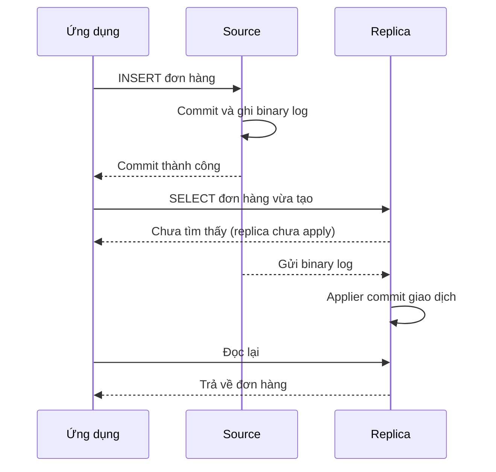

# Read-after-write khi ứng dụng đọc qua replica

Trong MySQL replication bất đồng bộ, một giao dịch có thể đã commit trên source nhưng chưa được replica áp dụng. Nếu ứng dụng ghi một đơn hàng vào source rồi lập tức đọc đơn đó từ replica, truy vấn có thể trả về dữ liệu cũ hoặc không tìm thấy đơn hàng. Đây là hiện tượng đọc sau ghi không nhất quán (*read-after-write inconsistency*).

Read-after-write là yêu cầu nhất quán theo phiên: sau khi một thao tác ghi đã được xác nhận thành công, các lần đọc tiếp theo của cùng luồng nghiệp vụ phải nhìn thấy ít nhất thay đổi đó. Ứng dụng có thể đạt yêu cầu bằng cách tiếp tục đọc từ source, hoặc chờ replica áp dụng giao dịch cần thiết rồi mới đọc. Việc chọn cách nào phụ thuộc độ trễ, tải hệ thống và mức nhất quán mà nghiệp vụ yêu cầu.

Trong module `DATABASE_MYSQL`, bài học này kết nối replication và GTID với cách ứng dụng định tuyến truy vấn, quản lý connection pool và kiểm tra dữ liệu. Sau bài học, bạn có thể:

- Giải thích vì sao replica có thể trả về dữ liệu cũ ngay sau khi source commit.
- Chọn chiến lược đọc sau ghi phù hợp cho từng luồng nghiệp vụ.
- Dùng GTID làm dấu mốc để chờ replica áp dụng giao dịch.
- Xử lý timeout và chuyển truy vấn sang source an toàn.
- Nhận biết giới hạn của `Seconds_Behind_Source`, semi-synchronous replication và bộ cân bằng tải.
- Kiểm thử read-after-write bằng dữ liệu nghiệp vụ và đo ảnh hưởng tới độ trễ.

## 1. Vì sao đọc từ replica có thể thấy dữ liệu cũ?

Trong kiến trúc source-replica thông thường, ứng dụng gửi lệnh ghi đến source. Source thực hiện giao dịch và ghi các sự kiện thay đổi vào binary log. Replica nhận sự kiện, ghi vào relay log rồi applier thread hoặc các worker áp dụng thay đổi vào dữ liệu của replica.

Hai giai đoạn nhận và áp dụng diễn ra bất đồng bộ. Vì vậy, có một khoảng thời gian mà source đã có dữ liệu mới nhưng replica vẫn giữ trạng thái trước đó.



Ví dụ, người dùng đặt hàng thành công và ngay sau đó mở trang chi tiết. Nếu truy vấn chi tiết được định tuyến sang replica đang trễ, trang có thể hiển thị “không tìm thấy đơn hàng” dù giao dịch ghi đã thành công. Một ví dụ khác là người dùng cập nhật địa chỉ giao hàng, nhưng lần đọc tiếp theo vẫn trả về địa chỉ cũ.

Đây là đặc tính của replication bất đồng bộ, không nhất thiết là lỗi mất dữ liệu. Nếu replica tiếp tục hoạt động và không có lỗi replication, dữ liệu thường sẽ hội tụ sau khi applier xử lý xong các giao dịch đang chờ.

## 2. Xác định mức nhất quán cần cho từng thao tác

Không phải mọi truy vấn đều cần đọc dữ liệu mới nhất từ source. Một trang thống kê hoặc danh sách sản phẩm có thể chấp nhận dữ liệu trễ vài giây. Các luồng sau ghi thường cần đảm bảo read-after-write:

- Người dùng vừa tạo đơn cần xem ngay đơn đó.
- Người dùng cập nhật hồ sơ rồi mở lại màn hình hồ sơ.
- Hệ thống vừa ghi nhận thanh toán cần hiển thị trạng thái giao dịch mới.
- Người dùng thêm hàng vào giỏ và cần thấy số lượng vừa cập nhật.
- Một thao tác quản trị vừa thay đổi quyền hoặc cấu hình và cần xác nhận kết quả.

Hãy phân loại truy vấn theo yêu cầu nghiệp vụ:

| Loại truy vấn | Chiến lược thường phù hợp | Lý do |
|---|---|---|
| Đọc ngay sau khi ghi trong cùng luồng | Đọc source hoặc chờ replica theo GTID | Cần nhìn thấy giao dịch vừa commit |
| Báo cáo, dashboard tổng hợp | Có thể đọc replica với độ trễ chấp nhận được | Dữ liệu trễ nhỏ thường không ảnh hưởng quyết định tức thời |
| Trang nội dung ít thay đổi | Đọc replica hoặc cache | Không cần nhất quán tức thời |
| Đối soát, kiểm tra số dư hoặc trạng thái thanh toán | Source hoặc cơ chế chờ causal consistency đã kiểm chứng | Dữ liệu cũ có thể dẫn tới quyết định nghiệp vụ sai |
| Truy vấn đọc sau ghi từ nhiều request khác nhau | Dùng session token/GTID watermark hoặc giữ affinity theo người dùng | Request sau có thể được xử lý bởi worker hoặc replica khác |

Mức nhất quán cần được xác định theo nghiệp vụ, không nên bật mọi truy vấn đọc sang source vì điều đó có thể làm tăng tải source và giảm lợi ích của read scaling.

## 3. Các cách bảo đảm read-after-write

### 3.1. Đọc source sau khi ghi

Đây là cách đơn giản nhất. Sau khi ghi thành công, ứng dụng tiếp tục gửi các truy vấn phụ thuộc vào thay đổi đó tới source. Khi luồng nghiệp vụ kết thúc hoặc hết khoảng thời gian cần nhất quán, ứng dụng có thể quay lại đọc replica.

Ví dụ:

```text
POST /orders
  -> ghi orders và order_items trên source
  -> COMMIT thành công
  -> trả order_id

GET /orders/{order_id}
  -> định tuyến tới source trong luồng vừa tạo đơn
  -> trả về dữ liệu mới
```

Có thể triển khai bằng cách gắn cờ “đọc primary” vào session hoặc request context. Cờ này phải theo được qua các lần gọi dịch vụ có liên quan; nếu request tiếp theo chạy ở một worker khác, ứng dụng cần truyền thông tin nhất quán theo cách được kiểm soát.

Ưu điểm là dễ hiểu, không cần đợi replication. Nhược điểm là source nhận thêm truy vấn đọc và cần có chính sách xác định khi nào được quay lại replica. Đây thường là lựa chọn tốt cho các thao tác nhạy cảm hoặc khi không thể lấy GTID từ driver.

### 3.2. Chờ replica áp dụng giao dịch bằng GTID

Nếu topology bật GTID, ứng dụng có thể lấy một GTID set sau khi giao dịch commit trên source rồi yêu cầu replica chờ cho đến khi set đó đã được thực thi. MySQL cung cấp hàm:

```sql
WAIT_FOR_EXECUTED_GTID_SET(gtid_set, timeout)
```

Hàm chờ trên máy chủ hiện tại cho tới khi tất cả GTID trong `gtid_set` xuất hiện trong tập GTID đã thực thi. Giá trị trả về:

- `0`: replica đã thực thi toàn bộ GTID được yêu cầu.
- `1`: hết thời gian chờ trước khi thực thi xong.
- `NULL`: xảy ra lỗi khi chờ; cần kiểm tra thông tin lỗi và trạng thái kết nối.

Tham số `timeout` tính bằng giây. Hãy đặt giới hạn phù hợp với SLA của request; không chờ vô hạn trong luồng HTTP hoặc transaction của ứng dụng.

### 3.3. Điều kiện cần có

Trước khi dùng cách chờ GTID, xác nhận:

- `gtid_mode=ON` và `enforce_gtid_consistency=ON` được cấu hình theo chính sách topology.
- Source và replica có cấu hình GTID tương thích.
- Replica theo dõi đúng source và đã được cấu hình tự động định vị bằng GTID khi kiến trúc sử dụng cách này.
- Replica không có replication filter loại bỏ schema hoặc bảng cần đọc.
- Ứng dụng có thể lấy watermark sau commit và gửi nó tới đúng replica sẽ phục vụ truy vấn.
- Driver và connection pool không làm mất hoặc trộn watermark giữa các request.

Ví dụ một cấu hình replication dùng thuật ngữ MySQL mới:

```sql
CHANGE REPLICATION SOURCE TO
    SOURCE_HOST = 'source-db.example',
    SOURCE_USER = 'repl_user',
    SOURCE_PASSWORD = 'secret-from-secret-manager',
    SOURCE_AUTO_POSITION = 1;

START REPLICA;
```

Đây là ví dụ cấu hình minh họa; tài khoản replication và thông tin xác thực phải được tạo, cấp quyền và lưu trữ an toàn. Không đặt mật khẩu thật trực tiếp trong script hoặc repository. Cú pháp có thể khác ở các phiên bản MySQL cũ.

## 4. Lấy GTID watermark sau khi commit

Ứng dụng cần biết giao dịch nào phải được replica nhìn thấy. Có nhiều cách lấy GTID. Cách cụ thể phụ thuộc phiên bản MySQL và khả năng session-state tracking của connector.

### 4.1. Dùng GTID set toàn cục làm watermark

Một cách đơn giản trong topology source-replica đơn là đọc `@@GLOBAL.gtid_executed` trên source sau khi commit:

```sql
START TRANSACTION;

INSERT INTO shop.orders (customer_id, order_status, total_amount)
VALUES (42, 'CREATED', 125000.00);

SET @new_order_id = LAST_INSERT_ID();

INSERT INTO shop.order_items (order_id, product_id, quantity, unit_price)
VALUES (@new_order_id, 9001, 1, 125000.00);

COMMIT;

SELECT @new_order_id AS order_id,
       @@GLOBAL.gtid_executed AS required_gtid_set;
```

Sau `COMMIT`, truy vấn `@@GLOBAL.gtid_executed` trả về một tập GTID đã thực thi trên source tại thời điểm đọc. Tập này bao gồm giao dịch vừa commit. Ứng dụng lưu chuỗi GTID set và chuyển nó cùng request hoặc session context tới bước đọc replica.

Đây là watermark bảo thủ: nó có thể chứa cả giao dịch khác được commit đồng thời hoặc trước thời điểm truy vấn. Replica phải thực thi toàn bộ set, nên có thể chờ lâu hơn mức cần thiết cho riêng giao dịch của người dùng. Trong topology phức tạp hoặc lưu lượng ghi lớn, nên cân nhắc lấy GTID chính xác của giao dịch qua cơ chế session tracking nếu phiên bản server và connector hỗ trợ.

### 4.2. Lấy GTID chính xác của session

MySQL hỗ trợ cơ chế session tracking cho GTID của giao dịch do session hiện tại thực hiện, thông qua cấu hình `session_track_gtids` và khả năng nhận session-state change trong giao thức client. Với chế độ `OWN_GTID`, server có thể gửi GTID của giao dịch của session trong gói phản hồi commit.

Để dùng cơ chế này, phải xác nhận phiên bản MySQL, cấu hình server và connector có thương lượng capability theo dõi session state và cung cấp GTID cho ứng dụng. API truy cập dữ liệu session state khác nhau giữa các connector. Không giả định rằng mọi driver đều tự động trả GTID trong kết quả `COMMIT`.

Nếu connector không hỗ trợ session tracking, watermark `@@GLOBAL.gtid_executed` đọc sau commit là cách đơn giản trong topology phù hợp; hoặc ứng dụng có thể giữ các lần đọc phụ thuộc trên source. Không cố lấy GTID bằng cách so sánh hai lần đọc global set trong môi trường ghi đồng thời rồi cho rằng phần chênh lệch chỉ thuộc về giao dịch của mình.

## 5. Chờ GTID trên replica trước khi đọc

Sau khi chọn replica, ứng dụng gửi GTID set cần nhìn thấy tới chính kết nối replica đó:

```sql
SELECT WAIT_FOR_EXECUTED_GTID_SET(?, 2) AS wait_result;
```

Tham số thứ nhất phải được truyền bằng prepared statement hoặc binding của connector. Ví dụ dưới đây minh họa logic phía ứng dụng, không phải một API driver cụ thể:

```text
1. Ghi giao dịch trên source.
2. COMMIT thành công.
3. Lấy required_gtid_set từ source.
4. Chọn một replica và mở connection tới replica đó.
5. Gọi WAIT_FOR_EXECUTED_GTID_SET(required_gtid_set, timeout).
6. Nếu kết quả = 0: chạy SELECT trên cùng connection replica.
7. Nếu kết quả = 1 hoặc NULL: fallback sang source hoặc trả lỗi có kiểm soát.
```

Ví dụ truy vấn kiểm tra trực tiếp:

```sql
SELECT WAIT_FOR_EXECUTED_GTID_SET(
    'aaaaaaaa-bbbb-cccc-dddd-eeeeeeeeeeee:1-105',
    2
) AS wait_result;
```

Chuỗi GTID trong ví dụ là giả định. Một GTID set thực tế có thể chứa nhiều UUID và nhiều khoảng số thứ tự; hãy truyền nguyên chuỗi do MySQL trả về, không tự ghép hoặc cắt khoảng GTID.

Khi hàm trả về `0`, chạy truy vấn đọc trên cùng replica:

```sql
SELECT order_id, order_status, total_amount
FROM shop.orders
WHERE order_id = ?;
```

Điều kiện quan trọng là phải đọc từ đúng replica đã hoàn tất việc chờ. Nếu ứng dụng chờ trên replica A rồi bộ cân bằng tải chuyển câu `SELECT` sang replica B, replica B vẫn có thể chưa áp dụng giao dịch. Hãy giữ connection hoặc ghim truy vấn vào cùng replica trong toàn bộ thao tác.

Có thể kiểm tra trạng thái đã hội tụ bằng `GTID_SUBSET()`:

```sql
SELECT GTID_SUBSET(
    'aaaaaaaa-bbbb-cccc-dddd-eeeeeeeeeeee:1-105',
    @@GLOBAL.gtid_executed
) AS required_set_is_executed;
```

Kết quả `1` nghĩa là tập GTID yêu cầu là tập con của `@@GLOBAL.gtid_executed` trên replica; kết quả `0` nghĩa là vẫn còn GTID chưa được thực thi. Hàm này phù hợp để kiểm tra trạng thái tức thời. Nếu cần chờ, dùng `WAIT_FOR_EXECUTED_GTID_SET()` với timeout.

## 6. Xử lý timeout và lỗi replica

Không phải lần chờ nào cũng thành công. Replica có thể bị trễ do tải ghi cao, truy vấn chạy lâu, worker applier bị nghẽn, lỗi replication, thiếu kết nối source hoặc thiếu dung lượng đĩa.

Ứng dụng nên xử lý rõ ba trường hợp:

| Kết quả chờ | Ý nghĩa | Hành động đề xuất |
|---|---|---|
| `0` | Replica đã thực thi GTID set cần thiết | Đọc từ chính replica đã chờ thành công |
| `1` | Hết timeout, replica chưa bắt kịp | Chuyển truy vấn sang source hoặc thử replica khác với giới hạn tổng thời gian |
| `NULL` hoặc lỗi kết nối | Hàm chờ gặp lỗi hoặc replica không khả dụng | Ghi log, đánh dấu replica lỗi theo chính sách và fallback sang source |

Fallback phải giữ đúng ngữ nghĩa nghiệp vụ. Nếu truy vấn đọc được chuyển sang source, hãy bảo đảm nó dùng cùng dữ liệu định danh và cùng quyền truy cập như truy vấn trên replica. Không tự động retry một thao tác ghi khi chưa xác định tính idempotent; bài học này chỉ nói về truy vấn đọc sau ghi.

Ví dụ pseudocode:

```text
function readOrderAfterWrite(orderId, requiredGtidSet):
    replica = replicaPool.acquire()
    result = replica.waitForExecutedGtidSet(requiredGtidSet, 2 seconds)

    if result == APPLIED:
        return replica.queryOrder(orderId)

    logReplicaWaitFailure(replica, result, requiredGtidSet)
    replicaPool.releaseOrMarkUnhealthy(replica)
    return sourcePool.queryOrder(orderId)
```

Trong thực tế, tổng timeout cần bao gồm thời gian lấy connection, thời gian chờ GTID và thời gian chạy truy vấn. Tránh retry nhiều replica tuần tự với timeout đầy đủ cho mỗi replica vì tổng độ trễ có thể vượt SLA. Đặt giới hạn retry và giới hạn thời gian toàn request.

## 7. Vì sao Seconds_Behind_Source không đủ?

`SHOW REPLICA STATUS` cung cấp thông tin hữu ích để vận hành:

```sql
SHOW REPLICA STATUS\G
```

Một số trường thường được quan tâm:

- `Seconds_Behind_Source`: ước lượng độ trễ theo thời gian của replication.
- `Replica_IO_Running` và `Replica_SQL_Running`: trạng thái các luồng nhận và áp dụng.
- `Retrieved_Gtid_Set`: các GTID replica đã nhận.
- `Executed_Gtid_Set`: các GTID replica đã thực thi.
- `Last_IO_Error` và `Last_SQL_Error`: thông tin lỗi ở luồng nhận hoặc áp dụng.

`Seconds_Behind_Source` là chỉ số giám sát, không phải xác nhận rằng một giao dịch cụ thể đã được áp dụng. Giá trị này có thể bằng `0` trong lúc không có sự kiện mới để xử lý, có thể `NULL` khi replica không xác định được độ trễ hoặc luồng replication gặp vấn đề, và không thể diễn tả chính xác một GTID cụ thể đã hoàn tất hay chưa.

`Retrieved_Gtid_Set` cũng không tương đương `Executed_Gtid_Set`: nhận sự kiện vào relay log chưa có nghĩa dữ liệu đã được applier commit. Để bảo đảm read-after-write, cần chờ GTID xuất hiện trong tập đã thực thi, hoặc đọc source.

Tên lệnh và trường trạng thái phụ thuộc phiên bản. MySQL 8.0.22 trở lên dùng thuật ngữ `SHOW REPLICA STATUS`; bản cũ có thể dùng `SHOW SLAVE STATUS`. Kiểm tra tài liệu đúng phiên bản đang chạy.

## 8. Semi-synchronous replication có bảo đảm read-after-write không?

Semi-synchronous replication yêu cầu ít nhất một replica xác nhận đã nhận và ghi sự kiện vào relay log trước khi source xác nhận commit theo chế độ semi-sync. Cơ chế này giúp giảm nguy cơ mất các giao dịch đã được replica nhận khi source gặp sự cố, nhưng acknowledgement không có nghĩa replica đã áp dụng giao dịch vào bảng.

Do đó, semi-sync tự nó không bảo đảm rằng một truy vấn `SELECT` ngay sau commit trên replica sẽ nhìn thấy thay đổi. Nếu ứng dụng cần read-after-write trên replica, vẫn phải có cơ chế chờ tới khi giao dịch được thực thi, chẳng hạn chờ GTID trên đúng replica.

## 9. Các tình huống cần chú ý trong ứng dụng

### 9.1. Connection pool và request khác nhau

Ứng dụng thường ghi bằng một connection từ pool rồi trả connection về pool. Request đọc tiếp theo có thể chạy trên worker khác và lấy connection replica khác. Vì vậy, thông tin về giao dịch vừa commit phải được truyền qua request/session context hoặc token nhất quán, không chỉ lưu trong biến cục bộ của connection đã trả về pool.

Không đặt GTID watermark vào biến session MySQL rồi kỳ vọng một connection khác đọc được biến đó. Biến session chỉ tồn tại trong connection hiện tại. Hãy chuyển chuỗi GTID set qua tầng ứng dụng và binding vào câu lệnh chờ trên replica.

### 9.2. Nhiều replica và load balancing

Mỗi replica có thể có độ trễ khác nhau. Nếu bộ cân bằng tải chọn replica ngẫu nhiên cho mỗi truy vấn, một lần chờ thành công không bảo đảm truy vấn kế tiếp được gửi đến cùng node. Có hai cách:

- Ghim request hoặc session vào replica đã chờ thành công.
- Chạy hàm chờ GTID trên mỗi replica được chọn trước khi đọc từ node đó.

Nếu một replica timeout, có thể chọn replica khác, nhưng cần giới hạn số lần thử và tổng thời gian chờ. Nếu không node nào bắt kịp, fallback sang source.

### 9.3. Replication filter và topology nhiều nguồn

GTID là dấu nhận diện giao dịch, không phải chứng minh mọi bảng trong giao dịch đều được áp dụng trên mọi replica. Nếu replica dùng replication filter để bỏ qua schema hoặc bảng, việc một GTID được đánh dấu đã xử lý không đồng nghĩa dữ liệu bị lọc xuất hiện ở đó. Không dùng replica có filter loại bỏ dữ liệu nghiệp vụ cần đọc.

Trong topology nhiều nguồn (multi-source), GTID set có thể bao gồm giao dịch từ nhiều channel. Nếu ứng dụng lấy toàn bộ `@@GLOBAL.gtid_executed` từ một máy chủ rồi yêu cầu một replica chỉ theo dõi một phần nguồn chờ toàn bộ set, replica có thể timeout vì không bao giờ nhận một số GTID đó. Hãy dùng watermark phù hợp với lineage của replica hoặc GTID chính xác của giao dịch cần đọc.

### 9.4. Failover và đổi source

Khi failover, source mới có thể có GTID set khác với source cũ. Trước khi tiếp tục dùng watermark cũ, ứng dụng hoặc lớp định tuyến cần xác nhận topology mới chứa các giao dịch cần thiết. Nếu không thể chứng minh điều đó, đọc từ primary hiện tại theo quy trình failover đã được xác nhận và không cố ép một replica không cùng lineage đáp ứng watermark.

### 9.5. Giao dịch rollback

Chỉ phát hành watermark sau khi `COMMIT` thành công. Nếu transaction rollback hoặc commit trả lỗi chưa rõ kết quả do mất kết nối, ứng dụng không nên giả định giao dịch đã được commit hoặc chưa commit. Cần xác định trạng thái giao dịch bằng mã nghiệp vụ/idempotency key hoặc truy vấn source trước khi tạo luồng đọc tiếp theo.

## 10. Kiểm thử read-after-write

Hãy kiểm thử trên môi trường có replication thực tế thay vì chỉ mô phỏng bằng `sleep()` cố định. Một bài kiểm thử nên tạo nhiều giao dịch, đọc ngay sau commit và ghi nhận tỷ lệ đọc thấy dữ liệu mới.

Ví dụ bảng thử nghiệm:

```sql
CREATE TABLE shop.read_after_write_probe (
    probe_id BIGINT UNSIGNED NOT NULL AUTO_INCREMENT,
    request_token CHAR(36) NOT NULL,
    payload VARCHAR(100) NOT NULL,
    created_at TIMESTAMP(6) NOT NULL DEFAULT CURRENT_TIMESTAMP(6),
    PRIMARY KEY (probe_id),
    UNIQUE KEY uq_probe_request_token (request_token)
) ENGINE=InnoDB;
```

Luồng kiểm thử:

1. Sinh `request_token` duy nhất.
2. Insert bản ghi trên source và commit.
3. Lấy GTID watermark sau commit.
4. Đọc replica theo hai chế độ: đọc ngay không chờ và chờ GTID trước khi đọc.
5. Ghi nhận bản ghi có xuất hiện, thời gian chờ và replica được chọn.
6. Lặp lại với nhiều mức tải ghi và nhiều replica.

Truy vấn đọc kiểm tra:

```sql
SELECT probe_id, payload, created_at
FROM shop.read_after_write_probe
WHERE request_token = ?;
```

Đo các chỉ số:

- Tỷ lệ truy vấn đọc ngay từ replica không thấy dữ liệu vừa commit.
- Thời gian chờ GTID trung vị, p95 và p99.
- Tỷ lệ timeout và tỷ lệ fallback sang source.
- Số lượng replica bị đánh dấu không khỏe và nguyên nhân.
- Tải CPU, I/O và số connection trên source/replica.

Sau kiểm thử, xóa dữ liệu thử nghiệm theo đúng phạm vi lab và xác nhận không có job nào dùng bảng probe. Không chạy bài thử tải trực tiếp trên production nếu chưa có kế hoạch và giới hạn tài nguyên.

## 11. Lựa chọn chiến lược theo yêu cầu

| Chiến lược | Độ nhất quán sau ghi | Chi phí và giới hạn |
|---|---|---|
| Đọc source sau ghi | Đảm bảo đọc thấy giao dịch đã commit trên source | Tăng tải đọc trên source; cần định tuyến đúng |
| Chờ GTID trên replica | Đảm bảo replica đã thực thi GTID yêu cầu nếu topology và filter phù hợp | Có độ trễ chờ; cần GTID, connector và xử lý timeout |
| Đợi một khoảng cố định rồi đọc replica | Không bảo đảm; replica có thể trễ lâu hơn khoảng chờ | Dễ triển khai nhưng tạo lỗi ngẫu nhiên theo tải |
| Chỉ theo dõi `Seconds_Behind_Source` | Không bảo đảm một giao dịch cụ thể đã áp dụng | Chỉ phù hợp giám sát xu hướng lag |
| Semi-sync không kèm chờ apply | Không bảo đảm replica đã áp dụng vào bảng | Tăng độ an toàn nhận log, nhưng không thay thế causal wait |

Với luồng nhạy cảm như số dư, thanh toán hoặc trạng thái đơn vừa thay đổi, ưu tiên source hoặc cơ chế chờ GTID đã được kiểm chứng. Với dashboard và truy vấn không phụ thuộc thao tác vừa ghi, có thể đọc replica theo chính sách độ trễ chấp nhận được.

## 12. Sai lệch thường gặp và cách điều tra

| Triệu chứng | Nguyên nhân có thể | Hướng kiểm tra |
|---|---|---|
| Ghi thành công nhưng không tìm thấy bản ghi | Read query tới replica chưa apply | Kiểm tra watermark, `Executed_Gtid_Set` và thử đọc source |
| Chờ GTID luôn timeout | Replica lỗi, thiếu channel, filter hoặc watermark chứa GTID không thuộc lineage | Kiểm tra `SHOW REPLICA STATUS`, GTID set và replication filter |
| Chờ thành công nhưng vẫn không thấy hàng | Đọc nhầm replica khác, filter bỏ bảng, truy vấn sai schema/tenant hoặc transaction ghi không tạo hàng như mong đợi | Ghim cùng replica, kiểm tra filter, primary và khóa truy vấn |
| `Seconds_Behind_Source=0` nhưng đọc cũ | Chỉ số lag không xác nhận GTID cụ thể | So sánh required GTID với `@@GLOBAL.gtid_executed` trên node đọc |
| Một request thấy dữ liệu, request kế tiếp lại không | Request sau được route sang replica khác hoặc không mang watermark | Truyền consistency token và kiểm tra routing/connection pool |
| Source tăng tải đột biến | Fallback quá thường xuyên hoặc giữ đọc primary quá lâu | Đo timeout/fallback, phân loại luồng đọc và xử lý replica lag |
| Sau failover chờ GTID không thành công | Replica mới không chứa watermark hoặc topology đổi lineage | Xác minh GTID set trên primary mới và trạng thái failover |

Khi điều tra, ghi lại request token, GTID watermark, replica host, kết quả hàm chờ, thời gian chờ và truy vấn đọc. Không ghi dữ liệu nhạy cảm hoặc thông tin xác thực vào log. Các thông tin này giúp phân biệt lỗi định tuyến, độ trễ replication và lỗi nghiệp vụ.

## 13. Quy trình triển khai trong ứng dụng

Một triển khai có thể bắt đầu từ các bước sau:

1. **Phân loại truy vấn:** xác định thao tác nào cần read-after-write và thao tác nào chấp nhận eventual consistency.
2. **Chọn cơ chế:** đọc source theo session hoặc dùng GTID wait trên replica.
3. **Xác minh topology:** kiểm tra GTID, replication channel, filter, failover và phiên bản MySQL.
4. **Tích hợp connector:** xác định cách lấy GTID sau commit; nếu dùng session tracking, kiểm tra driver có hỗ trợ đọc session state.
5. **Thiết kế timeout:** đặt giới hạn chờ, fallback, retry và tổng thời gian request.
6. **Giữ affinity:** bảo đảm truy vấn đọc chạy trên đúng replica đã chờ thành công.
7. **Quan sát:** đo wait latency, timeout, fallback, lag và tải source.
8. **Kiểm thử sự cố:** mô phỏng replica chậm, replication dừng, failover và request đi qua nhiều worker.
9. **Triển khai từng phần:** bật cho một nhóm luồng hoặc người dùng, theo dõi kết quả rồi mở rộng.

Không dùng `sleep(1)` hoặc một khoảng chờ cố định làm cơ chế nhất quán. Thời gian replication thay đổi theo tải, kích thước giao dịch, mạng và tốc độ applier. Chờ theo GTID hoặc định tuyến về source đưa ra điều kiện rõ ràng hơn.

## 14. Tình huống thực hành

Một ứng dụng thương mại điện tử ghi đơn hàng trên source và đọc chi tiết đơn qua một nhóm ba replica. Người dùng phản ánh rằng đôi khi trang xác nhận đơn báo không tìm thấy đơn dù API tạo đơn đã trả về thành công.

Thực hiện trong môi trường lab:

1. Tạo source và ít nhất một replica với GTID replication; xác nhận replication đang hoạt động.
2. Tạo bảng `orders` và `order_items` dùng InnoDB.
3. Ghi đơn hàng trong transaction trên source, commit rồi lấy `@@GLOBAL.gtid_executed` làm watermark.
4. Đọc ngay từ replica mà không chờ và ghi nhận kết quả.
5. Gọi `WAIT_FOR_EXECUTED_GTID_SET()` trên một replica được chọn, sau đó đọc đơn trên cùng connection.
6. Cố ý làm replica chậm trong môi trường lab và kiểm tra timeout/fallback về source.
7. Cấu hình load balancing qua nhiều replica; chứng minh vì sao cần chờ trên đúng node được dùng để đọc.
8. So sánh `Retrieved_Gtid_Set`, `Executed_Gtid_Set` và `Seconds_Behind_Source` khi replica nhận log nhưng chưa apply.
9. Đo p95/p99 của thời gian chờ và tỷ lệ fallback ở các mức tải khác nhau.
10. Viết chính sách định tuyến cho ba nhóm: đọc ngay sau ghi, báo cáo chấp nhận trễ và truy vấn nhạy cảm.

**Câu hỏi tự đánh giá:**

- Vì sao một transaction đã commit trên source vẫn có thể chưa đọc được từ replica?
- `WAIT_FOR_EXECUTED_GTID_SET()` khác gì so với kiểm tra `Seconds_Behind_Source`?
- Vì sao phải chờ trên đúng replica sẽ phục vụ câu truy vấn đọc?
- `Retrieved_Gtid_Set` và `Executed_Gtid_Set` biểu thị hai giai đoạn nào?
- Vì sao semi-synchronous replication không tự bảo đảm read-after-write?
- Khi dùng `@@GLOBAL.gtid_executed` làm watermark, tại sao ứng dụng có thể phải chờ thêm các transaction khác?
- Khi timeout, nên fallback thế nào để giữ đúng ngữ nghĩa nghiệp vụ và không làm source quá tải?

## Kết luận

Read-after-write cần một cơ chế bảo đảm truy vấn đọc nhìn thấy giao dịch đã commit. Đọc source là cách đơn giản và chắc chắn cho luồng phụ thuộc ngay sau ghi; chờ `WAIT_FOR_EXECUTED_GTID_SET()` cho phép dùng replica khi topology GTID phù hợp và ứng dụng giữ đúng replica đã chờ. Các chỉ số lag và semi-sync hỗ trợ vận hành nhưng không thay thế xác nhận GTID đã được áp dụng. Hãy lựa chọn theo yêu cầu nghiệp vụ, đặt timeout và fallback rõ ràng, rồi kiểm thử bằng các giao dịch thực tế của ứng dụng.
